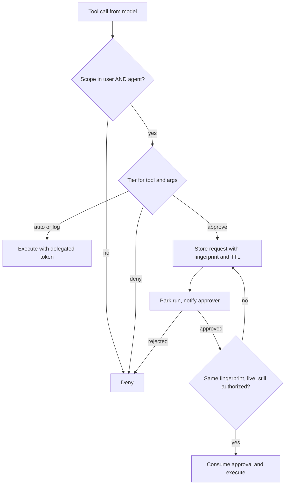

## TL;DR
Authorization asks "may this principal do this at all"; approval asks "must a human confirm this instance".
The runtime decides both at tool dispatch, outside the model's influence, using user-and-agent intersected
authority and approvals bound to exact arguments.

## For agent builders
- **Why it matters for agents.** Any text your agent reads (a ticket, a web page, a retrieved document) can
  steer its tool calls. The gate at dispatch is what stops an injected or hallucinated call from refunding
  money or emailing the wrong person, because the system prompt cannot.
- **Where it shows up in your stack.** The dispatcher in your agent runtime, LangGraph `interrupt()` before
  consequential tools, OAuth token exchange or on-behalf-of flows in tool adapters, and an approvals inbox
  or Slack/Teams card in the product.
- **What you control.** The tier table (auto, log, approve, deny), argument thresholds, the fingerprint and
  TTL on each approval, single-use consumption, and re-authorization when a parked run resumes.
- **What you can skip.** Designing a full policy language on day one. A reviewed tier table, delegated
  tokens and fingerprint-bound approvals cover most agents; generalise later.

## Decision case
### Scenario
An online retailer gives its 200 support reps a refund agent. Each rep drives runs from a ticket, and
the ticket text is written by the customer, so prompt injection is a live risk. All figures are
illustrative planning numbers.
- **Volume:** about 12,000 refunds a day: 90% at or under $50, 9% between $50 and $500, 1% above $500.
- **Compliance:** finance policy already requires a second person for any refund above $500 when a human
  issues it, so the agent must meet the same separation of duties.
- **Reviewers:** 6 finance reviewers with about 4 hours a day each for approvals (24 reviewer-hours).
- **Service level:** customers are promised a refund decision within 4 hours.
- **Observed timing:** a rep confirms in about 30 seconds; a finance review takes about 2 minutes, with a
  median wait of 45 minutes and a 95th percentile of 3 hours.

### Options
| Option | How it works | Injection | Separation of duties | Reviewer load per day | 4-hour promise |
|---|---|---|---|---|---|
| Approve every refund | every call parks for finance | stopped | met | 12,000 × 2 min = 400 h, far over 24 h | missed |
| Authorization only | intersected scopes; the payments service caps per-user totals; sample afterwards | an injected refund executes up to the cap | not met above $500 | none | met |
| Plan-level approval | the rep approves a plan of refunds at the start of a run | partly: deviations must re-trigger the gate | not met above $500 | none for finance | met |
| Tiered by amount | ≤ $50 `log`; $50-500 rep confirmation; > $500 independent finance approval, all fingerprint-bound | stopped above $50; capped below | met | 120 × 2 min = 4 h | met at the 95th percentile |

### Decision
**Tiered by amount, with intersected scopes underneath every tier.** It is the only option that meets
the compliance rule and the reviewer budget together.
- **Authorization first:** `payments:refund` must be in both the rep's delegated token and the agent's
  scopes, and the payments service enforces its own per-user daily cap on that token.
- **Rep confirmation for $50-500 (1,080 a day):** it defeats injection because the rep sees the real
  arguments and never typed the injected instruction; at 30 seconds each this is about 9 rep-hours a
  day, spread across 200 reps.
- **Finance approval above $500 (120 a day):** 4 reviewer-hours against 24 available, and the runtime
  rejects an approver who is also the requester.
- **TTL of 4 hours:** it covers the 3-hour 95th percentile and matches the customer promise; an expired
  request re-asks.
- **Re-authorize on resume:** scopes are re-read when a parked run continues, so an offboarded rep's run
  is denied.

**What would change it.**
- **Rep reject rate near zero after a month:** move the $50-500 band to `log` with sampling.
- **A rise in refund fraud by customers:** lower the finance threshold and re-run the load sum.
- **Background runs with no rep present:** use a tightly scoped workload identity and send the
  $50-500 band to finance.

### Trade-offs accepted
- **Small refunds can be injected.** A refund at or under $50 executes without a human; the per-user
  cap bounds the loss, and we sample `log`-tier refunds and alert on refunds whose ticket contains
  instructions.
- **Rep fatigue.** 1,080 confirmations a day can become a rubber stamp; we chart rep reject rate and
  time-to-confirm per rep.
- **Fresh approval on any change.** Exact fingerprints mean a corrected amount re-asks; we accept the
  extra prompts and count them.
- **Expired requests.** About 5% of finance approvals may exceed 3 hours; we track expiries as a share of
  requests and the refunds that missed the promise.

### Review rubric
- **Authorization and approval kept separate:** the write-up says who may refund at all before deciding
  who must confirm each refund.
- **Load is computed per option:** request counts times review minutes, compared with stated reviewer
  hours.
- **Each control is matched to the threat it defeats:** user confirmation for injection, independent
  approval for a single bad actor.
- **Approval mechanics are specified:** fingerprint, TTL derived from observed waits, single-use
  consumption and re-authorization on resume.
- **Residual risk is named and bounded:** what executes without a human and the cap that limits it.
- **Re-tier conditions are measurable:** reject rate, fraud rate or time-to-approve thresholds.

## Why it exists
- **Whoever influences the model influences the actions.** The user, a web page the agent read or a document
  in the retrieval index can all steer tool calls. A prompt-injected or hallucinated call carries exactly as
  much authority as a legitimate one, because model output is untrusted input.
- **Two questions are unavoidable per tool call.** Is the principal behind this run allowed to do this? And
  even if so, is this specific action consequential enough that a person should look first?
- **Rules in the system prompt fail three ways.** Instructions are advisory: a persuasive injection overrides
  them, at a rate no security review accepts. The model cannot verify permissions it cannot see, such as
  which records this user may read. And nothing is recorded, so there is no decision to audit, only a
  transcript.
- **A powerful service account creates the confused deputy.** A user who may not read a record asks the
  agent, which reads it with its own broad credential, bypassing the underlying system's access control.
  Agents more privileged than their drivers are the core of the "excessive agency" vulnerability class.
- **So the boundary lives in the runtime.** It is evaluated deterministically with the real principal's
  identity, and a human approval is a durable, argument-bound record, not a conversational "are you sure?".

## How it works
### Three principals, one effective authority
| Principal | What it is |
|---|---|
| **End user** | the person on whose behalf the run acts |
| **Agent** | a workload identity with its own allowed tool set |
| **Tool owner** | the service that will be called |

- **Effective authority is the intersection.** The action must be within the user's permissions *and*
  within the agent's delegated scope.
- **Intersect, never union,** because then the agent can never reach more than the user could. That is the
  design choice that prevents the confused deputy.
- **Implemented by delegation.** The runtime holds a user token or scopes from sign-in. At dispatch it
  exchanges them for a short-lived, down-scoped token for that tool: OAuth token exchange / on-behalf-of
  flows, or cloud role assumption with a session policy.
- **The tool enforces again (defence in depth).** The tool service checks its own authorization against the
  delegated identity, so even if the runtime's check is bypassed, the token cannot do more than the user
  could.

### Classifying actions
Authorization is binary per (principal, action, resource). Approval needs a richer classification, because
"allowed" and "safe to do unattended" differ. A workable tiering:

| Tier | Meaning | Examples |
|---|---|---|
| **auto** | read-only, idempotent, inside the tenant | search, fetch a record |
| **log** | writes that are reversible or low blast radius | create a draft, add a comment |
| **approve** | irreversible, external, financial or above a threshold | send email, refund, delete, merge, anything costing money beyond a cap |
| **deny** | never from an agent, regardless of user | drop tables, change IAM, disable logging |

- **Assign per tool, refine per argument.** A refund under a threshold may be `log`, above it `approve`.
- **Keep the table in configuration owned by security,** not in agent code or the prompt, because that makes
  it reviewable and changeable without redeploying agents.

### Approval as a durable, argument-bound state
When the gate returns `approve`, the runtime does not block. Instead:
1. **Write an approval request** with the run id, tool name, full arguments and a fingerprint (hash of the
   canonicalised call).
2. **Park the run** in `waiting_for_approval`.
3. **Notify an approver** through whatever channel the organisation uses. The approver sees the exact
   action, not the model's description of it, because descriptions can mislead while arguments are what
   will execute.

When the approval event arrives, the runtime resumes and re-checks before executing:
1. **Fingerprint matches.** The call about to dispatch hashes to the approved fingerprint, so the model
   cannot "adjust" arguments after approval.
2. **Not expired.** A TTL bounds how stale the human's context can be.
3. **Authorization still holds.** Permissions may have been revoked while the run was parked.
4. **Dispatch and consume in one write.** The approval is marked **consumed** in the same write that records
   the dispatch.

- **Why single use matters:** a fingerprint covers arguments, not occurrences. Without consumption, one
  approval of `refund(order=812, amount=400)` would also authorise an identical second refund later in the
  same run, which is exactly what a looping or injected agent produces.
- **Audit becomes a lookup.** The approval record, approver identity and final decision are appended to the
  run's log, so "who authorised this?" has a direct answer.

### Who approves, and through what channel
| Control | Who | Defeats | Does not defeat |
|---|---|---|---|
| **User confirmation** | the person driving the run | prompt injection: the user sees the real arguments and did not issue the injected instruction | a user who wants the harmful action |
| **Independent approval** | a manager, a finance reviewer | a single bad actor (separation of duties) | nothing extra on injection; the runtime must enforce approver ≠ requester |

- **Pick per tier.** Confirmation for "is this what you meant"; independent approval where the organisation
  would require it for a human doing the same thing.
- **The runtime renders the prompt.** It is built from the stored arguments and delivered through a channel
  the model cannot write to. If the model's chat output is the approval UI, an injection can print a fake
  "approved" or a misleading summary.

### Avoiding approval fatigue
A gate that asks too often trains approvers to click yes, which is worse than no gate. Mitigations that keep
the control:
- **Approve a plan up front:** a bounded set of actions and arguments, rather than each step.
- **Batch low-risk approvals.**
- **Scoped, time-boxed allowances:** "always allow this tool with these constraints for this session".
- **Track approval rate and median time-to-approve,** so you notice when the gate has become a rubber stamp.

## Diagram
Every call passes the intersection check first; only approve-tier calls park, and a resumed call executes
only if its fingerprint, TTL and authorization all still hold.



## Examples
### Dispatch-time gate with fingerprint-bound approvals
It computes effective authority as an intersection, tiers the action, and treats approvals as
fingerprint-bound records with a TTL. The policy table would normally be loaded from configuration; it is
inlined here to keep the mechanics visible.

```python
import hashlib, json, time

TOOL_SCOPES = {"search_docs": {"docs:read"}, "create_ticket": {"tickets:write"},
               "refund_payment": {"payments:refund"}, "drop_table": {"db:admin"}}
TIER = {"search_docs": "auto", "create_ticket": "log", "refund_payment": "approve", "drop_table": "deny"}

def fingerprint(call):                       # canonical bytes -> same args always hash the same
    return hashlib.sha256(json.dumps(call, sort_keys=True, separators=(",", ":")).encode()).hexdigest()

def tier_for(call):
    t = TIER.get(call["name"], "approve")    # unknown tools default to the safe side
    if call["name"] == "refund_payment" and call["args"].get("amount", 0) <= 50:
        t = "log"                            # argument-level refinement
    return t

def gate(run, call, approvals):
    need = TOOL_SCOPES.get(call["name"], {"__unknown__"})
    if not (need <= run.user_scopes and need <= run.agent_scopes):
        return ("deny", "outside effective authority (user ∩ agent)")
    tier = tier_for(call)
    if tier == "deny":
        return ("deny", "action never permitted from an agent")
    if tier in ("auto", "log"):
        return ("allow", tier)
    fp = fingerprint(call)
    rec = approvals.get(run.id, fp)          # keyed by run AND fingerprint, ignores consumed records
    live = rec is not None and rec["expires_at"] > time.time()
    if rec and rec["decision"] == "rejected":
        return ("deny", f"rejected by {rec['approver']}")
    if live and rec["decision"] == "approved":
        approvals.consume(rec)               # single use: an identical second call asks again
        return ("allow", f"approved by {rec['approver']}")
    if live and rec["decision"] == "pending":
        return ("wait", fp)                  # already asked; do not spam approvers with duplicates
    approvals.create(run.id, fp, call, ttl_s=4 * 3600)   # new or expired: park the run, a human decides
    return ("wait", fp)
# run.user_scopes is re-read from the identity provider when a parked run resumes, so the first check
# above is also the re-authorization; a cached copy from run start would let a revoked user's run finish.
```

### Worked trace: three refunds in one support run
| Call | Gate result | Why |
|---|---|---|
| `refund_payment(order=812, amount=30)` | allow (`log`) | passes the scope check; at or under the threshold, so it executes |
| `refund_payment(order=812, amount=400)` | wait | tiers to `approve`; no record exists, so a request with a 4-hour TTL is created and the run parks |
| same call, after approval | allow | the approver saw amount 400 and order 812; the same canonical call hashes to the same `fp`, the record is live and approved, so it is consumed and the refund executes |
| identical call again | wait | `get` finds no unconsumed record, so a new approval is required |
| `amount=4000` swapped in after approval | wait | the hash differs, so the run simply parks again |

### Runnable harness for the gate
Paste below the gate above and run it: an in-memory approvals table reproduces the trace, including the
consumed approval and the user who lacks `tickets:write`.

```python
from types import SimpleNamespace

class Approvals:                             # in-memory stand-in for the approvals table
    def __init__(self): self.rows = []
    def create(self, run_id, fp, call, ttl_s):
        self.rows.append({"run": run_id, "fp": fp, "call": call, "decision": "pending",
                          "approver": None, "expires_at": time.time() + ttl_s, "consumed": False})
    def get(self, run_id, fp):
        live = [r for r in self.rows if r["run"] == run_id and r["fp"] == fp and not r["consumed"]]
        return live[-1] if live else None
    def consume(self, rec): rec["consumed"] = True
    def decide(self, run_id, fp, decision, approver):     # what the approvals inbox calls
        rec = self.get(run_id, fp); rec["decision"], rec["approver"] = decision, approver

run = SimpleNamespace(id="run_7", user_scopes={"payments:refund", "docs:read"},
                      agent_scopes={"payments:refund", "docs:read", "tickets:write"})
ap = Approvals()
small = {"name": "refund_payment", "args": {"order": 812, "amount": 30}}
big = {"name": "refund_payment", "args": {"order": 812, "amount": 400}}
print(gate(run, small, ap))                              # ('allow', 'log')
effect, fp = gate(run, big, ap); print(effect)           # wait
ap.decide("run_7", fp, "approved", "maya")
print(gate(run, big, ap))                                # ('allow', 'approved by maya')
print(gate(run, big, ap)[0])                             # wait: approval was consumed
swapped = {"name": "refund_payment", "args": {"order": 812, "amount": 4000}}
print(gate(run, swapped, ap)[1] == fp)                   # False: different fingerprint
print(gate(run, {"name": "create_ticket", "args": {}}, ap))  # deny: user lacks tickets:write
```

## Production patterns
- **Down-scoped token per tool call** — when a user is present. Exchange the user's token at dispatch using
  OAuth 2.0 Token Exchange (RFC 8693, `grant_type=urn:ietf:params:oauth:grant-type:token-exchange` with the
  tool as audience) or an on-behalf-of flow; on AWS, assume a role with a session policy. Monitor token
  lifetimes and calls made without a user subject.
- **Tier table as reviewed configuration** — when more than one team ships tools. Keep tiers and thresholds
  in a policy file or policy engine owned by security, require their review on changes (for example via a
  CODEOWNERS entry), and fail closed on unknown tools. Monitor tools with no tier assigned.
- **Atomic single-use consumption** — whenever approvals gate money or external sends. Consume with a
  conditional write such as `UPDATE approvals SET consumed_at = now() WHERE id = $1 AND consumed_at IS
  NULL` and dispatch only if one row changed. Monitor duplicate-consume attempts.
- **Runtime-rendered approval cards** — when approvals happen in chat tools. Render the card in a Slack or
  Teams message from the stored arguments with approve and reject buttons, never from model text, and
  verify the clicker is not the requester for independent approvals. Monitor approver-equals-requester
  rejections.
- **Fatigue dashboard** — once the gate is live. Chart approval rate, reject rate and median time-to-approve
  per tool; a reject rate near zero means re-tier the tool, and time-to-approve sets the TTL. Monitor
  expired approvals as a share of requests.

## Trade-offs
- **Intersected scopes vs simple service identity.** You gain least privilege and clean audit attribution,
  but need per-user delegated tokens. For background agents with no user present, fall back to a tightly
  scoped workload identity and tier more actions as `approve`.
- **Exact-fingerprint approvals vs flexibility.** They defeat argument-swapping after approval, but any
  benign retry with different arguments needs a fresh approval. Loosen to a constrained intent (recipient
  fixed, body free) only where you can express the constraint in policy.
- **Runtime-only vs defence in depth.** Enforcing only at the runtime is simpler than also enforcing at each
  tool service, but a single bypass is then total. Defence in depth costs token plumbing and buys survival
  of your own bugs.
- **Plan-level vs per-step approval.** Plan-level cuts prompts dramatically and keeps humans engaged, but the
  agent may legitimately need to deviate, and every deviation outside the approved set must re-trigger the
  gate.
- **Short vs long approval TTLs.** Short TTLs keep the human's context fresh, yet in asynchronous
  organisations they expire before anyone looks. Pick the TTL from observed time-to-approve, not from a
  security wish.

## Pitfalls
- **Delegating the approval question to the model** ("ask the user before sending"). Symptom: a red-team
  injection gets the action executed with a polite confirmation message the user never saw. Fix: the gate
  decides, and the runtime renders the confirmation.
- **Approving by description rather than by arguments.** Symptom: an audit log where the executed call
  differs from what the approver believed they approved. Fix: show stored arguments and bind a fingerprint.
- **Running the agent under a broad service account.** Symptom: users retrieve through the agent records
  they cannot open directly, found during a security review or worse. Fix: delegated, intersected tokens.
- **Approvals without a TTL or run binding.** Symptom: an approval granted on Monday executes a different
  run's call on Friday after the business context changed. Fix: key by run and fingerprint, with expiry.
- **Resuming after approval without re-authorizing.** Symptom: a revoked user's parked runs still complete
  their actions hours after offboarding. Fix: re-read scopes from the identity provider on resume.
- **Approvals that are not consumed on use.** Symptom: one approved refund appears two or three times in the
  payment ledger when the agent retried or looped with identical arguments. Fix: consume atomically.
- **Unknown tools defaulting to `allow`.** Symptom: a newly added tool executes consequential actions before
  anyone classified it. Fix: default unknown tools to `approve` or deny.

## When to use
- **Use authorization from day one** for every agent that can perform a write.
- **Add approval** the moment an action is irreversible, external, financial or outside the tenant.
- **Avoid gating everything.** Measure the approval rate per tool, the reject rate (near zero means the gate
  is theatre or the tier is wrong) and time-to-approve, and move tools between tiers on evidence.
- **Day to day** this is a tier table in configuration, delegated tokens in tool adapters and an approvals
  inbox in the product.
- **Interviews:** expect "where does the check live and why not in the prompt", "how do you prevent the
  confused deputy" and "what exactly is the approver approving". The strong answer names the fingerprint,
  the TTL and re-authorization on resume.

## Role lens
- **Engineer:** Implements the gate in the dispatcher, canonicalises and hashes calls, and writes tests
  where an injected tool call must park or deny rather than execute.
- **Architect:** Owns the tier taxonomy, the delegation model (user token exchange versus workload
  identity) and the rule that tool services independently enforce authorization.
- **FDE:** Maps tiers onto the customer's change-management and SoD rules, wires approvals into their
  ticketing or chat tooling, and tunes TTLs to how fast their approvers actually respond.

## Check yourself
**Q:** A support agent can issue refunds. Security asks: how do you guarantee a prompt-injected ticket
cannot cause a large refund, without making agents unusable for the thousands of small, legitimate refunds
per day? Describe the boundary you would build.
**A:** First, authorization: the refund tool requires a `payments:refund` scope that must be present in both
the support user's delegated token and the agent's allowed scopes, so a run for a user without refund rights
denies regardless of what the model asks. Second, approval tiering by argument: refunds at or below a
threshold are `log` (executed, recorded, sampled for review), above it `approve`. An approve-tier call parks
the run with a fingerprint of the exact arguments, a human sees amount and recipient, and on resume the
runtime verifies the fingerprint, the TTL and that authorization still holds. Third, defence in depth: the
payments service enforces the per-user limit itself on the delegated token, so a bug in the gate cannot
exceed it. Finally, I would monitor approval and reject rates to keep the threshold honest.

## Interview questions
### What is the difference between authorization and approval for an agent's tool call?
- **Authorization** is a deterministic yes or no per principal, action and resource: may this user, through
  this agent, do this at all.
- **Approval** is a per-instance human check on an already-authorized action that is irreversible,
  external or financial, bound to the exact arguments.
- **Both live at dispatch** in the runtime, because model output is untrusted and prompts are advisory.

### Users are reading records through the agent that they cannot open directly. How do you debug and fix it?
- **Diagnosis:** the agent is a confused deputy, calling the records service with its own broad service
  account, so the service's access control sees the agent rather than the user.
- **Fix:** compute effective authority as user intersected with agent scopes, and exchange the user's token
  for a short-lived, down-scoped token per tool call so the records service enforces per-user rules itself.

### Why bind an approval to an argument fingerprint, and when would you loosen that?
- **Bind** because descriptions can mislead and the model could change the recipient or amount after the
  human said yes; a hash of the canonicalised call makes any change park the run again.
- **Loosen** to a constrained intent (recipient fixed, body free) only where policy can express the
  constraint, accepting that benign retries otherwise need a fresh approval.

### Approvers now approve 99 percent of requests within seconds. Is the gate working?
- **Probably not:** a near-zero reject rate with instant approvals signals fatigue, meaning the gate has
  become a rubber stamp that trains approvers to click yes.
- **Response:** re-tier low-risk tools to `log`, approve plans instead of steps, batch low-risk items, and
  keep human attention for the calls that are actually consequential.

### Who should approve: the user driving the run or an independent reviewer?
- **User confirmation** defeats prompt injection, because the user sees the real arguments and never issued
  the injected instruction, but it does nothing against a user who wants the harmful action.
- **Independent approval** adds separation of duties for actions the organisation would require a second
  person for, and the runtime must enforce that approver and requester differ.

## Quiz
### Q: Why should an agent's effective authority be the intersection of the user's permissions and the agent's scopes, rather than the agent's scopes alone?
- [ ] Intersection reduces the number of tokens spent describing tools to the model
- [x] It prevents the confused-deputy problem where users reach data through the agent that they could not access directly
- [ ] Agent scopes are stored in the prompt and cannot be trusted
- [ ] Union would require a separate OAuth client per tool
> If the agent acts with only its own, typically broad, authority, it becomes a privileged proxy that
> launders access for whoever drives it. Intersecting with the user's rights means the agent can never do
> more than the person could, which is the defining property of a safe deputy.

### Q: An approver confirms "send the summary to the customer". The model then calls the email tool with a different recipient. Which mechanism stops the send?
- [ ] A system prompt instruction to use only approved recipients
- [ ] Rate limiting the email tool to one call per run
- [x] The runtime compares the fingerprint of the call about to execute with the fingerprint that was approved
- [ ] Requiring the approver to be an administrator
> Binding the approval to a hash of the canonicalised arguments makes it specific to that recipient and
> body; any change produces a different fingerprint and the call parks again. Prompt instructions and rate
> limits do not constrain which arguments execute.

### Q: A run parked for approval is resumed three days later. What should the runtime do before dispatching the approved call?
- [ ] Dispatch immediately, since the approval was already granted
- [ ] Ask the model to re-plan and generate a new tool call
- [x] Check the approval has not expired and re-evaluate authorization for the current principal
- [ ] Downgrade the action to the `log` tier because a human already saw it
> Approvals carry a TTL because the human's context goes stale, and permissions can be revoked while a run
> is parked. Re-checking both keeps a long-parked run from executing an action nobody would authorise today.

## Use cases & projects
### Use cases
- **Support agents with refund tools.** Small refunds run as `log`, large ones park for an
  argument-bound approval, and the payments service still enforces per-user limits.
- **Email and outreach agents.** Every external send is `approve`-tier, the card shows the real recipient
  and body, and a changed recipient forces a fresh approval.
- **Internal data assistants.** Delegated, intersected tokens stop users from reading records through the
  agent that they cannot open directly.
- **DevOps and coding agents.** Merges and deploys need approval while destructive admin actions (drop
  tables, change IAM, disable logging) are `deny` regardless of the user.

### Mini project
**Gate a refund agent against prompt injection (2-3 hours).**
- **Goal:** show that an injected ticket cannot trigger a large refund while small refunds stay automatic.
- **Steps:** build a tool-calling agent with `search_docs`, `create_ticket` and `refund_payment`; put the
  gate and approvals table from the examples in the dispatcher; plant a ticket telling the agent to
  refund 4000; add a command-line approvals inbox that renders stored arguments; test a revoked user
  resuming a parked run.
- **Done when:** the injected refund parks and is rejected, a refund of 30 executes as `log`, an approved
  refund executes once and an identical repeat parks again, and the revoked user's run is denied on resume.
