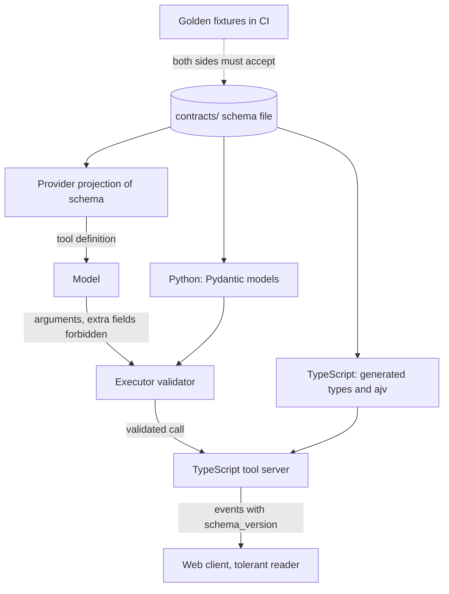

## TL;DR
Agent systems are polyglot, and the model itself reads your tool schemas. A contract is one
machine-readable schema every side generates types and runtime validators from, with explicit rules for
JSON's ambiguities (int64, dates, null vs absent, enums) and for safe evolution.

## For agent builders
- **Why it matters for agents.** Your tool definition is a contract the model reads, the executor validates
  and the tool server compiles against. When they drift, tool-call success drops with "invalid arguments"
  errors on calls that look correct, and no single code change is to blame.
- **Where it shows up in your stack.** Tool `input_schema` sent to the provider, Pydantic or Zod models,
  MCP server schemas, the step event stream to your UI, run checkpoints, and gRPC between executor and
  tool workers.
- **What you control.** One `contracts/` source of truth, `extra="forbid"` on model-supplied arguments and
  tolerant readers on events, a per-provider strict-mode projection, `schema_version` on events and
  checkpoints, and a generate-and-diff CI step.
- **What you can skip.** Choosing a neutral IDL on day one. Start with JSON Schema emitted from your primary
  language's models and promote when a third consumer appears.

## Decision case
### Scenario
An agent product has a Python executor using Pydantic, TypeScript tool servers and web UI using Zod,
and 35 tools offered to two model providers. A Go billing worker joins in 3 months. All figures are
illustrative planning numbers.
- **The incident:** after a field rename, the tool-argument rejection rate rose from 1% to 6% of about
  200,000 tool calls a day, from 2,000 to 12,000 failed calls, so 10,000 extra retries a day.
- **Traffic:** the step event stream peaks at about 400 events a second of roughly 1 KB each, about
  400 KB a second, so wire size is not a constraint.
- **Hard constraints:** model-facing schemas must be JSON Schema with a projection per provider; the
  browser reads JSON; checkpoints written today must load after next month's deploys.
- **Team:** 6 engineers, mostly Python; one owns the TypeScript side; nobody owns Go yet.
- **Deadline:** stop the drift within 4 weeks, before the Go worker starts.

### Options
| Option | How it works | Stops drift | Fits the model edge | Ready for Go | Effort |
|---|---|---|---|---|---|
| Hand-written types (today) | each language keeps its own models | no: this caused the incident | by hand | another copy to drift | none now, recurring later |
| Pydantic first | Python models emit JSON Schema; TypeScript types generated from it | yes, for two languages | yes | Python becomes the owner Go must follow | low |
| Neutral JSON Schema in `contracts/` | schemas are the source; Pydantic, TypeScript and Go types generated; per-provider projections from the same files | yes, for all three | yes: the schema the model sees comes from the same file | yes | moderate |
| Protobuf everywhere | `.proto` files with gRPC between services; converted to JSON Schema for models and browser | yes, with `buf breaking` | needs a conversion step | yes | highest, and buys wire efficiency we do not need |

### Decision
**A neutral JSON Schema source in `contracts/`, generating Pydantic, TypeScript and Go types, with a
per-provider projection and a generate-and-diff step in CI.**
- **It closes the incident's cause:** the schema the model sees, the executor's validator and the tool
  server's types all derive from one file, so a rename fails CI instead of production.
- **It matches the model edge:** tool definitions already are JSON Schema, so there is no conversion step.
- **The third consumer is already scheduled:** with Go 3 months away, the lesson's rule to promote on the
  third consumer applies now, not after another migration.
- **Protobuf loses on need:** about 400 KB a second needs no binary encoding, and both edges would need
  conversion back to JSON Schema.
- **Rules travel with it:** ids as strings, offset-aware datetimes, `extra="forbid"` on model arguments,
  tolerant readers with `schema_version` on events and checkpoints.

**What would change it.**
- **The Go worker is cancelled:** Pydantic first is enough for two languages.
- **Internal RPC grows to tens of thousands of messages a second,** or needs streaming RPC: move the
  executor-to-worker hop to Protobuf and keep JSON Schema at the model and browser edges.
- **External customers consume the events:** add consumer-driven contract tests.

### Trade-offs accepted
- **Verbose schemas.** JSON Schema is harder to read than Pydantic; we keep schemas small per surface and
  review them like code.
- **Generator quirks per language.** Generated Go and TypeScript can differ on optional and nullable
  fields; we pin generator versions and run the same golden fixtures in all three CIs.
- **Weak evolution discipline.** JSON Schema has no built-in breaking-change check; additive-only rules
  and `schema_version` are enforced in review, and we chart runtime validation failures per boundary.
- **CI friction.** An uncommitted regeneration fails the build; we accept it as drift caught early and
  count those failures.

### Review rubric
- **Every contract surface is listed:** tool arguments and results, events, checkpoints, internal RPC and
  run context, each with its consumers.
- **The model is treated as a consumer:** a per-provider projection is planned and tested from the same
  fixtures.
- **The choice follows from stated constraints:** language count, timeline and traffic, with the traffic
  number used to accept or reject Protobuf.
- **Representation rules are explicit:** int64, datetimes, null versus absent, enums and unknown fields.
- **Evolution is planned:** versioning, a migration for stored checkpoints and a CI check that catches
  drift.
- **A production signal is named:** tool-argument rejection rate per tool, provider and schema version.

## Why it exists
- **Every arrow is a contract, written down or not.** Python sends the model a tool definition as JSON
  Schema; the model returns arguments; a TypeScript tool server runs them; the result flows into the step
  log and out over a server-sent event stream to a web client. The run's checkpoint must be readable by next
  week's deploy.
- **Hand-maintained types drift silently.** Python renames `due_date` to `due_at`; the TypeScript tool still
  reads `due_date` and gets `undefined`. The model's schema allows `priority: "urgent"` but the validator only
  knows `low|high`, so legal calls fail at dispatch and tool-call success degrades with no code path to
  blame.
- **JSON hides representation bugs.** A Python `int` id above 2^53 arrives in JavaScript rounded. A naive
  `datetime` serialises without an offset and shifts by hours in another service. A new event type appears
  on the stream and an old client throws.
- **"JSON is self-describing, we'll be careful" fails** like untyped code at scale: there is no compiler
  across the boundary. TypeScript types vanish at runtime, Python hints are not enforced, and the model is a
  third participant that follows whatever schema it was shown.
- **Only a shared schema closes the gap:** generated into every language and validated at runtime on both
  sides.

## How it works
### One source of truth, generated everywhere
Choose one schema language and generate the rest:

| Option | Strength | Cost |
|---|---|---|
| **JSON Schema**, directly or via **OpenAPI** for HTTP | tool definitions sent to models *are* JSON Schema, so one document drives the model, the executor's validator and the TypeScript types | verbose, weak evolution discipline |
| **Protocol Buffers** with gRPC | binary, compact, strict and well-documented evolution rules; ideal for high-volume internal RPC (executor to tool workers, event fan-out) | converted to JSON Schema at the edge where the model or browser needs it |
| **Language-native first** (Pydantic or Zod emitting JSON Schema) | ergonomic for two-language teams | quietly makes one language the owner, fine as long as everyone knows which |

- **The rule is the same whichever you pick:** the tool schema the model sees, the validator the executor
  runs and the type the tool server compiles against all derive from one file in one repository.
- **CI enforces it** by regenerating and failing on diff.

### The contract surfaces in an agent runtime
Name them explicitly, because each has a different consumer and evolution pace:
- **Tool definitions:** name, argument schema, result schema, error shape.
- **Step event stream:** a discriminated union on `type`, versioned.
- **Run state and checkpoints:** versioned, because old checkpoints must load after a deploy.
- **Internal RPC** between loop and workers.
- **Run context** that policy relies on.

MCP is itself an example: a JSON-RPC contract with a published schema that lets Python and TypeScript
servers and clients interoperate without sharing code.

### Representation rules JSON does not give you
| Ambiguity | Rule | Because |
|---|---|---|
| **64-bit integers** | serialise ids and large counts as strings | JavaScript numbers are exact only to 2^53 − 1; Protobuf's JSON mapping does this for `int64` by default for the same reason |
| **Dates and times** | ISO 8601 with an explicit offset, always; reject naive datetimes at the producer | a naive value shifts by the reader's offset |
| **Null vs absent** | decide per field and encode it in the schema; usually omit absent fields and forbid `null` unless it means "clear this value" | Python `None`, TypeScript `undefined` and JSON `null` are three things |
| **Enums** | strings with a known set; consumers map unknown values to a fallback rather than throw | closed enums break the moment a producer adds a value |
| **Floats** | serialise with `allow_nan=False` and decide on `null` or an error; money is integer minor units or a decimal string | `NaN` and `Infinity` are not JSON, yet Python's `json.dumps` emits them by default and JavaScript's `JSON.parse` rejects the whole document |
| **Bytes** | base64 in a string field, encoding stated in the schema description | JSON has no bytes type |
| **Unknown fields** | service-to-service consumers ignore them (tolerant reader); model-to-executor arguments *forbid* them | producers can add fields, but an extra field from a model is a hallucination, not an upgrade |

### The model is a consumer with its own dialect
- **The model-facing schema is not always the validator's schema.** Providers that constrain generation to
  a schema (strict tool calling, structured outputs) typically support only a vendor-specific subset of
  JSON Schema.
- **Typical restrictions:** every property listed as required with nullability in the type; required
  `additionalProperties: false`; keywords such as `format`, `maxLength` or `$ref` ignored or rejected.
- **So generate a projection per provider,** keep the full contract for the executor's validator, and test
  both from the same fixtures.
- **Otherwise two failures appear:** the model is shown constraints it does not enforce (a 200-char limit it
  ignores) and the executor rejects the result, or a provider switch silently changes which constraints are
  enforced during generation.

### Evolution without breaking anyone
1. **Additive changes only** in a version: new optional fields, new event types old consumers can skip, new
   enum values with a fallback.
2. **Breaking changes get a new version:** renames, type changes, new required fields. Signal it with a
   `schema_version` field on events and stored state, or a new endpoint.
3. **Never reuse a name or Protobuf field number** with a different meaning.
4. **Keep the old version readable** for as long as a checkpoint or client of that version can exist.
5. **Write the migration when you introduce the version,** not when the first old checkpoint fails to load.

### Validate at runtime on both sides, and test the contract
- **Compile-time types catch programmer errors; only runtime validation catches drift and model output.**
- **Validators on both sides:** Pydantic in Python, Zod or ajv in TypeScript, both generated from the same
  schema.
- **Test the contract itself:** a directory of golden JSON fixtures both CI pipelines must accept, or
  consumer-driven contract tests where each consumer publishes what it relies on and the producer's CI
  verifies it still holds.

## Diagram
One contract file feeds all three consumers; note that the model gets a provider-specific projection while
the executor validates against the full contract.



## Examples
### Pydantic as the source of truth
The same definition yields the tool specification sent to the model, the executor's runtime validator and a
JSON Schema file consumed by the TypeScript side (types via a generator, runtime checks via ajv). Note the
representation rules baked into the fields.

```python
import json
from datetime import datetime
from enum import Enum
from typing import Annotated, Literal, Union
from pydantic import BaseModel, ConfigDict, Field, TypeAdapter, field_validator

class Priority(str, Enum):
    low = "low"; high = "high"

class CreateTicketArgs(BaseModel):
    model_config = ConfigDict(extra="forbid")        # model -> executor: unknown fields are hallucinations
    title: str = Field(max_length=200)
    priority: Priority = Priority.low
    due_at: datetime | None = None                   # ISO 8601 with offset on the wire
    account_id: str                                  # ids are strings: JS numbers are exact only to 2^53-1

    @field_validator("due_at")
    @classmethod
    def must_have_tz(cls, v):
        if v is not None and v.tzinfo is None:
            raise ValueError("due_at must carry a UTC offset")
        return v

class ToolCallEvent(BaseModel):
    model_config = ConfigDict(extra="ignore")        # service -> service: tolerant reader
    type: Literal["tool_call"]; schema_version: Literal[2] = 2
    run_id: str; call_id: str; name: str; args: dict

class ToolResultEvent(BaseModel):
    model_config = ConfigDict(extra="ignore")
    type: Literal["tool_result"]; schema_version: Literal[2] = 2
    run_id: str; call_id: str; ok: bool
    output: dict | None = None; error_code: str | None = None

_Event = TypeAdapter(Annotated[Union[ToolCallEvent, ToolResultEvent], Field(discriminator="type")])
KNOWN = {"tool_call", "tool_result"}

def parse_event(raw: dict):
    if raw.get("type") not in KNOWN:
        return None                                  # new event type from a newer producer: skip, don't crash
    return _Event.validate_python(raw)

# One definition, three consumers.
tool_spec = {"name": "create_ticket", "input_schema": CreateTicketArgs.model_json_schema()}  # to the model
with open("contracts/agent.schema.json", "w") as f:                                          # to TypeScript
    json.dump({"CreateTicketArgs": CreateTicketArgs.model_json_schema(),
               "ToolResultEvent": ToolResultEvent.model_json_schema()}, f, indent=2)
args = CreateTicketArgs.model_validate({"title": "Renewal", "account_id": "9007199254740993"})  # executor
evt = parse_event({"type": "tool_result", "run_id": "r1", "call_id": "c1", "ok": True, "cost_usd": 0.01})
assert parse_event({"type": "approval_requested", "run_id": "r1"}) is None
# TS side: generate types from contracts/agent.schema.json and validate the same file with ajv in CI.
```

### Worked scenario: what each line defends against
| Input | Without the rule | With the rule |
|---|---|---|
| `account_id` is `"9007199254740993"` (2^53 + 1) | as a number, `JSON.parse` in the TypeScript server returns 9007199254740992 and the ticket attaches to the neighbouring account | the string survives exactly |
| model adds `"assignee": "bob"` to `create_ticket` | the hallucinated field reaches the tool | rejected by `extra="forbid"` |
| `tool_result` event carries `cost_usd` from a newer producer | a strict reader fails | validates, because events ignore extras |
| `approval_requested` event this consumer has never heard of | the stream reader crashes | skipped |
| `due_at` of `2026-11-03T09:00:00` without an offset | a five-hour shift in a browser in another timezone | fails at the producer, where the bug is |

### Runnable: JSON's ambiguities in four prints
Pure standard-library Python. Python's `float` is the same IEEE-754 double as a JavaScript number, so it
reproduces the TypeScript rounding.

```python
import json
from datetime import datetime, timezone

# 1. int64: a JS number is an IEEE-754 double; Python's float is the same type
account_id = 2**53 + 1
print(account_id, int(float(account_id)))          # 9007199254740993 9007199254740992

# 2. NaN: Python emits it by default, but it is not JSON
print(json.dumps({"score": float("nan")}))         # {"score": NaN}  <- JSON.parse rejects this
try:
    json.dumps({"score": float("nan")}, allow_nan=False)
except ValueError as e:
    print("refused:", e)

# 3. naive vs aware datetimes
print(datetime(2026, 11, 3, 9).isoformat())                       # 2026-11-03T09:00:00 (no offset)
print(datetime(2026, 11, 3, 9, tzinfo=timezone.utc).isoformat())  # 2026-11-03T09:00:00+00:00

# 4. null vs absent: two wire forms that parse to the same Python value
for wire in ('{"title": "a"}', '{"title": "a", "due_at": null}'):
    d = json.loads(wire)
    print("due_at" in d, d.get("due_at"))          # False None / True None: same value, different meaning
```

## Production patterns
- **Generate and diff in CI** — whenever two languages share a contract. Regenerate TypeScript types (for
  example with json-schema-to-typescript) and any Python models (for example with datamodel-code-generator)
  from `contracts/`, then run `git diff --exit-code` so an uncommitted regeneration fails the build. Monitor
  contract CI failures as drift caught early.
- **Breaking-change detection for Protobuf** — when internal RPC uses gRPC. Run `buf breaking` against the
  main branch on every pull request, and mark removed field numbers and names as `reserved` so they are never
  reused. Monitor overridden breaking-change checks.
- **Golden fixtures in both pipelines** — for tool arguments and events. Keep valid and invalid JSON examples
  in `contracts/fixtures/`, validated by Pydantic in Python CI and ajv in TypeScript CI, with each rule from
  the representation table covered. Monitor fixtures added per schema change.
- **Consumer-driven contracts** — when another team or customer consumes your events. Use a tool such as
  Pact so each consumer publishes the fields it relies on and the producer's CI verifies them before deploy.
  Monitor verification failures by consumer.
- **Per-provider schema projection** — when you call more than one model provider. Write one projection
  function per provider (for example, strict modes that require every property in `required` and
  `additionalProperties: false`) and test it from the same fixtures. Monitor argument rejection rate per
  tool, provider and schema version.

## Trade-offs
- **JSON Schema/OpenAPI vs Protobuf/gRPC.** JSON Schema is universal, readable and identical to what models
  consume, but verbose on the wire and weak on evolution discipline. Protobuf wins for high-volume internal
  RPC and loses at the model and browser edge, where you convert anyway.
- **Language-native-first vs neutral IDL.** Pydantic or Zod schemas are fastest to write and keep in sync
  for a two-language team, but make one language the owner. Move to a neutral IDL when a third language or
  an external consumer appears.
- **Strict vs tolerant validation.** `extra="forbid"` on model-supplied arguments catches hallucinated fields
  immediately, while the same setting on service events breaks every additive change. Strictness has to
  match who the producer is.
- **Codegen pipeline vs hand-written types.** CI diff checks cost setup time and occasional friction, but
  they are the only thing that keeps three codebases and a model agreeing after the tenth change.
- **Versioning everything vs YAGNI.** A version field on every event and checkpoint adds migration code you
  may never need, yet the first time an old checkpoint must load after a schema change you will not have
  time to add it.

## Pitfalls
- **Serialising 64-bit ids as JSON numbers.** Symptom: a TypeScript client looks up the wrong record by one
  or two, only for ids above 2^53. Fix: ids as strings.
- **Emitting naive datetimes.** Symptom: due dates shift by the producer's UTC offset when read in another
  service or displayed in the browser. Fix: reject naive values at the producer.
- **Adding a required field to an event or result.** Symptom: old consumers fail validation the moment the
  producer deploys, with no code change on their side. Fix: optional with a default, or a new version.
- **Letting the model's tool schema and the executor's validator diverge.** Symptom: a falling tool-call
  success rate with "invalid arguments" errors on calls that match the schema the model was shown. Fix: derive
  both from one contract.
- **Sending the full contract schema to a provider whose strict mode supports only a subset.** Symptom: tool
  definitions rejected at request time, or `maxLength` silently unenforced during generation and then failing
  in the executor's validator. Fix: per-provider projection.
- **Closed enums on the consumer.** Symptom: a crash on the first new status value, usually at night. Fix:
  map unknown values to a fallback.
- **Treating `null` and missing as interchangeable on one side only.** Symptom: validation errors or values
  silently cleared when a field round-trips through the other language. Fix: define it per field in the
  schema.

## When to use
- **Use a written contract** the moment two languages, or one language and a model, exchange structured data;
  retrofitting after drift is far more expensive.
- **Start** with JSON Schema derived from your primary language's models, and promote to a neutral IDL when a
  third consumer arrives.
- **Measure:** contract CI failures (good: drift caught early), runtime validation failures per boundary in
  production (bad: drift that escaped), and tool-call argument rejection rate as the agent-specific signal.
- **Day to day:** a `contracts/` directory, a generate-and-diff step in CI, and validators at every ingress.
- **Interviews:** expect the JSON ambiguities (int64, dates, null versus absent, enums) and evolution rules;
  a strong answer also notes that the model is a consumer of the contract too.

## Role lens
- **Engineer:** Defines schemas once, wires codegen into CI, puts runtime validation at every ingress, and
  fixes the int64 and timezone issues before they reach production.
- **Architect:** Picks the schema language per surface, sets the evolution policy and versioning scheme,
  and decides which language owns which contract.
- **FDE:** Negotiates contracts with the customer's integration teams, often in Java or .NET, and uses golden
  fixtures to prove interoperability before either side deploys.

## Check yourself
**Q:** A Python agent service and a TypeScript tool server share hand-written types. After a release, the
agent's tool-call success rate drops 15% with "invalid arguments" errors, although the model's calls look
correct. Diagnose and fix structurally.
**A:** The likely cause is drift between the schema shown to the model and the validator on the tool server:
the Python side changed an enum or a field name and regenerated the model-facing schema, but the TypeScript
validator kept the old shape, so legal calls are rejected. I would confirm by diffing the schema in the tool
definition against the server's validator on a failing call. The structural fix is a single contract: one
schema file in a `contracts/` directory, the model's tool definition and Pydantic validator derived from it
in Python, TypeScript types and an ajv validator generated from the same file, and a CI step that fails on
any uncommitted regeneration diff. Add golden fixtures both sides must accept, forbid extra fields on
model-supplied arguments, make enums tolerant on consumers, and alert on argument rejection rate so the next
drift is caught in minutes.

## Interview questions
### Why do agent systems need explicit cross-language contracts more than ordinary microservices?
- **The model is a third consumer:** it follows whatever JSON Schema it was shown, so the tool definition,
  the executor's validator and the tool server's types must all agree or legal calls fail at dispatch.
- **Long-lived state crosses deploys:** checkpoints and event streams written today must be readable by next
  week's code, so versioning is part of the contract, not an afterthought.

### A TypeScript service occasionally attaches records to the wrong account. Where would you look first?
- **64-bit ids sent as JSON numbers:** values above 2^53 lose precision in `JSON.parse` without an error, so
  an id can land on its neighbour.
- **Fix:** serialise ids as strings in the contract, add a golden fixture with an id above 2^53, and
  validate it in both pipelines so the regression cannot return.

### When would you pick Protobuf and gRPC over JSON Schema for an agent platform?
- **Protobuf for high-volume internal RPC** between executor and tool workers or event fan-out, where compact
  binary encoding and strict field-number evolution rules pay off.
- **JSON Schema at the model and browser edge,** because tool definitions are JSON Schema anyway; with
  Protobuf you convert at that edge.

### How do you add a field to an event schema without breaking consumers?
- **Additive and optional:** add it with a default, keep consumers tolerant of unknown fields, and never
  reuse a name or field number with a different meaning.
- **Breaking changes get a version:** bump `schema_version` or add an endpoint, keep the old version readable
  while any checkpoint or client of it exists, and ship the migration with the change.

### What metrics show contract drift in production?
- **Tool-call argument rejection rate per tool and provider,** the agent-specific signal that the model's
  schema and the validator have diverged.
- **Runtime validation failures per boundary,** which are drift that escaped CI, compared against contract CI
  failures, which are drift caught early.

## Quiz
### Q: Why should 64-bit identifiers be serialised as strings in a JSON contract consumed by a TypeScript service?
- [ ] JSON does not allow integers larger than 32 bits
- [x] JavaScript numbers are exact only up to 2^53 − 1, so larger integers are silently rounded
- [ ] Strings compress better than numbers on the wire
- [ ] TypeScript's type system cannot represent integers
> JSON itself permits arbitrary integers, but the receiving language's number type does not; values above
> 2^53 − 1 lose precision without an error. Strings preserve the exact id, which is why Protobuf's JSON
> mapping does the same for `int64`.

### Q: A Python runtime validates model-supplied tool arguments with `extra="forbid"` and validates incoming service events with `extra="ignore"`. Why the difference?
- [ ] Events are larger, so ignoring extras saves memory
- [x] An unexpected field from a model is a hallucination to reject, while an unexpected field from a service is usually an additive upgrade to tolerate
- [ ] Pydantic cannot forbid extras on discriminated unions
- [ ] Service events are already validated by the producer
> Strictness should match the producer's trust and evolution model. Rejecting unknown model fields stops
> invented arguments reaching tools; tolerating unknown event fields is what lets producers add fields
> without coordinating every consumer's deploy.

### Q: Which change to a shared event schema is backward compatible for existing consumers?
- [ ] Renaming `error_code` to `errorCode` for consistency with TypeScript style
- [ ] Changing `schema_version` from an integer to a string
- [x] Adding a new optional field with a default that tolerant consumers can ignore
- [ ] Adding a new required field that every event must now include
> Only additive, optional changes leave old consumers working. Renames and type changes alter fields they
> already read, and a new required field fails validation on every message they had no part in changing;
> those need a new version.

## Use cases & projects
### Use cases
- **Python agents calling TypeScript tool servers.** One schema generates the model's tool definition, the
  Pydantic validator and the TypeScript types, so a rename cannot silently break dispatch.
- **Agents that switch or fall back between model providers.** Per-provider projections of the same
  contract keep strict tool calling working without changing what the executor enforces.
- **Live agent UIs over server-sent events.** A versioned, discriminated event union with tolerant readers
  lets the runtime add event types without crashing old clients.
- **Long-running agents resumed after deploys.** Versioned checkpoints with migrations written up front keep
  last week's parked runs loadable.

### Mini project
**One contract for a polyglot tool call (2-3 hours).**
- **Goal:** drive a Python agent loop and a TypeScript tool server from a single schema and prove drift is
  caught in CI.
- **Steps:**
  1. Define `CreateTicketArgs` and the event union in Pydantic and emit `contracts/agent.schema.json`.
  2. Generate TypeScript types from it, and compile the same file with ajv plus ajv-formats so `date-time`
     rejects a missing offset.
  3. Send the tool definition to a model and validate its arguments in Python and again in the tool server.
  4. Add golden fixtures for an id above 2^53, a naive `due_at`, an extra `assignee` field and an unknown
     event type.
  5. Add a `git diff --exit-code` regeneration check as a script or CI step.
- **Done when:** both sides accept and reject the same fixtures, renaming a field without regenerating
  fails the check, and the agent's tool-call argument rejection rate is logged per tool and schema version.
