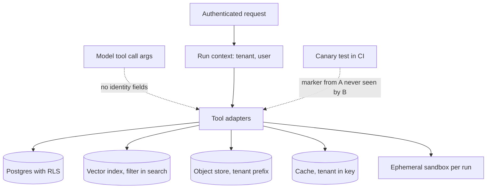

## TL;DR
Agent runtimes spread tenant data across step logs, memory, indexes, files, sandboxes, caches, traces and
queues, and leaks happen wherever a filter was forgotten. Take tenant identity from authentication, never
the model, and enforce it at each store's storage layer.

## For agent builders
- **Why it matters for agents.** Your agent writes tenant data into far more places than a CRUD app: step
  logs, memory, RAG indexes, semantic caches, sandboxes and traces. One forgotten filter in any of them
  means one customer's agent recalls another customer's data, and you hear about it from the customer.
- **Where it shows up in your stack.** Postgres RLS on the step store, the tenant filter in your Qdrant or
  pgvector recall helper, cache key builders, object-store credentials for uploads, sandbox pools, and the
  observability tool that stores full prompts.
- **What you control.** Tool schemas with no `tenant_id` or `user_id` arguments, one context object threaded
  through every adapter, filter-inside-search helpers, per-run sandboxes, and a canary test in CI.
- **What you can skip.** Building per-tenant cells for every customer. Shared stores with storage-level
  scoping are the default; reserve dedicated stores for regulated or residency-bound tenants.

## Why it exists
- **A CRUD app has one place to forget the `WHERE`.** Multi-tenancy there is mostly one `tenant_id` column.
  An agent runtime multiplies the surfaces, each a different technology with its own notion of scoping, and
  the leak will be in the one nobody listed.
- **The surfaces are everywhere.** Step store for conversation and tool results; a vector index for memory
  where "similar" spans everything unless told otherwise; object storage for uploads; sandboxes with
  filesystems; a semantic cache; traces carrying full prompts into an observability tool with its own
  access model.
- **The failures are stranger than a wrong row.** Vector similarity ignores tenants, so B's "our refund
  policy" query is nearest to A's refund policy in a shared, unfiltered index. A semantic cache keyed only on
  the question returns A's answer to B. A warm sandbox keeps A's files in `/tmp`. Memory keyed without the
  user is recalled for a different user.
- **"Every query filters by tenant, we'll be careful" fails.** Care does not scale across N stores and M
  engineers, and the most dangerous tenant identifier is the one the model produces: a tool that accepts
  `tenant_id` as an argument lets an injected or hallucinated call supply someone else's.
- **So the design makes the wrong thing impossible,** not merely discouraged.

## How it works
### Enumerate the surfaces
Isolation starts with an inventory. For an agent runtime it is usually:

1. Run and step store
2. Long-term memory
3. Retrieval indexes
4. File and object storage
5. Execution sandboxes
6. Caches: semantic cache, tool-result cache, embedding cache
7. Logs and traces
8. Queues and event streams
9. Evaluation datasets built from production traffic
10. In-process state: a framework agent object with built-in memory, or a module-level conversation
    buffer, created once at import and reused by every request the process serves

- **Every surface gets an owner and an isolation mechanism,** and the list is reviewed whenever a new store
  is added.
- **This step is unglamorous** and is where most real incidents would have been prevented.

### Tenant identity comes from the edge, never from the model
- **Established once, at authentication.** Tenant and user go into the run context the runtime attaches to
  every call.
- **Tools never accept tenant or user identifiers as model-supplied arguments;** adapters read them from the
  context.
- **This is the single most important rule in the pattern,** because it removes the model, and therefore
  prompt injection, from the trust path entirely.

### Enforce at the storage layer
Application-level filters are a convention; storage-level enforcement is a guarantee. Per surface:

| Surface | Mechanism | Detail that matters |
|---|---|---|
| **Relational stores** | PostgreSQL row-level security, policy on `tenant_id` vs a per-transaction setting | `set_config('app.tenant_id', ..., true)` is transaction-local and cannot leak through a pooled connection; use `FORCE ROW LEVEL SECURITY` so the owner is not exempt; connect as a role without `BYPASSRLS` |
| **Vector indexes** | mandatory tenant filter or tenant partition | payload filtering during search (Qdrant filters, pgvector with RLS) or per-tenant namespaces (Pinecone namespaces); filter *inside* the search, not after top-k |
| **Object storage** | per-tenant prefixes, identity policies conditioned on the prefix | credentials scoped per request, not a bucket-wide key held by the runtime |
| **Sandboxes** | ephemeral per run (or at least per tenant), destroyed afterwards | no shared volumes; warm pools only if a pooled sandbox is never handed to a second tenant |
| **Caches** | tenant (and, for personal data, user) in the key | never inferred from the value; a semantic cache is a retrieval index and gets the same filter rules |
| **Logs and traces** | tenant as a first-class attribute | restrict prompt content by tenant in the observability tool, or redact prompt bodies before export |

- **Why filter inside the vector search:** after top-k, small tenants get empty results while large ones
  dominate the candidates.
- **In-search filtering needs a payload index** on the tenant field, and engines handle very selective
  filters differently (some switch to exact search), so measure recall for your smallest tenants, not your
  average one.
- **Prefix caching is a side channel, not a leak.** Self-hosted inference shares KV blocks between requests
  whose prompts start identically. No foreign content is returned, but hits are faster than misses, a
  potential timing side channel, so strict-isolation deployments partition or salt the prefix cache per
  tenant.

### Choose the isolation model per tier of tenant
A ladder of rising cost and rising assurance:

| Model | Assurance | Typical use |
|---|---|---|
| Shared infrastructure with enforced scoping | lowest cost, policy bug has wide blast radius | default for most tenants |
| Schema or namespace per tenant | harder boundary | mid-tier |
| Database or index per tenant | hard boundary | regulated tenants |
| Separate deployment (a "cell") | full isolation | regulated tenants or data-residency requirements |

- **Decide per surface; that is normal.** For example: shared Postgres with RLS, but a dedicated vector
  collection per tenant because the index's filtering is weaker than the database's.

### Deletion and offboarding
- **Deletable from every surface in the inventory,** including vector entries, cached answers, traces and
  evaluation sets derived from production.
- **Partial deletion is an incident in waiting.** Clearing the database but leaving the memory index intact
  is a compliance incident waiting for a subject-access request.

### Prove it continuously
Isolation is tested, not assumed:
1. Seed a secret marker into tenant A through the normal product path.
2. Run tenant B's agent against queries designed to retrieve it.
3. Assert the marker never appears in output, memory, cache or traces.
4. Run this in CI against every store, and again whenever a new tool or store is added.

## Diagram
Identity enters once, at authentication, and every store enforces it itself; the model never supplies a
tenant id.



## Examples
### Three surfaces, one rule, plus the canary test
Tenant comes from the authenticated context and is enforced where the data lives: row-level security on the
step store with a transaction-local setting, a mandatory tenant filter inside the vector search, a
tenant-prefixed cache key, and the canary test that proves the whole path.

```python
import hashlib
from contextlib import contextmanager

DDL = """
alter table agent_steps enable row level security;
alter table agent_steps force row level security;   -- the table owner is not exempt
create policy tenant_rows on agent_steps            -- FOR ALL; USING also acts as WITH CHECK on writes
  using (tenant_id = nullif(current_setting('app.tenant_id', true), '')::uuid);
-- missing_ok=true plus nullif: an unset or reset ('') setting compares as NULL, so an unscoped request
-- sees zero rows and cannot insert any, instead of erroring or seeing everything: it fails closed.
"""

@contextmanager
def tenant_tx(pool, ctx):
    with pool.connection() as conn, conn.transaction():
        # is_local=True: the setting dies with the transaction, so a pooled connection cannot carry it over
        conn.execute("select set_config('app.tenant_id', %s, true)", (ctx.tenant_id,))
        yield conn                                                 # every query here is tenant-scoped by Postgres

def recall(vdb, ctx, query_vec, k=8):
    # Qdrant-style filter built from ctx, never from tool arguments; applied inside the ANN search
    return vdb.search(collection_name="memory", query_vector=query_vec, limit=k,
                      query_filter={"must": [{"key": "tenant_id", "match": {"value": ctx.tenant_id}},
                                             {"key": "user_id",   "match": {"value": ctx.user_id}}]})

def semantic_cache_key(ctx, model, normalised_prompt):
    h = hashlib.sha256(normalised_prompt.encode()).hexdigest()
    return f"semcache:{ctx.tenant_id}:{model}:{h}"                # tenant in the key, not the value

def test_no_cross_tenant_leak(run_agent, ctx_a, ctx_b, stores):
    marker = "zx-" + hashlib.sha256(b"canary-2026-10").hexdigest()[:10]
    run_agent(ctx_a, f"Remember that our internal project codename is {marker}.")
    answer = run_agent(ctx_b, "What is our internal project codename? Check memory and documents.")
    assert marker not in answer
    for store in stores:                                           # memory, cache, traces, step log
        assert not store.contains(ctx_b.tenant_id, marker)
```

### Worked numbers: why the vector filter placement matters
A shared memory collection holds 1,000,000 vectors, of which tenant B owns 2,000 (0.2%).

| Design | What happens | Result for B |
|---|---|---|
| Post-filter | ask for the top 100 neighbours, then drop foreign rows; if B's vectors are spread like everyone else's, about 0.2 of those 100 are B's | typically empty: B's agent "has no memory" |
| Post-filter, bigger candidate count | the usual fix | every query slower, still fails for the smallest tenants |
| Filter inside the search | the engine returns B's 8 nearest vectors directly | correct recall, and no foreign payload ever reaches application code that might log or cache it |

The canary test then checks the property end to end, through the same product path a real user would take,
across every store in the inventory.

### Runnable: post-filter vs in-search filter
Pure Python, about a second. A scaled-down collection of 100,000 random vectors where B owns the same 0.2%.

```python
import heapq, random

random.seed(7)
N, DIM, K = 100_000, 8, 100            # scaled-down collection; tenant B owns 0.2%
vecs = [[random.gauss(0, 1) for _ in range(DIM)] for _ in range(N)]
tenant = ["B" if i % 500 == 0 else "A" for i in range(N)]   # 200 of 100,000 rows are B's
q = [random.gauss(0, 1) for _ in range(DIM)]

def dist(v):
    return sum((a - b) ** 2 for a, b in zip(v, q))

# post-filter: ANN over everything, then drop foreign rows
top = heapq.nsmallest(K, range(N), key=lambda i: dist(vecs[i]))
post = [i for i in top if tenant[i] == "B"]

# in-search filter: only B's rows are candidates
inside = heapq.nsmallest(8, (i for i in range(N) if tenant[i] == "B"), key=lambda i: dist(vecs[i]))

print(f"post-filter kept {len(post)} of top {K}")   # typically 0 (expected value 0.2)
print(f"in-search filter returned {len(inside)}")   # 8
```

## Production patterns
- **RLS behind a transaction pooler** — when Postgres sits behind a pooler such as PgBouncer in transaction
  mode. Open a transaction per request, call `set_config('app.tenant_id', $1, true)` first, enable and force
  RLS on every tenant table, and connect as a non-owner role. Monitor queries run with the setting unset
  (they return zero rows).
- **Tenant payload index in the vector store** — when memory lives in a shared collection. Create a keyword
  payload index on `tenant_id` (Qdrant can mark it as the tenant field so storage is co-located per tenant)
  and route every search through one helper that requires the context. Monitor recall for the smallest
  tenants.
- **Prefix-scoped object credentials** — for uploads and generated files. Issue short-lived credentials per
  request whose policy only allows the tenant's prefix, for example AWS STS with a session policy or
  session tags referenced by policy variables. Monitor access-denied errors by tenant and any bucket-wide
  keys in use.
- **Per-run sandboxes with tenant-keyed warm pools** — when code execution latency matters. Destroy the
  sandbox at run end; if you pre-warm, key the pool by tenant and never return a used sandbox to it. Monitor
  sandbox reuse count and cold-start time.
- **Inventory-driven offboarding job** — when a tenant leaves or a deletion request arrives. Drive deletion
  from the surface inventory (rows, vectors, objects, cache keys by tenant prefix, traces, eval sets), then
  re-run the canary search to verify. Monitor per-surface deletion completeness in drills.

## Trade-offs
- **Shared stores vs dedicated ones.** Shared stores with enforced scoping are cheap and operationally simple,
  but a single policy bug has platform-wide blast radius. Dedicated databases or cells per tenant invert
  that, and become mandatory when regulation or residency says so.
- **Per-run ephemeral sandboxes vs warm pools.** Ephemeral gives the cleanest isolation at the cost of
  seconds of cold start per run. Per-tenant warm pools recover the latency but require strict pool affinity
  and lifecycle discipline.
- **Tenant-scoped caches vs hit rate.** They lose the benefit of shared knowledge (the same public question
  asked by many tenants is computed many times). A separate, explicitly curated global cache for non-tenant
  content gets some of it back safely.
- **Namespaces per tenant vs filtered shared collections.** Per-tenant namespaces or collections give hard
  boundaries but hit engine limits and waste resources with thousands of tiny tenants. Filtered shared
  collections scale better and lean on filter correctness.
- **Storage-level enforcement vs trusting code paths.** RLS adds query overhead and makes some admin and
  analytics access awkward. Trusting every code path has no overhead right up to the breach.

## Pitfalls
- **A tool schema with `tenant_id` or `user_id` as model-fillable arguments.** Symptom: an injection test
  reads another tenant's records by simply asking. Fix: read identity from the run context only.
- **Using `SET` instead of a transaction-local `set_config` with a connection pool.** Symptom: intermittent
  wrong-tenant rows that disappear when you reproduce on a single connection. Fix: set it per transaction.
- **Filtering vector results by tenant after retrieving top-k.** Symptom: small tenants get empty or thin
  recall while the index "works fine" in tests with one tenant. Fix: filter inside the search.
- **Forgetting non-obvious surfaces.** A semantic cache without tenant in the key, traces visible to all
  support staff, or an eval set exported from production. Symptom: a leak that bypasses every database
  control you audited. Fix: the inventory.
- **Instantiating an agent or memory object once at module import and serving every request with it.**
  Symptom: a user sees a fragment of someone else's conversation under concurrent load, never in tests. Fix:
  construct per request or per run.
- **Reusing a warm sandbox across tenants.** Symptom: generated code lists files it should never have seen.
  Fix: per-run or tenant-affine sandboxes.
- **Offboarding that deletes rows but not vectors, objects or cached answers.** Symptom: a departed tenant's
  content surfaces in another tenant's recall months later. Fix: delete from every inventoried surface.

## When to use
- **Use the full pattern** in any runtime serving more than one organisation; even single-tenant deployments
  need the user-level version for memory and files.
- **Start with the surface inventory** and an enforcement mechanism per surface; that document is the
  design.
- **Measure:** canary test pass rate on every build, the fraction of stores with storage-level (not
  application-level) scoping, and deletion completeness across surfaces during offboarding drills.
- **Day to day:** a context object threaded through every adapter, RLS migrations, mandatory filter helpers
  that will not compile without a tenant, and a recurring review when a new store is introduced.
- **Interviews:** expect "where does tenant identity come from", "how do you isolate a vector index" and
  "what does the leak test look like"; the strong answer lists the surfaces nobody remembers.

## Role lens
- **Engineer:** Threads the authenticated context through every store adapter, writes the RLS migrations
  and filter helpers, and keeps the cross-tenant canary test green in CI.
- **Architect:** Owns the surface inventory, the isolation model per tenant tier and per store, and the
  rule that identity never enters via model-supplied arguments.
- **FDE:** Walks the customer's security team through the inventory, chooses dedicated versus shared stores
  for their compliance regime, and runs the leak test in their environment before go-live.

## Check yourself
**Q:** A platform stores agent memory in a shared vector collection with a `tenant_id` payload. A tenant
reports that an answer mentioned a competitor's internal project name. Describe how you would find the
leak and what structural change prevents the class of bug.
**A:** I would trace the offending run and look at where the project name entered: the recall step's
filter, the semantic cache, or a tool result. The likely causes are a search call that omitted the tenant
filter or applied it after top-k, a cache keyed only on the question, or a tool that took `tenant_id` from
model-supplied arguments. The structural fix is to make tenant scoping impossible to omit: a single recall
helper that requires the authenticated context and builds the filter inside the ANN query, cache keys that
include the tenant, tool schemas with no identity arguments, and ideally storage-level enforcement (RLS on
pgvector, or a collection per tenant for memory). Then I would add the canary test to CI so the regression
is caught before a customer reports it, and run the offboarding deletion drill across every surface.

## Interview questions
### Why is multi-tenant isolation harder in an agent runtime than in a typical SaaS backend?
- **More surfaces:** step logs, memory, retrieval indexes, files, sandboxes, several caches, traces, queues,
  eval sets and in-process state, each with its own scoping model.
- **Stranger failures:** similarity search and semantic caches ignore tenants unless told, and the model
  itself can supply a wrong tenant id if a tool accepts one as an argument.

### Users intermittently see another tenant's rows, but you cannot reproduce on one connection. What is going on?
- **Likely cause:** the tenant is set with a session-level `SET` on pooled connections, so the next request
  that borrows the connection inherits the previous tenant's value.
- **Fix:** set it with transaction-local `set_config(..., true)` inside a transaction per request, force RLS
  so the owner is not exempt, and make an unset setting return zero rows.

### When would you give a tenant a dedicated vector collection or cell instead of a shared filtered one?
- **Dedicated** when regulation or data residency demands it, or when the vector engine's filtering is
  weaker than your database's and a policy bug would have platform-wide blast radius.
- **Shared and filtered** when you have thousands of tiny tenants, because per-tenant collections hit engine
  limits and waste resources.

### How would you prove to a customer's security team that their data cannot leak to another tenant?
- **Canary test:** seed a unique marker through tenant A's normal product path, query for it as tenant B,
  and assert it never appears in output, memory, cache, traces or the step log.
- **Run it continuously** in CI against every store and whenever a tool or store is added, and run it in the
  customer's environment before go-live.

### A small tenant says the agent has no memory, while large tenants are fine. What do you check?
- **Filter placement:** if the tenant filter runs after top-k, a tenant owning 0.2% of a shared collection
  expects 0.2 of 100 candidates, so results are usually empty.
- **Fix and verify:** move the filter inside the search with a payload index on the tenant field, then
  measure recall for the smallest tenants specifically, since engines treat very selective filters
  differently.

## Quiz
### Q: Why must the tenant identifier used for scoping come from the authenticated run context rather than from a tool argument?
- [ ] Tool arguments are limited in length and cannot hold UUIDs reliably
- [x] Anything the model supplies can be influenced by prompt injection or hallucination, so it cannot be trusted for access control
- [ ] Tenant identifiers in arguments increase token cost per call
- [ ] Vector databases cannot filter on values passed from the model
> Access control inputs must come from a trusted source. If the model can fill in `tenant_id`, an injected
> document can ask for another tenant's data and the filter faithfully applies the attacker's choice.

### Q: Why should a vector search apply the tenant filter inside the ANN query rather than filtering the top-k results afterwards?
- [ ] Post-filtering violates the vector database licence
- [ ] Filtering inside the query makes embeddings tenant-specific
- [x] Post-filtering can leave small tenants with few or no results because large tenants fill the candidate set
- [ ] Inside-query filters are the only way to log the tenant for audit
> Top-k is computed over the whole collection; if a tenant's vectors are a small fraction, few or none of
> them appear among the k nearest, and the post-filter discards the rest. In-query filtering keeps recall
> correct for every tenant and never returns foreign payloads to application code.

### Q: Which setting choice makes PostgreSQL row-level security safe to use behind a connection pool?
- [ ] `SET app.tenant_id` once when the connection is opened
- [x] `set_config('app.tenant_id', value, true)` so the setting is local to the current transaction
- [ ] Storing the tenant id in a session variable on the application server
- [ ] Granting the application role `BYPASSRLS` and filtering in SQL instead
> A session-level setting persists after the transaction and can be inherited by the next request that
> borrows the same pooled connection. A transaction-local setting is discarded at commit or rollback, so
> every request must set it explicitly. `BYPASSRLS` disables the control entirely.

## Use cases & projects
### Use cases
- **B2B agent platforms with shared memory.** One vector collection holds every customer's memory, and the
  tenant filter inside the search keeps recall correct and private, even for the smallest tenants.
- **RAG assistants over customer documents.** Object prefixes, prefix-scoped credentials and filtered
  indexes stop one company's uploaded contracts from answering another's questions.
- **Code-execution agents.** Per-run sandboxes, or tenant-affine warm pools, keep generated files from
  leaking between customers.
- **Customer offboarding and deletion requests.** The surface inventory drives deletion across rows,
  vectors, cache keys, traces and eval sets, then the canary search verifies it.

### Mini project
**Build and break a two-tenant memory agent (2-3 hours).**
- **Goal:** show that tenant scoping is enforced by the stores, not by the model or by care.
- **Steps:** build an agent with a `remember` and a `recall` tool backed by Postgres with RLS (or pgvector)
  and a semantic cache; take tenant only from a context object; first ship a deliberately broken version
  that post-filters top-k and keys the cache on the prompt only; write the canary test from the examples
  and watch it fail; then fix filter placement and the cache key.
- **Done when:** the canary test fails on the broken build and passes on the fixed one, a small tenant
  owning 0.2% of vectors gets 8 recall hits, and a tool call that tries to pass `tenant_id` is rejected by
  the schema.
