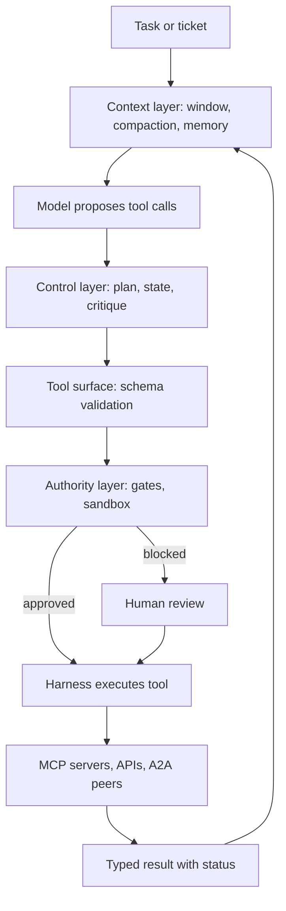

## Overview
This module is about building LLM agents that do real work against real systems and can be trusted to
keep doing it. It starts with the agent loop. The model proposes an action as a structured tool call,
the harness executes it, the result goes back into the transcript, and the cycle repeats until a stop
condition.

Everything else either improves that loop or limits it. The lessons fall into five groups:

- **Tool interface:** schemas and layered validation, typed contracts that keep schema and handler in step, result shapes the model cannot misread, selection accuracy as the first metric worth tracking, and parallel calls for independent reads.
- **Across boundaries:** MCP and its security layer, followed by A2A, take that interface across process and organisational boundaries.
- **Structure for long tasks:** planning, task decomposition, reflection and state machines give long tasks structure and enforceable phases.
- **Context and memory:** compaction and memory decide what the model sees on each step and what persists between sessions, with policies for retrieval, update and erasure.
- **Authority and blast radius:** human-in-the-loop, approval gates, sandboxing and computer use bound what a wrong or prompt-injected action can do.

Multi-agent patterns, the workflows-versus-agents decision and frameworks then tell you how much
autonomy to spend and which plumbing to adopt.

**Core versus background for agent builders:**

- **Core (23 lessons):** every lesson except one is marked core, because you use it directly when you build the harness, the tools, the context strategy or the controls.
- **Useful (1 lesson):** a2a-protocol is marked useful. You meet it when your agent must talk to opaque peer agents owned by another team or vendor.
- **Background:** none. This is the module where agent building happens.

**What you can build afterwards:**

- **A production agent:** design, build, measure and defend one, choosing where autonomy belongs.
- **Tools the model uses correctly:** typed, validated, with results that report status and truncation.
- **Long runs within budget:** compaction, memory and checkpointed state machines.
- **Controls in code, not the prompt:** the gates, sandboxes and OAuth scopes a security review expects.

It matters most for Engineers, who write the harness, and for Architects, who own the autonomy, trust
and topology decisions.

## Why it matters
- **Engineer:** You write the harness, not just the prompt: the loop and its budgets, tool contracts and validators that return fixable errors, result shapes with explicit status and truncation, concurrency caps for parallel calls, compaction at tool-call boundaries, and checkpointed state that resumes without repeating a side effect.
- **Architect:** You decide where autonomy is spent and where it is not when you design an agent system: workflow versus agentic island, single agent versus orchestrator-worker or handoffs, MCP versus in-process tools versus A2A peers, which actions are gated, which sandbox tier fits the threat, and how memory is scoped, retained and erased.
- **FDE:** Customers arrive with MCP servers, legacy GUIs and security reviewers, so you must connect an agent to their systems with per-user OAuth identity, explain approval gates and sandbox egress in a review, start with full human review, and widen autonomy per action class as agreement data comes in.

## Mental model
Picture the model as a planner with no authority sitting inside a harness that holds all of it. On
every step the model reads a context window and proposes one or more tool calls. The harness decides
whether each call is valid, permitted and safe to run, executes it, and writes a result back.

Each lesson in the module controls one of four things in that picture:

| Layer | Lessons | What it controls |
|---|---|---|
| Tool surface | schemas, contracts, results, selection, parallelism, MCP, A2A | The channel through which the model acts and sees, so most "the agent is dumb" bugs are interface bugs |
| Control layer | planning, decomposition, reflection, state machines, multi-agent patterns | Which next steps exist, and checking progress against the goal |
| Context layer | compaction, memory and its policies | What the model knows on this step |
| Authority layer | human review, approval gates, sandboxing, careful computer use | The damage when a proposal is wrong or injected |

- **Autonomy is a budget:** give the model choice only where you cannot draw the flowchart.
- **Invariants live below the model:** enforce every one of them in code, not in the prompt.

The loop runs top to bottom on every step. The model only proposes; validation, gates and the sandbox
sit between its proposal and any side effect, and every result returns through the context layer.

## Suggested order
1. agent-loop — the foundation: transcript as state, harness as authority, and budgets and stop conditions that every later lesson builds on.
2. tool-calling — the structured request and response format through which the loop acts, and why the model only ever asks.
3. workflows-vs-agents — with the loop and tools understood, decides early when to build a workflow instead and where agentic islands belong.
4. tool-schemas-and-argument-validation — the schema is the model's whole specification of a tool, and layered validation catches its mistakes before side effects.
5. typed-tool-contracts — derives schema, handler, errors and tests from one typed definition so they cannot drift apart.
6. tool-result-interpretation — designs the other half of the interface: results with explicit status, truncation and untrusted-data labels.
7. tool-selection-accuracy — measures whether the tool surface built so far works, using a labelled set and a confusion matrix.
8. parallel-tool-calls — extends the loop to run independent calls concurrently, which depends on contract metadata about side effects.
9. model-context-protocol — moves tools out of process into shared servers with tools, resources and prompts over JSON-RPC.
10. mcp-authentication-authorization-transport-security — adds per-user identity, OAuth scopes and audience binding once MCP servers are remote and shared.
11. planning — gives long tasks an explicit representation of intent to measure progress against and replan from.
12. task-decomposition — decides the shape of the work (granularity, dependencies, interfaces) once order is planned.
13. reflection-self-critique — adds a generate-critique-revise loop and teaches that only grounded evidence makes it help.
14. state-machines — turns phases into enforced states and guards that can be checkpointed and resumed after a crash.
15. context-compaction-summarization — keeps long runs within the window and budget by deciding what must survive.
16. agent-memory — extends context management across sessions with short-term, long-term and episodic stores.
17. memory-retrieval-update-deletion-policies — adds the lifecycle rules that stop memory going stale, poisoned or unlawful.
18. human-in-the-loop — decides where scarce human attention buys the most risk reduction and how to avoid rubber stamping.
19. approval-gates-for-consequential-actions — implements the most important human checkpoint in the executor, bound to exact arguments and durable.
20. sandboxing — bounds the blast radius of model-written code and shell commands, assuming prompt injection.
21. computer-use — the most general and least efficient tool, which needs the sandbox and gates already covered.
22. multi-agent-patterns — splits work across loops for isolation and parallelism, after single-agent design is solid.
23. a2a-protocol — the one useful (not core) lesson: connects to opaque peer agents with long-running tasks, best understood by contrast with MCP and after multi-agent patterns.
24. frameworks — evaluates LangGraph, LlamaIndex, Pydantic AI, DSPy and others against the plumbing problems the module has named.

## Capstone
### Brief
**Use case:** the support team of a mid-sized SaaS company needs a billing-dispute agent. This is the
module's major project, planned for a weekend to a week.

A ticket arrives saying a customer was double-charged. The agent must investigate across a ticketing
system, a billing API and a policy knowledge base. It decides whether a refund or credit is due, drafts
a reply, and issues the refund only after a support lead approves it.

Use mock services you control:

- **Billing over MCP:** expose the billing API as a remote MCP server with per-user OAuth scopes.
- **Legacy GUI:** include one old admin console with no API that the agent can reach only through computer use in a VM.

Model the run as a state machine with these states:

- **Intake:** a workflow, not an agent.
- **Investigation:** an agentic island with a step and token budget.
- **Proposal:** the agent states the refund or credit it wants.
- **Approval:** a durable pause.
- **Execution:** the approved action runs.

The investigation should issue parallel lookups and reconcile invoices in a sandboxed code tool with no
network egress. It critiques its own reconciliation against computed totals before it proposes
anything.

Per-customer memory records facts such as preferred contact and past disputes, with provenance and a
working erasure path. Seed one ticket whose attachment contains a prompt-injection instruction to
refund a different account. Build it, measure it and write it up for a security reviewer.

### Deliverables
- A working agent in a repository, built either on a hand-rolled loop or on one framework with a written justification, with typed tool contracts (input, output, error kinds, side-effect metadata) for at least six tools and snapshot tests of the schemas the model sees.
- A state-machine diagram and its implementation, showing allowed tools and transitions per state, guards enforced in code, checkpoints, and the durable approval pause with arguments bound to the approval.
- A labelled evaluation set of at least 30 tickets, including look-alike tools, empty-result cases and the injection ticket, with a script reporting task completion, tool selection accuracy (recall, confusion and argument accuracy), steps and cost per task at p50 and p95.
- A memory schema and policy note covering retrieval scoping and scoring, supersession of contradictory facts, TTLs, and an erasure procedure that covers the raw store, the vector index and compaction summaries.
- A two-page security and design review: why each step is workflow or agentic, the MCP OAuth scopes and audience binding, sandbox tier and egress policy, which tool classes are gated and why, and the plan for widening autonomy as approval data accumulates.

### Rubric
- On the injection ticket, the agent either never proposes the out-of-scope refund or proposes it and is stopped at the gate; the trace shows the attachment text labelled as untrusted data and no refund call reaching the billing server.
- Killing the process while it waits for approval and restarting it resumes in the same state, and approving executes the refund exactly once, shown by idempotency-key logs on the billing mock.
- An MCP call with a token issued for a different server or with a missing scope is rejected by the server, and every billing call in the logs is attributed to a human subject rather than a shared key.
- Tool results for empty searches, timeouts and truncated lists carry an explicit status, and the eval shows zero cases where the model reported "customer not found" when the backend actually failed.
- Turning parallel calls and compaction on or off produces a measured change in wall-clock time and tokens per run, reported against task completion so that any lost completions are visible.
- After erasing a test customer, a retrieval probe and a direct index query both return nothing for that customer, and the procedure lists every copy it removed.
- The sandboxed reconciliation tool cannot reach the network or read host credentials, demonstrated by a recorded attempt that fails with an egress denial.
