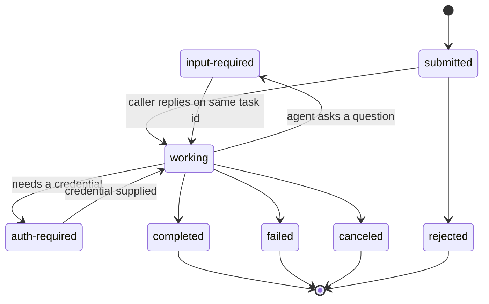

## TL;DR
A2A is an open protocol for one agent to discover another, hand it a task and follow it to completion
over HTTP without seeing inside. MCP connects agents to tools; A2A connects agents to opaque,
long-running peer agents.

## Why it exists
- **Agents need to talk to each other.** Once an organisation has more than one agent, a procurement agent
  must ask a legal-review agent whether a contract is acceptable; a travel agent must ask an airline's
  booking agent for seats.
- **"Wrap the other agent as a tool" fails on duration.** A tool call is a synchronous typed function,
  but an agent's job may run for minutes, ask a follow-up ("which cardholder?"), produce several
  artifacts and fail halfway.
- **It also fails on schemas and adapters.** Tool schemas assume the caller knows exact parameters;
  another agent's capabilities are best described in natural language and may change daily. And each
  pair of teams invents its own REST shape, auth and streaming, so every integration needs a bespoke
  adapter.
- **Sharing memory or prompts fails differently.** Agents from different vendors cannot and should not
  expose internal state, tool lists or system prompts to each other.
- **So A2A is built around opacity.** Agents cooperate by exchanging messages and artifacts about a task,
  never by inspecting one another. That works across organisational boundaries and lets a team swap an
  agent's internals without breaking callers.
- **Provenance:** announced by Google in 2025, later moved to the Linux Foundation. Its core objects are
  the Agent Card for discovery and the Task with a state machine for the work.

## How it works
### Discovery: the Agent Card
Each A2A server publishes a JSON **Agent Card** at a well-known URL: early versions used
`/.well-known/agent.json`; later revisions renamed it to `/.well-known/agent-card.json`. The card declares:
- **identity:** name and description, service endpoint URL, protocol version;
- **modes:** supported input and output modes (text, files, structured data);
- **capabilities:** such as streaming and push notifications;
- **skills:** each with an id, description and examples;
- **security schemes** it accepts, described in the OpenAPI style.

Skills are described in prose *because* the client is itself an LLM-driven agent. It selects a remote
agent the way it selects a tool: by reading descriptions, not by matching a function signature.

### The Task as the unit of work
1. **The client sends a Message:** a role plus one or more **Parts** (text, file or structured data).
2. **The server answers directly** with a message, **or opens a Task** with an id and a `contextId` that
   groups related tasks.
3. **The task carries a status** whose state comes from a fixed lifecycle: `submitted`, `working`,
   `input-required`, `completed`, `failed`, `canceled`, plus `rejected` and `auth-required` in later
   revisions.
4. **Outputs come back as Artifacts,** each a list of parts, so one task can produce a report, a
   spreadsheet and a JSON summary as separate items.

- **`input-required` is what distinguishes A2A from a tool call.** The remote agent can pause and ask for
  more information; the caller continues the *same* task by sending another message with the same task id.

The states fall into three groups, and a client must branch on the group, not the individual name:

| Group | States | What the caller does |
|---|---|---|
| Active | `submitted`, `working` | wait: stream, poll or await a push |
| Interrupted | `input-required`, `auth-required` | supply the missing input or credential on the *same* task id |
| Terminal | `completed`, `failed`, `canceled`, `rejected` | read artifacts or the status message; the task is finished |

- **Terminal tasks are immutable.** A follow-up ("now refund the second invoice too") is a *new* task in
  the same `contextId`, not a reopening of the old one.
- **Why:** it keeps every task's artifacts and outcome a stable record both sides can audit and refer
  back to, while `contextId` carries the conversational thread across tasks.

### Transport and messaging
The reference binding is JSON-RPC 2.0 over HTTPS. Core methods:

| Method | Purpose |
|---|---|
| `message/send` | request-response |
| `message/stream` | Server-Sent Events stream of task status and artifact updates |
| `tasks/get` | poll a task |
| `tasks/cancel` | cancel a task |
| `tasks/pushNotificationConfig/set` | register a webhook so long tasks notify the caller without an open connection |

- **Later revisions added gRPC and plain HTTP+JSON bindings** with the same data model.
- **Streaming exists** *because* agent tasks are slow and users want partial output.
- **Push notifications exist** *because* a task may outlive any HTTP connection.

### Security
- **Reuse web standards.** The Agent Card advertises accepted schemes (OAuth 2, API key, HTTP bearer,
  OpenID Connect); credentials travel in standard HTTP headers and the task body never carries them.
- **The server authenticates the calling agent** (or the user it acts for) and makes its own
  authorization decisions per skill.
- **Opacity limits leakage.** The caller never receives the remote agent's internal tool results, only
  the artifacts it chooses to return.

Push notifications add a reverse channel with its own risks:
- **Validate the webhook URL on the server,** because the server will POST to whatever URL the client
  registers; otherwise it becomes a tool for requests into internal networks (server-side request forgery).
- **Verify the sender on the client.** The webhook checks a token or signature agreed at registration,
  then fetches the authoritative task state with `tasks/get` rather than trusting the payload alone.
- **Treat peer output as untrusted input.** A remote agent's artifacts and questions reach the caller's
  model like a web page would; a compromised or malicious peer can embed instructions in its output.

### How it relates to MCP
| | MCP | A2A |
|---|---|---|
| Direction | Vertical: agent to tools and resources | Horizontal: agent to peer agent |
| Other side | Deterministic function with a JSON schema | Reasons, may take minutes, may ask questions, returns artifacts |
| Shared ground | JSON-RPC 2.0, SSE streaming, OAuth for HTTP security | same |

The two are complementary and commonly used together: a single agent typically speaks MCP to its tools
and A2A to other agents, so the operational skills transfer.

## Diagram
Read the task lifecycle: active states loop until the agent either needs something from the caller
(interrupted, resumed on the same task id) or reaches an immutable terminal state.



## Examples
### Minimal client: discover, send, poll, answer questions
A minimal client with `httpx`. It reads the Agent Card, sends a message, handles a direct answer without
a task, polls until a terminal state, and loops through any `input-required` turns.

Method and field names follow the 0.2/0.3-era JSON-RPC binding (later revisions rename some of them); check
`protocolVersion` in the card before relying on them.

```python
import httpx, time, uuid

BASE = "https://billing-agent.example.com"
TOKEN = "..."                                             # obtained per the card's securitySchemes
card = httpx.get(f"{BASE}/.well-known/agent-card.json").json()
print(card["name"], "skills:", [s["id"] for s in card["skills"]])
can_stream = card.get("capabilities", {}).get("streaming", False)  # if True, prefer message/stream

def rpc(method, params):
    r = httpx.post(card["url"], timeout=30,
                   headers={"Authorization": f"Bearer {TOKEN}"},
                   json={"jsonrpc": "2.0", "id": str(uuid.uuid4()),
                         "method": method, "params": params})
    r.raise_for_status()
    body = r.json()
    if "error" in body:
        raise RuntimeError(body["error"])
    return body["result"]

def user_message(text, task_id=None, context_id=None):
    msg = {"role": "user", "messageId": str(uuid.uuid4()),
           "parts": [{"kind": "text", "text": text}]}
    if task_id:
        msg["taskId"], msg["contextId"] = task_id, context_id  # continue the same task
    return {"message": msg}

task = rpc("message/send", user_message("Refund invoice INV-2291, duplicate charge"))
if task.get("kind") == "message":                        # answered directly, no task created
    raise SystemExit(task["parts"][0]["text"])
while True:
    state = task["status"]["state"]
    if state in ("submitted", "working"):
        time.sleep(2)
        task = rpc("tasks/get", {"id": task["id"]})
    elif state == "input-required":
        question = task["status"]["message"]["parts"][0]["text"]  # e.g. "Which card ending?"
        answer = input(question + " ")                   # surface it to the human
        task = rpc("message/send", user_message(answer, task["id"], task["contextId"]))
    else:                                                # completed, failed, canceled, rejected...
        break
print(state, [a.get("name") for a in task.get("artifacts", [])])
```

A real client would use `message/stream` to receive status and artifact events incrementally instead of
polling, and would persist `task["id"]` and `contextId` so the conversation survives a restart.

### Verifying a push notification before trusting it
Runnable pure Python. The webhook checks a shared token agreed at registration in constant time, then
re-reads the task instead of trusting the payload. `fetch_task` stands in for a `tasks/get` call.

```python
import hmac

WEBHOOK_TOKEN = "per-task-secret-from-registration"
TERMINAL = {"completed", "failed", "canceled", "rejected"}

def fetch_task(task_id):                       # stand-in for rpc("tasks/get", {"id": task_id})
    return {"id": task_id, "status": {"state": "completed"}, "artifacts": [{"name": "decision"}]}

def on_push(headers: dict, payload: dict):
    sent = headers.get("x-a2a-notification-token", "")
    if not hmac.compare_digest(sent, WEBHOOK_TOKEN):
        return 401, "unverified sender"
    task = fetch_task(payload["id"])           # authoritative state, not the payload's claim
    if task["status"]["state"] in TERMINAL:
        return 200, f"done: {[a['name'] for a in task['artifacts']]}"
    return 200, "still running"

print(on_push({"x-a2a-notification-token": "guess"}, {"id": "t1"}))
print(on_push({"x-a2a-notification-token": WEBHOOK_TOKEN}, {"id": "t1"}))
```

The header name here is illustrative; use whatever token or signature scheme you agreed in the push
notification config.

### Worked scenario: polling vs push for a twenty-minute task
| Approach | Requests to the remote agent | Caller holds |
|---|---|---|
| Poll `tasks/get` every 2 s for 20 min | 20 × 60 ÷ 2 = 600 polls | a loop and a worker for 20 min |
| `message/stream` | 1 long-lived SSE connection | one open connection, fragile behind proxies |
| Push notification webhook | 1 registration + a handful of notifications, each followed by one `tasks/get` | nothing between events |

At 1,000 such tasks a day, polling is about 600,000 requests of pure overhead, which is why long tasks
belong on push.

## Production patterns
- **Persist task state on the caller side.** Store task id, `contextId`, last known state and the remote
  agent URL in your own database before waiting. On restart, resume with `tasks/get` instead of resending
  the message. Monitor tasks with no state change past their expected duration.
- **Branch on state groups, not names.** Map states into active, interrupted and terminal in one helper,
  and treat unknown states as interrupted for human review. Monitor counts of unknown states after a peer
  upgrades its protocol version.
- **Push for long work, stream for interactive work.** Register `tasks/pushNotificationConfig/set` for
  anything longer than a request timeout; use `message/stream` when a user is watching. Monitor webhook
  verification failures and notifications that `tasks/get` does not confirm.
- **Correlation IDs across organisations.** Log your request id next to the remote task id and
  `contextId` on every call, and share the mapping in the integration runbook. Monitor time spent in each
  state per skill.
- **Quarantine peer artifacts.** Pass remote artifacts to your model as clearly delimited data, and require
  confirmation for any side effect that traces back to them. Monitor actions whose provenance is a peer
  agent's output.

## Trade-offs
- **Vendor opacity vs debuggability.** Opaque agents cooperate without exposing internals, but the caller
  cannot see why a task failed beyond the message it is given; debugging needs correlation IDs on both sides.
- **Standard envelope vs shared meaning.** A standard task lifecycle removes bespoke adapters, yet every
  integration still needs semantic agreement on what a skill does; the protocol standardises the envelope,
  not the meaning.
- **Graceful long tasks vs operational load.** Streaming and push notifications handle long tasks, at the
  cost of running a webhook endpoint and handling retries and ordering, which simple request-response
  avoids for fast tasks.
- **Flexible discovery vs exact parameters.** Natural-language skill descriptions make discovery flexible,
  but are less reliable than typed tool schemas when the task needs exact parameters; for those, an MCP
  tool is the better fit.

## Pitfalls
- **Wrapping an A2A agent as a synchronous tool.** Symptom: tasks complete server-side after the caller
  already timed out and retried, creating duplicates. Fix: persist the task id and stream, poll or push.
- **Treating `input-required` as a failure.** Symptom: a remote agent that always seems to "fail" on
  ambiguous requests when it was asking a reasonable question. Fix: surface the question and reply on the
  same task id.
- **Trusting the Agent Card without verifying server identity and TLS.** Symptom: an agent happily hands
  customer data to whoever answers at that hostname.
- **Losing the task id or `contextId` between turns.** Symptom: the remote agent starts from scratch every
  message, with no memory of earlier clarifications.
- **Assuming field names are stable across protocol versions.** Symptom: clients break when a server
  upgrades, because part type keys or well-known paths moved. Fix: read `protocolVersion` first.
- **Feeding a peer's artifacts into your model as trusted text.** Symptom: your agent takes actions that
  trace back to instructions inside a remote agent's reply.
- **Accepting push notifications without verifying the sender.** Symptom: task "completions" in your logs
  that `tasks/get` on the real server does not confirm.

## When to use
- **Use A2A when** the other side reasons rather than merely executes: it may take long, ask back, return
  several artifacts, or belong to another team or company that will not expose internals.
- **Use MCP when** you need a deterministic function with a schema.
- **Avoid A2A for agents you own inside one process;** a direct function call or an orchestrator-worker
  pattern is cheaper.
- **Measure** task completion rate, time in each state, and how often `input-required` occurs, since that
  reveals unclear skill descriptions.
- **Interviews:** the discriminating answer is "MCP for tools, A2A for peers", with a clear account of why
  the Task state machine and opacity matter.

## Role lens
- **Engineer:** Publishes an Agent Card, implements the task state machine and streaming endpoint, and
  writes clients that persist task ids across turns.
- **Architect:** Draws the boundary between agents that are tools (MCP) and agents that are peers (A2A),
  and defines the security schemes and correlation ids across organisations.
- **FDE:** Connects a customer's existing agents to yours through published cards, and negotiates skill
  descriptions and auth with their platform team.

## Check yourself
**Q:** A customer wants your support agent to delegate refund decisions to their in-house finance
agent, which can take up to ten minutes and sometimes needs the invoice number confirmed. Would you
integrate it as an MCP tool or an A2A agent, and what would the integration look like?
**A:** A2A. A ten-minute, possibly interactive process does not fit a synchronous tool call: the tool
would time out, retries would duplicate refunds, and there is no channel for "please confirm the
invoice". With A2A the finance agent publishes an Agent Card listing a `refund-review` skill and the
OAuth scheme it accepts. My agent sends a message, receives a task id and `contextId`, and subscribes
to the stream or registers a push notification so it is not holding a connection open. When the task
enters `input-required`, my agent surfaces the question to the user and replies on the same task id.
On `completed` I read the artifacts, which might include a structured decision and a PDF. I would
persist task ids for recovery, log both agents' correlation ids, and treat `failed` and `rejected`
differently from `input-required` in the user-facing flow.

## Interview questions
### What problem does A2A solve that MCP does not?
- **MCP is for tools:** deterministic functions with JSON schemas that execute on demand and return a
  result.
- **A2A is for peers:** opaque agents that reason, may run for minutes, can pause in `input-required` to
  ask the caller something, and return several artifacts, often across company boundaries.

### A peer agent's tasks keep showing up as duplicates on their side. How do you debug it?
- **Check for a synchronous wrapper with a timeout.** If the caller treats the agent as a tool, a slow task
  times out and the retry sends a fresh `message/send`, creating a second task.
- **Fix:** persist the task id before waiting, resume with `tasks/get` or the stream after errors, and
  only send a new message when no task id exists.

### When would you not use A2A between two agents?
- **When you own both and they run in one process.** A function call or orchestrator-worker pattern is
  cheaper and easier to debug than HTTP, auth and a state machine.
- **When the job needs exact typed parameters** and finishes quickly; an MCP tool with a schema is more
  reliable than a prose skill description.

### How do you make push notifications safe?
- **Server side:** validate the registered webhook URL so the server cannot be used for server-side
  request forgery into internal networks.
- **Client side:** verify the token or signature agreed at registration, then call `tasks/get` for the
  authoritative state instead of trusting the payload.

### A follow-up arrives after a task completed. What does the client send?
- **A new task in the same `contextId`,** because terminal tasks are immutable records both sides audit.
- **The `contextId`** carries the conversation thread, so the remote agent still has the earlier context
  while each task's artifacts stay stable.

## Quiz
### Q: What primarily distinguishes delegating to an A2A agent from calling an MCP tool?
- [ ] A2A uses gRPC while MCP uses JSON-RPC
- [x] An A2A task is long-running, can pause in `input-required` to ask the caller a question, and returns artifacts from an opaque agent
- [ ] MCP tools cannot be secured with OAuth
- [ ] A2A requires both agents to share a vector store for context
> MCP tools are schema-defined functions executed on demand. A2A models work as a task with a state
> machine, which is what allows pausing for input and multi-artifact results. Both use JSON-RPC in
> their reference bindings, and both support OAuth.

### Q: What does the Agent Card provide?
- [ ] The remote agent's system prompt so the caller can align instructions
- [ ] A cached copy of the remote agent's recent task results
- [x] Discovery metadata: endpoint URL, skills with descriptions, supported modes, capabilities and accepted security schemes
- [ ] The list of MCP tools the remote agent uses internally
> The card is the discovery document at a well-known path. It deliberately excludes internals such as
> prompts and tools, because A2A agents are opaque to each other by design.

### Q: Your client polls `tasks/get` every two seconds for a task that runs for twenty minutes. What is the protocol-native alternative?
- [ ] Increase the HTTP timeout to thirty minutes on `message/send`
- [x] Use `message/stream` for SSE updates, or register a push-notification webhook for the task
- [ ] Split the request into many small MCP tool calls
- [ ] Send the message again with a higher priority flag
> Streaming delivers status and artifact events as they happen, and push notifications let a task that
> outlives any connection notify the caller. Holding one long request open is fragile behind proxies.
