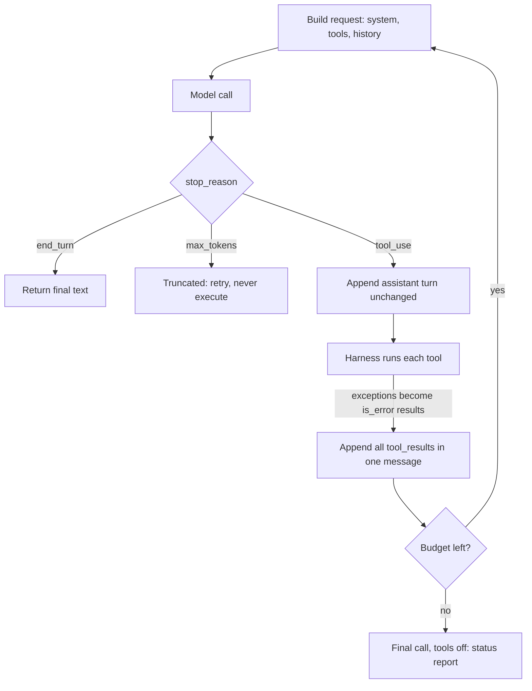

## TL;DR
An agent is a loop you write, not a model: the model proposes a tool call, your harness executes it,
appends the result and calls again until the model stops or a budget trips. Every agent framework is
this loop with defaults.

## For agent builders
- **Why it matters for agents.** This loop is the agent. Tools, memory, RAG, guardrails and evals all
  plug into one of its steps, so if you can write it by hand you can debug any framework that writes it
  for you, and read any trace it produces.
- **Where it shows up in your stack.** Hand-rolled on the Claude or OpenAI SDK, or prebuilt: LangGraph's
  `create_react_agent` (a model node and a tool node joined by a conditional edge; LangChain 1.0 moves
  it to `create_agent`), the OpenAI Agents SDK `Runner.run`, the Claude Agent SDK and Pydantic AI's
  `Agent`. LangSmith, Langfuse or OpenTelemetry tracing shows one span per iteration.
- **What you control.** Step, token and wall-clock budgets (LangGraph's `recursion_limit`, the Agents
  SDK's `max_turns`), how tool exceptions become results, which tools need approval, when to compact, and
  the status the loop returns when it stops.
- **What you can skip.** ReAct-style regex parsing of "Thought / Action" text. Native tool calling
  replaced it; know the history, not the parser.

## Why it exists
- **A model call is a pure function from prompt to text.** It cannot read a database, run a test or
  check whether an email went out, and it cannot see what happened after it answered.
- **Later steps need facts that do not exist yet.** For "find out why the nightly job failed and fix
  it", step three depends on what steps one and two return. No prompting fixes that, because the
  missing facts are outside the prompt.
- **A full plan up front breaks on the first surprise.** It works only in a predictable world: a missing
  file, or a query returning 40,000 rows instead of 4, invalidates every later step and the plan cannot
  react. A hand-written fixed pipeline is reliable but solves only the cases its author foresaw.
- **The loop is the minimal feedback structure: act, observe, decide again.** Each iteration is still one
  stateless model call; the *state* is the transcript, growing by one action and one observation per
  step. Budgets, approvals, memory and compaction are all consequences of that.

## How it works
### The three parties
| Party | Does | Never does |
|---|---|---|
| **The model** | Reads the transcript; emits final text or one or more tool-call blocks (a tool name plus JSON arguments) | Executes anything |
| **The harness** | Your code: sends requests, runs requested tools, decides what the model may do, appends results, decides when to stop | Hands authority to the model |
| **The environment** | Whatever the tools touch: APIs, files, databases, a browser, a shell | Talks to the model directly |

- **Authority lives in the harness.** The model expresses intent; the harness can refuse, ask a human,
  log, rate-limit or substitute.
- **A design where the model executes directly has nowhere to put policy.**

### One iteration
1. **Build the request:** system prompt, tool definitions, and the full message history.
2. **Call the model.** The response carries a `stop_reason`. If it is `tool_use`, the content holds one
   or more `tool_use` blocks, each with a unique `id`, a tool `name` and already-parsed `input`.
3. **Append the assistant message unchanged**, including the `tool_use` blocks, because the next request
   must show the model what it asked for and the API matches results to requests by id.
4. **Execute each requested tool.** Catch exceptions and turn them into results: an error the model can
   read is recoverable, an exception that kills the loop is not.
5. **Append one user message with a `tool_result` block per call**, each carrying its `tool_use_id`. All
   results from one turn go in that same message.
6. **Go to step 1.**

- **API shapes differ, the invariant does not.** Step 5 is the Claude API's shape; OpenAI's Chat
  Completions sends one `role: "tool"` message per call. Every API requires each call to be answered
  before the next model turn.

### When the loop ends
| Signal | Meaning | Harness action |
|---|---|---|
| `stop_reason` is `end_turn` | Model is done | Return the text |
| `pause_turn` (provider-run server tools) | "Send the conversation back to let me continue", not "done" | Resend and continue |
| `max_tokens` | Cut off mid-answer, not finished | Treat as a failure to retry; never execute it as a result |
| Harness stop | Step budget, wall-clock or token budget, detected repetition, or an unrecoverable error | Stop well (below) |

### Why the whole transcript is resent every time
- **The model is stateless,** so every iteration sends the entire history. Over *n* steps tokens processed
  grow roughly as 1 + 2 + … + n, quadratic in the number of steps.
- **Prompt caching makes this affordable because history is append-only:** the cached prefix stays valid
  and only the new tail is processed.
- **Illustrative arithmetic:** a 3,000-token system prompt plus tool definitions, and 1,500 new tokens of
  call-and-result per step, means step *k* sends about 3,000 + 1,500·*k* tokens.
- **Twenty steps** send roughly 20 × 3,000 + 1,500 × (1 + … + 20) ≈ 60k + 315k = 375k input tokens
  (worked below).
- **So harnesses never edit earlier messages in place;** an edit invalidates the cache from that point on.
- **Reasoning output must pass back untouched.** Claude's thinking blocks carry a signature and must be
  returned unmodified within a tool-use turn; OpenAI's reasoning items come back encrypted for the same
  reason. Tampering gets the request rejected.
- **Shrinking history is a separate, deliberate operation:** compaction (summarize, or clear old tool
  results), done explicitly.

### Stopping well
- **A harness stop is not a finished task,** so what the loop returns matters.
- **Make one last call with tools disabled** when a budget trips (on the Claude API,
  `tool_choice: {"type": "none"}`) asking what was done, found and left, because a partial result with an
  honest status is actionable while a bare exception throws away every step already paid for.
- **Return an explicit status:** `completed`, `budget_exhausted`, `needs_human`, `error`, so the caller,
  not a string-matcher on prose, decides what happens next.
- **Set budgets from measured traces,** for example the 95th-percentile step count of successful runs plus
  headroom. A budget below the typical successful path turns good runs into failures; one far above it only
  delays discovering stuck runs.

### Where reasoning fits
- **ReAct came first:** the model wrote "Thought / Action / Observation" as text, parsed with regular
  expressions. Native tool calling replaced the parsing with structured blocks, and models reason between
  calls, visibly or in thinking blocks. The loop shape is identical; what changed is reliability.

## Diagram
Follow the cycle: the model only proposes, the harness decides and executes, and every pass appends one
action and one observation to the transcript.



## Misconceptions
- **"The model runs the tools."** The model only emits a tool name and JSON arguments; your harness
  decides whether to execute, ask a human or refuse. That is why policy, budgets and logging live in
  your code, not in the prompt.
- **"The model remembers earlier steps between calls."** Each iteration is a stateless call, so the
  transcript you resend is the only memory. Drop a `tool_use` block or send only the latest result and
  the model repeats itself or the API rejects the unmatched `tool_use_id`.
- **"`end_turn` is the only stop that matters."** `max_tokens` means truncated, not finished, and a
  harness budget trip means unfinished work. Each needs its own handling and an explicit status, not the
  same "return the text" branch.
- **"A tool exception should end the run."** Returned as an `is_error` result, the failure is just
  another observation the model can recover from, such as a mistyped order id. Raised, it throws away
  every step already paid for.
- **"Cost grows linearly with steps."** The whole history is resent each call, so input tokens grow
  roughly quadratically: about 375k for a 20-step run whose final transcript is ~33k. Prompt caching on
  an append-only prefix is what makes long loops affordable.
- **"Frameworks run a different, smarter loop."** LangGraph, the Agents SDK and the Claude Agent SDK
  wrap this same loop with defaults such as `recursion_limit` or `max_turns`; their errors map back to
  its steps.

## Examples
### A complete manual loop
What toy versions omit: a step budget, errors returned as results, and all results for a turn in one
message. Order A200 does not exist, so the model gets an error result for it.

Checked against `anthropic` 2.1.0 (Python 3.12) with scripted responses; a live run needs an API key.

```python
import json, anthropic

client = anthropic.Anthropic()
TOOLS = [{
    "name": "get_order",
    "description": "Look up one order by id. Call this before answering any question "
                   "about an order's status, items or delivery date.",
    "input_schema": {"type": "object", "properties": {"order_id": {"type": "string"}},
                     "required": ["order_id"], "additionalProperties": False},
}]
DB = {"A100": {"status": "shipped", "eta": "2026-10-23"}}

def get_order(order_id: str) -> dict:
    if order_id not in DB:
        raise KeyError(f"no order with id {order_id}")
    return DB[order_id]

def run(user_text: str, max_steps: int = 8) -> str:
    messages = [{"role": "user", "content": user_text}]
    for _ in range(max_steps):
        resp = client.messages.create(model="claude-opus-5-5", max_tokens=8192,
                                      tools=TOOLS, messages=messages)
        if resp.stop_reason == "max_tokens":        # cut off: never return or execute it
            raise RuntimeError("truncated turn; retry with a higher max_tokens")
        messages.append({"role": "assistant", "content": resp.content})  # keep tool_use blocks
        if resp.stop_reason != "tool_use":          # end_turn, stop_sequence, refusal
            return "".join(b.text for b in resp.content if b.type == "text")
        results = []
        for block in resp.content:
            if block.type != "tool_use":
                continue
            try:
                content, is_error = json.dumps(get_order(**block.input)), False
            except Exception as e:                  # the model sees the failure; the loop survives
                content, is_error = f"error: {e}", True
            results.append({"type": "tool_result", "tool_use_id": block.id,
                            "content": content, "is_error": is_error})
        messages.append({"role": "user", "content": results})  # all results, one message
    raise RuntimeError(f"no final answer after {max_steps} steps")

print(run("Where is order A100, and has order A200 shipped yet?"))
```

### Stopping with a status instead of an exception
A production variant of the last line of `run`: when the budget trips, ask for a report with tools
disabled and return a status the caller can branch on.

```python
def finish_on_budget(messages):
    messages.append({"role": "user", "content":
        "Step budget reached. Do not call tools. Report what you did, what you found, what is left."})
    resp = client.messages.create(model="claude-opus-5-5", max_tokens=2048, tools=TOOLS,
                                  tool_choice={"type": "none"}, messages=messages)
    text = "".join(b.text for b in resp.content if b.type == "text")
    return {"status": "budget_exhausted", "report": text}
```

### Worked numbers: what a 20-step run really sends
Same assumptions as above: 3,000 stable tokens, 1,500 new tokens per step (illustrative).

| Step *k* | Tokens sent this call | Cumulative input tokens |
|---|---|---|
| 1 | 4,500 | 4,500 |
| 5 | 10,500 | 37,500 |
| 10 | 18,000 | 112,500 |
| 20 | 33,000 | 375,000 |

- **The transcript ends at ~33k tokens, but the run paid for ~375k.** That 11x gap is the quadratic term.
- **With caching**, everything except each call's new 1,500-token tail can be a cache read; on the Claude
  API cache reads are billed at roughly a tenth of the base input rate.
- **Illustrative caching maths:** steps 2 to 20 read 342k cached tokens and write 33k new ones in total.
  At 0.1x for reads and 1.25x for 5-minute cache writes that is about 34k + 41k ≈ 75k base-token
  equivalents instead of 375k, roughly 5x cheaper.
- **One in-place edit at step 3** would force every later call to reprocess from step 3 onward.

## Production patterns
- **Trace every iteration.** Always; emit one span or log line per step with step number, tool name,
  `tool_use_id`, latency and `usage` (input, output, cache-read tokens). Monitor steps per task, tokens per
  task and cache-read share; a falling cache share means something is editing the prefix.
- **Budgets from traces, several at once.** Once you have real runs; set step, token and wall-clock limits
  from the p95 of successful runs plus headroom. Monitor budget-trip rate per task type; a rising rate with
  flat completion points at tools or instructions.
- **Cache the stable prefix.** For any multi-step agent; keep system prompt and tool definitions
  byte-identical and first, and mark the end of that prefix with a `cache_control` breakpoint on the Claude
  API. Put a second breakpoint on the newest message each turn, because a breakpoint only on the static
  prefix leaves the growing history uncached. Monitor cache-read tokens against total input tokens.
- **Graceful exhaustion.** Whenever a budget trips; the tools-off report call above, returning
  `budget_exhausted`. Monitor how often callers can resume from the report.
- **Repetition guard.** For long-running agents; hash each call's tool name plus canonical JSON arguments
  and stop or warn after the same call repeats a few times in a row. Monitor guard trips per tool.
- **Approval gate for side effects.** When tools write or spend; tag tools read-only or mutating in the
  harness and route mutating calls to a human or policy check before execution. Monitor approval and
  rejection rates.

## Trade-offs
- **Adaptivity vs predictability.** The loop handles cases nobody scripted, but its path, cost and latency
  vary per run. When the task is a fixed sequence of known steps, a workflow with one or two model calls is
  cheaper, deterministic and easier to test.
- **Flexibility vs per-step cost.** Each iteration is a full model call, so latency and cost scale with step
  count, and resending the transcript makes cost superlinear without prompt caching. It pays off only when
  tool results genuinely change what the next step should be.
- **Append-only vs stale context.** Append-only history keeps caches and reasoning blocks valid, but the
  context fills with stale tool output. Past a few dozen steps you either pay for compaction machinery or
  accept degraded attention over a long history.
- **Harness policy vs friction.** Budgets, approvals and allow-lists add code and friction, but the
  alternative, trusting the model to stop itself, has no upper bound on damage or spend.

## Pitfalls
- **Dropped or re-serialized `tool_use` blocks.** Symptom: an API error about an unmatched `tool_use_id`,
  or the model re-issuing the same call. Cause: the assistant turn was not appended as returned. Diagnose:
  dump the request and check each `tool_result` id has a `tool_use` block in the previous message. Fix:
  append `resp.content` as-is.
- **No step or token budget.** Symptom: a run bouncing between two tools for an hour, found through the
  bill. Diagnose: plot steps per run from traces; a long tail far past the successful p95 is stuck runs.
  Fix: harness-enforced budgets.
- **A tool exception escaping instead of returning `is_error: true`.** Symptom: a crash on exactly the
  inputs where you wanted recovery. Diagnose: count runs ending in an uncaught exception per tool. Fix:
  catch and return the error as a result.
- **Treating `stop_reason == "max_tokens"` as finished.** Symptom: truncated JSON or a half-written tool
  call the harness executes. Diagnose: log `stop_reason` per step and alert on `max_tokens`. Fix: treat it
  as truncation and retry.
- **Editing earlier messages to "fix" the path mid-run.** Symptom: cost per run jumps and, if the edit
  touches signed or encrypted reasoning blocks, requests are rejected. Diagnose: cache-read tokens per step
  in `usage` fall toward zero; diff consecutive requests to find the edited message. Fix: append a
  correction or compact explicitly.

## When to use
- **Use when** the next action genuinely depends on the previous result and the space of paths is too
  large to enumerate: debugging, research across many sources, multi-step operations on live systems.
- **Avoid when** the steps are known in advance; a workflow with explicit code between model calls is
  cheaper, deterministic and testable.
- **Measure** steps per task, tokens per task, task completion rate and how often the budget trips. A
  rising step count with flat completion is the first sign the tools or instructions are wrong, not the loop.
- **Day to day and in interviews** the work is the harness: budgets, error-to-result conversion, logging
  every step and stop conditions. Name the transcript as the state, the harness as the authority, and
  append-only history as the reason caching works.

## Exercise
**Goal:** build a loop harness and prove every stop path with a scripted fake model, so no API key is
needed. No solution is given.
- **Inputs:** a `model(messages) -> response` callable you script per test; two tools, one that raises.
- **Constraints:** step, token and wall-clock budgets; append-only history; `run()` returns
  `{"status", "report", "steps"}` and never raises.
- **Deliver:** the harness and one test per stop path.
- **Acceptance:** a model calling the same tool forever ends `budget_exhausted` after a tools-off report
  call; a raising tool yields an `is_error` result and the run continues; a `max_tokens` turn never
  executes its call; each request's messages are a prefix of the next one's.

## Role lens
- **Engineer:** Writes the loop and its stop conditions, converts exceptions into `tool_result`
  errors, and traces every iteration with the step number, tool name and token usage.
- **Architect:** Decides which decisions belong to the model and which are hard-coded in the harness,
  and sets the budgets, approval points and compaction policy that bound cost and blast radius.
- **FDE:** Reads a customer's failed run as a transcript of steps, spots where the loop went wrong (bad
  result, missing stop condition, wrong tool) and fixes the harness rather than the prompt.

## Check yourself
**Q:** A colleague proposes saving tokens by sending the model only the latest tool result on each
iteration instead of the full history. What breaks, and what is the correct way to cut the cost?
**A:** The model is stateless, so without the history it cannot know what it already tried, which call
the result belongs to, or what the original task was; it will repeat calls or answer the wrong question,
and the API will reject a `tool_result` whose `tool_use_id` has no matching `tool_use` block in the
conversation. The correct levers are prompt caching, which makes the append-only prefix cheap to resend;
keeping tool results small and structured so the transcript grows slowly; clearing or summarizing old
tool results in an explicit compaction step when the context gets large; and a step budget so a stuck
run does not keep paying. Cost is controlled by shaping what enters the transcript, not by hiding the
transcript from the model.

## Interview questions
### Walk me through one iteration of an agent loop.
- **Build and call:** send system prompt, tools and full history; read `stop_reason`.
- **On `tool_use`:** append the assistant turn unchanged, run each tool in the harness, convert exceptions
  to `is_error` results, and append every `tool_result` (matched by `tool_use_id`) in one message.
- **Then repeat** until `end_turn` or a harness budget, because the state lives in the transcript, not
  the model.

### Your agent keeps re-issuing the same tool call. How do you debug it?
- **Check the transcript first:** are the assistant `tool_use` blocks appended verbatim and is each answered
  by a result with the right id? A missing or mismatched result makes the model ask again.
- **Then check the results themselves:** an empty or ambiguous result invites a retry, so return explicit
  status and errors.
- **Finally add a repetition guard** that stops after the same name-plus-arguments repeats.

### When would you not build an agent loop at all?
- **When the steps are known in advance.** A fixed workflow with code between one or two model calls is
  cheaper, deterministic and testable.
- **When results never change the plan,** the loop's per-step cost and variance buy nothing.
- **Reach for the loop** only when the next action depends on what the last one returned.

### Estimate the input tokens for a 20-step run and how you would cut the bill.
- **Arithmetic:** with 3,000 stable tokens and 1,500 per step, step *k* sends 3,000 + 1,500·*k*; twenty
  steps total about 375k input tokens for a ~33k final transcript.
- **Biggest lever is caching:** at 0.1x for cache reads and 1.25x for writes, the same run costs about
  75k base-token equivalents, roughly 5x less, provided nothing edits the prefix.
- **Then shrink growth:** smaller structured tool results, explicit compaction of old results, and a
  budget so stuck runs stop paying.

### What should the loop return when a budget trips?
- **Not a bare exception,** because it discards every paid-for step.
- **Make one tools-off call** (`tool_choice: {"type": "none"}`) asking for what was done, found and left.
- **Return an explicit status** such as `budget_exhausted` plus that report, so the caller decides whether
  to resume, escalate or fail.

### A LangGraph agent starts failing with `GraphRecursionError`. Do you raise `recursion_limit`?
- **Not first.** The error means the graph hit its step budget, which is the same harness stop as above,
  so read the trace (LangSmith or your tracer) to see whether runs are long-but-progressing or looping.
- **If they loop,** fix the cause: an ambiguous tool result, a missing stop condition, or two tools the
  model keeps alternating between, and add a repetition guard.
- **Raise the limit only** when successful traces genuinely need more steps, setting it from their p95.

## Quiz
### Q: Why must the assistant message containing the tool_use blocks be appended to the history before the tool results?
- [ ] Because the API bills tool calls only when they appear in the history
- [x] Because each tool_result must reference a tool_use id the model can see, and the model needs a record of what it asked for
- [ ] Because tool results are only valid inside an assistant message
- [ ] Because the model deletes tool_use blocks from its own output otherwise
> A `tool_result` is matched to its request by `tool_use_id`; if the request block is missing the API
> rejects the message, and even if it did not, the model would have no record of which action the
> result answers.

### Q: After step 12 of a run the response has stop_reason "max_tokens" and a partial tool_use block. What should the harness do?
- [ ] Execute the partial tool call with default values for the missing arguments
- [ ] Treat the text produced so far as the final answer
- [x] Treat it as a truncation, retry the turn with a higher output limit, and never execute the partial call
- [ ] Append an empty tool_result and continue the loop
> `max_tokens` means the model was cut off, so the call's arguments are untrustworthy. Executing or
> faking a result turns a truncation into a wrong side effect; the recoverable move is to retry the turn.

### Q: Which fact most directly explains why agent harnesses keep message history append-only?
- [ ] Models are trained to reject conversations that have been edited
- [x] Prompt caching and signed reasoning blocks depend on an unchanged prefix, so edits make later turns more expensive or invalid
- [ ] Appending is the only operation the SDK message list supports
- [ ] Edited history exceeds the context window faster than appended history
> Caching works by matching the prefix byte for byte, so an edit at position *i* invalidates everything
> after it. Compaction is done as an explicit operation precisely because it is the one place where the
> prefix is allowed to change.

## Mastery test
**Problem:** after a release, cost per task doubled and some runs are rejected with an error about a
thinking block. The diff put the current time at the top of the system prompt and added a helper that
strips whitespace from every message before each call. Explain both symptoms and the fix.

**A strong answer:**
- the timestamp changes the prefix every call and the helper rewrites history, so cache-read tokens in
  `usage` collapse; diffing consecutive requests confirms it;
- stripping whitespace altered signed thinking blocks, which must pass back unchanged;
- fix: time goes in the newest user message, history stays append-only.

## Use cases & projects
### Use cases
- **Coding agents.** Read files, run tests, edit and re-run until the suite passes, with a step budget so
  a flaky test cannot keep the loop spinning.
- **Support and operations agents.** Look up an account, check policy and draft or execute an action,
  with approval gates on the steps that change state.
- **Research agents.** Search, fetch and read across many sources, compacting old results so a 40-step
  run still fits the context window.
- **Debugging framework agents.** When a LangGraph or Agents SDK run misbehaves, mapping its trace back
  to this loop's steps tells you whether the model, a tool or a budget caused it.

### Mini project
**Put the Exercise harness on a real model (1-2 hours).**
- **Goal:** run your loop on a provider SDK with no agent framework.
- **Steps:** declare three small tools (a calculator, a fake order lookup, a fake refund that needs
  approval); add an `awaiting_approval` status; log one line per iteration.
- **Done when:** five tasks each end with the expected status, one trips the step budget on purpose, and
  the log shows the transcript only ever grew by appending.
