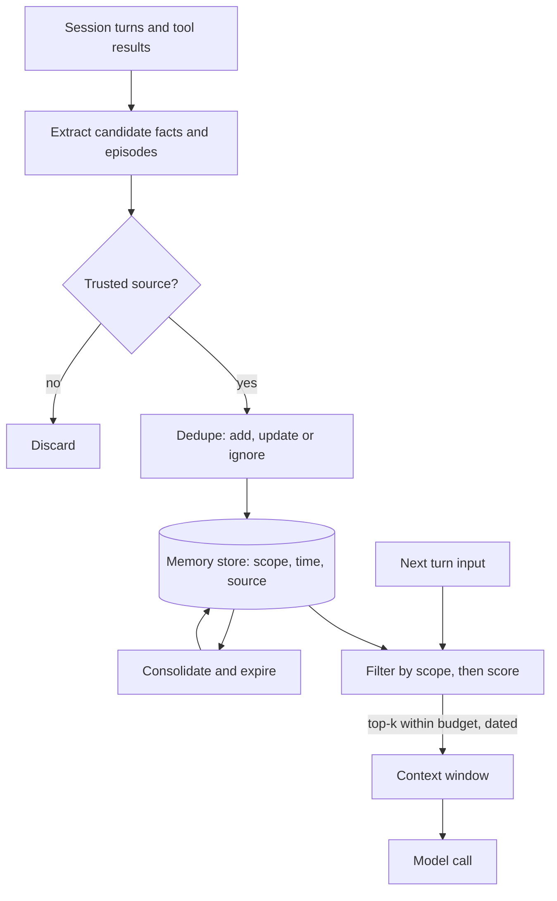

## TL;DR
A model remembers only its context window; agent memory decides what enters it. Short-term is the
window, long-term holds facts and procedures across sessions, episodic records timestamped events.
Memory is RAG over the agent's own history, plus a write path.

## Why it exists
- **A model call is a pure function of its input.** Close the session and the agent forgets the user's
  name, that the staging database is read-only, and that the last deployment failed on a missing
  environment variable. Users experience an assistant that asks the same questions every day.
- **Inside one session it is the mirror image.** The context fills with tool output; once the window is
  full something must go, so the agent "forgets" the start of the task it is still doing.
- **"Keep everything in context" fails on three axes:**
  - **Cost:** every token is re-read on every step, so a 100k-token history makes each step expensive
    (prompt caching discounts a repeated prefix, but cached tokens are still billed and still add latency).
  - **Capacity:** the window is finite and long sessions exceed it.
  - **Quality:** attention over very long contexts is uneven, so a fact in the middle of a huge history is
    attended to less reliably than the same fact placed near the question.
- **"A vector store of all past messages" is only a start.** Raw transcripts retrieved by similarity
  return chatter rather than facts, contradict each other when the user changes their mind, and never forget.
- **So memory needs distinct types,** each with its own write rule, storage, retrieval rule and lifetime.
  The cognitive-architecture framing (working, episodic, semantic, procedural) is useful not because agents
  are brains but because it separates "what happened" from "what is true" from "how to act".

## How it works
### The memory types at a glance
| Type | What it holds | Lives in | Read how |
|---|---|---|---|
| Short-term (working) | System prompt, conversation, tool results, plan, scratch notes | The context window | Directly |
| Semantic (long-term) | Facts about user, environment, domain | Store with embeddings, often plus key-value or graph | Retrieved by relevance |
| Procedural (long-term) | How to do things | Prompts, skill files, a small library | Read whole |
| Episodic | Specific timestamped events with outcome | Store with time, context and outcome | Relevance, recency, importance |

### Short-term (working) memory
- **The only memory the model reads directly,** so everything else must be loaded into it.
- **Managed by budgets:** reserve space for the system prompt and retrieved memories, truncate or summarise
  old turns, drop verbose tool outputs after use, and keep the plan near the end where attention is strongest.
- **Compaction** (summarising older turns into a short note) is the standard way to extend a session beyond
  the window; the trade is fidelity for room.

Treat the window as a budget you allocate, not a bucket you fill. Illustrative split for a 128k window:

| Slot | Budget |
|---|---|
| System prompt and tool schemas | about 3k |
| Retrieved long-term memories | 2k |
| Plan | 1k |
| Reserved for the model's output | 8k |
| Conversation and tool results | the rest |
| Compaction trigger | well before the limit, say at 70–80% |

- **Trigger compaction early** *because* compacting under pressure, mid-tool call, is when constraints get
  dropped.
- **Each slot has an owner and a cap,** so a 40k-token tool result cannot silently evict the retrieved
  memories.

### Long-term memory
Persisted outside the model and loaded on demand. Two sub-types matter in practice:
- **Semantic memory: facts.** Short declarative statements about the user, environment and domain, with
  provenance and a timestamp ("user's team deploys on Tuesdays", "prod DB is Postgres 15"). Written by an
  extraction step that reads a turn or session and emits candidate facts, deduplicated against the store.
  Stored as text with embeddings, often alongside a key-value or graph layer for exact lookups.
- **Procedural memory: how to do things.** From the system prompt and tool descriptions to learned recipes
  ("to reset the cache, call X then wait for Y"). It lives in prompts, skill files or a small library,
  *because* procedures are read whole rather than retrieved by similarity.

### Episodic memory
- **Records of specific past events:** a conversation, a task attempt, a tool failure, with time, context
  and outcome.
- **Separate from semantic memory** *because* an event is evidence, not a fact: "on Oct 3 the deploy
  failed with a missing variable" is useful even if the cause has been fixed.
- **Consolidation:** a dozen episodes can become one semantic fact ("deploys often fail on missing env
  vars; check first"). Reflexion-style lessons are episodic memory distilled into guidance.
- **Retrieval blends relevance, recency and importance,** as in the Generative Agents memory stream:

```
score(m) = α·relevance(q, m) + β·recency(m) + γ·importance(m)
relevance  = cosine(embed(q), embed(m))
recency    = decay^(time since m was last accessed)      # exponential, e.g. per hour
importance = a 1-10 rating the model assigns when m is written, rescaled to [0, 1]
```

- **Normalise each term** to a common range before weighting.
- **Score importance at write time** *because* it does not depend on the query: "user's production database
  was deleted" matters more than "user said thanks" no matter what is asked later.
- **Each term guards against a failure:** without importance, recency lets recent trivia bury a significant
  old event; without recency, a store of thousands of episodes surfaces stale ones forever.

### The read and write paths
1. **Write.** At turn or session end, an extraction prompt proposes facts and episodes. Each is checked
   against existing entries (add, update, ignore), tagged with source and time, embedded and stored.
   - **Write gating:** only store from trusted sources, never from retrieved third-party text, or memory
     becomes a persistence layer for prompt injection.
2. **Read.** At the start of a turn, build a query from the current input (and plan), retrieve top-k
   memories within a token budget, and place them in a labelled block in the system prompt or first user
   turn, with timestamps so the model can judge staleness.
3. **Consolidate.** Periodically merge duplicates, summarise episodes into semantic facts, and expire what
   is stale. This keeps retrieval quality from degrading as the store grows.

### Scope: whose memory is it
Every memory belongs to a scope, and the scope is a hard filter, not a ranking signal:

| Scope | Contents | Who writes |
|---|---|---|
| **Session** | Working notes that die with the task | The agent |
| **User** | Preferences, history | Extraction from that user's sessions |
| **Tenant or organisation** | Shared facts such as "our staging cluster is `stg-eu`", readable by everyone in that tenant | Few |
| **Global** procedural | The agent's own instructions and skills | Engineers, through review |

Choose the scope at write time *because* a fact at the wrong scope is either invisible where it is needed
or leaks where it must not appear.

### Model-managed memory
- **MemGPT-style designs expose memory operations as tools:** the model decides to save a fact, search
  archival memory or page old context out.
- **It works** *because* the model knows what it will need, but costs tool calls and is only as reliable
  as the model's judgement.
- **Common hybrid:** a small model-managed "core" block plus automatic extraction and retrieval.

## Diagram
Follow the two paths around the model: writes are gated and deduplicated before storage, reads are
scoped, scored and budgeted before they enter the context window.



## Examples
### A minimal semantic memory layer
Extract facts at session end, store them with embeddings and timestamps, retrieve by cosine similarity
weighted by recency, and inject them into the next session's prompt.

```python
import time, numpy as np

store = []                                       # [{user, text, vec, ts, source, kind}]

def embed(text):                                 # any embedding model; returns unit vector
    v = np.asarray(embedding_model(text), dtype=float)
    return v / np.linalg.norm(v)

def write_memories(user_id, transcript):
    facts = llm_json(f"From this conversation extract durable facts about the user or their "
                     f"environment as a JSON list of short statements. Ignore chit-chat.\n{transcript}")
    for f in facts:
        vec = embed(f)
        mine = [m for m in store if m["user"] == user_id]
        near = max(mine, key=lambda m: float(vec @ m["vec"]), default=None)
        if near is not None and float(vec @ near["vec"]) > 0.92:   # threshold is model-specific
            near.update(text=f, vec=vec, ts=time.time())  # crude "newest wins" supersede
            continue
        store.append({"user": user_id, "text": f, "vec": vec, "ts": time.time(),
                      "source": "user_conversation", "kind": "semantic"})

def recall(user_id, query, k=5, half_life_days=30):
    q = embed(query)
    scored = []
    for m in store:
        if m["user"] != user_id:                 # scope first: never cross users
            continue
        age_days = (time.time() - m["ts"]) / 86400
        recency = 0.5 ** (age_days / half_life_days)
        scored.append((0.8 * float(q @ m["vec"]) + 0.2 * recency, m))
    top = sorted(scored, key=lambda s: -s[0])[:k]
    return "\n".join(f"- ({time.strftime('%Y-%m-%d', time.localtime(m['ts']))}) {m['text']}"
                     for _, m in top)

system = "You are a deployment assistant.\n\nKnown about this user (may be stale):\n" \
         + recall("u42", "help me ship the payments service")
```

- **Illustrative values:** the weights, the 0.92 threshold and the half-life. The shape to copy is scoping
  by user before scoring, blending relevance with recency, and surfacing timestamps so the model can
  discount old facts.
- **The recency weight is small** *because* these are semantic facts: "prod DB is Postgres 15" is not less
  true for being old, and heavy decay would let last week's trivia outrank it. An episodic store would
  weight recency more and add the importance term above.
- **The write path supersedes.** "plan is Pro" and "plan is Basic" embed as near-duplicates, so *skipping*
  near-duplicates would keep the stale fact and drop the new one. The crude fix lets the newest statement
  win; the update-policy lesson replaces it with an explicit add/update/ignore decision and keeps the
  superseded value for audit.

### Episodic scoring: why the importance term matters
Runnable pure Python. Relevance is fixed per episode for clarity (normally a cosine score); the decay,
weights and ratings are illustrative.

```python
DECAY = 0.995                       # per hour since last access (illustrative)
W_REL, W_REC, W_IMP = 1.0, 1.0, 1.0

episodes = [  # relevance would come from cosine(embed(q), embed(m)); fixed here for clarity
    {"text": "prod database deleted by a migration, restored from backup", "rel": 0.55,
     "hours_since_access": 24 * 40, "importance": 10},
    {"text": "user said thanks after the deploy", "rel": 0.50, "hours_since_access": 2, "importance": 1},
    {"text": "deploy failed: missing env var PAYMENTS_KEY", "rel": 0.80,
     "hours_since_access": 24 * 6, "importance": 7},
]

def score(m, use_importance=True):
    recency = DECAY ** m["hours_since_access"]
    importance = (m["importance"] - 1) / 9          # 1-10 rating rescaled to [0, 1]
    return W_REL * m["rel"] + W_REC * recency + (W_IMP * importance if use_importance else 0)

for flag in (False, True):
    ranked = sorted(episodes, key=lambda m: -score(m, flag))
    print("with importance" if flag else "without importance",
          [f"{m['text'][:28]} ({score(m, flag):.2f})" for m in ranked])
# without importance: "user said thanks" ranks first (1.49), the deleted database last (0.56)
# with importance:    deploy failure 1.95, deleted database 1.56, thanks 1.49
```

### Worked scenario: one 40k tool result in a 128k window
| Without slot caps | With slot caps |
|---|---|
| System 3k + memories 2k + plan 1k + history 90k fill the window | Same starting point |
| A 40k log dump arrives; the oldest content (retrieved memories, early constraints) is truncated | Tool-result slot is capped; the log is summarised or stored with a reference |
| The agent forgets "staging DB is read-only" and tries a write | Memories and plan stay in their reserved slots |
| Compaction then fires mid-tool call under pressure | Compaction fired earlier, near 70–80%, at a turn boundary |

## Production patterns
- **Scope as a mandatory filter in the query.** Put user and tenant ids in every memory row and apply them
  as a metadata filter in the vector query itself, not after retrieval. Monitor with a canary test that
  queries as one user and asserts no other user's rows return.
- **Write gating by source.** Tag each candidate memory with its source and accept only user statements and
  verified tool results; drop anything derived from retrieved documents or web pages. Monitor rejected
  writes by source.
- **Dated memory block in the prompt.** Render retrieved memories with their dates under a heading such as
  "may be stale", capped by a token budget. Monitor staleness incidents from a labelled "changed details"
  test set.
- **Scheduled consolidation job.** Run a periodic job that merges near-duplicates, rolls episodes into
  semantic facts and expires entries past their lifetime. Monitor store growth per user and retrieval hit
  rate over time.
- **Context budget with early compaction.** Assign token caps per slot and trigger compaction at a turn
  boundary around 70–80% of the window. Monitor tokens per turn and constraint violations after compaction.

## Trade-offs
- **Small context vs missed facts.** Externalising memory keeps the context small and cheap, but every
  retrieval is a chance to miss the fact that mattered; when sessions are short and the history fits,
  keeping it in context is simpler.
- **Precise retrieval vs lossy extraction.** Extracting facts at write time makes retrieval precise, yet
  extraction is lossy and biased by the prompt; storing raw episodes too lets you re-extract later at
  storage cost.
- **Targeted vs consistent.** Model-managed memory tools adapt to what the task needs, at the cost of extra
  tool calls and reliance on the model remembering to save; automatic extraction is more consistent but
  less targeted.
- **Freshness vs stable facts.** Recency weighting keeps memories fresh, but buries stable long-term facts
  under recent trivia unless importance or a semantic/episodic split counterbalances it.

## Pitfalls
- **Storing raw transcripts and retrieving by similarity alone.** Symptom: "memories" that are chatter,
  contradictions surfacing together, and the model picking the wrong one. Fix: extract facts.
- **Writing memories from untrusted content** such as web pages or documents. Symptom: an instruction that
  persists across sessions after a single injected page. Fix: gate writes by source.
- **No timestamps or provenance on memories.** Symptom: the agent confidently acts on a preference the user
  changed months ago. Fix: store and show dates and sources.
- **Missing tenant or user scoping in retrieval.** Symptom: one user's facts appear in another user's
  session, a privacy incident rather than a quality bug. Fix: scope as a hard filter.
- **Treating compaction summaries as lossless.** Symptom: an agent forgets a constraint stated early in a
  long session right after the context was compacted. Fix: pin constraints outside the compacted region.

## When to use
- **Add long-term memory when** the same user or environment returns across sessions and re-asking costs
  trust or time: personal assistants, support agents, developer tools tied to one codebase.
- **Add episodic memory when** past attempts carry lessons: recurring tasks, flaky environments, anything
  with a failure history.
- **Skip persistent memory** for one-shot tasks, and prefer in-context history when sessions are short.
- **Measure** retrieval hit rate on a labelled set of "should have remembered" cases, staleness incidents,
  and token cost per turn.
- **On the job:** the extraction prompt, the store schema and the retrieval budget.
- **Interviews:** separate the three types, explain the write and read paths, and say why memory needs
  scoping and provenance.

## Role lens
- **Engineer:** Builds the extraction and recall steps, the store schema with timestamps and scope,
  and the context budget that decides how much memory each turn receives.
- **Architect:** Chooses which memory types the product needs, where they live, how they are isolated
  per tenant, and how memory interacts with compaction and state persistence.
- **FDE:** Decides with the customer what the agent may remember about their users and systems,
  demonstrates the recall quality, and handles their privacy review.

## Check yourself
**Q:** A customer-support agent remembers users well for a week, then starts giving answers that mix
up current and outdated account details. Diagnose the likely memory design flaws and fix them.
**A:** The symptoms point to an append-only semantic store with no update or recency handling. When
a user's plan changes, a new fact is added beside the old one, and similarity retrieval returns both
because they are nearly identical text; the model then picks arbitrarily. Fix the write path: on each
candidate fact, retrieve near-duplicates and decide add, update or ignore, superseding the old entry
and keeping history for audit. Fix the read path: store timestamps and provenance, blend recency into
scoring, and show dates in the injected block so the model can prefer the newer fact. Separate
episodic records ("plan changed on date X") from the semantic fact ("plan is Pro") so events do not
masquerade as current truth. Finally, add a staleness test: a labelled set of users with changed details
where the agent must answer with the latest value.

## Interview questions
### Explain short-term, long-term and episodic memory for an agent and why they are separate.
- **Short-term** is the context window, the only memory the model reads directly, managed by budgets and
  compaction.
- **Long-term** holds semantic facts and procedures across sessions; **episodic** holds timestamped
  events. They are separate because an event is evidence, not current truth, and needs different
  retrieval and lifetime.

### Why not just keep the entire conversation history in a long context window?
- **Cost:** every step re-reads every token; caching discounts but still bills.
- **Capacity and quality:** long sessions exceed the window, and facts in the middle of a huge context are
  attended to less reliably than the same facts retrieved and placed near the question.

### A user reports seeing another customer's details in the assistant's replies. What do you check?
- **Retrieval scoping first:** is the user and tenant filter applied inside the store query, or only after
  retrieval, or missing for some memory kinds?
- **Then the write path:** were facts written at the wrong scope, for example tenant instead of user?
- **Treat it as a privacy incident:** contain, audit affected rows, and add a cross-user canary test.

### How would you design episodic retrieval so a major old incident is not buried by recent small talk?
- **Blend three terms:** relevance, recency with exponential decay, and an importance rating assigned at
  write time, each normalised before weighting.
- **Importance is query-independent,** so "production database was deleted" stays high weeks later while
  "user said thanks" fades.

### What stops memory from becoming a persistence layer for prompt injection?
- **Write gating by source:** only user statements and verified tool results may create memories, never
  retrieved web pages or documents.
- **Provenance on every row** so a suspicious memory can be traced and purged, plus review for shared
  tenant or global memory.

## Quiz
### Q: Why keep episodic memory separate from semantic memory instead of storing everything as facts?
- [ ] Episodic memories are too long to embed
- [x] An event is evidence with a time, not a current truth, and many events can be consolidated into one fact
- [ ] Semantic memory cannot be timestamped
- [ ] Vector databases only support one collection per agent
> "The deploy failed on Oct 3" is useful history even after the cause is fixed; treating it as a fact
> would make the agent believe deploys currently fail. Keeping events separate lets consolidation derive durable facts.

### Q: What is the most important property of the memory write path from a security standpoint?
- [ ] Facts are embedded with a high-dimensional model
- [ ] Memories are stored in the same database as the application data
- [x] Only trusted sources such as user statements and verified tool results are allowed to create memories
- [ ] Writes happen at the end of every turn
> If retrieved documents or web pages can create memories, a single injected instruction persists into
> every future session. Gating writes by source is what keeps memory from becoming a persistence layer for injection.

### Q: Why is "keep the whole history in context" not a substitute for a memory system?
- [ ] Models cannot read more than a few thousand tokens
- [x] Cost scales with tokens re-read per step, the window is finite, and attention over long contexts is uneven
- [ ] Context windows cannot contain tool results
- [ ] History in context cannot be scoped per user
> Every step re-reads the full context, long sessions eventually exceed it, and facts buried in a huge
> history are attended to less reliably than the same facts retrieved and placed near the question.
