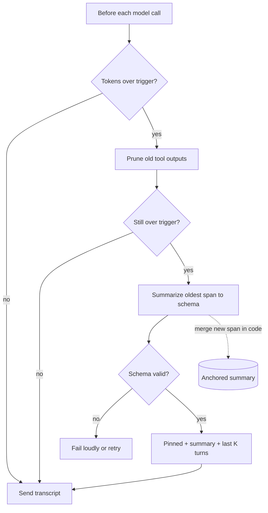

## TL;DR
An agent re-sends its whole growing transcript every step, so cost is quadratic and quality drops before
the limit. Compaction replaces old material with pruned outputs, a structured summary or pointers to
external state; the hard part is choosing what must survive.

## Why it exists
- **The loop is append-only.** Each iteration adds reasoning, a tool call and its result, and the next
  call re-sends everything. Tool results dominate: a file read, a search returning fifty hits, a test log.
- **Cost is quadratic, value is linear.** Illustratively, at 3,000 tokens per step, step 40 sends about
  120,000 tokens, and the run has sent 3,000 × (1 + 2 + … + 40) ≈ 2.5 million tokens for information
  that grew linearly.
- **Three things break before the budget does.** The hard limit (a 200k-token window ends the run
  mid-task, usually on the hard, long runs); quality ("lost in the middle": the task statement at
  position 2 competes with 100k tokens of logs); and distraction (stale errors and abandoned plans keep
  pulling the model back).
- **Naive fixes fail.** Dropping the oldest messages removes the system prompt, task and constraints,
  the most important tokens. A bigger window moves the wall but keeps the quadratic cost and the
  attention dilution. "Be concise" does not control tool output sizes, which is where the tokens are.
- **Prompt caching is not a substitute.** An unchanged prefix is billed at a discount on providers that
  support it, but that only changes the price of re-reading. The window limit and quality problems are
  untouched, so caching is a reason to compact rarely, not a reason not to compact.

Compaction is the harness taking ownership of what the model sees, with an explicit policy for what
must be preserved.

## How it works
### Weigh the transcript by class
| Class | Contents | Policy |
|---|---|---|
| *Pinned* | system prompt, task statement, constraints, tool schemas | small; never dropped |
| *Working memory* | the last few turns | stays verbatim: the model is reasoning about it now |
| *History* | old tool outputs and old reasoning | the bulk; mostly dead once acted on |

Compaction targets history, because that is where the tokens are and where the loss is cheapest: the
model read the file, edited it and moved on.

### Layer 1: prune observations
1. **Cap tool outputs at ingestion.** Return the first and last N lines with a marker and write the full
   output to a file the model can grep, because a 12,000-line log is almost never read in full.
2. **Stub what has been acted on.** Replace an old observation with a short stub ("output of 40 KB
   pruned; re-run the tool if needed").
3. **Keep the last K observations intact**, because the model may still be reading them.

- **Practically lossless when tools are idempotent:** the information is one call away.
- **Often the biggest win.** In a tool-heavy run tool output is typically the large majority of tokens,
  so this layer alone can extend achievable run length several-fold. How much depends entirely on your
  output mix; measure it.
- **Still a prefix edit.** Everything after the first stubbed message misses the prompt cache, so batch
  stubbing at compaction time rather than doing it every step.

### Layer 2: summarize across a threshold
- **Trigger** at a fraction of the window, say 60–80%, leaving headroom for the summary call's own
  output and the next step's response.
- **Shape:** summarize the *oldest span* and keep recent turns verbatim: pinned + summary + last K turns.
- **The summary must be structured**, because free-form "summarize the conversation" reliably drops what
  an agent needs to avoid redoing work: exact paths, IDs it created, the error string it saw, the
  decision and why.
- **A schema forces those fields** (goal, constraints, decisions-with-reasons, state of the world: files
  changed, resources created, commands run and their results; open issues; next step) and lets you
  validate the output before accepting it.
- **Summarizer choice:** a cheaper model can write it if the schema is strict and validated; the same
  model is safer when nuance matters.

### Layer 3: externalize state
- **Beyond a certain run length**, the context should be a cache of durable state, not its only copy.
- **Progress files or memory stores** ("done: A, B; next: C; gotchas: …") that the agent is told to read
  back allow aggressive compaction, because the summary only needs to point at the file.
- **This is where compaction meets agent memory:** the summary is short-term memory, the file is
  long-term.

### Boundaries and the prompt cache
- **Cut only at message boundaries; never separate a tool call from its result.** APIs reject orphaned
  tool results, and a call whose result vanished invites the model to hallucinate one.
- **Any compaction breaks the cache suffix.** Caches match the longest unchanged prefix, so after a
  summary or a stub the next call misses for everything after the first changed message; only the
  pinned head (system prompt, tools, task) still hits.
- **So compact rarely and in large chunks** rather than a little every step.
- **Tell the model it happened** ("earlier context was compacted; summary follows"), because otherwise it
  will refer to things it believes it can still see.

### The second compaction: merge, do not re-summarize
- **The naive second pass** summarizes a transcript that already contains a summary, so facts pass
  through the lossy step repeatedly and drift ("created PR #4812" becomes "opened a PR" becomes nothing).
- **Anchored (incremental) summarization:** keep the summary as a structured object the harness owns;
  each compaction asks the model only to summarize the *new* span, then merges field by field in code.
- **Append-only fields** (decisions, IDs created, errors seen) are concatenated and never rewritten by
  the model. **Overwrite fields** (current state, next step) take the newest value.
- **Result:** each fact goes through the lossy step exactly once.

### Isolate instead of compact
- **The cheapest tokens to compact never entered the main context.** Delegate a noisy sub-task (search
  the codebase for every caller of `charge()`) to a sub-agent with a fresh context and return only its
  condensed answer.
- **Same idea, different boundary:** compaction applied at the edge of a task rather than over time.
- **Provider features:** some providers now offer server-side context editing or compaction. They
  implement the same layers; you still own the policy for what must survive.

### What must survive
The test: would forgetting this cause a wrong action?

| Survives | Can go |
|---|---|
| constraints ("do not touch production") | file contents (re-readable) |
| decisions already made, with reasons | search results (re-runnable) |
| identifiers of things created | old logs already acted on |
| user preferences, partial results | anything cheaply re-derivable |

## Diagram
Before each model call the harness tries the cheap, lossless layer first and only pays for a summary
when pruning is not enough.



## Examples
### Compaction step that runs before each model call
It prunes old tool outputs first, because that needs no extra model call and loses nothing a re-run
cannot recover, and only summarizes when pruning is not enough. Both are prefix edits, so the cache is
rebuilt after either; the threshold check keeps them rare. The summary is JSON and is validated before
it replaces the old span.

```python
import json

LIMIT, TRIGGER, KEEP_RECENT = 100_000, 0.7, 6   # window budget, compaction threshold, verbatim tail

SUMMARY_PROMPT = """Summarize the conversation so far for an agent that will continue it.
Return JSON with keys: goal, constraints, decisions (each with its reason),
state (files changed, ids created, commands run and their results), open_issues, next_step.
Be exact with paths, ids and error strings. Never invent."""

def prune_old_outputs(messages, keep_recent):
    for m in messages[:len(messages) - keep_recent]:
        if m["role"] == "tool" and len(m["content"]) > 500:
            m["content"] = f"[tool output of {len(m['content'])} chars pruned; re-run the tool if needed]"
    return messages

def compact(messages, llm, count_tokens):
    if count_tokens(messages) < TRIGGER * LIMIT:
        return messages
    messages = prune_old_outputs(messages, KEEP_RECENT)
    if count_tokens(messages) < TRIGGER * LIMIT:
        return messages                      # pruning was enough; no summary call needed
    pinned, old, recent = messages[:2], messages[2:-KEEP_RECENT], messages[-KEEP_RECENT:]
    while recent and recent[0]["role"] == "tool":       # never split a tool call from its result
        old.append(recent.pop(0))
    raw = llm(pinned + old + [{"role": "user", "content": SUMMARY_PROMPT}])
    data = json.loads(raw)                               # a broken schema must fail loudly, not silently
    missing = [k for k in ("goal", "state", "next_step") if not data.get(k)]
    assert not missing, f"summary missing {missing}"
    note = {"role": "user", "content": "Earlier context was compacted. Summary:\n" + json.dumps(data, indent=1)}
    return pinned + [note] + recent          # system prompt + task statement stay pinned
```

### Anchored merge for the second and later compactions
The model summarizes only the new span; code merges it, so identifiers are never re-paraphrased. Runs
as-is.

```python
APPEND = ("constraints", "decisions", "ids_created", "errors_seen")   # never rewritten by the model
OVERWRITE = ("state", "open_issues", "next_step")                     # newest value wins

def merge(summary: dict, span: dict) -> dict:
    out = {k: list(v) if isinstance(v, list) else v for k, v in summary.items()}
    for k in APPEND:
        kept = out.setdefault(k, [])
        kept += [x for x in span.get(k, []) if x not in kept]
    for k in OVERWRITE:
        if span.get(k):
            out[k] = span[k]
    return out                     # "goal" is pinned: the model's span summary cannot touch it

s1 = {"goal": "fix flaky checkout test", "constraints": ["do not touch production"],
      "ids_created": ["PR #4812"], "state": "test isolated", "next_step": "patch retry logic"}
s2 = {"ids_created": ["ticket OPS-91"], "state": "patch pushed", "next_step": "wait for CI",
      "goal": "opened a PR"}                       # a drifted paraphrase is ignored
m = merge(s1, s2)
print(m["goal"], m["ids_created"], m["next_step"])
# fix flaky checkout test ['PR #4812', 'ticket OPS-91'] wait for CI
```

### Worked scenario: one run, illustrative numbers
| Moment | What happens |
|---|---|
| Step 28 | transcript is 72k tokens against a 70k trigger |
| Diagnosis | 54k of it is tool output older than the last six messages |
| Layer 1 | pruning stubs that down to about 1k, leaving roughly 19k |
| Result | no summary call; only the cache suffix after the first stub is rebuilt |
| Many steps later | no large outputs left to prune; the trigger fires again and the summary path runs |
| Every later pass | a production version merges the new span into the existing summary object |

## Production patterns
- **Cap tool output at the source.** When any tool can return unbounded text (logs, search, file reads).
  Return head and tail of N lines plus a path to the full output on disk. Monitor tokens per tool call
  broken down by tool name; one tool usually dominates.
- **Threshold-triggered structured summary.** For runs that outlive pruning. Trigger near 70% of the
  window, validate the JSON against required keys, retry once, then fail the run rather than accept a
  broken summary. Monitor compactions per run and summary validation failure rate.
- **Harness-owned anchored summary.** For any run that compacts more than once. Store the summary object
  beside the run checkpoint and merge new spans in code, as in the merge example. Monitor
  probe-question accuracy after the second and third compaction.
- **Cache-aware batching of edits.** Stub and summarize only at compaction time, never per step. Monitor
  the provider's cached-token usage field (for example `cache_read_input_tokens` on Anthropic or
  `cached_tokens` in OpenAI's prompt token details) per step.
- **Sub-agent isolation for noisy searches.** When a sub-task is mostly exploration. Give it a fresh
  context and a return-size cap on its answer. Monitor parent context growth per delegated task.
- **Compaction regression eval.** Before changing thresholds or summarizer models. Replay recorded runs,
  compact them, and ask probe questions whose answers sit in the dropped span. Track task success and
  probe accuracy, not just tokens saved.

## Trade-offs
- **Bounded context vs full recall.** Compaction is lossy by construction: a cheaper, bounded context in
  exchange for the guarantee that every earlier fact is still visible. Flips when the task depends on
  exact earlier text (a long diff, contract wording); then externalize to a file rather than summarize.
- **Summary call vs remaining run length.** A summary costs one model call over the whole old span. It
  pays only if the run continues for many more steps; a run that ends two steps after the threshold paid
  for nothing.
- **Smaller prefix vs cache hits.** Rewriting the prefix invalidates the prompt cache. Rare, large
  compactions keep hit rates high; frequent small ones can cost more in cache misses than they save.
- **Pruning vs re-run cost.** Pruning assumes re-running the tool is cheap and side-effect-free. Flips
  when the tool is a paid API, a slow query, or non-idempotent.
- **Cheaper summarizer vs fidelity.** A cheaper model lowers cost but drops specifics more often; a
  strict schema with validation recovers most of that, at the price of a retry loop when validation fails.

## Pitfalls
- **Summarizing away the task statement or a constraint.** Symptom: an agent that confidently finishes a
  slightly different task, or asks what it was supposed to do. Fix: pin them outside the compacted span.
- **Summaries without IDs ("created a ticket").** Symptom: duplicates, such as a second ticket, a second
  pull request, a second charge. Fix: an `ids_created` field the schema requires.
- **Cutting between a tool call and its result.** Symptom: API errors about unmatched tool results, or a
  model that invents the missing result. Fix: move the boundary until pairs stay together.
- **Compacting on every step.** Symptom: a collapsing cache hit rate, rising cost per step, and a summary
  that drifts because it is a summary of a summary of a summary. Fix: a threshold.
- **Re-summarizing the previous summary with the new span.** Symptom: identifiers and decisions present
  after the first compaction are vague or gone after the third. Fix: anchored merge.
- **Not telling the model compaction happened.** Symptom: references to "the file above" that no longer
  exists, followed by made-up contents. Fix: an explicit compaction note.
- **Secrets or personal data flowing into a persisted summary.** Symptom: credentials in a memory store
  or a log. Fix: redact tool outputs before they can reach the summarizer.

## When to use
- **Use when:** any agent runs more than a handful of steps (at least Layer 1); anything long-running
  (coding agents, research agents, multi-hour operations tasks) needs all three layers.
- **Do not start with summarization:** measure where the tokens are (almost always tool outputs) and
  prune at the source.
- **Measure:** tokens per step, prompt-cache hit rate, the fraction of runs that hit the window limit,
  and task success before and after. A policy that saves 40% of tokens and loses 10% of task completions
  is a net loss.
- **Test fidelity directly:** compact a recorded run and ask probe questions answered in the dropped span
  (which PR did you open? which constraint applies?); a wrong answer is a schema gap.
- **Interviews:** derive the quadratic cost of an uncompacted run and explain why the summary must be
  structured and cut at tool-call boundaries; that is the expected depth.

## Role lens
- **Engineer:** Implements the pruning and summary step in the harness, chooses thresholds, validates
  summaries against a schema, and watches cache hit rate and context-limit failures.
- **Architect:** Decides what state is durable (files, memory store) versus transient (context), and
  sets the policy for what must never be compacted, including secrets and constraints.
- **FDE:** Diagnoses customer runs that "forget" instructions mid-task, and tunes what the summary
  preserves for the customer's domain, such as case IDs or regulatory constraints.

## Check yourself
**Q:** You are building a coding agent that routinely runs 200+ steps against a 200k-token window, with
test logs and file reads as the dominant tool outputs. Design its compaction policy and explain what
must survive each compaction.
**A:** Start at the source: cap tool outputs (head and tail of logs, full output written to a file the
agent can grep), because that removes most tokens without losing anything. After the model acts on an
observation, stub it out, keeping the last five or six intact. Trigger summarization at roughly 70% of
the window, summarizing only the oldest span and keeping the system prompt, task statement and recent
turns verbatim, cut at message boundaries so tool calls and results stay paired. The summary must be
structured: goal and acceptance criteria, decisions with reasons, files changed, commands run with
outcomes, errors seen and fixes, open issues, next step. Persist a progress file so the summary can
point to it. On the second and later compactions, summarize only the new span and merge it into the
existing summary in code, so IDs and decisions are never re-paraphrased. Delegate noisy searches to
sub-agents so their output never enters the main context. Measure cache hit rate, task success and
probe-question accuracy after compaction, not just token savings.

## Interview questions
### Why is an uncompacted agent run quadratic in cost, and why does prompt caching not fix it?
- **Every step re-sends the whole transcript**, so with roughly constant tokens added per step the total
  sent over n steps is proportional to 1 + 2 + … + n, which is O(n²).
- **Caching only discounts the price** of re-reading an unchanged prefix. The window still fills, the
  middle of the context is still used less reliably, and stale observations still distract the model.

### A support agent starts creating duplicate tickets after about an hour. How do you debug it?
- **Suspect compaction first:** check whether the duplicates appear right after a compaction event and
  whether the summary still lists the ticket IDs created earlier.
- **Replay the run** up to that point and ask a probe question ("which tickets have you opened?"); a
  wrong answer confirms a schema gap.
- **Fix:** a required `ids_created` append-only field merged in code, plus idempotency keys on the
  ticket tool so a forgetful agent still cannot create a second one.

### When would you not summarize, and externalize state instead?
- **When exact text matters:** a long diff, contract wording, a config file. A summary paraphrases, and
  a paraphrase of a contract clause is a different clause.
- **Write it to a file or memory store** and keep only a pointer in context, so the agent can re-read the
  exact text when it needs it.

### How do you choose the compaction trigger and keep-recent size?
- **Trigger** around 60–80% of the window, leaving room for the summary call's own output and the next
  response; too low wastes summary calls, too high risks hitting the limit mid-step.
- **Keep-recent K** covers what the model is still reasoning about, typically the last few tool
  call/result pairs, adjusted so the boundary never splits a pair.
- **Tune with data:** compactions per run, cache hit rate and task success on replayed runs.

### What goes wrong on the third compaction that did not go wrong on the first?
- **Repeated lossy passes:** if each compaction re-summarizes the previous summary, facts drift each
  time ("created PR #4812" becomes "opened a PR" becomes nothing).
- **Anchored summarization** fixes it: the model summarizes only the new span and code merges fields, so
  each fact passes through the lossy step exactly once.

## Quiz
### Q: Why should a compaction summary follow a fixed schema rather than being a free-form paragraph?
- [ ] Because JSON is cheaper to tokenize than prose
- [x] Because free-form summaries reliably drop the specific identifiers, paths and decisions the agent needs to avoid redoing work
- [ ] Because the model cannot read its own earlier reasoning in prose form
- [ ] Because the API requires tool results to be JSON
> A schema forces the presence of goal, decisions, created IDs and next steps, and lets the harness
> validate the summary. Prose is not more expensive to tokenize; it is just unreliable about what it keeps.

### Q: What is the main reason not to compact a little on every step?
- [ ] The model becomes confused by frequent summaries
- [ ] Summaries are only valid once per session
- [x] Each compaction rewrites the prompt prefix, so the prompt cache misses and the summary drifts into a summary of summaries
- [ ] Tool results cannot be pruned more than once
> Compaction changes the start of the prompt, which invalidates cached prefixes, and repeated
> re-summarization compounds loss. Rare, larger compactions keep the cache hot and the summary close to
> the original facts.

### Q: Which item is safest to drop during compaction?
- [ ] The constraint "do not modify the production database"
- [ ] The ID of the pull request the agent opened
- [x] The full contents of a source file the agent already edited
- [ ] The user's stated preference for a particular library
> File contents are cheaply re-derivable with a tool call. Constraints, created identifiers and user
> preferences are not, and forgetting them causes wrong actions or duplicate side effects.
