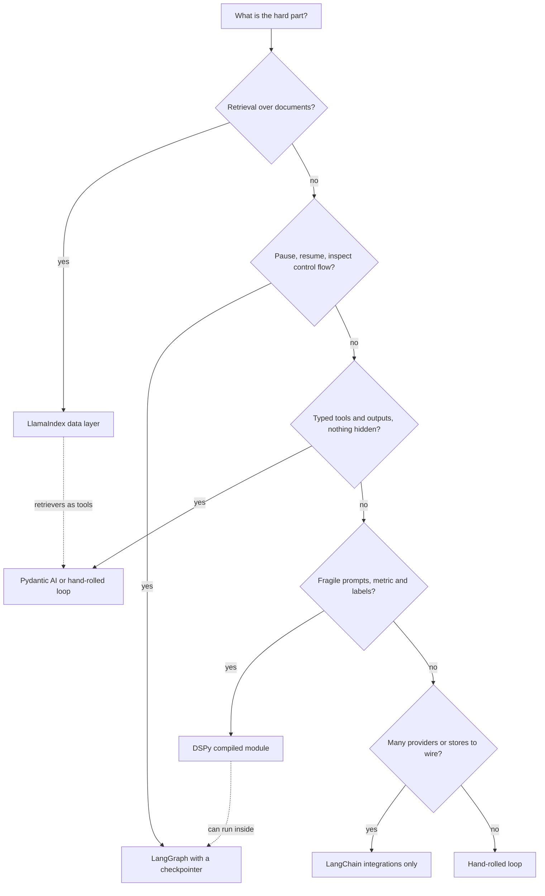

## TL;DR
Agent frameworks package your agent's plumbing: LangChain integrates, LangGraph runs resumable state
machines, LangSmith traces and evaluates, LlamaIndex retrieves, Pydantic AI types, DSPy compiles prompts.
Pick the thinnest layer that solves your agent's hard part.

## For agent builders
- **Why it matters for agents.** Almost every agent job posting and codebase names a stack: LangChain
  and LangGraph for orchestration, LangSmith for tracing and evals, LlamaIndex for retrieval, plus a
  vendor agent SDK. You need to know which layer each one owns, so you adopt one deliberately.
- **Where it shows up in your stack.** Orchestration (LangGraph, Pydantic AI, vendor SDKs such as the
  OpenAI Agents SDK, Claude Agent SDK and Google ADK), retrieval (LlamaIndex, LangChain retrievers),
  tracing and evals (LangSmith, Langfuse, Logfire), durable execution (checkpointers, Temporal), and
  tool protocols (MCP).
- **What you control.** Which layer you take from a framework and which you keep in your own code:
  tools, state types and evals should stay framework-neutral, so a framework swap touches one module.
- **What you can skip.** Memorising every class name. Each framework gets its own deep-dive lesson in
  the Agent frameworks & tooling module (LangChain, LangGraph, LangSmith, LlamaIndex, OpenAI Agents SDK,
  Claude Agent SDK, Pydantic AI, CrewAI, AutoGen, ADK, DSPy, Mastra); this lesson is the map.

## Why it exists
- **A production agent is mostly not model calls.** It is the loop, tool schemas and dispatch, argument
  validation, retries and backoff, streaming, crash-safe state, pausing for a human, tracing, provider
  swaps, and a retrieval pipeline behind it all.
- **Hand-rolled plumbing repeats the same bugs.** Teams write the same two thousand lines: tool results
  appended in the wrong order, a resume that double-executes, a provider migration that touches every
  file. Frameworks make that plumbing reusable.
- **The problems cluster, and so do the frameworks.** Data (parsing, chunking, indexing, querying):
  LlamaIndex. Inspectable, resumable control flow: LangGraph, after LangChain's early agent abstractions
  proved too opaque for production. Typed I/O with no magic: Pydantic AI. Fragile prompts you want to
  stop hand-tuning: DSPy, which treats prompts as parameters to optimize.
- **Both naive paths cost something.** Writing everything yourself is slower at the start and fine later,
  if you are disciplined about the loop and persistence. Adopting a framework blind is fast at the start
  and painful later: hidden prompts, abstractions that leak the moment you need something different, and
  version churn.

The skill is knowing which problem each framework actually solves, so you adopt the layer you need and
no more.

## How it works
### The common core
Strip any framework down and the same loop remains:
1. Assemble messages (system prompt, history, tool schemas).
2. Call the model.
3. Validate and execute any tool calls; append the results.
4. Repeat until a final answer or a budget.

They differ on three questions, which also let you evaluate frameworks not covered here (vendor agent
SDKs, multi-agent libraries):
- **Who owns control flow?** The model inside a loop, or an explicit graph or event flow you wrote.
- **Where does state live?** A message list, a typed state object, or event payloads.
- **What is first-class?** Integrations, retrieval, types or prompt optimization.

Answering those three tells you most of what a framework will be like to debug.

### LangChain
- **What it is:** the broad integration layer, a common interface over chat models, embeddings, vector
  stores, document loaders and tools.
- **Composition primitives:** prompt templates, output parsers, and the Runnable pipe syntax (LCEL) for
  chaining them with streaming, batching and async handled uniformly.
- **Under the hood:** each integration is an adapter to a provider SDK, so swapping providers or vector
  stores is ideally a one-line change (prompts and provider-specific features may still need work).
- **History:** its early agent abstractions (a ReAct loop driven by parsing the model's text) pushed the
  project toward LangGraph for anything stateful.
- **Sharp edges:** deep class hierarchies, prompts embedded in components you did not write, and a
  history of breaking changes between versions.

### LangGraph
- **Agents as graphs:** nodes are functions (often model calls or tool executions); edges are fixed or
  conditional; all nodes read and write a shared typed state (TypedDict or Pydantic model) through
  reducers that define how updates merge.
- **Supersteps:** execution is inspired by Pregel-style bulk synchronous processing, which makes parallel
  branches and fan-in well-defined.
- **Checkpointers** persist state after every step to a store, giving resume after crash, time travel for
  debugging, and **interrupts**: pause at a node for human input, resume later from the checkpoint. It is
  the state-machine lesson made concrete.
- **An interrupt does not freeze a Python frame.** On resume the interrupted node runs again from its
  first line, with `interrupt()` now returning the human's answer. Any side effect before the interrupt in
  that node executes twice; put side effects in their own node after the approval, or make them
  idempotent.
- **Sharp edges:** verbosity for simple cases, a learning curve around reducers and streaming modes, and
  a pull toward the vendor's hosted platform and tracing product for the full experience.

### LlamaIndex
- **A data framework first:** readers for many sources, node parsers (chunking), indexes (vector,
  keyword, summary, knowledge graph), retrievers, response synthesizers and query engines, with emphasis
  on structured and multi-document retrieval.
- **Agents came later:** tool-using agents over query engines, and an event-driven Workflows abstraction
  where steps are functions that consume and emit typed events, a different shape from LangGraph's state
  graph.
- **Choose it when** the hard problem is getting documents into a model well; the agent layer is
  adequate, but the retrieval layer is the reason it exists.
- **Sharp edges:** many abstractions with overlapping names, and defaults (chunk sizes, prompts) that
  work for demos and need tuning for production.

### Pydantic AI
- **Deliberately small,** from the Pydantic team: an `Agent` with a model, a system prompt, tools
  registered with a decorator, a dependency type injected into tools through a run context, and a typed
  output validated by Pydantic.
- **Validation-driven retries:** the model is shown the validation error and asked again.
- **Ecosystem:** model-agnostic, native Logfire integration for tracing, a companion graph library for
  explicit state machines, and in recent versions integration with durable-execution engines such as
  Temporal for runs that must survive restarts.
- **Under the hood** it is the plain agent loop with schemas generated from type hints; little is hidden.
- **Sharp edges:** younger than the others, so fewer integrations, and an API that moved fast before its
  1.0 release (2025), with names such as `result_type` renamed to `output_type`, so older tutorials no
  longer run as written.

### DSPy
- **A programming model, not a loop library.** Declare *signatures* (typed input and output fields with
  a docstring describing the task), compose *modules* (Predict, ChainOfThought, ReAct and others) into a
  program, then *compile* it with an optimizer against a metric and a small training set.
- **Optimizers** such as bootstrapped few-shot selection and instruction search generate and select the
  demonstrations and instructions that maximize the metric; some can also fine-tune weights.
- **The prompt is a compiler artifact,** not something you write. That solves prompt fragility and lets
  you re-optimize when the model changes.
- **Sharp edges:** you need a metric and labelled examples before you get value, optimization costs model
  calls, and the resulting prompts are less legible than hand-written ones.

### LangSmith and the tracing layer
- **LangSmith is not a framework,** it is LangChain's hosted platform for tracing agent runs, building
  datasets, running evaluators and managing prompts. It works with LangChain and LangGraph out of the
  box and with plain code through its SDK's `traceable` decorator.
- **Why agents need it:** a 15-step run fails at step 11, and only a trace of every model call, tool
  call, input and output shows why. The same traces become eval datasets.
- **Alternatives:** Langfuse (open source, self-hostable), Pydantic Logfire and Arize Phoenix, most built
  on or exporting OpenTelemetry. Choosing one is separate from choosing an orchestration framework.

### The wider agent stack
| Layer | Common choices | What it owns in your agent |
|---|---|---|
| Orchestration | LangGraph, Pydantic AI, LlamaIndex Workflows, hand-rolled loop | control flow, state, interrupts |
| Vendor agent SDKs | OpenAI Agents SDK, Claude Agent SDK, Google ADK | the loop, tools and handoffs for one provider's models |
| Multi-agent libraries | CrewAI, AutoGen / AG2, LangGraph subgraphs | roles, delegation, agent-to-agent messages |
| Integrations | LangChain, LiteLLM-style gateways | provider and vector-store adapters |
| Retrieval | LlamaIndex, LangChain retrievers, a vector database | ingestion, chunking, search |
| Tools | MCP servers, typed function tools | what the agent can touch |
| Tracing and evals | LangSmith, Langfuse, Logfire, Phoenix | traces, datasets, scores |
| Durability | LangGraph checkpointers, Temporal | resume after crash or a human pause |
| Prompt optimization | DSPy | compiled prompts against a metric |

The rows combine freely: a typical production agent is one orchestrator, one tracing tool, a vector
store and MCP or typed tools, with the rest hand-written.

### Comparing them
| Your plumbing problem | Fit |
|---|---|
| integration breadth | LangChain |
| inspectable, resumable control flow with human interrupts | LangGraph |
| document ingestion and retrieval quality | LlamaIndex |
| typed tools and outputs with minimal magic | Pydantic AI |
| prompt optimization against a metric | DSPy |

- **They combine:** DSPy modules inside a LangGraph node, LlamaIndex retrievers as Pydantic AI tools.
- **None removes the need to understand** the loop, persistence and gating yourself, because when the
  abstraction leaks, that is what you are debugging.

## Diagram
Pick the layer from the problem, and stop at the first box that matches; a small agent with none of
these problems is often best as a hand-rolled loop.



## Examples
### Two philosophies on support-ticket triage: Pydantic AI and DSPy
- **Pydantic AI** makes the tool and the output type explicit and validates them; **DSPy** declares the
  task and leaves the prompt to the compiler.
- **Model identifiers are configuration, not code,** and the two libraries spell them differently:
  Pydantic AI uses `provider:model`, DSPy passes LiteLLM's `provider/model`.
- **Versions:** parameter names follow Pydantic AI 1.x (`output_type`, `result.output`; older releases
  used `result_type` and `result.data`) and DSPy 2.5+.

```python
import os
from typing import Literal
from pydantic import BaseModel, Field
from pydantic_ai import Agent, RunContext

class Triage(BaseModel):
    category: Literal["billing", "bug", "feature"]   # anything else fails validation
    priority: int = Field(ge=1, le=4)                 # 1 (urgent) to 4
    reason: str

agent = Agent(os.environ["PYDANTIC_AI_MODEL"],        # "provider:model", e.g. "openai:<model>"
              deps_type=dict, output_type=Triage,
              system_prompt="Triage support tickets using the account data available through tools.")

@agent.tool
def account_plan(ctx: RunContext[dict], account_id: str) -> str:
    return ctx.deps["plans"][account_id]          # dependencies are injected, not global

result = agent.run_sync("Account 42: I was charged twice this month",
                        deps={"plans": {"42": "enterprise"}})
print(result.output)       # a validated Triage; a malformed answer triggers a retry with the error shown

# ---- DSPy: declare the task, compile the prompt ----
import dspy
dspy.configure(lm=dspy.LM(os.environ["DSPY_MODEL"]))  # LiteLLM form, "provider/model": not the same string

class TriageSig(dspy.Signature):
    """Classify a support ticket and assign a priority."""
    ticket: str = dspy.InputField()
    category: str = dspy.OutputField(desc="one of billing, bug, feature")
    priority: int = dspy.OutputField(desc="1 (urgent) to 4")

triage = dspy.ChainOfThought(TriageSig)
print(triage(ticket="I was charged twice this month"))

# With ~50 labelled tickets and a metric, an optimizer rewrites the prompt and picks demonstrations:
# optimized = dspy.MIPROv2(metric=lambda ex, pred, trace=None: ex.category == pred.category) \
#                 .compile(triage, trainset=examples)
```

### LangGraph: pause for a person, resume from a checkpoint
The part neither of those addresses.
1. **First `invoke`** runs `draft`, reaches the interrupt and returns with the state saved under the
   thread id.
2. **Second `invoke`,** possibly days later in another process sharing the same checkpoint store, re-runs
   `legal_approval` from its top with the human's answer.

```python
from typing import TypedDict
from langgraph.graph import StateGraph, START, END
from langgraph.checkpoint.memory import InMemorySaver
from langgraph.types import interrupt, Command

class Review(TypedDict, total=False):
    doc: str
    verdict: str
    approved: bool

def draft(state: Review) -> dict:
    return {"verdict": f"flag clause 7 of {state['doc']}"}   # a model call in practice

def legal_approval(state: Review) -> dict:
    answer = interrupt({"verdict": state["verdict"]})        # pause; nothing above this may have side effects
    return {"approved": answer == "approve"}

g = StateGraph(Review)
g.add_node("draft", draft); g.add_node("legal_approval", legal_approval)
g.add_edge(START, "draft"); g.add_edge("draft", "legal_approval"); g.add_edge("legal_approval", END)
app = g.compile(checkpointer=InMemorySaver())   # a Postgres or SQLite saver is what survives restarts

cfg = {"configurable": {"thread_id": "review-17"}}
app.invoke({"doc": "msa.pdf"}, cfg)              # stops at the interrupt
print(app.invoke(Command(resume="approve"), cfg))   # later: resumes from the checkpoint
```

### The common core without a framework
Runs as-is with a fake model. This is what every framework wraps; knowing it is how you debug them when
an abstraction leaks.

```python
import json

def run_agent(call_model, tools, messages, max_steps=10):
    """The loop every framework wraps: call, execute tool calls, append results, repeat."""
    for _ in range(max_steps):
        reply = call_model(messages, tools=list(tools))          # a provider SDK call in practice
        messages.append({"role": "assistant", "content": reply.get("content"),
                         "tool_calls": reply.get("tool_calls", [])})
        if not reply.get("tool_calls"):
            return reply["content"]                                # no tool call: final answer
        for tc in reply["tool_calls"]:                             # results in the order the calls were made
            fn = tools.get(tc["name"])
            try:
                out = fn(**json.loads(tc["arguments"])) if fn else f"unknown tool {tc['name']}"
            except Exception as e:                                 # errors go back to the model
                out = f"error: {e}"
            messages.append({"role": "tool", "tool_call_id": tc["id"], "content": str(out)})
    raise RuntimeError("step budget exhausted")

def fake_model(messages, tools):                                  # stands in for a real model
    if messages[-1]["role"] == "user":
        return {"tool_calls": [{"id": "c1", "name": "account_plan", "arguments": '{"account_id": "42"}'}]}
    return {"content": f"billing, priority 2 (plan: {messages[-1]['content']})"}

print(run_agent(fake_model, {"account_plan": lambda account_id: {"42": "enterprise"}[account_id]},
                [{"role": "user", "content": "Account 42: charged twice"}]))
# billing, priority 2 (plan: enterprise)
```

### Worked scenario: choosing a stack for a refund agent
A support team builds an agent that reads 2,000 policy pages, looks up orders, and issues refunds over
$100 only after a human approves.

| Need | Layer chosen | Why not more |
|---|---|---|
| Policy lookup | LlamaIndex retriever exposed as a tool | the agent layer stays thin |
| Pause for approval, resume next day | LangGraph with a Postgres checkpointer | needs persisted state |
| Typed refund arguments | Pydantic models on the tool | no extra framework needed |
| See why step 7 chose the wrong order | LangSmith or Langfuse tracing | one tracing tool, not two |
| Prompt optimization | none yet | no metric or labelled set exists |

Four layers, each answering a named need; DSPy waits until there are labels.

## Production patterns
- **Trace every agent run from day one.** Before the first user. Wire LangSmith, Langfuse or Logfire so
  every model call, tool call and checkpoint is one trace per run, and tag traces with a run or thread id.
  Monitor steps per run, tool error rate and cost per run, and turn failed traces into eval cases.
- **Durable LangGraph checkpointer.** Whenever a graph uses interrupts or must survive redeploys. Use the
  Postgres checkpointer (`PostgresSaver` from the `langgraph-checkpoint-postgres` package), keep
  `InMemorySaver` for tests, and pass a stable `thread_id` per run. Monitor resume success after
  redeploys and checkpoint table growth.
- **Side effects after the interrupt node.** For every approval in LangGraph. Put the notification,
  ticket or write in its own node that runs after the approval node, or give it an idempotency key.
  Monitor duplicate side effects per resumed run, which should be zero.
- **Pin and upgrade deliberately.** For every framework named here. Lock exact versions (a lock file
  such as `uv.lock` or pinned requirements), upgrade on a branch, and run the golden task set before
  merging. Monitor import and validation errors after each upgrade.
- **Print the final rendered prompt.** When adopting any framework component with built-in prompts.
  Turn on the framework's debug or tracing output and review the exact messages sent, including hidden
  system prompts. Monitor prompt token count per call; unexplained growth means a component added text.
- **Compile, save and re-check DSPy programs.** When prompts are fragile and labels exist. Compile on a
  training set, evaluate on a held-out set, save the compiled program (DSPy modules have `save` and
  `load`) and re-compile when the model changes. Monitor the metric on the held-out set and on a sample of
  production traffic.
- **A thin adapter around the framework.** When exit cost matters. Keep your tools, state types and
  evals framework-neutral and call the framework through one module, so swapping it touches one place.
  Monitor how many files import the framework directly.

## Trade-offs
- **Speed now vs dependency later.** A framework buys the loop, persistence and tool wiring in an
  afternoon but makes you a dependent of its release cadence; flips toward hand-rolling when the agent is
  small and the team can own two hundred lines of loop.
- **LangGraph's resumability vs verbosity.** Typed state and checkpointers give resumability and
  interrupts for free, at the cost of verbosity and a learning curve; for a three-call workflow plain
  functions are clearer.
- **LlamaIndex's quick demo vs hidden tuning.** Defaults get a retrieval demo running in minutes, but
  production quality requires tuning chunking, retrievers and prompts the framework hides, at which point
  the abstraction can be in the way.
- **Pydantic AI's legibility vs breadth.** You can read everything it does, but fewer integrations and a
  young API mean more code you write and more renames you absorb.
- **DSPy's robustness vs prerequisites.** Compiled prompts are more robust and portable across models
  than hand-written ones, but only once you have a metric and labelled data; without them it is just
  another way to write prompts.
- **Hosted companions vs coupling.** Vendor tracing and deployment platforms are convenient and
  commercially coupled; the frameworks work without them, and adopting them is a separate decision.

## Pitfalls
- **LangChain's early text-parsing agent patterns in production.** Symptom: an agent that breaks when the
  model's phrasing changes, and a loop you cannot inspect.
- **LangGraph without a checkpointer** ("we will add persistence later"). Symptom: a human-interrupt
  feature that cannot resume after a redeploy.
- **Pinning nothing and upgrading casually.** Symptom: import errors and renamed parameters on a Monday
  morning, across every framework named here.
- **Treating LlamaIndex's default chunking and prompts as tuned.** Symptom: retrieval that works on the
  demo PDF and fails on the customer's scanned contracts.
- **DSPy optimization on a metric that does not match the business outcome.** Symptom: a compiled prompt
  that scores well and ships worse answers.
- **A side effect before `interrupt()` in a LangGraph node.** Symptom: a notification or ticket created
  twice, once when the graph paused and again when it resumed.
- **Hidden framework system prompts conflicting with yours.** Symptom: behaviour you cannot explain until
  you print the final rendered prompt.

## When to use
- **Choose by the problem, not the popularity.**
- **Retrieval over documents is the hard part:** start with LlamaIndex's data layer and keep the agent
  layer thin.
- **Resumable, inspectable control flow with human interrupts:** LangGraph is the strongest option and
  maps directly onto a state-machine design.
- **Typed tools and outputs with nothing hidden:** Pydantic AI, or a hand-rolled loop of similar size.
- **Fragile prompts, with labelled examples and a metric:** DSPy.
- **LangChain:** use its integrations where they save real work, not its older agent abstractions.
- **Measure the same things regardless:** task completion on a golden set, p95 cost and latency, resume
  success, and how long a new engineer takes to read the final rendered prompt.
- **Interviews:** expect "what does a framework do under the hood?" and "when would you not use one?"

## Role lens
- **Engineer:** Picks the thinnest layer that solves the actual problem, pins versions, reads the
  rendered prompts and the loop code of whatever is adopted, and keeps tools and state typed.
- **Architect:** Owns the decision of framework versus hand-rolled runtime per system, the persistence
  and tracing story that must work with it, and the exit cost if the framework changes direction.
- **FDE:** Matches the customer's constraints (languages, hosting, data sensitivity, existing
  observability) to a framework they can operate after handover, and avoids vendor-coupled components
  they have not approved.

## Check yourself
**Q:** A team is choosing between LangGraph, Pydantic AI and DSPy for a document-review agent that must
pause for legal approval, resume days later, and produce a strictly structured verdict. How would you
reason about the choice?
**A:** Separate the requirements. Pausing for days and resuming is the decisive one: it needs persisted
state and an interrupt-and-resume mechanism, which LangGraph provides natively through checkpointers
and interrupts; Pydantic AI can do it with its graph library's state persistence or a durable-execution
integration, and DSPy does
not address it at all, because DSPy is about optimizing the model calls, not orchestrating them. In LangGraph the
approval node must contain nothing with a side effect before the interrupt, because LangGraph re-runs
the node on resume. The structured verdict is served by any of them: typed state and structured outputs in LangGraph, a
validated output type with retries in Pydantic AI, typed output fields in DSPy. So the shape is
LangGraph, or a small hand-rolled state machine, for control flow, and if the review prompt proves
fragile across models and the team has labelled examples, a DSPy-compiled module inside the review
node. The retrieval side, if documents are large, is a separate decision where LlamaIndex's data layer
may fit.

## Interview questions
### What does an agent framework actually do under the hood?
- **The same loop as a hand-rolled agent:** assemble messages and tool schemas, call the model, validate
  and execute tool calls, append results, repeat until an answer or a budget.
- **Plus plumbing:** retries, streaming, persistence, interrupts, tracing and provider adapters. The
  differences are who owns control flow, where state lives, and what is first-class.

### When would you not use a framework?
- **A small agent** with a few tools and no pause-and-resume needs, where two hundred lines of loop are
  easier to read, test and own than a dependency's abstractions and release churn.
- **Strict environments** where hidden prompts or vendor-coupled components are unacceptable; a
  hand-rolled loop or a minimal library keeps everything visible.

### After adding a LangGraph approval step, customers get duplicate notification emails. Why?
- **Resume re-runs the interrupted node from its first line,** so an email sent before `interrupt()` in
  that node goes out once on pause and again on resume.
- **Fix:** move the email to its own node after the approval node, or give it an idempotency key so the
  second send is a no-op.

### When is DSPy worth the setup cost?
- **When prompts are the fragile part** (they break across model versions or need constant hand-tuning)
  and you have a metric and labelled examples, around tens of examples or more.
- **Not when the metric is weak:** optimizing against a metric that does not match the business outcome
  produces prompts that score well and ship worse answers. Evaluate on a held-out set.

### A team wants RAG over 10,000 contracts plus an agent that drafts redlines. Which frameworks and why?
- **Retrieval is likely the hard part,** so LlamaIndex's data layer (parsers, chunking, retrievers) is a
  strong start, tuned beyond its defaults for scanned contracts.
- **Control flow:** if drafts need approval and resume, LangGraph with a durable checkpointer, or Pydantic
  AI with typed outputs if the flow is simple; expose the retrievers as tools.
- **Keep evals framework-neutral** so either layer can be swapped later.

### Where do LangChain, LangGraph and LangSmith each fit in an agent you ship?
- **LangChain** is the integration layer: model, embedding and vector-store adapters you call from
  nodes or tools.
- **LangGraph** owns control flow: the state graph, checkpointer, interrupts and resume.
- **LangSmith** owns visibility: traces of every run, datasets built from them and evaluators that score
  new versions. It works without the other two, and Langfuse or Logfire can replace it.

## Quiz
### Q: Which framework's core abstraction is a typed shared state updated by nodes in a graph, persisted by checkpointers?
- [ ] LangChain
- [x] LangGraph
- [ ] LlamaIndex
- [ ] DSPy
> LangGraph models agents as state graphs with checkpointing, which is what makes interrupts and resume
> possible. LangChain is the integration layer; LlamaIndex centres on data; DSPy on prompt optimization.

### Q: What does DSPy "compile" when you call an optimizer?
- [ ] Python code into a faster executable
- [ ] Model weights into a smaller model
- [x] The prompts and few-shot demonstrations of each module, selected and rewritten to maximize a metric on a training set
- [ ] The retrieval index for faster lookup
> DSPy treats prompts as parameters: given signatures, a metric and examples, optimizers search
> instructions and demonstrations. Some optimizers can also fine-tune weights, but prompt artifacts are
> the default output.

### Q: A team wants typed tool arguments, a validated structured output with automatic retry on validation failure, and no hidden prompts. Which is the most direct fit?
- [ ] LangChain's legacy agent executor
- [x] Pydantic AI
- [ ] LlamaIndex query engines
- [ ] DSPy's ReAct module
> Pydantic AI generates tool schemas from type hints, validates the output type and retries by showing
> the model the validation error, with nothing hidden. The others solve different problems or carry
> more abstraction.

## Use cases & projects
### Use cases
- **Choosing a stack for a new agent team.** Map each hard part (retrieval, resumable control flow,
  typed outputs, prompt tuning) to the thinnest framework layer that owns it, and write the choice down.
- **Adding human approval to an existing agent.** Teams move the loop onto LangGraph so a checkpointer can
  pause the run at an interrupt and resume it after review without re-running earlier tools.
- **Document Q&A agents.** LlamaIndex handles parsing, chunking and query engines, while the agent loop
  stays in plain code or a thin orchestration layer.
- **Hardening a fragile multi-step prompt pipeline.** DSPy replaces hand-tuned prompts with modules and a
  metric, so prompt changes are driven by an eval set instead of guesswork.

### Mini project
**Same agent, two framework layers (2-3 hours).**
- **Goal:** see what a framework buys and hides by building one small tool-calling agent twice.
- **Steps:** write two framework-neutral tools (a fake order lookup and a fake refund) as plain typed
  functions; build the agent once as a hand-rolled loop and once with LangGraph or Pydantic AI importing
  the same tools; run the same five test tasks through both and log tool calls and token usage per run.
- **Done when:** both versions pass the five tasks, the tools module is shared unchanged, and you have a
  short table comparing lines of code, visible prompts and what each version needed for retries.
