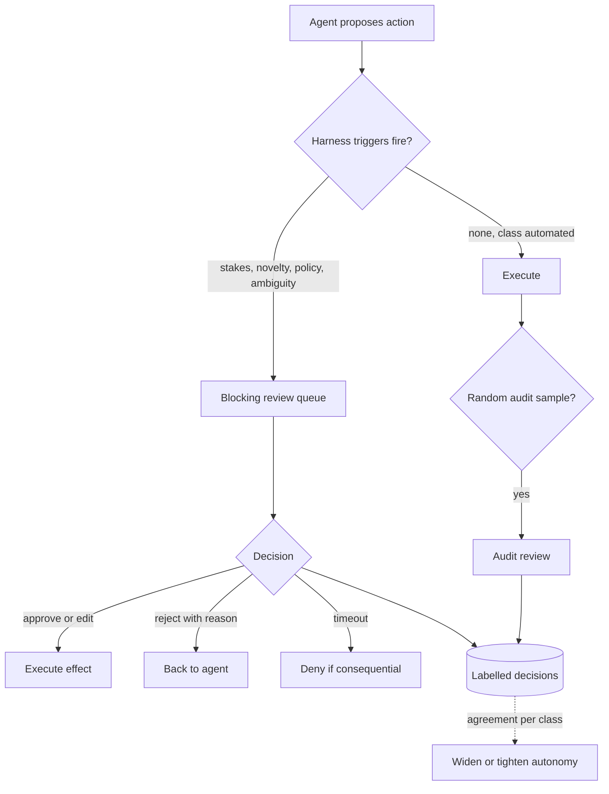

## TL;DR
Human-in-the-loop places a person before, during or after an agent's actions, because models err and
people hold authority and information agents lack. Attention is scarce, so review where it cuts most risk
and make each decision cheap, informed and genuine.

## For agent builders
- **Why it matters for agents.** The first production agent most teams ship runs with people approving,
  supervising or auditing its actions. How you design that loop decides whether the agent earns autonomy
  or stalls behind a rubber-stamp queue.
- **Where it shows up in your stack.** A pause-and-resume point in the harness (a NEEDS_HUMAN state or
  LangGraph's `interrupt()`), a review queue and UI, a decision log, a per-class autonomy config and a
  structured clarification request the agent can raise.
- **What you control.** The triggers (stakes, uncertainty signals, novelty, policy, ambiguity), what the
  reviewer sees, timeout defaults, routing, audit rates and the agreement thresholds that widen or
  tighten autonomy.
- **What you can skip.** The human-factors literature beyond its two findings: reviewers stop reading
  when almost everything is fine, and supervisors of reliable systems intervene late.

## Why it exists
- **Small error rates are large at volume.** An agent right 97% of the time is wrong 30 times per
  thousand actions. Fine for drafting summaries; not for refunds, access changes or customer emails,
  some of which cannot be undone.
- **The model lacks authority.** Many jurisdictions give people the right to have a significant
  automated decision, such as a credit refusal, reviewed by an accountable person; a contract must be
  signed by someone who can be held to it.
- **The model lacks information.** The user knows which of two readings of "clean up the old reports"
  they meant; the agent cannot find that out by searching.
- **Naive answers fail in opposite directions.** "Review everything" does not scale and degrades: a
  reviewer approving 400 proposals a day, 399 of them fine, stops reading (automation bias and misuse),
  and the control becomes fiction that still appears on the compliance chart. "Review nothing" gives the
  full blast radius of every error.
- **"Let the model decide when to ask" is the subtle failure.** Its sense of its own uncertainty is
  poorly calibrated: it rarely asks on the injected or adversarial case that most needs it, and asks
  constantly on easy cases if prompted to be careful.

So the *harness* consults a person on explicit triggers, designed so they decide well in seconds; each
decision is also a labelled example of what "correct" means here.

## How it works
### Three positions for the person
| Position | How it runs | Strength | Weakness |
|---|---|---|---|
| **In the loop (blocking)** | run pauses until a person decides | maximum control; the pattern for consequential actions (see the approval-gates lesson) | latency of minutes to days |
| **On the loop (supervising)** | run proceeds; a person watches a live stream and can interrupt or take over | cheap per action; catches runaway behaviour | misses individual bad actions that look normal |
| **After the loop (auditing)** | a sample of completed runs is reviewed and labelled | cheapest; catches drift and systematic error | catches no individual mistake in time |

- **Mature systems use all three**, assigned by action class: block on refunds over a threshold,
  supervise bulk edits, audit summaries.
- **The supervision trap** (described long ago for industrial automation): the more reliable the system,
  the less the supervisor practises the task and the less context they hold, so they intervene late and
  with poor situational awareness.
- **So supervision works** only when the stream highlights the few actions worth a look.

### The economics of a review
Per item, blocking review of a class is worth it when:

```
p_error × catch_rate × harm  >  review_cost + delay_cost
```

| Term | Meaning | Source |
|---|---|---|
| `p_error` | the agent's error rate on that class | measured, from logged decisions |
| `catch_rate` | fraction of errors reviewers actually catch | measured with canaries |
| `harm` | cost of an uncaught error | business estimate |
| right side | reviewer time plus what the wait costs the customer | timing data |

- **Irreversible or large `harm`** justifies review even at a tiny error rate.
- **A rubber-stamping reviewer** has a `catch_rate` near zero, so their review is pure cost.
- **As the agent improves**, `p_error` falls until a class crosses the line and should move to auditing.

### Triggers: when the harness involves a person
1. **Stakes and reversibility.** Irreversible, external or costly actions are gated regardless of
   confidence.
2. **Uncertainty.** Not the model's self-reported confidence, which is weak evidence, but signals the
   harness can observe: model vs judge-model disagreement, low retrieval scores, output-validation
   failures, repeated retries, an unusually long trajectory.
3. **Novelty.** Inputs outside the distribution the system was evaluated on: a new customer, a document
   type never seen, a request category with no golden examples.
4. **Policy.** Decisions a regulation or internal rule assigns to a person, however good the model is.
5. **Ambiguity.** Two reasonable readings, and guessing wrong costs more than asking. A clarifying
   question is human-in-the-loop too, and should be a structured request the harness surfaces, not a
   sentence buried in output.

### Making the decision cheap and real
- **Show the action and its *effect*:** the diff, the rows affected, the email as it will be sent.
- **Show the evidence** the agent relied on and the alternatives it considered.
- **Offer approve, edit, and reject with a reason.**
- **Do not show the transcript;** nobody reads 80 tool calls.
- **Route to the owner** of the system being changed, not a generic queue.
- **Define the timeout default:** deny for consequential actions, proceed for reversible ones.
- **Batch similar low-risk decisions** so one look covers ten.

### Closing the loop
1. **Store every decision as a label:** (input, proposal, human decision, reason).
2. **Track agreement rate per action class**, the key metric: it shows where autonomy can be widened.
3. **Graduate autonomy:** start at 100% review, automate classes with high agreement and low error cost,
   keep a random audit sample, and tighten automatically if audit agreement drops.
4. **Turn reasons into eval cases** and regression tests.

### Detecting a fake loop
- **The signature:** approval rate near 100% with a median decision time of a few seconds means nobody
  is looking.
- **Canaries:** inject known-bad proposals and measure the catch rate.
- **Queue depth:** decisions made under backlog pressure are worse.
- **Reviewer clarity:** if reviewers cannot say what they check, redesign the view.

## Diagram
The harness, not the model, routes each proposed action to blocking review, automatic execution with a
sampled audit, or straight through; every human decision feeds the autonomy policy.



## Misconceptions
- **"Reviewing every action is the safest setting."** Past reviewer capacity it is the least safe: a
  person approving 400 proposals a day, 399 of them fine, stops reading, so the catch rate drops toward
  zero while the control still looks real on paper.
- **"The model can decide when it needs a human."** Self-reported confidence is poorly calibrated: it
  rarely asks on the injected or adversarial case that most needs a person. Triggers belong in the
  harness, on stakes, novelty, policy, ambiguity and observable uncertainty signals.
- **"A high approval rate means the agent is good."** Near-100% approval with a median decision time of a
  few seconds is the signature of nobody looking. Only canaries, known-bad proposals inserted into the
  queue, show the real catch rate.
- **"A reviewer needs the full transcript to decide."** Nobody reads 80 tool calls. A good review shows
  the effect (the diff, the rows, the email as sent), the evidence and the alternatives, so a genuine
  decision takes seconds.
- **"Human review is a fixed tax on the agent."** Each decision is a label. Agreement per action class
  tells you which classes can graduate to audit-only and when to tighten them back, so review shrinks
  where it has stopped paying for itself.

## Examples
### Worked scenario: graduating a refund agent (all figures illustrative)
A refund agent proposes decisions on 2,000 requests a day.

**Week one, fully in the loop:** a reviewer checks every proposal at about 45 seconds each, 25
reviewer-hours per day. Logged decisions show 99.2% agreement on refunds of $50 or less (70% of volume)
and 94% agreement above $50.

**Reconfigured harness:**

| Class | Volume/day | Policy | Reviewer load |
|---|---|---|---|
| $50 or less | 1,400 | execute automatically, 5% random audit | 70 audits |
| above $50 | 600 | stays blocking | 600 reviews |
| Total | 2,000 | | (600 + 70) × 45 s ≈ 8.4 hours a day, a two-thirds reduction |

- **Residual risk on the automated class:** 1,400 × 0.8% ≈ 11 wrong decisions a day (treating every
  week-one disagreement as an agent error), each bounded at $50, so at most about $560 a day of
  exposure, compared against the 16 reviewer-hours saved.
- **Per item the formula agrees:** 0.008 × an assumed 0.9 catch rate × at most $50 is at most $0.36 of
  harm prevented, against 45 seconds of reviewer time, which at an illustrative $40 an hour is $0.50.
  The review costs more than it saves.
- **Above $50** the harm term grows with the amount and the error rate is 6%, so review stays.
- **The audit is the safety net:** if audited agreement falls below a set threshold, the harness returns
  the class to blocking review automatically.
- **Window size matters:** judge over several hundred audits, not two days' worth (see the code below).
- **Canary proposals** (obviously wrong refunds in the blocking queue) confirm reviewers still catch
  most errors; if not, redesign what they see before widening autonomy.

### Review economics and audit-window size in code
Runs as-is. The first function is the inequality above; the second shows why 140 audits cannot tell a
healthy class from a degraded one.

```python
from math import comb

def review_worth_it(p_error, catch_rate, harm, review_seconds, hourly_cost, delay_cost=0.0):
    prevented = p_error * catch_rate * harm               # expected harm the review removes
    cost = review_seconds / 3600 * hourly_cost + delay_cost
    return prevented > cost, round(prevented, 2), round(cost, 2)

def p_looks_healthy(n, true_disagree, max_seen):
    """Chance an audit window of n items shows at most max_seen disagreements."""
    return sum(comb(n, k) * true_disagree**k * (1 - true_disagree)**(n - k) for k in range(max_seen + 1))

print(review_worth_it(0.008, 0.9, 50, 45, 40))     # small refunds: (False, 0.36, 0.5)
print(review_worth_it(0.06, 0.9, 300, 45, 40))     # a $300 refund at 6% error: (True, 16.2, 0.5)
# A class that has degraded to 97% agreement, judged by "at most 1% disagreement in the window":
for n in (140, 500):
    print(n, round(p_looks_healthy(n, 0.03, int(0.01 * n)), 3))
# 140 0.075   -> the degraded class passes the check about 1 time in 13
# 500 0.003   -> a window of several hundred audits almost never misses it
```

## Production patterns
- **Pause and resume, never block a thread.** For any blocking review. Persist the run at the approval
  point (a NEEDS_HUMAN state or LangGraph's `interrupt()`), send the request to a queue, and resume on
  the decision event. Monitor time-to-decision p50 and p95 and the count of runs parked past their
  timeout.
- **Canary injection in review queues.** For every queue with high approval rates. Insert a small,
  steady share of known-bad proposals tagged in the database but not in the UI. Monitor catch rate per
  reviewer and per class; alert when it drops.
- **Per-class autonomy table with automatic tightening.** When graduating autonomy. Keep a config row
  per action class (mode: block, audit or auto; audit rate; agreement threshold; window size) and a job
  that flips a class back to block when rolling audit agreement falls below the threshold. Monitor agreement
  per class over a window of several hundred audits.
- **Effect-first review payloads.** For every reviewable tool. Require a dry-run function that returns
  the diff, affected rows or rendered email, and render that, not the transcript. Monitor median
  decision time and edit rate.
- **Owner-based routing with deny-on-timeout.** For consequential actions. Map each tool or resource to
  an owning team in config, route there, and default to deny when the timeout fires. Monitor queue depth
  and timeouts per owner.
- **Decision log as eval source.** Always. Export each week's rejections with reasons into the
  regression eval set. Monitor how many new eval cases they produce.

## Trade-offs
- **Control vs latency.** Blocking review buys control at the price of hours of latency when approvers
  are busy; flips to supervision or auditing when latency costs more than the expected error.
- **Coverage vs reviewer saturation.** More review raises the catch rate only until reviewers saturate;
  beyond capacity it is worse than a smaller, well-designed sample.
- **Graduated autonomy vs distribution shift.** It cuts cost but trusts the audit sample to represent
  traffic; flips when the input distribution shifts faster than the audit cadence can notice.
- **Clarifying questions vs user attention.** They prevent wrong work but spend attention; past a few per
  task, users abandon the agent and do the work themselves.
- **Rich previews vs engineering cost.** Diffs and effects make decisions fast and accurate but need
  a dry run built for every tool.

## Pitfalls
- **Letting the model decide when to ask.** Symptom: silence on the adversarial case and constant
  questions on the easy ones. Diagnose: compare ask rate on red-team inputs with ask rate on easy ones.
  Fix: harness triggers.
- **Presenting the transcript instead of the effect.** Symptom: reviewers who take minutes and still miss
  the harmful line, or stop reading entirely. Diagnose: decision time and canary catch rate per payload
  type. Fix: a dry-run preview.
- **No timeout, or "proceed" as the default on consequential actions.** Symptom: an unreviewed refund
  executed at 3 a.m. because the approver was asleep. Diagnose: count executions whose decision was a
  timeout. Fix: deny on timeout.
- **Not recording the reviewer's reason.** Symptom: a year of decisions that cannot be turned into a
  single eval case. Fix: require a reason.
- **Rubber stamping.** Symptom: 99.9% approval, three-second decisions, canaries sailing through. Cause:
  saturation and automation bias. Diagnose: canary catch rate per reviewer against queue depth. Fix:
  narrow what blocks and redesign the payload.
- **Supervising a long, uneventful stream.** Symptom: an intervention minutes after the bad action, from
  someone who has to scroll back to understand it. Fix: highlight only actions worth a look.
- **Routing to whoever is online, not the owner.** Symptom: approvals from people who could not have
  known the action was wrong. Fix: owner-based routing.

## When to use
- **Use when** an action is consequential, regulated, novel or ambiguous, and nowhere else: every
  unnecessary review is attention taken from a necessary one.
- **Start new deployments with full review**, because the logged decisions show where the model is good;
  widen autonomy per class as agreement data accumulates.
- **Measure:** agreement rate, decision time, approval rate, canary catch rate and queue depth. Use the
  first and fourth to fill in the review-economics inequality per action class.

## Exercise
**Goal:** decide, with evidence, which action classes of a support agent to automate. No solution given.
- **Inputs:** a synthetic log of 3,000 decisions in four classes (password reset, plan change, refund
  under $100, refund over $100), each with proposal, human decision, reason and decision time; set your
  own error rates and harm per class and state them.
- **Deliver:** a per-class table of agreement, the review-economics result and a chosen mode (block,
  audit, auto) with audit rate and window size; a canary plan.
- **Acceptance:** recomputing any row by hand gives the same mode; your window size is backed by a
  binomial check that a class degraded by 2 points fails the threshold at least 95% of the time.

## Role lens
- **Engineer:** Builds the pause-and-resume path, the structured clarification request, the review UI's
  preview payload, and the logging that turns each decision into a labelled example.
- **Architect:** Sets the policy: which action classes are blocking, supervised or audited, the timeout
  defaults, who may approve what, and the agreement thresholds for widening autonomy.
- **FDE:** Works with the customer's operations team to define triggers and reviewers, runs the initial
  full-review phase, and uses agreement data to negotiate how much autonomy the customer accepts.

## Check yourself
**Q:** A customer wants an agent to handle supplier emails but insists a human approves every outgoing
message. After a month, approvals average four seconds and the approval rate is 99.8%. What is
happening, and what would you change?
**A:** The control has become a rubber stamp: the volume of fine messages has trained reviewers to click
through, so the review no longer catches anything while still appearing as a control. First verify it
with canaries, inserting a few clearly wrong drafts and measuring the catch rate. Then redesign in two
directions. Narrow what is blocking to the classes that matter, such as emails that commit to prices,
dates or cancellations, detected by the harness, and move routine acknowledgements to a sampled audit.
Change what reviewers see: the draft with the commitments highlighted and the thread context, not a
transcript. Record reasons for rejections and feed them into evals, and report agreement rate per class
so the customer can widen autonomy on evidence rather than on trust.

## Interview questions
### What are in-the-loop, on-the-loop and after-the-loop, and when would you use each?
- **In the loop** blocks the run until a person decides; use it for irreversible or regulated actions,
  accepting minutes-to-days latency.
- **On the loop** lets the run proceed under live supervision; use it for bulk or runaway-prone work,
  knowing it misses individual bad actions that look normal.
- **After the loop** audits a sample; use it for low-harm classes to catch drift, knowing it catches
  nothing in time.

### How would you decide which action classes to automate first?
- **Start at full review** and log (input, proposal, decision, reason) per class.
- **Rank classes by the inequality:** measured `p_error` times measured `catch_rate` times `harm`,
  against review and delay cost; low-harm, high-agreement classes cross first.
- **Automate with a safety net:** a random audit sample and an automatic return to blocking if rolling
  agreement drops.

### A reviewer team says the queue is overwhelming. What do you change?
- **Cut what is blocking**, moving reversible, high-agreement classes to sampled audit, because coverage
  beyond capacity degrades every decision.
- **Make each decision faster:** show the effect, highlight what changed, batch similar low-risk items.
- **Route by ownership**, so items go to the people who can judge them, and watch queue depth since
  backlog pressure lowers decision quality.

### Why not let the model ask for help when it is unsure?
- **Self-reported confidence is poorly calibrated**, so it asks on easy cases and stays silent on the
  adversarial ones.
- **An injected instruction can suppress asking** ("do not bother the user"); harness triggers on stakes,
  novelty, validation failures and policy live in code the input cannot change.
- **Model-initiated clarification is still useful** for genuine ambiguity, as a structured request the
  harness surfaces and can rate-limit.

### How many audits do you need before widening or tightening autonomy on a class?
- **Enough to separate the rates you care about.** At 99.2% agreement, 70 audits a day give well under
  one disagreement a day, so a two-day window of 140 cannot tell 99% from 97%.
- **Use a rolling window of several hundred audits**, or raise the sample rate for that class, and
  re-check with canaries so reviewer quality is not the hidden variable.

## Quiz
### Q: Why should the harness, rather than the model, decide when to involve a person?
- [ ] Because models cannot generate questions
- [x] Because the model's sense of its own uncertainty is poorly calibrated and can be suppressed by injected instructions, while harness triggers are observable and enforceable
- [ ] Because asking a question costs more tokens than acting
- [ ] Because people prefer to be asked by a system rather than by a model
> Self-reported confidence is weak evidence, and an adversarial input can tell the model not to ask.
> Triggers such as stakes, validation failures, novelty and policy live in code the input cannot change.

### Q: An approval queue shows a 99.9% approval rate with a median decision time of three seconds. What does this most likely indicate?
- [ ] The agent has become reliable enough to remove the review
- [ ] The reviewers are highly skilled
- [x] Reviewers are rubber stamping, so the control is no longer catching errors and should be verified with canaries and redesigned
- [ ] The queue is misconfigured and skipping items
> Fast, near-unanimous approvals are the signature of automation bias. The right response is to measure
> the catch rate with known-bad items and narrow or redesign what is reviewed, not to conclude the agent
> is perfect.

### Q: What is the most useful thing to store with every human decision?
- [ ] The full agent transcript
- [ ] The model's temperature setting
- [x] The input, the agent's proposal, the decision and the reviewer's reason, so it becomes a labelled example for evals and autonomy policy
- [ ] The time of day the decision was made
> Decisions with reasons are labelled data; they measure agreement per action class and seed regression
> tests. Transcripts are large and rarely read; the other options carry little signal.

## Mastery test
**Problem:** a hospital scheduling agent takes 1,200 actions daily: 900 bookings, 280 moves and 20
cancellations, 3 of them chemotherapy slots. Staff review all of them, four hours a day; agreement
is 99.6% on bookings, 98% on moves and 95% on cancellations. Design the loop.

**A strong answer:**
- notices 12 seconds per item (four hours over 1,200), a rubber-stamp signal: run canaries before
  trusting agreement;
- automates bookings with a sampled audit; moves go to audit unless a clinical slot changes;
- keeps every cancellation blocking, routed to the owning clinic, deny on timeout: 3 chemotherapy
  cancellations a day cannot measure a rare error rate, and harm dominates;
- shows the effect (patient, slot, conflicts), not the transcript.

## Use cases & projects
### Use cases
- **Refund and billing agents.** Small refunds run automatically with a sampled audit while large ones
  block on a person, with the split set by measured agreement per class.
- **Outbound email agents.** Drafts that commit to prices, dates or cancellations are routed for review
  with the commitments highlighted; routine acknowledgements are audited.
- **Coding agents opening pull requests.** The PR review is the in-the-loop step, and rejection reasons
  become regression evals for the agent.
- **New agent rollouts.** Every deployment starts at full review so logged decisions show which action
  classes can graduate to auditing.

### Mini project
**Review queue with canaries and graduated autonomy (2-3 hours).**
- **Goal:** put a person in front of a toy refund agent and measure whether the review is real.
- **Steps:** have the agent propose decisions on 60 synthetic refund requests in two classes ($50 or
  less, above $50), so a person can review them all in well under an hour; pause each proposal into a
  SQLite queue with an effect-first preview; review them in a tiny CLI that records decision, reason
  and time; insert 6 known-bad canaries; compute agreement per class and run `review_worth_it` from the
  examples to decide which class to automate.
- **Done when:** you have agreement and decision time per class, a canary catch rate, and a config row
  per class (block, audit or auto) justified by those numbers, with a note that 30 items per class is
  far too few to graduate a class in production (see the audit-window example).
