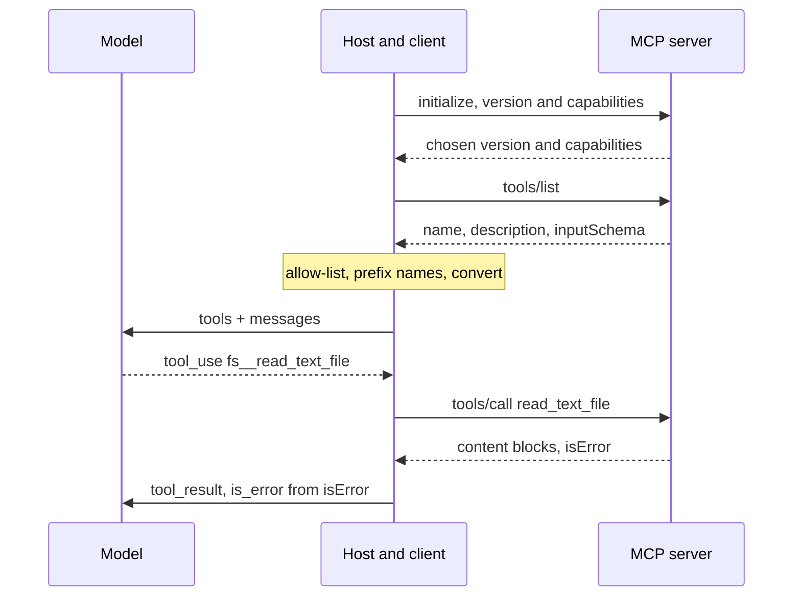

## TL;DR
MCP, an open protocol Anthropic released in November 2024, standardizes how AI applications connect to
capability servers exposing tools, resources and prompts over JSON-RPC. Integrations are written once; it
does not remove authentication, trust decisions or tool-set curation.

## Why it exists
- **Every framework had its own plugin format.** A vendor wanting its database, ticketing system or document
  store usable by agents wrote one connector per framework, and every application team re-implemented the
  same connectors: the classic N applications times M integrations problem.
- **Connectors disagreed on basics:** how to describe a tool, stream a result, expose a document for the
  model to read, and authenticate.
- **"Point the model at an OpenAPI spec" works poorly.** A spec describes hundreds of endpoints for
  programmers, not a curated handful of actions with the descriptions a model needs to select among. It says
  nothing about resources to put into context, prompts a user can invoke, or how a server can ask the host's
  model for help.
- **Framework registries solved the model-facing problem** but locked each integration to one framework.
- **MCP separates the two sides with a contract.** Servers package a system as tools with JSON Schema inputs,
  resources with URIs and prompt templates; the client is a small, generic part of the host. A new server
  works with every host and a new host with every server, which is why the ecosystem grew quickly and
  customers increasingly already have MCP servers you are expected to plug into.
- **It is no longer single-vendor.** Other model providers adopted it during 2025, and Anthropic later donated
  the protocol to the Agentic AI Foundation under the Linux Foundation.

## How it works
### Roles
| Role | What it is |
|---|---|
| **Host** | The application: an IDE, a chat app, your own agent. Holds many clients and decides what the model sees from each |
| **Client** | Inside the host; holds one connection to one server |
| **Server** | Exposes capabilities; a local process or a remote service |

### The primitives
| Primitive | Controlled by | Methods and shape |
|---|---|---|
| **Tools** | The model | `tools/list` gives name, description, `inputSchema` (JSON Schema); `tools/call` runs one |
| **Resources** | The application | Data identified by URIs (`file://…`, `db://…`), listed and read by the host, optionally with change subscriptions |
| **Prompts** | The user | Templates via `prompts/list`, `prompts/get`, typically slash commands or menu items |

- **Tool results** are a list of content blocks (text, image, audio, embedded resources or resource links,
  depending on the revision) plus an `isError` flag.
- **Typed outputs:** since the 2025-06-18 revision a tool may also declare an `outputSchema` and return typed
  `structuredContent` alongside the content blocks.
- **Tools map one-to-one** onto a provider's tool definition and `tool_result`, which is the whole point.
- **Resources stay host-chosen:** the host decides what enters the model's context; the model does not fetch
  resources on its own.

### Server-to-client requests and notifications
- **Sampling:** a server asks the host's model for a completion without holding its own API key; the host
  should keep a human able to review it.
- **Roots:** the host tells a server which filesystem locations to work within. This is advisory, not an
  enforced sandbox.
- **Elicitation** (newer revisions): a server asks the user for input mid-operation.
- **Notifications** such as `tools/list_changed` let a server announce that its capabilities changed.

### The wire
1. **Messages are JSON-RPC 2.0.**
2. **A session starts with `initialize`** carrying the protocol version and each side's capabilities, then an
   `initialized` notification, then normal operation.

| Transport | How | Use |
|---|---|---|
| **stdio** | Host spawns the server as a subprocess and talks over its standard streams | Simple, local, inherits the host's environment |
| **Streamable HTTP** | HTTP POST with optional server-sent events for streaming | Remote servers; replaced the earlier HTTP-plus-SSE transport |

- **Remote servers authenticate with OAuth 2.1** under the specification's authorization section; a separate
  lesson covers that in depth.

### One call on the wire
The handshake is where versioning lives. The client sends `initialize` with the revision it speaks and what
it supports; the server answers with the revision it will use and its own capabilities:

```json
{"jsonrpc": "2.0", "id": 1, "method": "initialize", "params": {"protocolVersion": "2025-06-18",
  "capabilities": {"elicitation": {}}, "clientInfo": {"name": "ops-agent", "version": "1.4.0"}}}
{"jsonrpc": "2.0", "id": 1, "result": {"protocolVersion": "2025-06-18",
  "capabilities": {"tools": {"listChanged": true}, "resources": {}}, "serverInfo": {"name": "fs", "version": "0.6.2"}}}
```

- **Each side then uses only features both declared,** *because* hosts and servers upgrade on different
  schedules, and a capability never negotiated is simply not used rather than failing at runtime.
- **A tool call is one request and one response,** correlated by `id`:

```json
{"jsonrpc": "2.0", "id": 7, "method": "tools/call",
  "params": {"name": "read_text_file", "arguments": {"path": "/data/reports/q3.md"}}}
{"jsonrpc": "2.0", "id": 7, "result": {"content": [{"type": "text", "text": "Q3 churn rose to ..."}],
  "isError": false}}
```

### Two failure channels
| Channel | Example | Arrives as | Host must |
|---|---|---|---|
| 1. Tool ran and failed | File missing, upstream down | A normal `result` with `isError: true` | Pass it to the model as an error result it can recover from |
| 2. Protocol failure | Unknown method, malformed request, crashed server | A JSON-RPC `error` object or a dead connection | Convert it into an `is_error` tool result itself; the model never sees it otherwise |

- **A host that handles only the first channel crashes its loop on the second.**

### Plugging into the agent loop
1. **List tools** from each connected server.
2. **Convert** them to the provider's format (name, description, `input_schema`), usually prefixing names with
   the server name to avoid collisions, and pass them in `tools`.
3. **Route** each `tool_use` to the right client's `tools/call`.
4. **Convert** returned content blocks into a `tool_result`, setting `is_error` from `isError`.

- **The model never knows MCP is involved.**
- **Some providers do the hop server-side** for remote (HTTP) servers. Anthropic's MCP connector, a beta at the
  time of writing, takes an `mcp_servers` list in the request so the connection is made from the provider's
  side; OpenAI's Responses API offers a comparable remote-MCP tool.
- **Beta parameter names have changed between versions,** so check current docs rather than copying an old
  snippet.

### Compared with the alternatives
- **In-process function tools** remain right for a single codebase with a few tools.
- **MCP earns its hop** when the same capability must reach several hosts, come from a third party, or run in a
  different process or language.
- **OpenAPI describes HTTP APIs;** MCP servers often *wrap* an OpenAPI surface into a curated, well-described
  tool set.
- **A2A is a different layer:** agents delegating tasks to agents rather than hosts calling tools; the two
  compose rather than compete.

### Sharp edges
- **Tool bloat.** Each server tends to expose dozens of tools, so three servers can put a hundred definitions
  into context, with the token cost and selection-accuracy loss that implies; allow-list the tools you need.
- **Tool poisoning.** A server's descriptions become part of your prompt, so a malicious or compromised server
  can inject instructions through them, and can change descriptions after you approved it; pin versions and
  review descriptions like code.
- **Results are untrusted content.**
- **stdio servers inherit the host's environment and credentials,** so run them with least privilege.
- **Every call is an extra hop** with its own latency and failure modes.

## Diagram
The host does all the translation: it negotiates once, maps server tools into the provider format, and
routes each model `tool_use` to `tools/call`, so the model never sees MCP.



## Examples
### A host that drives a stdio server
A Python host connects to a local reference filesystem server over stdio, converts its tools to the provider
format with a namespace prefix, and runs the standard agent loop, routing each `tool_use` back to
`session.call_tool`. The `mcp` package is the official Python SDK.

For brevity it keeps only text content blocks; a production host would also forward images and
`structuredContent`.

```python
import asyncio, anthropic
from mcp import ClientSession, StdioServerParameters
from mcp.client.stdio import stdio_client

SERVER = StdioServerParameters(command="npx", args=["-y", "@modelcontextprotocol/server-filesystem",
                                                    "/data/reports"])          # sandboxed root

async def main(question: str):
    async with stdio_client(SERVER) as (read, write):
        async with ClientSession(read, write) as session:
            await session.initialize()                                   # version + capability handshake
            listed = await session.list_tools()
            tools = [{"name": f"fs__{t.name}", "description": t.description or "",
                      "input_schema": t.inputSchema} for t in listed.tools]   # 1:1 mapping, namespaced
            client = anthropic.AsyncAnthropic()                          # do not block the event loop
            messages = [{"role": "user", "content": question}]
            for _ in range(12):                                          # step budget
                resp = await client.messages.create(model="claude-opus-5-5", max_tokens=8192,
                                                    tools=tools, messages=messages)
                messages.append({"role": "assistant", "content": resp.content})
                if resp.stop_reason != "tool_use":
                    return "".join(b.text for b in resp.content if b.type == "text")
                results = []
                for b in resp.content:
                    if b.type != "tool_use":
                        continue
                    try:                                                 # protocol errors raise
                        r = await session.call_tool(b.name.removeprefix("fs__"), arguments=b.input)
                    except Exception as e:                               # map channel 2 to an error result
                        results.append({"type": "tool_result", "tool_use_id": b.id,
                                        "content": f"server error: {e}", "is_error": True})
                        continue
                    text = "\n".join(c.text for c in r.content if getattr(c, "type", "") == "text")
                    if len(text) > 8000:                                 # cap, and say so
                        text = text[:8000] + "\n[truncated: narrow the request]"
                    results.append({"type": "tool_result", "tool_use_id": b.id,
                                    "content": text, "is_error": bool(r.isError)})
                messages.append({"role": "user", "content": results})
            raise RuntimeError("step budget exhausted")

print(asyncio.run(main("Which reports under /data/reports mention Q3 churn, and what do they say?")))
```

### A minimal server with the official SDK
The other side: the Python SDK's `FastMCP` turns a typed, documented function into a tool whose
`inputSchema` is generated from the signature and whose description is the docstring. Run it with stdio as
the transport.

```python
from mcp.server.fastmcp import FastMCP

mcp = FastMCP("orders")
ORDERS = {"A100": {"status": "shipped", "eta": "2026-10-23"}}

@mcp.tool()
def get_order(order_id: str) -> dict:
    """Look up one order by id. Call before answering any question about an order's status."""
    if order_id not in ORDERS:
        raise ValueError(f"no order with id {order_id}; ids look like A100")  # becomes an error result
    return ORDERS[order_id]

if __name__ == "__main__":
    mcp.run()          # stdio by default; log to stderr, never print to stdout (it is the protocol channel)
```

### Worked numbers: three vendor servers
Illustrative figures for a customer plugging in three servers, assuming roughly 100 tokens per tool
definition.

| Setup | Tools in context | Fixed tokens per request |
|---|---|---|
| Expose everything (3 servers of ~30 tools) | ~90 | ~9,000 |
| Allow-list what the use case needs | 8 | ~800 |

- **The 10x token cut is the smaller win.** Selection accuracy falls as near-duplicate tools from different
  vendors compete, so re-run the selection eval with the combined set.
- **Two servers both exposing `search`** is likely at this scale, which is why names get a server prefix.

## Production patterns
- **Allow-list and namespace per server.** For every connected server; keep an explicit list of tool names per
  server in host config and prefix them (`fs__`, `crm__`). Monitor tools in context per request and selection
  accuracy with the combined set.
- **Pin versions and diff descriptions.** For third-party servers; pin the package or image version, hash the
  `tools/list` output at startup, and alert or refuse to start when it changes unreviewed. Monitor description
  changes per server.
- **Least-privilege stdio.** For local servers; pass an explicit minimal environment (the Python SDK's
  `StdioServerParameters` takes an `env` mapping) and a narrow root directory, never the developer's full
  shell. Monitor files and hosts each server touches.
- **Map both failure channels and trace per server.** In every host; convert JSON-RPC errors and dead
  connections into `is_error` results, and log server, tool, latency and outcome per call. Monitor per-server
  call latency and error rate.
- **Snapshot the tool set per session.** When prompt caching matters; list tools once at session start and
  apply `tools/list_changed` only between sessions or after review, so the cached prefix stays stable. Monitor
  cache-read share per session.
- **Gate actions after untrusted results.** For servers that return third-party content; route consequential
  tool calls after such reads through approval. Monitor gated actions per run.

## Trade-offs
- **Write-once integration vs an extra hop.** A large ecosystem comes with an extra process or network hop
  and a protocol surface to secure; for one in-house tool in one codebase, a direct function is simpler and
  faster.
- **Ready-made descriptions vs prompt influence.** Servers bring their own tool descriptions, saving work but
  handing a third party influence over your prompt; curating and allow-listing is the price of someone
  else's server.
- **stdio vs Streamable HTTP.** stdio servers are simple and private but tied to the host machine; Streamable
  HTTP enables shared remote servers at the cost of real authentication, multi-tenancy and network policy.
- **Dynamic discovery vs predictability.** `tools/list_changed` keeps tool sets current but complicates prompt
  caching and approval; pin server versions and tool sets where predictability matters more than freshness.

## Pitfalls
- **Connecting several servers and exposing every tool.** Symptom: a jump in tokens per request and a drop in
  selection accuracy that looks like a model regression. Fix: allow-list.
- **Trusting tool descriptions and results from a third-party server.** Symptom: the agent takes an action a
  description or a result told it to, not the user. Fix: review descriptions, gate actions.
- **Running stdio servers with the developer's full environment.** Symptom: a server reading credentials or
  files it never needed, discovered during a security review. Fix: minimal env and roots.
- **Ignoring `isError` and mapping every result to a successful `tool_result`.** Symptom: the model narrates
  error text as if it were data. Fix: set `is_error` from it.
- **A stdio server that prints logs or a startup banner to stdout.** stdout *is* the protocol channel. Symptom:
  JSON parse errors or a handshake that hangs. Fix: log to stderr.
- **Building against the deprecated HTTP-plus-SSE transport.** Symptom: new remote servers that will not
  connect. Fix: Streamable HTTP.
- **Assuming two servers cannot both have a tool named `search`.** Symptom: calls routed to the wrong server
  until names are prefixed. Fix: namespace.

## When to use
- **Use when** a capability must be shared across hosts, comes from a vendor or another team, or lives in
  another process or language, and when a customer already runs MCP servers you must integrate with.
- **Avoid when** a small tool set is owned by one codebase; prefer in-process tools. Wrap an existing OpenAPI
  service in an MCP server only after curating which operations the model should see.
- **Measure** tools in context per request, per-server call latency and error rate, and selection accuracy with
  the combined tool set, since adding a server changes it.
- **Day to day** the work is allow-listing, namespacing, reviewing descriptions and configuring credentials
  with least privilege.
- **Interviews:** expect "what problem does MCP solve and what does it not solve"; name the N-times-M problem,
  the three primitives, the two transports, and the trust and tool-bloat caveats.

## Role lens
- **Engineer:** Writes and consumes servers with the official SDKs, maps tools to the provider format
  with namespaces, handles `isError`, and allow-lists which tools reach the model.
- **Architect:** Decides which capabilities are exposed through MCP, where the trust boundary sits for
  third-party servers, the authentication model for remote servers, and whether a gateway fronts them.
- **FDE:** Connects a customer's systems through servers running inside their environment, reviews
  every exposed tool and credential with the customer, and evaluates selection accuracy before go-live.

## Check yourself
**Q:** A customer wants to plug three vendor-provided MCP servers into their internal agent this week.
What do you review before enabling them, and in what order?
**A:** First the tool inventory: list every tool from each server, read the descriptions as if they
were code, and allow-list the handful the use case needs, because the full set inflates context and
invites selection errors. Then trust and authentication: which transport, what credentials each server
receives and with what scopes, whether a remote server uses the specification's OAuth flow, and what
data leaves the customer's network. Then runtime policy: results from these servers are untrusted
content, so consequential actions that follow them need approval gates, and stdio servers run with least
privilege. Then stability: pin server versions so descriptions cannot change silently, prefix names to
avoid collisions, and log every call. Finally measure: re-run the selection eval with the combined tool
set and check latency and error rates per server before go-live.

## Interview questions
### What problem does MCP solve, and what does it not solve?
- **Solves:** the N applications times M integrations problem, with one contract for tools, resources and
  prompts over JSON-RPC, so a server works with every host.
- **Does not solve:** authentication policy, trust in third-party servers, tool bloat, or untrusted results;
  those remain the host's job.

### Your MCP-backed agent crashes when a server dies mid-run. What is wrong?
- **The host handles only one failure channel.** Tool failures arrive as `isError: true` results, but protocol
  failures arrive as JSON-RPC errors or a dead connection.
- **Fix:** catch those around `tools/call` and convert them into `is_error` tool results, so the model can
  recover or report instead of the loop crashing.

### When would you not use MCP?
- **One codebase, a few in-house tools:** in-process functions are simpler and faster, with no extra hop or
  protocol surface to secure.
- **Use MCP** when the capability must reach several hosts, comes from a third party, or runs in another
  process or language.

### How do you defend against tool poisoning from a vendor server?
- **Treat descriptions as code:** review them, allow-list only needed tools, and pin the server version.
- **Detect drift:** hash the `tools/list` output at startup and refuse unreviewed changes.
- **Hold the line in the harness:** results are untrusted, so consequential actions after them need approval.

### What does the initialize handshake buy you?
- **Version negotiation:** the client states its revision, the server picks the one it will use.
- **Capability negotiation:** each side uses only features both declared, *because* hosts and servers upgrade
  on different schedules, so an unsupported feature is simply not used rather than failing at runtime.

## Quiz
### Q: Which MCP primitive is "model-controlled", meaning the model decides when to invoke it?
- [ ] Resources
- [ ] Prompts
- [x] Tools
- [ ] Roots
> Tools are listed to the model and called at its discretion. Resources are chosen by the host
> application for inclusion in context, prompts are invoked by the user, and roots are host-to-server
> configuration about allowed filesystem locations.

### Q: What does the model see when an agent uses tools from an MCP server?
- [ ] JSON-RPC messages that it must format correctly
- [x] Ordinary tool definitions and results in the provider's format; MCP is invisible to the model
- [ ] A list of server URLs it can call directly
- [ ] Only the resources, since tools are executed by the server
> The host converts `tools/list` output into provider tool definitions and routes `tool_use` blocks to
> `tools/call`. The protocol lives entirely between host and server.

### Q: What is the most common operational problem when connecting several MCP servers to one agent?
- [ ] JSON-RPC message size limits
- [x] Tool bloat: too many definitions in context, raising token cost and lowering selection accuracy, plus trust exposure to each server's descriptions
- [ ] Servers cannot run on the same machine
- [ ] The model refuses to use more than one server
> Each server tends to expose many tools, and every definition is rendered into the prompt. Allow-listing
> the needed tools and reviewing descriptions addresses both the cost and the trust problem.
