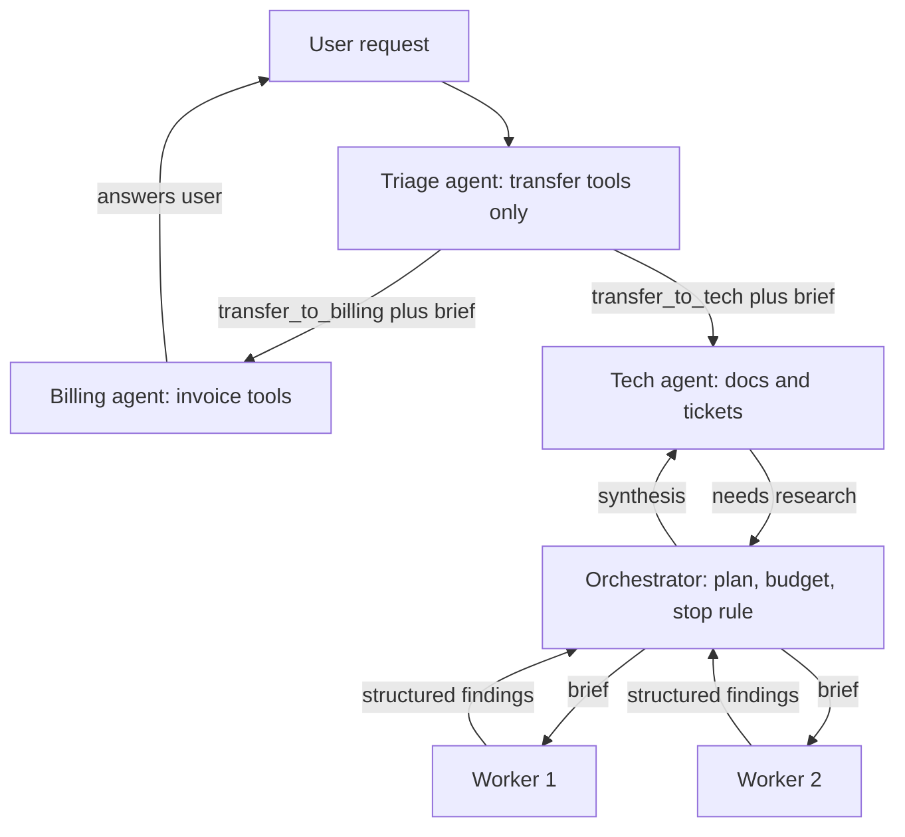

## TL;DR
Split your agent into several model loops only when one loop's context, tool list or permissions break.
Orchestrator-worker fans out to parallel workers; handoffs pass the conversation to one specialist.
Both cost tokens and coordination, so one good agent is the default.

## For agent builders
- **Why it matters for agents.** As the tool list grows (the example below has fourteen) or the context
  fills with search output, a single loop picks wrong tools more often and holds credentials it should
  not. Splitting fixes that structurally, but every boundary loses context and multiplies tokens, so the
  decision is an engineering trade, not a style.
- **Where it shows up in your stack.** The OpenAI Agents SDK's handoffs and agents-as-tools, LangGraph
  supervisor and subgraph patterns, sub-agents in coding agents such as Claude Code, CrewAI crews, and
  A2A when the peer agent belongs to another team.
- **What you control.** The split (which roles exist), the brief and output schema at each boundary, how
  history is filtered on a handoff, transfer caps, per-agent credentials, the global budget and who owns
  the stopping rule.
- **What you can skip.** Debate and group-chat research setups unless you have a judge you trust; most
  production systems are an orchestrator-worker core with handoffs at the user-facing edge.

## Why it exists
- **One loop has one context and one tool set, and three things break as a task grows.**
  - The context fills with earlier tool output, crowding out the goal.
  - The tool list grows until selection accuracy falls and the system prompt becomes a manual nobody follows.
  - Permissions blur: the loop that reads public docs also holds the refund credential, so one prompt
    injection reaches everything.
- **"Bigger context, longer prompt" postpones it** and raises cost per step, because every step re-reads
  everything.
- **The structural fix is separation of concerns with narrow interfaces.** A research worker needs the
  search tool and a brief, not the conversation history or the payments API. A billing specialist needs
  the invoice tools and the last few turns, not the triage prompt.
- **It also buys parallelism.** Ten workers researching ten sources finish in roughly the time of the
  slowest one plus orchestration, not ten times one.
- **But the bill is real.** Anthropic's research-system write-up reports agents using about 4x the tokens
  of a chat interaction and its multi-agent system about 15x, and coordination failures (duplicated work,
  conflicting results, lost context at boundaries) are the main bug source. Use it when value justifies
  the bill and the structure tolerates partition.

## How it works
### Orchestrator-worker
1. **Decompose and dispatch.** The **orchestrator** receives the goal, decomposes it into subtasks
   (dynamically or from a template), and sends each to a **worker** with a self-contained brief:
   objective, inputs, tools allowed, output schema, and a budget.
2. **Workers run in isolation.** Each runs its own agent loop in its own context, often in parallel, and
   returns a **structured result**, not its transcript. This is the central design choice *because* it
   keeps the orchestrator's context small and makes workers interchangeable: the orchestrator never sees
   search noise, only findings.
3. **Check and synthesise.** The orchestrator checks results against the plan, may dispatch follow-up
   workers (gaps, conflicts), and finally **synthesises** the deliverable, optionally via a separate
   writer or critic.

- **Why a central orchestrator rather than peers chatting?** Someone must own the plan, the budget and the
  stopping rule; without one owner, systems loop, duplicate and never finish.
- **It is also the natural place** for human approval and for the trace root.

Practical rules the research-system write-ups emphasise:
- **State the effort a subtask deserves** (number of searches or tool calls), because workers cannot infer
  scale.
- **Give each worker a distinct, non-overlapping objective,** or they converge on the same sources.
- **Start searches short and broad, then narrow,** rather than opening with long, specific queries that
  return little.
- **Make the orchestrator robust to a worker failing,** since with parallelism, failures are routine.

### Handoffs
- **A handoff transfers the conversation** from one agent to another.
- **It is almost always a special tool.** The triage agent's tool list includes `transfer_to_billing`;
  when the model calls it, the runtime swaps the active agent's system prompt and tool set, and the
  conversation continues.
- **The history can be passed** whole, filtered (drop tool calls, keep user turns) or summarised, and the
  handoff can carry a structured payload (the account id, the reason).
- **Why one active agent instead of an orchestrator?** The user talks to *someone*, and a specialist that
  sees the dialogue answers better than one fed a coordinator's summary.
- **Simple mental model:** a state machine whose states are agents and whose transitions are tool calls.
- **The cost:** no parallelism, and the receiving agent inherits whatever context was passed, so filtering
  decisions matter.

### Agents as tools versus handoffs
A third option sits between the two: call a specialist *as a tool*. The caller stays in control, the
specialist runs in its own context and returns a result, and the caller continues: orchestrator-worker
with one worker.

A handoff instead gives the specialist the conversation and does not come back unless
the specialist transfers again. The choice turns on who should own the next user-facing turn:

| | Orchestrator-worker / agent-as-tool | Handoff |
|---|---|---|
| Who talks to the user | the orchestrator, always | whichever agent is active |
| Parallelism | yes, many workers at once | no, one active agent |
| What crosses the boundary | a brief down, a structured result up | (filtered) history plus a payload |
| Typical failure | synthesis misses what a worker found | specialist lacks context, or agents ping-pong |

### Other shapes, briefly
- **Pipelines:** a fixed sequence of specialists.
- **Evaluator-optimizer pairs:** generator plus critic, the multi-agent form of reflection.
- **Hierarchical orchestrators:** an orchestrator whose workers are themselves orchestrators.
- **Debate or group chat:** several agents argue, a judge decides.

### Communication, state and tracing
- **Share through structured messages and a shared store** (a task table, files, a blackboard), not by
  reading each other's contexts.
- **For bulky outputs, return a reference plus a summary.** Workers write the artifact to the store,
  *because* every hop where one model paraphrases another's findings loses detail.
- **Propagate a trace id** from each run to every worker so a failure can be followed across agents.
- **Decide what each worker may write** to shared state, because concurrent writers produce the hardest bugs.
- **Set a global budget the orchestrator enforces,** since each worker will happily spend its own.

### The cost model
- **Rough shape:** if a single agent spends T tokens, an orchestrator with k workers spends its own tokens
  plus k worker runs plus synthesis. Parallelism improves, not the token count.
- **Using the published 4x (single agent) and 15x (multi-agent) figures** relative to a chat turn, expect a
  multi-agent research run to cost several times a single-agent run on the same task. These are one
  vendor's research-task numbers, not a constant; measure your own and budget accordingly.

Why the bill rises even though each context is smaller (illustrative run):

| Quantity | Value |
|---|---|
| Workers | five, each with a 2k-token brief |
| Tool calls per worker | eight, results averaging 3k tokens |
| Input per worker (re-reading its growing context each step) | 2k×8 + 3k×(0+1+…+7) ≈ 100k |
| Input for all five | about 500k |

- **One agent doing the same 40 tool calls in one context** would re-read far more (the history term grows
  with the square of the step count).
- **But in practice a single agent does not make 40 calls; it explores less.** The multi-agent premium is
  mostly that it *does more work*, in parallel: the point when breadth matters, the waste when it does not.

## Diagram
Compare the shapes: the orchestrator fans out and gets structured results back; a handoff moves the
conversation to one specialist.



## Misconceptions
- **"Several smaller agents are cheaper than one big one, since each context is smaller."** Parallelism
  improves, not the token count: each worker re-reads its own growing context, and the system does more
  work. One vendor's research write-up reports about 15x the tokens of a chat turn for its multi-agent
  system versus about 4x for a single agent.
- **"Multi-agent is the more advanced, therefore better, architecture."** Split only when one loop's
  context, tool list or permissions break. Every boundary loses context and adds coordination bugs, so one
  good agent is the default.
- **"Workers should send back their full transcript so nothing is lost."** That floods the orchestrator
  with search noise. Return a structured result, with a reference plus summary for bulky artifacts, and
  keep the orchestrator's context small.
- **"Agents can coordinate by chatting as peers."** Without one owner of the plan, budget and stopping
  rule, peer systems loop, duplicate work and never finish. An orchestrator, or a capped handoff chain,
  owns termination.
- **"A handoff and an agent-as-tool are interchangeable."** They differ in who owns the next user-facing
  turn: an agent-as-tool returns a result and the caller continues; a handoff gives the specialist the
  conversation and does not come back unless it transfers again.
- **"Splitting agents is only about quality."** It is also a security boundary: if `issue_refund` is not
  in the tech agent's tool list, an injection during a bug investigation cannot trigger a refund.

## Examples
### Minimal handoff runtime
Each agent is a prompt plus a tool list; transfers are tools; the loop swaps the active agent and
continues the same message list. `llm` returns an assistant message with optional `tool_calls`.

```python
AGENTS = {
    "triage": dict(system="Classify the request and call a transfer tool. Do not solve it yourself.",
                   tools=["transfer_to_billing", "transfer_to_tech"]),
    "billing": dict(system="You handle invoices and refunds. Verify the invoice before refunding.",
                    tools=["lookup_invoice", "issue_refund", "transfer_to_triage"]),
    "tech": dict(system="You debug product issues. Ask for logs before guessing.",
                 tools=["search_docs", "create_ticket", "transfer_to_triage"]),
}

def handoff_history(messages, keep_last=6):
    user_turns = [m for m in messages if m["role"] in ("user", "assistant") and not m.get("tool_calls")]
    return user_turns[-keep_last:]            # specialists do not need triage's tool noise

def run(messages, agent="triage", max_turns=20, max_transfers=3):
    brief, transfers = {}, 0
    for _ in range(max_turns):
        spec = AGENTS[agent]
        reply = llm(system=spec["system"] + f"\nHandoff brief: {brief}", messages=messages,
                    tools=[TOOL_SCHEMAS[t] for t in spec["tools"]])
        messages.append(reply)
        if not reply.get("tool_calls"):
            return messages, agent                  # agent produced a user-facing answer
        for call in reply["tool_calls"]:
            if call["name"].startswith("transfer_to_"):
                transfers += 1
                if transfers > max_transfers:       # ping-pong guard: escalate to a human
                    return escalate(messages, trace_id=TRACE), agent
                agent = call["name"].removeprefix("transfer_to_")
                brief = call["arguments"]           # e.g. {"account_id": "A-17", "reason": "..."}
                messages = handoff_history(messages) # filtered context crosses the boundary
                log_event(trace_id=TRACE, event="handoff", to=agent, brief=brief)
                break                                # drop the rest of this reply's calls
            else:
                out = TOOLS[call["name"]](**call["arguments"])
                messages.append(tool_result(call["id"], out))
    return messages, agent
```

The deliberate choices, beyond transfer-as-tool and filtered history:
- **Transfers are capped,** because two agents that each think the other owns the request will otherwise
  bounce it until the turn budget runs out.
- **The `break` matters.** The filter removes the assistant message that issued the calls, so executing
  its other tool calls afterwards would run them under the wrong agent and append results referencing a
  tool-call id no longer in the history, which most chat APIs reject.
- **No tool result is appended for the transfer call itself,** for the same reason: the message that made
  it has just been filtered out.

### Orchestrator with briefs, a global budget and failure tolerance
Pure Python with simulated workers; runs as is. One worker fails and becomes a gap, not a crash; all
workers spend one shared budget.

```python
import asyncio, random, uuid

class Budget:
    def __init__(self, tokens):
        self.left = tokens
    def spend(self, n):
        if n > self.left:
            raise RuntimeError("global budget exhausted")
        self.left -= n

async def worker(brief, budget, trace_id):
    await asyncio.sleep(random.uniform(0.01, 0.05))      # stands in for an isolated agent loop
    if brief["objective"] == "vendor C pricing":
        raise TimeoutError("search API timed out")       # failures are routine with parallelism
    budget.spend(brief["max_tool_calls"] * 3_000)
    return {"objective": brief["objective"], "findings": ["..."], "sources": ["ref:doc-1"],
            "trace_id": trace_id}                        # structured result, never the transcript

async def orchestrate(objectives, total_tokens=200_000):
    trace_id, budget = str(uuid.uuid4()), Budget(total_tokens)
    briefs = [{"objective": o, "tools": ["search"], "max_tool_calls": 5,
               "output_schema": "findings, sources"} for o in objectives]
    results = await asyncio.gather(*(worker(b, budget, trace_id) for b in briefs),
                                   return_exceptions=True)
    ok = [r for r in results if not isinstance(r, Exception)]
    gaps = [b["objective"] for b, r in zip(briefs, results) if isinstance(r, Exception)]
    return {"done": [r["objective"] for r in ok], "gaps": gaps, "tokens_left": budget.left}

print(asyncio.run(orchestrate(["vendor A pricing", "vendor B pricing", "vendor C pricing"])))
# {'done': ['vendor A pricing', 'vendor B pricing'], 'gaps': ['vendor C pricing'], 'tokens_left': 170000}
```

The `gaps` list is what drives a follow-up worker or an honest "could not verify" in the synthesis.

### Worked scenario: splitting a fourteen-tool support bot
| Metric | One agent, fourteen tools | Triage plus billing and tech specialists |
|---|---|---|
| Tools per decision | 14 | 2 (triage), 3 per specialist |
| Wrong tool | about a fifth of the time | measured before and after; expected to fall because each choice is among a handful |
| Refund during a bug investigation | possible | impossible: `issue_refund` is not in the tech agent's tool list |
| Extra cost | none | one triage call per conversation plus a filtered history at each transfer |

## Production patterns
- **Trace id on every hop.** Create a trace id at the orchestrator or triage entry and pass it into every
  worker brief, handoff log and tool call, ideally as an OpenTelemetry trace context. Monitor traces with
  missing child spans; they mark where work disappeared.
- **Global budget owned by the orchestrator.** Give the run one token and tool-call budget, debit every
  worker from it, and stop dispatching when it is low. Monitor tokens per task against the single-agent
  baseline and its variance between similar tasks.
- **Per-agent credentials.** Issue each role its own credential scoped to its tools (the tech agent's token
  cannot refund), instead of one shared key. Monitor denied calls per agent; they reveal routing mistakes.
- **Transfer caps and loop detection.** Cap transfers per conversation (for example 3) and escalate to a
  human when exceeded. Monitor transfer counts per conversation and A-to-B-to-A patterns.
- **Results as data, not instructions.** Wrap worker results and web content as delimited data in the
  orchestrator prompt and validate them against the output schema before use. Monitor schema rejections and
  any orchestrator action whose provenance is a worker's retrieved content.

## Trade-offs
- **Focus vs boundary loss.** Context isolation keeps each agent focused with a short tool list, but every
  boundary loses information; when subtasks need most of the same context, a single agent is better.
- **Wall-clock vs tokens.** Parallel workers cut wall-clock time for research-style tasks, yet total tokens
  and API concurrency rise with worker count, so cost per task grows several-fold over a single agent.
- **Coherent conversation vs parallelism.** Handoffs keep user-facing conversations coherent with one
  active specialist, at the cost of no parallelism and a history-filtering decision that can drop what the
  specialist needed.
- **Least privilege vs a powerful router.** Separate agents allow separate credentials per role, but the
  orchestrator now holds the power to route work and must be hardened against injected instructions in
  worker results.

## Pitfalls
- **Workers returning transcripts instead of structured findings.** Symptom: the orchestrator context
  bloats after two rounds and synthesis ignores most of the input. Diagnose: log orchestrator input tokens
  per round and per worker result. Fix: an output schema per brief.
- **Overlapping worker objectives.** Symptom: several workers cite the same three sources and gaps nobody
  covered. Diagnose: measure source overlap (shared URLs or doc ids) across workers. Fix: distinct
  objectives in each brief.
- **No global budget or stopping owner.** Symptom: runs spawn follow-up workers indefinitely and bills vary
  tenfold between similar tasks. Diagnose: count follow-up dispatches per run in the trace. Fix: one
  owner, one budget.
- **Handing off the entire history including tool noise.** Symptom: specialists answer the triage agent's
  internal notes rather than the user. Diagnose: inspect the first prompt on the handoff span. Fix: filter
  at the boundary.
- **Treating worker output as trusted.** Symptom: an orchestrator following instructions that arrived
  inside a worker's web search result. Diagnose: tag each orchestrator action with the provenance of the
  text that triggered it. Fix: wrap results as delimited data and validate them against the output schema.
- **Reaching for multi-agent first.** Symptom: a fragile system whose single-agent baseline was never
  measured and would have sufficed. Fix: build and measure the single agent first, then split only where
  it fails.

## When to use
- **Use orchestrator-worker when** a task decomposes into parallel, mostly independent pieces whose value
  justifies several times the token cost: broad research, large codebase changes, multi-source
  reconciliation.
- **Use handoffs when** a conversation needs different specialists with different tools and one
  user-facing voice: support, sales, onboarding.
- **Stay single-agent when** subtasks share most context, latency per step matters more than throughput,
  or the baseline already works.
- **Measure** task completion, tokens per task against the single-agent baseline, boundary losses (how
  often the synthesis lacked something a worker found) and per-agent failure rates.

## Exercise
**Goal:** build an orchestrator-worker research run and decide, with numbers, whether it beats one agent.
- **Inputs:** 10 research questions with a short answer key, a search tool or a fixed local corpus, and
  any model API.
- **Constraints:** each brief carries objective, tools, effort limit and output schema; one global
  budget; a trace id on every worker; one worker forced to time out.
- **Deliver:** single-agent and orchestrator-worker versions with accuracy, tokens and wall-clock per
  question.
- **Acceptance:** the forced timeout shows up as a stated gap, not a crash or an invented fact; every
  worker span carries the run's trace id; spend stays within budget; you can state the cost multiple and
  whether accuracy justified it.

## Role lens
- **Engineer:** Implements the orchestrator loop, worker briefs with output schemas and budgets, the
  handoff tools and history filtering, and trace propagation across agents.
- **Architect:** Decides which roles get separate agents, credentials and models, sets the global
  budget and stopping ownership, and chooses between orchestration and handoffs per use case.
- **FDE:** Maps the customer's teams and systems onto agent roles, defines who approves what at each
  handoff, and proves cost per task against the customer's single-agent expectation.

## Check yourself
**Q:** A support bot built as one agent with fourteen tools picks the wrong tool about a fifth of the
time and sometimes issues refunds while investigating a bug. Which multi-agent pattern would you apply,
and what would you watch for?
**A:** Handoffs. The conversation is user-facing and sequential, so an orchestrator with parallel
workers adds nothing; what is needed is specialists with short tool lists and separate credentials. A
triage agent with only transfer tools routes to a billing agent (invoice lookup, refund) or a tech agent
(docs search, ticket creation). Tool-selection accuracy improves because each agent chooses among a
handful of tools, and the refund tool simply does not exist in the tech agent's context, which closes
the accidental-refund path structurally rather than by instruction. I would pass a filtered history
(user and assistant turns, last few) plus a structured payload with account id and reason, log every
transfer with a trace id, cap transfers per conversation to avoid ping-pong, and measure wrong-tool
rate and transfer loops before and after.

## Interview questions
### When is a multi-agent system worth it over a single agent?
- **When the work partitions:** parallel, mostly independent pieces (broad research, multi-source
  reconciliation), or roles that need different tools and credentials.
- **And the value justifies the bill:** published figures put a multi-agent research system around 15x a
  chat turn's tokens versus about 4x for a single agent. Otherwise one well-built agent is the default.

### When do you call a specialist as a tool rather than hand off to it?
- **Agent-as-tool when the caller should keep the next user-facing turn:** the specialist works in its
  own context, returns a structured result, and the caller continues; several can run in parallel.
- **Handoff when the specialist must talk to the user directly,** because it answers better seeing the
  dialogue than a summary. The price is no parallelism and a history-filtering decision.
- **Watch the failure modes:** agent-as-tool loses detail in synthesis; handoffs lose context or
  ping-pong.

### Two agents keep transferring a conversation back and forth. How do you debug and prevent it?
- **Read the trace:** check each agent's prompt and tool descriptions for overlapping ownership, and what
  history and brief crossed each transfer, since a specialist missing context often bounces back.
- **Prevent:** clarify ownership in prompts, pass a structured reason in the brief, and cap transfers with
  escalation to a human.

### Estimate the input tokens of a five-worker research run and say where you would cut.
- **Per worker:** a 2k brief and eight tool calls returning 3k each, re-read every step, is about 100k, so
  five workers read about 500k.
- **Cuts:** fewer, smaller tool results (summaries and references), effort limits in briefs, a global
  budget, and fewer workers when breadth does not matter.

### Why must worker results be structured rather than transcripts?
- **Context:** the orchestrator synthesises across many workers; transcripts bloat its context with search
  noise and synthesis ignores most of it.
- **Interchangeability and checks:** fixed fields let the orchestrator detect gaps and conflicts and swap
  workers, and references keep raw detail available without paraphrase loss.

## Quiz
### Q: What is the most important property of a worker's return value in the orchestrator-worker pattern?
- [ ] It should include the worker's full reasoning so the orchestrator can audit it
- [x] It should be a structured result with only the findings, so the orchestrator's context stays small and workers are interchangeable
- [ ] It should be written directly into the final deliverable
- [ ] It should be a natural-language summary without any schema
> The orchestrator synthesises across many workers; transcripts would bloat its context with tool noise.
> Structured findings keep it focused and make it easy to check gaps, conflicts and completeness.

### Q: How is a handoff typically implemented?
- [ ] The orchestrator forks a new process for the specialist agent
- [ ] The specialist agent is called as an MCP tool with the full history as an argument
- [x] As a tool call that swaps the active agent's system prompt and tool set while the conversation continues
- [ ] By asking the user to open a new chat with the specialist
> A transfer tool lets the model decide to hand off; the runtime switches prompt and tools and keeps
> the message list, optionally filtered, so one specialist speaks to the user at a time.

### Q: Which situation argues against splitting a single agent into several?
- [ ] Subtasks can run in parallel on different sources
- [ ] Different steps need different credentials
- [x] The subtasks all need most of the same context to make good decisions
- [ ] The tool list has grown large enough to hurt selection accuracy
> Every agent boundary loses context. When pieces share nearly all their context, partitioning costs
> more than it saves; the other options are precisely the conditions where multi-agent pays off.

## Mastery test
**Problem:** an insurance claims assistant talks to the claimant, checks policy coverage, pulls three
independent records (police report, repair estimate, medical bill), and only a human adjuster may approve
payment. Design the agent topology.

**A strong answer:**
- keeps one user-facing voice (a single agent, or handoffs between intake and claims specialists);
- runs the three pulls as parallel agent-as-tool or plain tool calls returning structured records;
- keeps payment out of every agent's tools, behind an approval gate, with per-role credentials;
- treats documents as data, not instructions, and adds transfer caps, a global budget and one trace id;
- measures it against a single-agent baseline before adding agents.

## Use cases & projects
### Use cases
- **Customer support with specialists.** A triage agent with only transfer tools hands the conversation
  to billing or tech agents, each with its own short tool list and credential.
- **Deep research.** An orchestrator sends distinct sub-questions to parallel workers that return
  structured findings and sources, then synthesises one report with honest gaps.
- **Large code changes.** A lead coding agent dispatches sub-agents per module, each in its own context,
  and checks their results against tests before merging.

### Mini project
**Split a fourteen-tool support bot into triage plus two specialists (2-3 hours).**
- **Goal:** measure whether handoffs cut wrong-tool calls and remove the refund-during-bug path.
- **Steps:** build a single agent with all tools on mock services; label 20 support requests with the
  correct tool; rebuild it as triage, billing and tech agents with transfer tools, filtered history and a
  structured brief; cap transfers at 3 and log every handoff with a trace id; run both versions on the
  same requests.
- **Done when:** a table compares wrong-tool rate, transfers per conversation and tokens per run, and no
  run of the tech agent can reach `issue_refund`.

### Major project
Feeds the module Capstone: the billing-dispute agent separates
read-only investigation from the gated refund step, so the credential that can move money is never in
the investigating loop's tool list.
