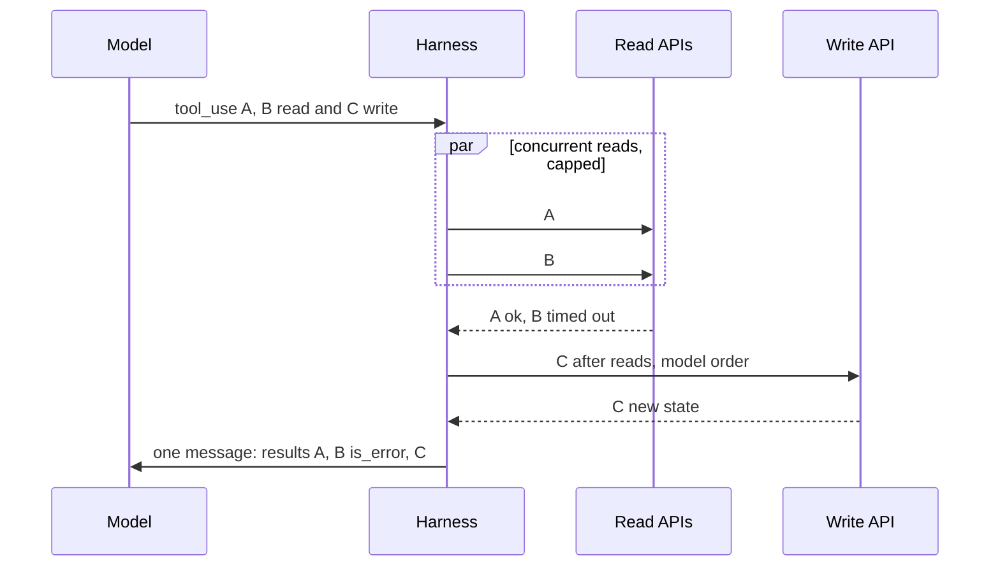

## TL;DR
An agent's model can emit several tool calls in one turn; the harness runs independent ones
concurrently and answers every call before the next turn, saving a round trip per call. The model
picks the batch; only the harness knows what may overlap.

## For agent builders
- **Why it matters for agents.** Round trips dominate agent latency, and research or support agents
  often need several independent lookups per step. Batching them can cut seconds per turn, but running
  two writes at once can corrupt state, so the harness, not the model, decides what overlaps.
- **Where it shows up in your stack.** `disable_parallel_tool_use` on the Claude API and
  `parallel_tool_calls` on OpenAI; LangGraph's prebuilt `ToolNode` runs the calls from one model message
  concurrently, and the OpenAI Agents SDK runs one turn's function tools together. Check whether your
  framework lets you hold writes back.
- **What you control.** Which tools are parallel-safe (from contract metadata), the concurrency cap,
  per-call timeouts, failure isolation, and a single message answering every call.
- **What you can skip.** Building a dependency planner. Dependent calls arrive in later turns on their
  own; programmatic tool calling covers long chains.

## Why it exists
- **The model call dominates step latency.** A step is a model call plus a tool call, and the model call is
  usually slower, often seconds.
- **Sequential fan-out pays that latency repeatedly.** An agent needing three documents, four order
  statuses or the weather in two cities pays the model latency three or four times, and grows the
  transcript by an assistant turn and a user turn each time.
- **Nothing in those fetches depends on the others;** the model is only between them because the loop is
  sequential.
- **"One tool at a time" is simple** and keeps ordering trivial, but it is that slow path.
- **A special batch tool taking a list of ids** works for one tool but cannot express "look up this order
  *and* that customer *and* fetch this page", and moves batching logic into every tool.
- **Parallel calls generalize it.** Several `tool_use` blocks in one response say "these do not depend on
  each other", and the harness, which knows what each tool does, decides how to run them.

## How it works
### The model's side
- **Batching is on by default** on the major APIs for models trained for tool use. It can be switched off:

| API | Switch off with |
|---|---|
| Claude API | `disable_parallel_tool_use: true` inside `tool_choice` |
| OpenAI | `parallel_tool_calls: false` |

- **Dependencies cannot be expressed in one turn.** "Use the customer id from call A as the argument of
  call B" means the model emits A, waits, then emits B, which is correct and sequential.
- **Batch eagerness varies by model and context.** If traces show independent reads arriving one per turn,
  a system-prompt instruction ("when several lookups do not depend on each other, request them in the same
  turn") usually raises the batch rate; the calls-per-turn metric tells you whether it did.
- **For long dependent chains, use programmatic tool calling:** the model writes a script that calls tools
  inside a sandbox, keeping intermediate results out of the transcript. Anthropic offers this as
  "programmatic tool calling"; code-as-action agent frameworks implement the same idea.

### The harness's side
1. **Collect every `tool_use` block** from the response, not just the first.
2. **Classify each by contract metadata.** Read-only calls are parallel-safe; side-effecting calls run one
   at a time in the model's order, or go through an approval gate.
3. **Run the safe set concurrently** (`asyncio.gather`, a thread pool, a task group) under a concurrency
   cap, because a model that emits ten calls to the same API is a burst your rate limits did not plan for.
4. **Isolate failures.** Each call gets its own result and one exception must not cancel the others,
   because the model needs every result, and a missing `tool_result` for any `tool_use` is a protocol error.
5. **Apply a per-call timeout** and convert it into an `is_error` result, so one slow upstream does not
   hold the whole turn.
6. **Build a single user message** with one `tool_result` per `tool_use`, bound by id. Order is cosmetic;
   completeness is mandatory.

- **Idempotency does not make a write parallel-safe.** "Set status to shipped" and "set status to
  cancelled" are each idempotent, yet run concurrently they race on which lands last.
- **Reads-first reorders the turn, and that is acceptable** *because* calls in one turn are ones the model
  considered independent. If a read and a write in the same turn touch the same record, the read reports
  the pre-write state, so the write tool should return the new state itself.

### Why all results go back together
- **Every API requires each call in an assistant turn to be answered before the next assistant turn.**
- **Wire shapes differ.** The Claude API wants all `tool_result` blocks in the single following user
  message and rejects a request leaving a `tool_use` unanswered there; OpenAI's Chat Completions uses one
  `role: "tool"` message per call, all placed directly after the assistant message.
- **The transcript is also an in-context example.** A history in which calls appear answered one at a time
  teaches the model to make them one at a time, and the speedup quietly disappears.

### Side effects and ordering
- **Two writes emitted together have no guaranteed order** once run concurrently.
- **The model sometimes batches dependent writes.** If tool A creates a record and tool B updates it, it
  should not have batched them; the harness's `parallel_safe` flag is what prevents the race.
- **Idempotency keys are the other half.** They make a retried or duplicated call harmless, but protect
  against duplicates, not against two different writes landing in the wrong order.

### The latency arithmetic
Illustrative numbers: a model call of 3 s and tool calls of 1 s each, four independent reads.

| Plan | Cost | Total |
|---|---|---|
| Sequential | four model calls each followed by one tool call, then the final model call: 4 × (3 + 1) + 3 | 19 s |
| Batched | one model call, the slowest of the four tool calls, the final model call: 3 + 1 + 3 | 7 s |

- **The transcript also gains one assistant turn instead of four,** which compounds across the rest of the run.

## Diagram
One assistant turn with three calls: reads overlap under a cap, the write waits its turn, and one message
answers every call.



## Examples
### A harness function for one turn
Safe calls run concurrently with a semaphore and a timeout, unsafe calls run in order, every call gets
exactly one result, and all results go back in one message. `HANDLERS` maps tool names to async functions;
`PARALLEL_SAFE` comes from the tool contracts.

```python
import asyncio, json

PARALLEL_SAFE = {"get_order", "search_docs", "get_weather"}   # read-only tools, from the contracts
sem = asyncio.Semaphore(5)                                      # protect upstream rate limits
TIMEOUT_S = 10

async def run_one(block) -> dict:
    """Execute one tool_use block and always return a tool_result for it."""
    try:
        async with sem:
            out = await asyncio.wait_for(HANDLERS[block.name](**block.input), timeout=TIMEOUT_S)
        return {"type": "tool_result", "tool_use_id": block.id, "content": json.dumps(out)}
    except asyncio.TimeoutError:
        return {"type": "tool_result", "tool_use_id": block.id, "is_error": True,
                "content": f"timed out after {TIMEOUT_S}s; outcome unknown, check before retrying"}
    except Exception as e:                                      # isolate: one failure, one error result
        return {"type": "tool_result", "tool_use_id": block.id, "is_error": True,
                "content": f"{type(e).__name__}: {e}"}

async def execute_turn(response) -> dict:
    calls = [b for b in response.content if b.type == "tool_use"]
    safe = [b for b in calls if b.name in PARALLEL_SAFE]
    unsafe = [b for b in calls if b.name not in PARALLEL_SAFE]
    results = {}
    for r in await asyncio.gather(*(run_one(b) for b in safe)):   # concurrent; run_one never raises
        results[r["tool_use_id"]] = r
    for b in unsafe:                                              # writes: sequential, model's order
        r = await run_one(b)
        results[r["tool_use_id"]] = r
    return {"role": "user", "content": [results[b.id] for b in calls]}   # one message, every call answered

# inside the loop:
#   messages.append({"role": "assistant", "content": response.content})
#   messages.append(await execute_turn(response))
```

### See the speedup and the isolation locally
Runnable with only the standard library: four simulated 1 s calls, one of which fails. Sequential takes
about 4 s; concurrent takes about 1 s and still returns all four results.

```python
import asyncio, time

async def fetch(name: str, delay: float, fail: bool = False) -> str:
    await asyncio.sleep(delay)                       # stands in for a 1 s upstream call
    if fail:
        raise LookupError(f"{name}: 404")
    return f"{name}: ok"

async def safe(coro) -> str:                         # isolate: an exception becomes a value
    try:
        return await coro
    except Exception as e:
        return f"error: {e}"

async def main():
    jobs = [("A", 1.0, False), ("B", 1.0, True), ("C", 1.0, False), ("D", 1.0, False)]
    t = time.perf_counter()
    for j in jobs:
        await safe(fetch(*j))
    print(f"sequential: {time.perf_counter() - t:.1f}s")       # ~4.0s
    t = time.perf_counter()
    results = await asyncio.gather(*(safe(fetch(*j)) for j in jobs))
    print(f"concurrent: {time.perf_counter() - t:.1f}s", results)   # ~1.0s, B is an error value

asyncio.run(main())
```

## Production patterns
- **Concurrency caps per downstream, not one global cap.** When tools hit different systems; keep one
  `asyncio.Semaphore` per upstream sized to its rate limit, so a burst to one API does not starve another.
  Monitor 429s and queue wait time per upstream.
- **Watch calls per assistant turn.** Once parallel calls are enabled; log the number of `tool_use` blocks per
  turn. A value stuck at one usually means the transcript taught the model not to batch, or results were
  split across messages; add the batching instruction to the system prompt and re-measure.
- **"Outcome unknown" for timed-out writes.** For any write tool; the timeout result says the outcome is
  unknown and to check before retrying, and the write carries an idempotency key. Monitor duplicate-write
  incidents and timeout rate per tool.
- **Per-result size caps sized for a batch.** For fan-out agents; cap each result, because eight large pages
  arriving at once make the context jump in one step. Monitor context tokens added per turn.
- **Turn batching off for write-heavy agents.** When correctness dominates latency; set
  `tool_choice={"type": "auto", "disable_parallel_tool_use": True}` on the Claude API or
  `parallel_tool_calls=False` on OpenAI. Monitor wall-clock per task to confirm the cost is acceptable.
- **Declined calls still get a result.** When policy refuses a call; return an `is_error` result saying it
  was declined, never drop it. Monitor declined calls per tool.

## Trade-offs
- **Latency vs downstream burst.** Independent calls finish sooner with fewer model turns, but downstream
  systems get a burst of concurrent load; without a concurrency cap the speedup turns into rate-limit errors.
- **Model-decided batching vs harness design.** It is convenient, but the model may batch dependent or
  side-effecting calls; the harness needs contract metadata to serialize them, which is extra design work.
- **One message vs context jump.** Returning all results at once makes one large message; with big results
  the context jumps in a single step, so per-result size caps matter more than in the sequential case.
- **Disabling vs speed.** Turning parallel calls off simplifies the harness and guarantees ordering but gives
  up the speedup; a fair choice for low-volume, write-heavy agents where correctness dominates latency.

## Pitfalls
- **On the Claude API, splitting results into separate user messages.** Symptom: an API error about
  unanswered tool calls, or a model that stops batching after a few turns. Fix: one message, every call.
- **Using `gather` without isolating failures.** Symptom: one 404 cancelling every sibling call and a turn
  with no results at all. Fix: a `run_one` that never raises.
- **Running writes concurrently.** Symptom: duplicated or out-of-order side effects that only appear under
  load. Fix: serialize anything not marked parallel-safe.
- **No per-call timeout.** Symptom: a whole turn stalled on one slow upstream while the others finished long
  ago. Fix: `asyncio.wait_for` per call.
- **Telling the model to "retry" a write that timed out.** The timeout cancelled your wait, not necessarily
  the downstream operation. Symptom: a double charge or duplicate ticket, unless the write carries an
  idempotency key or the model is told the outcome is unknown and checks first.
- **Dropping the result for a call the policy refused to run.** Symptom: a protocol error. Fix: an `is_error`
  result saying the call was declined.

## When to use
- **Use when** an agent does many independent reads: research across sources, fan-out lookups,
  multi-entity status checks.
- **Avoid when** tools are mostly writes or downstream systems cannot absorb bursts; keep parallel calls
  disabled or serialize in the harness.
- **Measure** average calls per assistant turn (stuck at one means the model is not batching, usually
  because the transcript taught it not to), wall-clock per step, and error rate under concurrency.
- **Day to day** the bugs are in the harness: isolation, timeouts, caps and the one-message rule.
- **Interviews:** "what changes in your loop to support parallel calls" tests whether someone has built one;
  answer scheduling by contract metadata, failure isolation, and completeness of the result message.

## Role lens
- **Engineer:** Implements concurrent execution with a semaphore, per-call timeouts and failure
  isolation, and returns exactly one `tool_result` per `tool_use` in a single message.
- **Architect:** Decides which tools are declared parallel-safe, sets concurrency caps per downstream
  system, and requires idempotency keys on any write that could be duplicated.
- **FDE:** Measures the customer's per-task latency, identifies the sequential fan-out, and enables
  batching only after checking the customer's API quotas can take the burst.

## Check yourself
**Q:** A research agent fetches eight web pages one at a time and takes about forty seconds per task.
Someone proposes "just turn on parallel tool calls". What has to change in the harness, and what could
go wrong?
**A:** The model will batch the fetches once the transcript shows that batching is answered correctly,
but the harness must change first: collect every `tool_use` block, run the fetches concurrently under a
concurrency cap so the target sites and your proxy are not hammered, give each a timeout, catch every
exception and convert it to an `is_error` result so one dead page does not cancel the rest, and return
all eight results in one user message. Then watch three risks: eight large pages arriving at once can
blow the context, so cap each result's size; fetched pages are untrusted and now arrive in bulk, so
the provenance labels and action gates must already be in place; and if any tool in the set has side
effects it must be excluded from the concurrent group. Confirm with calls per turn and wall-clock per task.

## Interview questions
### What changes in your loop to support parallel tool calls?
- **Collect every `tool_use` block,** classify by contract metadata, and run only parallel-safe calls
  concurrently under a cap.
- **Isolate failures and time out each call,** converting both into `is_error` results.
- **Return exactly one result per call in one message,** because completeness is a protocol rule and the
  transcript teaches the model how batching is handled.

### Why is an idempotent write still not safe to run in parallel?
- **Idempotency removes duplication, not ordering races:** "set shipped" and "set cancelled" are each
  idempotent, but concurrently they race on which lands last.
- **So** writes run sequentially in the model's order, or behind an approval gate, unless the contract marks
  them parallel-safe.

### Estimate the latency saved by batching four independent lookups.
- **Illustrative:** 3 s per model call and 1 s per tool call.
- **Sequential:** 4 × (3 + 1) + 3 = 19 s. **Batched:** 3 + 1 + 3 = 7 s.
- **Plus** one assistant turn instead of four, so later turns resend a shorter transcript.

### You enabled parallel calls but the model still calls one tool per turn. Why?
- **Check the transcript shape first:** results split across messages teach the model, in context, to make
  calls one at a time.
- **Check the instructions:** add "request independent lookups in the same turn" to the system prompt.
- **Check for real dependencies:** if B needs A's output, sequential is correct; consider programmatic tool
  calling for long chains.

### When would you disable parallel tool calls entirely?
- **Write-heavy, low-volume agents** where ordering and correctness matter more than seconds.
- **Fragile downstream systems** that cannot absorb bursts even with caps.
- **The cost** is giving up the latency win, so measure wall-clock per task before and after.

### Your framework runs every call in a turn concurrently, writes included. How do you make it safe?
- **Classify tools in your own registry** as read-only or side-effecting, because the framework does not
  know which calls race.
- **Serialize writes yourself:** route side-effecting tools through a lock or queue per resource, or turn
  off parallel calls for agents that mostly write.
- **Verify in traces** that two writes to one record never overlap, and keep per-call timeouts and error
  results so one failure does not drop the others.

## Quiz
### Q: On the Claude API, why must all the tool results for one assistant turn be returned in a single user message?
- [ ] Because the API bills per user message
- [x] Because every tool call in the turn must be answered before the next assistant turn, and a transcript that answers them one at a time teaches the model to stop batching
- [ ] Because tool results are only matched by position, not by id
- [ ] Because concurrent execution requires a single thread to write the message
> The protocol expects completeness, and the transcript doubles as the model's in-context example of
> how calls are handled. Results are matched by `tool_use_id`, so order within the message does not
> matter. (OpenAI's API uses one tool message per call instead, but the completeness rule is the same.)

### Q: Which calls should the harness refuse to run concurrently by default?
- [ ] Calls to tools with long descriptions
- [ ] Calls whose arguments contain the same id
- [x] Side-effecting calls such as creates, updates and sends, unless their contract marks them parallel-safe
- [ ] Any call that returns more than one row
> Concurrent writes have no guaranteed order and can race or duplicate, and idempotency only removes
> the duplication risk, not the ordering race. Reads are safe. Argument overlap and result size are
> not what determine safety.

### Q: One of five concurrent calls times out. What should the harness send back?
- [ ] Nothing for that call; the model will notice it is missing
- [ ] An empty tool_result so the message stays complete
- [x] An is_error tool_result for the timed-out call alongside the four normal results
- [ ] Retry the whole turn, including the four calls that succeeded
> Every `tool_use` needs a `tool_result`, and an error result tells the model what happened so it can
> retry just that call. An empty result looks like success, and re-running the successful calls wastes
> time and may duplicate side effects.

## Use cases & projects
### Use cases
- **Research agents.** Several independent searches or page fetches in one turn cut the wall-clock time
  of each research step.
- **Support agents.** Account, order and policy lookups for one customer run together before the agent
  answers.
- **Dashboard and reporting agents.** Metrics from several services are gathered concurrently, with a
  per-call timeout so one slow service does not stall the turn.
- **Mixed read-write turns.** Reads run in parallel while writes are held back and run one at a time,
  so state is never changed by two calls at once.

### Mini project
**Add parallel execution to a harness (1-2 hours).**
- **Goal:** run independent tool calls from one turn concurrently and measure the saving.
- **Steps:** give an agent three read tools with simulated latency and one write tool; execute a turn's
  calls with `asyncio`, a concurrency cap and per-call timeouts; run reads concurrently and writes
  serially using a parallel-safe flag; make one call time out on purpose; answer every call in one
  message, with an error result for the timeout.
- **Done when:** a table shows turn latency sequential versus parallel, the timed-out call returned an
  error result while the others succeeded, and the write never overlapped another call.
