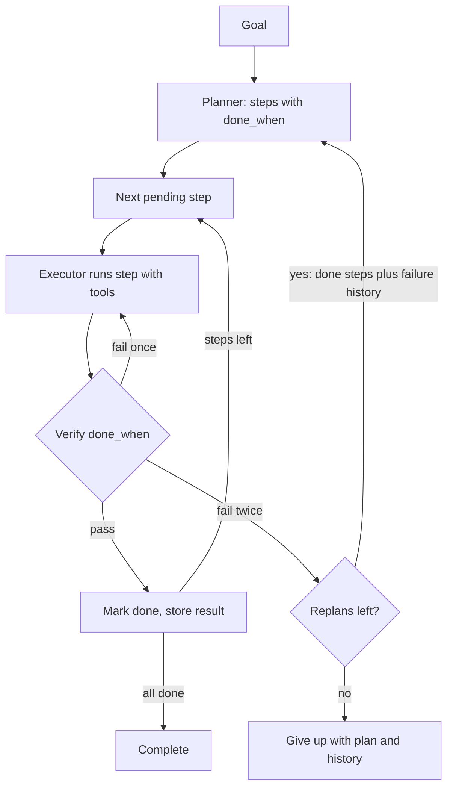

## TL;DR
Planning is how an agent decides which actions to take and in what order. An explicit plan gives the
loop a target to measure progress against and a place to replan; where planning lives trades tokens for
robustness.

## Why it exists
- **The basic loop is greedy.** Look at the conversation, choose one tool call, observe, repeat. Fine for
  a three-step task.
- **Greedy fails predictably on long tasks.** On "migrate this service to the new auth library and make
  the tests pass", the model fixes the first compile error, then the next, loses the goal as tool output
  fills the context, repeats steps whose evidence scrolled away, and declares victory when the latest
  output looks good rather than when the goal is met.
- **Every step is locally reasonable and the trajectory is still wrong,** *because* nothing in the loop
  represents the whole task.
- **"Bigger context, stronger model" helps less than expected.** Long contexts dilute attention, each step
  still conditions on the recent past more than the goal, and cost grows with every token re-read per step.
- **A plan is the missing compact representation of intent:** sub-goals, their order, which are done, and
  what to do when one fails. It gives the agent a progress check, lets a human review the approach before
  side effects, and provides the hook for replanning rather than flailing when the world disagrees.

## How it works
### Four places planning can live
| Placement | How | Works because | Fails when |
|---|---|---|---|
| **Interleaved (ReAct-style)** | Short reasoning step, action, observation, repeat; planning is implicit and local | Each decision uses the freshest information, which matters in unpredictable environments | Long horizons (the drift above); costs one model call per action |
| **Plan-then-execute** | A planner call writes a step list; an executor (often a smaller model, or plain code) runs it; a check after each step continues or returns control to the planner | Planning benefits from the whole problem in a clean context; execution from narrow focus and cheap calls | The first plan is badly wrong and checks are weak |
| **Plan with placeholders (ReWOO-style)** | Planner writes every step up front, referencing unseen outputs as variables (`#E1`, `#E2`); a worker runs all tool calls; a solver call combines evidence | Observations never go back through the planner, so calls and tokens drop sharply | Results are surprising: the plan cannot adapt |
| **Search over plans (Tree of Thoughts, MCTS-like)** | Generate several candidate next steps, score them with a value prompt or external checker, expand the best, backtrack from dead ends | A partial state can be evaluated cheaply and reliably: puzzles, code with tests, formal constraints | No evaluator: it degenerates into expensive sampling |

- **The formal extreme:** the LLM only translates the goal into a planning language (PDDL) and a classical
  planner finds a provably valid plan. This works when the domain's actions and preconditions can be
  written down exactly, and not otherwise.
- **Hierarchical planning layers these.** A top-level planner emits goals; each goal runs in its own
  interleaved loop. It keeps each context small and matches how task decomposition is done.

### What a plan looks like
- **Free text or structured data.** "1. find the config, 2. …" works for humans; structured plans win in
  production *because* code can act on them.
- **A JSON step list** with `id`, `goal`, `depends_on`, `done_when` and `status` gives dependency
  ordering, parallel execution of independent steps, a place to store results, and an easy progress
  display.
- **`done_when` is the most valuable field.** It turns "did I finish?" from a vibe into a check that can be
  delegated to a tool or a critic.

### Keeping the plan in view
- **Plans decay if they scroll out of context.**
- **Re-inject the current plan with step statuses** at the top of each turn, or keep it in a file or
  scratchpad the agent updates and re-reads (the "todo list" pattern).
- **Why it works:** recency and position both affect what the model attends to; putting the goal and
  remaining steps where the model will see them counteracts the pull of the latest tool output.

### Replanning
Replanning triggers should be explicit:
1. **A step fails twice.**
2. **An observation contradicts an assumption** listed in the plan.
3. **The step budget is half spent** with less than half the plan done.
4. **A human edits the plan.**

- **On trigger,** the planner receives the original goal, the plan with statuses, and a summary of what
  went wrong, and returns a revised plan.
- **Bound replans** (for example, three per task) so the loop does not plan forever instead of acting.

### Cost model
| Scheme | Model calls | Token growth |
|---|---|---|
| Interleaved | One per action, whole history re-read each time | History grows by one observation per step, so total input tokens grow roughly with steps² |
| Plan-then-execute | One large planner call plus cheap executor calls | Roughly linear in steps |
| ReWOO | A small constant number | Smallest |
| Search | Multiplied by branching factor and depth | Largest |

- **Prompt caching** lowers the price of re-reading history but not the attention dilution.
- **Pick the cheapest scheme that survives your failure cases,** then measure.

## Diagram
Follow the plan-then-execute loop: each step is checked against its `done_when`, one retry absorbs
transient failures, and a second failure sends control back to a bounded replanner.



## Examples
### Plan-then-execute with verification and bounded replanning
A plan-then-execute loop with structured steps, a verification check per step, and bounded replanning.
`llm_json` is any call that returns parsed JSON; `run_step` executes a step with tools and returns the
observation.

```python
MAX_REPLANS, MAX_STEPS = 3, 20

def make_plan(goal, done=(), history=""):
    finished = [s["goal"] for s in done]
    return llm_json(f"""Goal: {goal}
Already completed, do not repeat: {finished or 'none'}
Previous attempts and failures: {history or 'none'}
Return JSON: {{"steps":[{{"id":1,"goal":"...","done_when":"...","depends_on":[]}}]}}
Plan only the remaining work; steps independently verifiable; at most 8.""")["steps"]

def verify(step, observation):
    return llm_json(f'Step goal: {step["goal"]}\nDone when: {step["done_when"]}\n'
                    f'Observation: {observation}\nReturn {{"done": true|false, "why": "..."}}')

def agent(goal):
    plan, history, used = make_plan(goal), [], 0
    for replan in range(MAX_REPLANS + 1):
        for step in plan:
            if step.get("status") == "done":
                continue
            for attempt in (1, 2):             # retry once: one failure may be transient
                if used >= MAX_STEPS:
                    return {"status": "budget_exhausted", "plan": plan}
                obs = run_step(step, context=[s for s in plan if s.get("status") == "done"])
                used += 1
                check = verify(step, obs)
                if check["done"]:
                    step["status"], step["result"] = "done", obs
                    break
                history.append(f'step {step["id"]} try {attempt} failed: {check["why"]}')
            if step.get("status") != "done":
                break                          # failed twice: the plan's premise is suspect
        else:
            return {"status": "complete", "plan": plan}
        if replan == MAX_REPLANS:
            break                          # no replans left; do not pay for an unused plan
        done = [s for s in plan if s.get("status") == "done"]
        plan = done + make_plan(goal, done, "\n".join(history))  # replan only the rest
    return {"status": "gave_up", "plan": plan, "history": history}
```

The deliberate choices:
- **`done_when` is written at planning time,** *because* that is when the intent is clearest.
- **One retry before a replan,** *because* a single failure is often transient while two suggest the plan
  itself is wrong.
- **Finished steps are kept across replans *and named to the replanner*,** so it plans only the remaining
  work and nothing verified is redone.
- **Prefer code checks.** Where `done_when` can be checked by code (a test passes, a row exists), replace
  the LLM `verify` call with that check; a model judging its own executor's output is the weakest verifier
  available.

### Trace: "upgrade the auth library and make the tests pass"
| Step | `done_when` | Outcome |
|---|---|---|
| 1. Bump the dependency | lockfile shows the new version | pass |
| 2. Fix compile errors | build exits 0 | pass |
| 3. Update deprecated token call sites | grep finds no old API | fails twice: the "deprecated" call has no direct replacement, contradicting the plan's assumption |
| Replan (sees steps 1 and 2 done plus failure history) | | returns: add an adapter function, migrate call sites to it, then the test step |
| 4. Run tests | suite green | pass |

Total: two planner calls and about seven executor calls, versus a reactive loop that would likely have
kept patching call sites one compile error at a time.

### Scheduling a structured plan into parallel waves
Runnable pure Python: because steps carry `depends_on`, code (not the model) decides what can run
together, and the same data renders the progress header re-injected each turn.

```python
plan = [
    {"id": 1, "goal": "bump auth dependency", "depends_on": [], "status": "done"},
    {"id": 2, "goal": "fix compile errors", "depends_on": [1], "status": "pending"},
    {"id": 3, "goal": "update docs for new login flow", "depends_on": [1], "status": "pending"},
    {"id": 4, "goal": "migrate token call sites", "depends_on": [2], "status": "pending"},
    {"id": 5, "goal": "run test suite", "depends_on": [3, 4], "status": "pending"},
]

def waves(plan):
    """Group pending steps into waves; steps in one wave can run in parallel."""
    done = {s["id"] for s in plan if s["status"] == "done"}
    pending = {s["id"]: s for s in plan if s["status"] != "done"}
    out = []
    while pending:
        ready = [i for i, s in pending.items() if set(s["depends_on"]) <= done]
        if not ready:
            raise ValueError(f"cycle or missing dependency among steps {sorted(pending)}")
        out.append(sorted(ready))
        done |= set(ready)
        for i in ready:
            del pending[i]
    return out

print(waves(plan))   # [[2, 3], [4], [5]]

def progress_header(plan):
    """The block re-injected at the top of every turn so the plan never scrolls away."""
    marks = {"done": "x", "pending": " ", "failed": "!"}
    return "\n".join(f"[{marks[s['status']]}] {s['id']}. {s['goal']}" for s in plan)

print(progress_header(plan))
```

### Worked cost comparison for a 10-step task
Illustrative orders of magnitude, not a benchmark: 2,000 stable prompt tokens, observations of 1,000
tokens each.

| Scheme | Model calls | Input tokens (approx.) |
|---|---|---|
| Interleaved: step *k* sends 2,000 + 1,000·(*k*−1) | 10 | 10 × 2,000 + 1,000 × 45 = 65,000 |
| Plan-then-execute: 1 planner call, 10 executor calls of ~1,500, 10 verify calls of ~500 | 21 | 2,000 + 15,000 + 5,000 = 22,000 |
| ReWOO: planner, then a solver reading all 10 observations | 2 | 2,000 + 12,000 = 14,000 |

Interleaved grows quadratically, so doubling to 20 steps more than triples its total (65,000 to
230,000), while the other two roughly double.

## Production patterns
- **Persist the plan outside the context.** Store the step list with statuses in a database row or a
  scratchpad file keyed by run id, and rebuild the prompt header from it each turn. This also gives crash
  resumability. Monitor steps re-executed after already being marked done.
- **Code-checkable `done_when` wherever possible.** Map criteria such as "build exits 0" or "row exists"
  to deterministic checks and reserve LLM verification for fuzzy goals. Monitor the share of steps
  verified by code versus by model.
- **Human approval gate on the plan.** For deployments and data changes, show the structured plan in the
  UI and execute only after approval; re-approve when a replan adds side-effecting steps. Monitor approval
  latency and how often operators edit plans.
- **Budgets on steps and replans.** Set explicit limits (for example 20 steps, 3 replans) and return a
  status report rather than an exception when they trip. Monitor replans per task and budget-exhausted
  rate.
- **Plan against the real tool list.** Put the available tool names and descriptions in the planner prompt
  and reject plan steps that need tools the agent lacks before execution starts. Monitor plan validation
  failures.

## Trade-offs
- **Reviewability vs information.** Up-front plans give reviewability and progress tracking, but are
  written with the least information; in highly uncertain environments interleaved planning wastes fewer
  steps on wrong plans.
- **Few calls vs adaptability.** ReWOO-style placeholder plans cut model calls to a handful, yet cannot
  react to surprising tool output. Placeholders can pass an unknown result into a later step's arguments,
  but the moment *which* step comes next depends on what a result says, interleaving wins back its cost.
- **Search quality vs cost.** Search over plans improves hard-problem success substantially, but only with
  a trustworthy evaluator; with a noisy value prompt you pay branching-factor times the cost for little gain.
- **Structure vs strictness.** Structured JSON plans enable parallelism and validation, at the cost of a
  stricter planner prompt and occasional parse failures that free-text plans never have.

## Pitfalls
- **Letting the plan scroll out of context.** Symptom: the agent repeats completed steps or declares
  success after the most recent sub-goal rather than the whole task. Fix: re-inject plan state each turn.
- **Steps without a completion criterion.** Symptom: an executor that "completes" every step and a final
  result that satisfies none of the goal. Fix: require `done_when`.
- **Replanning on every hiccup.** Symptom: a trace full of planner calls and few tool calls, with the plan
  reshuffled each turn. Fix: explicit triggers and a replan cap.
- **Over-planning simple tasks.** Symptom: five-step plans for one-tool questions and users who notice the
  latency. Fix: route short tasks to a plain loop.
- **Planning without knowing the tools.** Symptom: plans that call capabilities the agent does not have,
  which only surfaces at execution time. Fix: give the planner the tool list and validate plans.

## When to use
- **Use explicit planning when** tasks exceed roughly five tool calls, humans must approve the approach
  before side effects (deployments, data changes), steps can run in parallel, or you need resumability
  after a crash.
- **Stay with interleaved ReAct when** tasks are short and the environment is unpredictable.
- **Prefer a fixed workflow when** the steps are known in advance.
- **Measure** task completion rate, steps per task against an ideal, replans per task and tokens per task.
- **On the job:** this is the difference between an agent that migrates a codebase and one that fixes the
  first error it sees.
- **Interviews:** explain the four placements and the cost model, then show you would pick by failure mode
  rather than by fashion.

## Role lens
- **Engineer:** Writes the planner and verifier prompts, chooses the plan schema, re-injects plan state
  each turn and bounds replans and steps.
- **Architect:** Decides whether a use case is a fixed workflow, a planned agent, or a search, and sets
  where human approval of a plan is mandatory.
- **FDE:** Tunes plan granularity to the customer's tools and risk appetite, and exposes the plan in
  their UI so operators trust and correct the agent.

## Check yourself
**Q:** An agent that reconciles invoices against purchase orders works on small batches but on large
batches it keeps re-checking invoices it already matched and never finishes. Diagnose and propose a
fix with a cost estimate.
**A:** The trajectory shows classic plan decay: with a long context, the record of which invoices are
matched scrolls out of view and the agent re-derives work from recent tool output. Fix the
representation, not the model. Have a planner produce a structured plan where each invoice (or batch
of invoices) is a step with `done_when: "match stored for invoice X"`, keep the status table in a
scratchpad that is re-injected at the top of each turn, and gate completion on the table, not on the
last message. Independent invoices can run as parallel steps. Cost: one planner call, then one executor
call per invoice with a small context, instead of one growing-context call per action, so the dominant
cost falls from roughly O(n²) tokens to O(n) (the status table still grows with n, but at a few tokens
per invoice, or summarise it as counts plus the next pending ids), and replans are bounded to a few per
batch. Better still, "matched" should be a deterministic check on stored records, not the model's opinion.

## Interview questions
### Why does a purely reactive agent loop drift on long tasks?
- **It is greedy:** each step conditions on the latest observations, not on a representation of the whole
  task, so locally sensible steps add up to a wrong trajectory.
- **Context makes it worse:** evidence of finished work scrolls away, so steps repeat, and success is
  judged on the latest output instead of the goal. An explicit plan with statuses fixes the representation.

### Compare ReAct, plan-then-execute, ReWOO and tree search. How do you choose?
- **ReAct** adapts best to unpredictable environments, at one call per action and quadratic token growth.
- **Plan-then-execute** suits long tasks needing review and progress tracking; **ReWOO** minimises calls
  when results will not change which steps run.
- **Search** pays off only with a cheap, reliable evaluator such as tests. Choose by the failure mode you
  must survive, then measure.

### Your agent's traces show five planner calls for every tool call. What is wrong?
- **Replanning is triggered too easily,** likely on any single error or on every new message.
- **Fix:** retry once for transient failures, replan only on repeated failure, contradicted assumptions or
  budget signals, and cap replans per task (for example three).

### When would you not add an explicit planner?
- **Short tasks** of one or two tool calls, where a five-step plan adds latency users notice.
- **Known steps,** where a fixed workflow in code is cheaper and deterministic.
- **Highly unpredictable environments,** where an up-front plan written with the least information is
  mostly wasted.

### How would you estimate the token cost of an interleaved loop versus plan-then-execute for 20 steps?
- **Interleaved:** step *k* re-reads the stable prompt plus *k*−1 observations, so totals grow roughly
  with steps²; with 2,000 stable and 1,000 per observation, 20 steps is about 230,000 input tokens.
- **Plan-then-execute:** one planner call plus 20 small executor and verify calls, roughly linear, so
  tens of thousands. Prompt caching lowers price, not attention dilution.

## Quiz
### Q: Why does plan-then-execute often beat interleaved ReAct on long tasks?
- [ ] The executor model is always more accurate than the planner model
- [x] The plan keeps the whole goal and step statuses explicit, so progress is measured against intent rather than the latest observation
- [ ] It eliminates the need for tool calls
- [ ] It guarantees the first plan is correct
> Interleaved loops condition mostly on recent output and drift. An explicit plan with completion
> criteria gives the loop a target and a replanning hook; it does not make the first plan correct, which
> is why replanning exists.

### Q: When is a ReWOO-style plan with placeholder variables a poor choice?
- [ ] When tool calls are expensive
- [ ] When the task has many independent steps
- [x] When which steps to run, not just their arguments, depends on what earlier observations turn out to contain
- [ ] When the model supports structured outputs
> Placeholder plans are written before any observation and never revisited by the planner. A variable
> like `#E1` can carry step 1's output into step 3's arguments, but if step 1's result should change
> *what* step 3 is (or whether it runs), the fixed plan cannot adapt. Many independent steps suit ReWOO well.

### Q: Which trigger is a sound reason to replan rather than retry?
- [ ] Any tool returning an error once
- [ ] The user sending any new message, even one that leaves the goal unchanged
- [x] An observation contradicting an assumption the plan was built on, or a step failing repeatedly
- [ ] Every ten steps regardless of progress
> Replanning is for when the plan's premises are wrong. Single transient errors deserve a retry, and
> periodic replanning without a signal burns planner calls while shuffling work that was fine.
