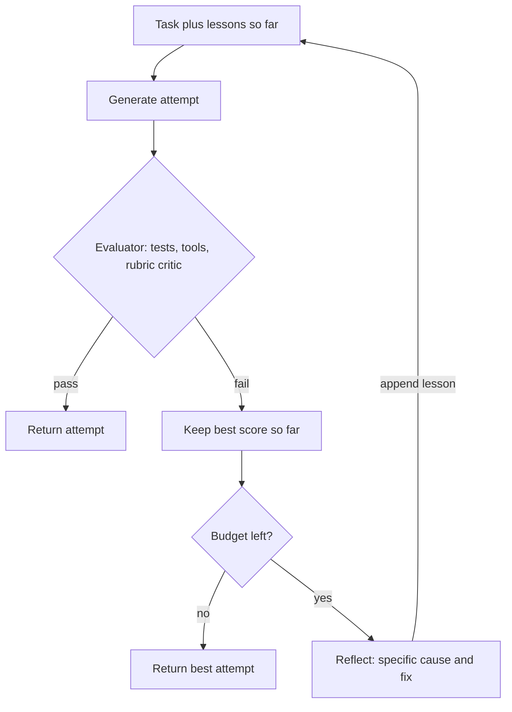

## TL;DR
Reflection is a generate–critique–revise loop inside your agent. It pays off only when the critique
brings new information (a failing test, a tool error, a verifier, a fresh rubric context); "look again"
with no new signal can turn right answers wrong.

## For agent builders
- **Why it matters for agents.** Teams often add a "review before submit" step to coding, research and
  writing agents, and it is often wasted. Whether it helps is decided by the evidence the critic sees, so
  the design work is building the evaluator, not the critique prompt.
- **Where it shows up in your stack.** The evaluator-optimizer workflow (generator and critic nodes with a
  conditional edge back, as in LangGraph's reflection examples); output guardrails that validate a final
  answer (OpenAI Agents SDK); test runners and schema validators as tools; LLM-as-judge evaluators in
  LangSmith or similar for checking critic agreement offline.
- **What you control.** The evaluator kind (code, tool-grounded, rubric critic or plain reconsideration),
  whether the critic runs in a fresh context or another model, the structured issue schema, keep-best,
  the iteration cap and whether lessons persist across episodes.
- **What you can skip.** The Self-Refine, Reflexion and CRITIC benchmark tables; keep which signal each
  feeds back.

## Why it exists
- **One forward pass cannot step back.** It commits token by token. Fine for a short factual question.
- **First attempts have a known failure profile** on code, long-form writing, multi-step tool use or any
  checkable goal: they satisfy the surface of the request, skip an edge case, misread a tool result, or
  stop before the goal is met. Humans review their work; the agent equivalent is a second call whose job
  is to judge, not produce.
- **"Ask for the best answer and trust it"** leaves the error rate exactly where it was.
- **"Ask the model to check its answer" is where people get burned.** Without external evidence the model
  re-rolls with a bias toward *changing* its answer, because the prompt implies something is wrong.
  Studies of intrinsic self-correction on reasoning tasks found it often fails to help and sometimes hurts.
- **It earns its cost when the critique sees something new:** an execution result, a retrieved fact, a
  rubric in a clean context, or a different model. Reflexion showed large coding-benchmark gains because
  reflection was grounded in execution: the agent ran unit tests (which it wrote itself, so the signal came
  from running code, not rereading it) and carried the lesson forward as text. Copy that: grounded,
  persisted, fed forward.

## How it works
### The loop
1. **Generate** an attempt from the task and any prior reflections.
2. **Evaluate** the attempt, with one of four evaluator kinds (strongest first):
   - (a) deterministic code: tests, schema validation, a linter or a reconciliation check;
   - (b) a tool-grounded critic that runs searches or executes code to verify claims (the CRITIC approach);
   - (c) an LLM critic with a rubric in a separate context;
   - (d) the same model asked to reconsider, the weakest option.
3. **Reflect:** turn the evaluation into a short, specific lesson, such as "the function failed on an
   empty list because it indexes `[0]` without a guard". Reflexion stores these verbal lessons in episodic
   memory and prepends them to the next attempt.
4. **Revise:** generate again with the lesson in context. Stop when the evaluator passes, the attempt
   stops changing, or the iteration budget runs out.

### Three named variants, and what each feeds back
| Variant | Mechanism | New information | Good for |
|---|---|---|---|
| **Self-Refine** | One model, one task: generate, write feedback on its own output, refine in place, repeat | None external | Tasks where a second look at visible output suffices: style, readability, constraint coverage; not facts the model did not know |
| **Reflexion** | Across attempts: an evaluator (tests, an environment's success signal) scores a whole trial, the model writes a verbal lesson, the next trial starts fresh with lessons prepended | Outcome signal | Regenerates rather than edits, which helps when the first attempt's approach was wrong |
| **CRITIC** | The critique itself uses tools: to check a claim, the critic searches or runs code, then revises | Arrives during critique, not from a pre-built test suite | Factual claims and computations |

### Why a separate critic context helps
- **Same-conversation critique confirms itself.** The generator's context is saturated with the reasoning
  that produced the answer, and attention to that reasoning makes confirmation likely.
- **A fresh call is a different computation.** Seeing only the task, the artifact and a rubric, it has no
  prior reasoning to defend.
- **A different model, or the same model with a role prompt and no history,** is cheap and weakens that
  agreement bias. It does not remove it: LLM judges are known to favour outputs that resemble their own,
  so measure critic-versus-human agreement on your task.
- **Make the critic output structured:** `{"pass": bool, "issues": [{"where": ..., "what": ..., "severity": ...}]}`,
  *because* a free-text "looks good overall" cannot drive the revise step or a stopping rule.

### Why grounding matters most
The evaluator's value is the information it adds:
- **Tests and tool results are the gold standard,** *because* they are independent of the model's beliefs.
- **A rubric-driven LLM critic** adds a different viewpoint and catches omissions and format violations
  well, but shares the generator's blind spots on facts.
- **Intrinsic reconsideration adds nothing new.** Expect it to help only where the first pass was sloppy
  rather than wrong: formatting, completeness against a checklist, or tone.

### Stopping and budgets
- **Each iteration costs** a generate call plus an evaluate call.
- **Revisions are not monotone:** attempt 3 can be worse than attempt 2, so keep the best-scoring attempt.
- **Cap iterations:** two or three is typical for writing, more for code with tests.
- **Stop early** when the critic passes or the diff between attempts is trivial.

Gate the loop on the evaluator, so you pay for revision only on failures:

```
expected model calls per task ≈ 1 + (1 − p₁) · (reflect + regenerate)      p₁ = one-shot pass rate
```

- **With a cheap deterministic check** at p₁ = 0.9, the loop costs about 20% extra on average and only
  touches the 10% that failed.
- **An LLM critic runs on *every* task,** so it adds at least one call even when the first attempt was
  already right; that is where reflection is most often not worth it.

### Where reflection sits in an agent
| Scope | Example |
|---|---|
| Inside a step | Revise a tool call after an error |
| End of a task | Review the deliverable before returning it |
| Across episodes | Carry lessons into the next task via memory |

The cross-episode form is what turns reflection into learning without changing weights.

## Diagram
Trace the evidence: the evaluator, not the model's opinion, decides when to stop; each failure becomes
a lesson for the next attempt, and the best attempt is kept.



## Misconceptions
- **"Asking the model to check its answer catches its mistakes."** With no new evidence the model
  re-rolls, biased toward changing its answer because the prompt implies something is wrong. Studies of
  intrinsic self-correction on reasoning found it often fails to help and sometimes hurts; the critique
  must bring new information such as a failing test or a tool result.
- **"More reflection iterations means a better answer."** Revisions are not monotone: attempt 3 can be
  worse than attempt 2. Keep the best-scoring attempt, cap iterations, and stop when the evaluator
  passes or the diff is trivial.
- **"A separate critic model removes the self-agreement bias."** A fresh context or another model weakens
  it but does not remove it; LLM judges favour outputs that resemble their own. Measure critic-versus-human
  agreement on your task before trusting the critic.
- **"Reflexion's coding gains came from the model thinking harder."** They came from grounding: the
  agent ran unit tests, turned the outcome into a verbal lesson and carried it into the next trial.
  The signal came from running code, not rereading it.
- **"A review step is cheap insurance on every task."** An always-on LLM critic adds at least one call even
  when the first attempt was right: at a 90% one-shot pass rate it costs about +120% calls versus about
  +20% for a loop gated on a deterministic check that reflects only on failures.
- **"A free-text verdict like 'looks good overall' is enough."** It cannot drive the revise step or a
  stopping rule. Make the critic return a pass flag and a structured list of issues.

## Examples
### Test-grounded code repair with keep-best
`llm` is any text-in, text-out model call; the loop runs `pytest` on every attempt (checked against
pytest 8.4 on Python 3.9).

```python
import pathlib, re, subprocess, sys, tempfile

def run_tests(code: str, tests: str) -> tuple[bool, int, str]:
    d = pathlib.Path(tempfile.mkdtemp())
    (d / "solution.py").write_text(code)
    (d / "test_solution.py").write_text(tests)
    try:                                                # no -x: we want to count every pass
        p = subprocess.run([sys.executable, "-m", "pytest", "-q", str(d)],
                           capture_output=True, text=True, timeout=60)
    except subprocess.TimeoutExpired:
        return False, 0, "Tests timed out after 60 s (infinite loop?)"
    m = re.search(r"(\d+) passed", p.stdout)
    return p.returncode == 0, int(m.group(1)) if m else 0, p.stdout[-2000:]

def reflect(task, code, report):
    return llm(f"Task: {task}\nCode:\n{code}\nTest output:\n{report}\n"
               "In three sentences, state the specific cause of failure and what to change. "
               "Do not rewrite the code.")

def solve(task, tests, max_iters=4):
    lessons, best = [], (-1, None)
    for i in range(max_iters):
        code = llm(f"Task: {task}\nLessons from earlier attempts:\n" + "\n".join(lessons)
                   + "\nReturn only Python code for solution.py.")
        ok, passed, report = run_tests(code, tests)
        if passed > best[0]:
            best = (passed, code)                       # revisions are not monotone; keep the best
        if ok:
            return code, i + 1
        lessons.append(f"Attempt {i+1}: " + reflect(task, code, report))
    return best[1], max_iters
```

- **The reflection prompt may not rewrite code,** so the lesson stays short and specific.
- **Scoring by tests *passed*** (rather than failures counted with `-x`, which stops at the first one) is
  what makes "keep the best" meaningful, and it ranks an attempt that does not even import below one that
  fails a single test.

### Cost calculator: gated loop vs always-on critic
Pure Python for the formula above; runs as is.

```python
def gated_calls(p1, reflect=1, regenerate=1):
    """Deterministic check first; model pays for reflection only on failures."""
    return 1 + (1 - p1) * (reflect + regenerate)

def critic_calls(p1, revise=1, recritique=1):
    """LLM critic on every task, then revise and re-critique on failures."""
    return 1 + 1 + (1 - p1) * (revise + recritique)

for p1 in (0.5, 0.9, 0.98):
    g, c = gated_calls(p1), critic_calls(p1)
    print(f"p1={p1}: gated {g:.2f} calls (+{g-1:.0%}), always-on critic {c:.2f} calls (+{c-1:.0%})")
# p1=0.5: gated 2.00 calls (+100%), always-on critic 3.00 calls (+200%)
# p1=0.9: gated 1.20 calls (+20%), always-on critic 2.20 calls (+120%)
# p1=0.98: gated 1.04 calls (+4%), always-on critic 2.04 calls (+104%)
```

### Worked scenario: "review your answer" made facts worse
A summarisation team added a same-context "review and fix mistakes" pass (illustrative figures).

| Version | Evaluator | Formatting | Claim support | Calls per summary |
|---|---|---|---|---|
| One shot | none | baseline | baseline | 1 |
| Same-context self-review | (d) the model reconsidering | better | slightly worse | 2 |
| Fresh-context claim checker plus section check, revise unsupported claims only, cap 2 | (c) plus (a) | better | better | 2 plus revisions only where needed |

The fix was not more iterations; it was giving the critic the source document and a per-claim schema.

## Production patterns
- **Deterministic gate first.** Run tests, schema validation or reconciliation before any model critique,
  and invoke reflection only on failure. Monitor one-shot pass rate p₁ and the share of tasks entering the
  loop.
- **Keep-best with a numeric score.** Score each attempt (tests passed, rubric points) and return the
  maximum, not the last. Monitor how often the returned attempt is not the final one; a high rate means
  revisions regress.
- **Fresh-context rubric critic with measured agreement.** Run the critic as a separate call with only task,
  artifact and rubric, ideally a different model, returning the structured issue schema. Before trusting
  it, compare its verdicts with human labels on a sample of real outputs; monitor that agreement over time.
- **Held-out checks against test gaming.** Show the generator some tests and keep others hidden for the
  final gate, so special-casing visible inputs fails. Monitor the gap between visible and held-out pass
  rates.
- **Scoped, expiring lesson memory.** Store cross-episode lessons keyed by task type with a creation date,
  retrieve only matching ones, and expire them. Monitor whether success on a task type improves after
  lessons start applying.
- **Trace every attempt and critique.** Record each attempt, its score and the critic's issues as child
  spans (LangSmith or OpenTelemetry), and turn disputed critiques into a labelled dataset for the critic.
  Monitor score per iteration; a flat or falling curve says remove the loop.

## Trade-offs
- **Higher success vs per-iteration cost.** Grounded reflection raises success on checkable tasks
  substantially, but each iteration adds a critique call, an evaluator run and a fresh generation; for
  tasks usually right in one shot, that is pure overhead.
- **Less agreement bias vs latency and upkeep.** A separate critic model reduces agreement bias, yet adds
  latency and a second prompt to maintain; when the generator is strong and tasks are simple, the critic
  rarely changes the outcome.
- **Compounding lessons vs staleness.** Cross-episode lessons compound on recurring task types, but stale
  ones mislead on new types unless memory is scoped and expires.
- **Coverage vs shared blind spots.** Rubric-based LLM critique scales to tasks without tests, at the price
  of sharing the generator's factual blind spots; pair it with tool-grounded checks for claims.

## Pitfalls
- **Asking the same context "are you sure?" with no new evidence.** Symptom: correct answers changed to
  wrong ones and accuracy that drops with more iterations. Diagnose: on a labelled sample, count
  right-to-wrong flips per iteration. Fix: add evidence or remove the step.
- **Letting the critic rewrite the artifact.** Symptom: reflections longer than the work, and a revise step
  that copies the critic's version with its own errors. Diagnose: log critique length against artifact
  length and diff each revision with the critique. Fix: the critic only names issues.
- **Unbounded loops that stop only on "pass".** Symptom: runaway cost on tasks the evaluator can never
  satisfy, such as a test that is itself wrong. Diagnose: plot iterations per task and inspect the
  evaluator on the long tail. Fix: an iteration cap.
- **Keeping only the last attempt.** Symptom: returning attempt 4 when attempt 2 passed more tests.
  Diagnose: log the score per attempt and count runs whose returned attempt is not the best. Fix: keep-best.
- **Vague critic output ("could be improved").** Symptom: revisions change style, not substance. Fix: the
  structured issue schema.
- **Letting the generator see and optimise against the exact tests.** Symptom: code that special-cases test
  inputs, passing the visible suite and failing held-out cases or production inputs. Diagnose: track the
  visible versus held-out pass-rate gap. Fix: held-out tests.

## When to use
- **Use when** a cheap, trustworthy evaluator exists (tests, validators, reconciliations), the deliverable
  is long and has a checklist, or the same task type recurs so lessons can accumulate.
- **Skip** for short factual answers and for tasks where no evaluator better than the generator exists.
- **Measure** accuracy per iteration, the fraction of revisions that improve the score, and cost per
  success.

## Exercise
**Goal:** add grounded reflection to a checkable task and show whether it helps more than it costs.
- **Inputs:** 20 extraction tasks with a JSON schema and a field-level answer key, and any model API.
- **Constraints:** structured critic issues, keep-best by numeric score, at most three iterations.
- **Deliver:** three arms (one shot, same-context "look again", checker-gated reflection) with pass rate,
  calls per task and right-to-wrong flips per arm.
- **Acceptance:** calls per task in the gated arm match your prediction from p₁ within about 10%;
  keep-best never returns a lower score than attempt 1; a planted wrong answer-key entry stops at the cap.

## Role lens
- **Engineer:** Builds the evaluator, the structured critic prompt and the keep-best loop, and logs
  each attempt so the rubric can be tuned from traces.
- **Architect:** Decides which tasks justify a reflection budget, which get a separate critic model,
  and how lessons are stored and scoped across episodes.
- **FDE:** Turns the customer's acceptance criteria into the critic's rubric and shows reviewers the
  critique trail so they trust what the agent ships.

## Check yourself
**Q:** A team added "review your answer and fix any mistakes" to their summarisation agent and found
factual accuracy got slightly worse while formatting got better. Explain the result and redesign the
reflection step.
**A:** The result is what the self-correction literature predicts. The reflection had no new
information: the same context, biased toward its own reasoning and nudged to change something, altered
correct statements as often as wrong ones, so facts did not improve and sometimes regressed. Formatting
improved because checklist-style properties are visible in the output without external evidence. The
redesign gives the critic something the generator lacked. Run the critique in a fresh context with the
source document and the summary, and ask it to verify each claim against the source and return
`{claim, supported, evidence_span}`. Add a deterministic check for required sections. Revise only the
unsupported claims, keep the best-scoring draft, and cap at two iterations. Then measure claim-level
support rate before and after rather than trusting that more iterations means better.

## Interview questions
### When does self-critique actually improve an LLM's output?
- **When the critique adds information** the generator lacked: test results, tool or search output, a
  rubric applied in a fresh context, or a different model.
- **Intrinsic "check your answer"** in the same context mostly re-rolls with a bias toward change, so it
  helps only sloppy-not-wrong properties such as formatting and checklist coverage.

### Your coding agent's reflection loop returns worse code than its second attempt. How do you debug and fix it?
- **Look at the trace of scores per attempt:** revisions are not monotone, so a last-attempt return loses
  better earlier work.
- **Fix:** score by tests passed (no `-x`), keep the best, cap iterations, and check whether lessons are
  vague or whether the generator is overfitting visible tests.

### When would you not add a reflection step?
- **When one-shot accuracy is already high and no cheap evaluator exists,** since an always-on LLM critic
  adds at least one call per task: at p₁ = 0.9 that is over 100% extra calls for a small gain.
- **For short factual answers,** where reconsideration without evidence can only shuffle correct answers.

### How do Self-Refine, Reflexion and CRITIC differ?
- **Self-Refine** edits in place with the same model's feedback: no external signal.
- **Reflexion** scores whole trials with an evaluator, writes verbal lessons and restarts with them
  prepended, which helps when the approach itself was wrong.
- **CRITIC** has the critic call tools (search, code) to verify claims during critique.

### How would you validate an LLM critic before putting it in production?
- **Label a sample of real outputs by hand** and measure critic-versus-human agreement, because judges
  favour outputs resembling their own.
- **Check its structured output drives decisions:** pass and fail rates, issue severity distribution, and
  whether revisions guided by it raise a ground-truth metric, not just the critic's own score.

### Your research agent's always-on critic doubled cost per task. How do you decide whether to keep it?
- **Measure what it changes:** on a labelled sample, compare final accuracy with and without the critic
  and count how often its issues led to a revision that raised the ground-truth score.
- **Gate it:** run a cheap deterministic check first (citations resolve, required sections present) and
  call the critic only on failures or high-risk tasks, so cost follows (1 − p₁) instead of every task.

## Quiz
### Q: Which reflection setup is most likely to improve correctness on a reasoning or coding task?
- [ ] Asking the model in the same conversation whether it is sure
- [x] Critiquing with evidence the generator did not have, such as test results or a verifier's output
- [ ] Repeating the generation prompt with a higher temperature
- [ ] Asking the model to rate its own confidence from one to ten
> Self-correction works when the critique adds information. Test outcomes and tool-grounded checks are
> independent of the model's beliefs; "are you sure" in the same context mostly induces random changes.

### Q: Why should the critic return structured issues rather than a prose opinion?
- [ ] Prose cannot be stored in memory
- [x] Structured issues can drive the revise step and a stopping rule, while "looks good overall" cannot
- [ ] Structured output is cheaper to generate
- [ ] Models are more honest in JSON
> The revise step needs to know where and what to fix, and the loop needs a pass/fail signal to stop.
> A free-text judgement gives neither, so revisions drift toward stylistic changes.

### Q: What does the Reflexion pattern add beyond a single critique-and-revise pass?
- [ ] A reinforcement-learning update to the model weights after each failure
- [ ] A larger context window for the generator
- [x] Verbal lessons derived from grounded feedback, stored and prepended to later attempts
- [ ] A vote among several parallel generations
> Reflexion keeps reflections as text in episodic memory and feeds them into the next attempt, so the
> agent improves across trials without any weight update; the feedback came from outcomes such as tests.

## Mastery test
**Problem:** a SQL agent answers analytics questions and 70% of first-pass queries are correct. The team
proposes an always-on LLM critic that reads question and SQL and says approve or revise. You can also run
queries against a staging warehouse. Design the reflection step and predict its cost.

**A strong answer:**
- grounds the check in execution first: errors, empty or absurd results, and known answers for a small
  question set, because they add information the critic lacks;
- computes gated cost 1 + f × 2, where f ≤ 0.3 is the share execution flags, so at most 1.6 calls per
  question, against at least 2.6 for the always-on critic;
- notes a query that runs can still be wrong, so adds a fresh-context critic only for risky questions,
  validated against human labels;
- keeps the best attempt, caps iterations and tracks right-to-wrong flips.

## Use cases & projects
### Use cases
- **Coding agents.** Generate a patch, run the tests, feed failures back as the critique, and stop when
  tests pass or the iteration cap is hit.
- **Structured extraction.** A schema validator rejects malformed output with a specific error, and the
  agent revises against that error instead of re-reading its own answer.
- **Customer-facing drafts.** A rubric critic in a fresh context checks a reply for policy and tone
  before it is sent, with keep-best so a revision never ships worse than the first draft.

### Mini project
**Measure when reflection helps a small coding agent (2-3 hours).**
- **Goal:** compare no reflection, plain "look again" reconsideration and test-grounded critique on 15
  small Python functions with unit tests.
- **Steps:** generate a first solution; one arm self-reviews with no new evidence and returns its last
  revision; the other gets the failing test output and keeps the best; cap both at three revisions; run
  the tests on every attempt for logging only; log pass rate, tokens and right-to-wrong flips.
- **Done when:** a table of pass rate and cost per arm, and a right-to-wrong flip count showing whether
  ungrounded critique hurt.

### Major project
Feeds the module Capstone: the billing-dispute agent critiques its invoice reconciliation against totals computed in a sandboxed code tool before it proposes any refund.
