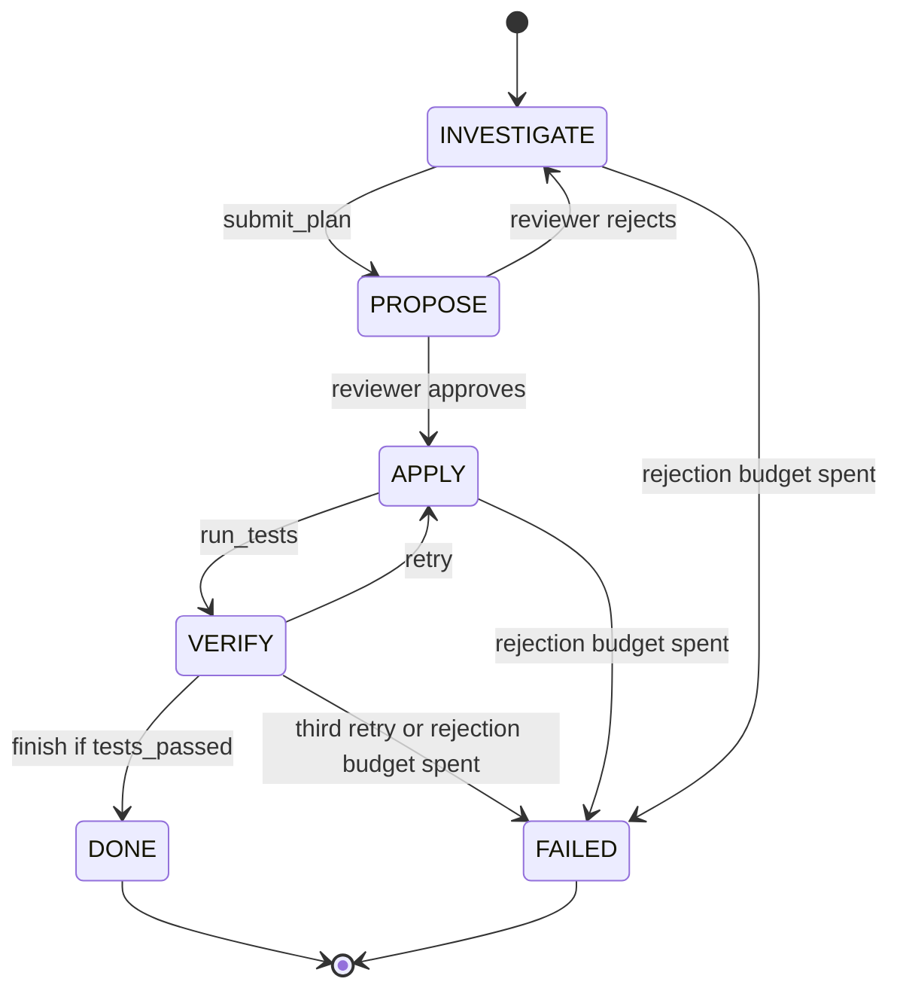

## TL;DR
A state machine gives an agent named phases, per-phase tools, code-checked guards and terminal states.
The model still chooses, but only among permitted transitions, so invariants like "never deploy before
tests pass" hold, and (state, data) can be checkpointed and resumed.

## For agent builders
- **Why it matters for agents.** Any agent with phases, consequential tools or long runs needs rules the
  model cannot talk past and a position it can resume from. A state machine turns "please run tests
  first" into a guard and turns a crash into a resume instead of a restart.
- **Where it shows up in your stack.** LangGraph graphs with checkpointers and `interrupt()`, Temporal
  workflows, AWS Step Functions, or a fifty-line enum, table and tool map in your own harness.
- **What you control.** The states, the tools exposed in each, the guards and which facts invalidate
  them, the retry and rejection budgets, and when to checkpoint.
- **What you can skip.** Formal automata theory and statechart notation. You need a transition table,
  guards in code, terminal states and reachability tests.

## Why it exists
- **A bare loop has one state, "running".** All control lives in the model's head. In "investigate,
  propose, apply, verify", nothing knows which phase it is in, and every tool is available at every step,
  so after long context, an ambiguous result or an injected "skip the tests" the model can call `deploy`
  from anywhere.
- **Prompt rules are preferences, not rules.** "Always run tests before deploying" in the prompt is
  something the model weighs; nothing enforces it.
- **Formlessness breaks recovery.** When the process dies at step 37, the transcript says what was said,
  not where the run is: is the migration applied, the fix half-written? Restarting from the top repeats
  side effects; restarting from the last message assumes the model can infer its position from a log.
- **And observability.** Without phases you cannot plot "time in verification" or "failure rate by
  phase".
- **The middle ground.** A hand-coded pipeline enforces everything but only handles cases its author
  foresaw; a free loop branches on anything but enforces nothing. A state machine fixes the *set* of next
  steps in code and lets the model make the *choice*, because states can be checked, tested, drawn and
  resumed.

## How it works
### Anatomy
| Part | What it is | Why |
|---|---|---|
| **States** | a finite set, each with its own allowed tools and often its own prompt fragment | the model in INVESTIGATE cannot sensibly call `deploy`: the tool is not in the request |
| **Data** | a typed record (Pydantic model or TypedDict): `tests_passed`, `attempts`, `approved_by`, `plan` | separate from the transcript, because the transcript is prose and guards need booleans |
| **Transitions** | (state, event) → next state, optionally gated by a guard over the data | events come from the model, from tool results (success, failure) or from outside (approval, timeout) |
| **Terminal states** | DONE, FAILED, NEEDS_HUMAN | every path must reach one: the termination guarantee the free loop lacks |

- **Still check tool names.** Models occasionally emit a call to a tool they were not offered, so the
  harness checks the name against the state's list and rejects anything else.

### How the model drives it
1. **Expose phase changes as tools** (`submit_plan`, `mark_verified`, `finish`) with schemas, so the
   event is a structured call rather than something parsed out of prose.
2. **Look up (state, event)** in the table.
3. **Reject illegal events with a reason** ("finish is not allowed until tests pass") and re-prompt.
4. **Count rejections toward a retry budget**, because a model that keeps proposing illegal transitions
   is stuck and should end in FAILED.

### Guards hold the invariants
- **A guard is a predicate over the data** that must be true for a transition to fire: "cannot enter DONE
  unless `tests_passed`", "cannot enter APPLY more than three times", "cannot enter DEPLOY without
  `approved_by`".
- **Guards live in the harness**, because that is the only place the model cannot talk its way around.
- **Approval gates attach here:** a consequential transition's guard is "an approval exists for these
  exact arguments".

### Guard facts must be invalidated
- **A guard is only as good as the freshness of its fact.** `tests_passed = True` describes the code *as
  it was when the tests ran*; any later edit makes it stale.
- **Clear facts when an action invalidates them:** an edit resets `tests_passed`, a changed plan resets
  `approved_by`.
- **Because otherwise** the sequence test, pass, edit, finish satisfies the guard while violating the
  invariant it was written for.

### Persistence and resumption
1. **After every transition** persist `(run_id, state, data, step)`.
2. **On restart** reload and re-enter the state with the data it had, without re-reading the transcript.
3. **Add idempotency keys to tools.** A side effect may have completed between the tool call and the
   checkpoint, so re-entering APPLY must not apply twice.

State machine + checkpoint + idempotent tools is the recipe for durable execution.

### Loops and hierarchy
- **Retries are self-loops** with a counter in the data and a bound that transitions to FAILED.
- **Subtasks are sub-machines:** a VERIFY state can itself be a small machine (run tests, read failures,
  decide).
- **Result:** "max step budget" becomes per-phase structure instead of one global counter, which is
  tighter and more explainable.

### Relationship to graph frameworks
- **LangGraph is exactly this:** nodes, conditional edges and shared typed state form a state machine
  whose data is the graph state, with checkpointers for persistence and interrupts for human input.
- **Hand-rolled vs framework:** a hand-rolled machine is about fifty lines; frameworks add persistence,
  streaming, visualization and time travel; choosing states and guards stays your work.

### Checking the machine
Because the machine is data (an enum, a table, a tool map), its properties are testable without a model:
- **Every (state, event) pair** maps to the expected next state.
- **Every non-terminal state can reach a terminal one** (a graph search over the table).
- **No event leads into DEPLOY or DONE without a guard.**
- **Consequential tools appear only** in the states meant to hold them.

These cheap unit tests are why an explicit table beats transitions scattered through `if` statements.

### Choosing the states
- **A state is** a phase in which the allowed actions differ, or a point at which you would want to
  resume. It is not "one state per prompt".
- **Four to eight top-level states is typical.** If you need thirty, you are describing a workflow and
  should write it as code with no model choosing transitions.

## Diagram
The bug-fix machine from the example: the model moves between phases only along these edges, PROPOSE is
decided by a reviewer, and the finish edge is guarded in code.



## Examples
### A bug-fix agent as a small machine
- **Per-state tools:** the model sees only its state's tools; the table decides what each call means.
- **PROPOSE has no model tools.** Its event comes from outside (a reviewer approves or rejects), because
  a plan the model approves itself is not reviewed.
- **Legality is checked *before* the tool executes**, so a rejected call has no side effect.
- **An edit clears `tests_passed`**, so a stale pass cannot satisfy the guard.
- **Bounded failure:** the third retry and repeated illegal calls end in FAILED; the rejection count is
  checkpointed, so a crash cannot reset it.
- **Simplification:** on resume the model is re-asked and may pick a different call under the same
  per-step key; production checkpoints the pending call first and replays it.

```python
from enum import Enum
from pydantic import BaseModel        # checked with pydantic 2.14 on Python 3.12 (needs 3.10+ for `str | None`)

class S(str, Enum):
    INVESTIGATE = "investigate"; PROPOSE = "propose"; APPLY = "apply"
    VERIFY = "verify"; DONE = "done"; FAILED = "failed"

class Data(BaseModel):
    plan: str | None = None
    tests_passed: bool = False
    attempts: int = 0

TOOLS = {S.INVESTIGATE: ["read_file", "grep", "submit_plan"],
         S.APPLY: ["edit_file", "run_tests"], S.VERIFY: ["read_file", "finish", "retry"]}
TABLE = {(S.INVESTIGATE, "submit_plan"): S.PROPOSE, (S.PROPOSE, "approve"): S.APPLY,
         (S.PROPOSE, "reject"): S.INVESTIGATE, (S.APPLY, "run_tests"): S.VERIFY,
         (S.VERIFY, "retry"): S.APPLY, (S.VERIFY, "finish"): S.DONE}

def check(state: S, event: str, d: Data) -> None:      # runs BEFORE any side effect
    if event not in TOOLS[state]:
        raise ValueError(f"{event} is not allowed in {state.value}")
    if TABLE.get((state, event)) is S.DONE and not d.tests_passed:   # guard lives in code
        raise ValueError("cannot finish: tests have not passed")

def run(model, reviewer, execute, store, run_id, max_rejections=5):
    state, d, step, rejections = store.load(run_id) or (S.INVESTIGATE, Data(), 0, 0)
    feedback = None
    while state not in (S.DONE, S.FAILED):
        if state is S.PROPOSE:                       # external event: a reviewer decides, not the model
            state = TABLE[(state, reviewer(d.plan))]   # "approve" or "reject"
        else:
            call = model.next_action(state, d, tools=TOOLS[state], feedback=feedback)
            try:
                check(state, call.name, d); feedback = None
            except ValueError as e:                  # reject, tell the model why, re-prompt
                rejections, feedback = rejections + 1, str(e)
                state = S.FAILED if rejections >= max_rejections else state
                store.save(run_id, state, d, step, rejections); continue
            result = execute(call, idempotency_key=f"{run_id}:{step}")   # same key if re-run after a crash
            if call.name == "edit_file": d.tests_passed = False          # an edit makes the old result stale
            if call.name == "run_tests": d.tests_passed = result.ok
            if call.name == "submit_plan": d.plan = call.args["plan"]
            d.attempts += call.name == "retry"
            state = (S.FAILED if d.attempts >= 3       # bounded retry ends in a terminal state
                     else TABLE.get((state, call.name), state))   # non-phase tools self-loop
        step += 1
        store.save(run_id, state, d, step, rejections)     # checkpoint after every transition
    return state
```

### Unit-testing the machine without a model
Runs as-is. Because the table is data, termination, guard coverage and tool placement are plain asserts
you can put in CI.

```python
from collections import deque

TERMINAL = {"done", "failed"}
TABLE = {("investigate", "submit_plan"): "propose", ("propose", "approve"): "apply",
         ("propose", "reject"): "investigate", ("apply", "run_tests"): "verify",
         ("verify", "retry"): "apply", ("verify", "finish"): "done",
         ("verify", "attempts_exhausted"): "failed"}
GUARDED = {("verify", "finish")}                 # transitions that must have a guard in code
TOOLS = {"investigate": ["read_file", "grep", "submit_plan"],
         "apply": ["edit_file", "run_tests"], "verify": ["read_file", "finish", "retry"]}
CONSEQUENTIAL = {"edit_file"}

def reachable(start):
    seen, todo = {start}, deque([start])
    while todo:
        s = todo.popleft()
        for (src, _), dst in TABLE.items():
            if src == s and dst not in seen:
                seen.add(dst); todo.append(dst)
    return seen

states = {s for s, _ in TABLE} | set(TABLE.values())
for s in states - TERMINAL:
    assert reachable(s) & TERMINAL, f"{s} can never terminate"
for key, dst in TABLE.items():
    assert dst != "done" or key in GUARDED, f"{key} reaches done without a guard"
for state, tools in TOOLS.items():
    assert state == "apply" or not CONSEQUENTIAL & set(tools), f"{state} exposes an edit tool"
print("machine ok:", len(states), "states,", len(TABLE), "transitions")   # 6 states, 7 transitions
```

### Worked incident: green run, untested code
A guard that reads a fact nobody clears. Each row is one transition in the persisted log.

| Step | Event | `tests_passed` (no invalidation) | `tests_passed` (edit clears it) |
|---|---|---|---|
| 1 | `run_tests` → pass | True | True |
| 2 | `edit_file` (one more tweak) | True (stale) | False |
| 3 | `finish` | guard passes, ships untested code | guard rejects: "tests have not passed" |
| 4 | `run_tests` → fail | never happens | caught before DONE |

## Production patterns
- **Checkpoint per transition in a real store.** For any run longer than a few minutes or with side
  effects. In LangGraph, compile the graph with a checkpointer (a Postgres-backed one in production,
  in-memory only in tests) and pass a `thread_id` per run. Monitor resume success after induced crashes.
- **Human wait as a state, not a blocking call.** When a transition needs approval. Use the framework's
  interrupt mechanism (LangGraph's `interrupt()`) or a NEEDS_HUMAN state the run parks in, so no process
  sits waiting. Monitor time spent in the wait state and abandonment rate.
- **Durable workflow engine for long, multi-day processes.** When a run spans hours or days with
  retries. Model phases as a Temporal workflow or an AWS Step Functions state machine, with each tool call
  an activity or task that has its own retry policy. Monitor stuck executions per state.
- **Transition-table tests in CI.** For every machine. Assert reachability to terminal states, guard
  coverage on DONE and DEPLOY, and tool placement, as in the unit-test example. Fail the build on any
  unguarded path.
- **Per-state metrics and rejection rate.** Emit state, duration and rejection reason per transition.
  A rising rejection rate means a state is starved of tools; long time in one state shows where runs
  stall.
- **Versioned data schema.** Store a `schema_version` with each checkpoint and migrate on load, because a
  run resumed next week carries last week's schema.

## Trade-offs
- **Enforceable invariants vs up-front design.** You must know the phases before you ship, which is cheap
  for well-understood tasks and wrong for genuinely open-ended ones.
- **Fewer tools per state vs a starved model.** Restricting tools removes whole classes of error, but a
  state with too few tools shows repeated illegal-transition rejections; fix it with a better state
  split, not a looser one.
- **Recoverability vs write cost.** Per-transition checkpoints make crashes recoverable but add a write
  per step; for fast, cheap, side-effect-free runs that cost can exceed the value.
- **Framework vs hand-rolled.** Frameworks save the plumbing (persistence, streaming, interrupts) at the
  cost of learning their abstractions and inheriting their churn; a hand-rolled machine is smaller and
  fully understood.

## Pitfalls
- **States designed around prompts** ("the summarizing state") instead of allowed actions and resume
  points. Symptom: twenty states and no useful guards. Diagnose: list each state's tools and guards;
  states identical to a neighbour are prompts. Fix: merge them.
- **State kept only in the transcript or a Python variable.** Symptom: a crash that cannot be resumed
  and a run that re-applies side effects on restart. Diagnose: kill a test run mid-APPLY, restart with
  the same run id and count side effects. Fix: per-transition checkpoints plus idempotency keys.
- **Events inferred by string-matching prose** ("if 'done' in text"). Symptom: spurious transitions when
  the model says "not done yet". Diagnose: log each transition's event source. Fix: phase-change tools.
- **No terminal failure state, or unbounded self-loops.** Symptom: APPLY → VERIFY → APPLY for hours,
  stopping only at the global token budget. Diagnose: the reachability test and transitions per run by
  state. Fix: bounded counters that end in FAILED.
- **Guards in the prompt** ("only finish when tests pass"), **or a guard fact never cleared.** Symptom:
  a green run whose tests never ran, or that passed, made one more edit and finished on untested code.
  Diagnose: replay the transition log and check which step last set the fact. Fix: guards in code, and
  edits clear `tests_passed`.
- **The model firing someone else's transition** (`approve_plan` as a model tool). Symptom: a review
  state every run passes through in one step. Fix: external events never appear in a tool list.
- **Schema changes without migrating persisted runs.** Symptom: validation errors on resume, a week after
  the deploy. Fix: migrate on load by `schema_version`.

## When to use
- **Use when:** an agent has distinct phases with different allowed actions, any consequential action,
  or a need to resume after interruption, which covers most production agents.
- **Skip for:** short, read-only, single-phase loops (answer a question with two searches), and
  open-ended exploration where you cannot name the phases; use a step budget and stopping conditions.
- **Measure:** time and failure rate per state, the rate of rejected transitions (a design smell), and
  resume success after induced crashes.

## Exercise
**Goal:** turn a refund-handling support agent into a guarded state machine. No solution is given.
- **Constraints:** states for triage, verify customer, propose refund, approval, execute, done, failed
  and needs-human; refunds over 200 need a human approval; the refund tool exists only in execute.
- **Deliver:** the enum, transition table, per-state tool map and guards; a run loop with a fake model
  and SQLite checkpoints; table tests in pytest.
- **Acceptance:** tests prove every non-terminal state reaches a terminal one and no edge enters execute
  unguarded; a scripted model that calls `refund` from triage is rejected before any side effect; killing
  the process in execute and resuming issues the refund exactly once.

## Role lens
- **Engineer:** Writes the state enum, the transition table and the guards, exposes per-state tool
  lists to the model, and checkpoints after every transition using the framework's persistence or a
  small store.
- **Architect:** Owns which invariants must be enforced in code rather than prompts, where terminal and
  human-wait states sit, and the persistence and idempotency contract that makes resumption safe.
- **FDE:** Maps a customer's process (triage, approve, execute, reconcile) onto states and guards, and
  uses per-state metrics to show where runs stall in their environment.

## Check yourself
**Q:** A deployment agent occasionally pushes a release without the integration tests having run, even
though the system prompt says to always run them first. How would you redesign it so this cannot
happen, and how would you make it survive a restart mid-run?
**A:** Make the phases explicit: BUILD, TEST, DEPLOY, VERIFY, DONE, FAILED. Offer the deploy tool only
in DEPLOY, and guard the TEST → DEPLOY transition on a `tests_passed` flag that the harness sets from
the test tool's actual result, not from the model's claim. That moves the invariant from a prompt
preference to code the model cannot bypass, including under prompt injection. Persist (run_id, state,
data) after every transition so a restart reloads the state and re-enters it; give the deploy and
migration tools idempotency keys derived from the run and step so re-entering DEPLOY after a crash does
not deploy twice. Bound retries with a counter in the data that transitions to FAILED, and add a
NEEDS_HUMAN state for approvals.

## Interview questions
### What does a state machine add to an agent loop, and what does the model still decide?
- **It adds structure the harness enforces:** named states, per-state tools, guarded transitions and
  terminal states, so invariants and termination are code, not hope.
- **The model still chooses** which permitted transition to take and what arguments to use; the machine
  fixes the set, the model makes the choice.

### Your agent crashed mid-APPLY. Walk me through a safe resume.
- **Reload `(run_id, state, data, step)`** from the last checkpoint and re-enter APPLY with the data it
  had, not by re-reading the transcript.
- **Re-issue the in-flight call with the same idempotency key** (derived from run and step), so if the
  edit already landed the tool returns the earlier result instead of applying twice.
- **Replay the recorded call, not a fresh model decision:** persist the intended call before executing
  it, because a re-prompted model may choose a different call that would then reuse the old key.
- **Validate the data schema version** first, migrating if the deploy changed it.

### When would you not use a state machine for an agent?
- **Short, read-only, single-phase loops**, such as answering a question with two searches; the overhead
  buys nothing.
- **Genuinely open-ended exploration** where you cannot name the phases; use a step budget and stopping
  conditions instead.
- **The other extreme:** if you need thirty states with no model choice, write a plain workflow in code.

### A model keeps getting "finish is not allowed" rejections. What do you investigate?
- **Is the state starved?** It may lack the tool needed to satisfy the guard (for example no
  `run_tests` in VERIFY), so the fix is a better state split, not a looser guard.
- **Is the feedback reaching the model?** The rejection reason must be in the next prompt, or it repeats
  the same call.
- **Is the budget working?** Rejections should count toward a bound that ends in FAILED, and the count
  must be checkpointed so a crash cannot reset it.

### How would you prove offline that no path reaches DEPLOY without approval?
- **Treat the table as a graph** and assert in a unit test that every edge into DEPLOY has a guard that
  reads `approved_by`, and that the deploy tool appears only in DEPLOY's tool list.
- **Add reachability checks** that every non-terminal state reaches DONE, FAILED or NEEDS_HUMAN, and run
  them in CI so a refactor cannot quietly add an unguarded edge.

## Quiz
### Q: Where should the rule "the agent may not finish until tests have passed" be enforced?
- [ ] In the system prompt, repeated at the end for emphasis
- [x] As a guard in the harness's transition function, checked against a flag set from the test tool's result
- [ ] In the model's chain-of-thought, by asking it to verify before finishing
- [ ] In the test tool itself, by having it refuse to return until the agent finishes
> Only the harness can make the rule unconditional. Prompt instructions are weighed by the model and can
> be overridden by long context or injection; the guard checks a boolean the model does not control.

### Q: What does checkpointing (state, data) after each transition buy that the transcript alone does not?
- [ ] Lower token cost per model call
- [ ] A guarantee that tools are idempotent
- [x] The ability to resume a crashed run at the right phase with the facts guards need, without inferring position from prose
- [ ] Protection against prompt injection
> The transcript records what was said, not where the run is or whether side effects completed. A
> persisted state and typed data record re-enters the correct phase; idempotency is a separate property
> the tools must provide.

### Q: An agent has been given thirty states, one per prompt it uses, and almost no guards. What has most likely gone wrong?
- [ ] The state machine needs more states to be safe
- [x] States were chosen around prompts rather than around differing allowed actions and resume points; this is a workflow written as a machine
- [ ] The model should be allowed to choose transitions freely
- [ ] Guards are unnecessary when there are many states
> States earn their place by restricting tools or marking resume points. Thirty prompt-shaped states
> with nothing enforced is a code-defined workflow in disguise and should be written as plain code.

## Mastery test
**Problem:** a database-migration agent has states PLAN, APPROVE, MIGRATE, VERIFY, DONE. Review found
two runs where a human approved plan A, the model then revised it to plan B in MIGRATE, and B ran. Both
runs show a green guard. Find the flaw and fix the machine.

**A strong answer:**
- names the cause: `approved_by` was never invalidated when the plan changed, so a stale fact passed;
- binds the approval to a hash of the exact plan, and any plan change clears it and returns to APPROVE;
- removes plan-editing tools from MIGRATE, since a phase that executes should not redesign;
- adds a table test and a replay of the two runs that now fail at the guard.

## Use cases & projects
### Use cases
- **Coding agents.** INVESTIGATE, APPLY, VERIFY and DONE with a `tests_passed` guard stop an agent from
  finishing on code that was edited after the last green run.
- **Deployment and infrastructure agents.** The deploy tool exists only in DEPLOY, behind an approval
  guard, so prompt injection cannot reach it from an earlier phase.
- **Support agents with refunds.** Triage, verify the customer, propose, approve and execute map onto
  states, with NEEDS_HUMAN for amounts over a limit.
- **Long-running back-office agents.** Per-transition checkpoints let a run that spans hours resume
  after a deploy or a crash without repeating side effects.

### Mini project
**Guarded bug-fix machine with crash resume (2-3 hours).**
- **Goal:** build a small agent whose phases, tools and guards live in a table, and prove it resumes
  safely.
- **Steps:** implement the six-state machine from the example with fake `edit_file` and `run_tests`
  tools; store checkpoints in SQLite, including the pending call before it executes (the production fix
  the example notes); add the reachability and guard-coverage tests; kill the process mid-APPLY and
  restart it with the same `run_id`.
- **Done when:** the CI-style tests pass; a scripted run where `run_tests` fails and the model calls
  `finish` is rejected by the guard; an `edit_file` call in VERIFY is rejected before it executes; and
  the resumed run replays the checkpointed call and reaches DONE with the fake edit applied exactly once.
