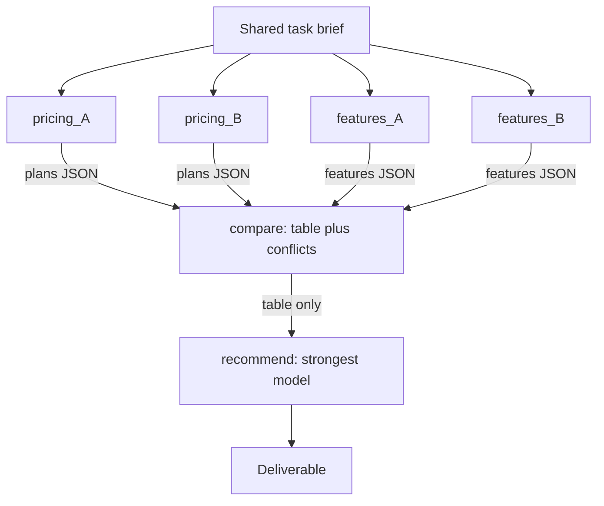

## TL;DR
Task decomposition splits a large job into subtasks that each fit one model call, can be verified alone
and expose a small interface. Planning decides order; decomposition decides shape. Done well it buys
parallelism and isolated failures; done badly, coordination overhead.

## Why it exists
- **One call has fixed attention and context.** Ask for "a competitive analysis of five vendors with
  pricing, features and a recommendation" in one shot and the output is shallow where it matters,
  confidently wrong on details, and checkable only by redoing the work.
- **The model is not failing at any sub-skill.** It fails because the task asks it to hold too many
  threads at once, and quality degrades gracefully enough that nobody notices until a customer does.
- **Longer prompts or stronger models leave the failure's structure untouched.** Both raise the ceiling
  slightly, but you still get one monolithic answer with no seam at which to verify, retry or parallelise.
  Chain-of-thought helps a single reasoning path but does not reduce the distinct work in context.
- **Decomposition changes the economics.** Five vendor-research subtasks run in parallel with small
  contexts; a comparison step reads five structured summaries instead of five raw web dumps; a writing
  step gets a comparison table, not everything ever retrieved. Each piece can be checked, cached, retried
  or handed to a cheaper model.
- **Evidence, with its limits.** Least-to-most and decomposed prompting showed that splitting problems
  into reliably solvable sub-problems beats asking for the whole answer on compositional benchmarks
  (symbolic manipulation, compositional generalisation, math word problems). Those test short reasoning
  tasks; applying the logic to long agent tasks is standard practice, not something they measured.

## How it works
### Three dimensions of a decomposition
1. **Granularity: how big each subtask is.**
   - Too coarse and a subtask inherits the monolith's problems.
   - Too fine and you pay a model call, a context setup and a coordination step for trivial work, and
     shared context gets re-explained in every call.
   - Heuristic: right-sized means one model call can finish it with a clear success criterion and no more
     than a handful of tool calls.
2. **Dependency structure: fan-out, chain or DAG.** Independent subtasks (fan-out), a chain (each needs
   the previous), or a directed acyclic graph. It matters *because* independence buys parallelism and
   isolation, while every dependency edge is a place where context must be passed and can be lost. Draw
   the DAG explicitly; if everything depends on everything, the decomposition is wrong.
3. **Interface contract: what each subtask takes and returns.** Returning structured data (a JSON summary
   with fixed fields) rather than a transcript is the single most effective choice, *because* downstream
   steps receive exactly what they need and the orchestrator's context stays small. The contract also says
   what "done" means so a verifier can check it.

### Who decomposes, and when
| Mode | Who | Character | Use when |
|---|---|---|---|
| **Static, at design time** | An engineer writes subtasks and graph in code | A workflow: predictable, testable, cheap | The shape of the task is known in advance |
| **Dynamic, at run time** | A model reads the goal and emits subtasks | Makes an agent general; where quality varies most | Goals are novel per request |
| **Hybrid** | Fixed top-level phases (research, compare, write), dynamic inside one phase | Most production systems land here | Mixed |

- **Constrain dynamic decomposition:** a schema for subtasks, a maximum count, a required `done_when` per
  subtask, and examples of good splits for this domain.
- **Least-to-most prompting is the simplest dynamic form:** first ask "what sub-questions must be answered
  first?", then answer them in order, feeding each answer forward.

### Where to cut
- **Verification boundaries.** If you can test a piece (unit tests pass, a schema validates, a number
  reconciles), it is a good subtask.
- **Data boundaries.** One subtask per source, document or entity gives natural parallelism and keeps each
  context focused.
- **Tool boundaries.** A subtask that needs only the search tool is easier to secure and cheaper than one
  that needs all tools.
- **Not narrative boundaries** ("introduction", "body"), *because* those pieces share almost all their
  context and will contradict each other.

### Passing context across the seams
- **Each subtask gets** the goal, its own inputs and only the upstream results it depends on.
- **Pass summaries and structured results, not raw transcripts,** *because* the downstream model will
  otherwise attend to irrelevant detail and the token bill grows with every edge.
- **Keep a shared, read-only "task brief"** that every subtask sees, so terminology and constraints stay
  consistent.

### The arithmetic of seams
Three numbers decide whether a decomposition pays. Sketch them for a proposed graph before building it.

| Number | Rule | Consequence |
|---|---|---|
| **Reliability compounds along chains** | *n* sequential subtasks each succeeding independently with probability *p* give *pⁿ* | Ten steps at 95% each finish cleanly only about 60% of the time (0.95¹⁰ ≈ 0.60) |
| **Latency follows the critical path** | With unlimited concurrency, wall-clock time is the longest dependency chain, not the subtask count | Flattening a five-deep chain into one fan-out plus a merge can cut latency several times for the same work |
| **Cost follows the edges** | Total tokens ≈ Σ (task brief + own inputs + upstream results passed in) | A fat transcript on one edge is paid by every consumer of that edge |

- **Why each subtask needs a verifier and a retry:** a step that is checked and retried once fails only
  when both attempts fail, roughly (1 − p)² if failures are independent, which lifts the chain back up.
- **Why a long chain is worse than a wide fan-out of the same size:** fewer multiplied failure points on
  any one path, and a shorter critical path.

### Recomposition
- **The merge is a subtask with its own contract:** resolve conflicts between pieces (two researchers
  found different prices), enforce consistency and produce the deliverable.
- **Reserve the strongest model for recomposition and dynamic decomposition,** since those are where
  judgement concentrates.

## Diagram
Look at the shape: four independent research subtasks fan out in one wave, and each seam passes only a
structured result, so the recommendation never sees raw research.



## Examples
### DAG executor that passes only declared dependencies
A small DAG executor that runs independent subtasks concurrently and passes only declared dependencies
downstream. `call_model` is any async model call returning structured output.

```python
import asyncio

GRAPH = {
    "pricing_A":  {"deps": [], "task": "Find current list pricing for vendor A; return {plans:[...]}"},
    "pricing_B":  {"deps": [], "task": "Find current list pricing for vendor B; return {plans:[...]}"},
    "features_A": {"deps": [], "task": "List vendor A features for SSO, audit, SLA; return {features:{}}"},
    "features_B": {"deps": [], "task": "List vendor B features for SSO, audit, SLA; return {features:{}}"},
    "compare":    {"deps": ["pricing_A", "pricing_B", "features_A", "features_B"],
                   "task": "Build a comparison table; flag conflicts; return {table:[...], conflicts:[...]}"},
    "recommend":  {"deps": ["compare"],
                   "task": "Recommend one vendor for a 200-seat team; cite table rows; return {text:...}"},
}
BRIEF = "Buyer: 200-seat fintech, needs SSO and audit logs, budget 40k/year."

async def run_subtask(name, upstream):
    spec = GRAPH[name]
    inputs = {d: upstream[d] for d in spec["deps"]}        # only declared dependencies cross the seam
    return await call_model(brief=BRIEF, task=spec["task"], inputs=inputs, max_tool_calls=6)

async def execute(graph):
    done = {}
    while len(done) < len(graph):
        ready = [n for n, s in graph.items()
                 if n not in done and all(d in done for d in s["deps"])]
        if not ready:
            raise RuntimeError("cycle or unsatisfiable dependency in graph")
        results = await asyncio.gather(*(run_subtask(n, done) for n in ready))
        done.update(zip(ready, results))                    # one wave of independent work per loop
    return done

final = asyncio.run(execute(GRAPH))
print(final["recommend"]["text"])
```

- **What runs when:** the four research subtasks run in one wave, `compare` runs when all four finish, and
  `recommend` sees only the comparison table, never the raw research.
- **Wave scheduling is the simplest correct executor,** but a ready node waits for the slowest node of the
  previous wave.
- **On uneven graphs,** start each node as soon as its own dependencies finish (one task per node awaiting
  its parents) to cut wall-clock time.

### Seam calculator: reliability and critical path
Runnable pure Python for the two numbers worth sketching before you build a graph.

```python
def chain_success(p, n, retries=0):
    per_step = 1 - (1 - p) ** (retries + 1)       # independent failures assumed
    return per_step ** n

def critical_path(graph, seconds):
    memo = {}
    def finish(node):
        if node not in memo:
            memo[node] = seconds[node] + max((finish(d) for d in graph[node]), default=0)
        return memo[node]
    return max(finish(n) for n in graph)

print(f"{chain_success(0.95, 10):.2f}")             # 0.60
print(f"{chain_success(0.95, 10, retries=1):.3f}")  # 0.975

chain = {"a": [], "b": ["a"], "c": ["b"], "d": ["c"], "e": ["d"]}
fan = {"a": [], "b": [], "c": [], "d": [], "merge": ["a", "b", "c", "d"]}
print(critical_path(chain, dict.fromkeys(chain, 20)))   # 100 seconds
print(critical_path(fan, dict.fromkeys(fan, 20)))       # 40 seconds
```

### Worked scenario: restructuring a one-shot vendor analysis
Illustrative numbers for a five-subtask job where each subtask takes about 20 seconds.

| Design | End-to-end success | Wall-clock | Checkable seams |
|---|---|---|---|
| One monolithic call | unknown, checkable only by redoing it | one long call | none |
| 10-step unverified chain at 95% per step | about 60% | 10 × step time | none enforced |
| Same chain, each step verified and retried once | about 97.5% | slightly more | 10 |
| Five-deep chain of 20 s steps | — | 100 s | 5 |
| Four-way fan-out plus merge, 20 s each | — | 40 s | 5 |

## Production patterns
- **Schema-validate every subtask output.** Define each contract as a typed model (for example Pydantic)
  and reject or retry outputs that fail validation before they cross a seam. Monitor validation failure
  rate per subtask type.
- **Cap dynamic decomposition.** Enforce a maximum subtask count and a required `done_when` in the
  decomposition schema, and fall back to a static template when the cap trips. Monitor subtasks per
  request; a long tail signals runaway splitting.
- **Bound fan-out concurrency.** Wrap subtask calls in an `asyncio.Semaphore` sized to your provider's rate
  limits, so a wide graph queues instead of tripping 429s. Monitor queue wait and rate-limit errors per
  run.
- **Cache subtasks by input hash.** Key results on the task text plus a hash of declared inputs, so
  retries and reruns skip finished, unchanged pieces. Monitor cache hit rate and stale-result complaints.
- **Pass references for raw data.** Put source ids or document chunk ids in the structured result, so the
  merge step can fetch raw text when a detail matters. Monitor how often the merge step fetches.

## Trade-offs
- **Per-piece accuracy vs overhead.** Smaller subtasks improve accuracy and verifiability per piece, but
  every extra subtask adds a call, a context setup and a chance to lose shared context; past a point,
  overhead dominates.
- **Generality vs reliability.** Dynamic decomposition handles novel goals, yet it is the least reliable
  step in the system; static decomposition is more robust whenever the task shape is known.
- **Small contexts vs lost detail.** Structured summaries across seams keep contexts small and cheap, at
  the risk of dropping a detail a downstream step needed; when details matter, pass references so steps
  can fetch raw data.
- **Wall-clock vs concurrent load.** Parallel fan-out cuts wall-clock time dramatically, but multiplies
  concurrent tool and API usage, so rate limits and cost per task rise with the branching factor.

## Pitfalls
- **Decomposing along narrative sections.** Symptom: pieces contradict each other and the merge step
  rewrites everything. Fix: cut along data or verification boundaries.
- **Subtasks without a success criterion.** Symptom: every subtask "succeeds" and the final output still
  misses what was asked. Fix: a `done_when` per subtask.
- **Passing full transcripts between subtasks.** Symptom: token cost grows with the number of edges and
  downstream steps fixate on irrelevant upstream detail. Fix: structured results plus references.
- **Unbounded dynamic decomposition.** Symptom: forty subtasks for a question that needed two, and a budget
  blown before any work happens. Fix: a count cap in the schema.
- **Hidden dependencies not declared in the graph.** Symptom: intermittent failures when a subtask happens
  to run before the one it silently relied on. Fix: pass only declared inputs, so missing edges fail loudly.
- **Long unverified chains.** Symptom: end-to-end success far below any single step's success rate,
  because per-step failures multiply. Fix: verify and retry each step, or flatten the chain.

## When to use
- **Decompose when** a task has more than a few distinct pieces of work, parts can be verified
  independently, pieces can run in parallel, or a single context would exceed what the model handles well.
- **Avoid when** tasks are short, reasoning is tightly coupled, or the pieces need almost all of the same
  context.
- **Measure** per-subtask success, merge conflict rate and total tokens versus the monolithic baseline.
- **On the job:** designing the subtask schema and the DAG for a research or migration agent.
- **Interviews:** the strong answer covers granularity, dependency structure and interface contracts, and
  explains where to cut and why.

## Role lens
- **Engineer:** Writes the subtask schema, the DAG executor and the verifiers, and tunes granularity
  by measuring per-subtask success and token cost.
- **Architect:** Decides which phases are static workflow and which are dynamic, and where the seams
  must align with security and data boundaries.
- **FDE:** Maps the customer's real process onto subtasks their domain experts can review individually,
  so trust is built one verifiable piece at a time.

## Check yourself
**Q:** A document-processing agent that extracts fields from 80-page contracts gets the parties and
dates right but misses clauses deep in the document, and a single run costs more than the team
expected. How would you restructure it?
**A:** Decompose along data boundaries. Split the contract into sections or clause-sized chunks and
run one extraction subtask per chunk with a fixed output schema and a `done_when` such as "every
clause type in the taxonomy is marked present or absent". These chunks are independent, so they run in
parallel with small contexts, which fixes both the deep-clause misses (each chunk gets full attention)
and the cost (no step re-reads the whole document). Add a recomposition subtask that merges per-chunk
results, resolves conflicts such as a defined term redefined later, and flags clauses found in two
places. Chunking cuts across one real dependency: clauses refer to definitions and other sections
("as defined in Section 1.4"), so either give every chunk the definitions section as part of the shared
brief, or overlap chunks at boundaries; otherwise a chunk extracts a clause whose meaning it cannot see. Pass the merge step only the structured extractions plus chunk references so it can fetch the
raw text when needed. Measure recall per clause type before and after, and tokens per contract.

## Interview questions
### What is the difference between planning and task decomposition?
- **Planning decides order:** which actions happen and when, and how to replan when one fails.
- **Decomposition decides shape:** granularity of each subtask, the dependency graph, and the input and
  output contract at every seam. A good plan over a bad decomposition still passes too much context and
  cannot parallelise.

### A ten-step research agent succeeds far less often end to end than any single step does. Why, and what do you change?
- **Failures multiply along a chain:** at 95% per step, ten steps finish cleanly only about 60% of the
  time.
- **Fixes:** verify each step and retry once (roughly 97.5% if failures are independent), and flatten the
  chain into a fan-out plus merge where steps do not truly depend on each other.

### When would you not decompose a task?
- **Short or tightly coupled work,** where every piece needs almost the same context, so splitting only
  re-explains the context and adds calls.
- **Narrative pieces of one document,** which contradict each other once split; one call with a good
  outline is better.

### How do you keep token costs down in a decomposed pipeline?
- **Cost follows the edges:** each consumer pays for what crosses its incoming seams, so pass structured
  summaries, never transcripts.
- **Keep the shared brief short,** pass references for raw data, cache subtasks by input hash, and give
  cheap models the narrow subtasks while the strongest model does decomposition and merge.

### Design the decomposition for a contract-review agent that compares a contract against a policy playbook.
- **Cut by data:** one subtask per clause type or section, each with the relevant playbook rule and the
  definitions section in a shared brief.
- **Contracts:** each returns present or absent, the clause text reference and a pass or deviate verdict.
- **Merge:** a strongest-model step resolves conflicts and drafts the redline; measure recall per clause type.

## Quiz
### Q: Which boundary is the best place to cut a task into subtasks?
- [ ] Along the sections of the final document, such as introduction and conclusion
- [x] Along verification or data boundaries, where each piece can be checked and needs little shared context
- [ ] Wherever the model's output exceeds a fixed token count
- [ ] At every tool call
> Pieces that can be verified independently and that work on distinct data give parallelism and
> isolation. Narrative sections share almost all context, so they drift apart and must be rewritten on merge.

### Q: Why should subtasks return structured summaries rather than their full transcripts?
- [ ] Transcripts cannot be serialised to JSON
- [ ] Structured output is required by the DAG executor
- [x] Downstream steps receive exactly what they need, keeping contexts small and attention on relevant detail
- [ ] It prevents subtasks from calling tools
> Every dependency edge passes context. Raw transcripts grow token cost per edge and pull downstream
> attention toward irrelevant detail; a contract with fixed fields does neither, with references for raw data.

### Q: When is static (design-time) decomposition preferable to letting the model decompose at run time?
- [ ] When the task is open-ended and the goal changes per request
- [x] When the shape of the task is known in advance and predictability matters more than generality
- [ ] When the model is strong enough to plan reliably
- [ ] Never; dynamic decomposition is always more capable
> Dynamic decomposition is the least reliable step in an agent. If the phases are known, encoding them
> in code gives testability and cost control; keep dynamic splitting for the genuinely open parts.
