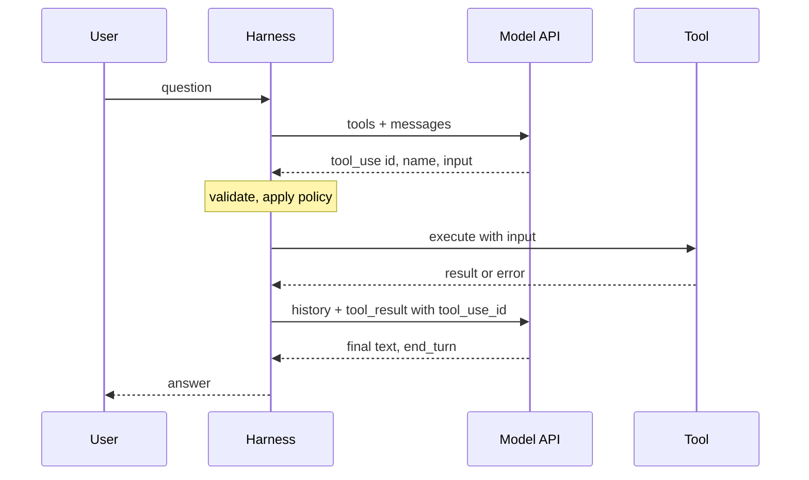

## TL;DR
Tool calling lets a model request an action instead of describing one: it emits a structured, typed call
against a declared schema, your code executes it, and the result returns to context. Models cannot reach
live data, and parsing actions from free text is unreliable.

## Why it exists
- **Models stop at their training cutoff and their output text.** Ask for today's exchange rate or to
  create a ticket and the model can only guess or describe.
- **Text-command parsing failed three ways.** Prompting for "respond with ACTION: search(query)" plus
  regular expressions broke because the model drifted from the format in long contexts, the parser could
  not tell a quoted example from a real command, and free-text arguments sent "next Tuesday" where the
  API needed ISO 8601.
- **Tool calling moves the format into training and the API contract.** OpenAI's term "function calling"
  names the same idea. The model emits a dedicated block with a tool name and schema-conforming
  arguments, the API parses it, and your code receives a dictionary, not a string to scrape.
- **The model still does nothing; it only asks.** Whether a request is honoured, modified, rejected or
  routed to a human is decided by the receiving code. That separation is what makes tool calling safe
  enough to connect to real systems.

## How it works
### Declaration
- **Three fields:** a `name`, a `description`, and an `input_schema` (JSON Schema, normally an object with
  typed properties, a `required` list and `enum` where values are fixed).
- **Declarations are rendered into the prompt on every request,** so they cost input tokens every time and
  form part of the cacheable prefix.
- **On the Claude API they sit at the very front:** cache order is tools, then system, then messages, so
  changing one tool invalidates the cache for everything after it.
- **The description is the most important field,** because it is all the model has to decide *whether* and
  *when* to call. State trigger conditions ("call this when the user asks about an order's status"), not
  only what the tool does.

### The model's side
1. **It chooses** plain text, one or more tool calls, or text followed by calls.
2. **A call arrives as a `tool_use` block** with a unique `id`, the `name`, and `input` already parsed into
   JSON.
3. **The response's `stop_reason` is `tool_use`,** the harness's signal that work is expected.

| `tool_choice` | Claude API | OpenAI |
|---|---|---|
| Model decides (default) | `auto` | `auto` |
| Never call | `none` | `none` |
| Must call something | `any` | `required` |
| Must call this tool | a named tool | a named function |

- **Forcing is not always available.** On the Claude API, requests with extended thinking enabled accept
  only `auto` and `none`, so the instruction must go in the prompt. Treat forcing as model- and
  mode-dependent and always check a `tool_use` block came back.
- **`strict: true` guarantees shape, not sense.** With it on the declaration (and
  `additionalProperties: false` in the schema) the API guarantees arguments validate against the schema.
  That removes a class of parsing failures but says nothing about whether the values make sense.

### Under the hood
- **It is still next-token prediction.** The provider serializes declarations into a prompt format the
  model was fine-tuned on; the model emits the call as ordinary tokens wrapped in special delimiters; the
  API recognises them, stops generation, parses the arguments and hands you a `tool_use` block.
- **Without `strict`, validity is a trained tendency, not a guarantee.** The model usually produces
  schema-shaped JSON *because* it was trained on millions of such calls, but it can omit a required field
  or invent an enum value, so your handler must validate.
- **`strict` works by constrained decoding.** The schema is compiled into a grammar and tokens that would
  break it are masked before sampling. That is why it can *guarantee* shape, why it supports only a
  subset of JSON Schema (the grammar must compile), and why it cannot help with meaning.
- **A grammar can force `"date"` to be a pattern-matching string,** not to be the date the user meant.

### Your side
1. **Execute** the matching function for each `tool_use` block, with `input` as its arguments.
2. **Send back a user message** containing a `tool_result` block with the same `tool_use_id` and a
   `content` (a string, or a list of text and image blocks).
3. **On failure** set `is_error: true` with a readable message in `content`; models are trained to treat
   such results as recoverable and will retry, adjust arguments or explain.
4. **Several calls in one turn** get several `tool_result` blocks in a single message. On the Claude API
   those blocks must come first in the message's content, before any text you add.
5. **Call the model again** with the extended history: one iteration of the agent loop.

- **OpenAI's Chat Completions differs:** one `role: "tool"` message per call, keyed by `tool_call_id`.

### Client-side versus server-side tools
| | Client-side | Server-side |
|---|---|---|
| Who executes | You; the API returns the request and waits for your result | The provider, inside the same request |
| Examples | Your APIs, databases, internal systems | Web search, code execution, hosted MCP connections |
| Gain | Execution, secrets and policy stay in your process | No round trip, no hosting burden |

- **Both kinds can be declared in one request.**

### Token and latency accounting
- **Every declared tool costs tokens on every call;** a catalogue of fifty tools can be several thousand
  tokens of fixed overhead, and selection accuracy degrades as the catalogue grows.
- **Each round trip is a full model call plus your tool's latency.**
- **These two facts drive most tool engineering:** small focused tool sets, deferred loading or tool search
  for large catalogues, parallel calls for independent reads, and compact results.

## Diagram
One tool call is two model requests: the first returns a `tool_use` request, your code runs it, and the
second request carries the matching `tool_result` back.



## Examples
### One tool, one call, one result, one answer
The point is the exact shape of each message: the assistant turn carries the `tool_use` block, the next
user turn carries the `tool_result` with the matching id, and only then does the model produce final
text. The rate itself is stubbed.

```python
import json, anthropic

client = anthropic.Anthropic()
tools = [{
    "name": "get_fx_rate",
    "description": "Return the current exchange rate between two ISO 4217 currencies. "
                   "Call it whenever the user asks for a conversion or a current rate; "
                   "never estimate a rate from memory.",
    "input_schema": {
        "type": "object",
        "properties": {
            "base": {"type": "string", "description": "3-letter code, e.g. EUR"},
            "quote": {"type": "string", "description": "3-letter code, e.g. USD"},
        },
        "required": ["base", "quote"], "additionalProperties": False,
    },
    "strict": True,
}]

def get_fx_rate(base: str, quote: str) -> dict:                       # stub for the lesson
    return {"base": base, "quote": quote, "rate": 1.0842, "as_of": "2026-10-20T09:00Z"}

messages = [{"role": "user", "content": "How much is 250 EUR in USD right now?"}]
first = client.messages.create(model="claude-opus-5-5", max_tokens=8192,
                               tools=tools, messages=messages)
assert first.stop_reason == "tool_use"
call = next(b for b in first.content if b.type == "tool_use")
print(call.name, call.input)                       # get_fx_rate {'base': 'EUR', 'quote': 'USD'}

messages += [
    {"role": "assistant", "content": first.content},
    {"role": "user", "content": [{"type": "tool_result", "tool_use_id": call.id,
                                  "content": json.dumps(get_fx_rate(**call.input))}]},
]
final = client.messages.create(model="claude-opus-5-5", max_tokens=8192,
                               tools=tools, messages=messages)
print(next(b.text for b in final.content if b.type == "text"))   # "250 EUR is about 271.05 USD ..."
```

### A dispatcher that never crashes the loop
Production harnesses route every `tool_use` block through one function: unknown tools and handler
exceptions become `is_error` results, and results are compact JSON. Runnable without an API key.

```python
import json

HANDLERS = {"get_fx_rate": lambda base, quote: {"rate": 1.0842, "base": base, "quote": quote}}

def dispatch(name: str, tool_use_id: str, args: dict) -> dict:
    handler = HANDLERS.get(name)
    try:
        if handler is None:
            raise LookupError(f"unknown tool {name!r}; available: {sorted(HANDLERS)}")
        content, is_error = json.dumps(handler(**args), separators=(",", ":")), False
    except Exception as e:
        content, is_error = f"error: {e}", True
    return {"type": "tool_result", "tool_use_id": tool_use_id,
            "content": content, "is_error": is_error}

print(dispatch("get_fx_rate", "toolu_1", {"base": "EUR", "quote": "USD"}))
print(dispatch("get_fx_rate", "toolu_2", {"base": "EUR"}))     # missing arg -> is_error True
print(dispatch("get_weather", "toolu_3", {}))                  # unknown tool -> is_error True
```

### Worked numbers: what a large catalogue costs
Illustrative assumption: about 100 tokens per tool declaration. Measure your own with a token-count call.

| Catalogue | Fixed tokens per call | Over a 20-step run |
|---|---|---|
| 5 focused tools | ~500 | ~10,000 |
| 50 tools | ~5,000 | ~100,000 |

- **Caching softens the bill** because declarations are the stable front of the prefix, but it does not
  fix selection: the model still has to choose among fifty descriptions on every turn.

## Production patterns
- **Measure declaration overhead before shipping.** When a catalogue grows past a handful of tools; call
  the Claude API's token-count endpoint (`client.messages.count_tokens`) with and without `tools` and
  record the difference. Monitor fixed tokens per request per route.
- **Defer rarely used tools.** For large catalogues; keep a small core set always loaded and expose the
  rest through a tool-search step or deferred loading so only relevant declarations enter context. Monitor
  selection accuracy and how often the search step is used.
- **Central dispatcher with errors as results.** In every harness; one `dispatch` function as above, with
  the tool name, latency and `is_error` logged per call. Monitor error rate per tool; a spike usually means
  an upstream API or schema change.
- **Strict schemas plus semantic validation.** For tools with fixed shapes; set `strict: true` and
  `additionalProperties: false`, then check meaning (dates in range, ids that exist) in the handler.
  Monitor validation-failure rate by field.
- **Selection eval in CI.** Before changing descriptions or adding tools; replay a labelled set of real
  queries (expected tool or "none") and fail the build on regressions. Monitor should-call recall and
  wrong-tool rate.

## Trade-offs
- **Reliable parsing vs declaration tokens.** Structured calls are reliable to parse but cost declaration
  tokens on every request. When only one or two tools are ever relevant, a large catalogue is pure
  overhead; trim it or load on demand.
- **`auto` vs forced choice.** Letting the model decide handles mixed conversations. For a step that must
  always produce a call, a forced choice or an explicit prompt instruction plus a check for a `tool_use`
  block is more predictable; which is available depends on the model.
- **Server-side vs client-side.** Server-side tools cut latency and hosting work but move execution, data
  and credentials to the provider. When the tool touches internal systems or needs approval gates,
  client-side execution is the only option.
- **`strict` vs schema richness.** Strict schemas guarantee argument shape at the cost of a restricted,
  provider-specific vocabulary (support for recursion and numeric or length constraints varies). When you
  need rich validation, keep the schema simple and validate the meaning in your handler.

## Pitfalls
- **Descriptions that say what, not when.** Symptom: the model answers from memory when it should have
  called, or picks the wrong one of two similar tools. Fix: add trigger conditions and negative guidance.
- **Returning raw API payloads of thousands of tokens.** Symptom: context exhaustion after a handful of
  steps and answers that miss the one field buried in the dump. Fix: return only the fields that matter.
- **Raising on tool failure instead of returning `is_error: true`.** Symptom: a crashed loop where a retry
  with corrected arguments would have succeeded. Fix: route through a dispatcher that catches.
- **Matching on the serialized `input` string (in tests or caches) instead of the parsed object.** Symptom:
  spurious mismatches when the model escapes Unicode or slashes differently between runs. Fix: compare
  parsed, canonicalized objects.
- **On the Claude API, separate user messages per result, or text before the `tool_result` blocks.**
  Symptom: a validation error about unanswered `tool_use` ids, or a model that quietly stops batching
  independent calls. Fix: one message, results first.

## When to use
- **Use when** the answer depends on data the model lacks or an effect it cannot cause: lookups, exact
  calculations, writes to systems, anything time-sensitive.
- **Avoid when** you only want structured output from a model that is not acting. A JSON schema on the
  response (structured outputs) is the right tool where supported; forcing a "function" to extract JSON is
  a leftover habit from before that existed.
- **Measure** how often the model calls when it should and refrains when it should not, how often
  arguments validate, and tokens per completed task.
- **Day to day** the work is writing descriptions, keeping schemas small, shaping results and handling
  `is_error`.
- **Interviews:** draw the request and response shapes from memory and explain why the model never
  executes anything itself.

## Role lens
- **Engineer:** Declares tools with trigger-condition descriptions, dispatches `tool_use` blocks to
  handlers, and returns compact `tool_result` blocks with `is_error` set on failure.
- **Architect:** Decides which capabilities become tools, which run client-side versus provider-side,
  and where approval and audit sit between the model's request and the execution.
- **FDE:** Maps a customer's existing APIs onto a small tool set the model can select reliably, and
  proves it with a selection eval before connecting any write operations.

## Check yourself
**Q:** Your support agent has 40 tools and users complain that it "forgets to look things up". What are
the likely causes, and how would you diagnose and fix them?
**A:** Three causes dominate. First, descriptions that describe function but not trigger conditions, so
the model does not know when a lookup is expected; rewrite them as "call this when …" and add negative
guidance for near-duplicates. Second, too many overlapping tools diluting selection; consolidate (one
`search_records` with a `type` enum beats five searchers) or defer rarely used tools so only relevant
ones sit in context. Third, a system prompt that rewards answering directly. Diagnose with a selection
eval: a few hundred real queries labelled with the expected tool or "none", scored for should-call
recall, tool-name accuracy and argument validity, changing one lever at a time. Confirm in production by
logging the ratio of calls to answerable queries.

## Interview questions
### What actually happens when a model calls a tool?
- **Definition:** the model emits a `tool_use` block (id, name, parsed JSON input) and stops with
  `stop_reason` `tool_use`; it executes nothing.
- **Why it matters:** your harness decides whether to run, modify, refuse or escalate the request, which
  is where policy, secrets and audit live.
- **Then** you return a `tool_result` with the matching `tool_use_id` and call the model again.

### The API guarantees strict schemas. Why do you still validate arguments?
- **`strict` guarantees shape through constrained decoding,** not meaning: a valid string can still be the
  wrong date or a nonexistent id.
- **Without `strict`** validity is only a trained tendency, so required fields can be missing.
- **So** the handler checks ranges, existence and permissions, and returns `is_error` with a clear message
  when they fail.

### When would you use a server-side tool instead of a client-side one?
- **Server-side** (web search, code execution, hosted MCP) when the capability is generic and you want no
  round trip or hosting.
- **Client-side** whenever the tool touches internal systems, needs your credentials, or needs an approval
  gate, because execution and policy then stay in your process.
- **Both can be declared in one request,** so mix them per capability.

### A tools catalogue grew from 8 to 60 and costs and errors rose. What do you do?
- **Quantify:** measure declaration tokens per request with a token-count call and run a selection eval
  for wrong-tool and should-call rates.
- **Shrink:** consolidate near-duplicates into one tool with an enum, and defer rarely used tools behind a
  search step.
- **Protect the cache** by keeping declarations stable and first, since one changed tool invalidates
  everything after it.

### How do the Claude and OpenAI result message shapes differ?
- **Claude API:** one user message containing every `tool_result` block for the turn, results before any
  text, each keyed by `tool_use_id`.
- **OpenAI Chat Completions:** one `role: "tool"` message per call, keyed by `tool_call_id`.
- **Same invariant:** every call is answered before the next model turn, or the request is rejected.

## Quiz
### Q: What does the model actually do when it "calls" a tool?
- [ ] Executes the function in a provider-hosted sandbox and returns the output
- [x] Emits a structured request (name and JSON arguments) that the calling code may execute, modify or refuse
- [ ] Sends an HTTP request to the URL given in the tool description
- [ ] Looks up the answer in a cache of previous tool results
> The model only produces a `tool_use` block; execution, policy and the result are entirely the
> harness's responsibility. Server-side tools are executed by the provider, but even then the model
> itself only issued the request.

### Q: A tool handler throws because the user gave an invalid order id. What should be sent back to the model?
- [ ] Nothing; stop the loop and show the exception to the user
- [ ] A tool_result with empty content so the model moves on
- [x] A tool_result with is_error set and a readable message explaining what was invalid
- [ ] A new user message saying "that failed" without any tool_result
> Models are trained to treat an error result as something to recover from: re-ask, correct the
> argument or explain. An empty result looks like a successful lookup that found nothing, which leads
> to a confidently wrong answer.

### Q: Which field most influences whether the model decides to call a tool at all?
- [ ] The position of the tool in the tools array
- [ ] The number of required parameters
- [x] The tool description, especially explicit conditions for when it should be used
- [ ] The length of the tool name
> Selection is driven by the description; the schema shapes the arguments once a tool is chosen. Array
> position and name length matter far less than a description that states the trigger condition.
