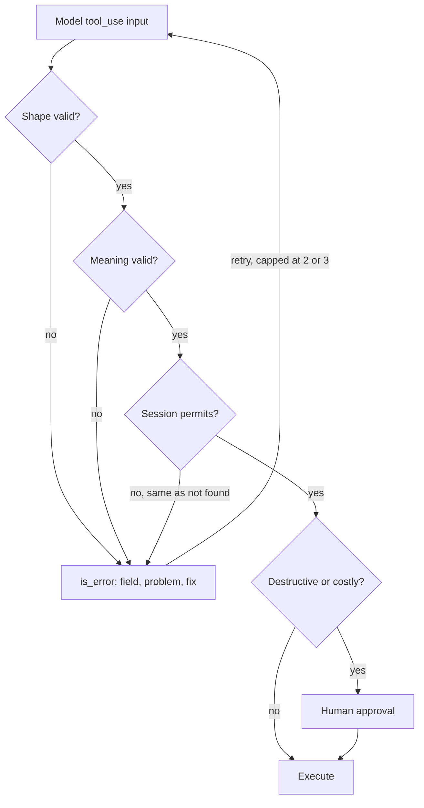

## TL;DR
The input schema is your agent's whole specification of a tool's arguments; harness validation catches
the model's mistakes before they become side effects. Keep schemas small and explicit, validate shape,
meaning, then permission, and return fixable error results.

## For agent builders
- **Why it matters for agents.** The model reads nothing about your tool except its name, description
  and schema, and validation is the last gate before an argument becomes a refund, an email or a
  deleted row. Most "the agent did something dumb" incidents trace back to one of the two.
- **Where it shows up in your stack.** Pydantic models (`model_json_schema()`) or Zod in TypeScript,
  provider strict modes, LangChain's `@tool` (schema from type hints, or a Pydantic `args_schema`),
  Pydantic AI (validation errors sent back to the model as a retry), and Instructor for validated
  structured outputs.
- **What you control.** Field types, enums, required fields, descriptions with units and formats, the
  meaning and permission checks no schema can express, and the cap on validation retries.
- **What you can skip.** The full JSON Schema specification. Provider strict modes accept only a subset,
  and flat, enum-heavy schemas are what models fill well anyway.

## Why it exists
- **Model-generated arguments are plausible, not correct.** They fail in three distinct ways:
  - **Shape errors:** a string where an integer was expected, a missing required field, an invented field.
  - **Semantic errors:** a past date for a future booking, an order id that does not exist, a quantity of
    1000 where 10 was meant.
  - **Authorization errors:** a well-formed request for a record the current user may not see.
- **Strict mode fixes only the first class.** Constrained decoding ("strict" schema mode) eliminates shape
  errors on providers that offer it and does nothing for the other two.
- **Passing `input` straight downstream fails badly:** a 400 at best, a wrong write at worst, and the
  exception kills the loop before the model can correct itself. Validating and crashing is barely better.
- **The model needs a specific message,** like a junior engineer in code review: one that sees "amount
  must be in cents" fixes itself; a 500 from your handler ends the run.
- **The schema is documentation the model reads.** A bare-string `date` invites "next Friday"; described as
  "ISO 8601 date, e.g. 2026-11-03" it gets the right value. Many "bad arguments" are schema bugs.

## How it works
### What the model sees
- **The declared `input_schema` is a JSON Schema object:** `type`, `properties`, `required`, `enum`,
  `description` per property, `default`, `items` for arrays, nested objects, and `additionalProperties`.
- **The model reads every description,** so put units, formats and examples there: "amount in minor
  currency units (cents)", "ISO 4217 code", "max 50 results".
- **`additionalProperties: false`** tells the model not to invent fields and is required by strict mode on
  the major providers.
- **OpenAI's strict mode also requires** every property to be listed in `required`, with optional fields
  expressed as nullable.

### Design rules, and the reason for each
- **Flat over nested,** because every level of nesting is another place to misplace a key.
- **Enums over free strings** for anything with a fixed set of values, because they turn a classification
  into a choice the API can enforce.
- **Few parameters with sensible defaults,** because every optional parameter is a decision the model can
  get wrong; expose only what the task needs, not the downstream API's whole surface.
- **Units and formats in names and descriptions** (`total_cents`, `starts_at_utc`), because "amount" can
  mean cents or dollars and the model will pick one.
- **Avoid unions, recursion and deep polymorphism,** because models fill them poorly and strict-mode
  support differs by provider.
  - At the time of writing OpenAI's strict mode accepts recursive schemas and some numeric and pattern
    keywords; Anthropic's rejects recursive schemas and numeric or length bounds.
  - Check the provider's supported subset rather than assuming either.

### Where the shape guarantee comes from
| | Without strict mode | With strict mode |
|---|---|---|
| How JSON is produced | Generated as text, parsed by the API | Schema compiled to a grammar; tokens masked during decoding (constrained generation) |
| Wrong types, missing fields | Possible | Impossible by construction |
| Cost | None | Restricted schema vocabulary; one-time compilation cost for new schemas |
| Worth it for | A single free-text query parameter | Write tools |

- **Open-weight servers do the same** with libraries like Outlines.
- **Treat availability and the exact supported subset as vendor-dependent.**

### Validation layers in the harness
1. **Shape:** parse `input` into a typed model (Pydantic, Zod). Do this even with strict mode, because:
   - constraints outside the provider's strict subset (often numeric bounds, sometimes patterns) are
     stripped from the sent schema and enforced only here;
   - a response truncated at `max_tokens` is not a complete call;
   - the next model or provider may not offer strict mode.
2. **Meaning:** ranges, cross-field rules, existence checks against your data ("order not found").
3. **Permission:** tenant and user scoping come from the authenticated session in the harness, never from a
   model-supplied argument, because the model will cheerfully pass whatever id appears in the conversation.
4. **Consequence:** destructive or expensive calls get an approval gate regardless of validation.

### What a failure returns
- **`is_error: true` with a message naming the field, the problem and the fix,** and nothing else: no
  stack traces, no table names.
- **One exception to "be specific":** "does not exist" and "exists but belongs to someone else" return the
  same message, otherwise the error channel tells a caller which other tenants' ids are real.
- **Cap validation retries per call,** two or three is typical, so a model that cannot satisfy the schema
  does not loop forever.

## Diagram
Each call passes four gates in order; any failure becomes an `is_error` result the model can fix, and
only a fully valid call reaches the side effect.



## Misconceptions
- **"Strict mode means I can skip validation."** Constrained decoding removes shape errors only. A
  well-typed `amount_cents` can still be 100x too large, an order id can still not exist, and keywords
  outside the provider's subset (such as numeric bounds on Anthropic) are enforced only by your validator.
- **"The schema is just a type check for my code."** It is the model's whole documentation of the tool.
  A bare string `date` invites "next Friday"; a description with format and example fixes most "bad
  arguments" before any validator runs.
- **"Generating the schema from my database model saves work."** Thirty optional fields become thirty
  chances to invent a value. A purpose-built input model with few parameters, enums and units in the
  names is what the model fills reliably.
- **"Passing `tenant_id` as an argument is fine if I validate it."** Validation checks format, not who is
  calling; the model passes whatever id is in its context, injected ones included. Scope comes from the
  session, and "not yours" returns the same message as "not found".
- **"Fail fast: raise on the first bad field."** Raising kills the loop, and reporting one field at a time
  costs a model round trip per field. Return one `is_error` result naming every bad field and its fix,
  and cap retries at two or three.

## Examples
### One Pydantic model for schema and validator
The Pydantic model is the single source for the schema the model sees and the validator the handler runs.
The regex and bounds are shape rules; the existence check is semantic; the tenant check is authorization
using the session, not the model's argument. Errors are turned into results.

```python
# Runs as is; checked with pydantic 2.14.1 on Python 3.12 (str.removeprefix needs 3.9+).
from typing import Literal
from pydantic import BaseModel, ConfigDict, Field, ValidationError, field_validator

ORDERS = {"ORD-104233": {"tenant": "acme", "paid_cents": 12_900}}

class RefundInput(BaseModel):
    model_config = ConfigDict(extra="forbid")            # -> additionalProperties: false
    order_id: str = Field(pattern=r"^ORD-\d{6}$", description="Order id, format ORD-123456")
    amount_cents: int = Field(gt=0, description="Refund amount in cents (minor units)")
    reason: Literal["damaged", "late", "wrong_item", "other"]

    @field_validator("order_id")
    @classmethod
    def must_exist(cls, v: str) -> str:                   # semantic layer: hits data, not just regex
        if v not in ORDERS:
            raise ValueError(f"order {v} not found; ids look like ORD-123456")
        return v

REFUND_TOOL = {"name": "issue_refund",
               "description": "Refund part or all of a paid order. Call only after the user "
                              "has confirmed the order id and amount.",
               "input_schema": RefundInput.model_json_schema()}
# If you enable strict mode, strip keywords outside the provider's subset (e.g. gt on Anthropic)
# from the sent schema and keep enforcing them here; some SDK helpers do this for you.

def handle_refund(block, session_tenant: str) -> dict:
    try:
        args = RefundInput.model_validate(block.input)
    except ValidationError as e:
        msg = "; ".join(f"{'.'.join(map(str, err['loc']))}: {err['msg'].removeprefix('Value error, ')}"
                        for err in e.errors())
        return {"type": "tool_result", "tool_use_id": block.id, "is_error": True,
                "content": f"invalid arguments: {msg}"}
    order = ORDERS[args.order_id]
    if order["tenant"] != session_tenant:                 # authorization from the session
        return {"type": "tool_result", "tool_use_id": block.id, "is_error": True,  # identical to a
                "content": f"invalid arguments: order_id: order {args.order_id} not found; "
                           "ids look like ORD-123456"}                          # missing id

    if args.amount_cents > order["paid_cents"]:           # cross-field semantic rule
        return {"type": "tool_result", "tool_use_id": block.id, "is_error": True,
                "content": f"amount_cents exceeds paid amount {order['paid_cents']}"}
    return {"type": "tool_result", "tool_use_id": block.id,
            "content": f'{{"status": "refunded", "amount_cents": {args.amount_cents}}}'}
```

### Worked trace: one bad call, one round trip
The user says "refund $12.90 on order 104233, it arrived broken". The model sends
`{"order_id": "104233", "amount_cents": 12.9, "reason": "broken"}`.

| Field | Sent | Layer that rejects | Message tells the model |
|---|---|---|---|
| `order_id` | `"104233"` | Shape | It must match the pattern `^ORD-\d{6}$` |
| `amount_cents` | `12.9` | Shape | It must be an integer with no fractional part |
| `reason` | `"broken"` | Shape | The four allowed `reason` values |

- **Pydantic reports all three in one pass,** so the model gets a single result naming each.
- **One round trip later** it sends `{"order_id": "ORD-104233", "amount_cents": 1290, "reason": "damaged"}`,
  which passes.
- **Reporting every error together matters** *because* fixing them one per round trip would cost three
  model calls instead of one.
- **Had it sent `amount_cents: 129000`,** shape would pass and the cross-field rule would reject it with the
  paid amount in the message, exactly the information needed to correct it.

### Capping validation retries
A runnable sketch of the retry cap: after the third rejection of the same tool in a run, the result tells
the model to stop and ask the user instead of trying again.

```python
from collections import Counter

MAX_REJECTIONS = 3
rejections: Counter[str] = Counter()          # per run, keyed by tool name

def reject(tool: str, tool_use_id: str, msg: str) -> dict:
    rejections[tool] += 1
    if rejections[tool] >= MAX_REJECTIONS:
        msg += f" (rejected {rejections[tool]} times; stop retrying and ask the user for the values)"
    return {"type": "tool_result", "tool_use_id": tool_use_id, "is_error": True,
            "content": f"invalid arguments: {msg}"}

for i in range(3):
    print(reject("issue_refund", f"toolu_{i}", "amount_cents: must be an integer")["content"])
```

## Production patterns
- **Schema snapshot tests.** Whenever the schema is generated from code; commit the output of
  `model_json_schema()` and fail CI when it changes unreviewed, because a renamed field silently changes what
  the model sees. Monitor argument validity rate after each deploy.
- **Replay real arguments as fixtures.** Once traces exist; export actual `input` objects (good and
  rejected) from traces and run the validator over them in CI, instead of hand-written fixtures. Monitor the
  semantic rejection rate per field.
- **Per-provider schema rendering.** When one tool serves several vendors; keep one canonical Pydantic
  model, render a provider-specific schema that drops unsupported keywords, and keep enforcing them in the
  validator. Monitor 400s mentioning unsupported keywords.
- **Coerce low-stakes, reject high-stakes.** Trim whitespace or upper-case a currency code before
  validation; reject ambiguous money, dates and ids. Monitor how often coercion fires.
- **Retry cap plus escalation.** In every harness; cap rejections and then tell the model to ask the user,
  as above. Monitor retries per rejected call.

## Trade-offs
- **Hard shape guarantee vs vocabulary and latency.** Strict mode limits the schema vocabulary and adds
  first-call compilation latency; it pays for itself on write tools and is overkill for a one-string
  search tool.
- **Tight validation vs round trips.** It catches more errors, but each rejection costs a model round trip.
  For low-stakes arguments it is cheaper to coerce (trim whitespace, upper-case a currency code) than to
  reject.
- **Flat parameters vs pushed complexity.** Fewer, flatter parameters make calls reliable but push
  complexity into more tools or the handler; the balance flips when the domain genuinely needs a structured
  payload such as an address.
- **Detailed errors vs leakage.** Detail helps the model self-correct but can leak internals; return what
  the model needs to fix the call, not what a developer needs to debug the service.

## Pitfalls
- **Generating the schema from an internal database model with thirty fields.** Symptom: the model fills
  optional fields with invented values or omits the ones that matter. Diagnose: per-field fill rate in
  traces against what the task needs. Fix: a purpose-built input model.
- **A bare `{"type": "string"}` for dates, money or ids.** Symptom: "next Friday", "$12.90" and ids with the
  wrong prefix reach the handler. Diagnose: group rejections by field and read the sent values. Fix:
  formats, patterns, examples.
- **Taking `tenant_id` or `user_id` from the model's arguments.** Symptom: cross-tenant access found only in
  a security review or an incident. Diagnose: grep schemas for identity fields. Fix: derive scope from
  the session.
- **Validating shape only.** Symptom: downstream 400s and refunds off by 100x from cents-dollars confusion.
  Diagnose: plot argument distributions (amounts) per tool; a second mode 100x away is a unit bug. Fix:
  semantic and cross-field rules.
- **Unbounded validation retries.** Symptom: one call rejected twenty times until the step budget trips.
  Fix: a retry cap.
- **One schema across providers with different strict-mode subsets.** Symptom: a 400 from one vendor about
  an unsupported keyword such as `pattern` or `minimum`. Fix: per-provider rendering.

## When to use
- **Always validate;** what varies is how deep.
- **Read-only search tool:** shape validation and little else.
- **Tools that move money, delete data or send messages:** all four layers plus an approval gate.
- **Measure** argument validity rate (calls passing shape), semantic rejection rate, and retries per
  rejected call; a rise after a prompt or model change usually means an ambiguous description.
- **Day to day and in interviews:** most tool bugs live here, so keep schema and validator in one place and
  test with real traced arguments; know what strict mode does not guarantee, and why authorization never
  comes from a model argument.

## Exercise
**Goal:** render one Pydantic input model as strict-compatible schemas for two providers without losing
any rule. No solution is given.
- **Inputs:** a `CreateInvoiceIn` model with an optional field, an enum, a pattern and numeric bounds;
  both providers' current strict-mode docs (note the date read).
- **Deliver:** `render(model, provider)`, a validator enforcing whatever a rendering dropped, and tests.
- **Acceptance:** the OpenAI rendering lists every property in `required` with optional fields nullable;
  the Anthropic rendering carries no keywords its subset rejects; a value breaking a dropped bound is
  still rejected with a message naming the field; both renderings are snapshot-tested.

## Role lens
- **Engineer:** Defines each tool's input as a typed model, derives the JSON Schema from it, validates
  every call in layers, and returns specific `is_error` results instead of raising.
- **Architect:** Sets the rule that identity and tenant scope come from the session, decides which
  tools require strict schemas and approval gates, and standardizes the error format across teams.
- **FDE:** Inspects a customer's failing tool calls in traces, usually finds an ambiguous schema or a
  missing unit, and fixes the description before touching the prompt or the model.

## Check yourself
**Q:** You enable strict schema mode and argument validation errors drop to zero, yet refund amounts
are occasionally a hundred times too large. What happened, and what do you change?
**A:** Strict mode guarantees the arguments match the schema's shape: `amount` is an integer, every
required field is present. It cannot know that the integer was meant in dollars while the handler reads
cents, so the model sometimes sends 129 for a 129-dollar refund and sometimes 12900. The fix is in the
contract and the handler, not the decoder: rename the field to `amount_cents` and say "minor units" in
its description; add a semantic check that the amount does not exceed what the order paid; gate refunds
above a threshold behind human approval; and return a specific error when the check fails so the model
corrects itself. Then watch the distribution of amounts in traces to confirm the fix.

## Interview questions
### What are the three ways model-generated arguments fail?
- **Shape:** wrong types, missing or invented fields; strict mode or a typed parser catches these.
- **Semantics:** values that parse but are wrong, such as a past date for a booking or a nonexistent id;
  only checks against your data catch these.
- **Authorization:** a well-formed request for a record the caller may not see; only the session in the
  harness can decide that.

### A model keeps sending dates like "next Friday". How do you fix it?
- **Treat it as a schema bug first:** a bare string invites free text.
- **Describe the format** ("ISO 8601 date, e.g. 2026-11-03"), add a pattern, and name the field with its
  unit or zone (`starts_at_utc`).
- **Validate and return a specific error** naming the expected format, so the next call self-corrects in
  one round trip.

### Why should tenant scope never be a tool argument?
- **The model passes whatever id appears in its context,** including one injected by a document or a user.
- **So scope comes from the authenticated session** and is applied regardless of arguments.
- **Also make "not found" and "not yours" identical,** otherwise the error channel reveals which other
  tenants' ids are real.

### When would you coerce instead of rejecting an argument?
- **Coerce cosmetic, unambiguous issues** such as whitespace or currency-code case, because each rejection
  costs a full model round trip.
- **Reject anything where a guess could be wrong:** money units, dates, ids, destructive flags.
- **Log coercions** so you can see when a description needs fixing.

### How do you keep validation retries from burning the step budget?
- **Report every error in one result,** as Pydantic does, so three bad fields cost one retry, not three.
- **Cap retries at two or three per call,** then tell the model to ask the user.
- **Watch retries per rejected call;** a rise after a change points to an ambiguous description.

### A framework validates arguments for you and retries on failure. Is that enough?
- **It covers shape only.** Pydantic AI or a LangChain `args_schema` rejects wrong types and missing
  fields, but cannot know that an order belongs to another tenant or that a date is in the past.
- **Keep meaning and permission checks in the handler,** with scope taken from the session, and an
  approval gate for destructive calls.
- **Check the retry setting** so a framework's automatic retries stay inside your step budget.

## Quiz
### Q: What does strict or constrained schema mode guarantee about a tool call's arguments?
- [ ] That the values are correct for the task
- [x] That the arguments conform to the declared schema's shape and types
- [ ] That the referenced records exist
- [ ] That the caller is authorized to use them
> Constrained decoding enforces the grammar of the output, so types and required fields are right by
> construction. Existence, meaning and permission are properties of your data and your session, which
> only the harness can check.

### Q: A parameter has exactly five valid values and the model keeps sending variants. Which change fixes it most directly?
- [ ] Increase the model's output token limit
- [ ] Add the five values to the system prompt
- [x] Declare the parameter as an enum of the five values in the schema
- [ ] Lower the temperature
> An enum turns a free-text guess into a choice the API validates, and strict modes enforce it during
> decoding. A prompt mention helps less because it is not attached to the parameter and is not enforced.

### Q: Where should the tenant scope for a tool call come from?
- [ ] A required tenant_id parameter the model fills in
- [ ] The tool description, which tells the model the current tenant
- [x] The authenticated session in the harness, applied regardless of the model's arguments
- [ ] The most recent tool result that mentioned a tenant
> The model will pass any id that appears in its context, including one injected by a document or a
> user. Authorization must be derived from who is actually calling, which only the harness knows.

## Mastery test
**Problem:** a `book_meeting` tool takes `start_time` (pattern-checked ISO 8601) with strict mode on, so
validation never fails. Users in India report meetings landing 5 hours 30 minutes late. Find, confirm
and fix the bug.

**A strong answer:**
- a contract bug: with no zone, a local 15:00 is stored as 15:00 UTC (20:30 IST);
- traces show a constant stated-versus-stored offset matching the user's zone;
- renames to `starts_at_utc` or requires an offset, takes the user's zone from the session, adds a
  semantic check (future, plausible hours), and returns a fixable error.

## Use cases & projects
### Use cases
- **Payment and refund tools.** Amount ranges, currency enums and order-ownership checks stop a
  hallucinated or injected argument from moving money.
- **Database and query tools.** Enum-restricted filters and row limits keep the model from asking for
  unbounded or unsafe queries.
- **Multi-tenant SaaS agents.** Tenant and user scope come from the session, so a model-supplied id can
  never cross a tenant boundary.
- **Self-correcting loops.** A clear validation error lets the model fix its own arguments on the next
  turn instead of the run failing.

### Mini project
**Harden one risky tool (1-2 hours).**
- **Goal:** take a `create_refund` tool from a loose schema to a validated, permission-checked one.
- **Steps:** define the input with Pydantic (amount with bounds, currency enum, order id format, reason
  enum); validate in three layers (shape, then meaning such as amount not above the order total, then
  permission from the session); return fixable error results; cap validation retries at a small number;
  write 15 adversarial argument sets, including a wrong tenant and a negative amount.
- **Done when:** every adversarial case is rejected before any side effect, the error text names the
  field and the fix, and the model recovers from at least one error on its next turn.
