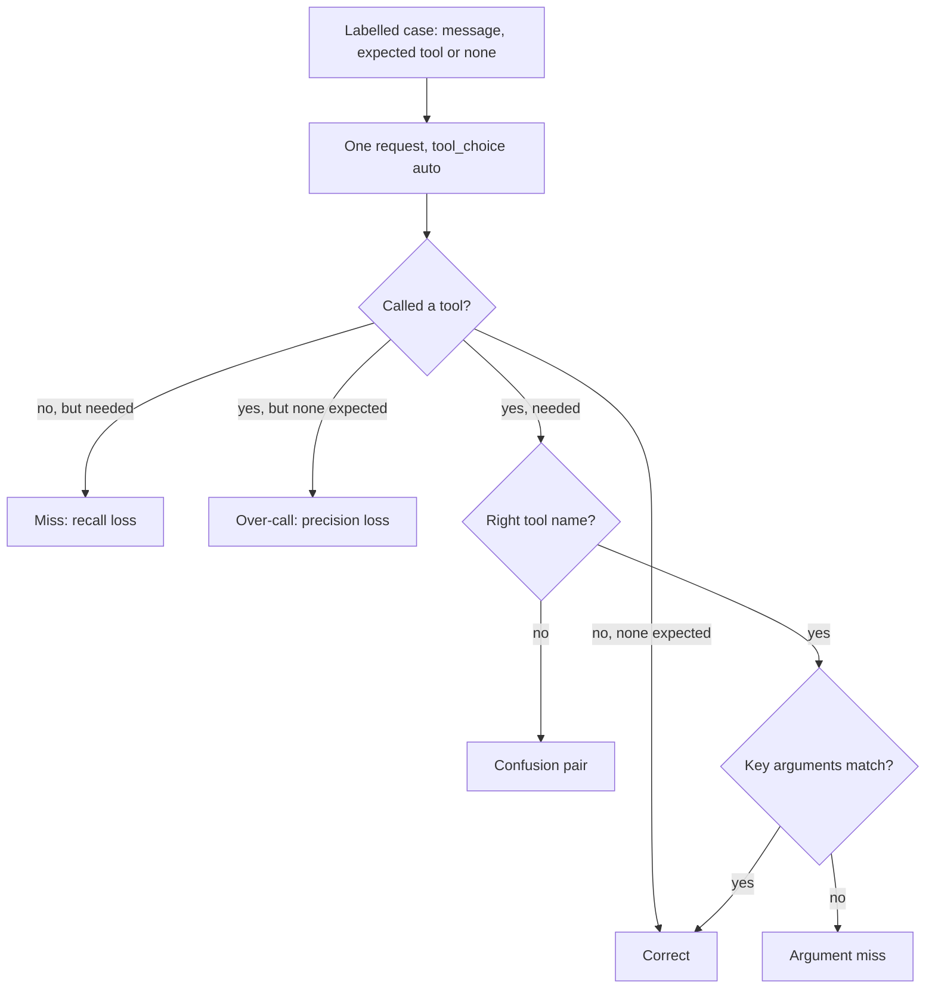

## TL;DR
Tool selection accuracy is the share of an agent's decision points where the model picks the right
tool, or none, with correct arguments. It falls as tools multiply and overlap; instrument it first,
because it isolates the decision made every step.

## For agent builders
- **Why it matters for agents.** Every step of the loop starts with this decision, and errors compound:
  a wrong tool at step 2 sends the rest of the run down the wrong path. It is also the cheapest agent
  metric to measure, one model call per case with no tools executed.
- **Where it shows up in your stack.** An eval dataset run in CI, in LangSmith datasets and evaluators,
  Braintrust, Langfuse or a plain pytest harness; trace attributes (tool name, schema-validation outcome)
  for the label-free production signals; tool search or deferred loading once the catalogue grows.
- **What you control.** Tool names, descriptions with trigger conditions, how many tools are in context,
  enums on parameters, the system prompt's act-versus-answer guidance, and the labelled case set.
- **What you can skip.** Elaborate statistics. The standard-error and paired-count checks in this lesson
  are enough to tell a real change from noise.

## Why it exists
- **"The agent feels dumb" decomposes into three failures:** it answered from memory when it should have
  called a tool; it called the wrong one of two similar tools; or it called the right tool with wrong
  arguments.
- **Task success cannot separate them** from a flaky API, a bad result format or a weak final answer. Teams
  tuning on task success alone change descriptions, prompts and the tool list at once and cannot tell
  which change helped and which regressed something else.
- **Reading a few transcripts is not a substitute.** It is slow, biased toward the cases you happened to
  look at, and useless for catching a regression after a model upgrade or a description edit.
- **The metric moves when the tool surface changes and stays still when it does not,** which is what safe
  iteration needs. A wrong selection wastes a step at best and causes a wrong side effect at worst.
- **It is cheap:** the decision is made in the model's first response, so no tool has to execute to score it.

## How it works
### Decompose the decision
At each step the model makes three choices, each with its own metric:

| Choice | Metric | Definition | Low score looks like |
|---|---|---|---|
| 1. Call or not | *Should-call recall* | Of cases needing a tool, fraction where one was called | Hallucinated facts |
| 1. Call or not | *Should-call precision* | Of cases where it called, fraction that needed a call | Cost and latency on questions a sentence would answer |
| 2. Which tool | *Name accuracy* | Exact match against the expected tool, given a needed call was made | Wrong tool of a similar pair |
| 3. Which arguments | *Schema-valid rate* | Automatic and cheap | Shape errors |
| 3. Which arguments | *Argument accuracy* | Key fields compared with the expectation | Right tool, wrong record |

- **Use a confusion matrix for names,** over (expected, chosen) pairs, because it points at the specific pair
  of tools whose descriptions overlap; the single number does not.
- **Match arguments by type:** exact for ids and enums, normalized for dates and codes, a rule or an LLM judge
  for free text such as search queries, where "shipping delay refund" and "refund for late delivery" are
  both right.
- **Step-level accuracy is the conjunction:** right decision, right tool, right arguments.

### Build the dataset
1. **Sample real traffic, not imagined prompts.** Label each turn with the expected tool (or `none`) and the
   expected key arguments.
2. **Include `none` cases in roughly their real proportion** so precision is measured, and deliberately add
   near-miss pairs that separate similar tools.
3. **Treat it as a golden set:** keep it out of any few-shot examples embedded in tool descriptions, and
   version it with the tool definitions.
4. **For mid-trajectory decisions,** snapshot the conversation up to the decision point as the case input.

### How big the set must be
- **Low hundreds of cases see large regressions, not small ones.** With 200 cases the standard error on a 90%
  score is about 2 points (sqrt(0.9 × 0.1 / 200) ≈ 0.021), so only shifts of roughly five points or more are
  distinguishable from noise.
- **Paired comparison is more sensitive.** On the *same* cases most results agree, so count only discordant
  cases (passed before and failed after, or the reverse). A 14-to-3 split is a real change where two headline
  numbers a few points apart might not be.

### Run it cheaply
- **One request per case** with the production system prompt and tool list and `tool_choice` left on `auto`;
  score the first response's `tool_use` blocks.
- **Prompt caching makes it inexpensive,** because the prefix (tools plus system prompt) is identical across
  cases, so a few hundred cases fit in CI on every change to a description, the tool list or the model version.
- **Selection is sampled, not deterministic.** Run borderline cases several times (or the whole set two or
  three times) and treat run-to-run variation as part of the noise floor.

### What moves the number
- **Trigger conditions in descriptions.** "Call this when the user asks about an order's status; do not use
  it for returns" is usually the highest-leverage single edit for recall and confusion.
- **Re-validate eagerness per model.** How eagerly a model reaches for tools differs between families and
  versions (some under-call, some over-call), so "call when" language must be re-checked on every model change.
- **Fewer, more distinct tools.** Merge overlapping tools behind an enum parameter, split a do-anything tool
  whose `mode` parameter is really five tools, and use names that read as verbs on nouns.
- **Fewer tools in context.** Beyond a few dozen tools (the threshold is model-dependent and illustrative)
  accuracy degrades and token cost rises; defer rarely used tools and load them through tool search or
  dynamic registration when the task calls for them.
- **Better parameter descriptions and enums** move argument accuracy specifically.
- **System prompt guidance** about when to act versus answer moves should-call precision and recall.

### Model dependence
- **Selection is learned behaviour,** so the same tool definitions score differently on different models and
  versions.
- **Re-run the eval on every model change** and treat a should-call shift as expected, not a bug in your code.

## Diagram
Each labelled case is scored at the first decision it fails, which is what turns one headline number into
a fix you can act on.



## Examples
### A minimal selection eval
A labelled case set, one request per case, and decomposed scores: should-call recall and precision, name
accuracy over cases where a call was needed and made, argument accuracy over correctly named calls, plus a
confusion map that also records missed and unnecessary calls.

It uses the production `TOOLS` and `SYSTEM` and never executes a tool, so it is safe to run in CI.

```python
import anthropic
from collections import Counter

client = anthropic.Anthropic()
CASES = [  # (user message, expected tool or None, expected key arguments)
    ("Where is order ORD-104233?",                  "get_order",     {"order_id": "ORD-104233"}),
    ("Show me all open orders for customer C-9",    "search_orders", {"customer_id": "C-9", "status": "open"}),
    ("What is your returns policy?",                None,            {}),
    ("Refund ORD-104233, it arrived broken",        "issue_refund",  {"order_id": "ORD-104233"}),
    ("Has C-9 ordered anything that shipped?",      "search_orders", {"customer_id": "C-9", "status": "shipped"}),
]

def first_call(user_msg: str):
    r = client.messages.create(model="claude-opus-5-5", max_tokens=1024, system=SYSTEM,
                               tools=TOOLS, messages=[{"role": "user", "content": user_msg}])
    return next(((b.name, b.input) for b in r.content if b.type == "tool_use"), (None, {}))

t, confusion = Counter(), Counter()
for msg, want, want_args in CASES:
    got, args = first_call(msg)
    t["needed"] += want is not None
    t["called"] += got is not None
    if want is not None and got is not None:
        t["both"] += 1
        t["name_ok"] += got == want
        t["args_ok"] += got == want and all(args.get(k) == v for k, v in want_args.items())
    if got != want:
        confusion[(want, got)] += 1        # includes (tool, None) misses and (None, tool) over-calls

d = lambda a, b: t[a] / max(t[b], 1)
print(f"recall {d('both', 'needed'):.0%}  precision {d('both', 'called'):.0%}  "
      f"name {d('name_ok', 'both'):.0%}  args {d('args_ok', 'name_ok'):.0%}")
print("confusions (expected -> chosen):", dict(confusion))
```

### Worked numbers: reading the output
Illustrative numbers on a realistic set: 200 cases, 160 need a tool, 40 are `none`. The model calls on 150:
140 of the needed cases and 10 of the `none` cases.

| Metric | Calculation | Score |
|---|---|---|
| Should-call recall | 140/160 | 87.5% |
| Should-call precision | 140/150 | 93% |
| Name accuracy | 133 of the 140 | 95% |
| Argument accuracy | 120 of those 133 | 90% |
| Step-level accuracy | 120 tool cases + 30 correctly unanswered `none` cases = 150/200 | 75% |

- **75% alone says "the model is mediocre";** the decomposition says something sharper.
- **The biggest loss is the 20 missed calls.** If the confusion map shows 15 of them as `(get_order, None)`
  on "when will it arrive" phrasings, the fix is one trigger condition in one description, not a model change.
- **The 13 argument misses** are a separate, smaller problem with a separate fix (parameter descriptions).
- **The 7 name errors** point at one pair of tools.

### Is the change real? Noise floor and paired counts
Pure Python, runnable as is: the standard error of a score, and an exact two-sided sign test on the
discordant cases between two configurations run on the same set.

```python
from math import comb, sqrt

def se(p, n): return sqrt(p * (1 - p) / n)

def discordant_p(worse, better):                 # sign test on cases that flipped
    n, k = worse + better, max(worse, better)
    tail = sum(comb(n, i) for i in range(k, n + 1)) / 2 ** n
    return min(1.0, 2 * tail)

print(f"SE at 90%, n=200: {se(0.9, 200):.3f}")   # 0.021 -> about 2 points
print(f"SE at 90%, n=800: {se(0.9, 800):.3f}")   # 0.011 -> 4x the cases halves the noise
print(f"14 vs 3 flips: p = {discordant_p(14, 3):.3f}")   # 0.013 -> real change
print(f"6 vs 3 flips:  p = {discordant_p(6, 3):.3f}")    # 0.508 -> noise
```

## Production patterns
- **Selection eval as a CI gate.** On every change to a description, the tool list, the system prompt or the
  model id; run the labelled set (two or three repeats) and fail the build when the paired discordant count
  shows a significant regression. Monitor recall, precision and the confusion matrix diff per PR.
- **Label-free production proxies.** Always on; track the ratio of tool calls to turns and the
  schema-validation failure rate per tool on a dashboard. A step change after a deploy is the cue to run the
  full eval.
- **Refresh the golden set from traffic.** Monthly or after a launch; sample new production turns, label
  expected tool and key arguments, and add them, keeping them out of description few-shot examples. Monitor
  the share of cases from the last quarter.
- **One description edit per change.** When tuning; edit one description, rerun, compare the confusion matrix,
  then move on. Monitor which pair each edit was aimed at and whether it moved.
- **Cap tools per agent and defer the rest.** For large catalogues; set a maximum based on measured accuracy
  and expose the rest through tool search or dynamic registration. Monitor accuracy on deferred tools
  separately, since discovery adds a step.

## Trade-offs
- **First-turn eval vs trajectory coverage.** It is cheap and isolates the decision, but misses selections
  made deep in a long context. When first-turn accuracy is high and task completion is still low, add
  trajectory evals.
- **Recall vs precision.** More insistent descriptions raise should-call recall but lower precision. The
  balance depends on whether a wasted call or a hallucinated answer costs more; for write tools it is better
  to under-call and ask.
- **Fewer tools vs capability.** Fewer tools improve accuracy but reduce capability; deferred loading and
  tool search keep capability at the price of a discovery step and some latency.
- **LLM-judged arguments vs noise.** A judge handles free-text parameters but adds noise and cost; use exact
  or normalized matching for ids, enums and dates and reserve the judge for queries.

## Pitfalls
- **Measuring only task success.** Symptom: a selection regression stays invisible until many tasks fail and
  the cause must be reconstructed from transcripts. Fix: score selection separately.
- **Writing eval cases from the examples in the descriptions.** Symptom: a perfect eval score and the old
  failures in production. Fix: cases from real traffic, held out.
- **Omitting `none` cases.** Symptom: an agent that calls tools for greetings and small talk, and a bill that
  grows faster than usage. Fix: include them at their real proportion.
- **Changing several descriptions in one commit.** Symptom: a moved number with no way to know which edit
  moved it or whether another edit cancelled a gain. Fix: one edit per change.
- **Skipping the eval on a model upgrade.** Symptom: a drop in should-call rate with no code change and a week
  looking for the bug in the wrong place. Fix: model id changes trigger the eval.

## When to use
- **Instrument it** as soon as an agent has more than two or three tools, and run it on every change to
  descriptions, the tool list, the system prompt or the model.
- **Use the decomposition to decide what to edit:** low recall means trigger conditions and system prompt;
  confusion between a pair means those two descriptions; low argument accuracy means parameter descriptions
  and enums.
- **Avoid** chasing the last few points on a small eval; label more cases instead.
- **Measure in production** the ratio of tool calls to turns and the schema-validation failure rate, cheap
  proxies that need no labels.
- **Interviews:** "how do you know your tool descriptions are good" is common; the expected answer is a
  labelled set, the three-way decomposition and a confusion matrix, not "we read transcripts".

## Role lens
- **Engineer:** Maintains the labelled case set, runs the selection eval in CI, and edits one
  description at a time with the confusion matrix open.
- **Architect:** Sets the maximum number of tools a single agent may hold in context and the policy
  for deferring the rest, based on measured accuracy rather than convenience.
- **FDE:** Builds the case set from the customer's real queries during onboarding and uses the score
  to justify consolidating the customer's forty endpoints into eight tools.

## Check yourself
**Q:** Step-level selection accuracy is 92%, yet users report that the agent "makes up delivery
dates". Which component of the metric would you look at first, and what would you change?
**A:** Making up a date is an answer given without a lookup, so the suspect is should-call recall for
the order-status tool, not name confusion. Check the confusion map for cases labelled `get_order` that
the model answered with no call; if they cluster around phrasings like "when will it arrive", the
description's trigger condition does not cover them. Rewrite the description to name those phrasings
and to state that delivery dates must never be given without a lookup, add the same rule to the system
prompt, and re-run the eval watching recall and precision together so the fix does not cause calls on
every message. In production, confirm by tracking the share of delivery-date answers preceded by a
`get_order` call.

## Interview questions
### How do you know your tool descriptions are any good?
- **A labelled set from real traffic,** each turn tagged with the expected tool or `none` and key arguments.
- **Decomposed scores:** should-call recall and precision, name accuracy with a confusion matrix, and
  argument accuracy, because each points at a different fix.
- **Run it in CI** on every description, tool list, prompt or model change.

### Two tools keep being confused after a release. Walk me through the fix.
- **Find the pair in the confusion matrix** and read the cases where it happens.
- **Rewrite both descriptions** with disjoint trigger conditions and explicit "do not use for" guidance, or
  merge them behind an enum parameter.
- **Change one thing, rerun** on the same cases and compare discordant counts before shipping.

### Your eval moved from 88% to 91% on 200 cases. Is that a real improvement?
- **Not from headline numbers alone:** the standard error near 90% on 200 cases is about 2 points.
- **Use the paired view:** count cases that flipped each way; a 14-to-3 split is significant, a 6-to-3
  split is noise.
- **Also rerun** two or three times, because selection is sampled.

### When would you accept lower should-call recall?
- **For write tools,** where an unnecessary or wrong call causes a side effect; under-call and ask instead.
- **When a wasted call is expensive** in latency or money and answering from context is usually right.
- **Never for facts that must be looked up,** such as delivery dates or balances.

### What production signals tell you selection broke without labels?
- **Tool calls per turn:** a sudden drop suggests under-calling; a jump suggests over-calling.
- **Schema-validation failure rate per tool,** which rises when arguments degrade.
- **Use them as triggers** to run the full labelled eval, not as the eval itself.

### How would you turn production traces into a selection eval?
- **Sample decision points from traces,** for example exported from LangSmith or your tracing store,
  snapshotting the conversation up to each tool decision as the case input.
- **Label the expected tool (or `none`) and key arguments,** oversampling near-miss pairs and keeping
  `none` cases near their real share.
- **Version the set with the tool definitions** and run it on every description, catalogue or model change.

## Quiz
### Q: Which metric captures "the agent answered from memory when it should have looked it up"?
- [ ] Tool-name accuracy
- [x] Should-call recall
- [ ] Schema-valid argument rate
- [ ] Should-call precision
> Recall measures, over the cases that needed a tool, how often one was called. Precision is the
> reverse error (calling when unnecessary), and name and argument metrics only apply once a call was made.

### Q: Two tools are repeatedly confused for each other. What is the highest-leverage fix?
- [ ] Move the more common tool to the front of the tools array
- [ ] Lower the sampling temperature
- [x] Rewrite both descriptions with explicit, disjoint trigger conditions, or merge them behind an enum parameter
- [ ] Add more required parameters to the less common tool
> Confusion comes from overlapping descriptions; making them disjoint or removing the choice entirely
> addresses the cause. Ordering and temperature have at most marginal effects, and extra parameters do
> not change which tool is chosen.

### Q: Why should the eval set include cases where the correct behaviour is to call no tool?
- [ ] To make the eval run faster
- [x] To measure should-call precision, so the agent is not rewarded for calling tools on every message
- [ ] Because the API requires at least one text-only response per batch
- [ ] To test the fallback model
> Without `none` cases an agent that calls a tool on every turn scores perfectly on recall while wasting
> cost and latency; the `none` cases are what expose over-calling.

## Use cases & projects
### Use cases
- **Gating prompt and model changes.** A selection eval in CI shows whether a new model or a reworded
  description helped or hurt before it ships.
- **Growing a tool catalogue.** Measuring accuracy as tools are added tells you when to merge,
  rename or defer-load tools.
- **Connecting MCP servers.** Vendor tool descriptions often overlap; a selection eval shows which ones
  to rewrite or drop.
- **Production monitoring.** Label-free signals such as schema-validation failures per tool flag a
  selection regression between eval runs.

### Mini project
**Build a tool selection eval (2-3 hours).**
- **Goal:** measure how often an agent picks the right tool, or none, and show the effect of one fix.
- **Steps:** give an agent eight tools, two of them deliberately overlapping; write 60 labelled cases,
  including at least 10 `none` cases; run each case as one model call with no tools executed; score tool
  match, argument match and should-call precision; rewrite the two overlapping descriptions and re-run.
- **Done when:** you have a before-and-after table per tool, a confusion list of which tools get mixed
  up, and a paired comparison showing whether the change beats noise.
