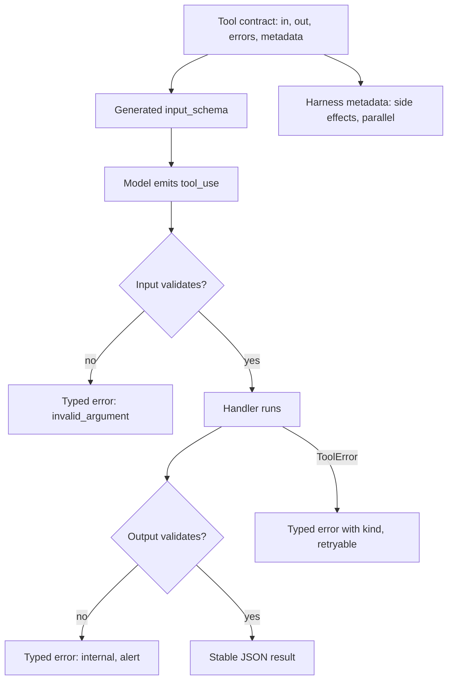

## TL;DR
A typed tool contract defines each agent tool once as types: input, output, error kinds and side-effect
metadata. Schema, handler, serialization and tests derive from it, so they cannot drift and the model
always reads results of a stable shape.

## For agent builders
- **Why it matters for agents.** An agent with 20 tools has 20 schemas, handlers and result formats that
  drift apart one edit at a time. One typed definition per tool keeps what the model is told, what the
  handler accepts and what the model reads back in lockstep, and gives the harness the metadata it gates on.
- **Where it shows up in your stack.** Pydantic or Zod models behind Anthropic's `@beta_tool` and
  `betaZodTool`, LangChain tools with an `args_schema`, the OpenAI Agents SDK's `@function_tool`, Pydantic
  AI's typed tools and results, and MCP's `inputSchema`, `outputSchema` and annotations.
- **What you control.** The registry, the shared error taxonomy with `retryable` flags, side-effect and
  parallel-safety classes, idempotency keys for writes, and the schema snapshot test that guards changes.
- **What you can skip.** Building a general framework. A dictionary from tool name to contract, plus one
  dispatch function, covers most agents.

## Why it exists
- **Hand-written schemas drift from handlers.** The schema is a dictionary in one file and the handler
  reads a `dict` in another. Someone renames a parameter in the handler and forgets the schema; the model
  keeps sending the old name; the handler raises `KeyError` in production on the calls that matter.
- **Outputs drift too.** The handler returns the upstream API's JSON unchanged, the vendor renames `state`
  to `status`, and the agent silently starts reporting empty values.
- **Errors drift worst.** One handler returns "not found", another raises, a third returns `None`, and the
  model cannot tell a transient failure it should retry from a permission failure it should not.
- **"Document it in a wiki and be careful" fails** because nothing enforces it and the failures are silent:
  the model does not crash on a wrong field name, it adapts, badly.
- **The fix is the one API engineering settled on years ago:** a machine-readable interface definition
  from which clients, servers and tests are generated. Here the client is the model, the server is your
  handler, and JSON Schema is the shared language, which is why protocols such as MCP transport tools as
  schemas rather than code.

## How it works
### The four parts of a contract
1. **Input type.** A typed model (Pydantic, Zod, an annotated dataclass) whose JSON Schema is generated,
   not written. Field names, enums and descriptions live in one place, so the model's view and the
   handler's view are the same object.
2. **Output type.** Stable field names, units in names (`total_cents`), an explicit status, counts and
   truncation flags, serialized the same way on every call, because the model reads the result as a
   prompt and consistency lets it learn the shape from one call to the next.
3. **Error taxonomy.** A small enum of kinds, each with a `retryable` flag, returned as `is_error: true`
   results carrying the kind and a message, because the correct recovery differs per kind (table below).
4. **Harness metadata.** Side-effect class (read-only, idempotent write, destructive), parallel safety, a
   timeout, perhaps a cost tag. The model never sees these; the harness uses them for gating, concurrency
   and retries without parsing descriptions.

| Error kind | Model's correct recovery |
|---|---|
| `invalid_argument` | Fix the argument and call again |
| `not_found` | Ask the user for the right value |
| `permission_denied` | Give up and explain |
| `transient` | Wait and retry |
| `rate_limited` | Wait and retry, more slowly |
| `internal` | Report the failure; the harness alerts, because the bug is in the tool, not the call |

- **Keep the enum small and shared.** The example below implements a subset (`not_found`,
  `invalid_argument`, `transient`, `internal`); a real registry defines every kind once for all tools.

### Making write retries safe
- **The contract says how a retry is made safe.** The harness derives an idempotency key (for example
  from the `tool_use` id) and passes it to the handler.
- **Because** a `transient` error after the downstream system committed the write is indistinguishable,
  from the harness's side, from one before it; only a key lets the retry be a no-op instead of a double
  charge.

### Derivation, not duplication
1. **A registry maps each tool name to its contract.**
2. **At startup** it produces the provider-format tool list (`name`, `description`, `input_schema` from the
   input type).
3. **At call time** it validates raw input into the input type, runs the handler, validates the return
   value against the output type, and serializes it.

- **SDK helpers are this pattern in miniature.** Anthropic's SDK tool runners (beta at the time of writing:
  `@beta_tool` generates a schema from a Python signature, `betaZodTool` from a Zod schema) and similar
  helpers elsewhere; the registry adds the output type, error taxonomy and harness metadata.

### Versioning
- **Treat the contract like a public API.** Additive changes (a new optional field with a default) are
  safe.
- **Renames and type changes are breaking,** because prompts, few-shot examples, evals and cached
  conversations all encode the old shape. Ship them as a new tool name (`search_orders_v2`), or add the new
  parameter as optional and keep accepting the old one for a transition period before removing it.
- **Snapshot the generated schema.** A test comparing it against a committed copy makes an unintended
  change fail CI; an intended one updates the snapshot in the same PR.

### Across process boundaries
- **The contract is what crosses the wire** when tools live in another service or language.
- **MCP maps onto it directly.** `tools/list` returns a name, description and `inputSchema` per tool; since
  the 2025-06-18 revision a server can also declare an `outputSchema` and return matching
  `structuredContent`.
- **Optional MCP annotations carry side-effect metadata:** `readOnlyHint`, `destructiveHint`,
  `idempotentHint`. From a server you do not control they are claims, not guarantees, so the harness
  should not relax a gate on their word alone.
- **The contract also feeds evals.** Expected arguments in a selection eval are instances of the input
  type, so a schema change breaks the eval loudly rather than invalidating it silently.

## Diagram
One contract feeds both the model-facing schema and the runtime checks; every result, good or bad, leaves
in a typed shape.



## Examples
### A registry entry derived from types
The handler receives a validated `SearchOrdersIn`, must return something that validates as
`SearchOrdersOut`, and any failure becomes a typed error. The `read_only` and `parallel_safe` flags are
read by the harness, not the model.

```python
import json
from dataclasses import dataclass
from enum import Enum
from typing import Callable, Literal
from pydantic import BaseModel, ConfigDict, Field, ValidationError

class ErrorKind(str, Enum):
    not_found = "not_found"; invalid_argument = "invalid_argument"; transient = "transient"
    internal = "internal"

class ToolError(Exception):
    def __init__(self, kind: ErrorKind, message: str, retryable: bool = False):
        super().__init__(message)
        self.body = {"kind": kind.value, "message": message, "retryable": retryable}

class SearchOrdersIn(BaseModel):
    model_config = ConfigDict(extra="forbid")
    customer_id: str = Field(description="Customer id, e.g. C-10492")
    status: Literal["open", "shipped", "delivered"] | None = Field(default=None, description="Filter")
    limit: int = Field(default=10, ge=1, le=50, description="Max rows, 1-50")

class OrderRow(BaseModel):
    order_id: str; status: str; total_cents: int; placed_on: str

class SearchOrdersOut(BaseModel):
    orders: list[OrderRow]; total_matches: int; truncated: bool

@dataclass
class Tool:
    name: str; description: str; input_model: type[BaseModel]; output_model: type[BaseModel]
    handler: Callable; read_only: bool = True; parallel_safe: bool = True   # harness-only metadata

    def spec(self) -> dict:                                 # what the model sees, derived from types
        return {"name": self.name, "description": self.description,
                "input_schema": self.input_model.model_json_schema()}

    def run(self, raw_input: dict) -> tuple[str, bool]:     # (content, is_error)
        try:
            args = self.input_model.model_validate(raw_input)
        except ValidationError as e:
            msg = "; ".join(f"{'.'.join(map(str, x['loc']))}: {x['msg']}" for x in e.errors())
            return json.dumps({"kind": "invalid_argument", "message": msg, "retryable": False}), True
        try:
            out = self.output_model.model_validate(self.handler(args))   # output is checked too
            return out.model_dump_json(), False
        except ToolError as e:
            return json.dumps(e.body), True
        except ValidationError:                             # handler broke its own output contract
            return json.dumps({"kind": "internal", "message": "tool returned malformed data",
                               "retryable": False}), True  # our bug, not the model's: log and alert

CUSTOMERS = {"C-10492"}
ALL_ORDERS = [{"order_id": "O-1", "customer_id": "C-10492", "status": "shipped",
               "total_cents": 12_900, "placed_on": "2026-10-02"}]

def search_orders(args: SearchOrdersIn) -> dict:
    rows = [r for r in ALL_ORDERS if r["customer_id"] == args.customer_id
            and (args.status is None or r["status"] == args.status)]
    if not rows and args.customer_id not in CUSTOMERS:
        raise ToolError(ErrorKind.not_found, f"customer {args.customer_id} not found")
    return {"orders": rows[:args.limit], "total_matches": len(rows), "truncated": len(rows) > args.limit}

SEARCH = Tool("search_orders", "Find a customer's orders. Call when the user asks about their "
              "orders without giving an order id.", SearchOrdersIn, SearchOrdersOut, search_orders)
```

### What the outcomes look like to the model
| Input | Result | What the model does |
|---|---|---|
| `{"customer_id": "C-10492", "status": "shipped"}` | `{"orders": [{"order_id": "O-1", ...}], "total_matches": 1, "truncated": false}` | Answers; same keys in the same order every call |
| `{"customer_id": "C-10492", "limit": 100}` | `invalid_argument` naming `limit` and the bound of 50 | Fixes it in one retry |
| `{"customer_id": "C-99999"}` | `not_found` with `retryable: false` | Asks the user for the right id instead of calling again |

- **"Nothing matched" (`total_matches: 0`) can never be confused with "the tool broke",** because both
  have their own typed shape.
- **Drift is caught on the first call.** If a refactor made `search_orders` return `total` instead of
  `total_matches`, the output check turns it into an `internal` error, and your alerting, not a customer,
  notices.

### Schema snapshot test
A pytest sketch that fails CI when any generated schema changes without the committed snapshot being
updated in the same PR. `REGISTRY` is assumed to map tool names to `Tool` objects like `SEARCH` above.

```python
import json, os, pathlib
from tools import REGISTRY                      # {"search_orders": SEARCH, ...}

SNAPSHOT = pathlib.Path(__file__).parent / "tool_schemas.json"

def test_tool_schemas_match_snapshot():
    current = {name: tool.spec() for name, tool in sorted(REGISTRY.items())}
    if os.environ.get("UPDATE_SNAPSHOTS") == "1":          # one command for intended changes
        SNAPSHOT.write_text(json.dumps(current, indent=2, sort_keys=True))
    committed = json.loads(SNAPSHOT.read_text())
    assert current == committed, "tool schema changed: review, then rerun with UPDATE_SNAPSHOTS=1"
```

## Production patterns
- **One registry, generated specs.** As soon as two people edit tools; every tool is registered as a
  contract and the provider tool list is built from `spec()` at startup, never hand-written. Monitor
  per-tool schema-validation failure rate, which should be near zero.
- **Snapshot in CI.** For every repository with tools; the test above, plus a one-command update so people
  do not delete it. Monitor how often a contract change broke an eval.
- **Alert on `internal`.** In production; an `internal` kind means the handler broke its own output
  contract, usually after an upstream change, so page on its rate per tool rather than waiting for users.
- **Idempotency keys for writes.** For any write tool that can be retried; derive the key from the
  `tool_use` id and pass it downstream (for example as an `Idempotency-Key` header where the API supports
  one). Monitor duplicate-write incidents and retries per write.
- **Retry policy from the taxonomy.** In the harness; auto-retry `transient` and `rate_limited` with
  backoff, never retry `permission_denied`, surface `not_found` to the model. Monitor the share of errors
  that carry a kind; untyped errors mean a handler skipped the contract.
- **Treat remote annotations as hints.** For MCP servers you do not control; keep your own side-effect
  class per tool and gate on it, not on `readOnlyHint` alone.

## Trade-offs
- **One source of truth vs coupling.** It prevents drift, but couples the model-facing schema to internal
  types; when the internal model is wide you need a separate thin tool-facing type, extra code but the
  right boundary.
- **Typed outputs vs mapping work.** The model gets stable results, at the cost of mapping whenever an
  upstream API changes; passing payloads through instead pushes that change onto the model at runtime,
  where it fails silently.
- **Error taxonomy vs discipline.** It enables correct recovery but demands discipline in every handler. A
  half-adopted taxonomy, some errors typed and others raw strings, is worse than none because the model
  learns to ignore the kind.
- **Snapshot tests vs friction.** They catch accidental schema changes but slow intentional ones; keep the
  update a one-command step or people will delete the test.

## Pitfalls
- **Exposing the ORM or API model as the tool input.** Symptom: a thirty-field schema and a model that
  invents values for fields it does not understand. Fix: a thin tool-facing input type.
- **Returning upstream JSON unchanged.** Symptom appears weeks later, when an upstream field rename makes
  the agent report null values with full confidence. Fix: a typed output mapped at your boundary.
- **Renaming a parameter in place.** Symptom: evals on fresh prompts pass while cached conversations and
  few-shot examples that embed the old name break in production. Fix: new tool name or a transition period.
- **Error strings without kinds.** Symptom: the model retries permission errors and gives up on transient
  ones, the exact opposite of what you want. Fix: the enum, everywhere.
- **Marking a tool `parallel_safe` or `read_only` without checking the handler.** Symptom: duplicated writes
  the first time the model batches two calls to it. Fix: review metadata with the handler code.

## When to use
- **Use when** more than one person edits tools, more than one agent shares them, or any tool has side
  effects; that covers nearly every production system.
- **Lighter option:** for a throwaway prototype with two read-only tools, an SDK decorator that derives the
  schema from a function signature is enough and is still the same idea.
- **Measure** schema-validation failure rate per tool (near zero with a good contract), the share of errors
  that carry a kind, and how often a contract change broke an eval.
- **Debug here first:** when a tool "stopped working", compare the committed schema snapshot with what the
  model is sending.
- **Interviews:** the usual question is "how do you keep tools from drifting as the team grows"; answer
  derive, snapshot, version additively.

## Role lens
- **Engineer:** Writes each tool as an input type, an output type and a handler, lets the registry
  generate the schema, and adds a snapshot test so an accidental change fails CI.
- **Architect:** Owns the error taxonomy, the side-effect classes and the versioning rules that every
  team's tools must follow so one harness can gate and parallelize them uniformly.
- **FDE:** Wraps a customer's inconsistent internal APIs behind contracts with stable outputs, so the
  agent's behaviour does not change when the customer's backend does.

## Check yourself
**Q:** A team of six adds tools weekly. After a refactor the agent began "calling tools with the wrong
parameter names" and nobody noticed for three days. How do you prevent this class of failure?
**A:** The schema and the handler were separate artifacts, so a rename in one did not reach the other,
and because the model adapts rather than crashes the failure was silent. Prevent it structurally: define
each tool's input and output as typed models and generate the schema from them so the two cannot
disagree; snapshot the generated schemas and fail CI when one changes without a deliberate update;
treat renames as breaking and ship them under a new tool name or with a transition period; and run a
small selection-and-arguments eval on every PR so a change that confuses the model is caught before
merge. Finally, alert on the per-tool validation failure rate so a drift that slips through shows up in
hours, not days.

## Interview questions
### What is a typed tool contract and what problem does it solve?
- **Definition:** a tool defined once as an input type, an output type, an error taxonomy and harness
  metadata, with the schema, validation, serialization and tests all derived from it.
- **Problem solved:** drift between schema, handler and outputs, which is silent because the model adapts
  rather than crashing.

### The agent started reporting null order statuses last week. How do you debug it?
- **Suspect output drift:** an upstream API likely renamed a field and the handler passes its JSON through.
- **Confirm in traces** by comparing tool results before and after the date with the expected shape.
- **Fix structurally:** a typed output model validated on every call, so the next rename becomes an
  `internal` error that pages you on the first call.

### How do you ship a breaking change to a tool's parameters?
- **Never rename in place,** because prompts, few-shot examples, evals and cached conversations encode the
  old shape.
- **Either** ship `search_orders_v2` alongside the old tool, **or** add the new parameter as optional and
  accept both during a transition period.
- **Update the schema snapshot in the same PR** and rerun the selection eval.

### Why does a write tool need an idempotency key, and where does it come from?
- **A `transient` error after commit looks identical to one before it,** so a blind retry can double-charge.
- **The harness derives the key** (for example from the `tool_use` id) and passes it to the handler and
  downstream API, so the retry becomes a no-op.

### Would you trust an MCP server's readOnlyHint to skip an approval gate?
- **No, not for a server you do not control:** annotations are claims, not guarantees.
- **Keep your own side-effect class** per tool in the harness and gate on that.
- **Use the hint** only as a default when registering a server you own and have reviewed.

### Your agent mixes LangChain tools, in-house functions and two MCP servers. How do you keep contracts consistent?
- **Normalize at the registry.** Wrap every source behind one contract shape: input type, output type,
  error kind and side-effect class, whatever the origin.
- **Assign side-effect classes yourself** for third-party tools, because their metadata is a claim.
- **Snapshot every generated schema** in CI, so a dependency upgrade that changes a tool fails loudly.

## Quiz
### Q: What is the main benefit of generating the tool schema from the handler's input type instead of writing it by hand?
- [ ] Generated schemas are shorter and cost fewer tokens
- [x] The model's view of the arguments and the handler's expectations cannot drift apart
- [ ] Generated schemas are automatically strict-mode compatible on every provider
- [ ] It removes the need for argument validation
> One source of truth means a renamed or retyped field changes both sides at once. Token cost, strict
> compatibility and validation are separate concerns; validation is still needed for meaning and
> permission.

### Q: Why should a tool's output be typed and stable rather than passed through from the upstream API?
- [ ] Typed outputs are required by the tool-calling API
- [ ] Upstream APIs cannot return JSON
- [x] The model reads results as a prompt, so a stable shape is what lets it interpret them reliably, and upstream changes are caught at your boundary
- [ ] Typed outputs are always smaller
> The result is text the model has to understand; a shape that changes with the vendor's release notes
> produces silent misreadings. Mapping at the boundary turns an upstream change into a failing test
> instead of a wrong answer.

### Q: Which part of a typed tool contract is used by the harness rather than shown to the model?
- [ ] The parameter descriptions
- [ ] The enum values of each field
- [x] The side-effect class and parallel-safety flags
- [ ] The tool name
> Names, descriptions and enums are rendered into the prompt for selection and argument filling. Side-
> effect and concurrency metadata drive gating, approval and scheduling decisions that belong to the
> harness, not the model.

## Use cases & projects
### Use cases
- **Agents with large tool catalogues.** Twenty or more tools stay consistent because schema, handler
  and result shape come from one definition.
- **Tools shared across agents and hosts.** The same contract can back an in-process tool, an MCP server
  and a REST endpoint without three hand-written schemas.
- **Approval and scheduling decisions.** Side-effect and parallel-safety metadata let the harness decide
  what needs a human and what may run concurrently.
- **Safe tool evolution.** Schema snapshot tests catch a breaking change to a tool before it changes what
  the model is told in production.

### Mini project
**Build a typed tool registry (2-3 hours).**
- **Goal:** define five agent tools once each and derive everything else from those definitions.
- **Steps:** write a contract type holding input and output models, error kinds with a `retryable` flag,
  and side-effect and parallel-safety metadata; build a registry that emits provider tool definitions
  from it; write one dispatch function that validates input, runs the handler and serializes a result of
  a stable shape; add a snapshot test of the emitted schemas.
- **Done when:** renaming a field fails the snapshot test, every result the model reads has the same
  envelope, and the harness refuses to run two tools marked not parallel-safe at once.
