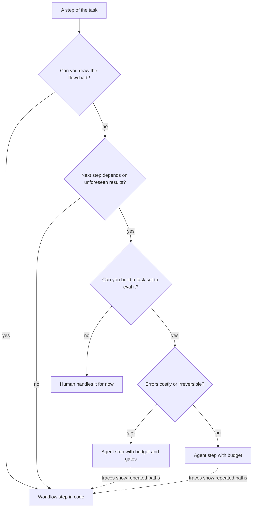

## TL;DR
A workflow runs LLM calls along paths your code defines; an agent lets the model pick each next step.
If you can draw the flowchart, build the workflow: cheaper, bounded, testable. Most production systems
are workflows with small agentic islands where the path is unforeseeable.

## For agent builders
- **Why it matters for agents.** This is the first design decision on every agent project: how much of
  the path the model chooses. Get it wrong one way and you pay agent prices and tails for a flowchart;
  get it wrong the other way and the system cannot handle the cases it was built for.
- **Where it shows up in your stack.** Plain code with structured outputs for workflow steps, routers and
  parallel calls, an agent loop for the agentic island, an orchestrator (Temporal, AWS Step Functions or
  a LangGraph graph) for the skeleton, and traces tagged by route.
- **What you control.** Which steps are code and which are agentic, each island's step budget, tool set
  and gates, the per-run cost cap, and when trace data moves the boundary.
- **What you can skip.** Debating what counts as a "real" agent. The useful question is only who
  chooses the next step, your code or the model.

## Why it exists
- **"Agent" hides the real decision.** The word covers everything from a prompt template to a fully
  autonomous loop. What determines cost, latency, reliability and testing is who chooses the next step:
  your code or the model.
- **Code chooses: predictable.** Every run follows a path you wrote, model calls are fixed, each step is
  testable in isolation, and failures are localized to a step.
- **Model chooses: variable.** Runs vary, call counts have a heavy tail, failures are trajectories
  rather than steps, and the only honest evaluation is end to end.
- **"Make everything an agent" loses in production.** The demo is impressive (one prompt, tools, it
  figures things out), but you get unbounded cost per request, p99 latencies many times the median,
  regressions you cannot localize, and an eval story of "run it and see".
- **"Never use agents" caps you at foreseen cases.** A document pipeline cannot recover on a kind of
  document it has never seen; a support flow cannot investigate an anomaly needing three lookups whose
  order depends on the results.

The decision is rarely binary: a workflow can contain one agentic step, and an agent can call
workflow-shaped tools. The core skill is drawing that boundary, spending autonomy like a budget exactly
where the environment is unpredictable, and nowhere else.

## How it works
### The spectrum of control
A dial for "who decides the next step", from none to the model:

| Point on the dial | Who owns control flow | Use when |
|---|---|---|
| **Augmented model** (one call with retrieval, tools and memory available) | no control-flow decision at all | one call suffices |
| **Prompt chaining** | code: fixed sequence, programmatic checks between (outline, check length, write, check tone) | the task decomposes into fixed stages |
| **Routing** | code, via a classifier call picking a specialized path | inputs fall into distinct categories |
| **Parallelization** | code: same input to several calls, sectioned (each a part) or voted (majority or any-flag) | speed or confidence |
| **Orchestrator-workers** | dynamic decomposition, but the orchestrator's role and workers' tools are fixed | sub-tasks are not known in advance |
| **Evaluator-optimizer** | code loop: produce, critique against criteria, until pass or budget | criteria are statable and iteration measurably helps |
| **Agent** | the model, from tools and environment feedback, including when to stop | the path cannot be foreseen |

### What the choice changes
| Dimension | Workflow | Agent |
|---|---|---|
| **Cost** | roughly fixed per request | a distribution with a long tail |
| **Latency** | predictable; parallel by design | serial by nature |
| **Reliability** | per-step failures, retriable in place | per-trajectory failures, often visible only at the end |
| **Testing** | unit tests with fixed inputs per step | trajectory evals and golden task sets |
| **Debuggability** | same trace shape every time | a unique trace per run |
| **Capability** | foreseen paths only | handles what you did not foresee: the only reason to pay the rest |

- **Do not plan cost from the median run.** The mean sits well above it. Plan totals from the mean
  measured on a realistic sample that includes the tail, and set per-request caps from the p95 or p99.
- **Both compound across steps** (three steps at 99% each succeed about 97% of the time). But a workflow
  has a fixed, short chain with a check after each link, while an agent's chain length is a random
  variable, and its long runs are both the costliest and the least reliable.

### The decision criteria
Ask, in order:
1. **Can I draw the flowchart?** If yes, workflow.
2. **Does the next step depend on information that exists only after earlier steps run, in ways I cannot
   enumerate?** If yes, that part is agentic.
3. **What does an error cost, and is it reversible?** High and irreversible pushes toward workflows, or
   toward agents with gates and budgets.
4. **What volume and latency budget?** High volume with tight latency pushes toward workflows.
5. **Can I evaluate it?** Without a task set with success criteria, you cannot safely run an agent.

### Moving the boundary over time
Logged trajectories tell you where to move it; both moves use path frequencies from traces and the
exception rate.
- **Agent → workflow.** If most runs follow the same two or three tool sequences, that is a flowchart you
  did not know you had: codify those sequences as branches, route matching inputs to them, keep the
  agent for the residue.
- **Workflow → agent.** A growing exception queue or router branch count says that part of the path is
  not predictable; make that step agentic.

### The hybrid, which is the usual answer
- **Workflow skeleton with agentic nodes:** intake and routing by code, an agent for investigation with a
  step budget and a restricted tool set, then fixed validation and delivery by code.
- **Agent with workflow tools:** tools like "run the full reconciliation", so each call is reliable and
  the agent makes only a few high-level choices.
- **Same principle either way:** put the model's judgement where the path is unpredictable and surround
  it with code where it is not.

## Diagram
The decision path for one step of a system: most steps end as workflow code, every agentic exit
carries a budget and restricted tools (plus gates when errors are costly), and traces feed repeated
paths back into code.



## Examples
### Worked scenario: invoice processing three ways (all figures illustrative)
A team automates invoices: extract fields, validate against the purchase-order system, route for payment
or exception handling.

| | Workflow | Agent | Hybrid (shipped) |
|---|---|---|---|
| **Shape** | extraction call with a structured-output schema, validation in code against the PO database, a classification call to pick the route when validation fails | one prompt with tools for OCR, PO lookup, vendor lookup and routing: "process this invoice" | workflow for the 92% that validate cleanly; agent only on the exception route |
| **Calls and tokens** | three model calls or fewer, about 6k tokens | median 9 calls and 30k tokens; p95 25 calls | workflow cost plus agent cost on about 8% |
| **Latency** | roughly two seconds, deterministic shape | several serial calls, variable | fast path unchanged |
| **Failure mode** | a failing unit test on a step | 3% of runs hit the 40-step budget with no decision | agent has a 15-step budget, read-only tools, and its proposed resolution is gated for human approval |
| **Monthly cost** | at 50,000 invoices, predictable within a few percent | five to eight times the workflow's, varying month to month | about 40–65% above the pure workflow, rather than 400–700% |
| **Testing** | unit tests with fixed inputs | task-completion rate on a golden set of 300 invoices; finding a cause means reading trajectories | unit tests for the workflow, a trajectory eval for the exception agent |

- **The agent handles strange cases well:** a scanned invoice with two POs, a vendor renamed since the PO
  was issued. The hybrid keeps that capability where it is needed.
- **Hybrid arithmetic:** roughly 8% of invoices × five to eight times the per-invoice workflow cost, so
  about 40–65% extra.

### Hybrid skeleton: code owns the path, the agent owns the exceptions
Runs with stubs. The agentic island is budgeted, read-only, and its output is a proposal that still goes
through approval.

```python
def process_invoice(inv, extract, po_db, exception_agent, request_approval):
    fields = extract(inv)                            # model call 1: structured output, schema-validated
    problems = po_db.validate(fields)                # code, not a model: fixed and unit-testable
    if not problems:
        return {"route": "pay", "fields": fields}    # the clean majority ends here
    proposal = exception_agent(fields, problems, max_steps=15,
                               tools=["ocr", "po_lookup", "vendor_lookup"])   # read-only agentic island
    if proposal is None:                             # budget exhausted: hand to a person, do not guess
        return {"route": "manual_queue", "fields": fields}
    request_id = request_approval(proposal)          # a person approves before anything is paid or changed
    return {"route": "pending_approval", "proposal": proposal, "request": request_id}
```

### Mining traces to move the boundary
Runs as-is on sample traces. If a few tool sequences cover most runs, those are workflow branches
waiting to be written.

```python
from collections import Counter

traces = ([["po_lookup", "vendor_lookup", "route"]] * 61 + [["ocr", "po_lookup", "route"]] * 22
          + [["po_lookup", "route"]] * 7 + [["ocr", "vendor_lookup", "po_lookup", "ocr", "route"]] * 10)
seqs = Counter(tuple(t) for t in traces)
total = sum(seqs.values())
for seq, n in seqs.most_common(3):
    print(f"{n / total:.0%}  " + " > ".join(seq))
print(f"top 3 sequences cover {sum(n for _, n in seqs.most_common(3)) / total:.0%} of runs")
# 61%  po_lookup > vendor_lookup > route
# 22%  ocr > po_lookup > route
# 10%  ocr > vendor_lookup > po_lookup > ocr > route
# top 3 sequences cover 93% of runs  -> codify the top two, keep the agent for the rest
```

## Production patterns
- **Workflow first, with an explicit exception route.** For any new automation. Build the deterministic
  path, send everything it cannot handle to a named exception queue, and only then decide whether that
  queue deserves an agent. Monitor the exception rate per week; growth is the signal to add autonomy.
- **Per-run caps from measured tails.** For every agentic step. Set a step limit and a token or cost cap
  per run from the p95 or p99 of a realistic sample, and route budget-exhausted runs to a person. Monitor
  the budget-exhaustion rate and p95 steps.
- **Trace-mining review every few weeks.** For agents in production. Group traces by tool sequence, as
  in the snippet above, and codify sequences that cover most runs. Monitor the share of runs on the top
  sequences and the agent's share of total traffic.
- **Two eval suites, kept separate.** Unit tests with fixed inputs for workflow steps in CI; a golden
  task set scored on completion for the agentic step, run before each prompt or model change. Monitor
  both; a green unit suite says nothing about trajectories.
- **Cost attribution by route.** Tag every model call with its route (workflow step or agent) so spend
  per route is visible. Monitor the mean and p95 cost per request for each route, and plan totals from
  the mean.
- **Durable orchestration for the skeleton.** When the workflow spans services or long waits. Run the
  code-defined path in an orchestrator such as Temporal, AWS Step Functions or a LangGraph graph with a
  checkpointer, with the agent as one step. Monitor stuck executions per step.

## Trade-offs
- **Fixed cost vs coverage.** Workflows give fixed cost and testable steps but only foreseen paths; when
  input variety exceeds what routing can classify, the balance flips toward an agentic step.
- **Novelty vs variance.** Agents handle novelty, but p95 cost and latency can be many times the median,
  which flips back toward workflows at high volume or tight latency budgets.
- **Localized autonomy vs two test strategies.** A hybrid confines autonomy to the unpredictable step
  at the cost of two testing strategies and an explicit code-agent interface; worth it once the agent's
  cost tail or the workflow's exception rate is visible.
- **Structured adaptivity vs up-front knowledge.** Orchestrator-worker and evaluator-optimizer capture
  much of an agent's adaptivity with bounded structure, but only if you can state the decomposition or
  the criteria up front.
- **Fast demo vs fast production.** Starting with the agent gets a demo fastest and a production system
  slowest; starting with the workflow is the reverse, and the exception rate tells you when to add
  autonomy.

## Pitfalls
- **An agent for a napkin-sized flowchart.** Symptom: a bill several times what a three-call pipeline
  would cost and regressions nobody can localize.
- **A router with 40 branches and growing.** Symptom: a new branch every week, meaning the path is not
  actually predictable and an agentic step is overdue.
- **Evaluating an agent with step-level unit tests.** Symptom: green tests and a falling completion
  rate, because the failures are in the trajectory, not any step.
- **Budgeting from the typical run** (the median, or a mean from a handful of demo runs). Symptom: a
  monthly bill well above plan, dominated by the few percent of runs that hit the step limit.
- **An agentic node without budget, restricted tools or gates** inside an otherwise fixed workflow.
  Symptom: that one node produces all of the incidents.
- **Never revisiting the boundary.** Symptom: traces show the same three tool sequences in nine runs out
  of ten, paying agent prices for a path that could be code.
- **"Agent" as a product requirement** rather than a design choice. Symptom: autonomy where it should be
  deterministic and vice versa.

## When to use
- **Default to a workflow;** add autonomy only where you cannot enumerate the path: investigation,
  open-ended research, repair after unexpected failures.
- **Keep agentic islands small,** budgeted, tool-restricted and gated, and measure them separately.
- **Measure agentic parts:** completion rate on a golden set, steps and cost per run at the p95, the
  fraction of runs ending at the budget, and the distribution of tool sequences every few weeks to find
  codifiable paths.
- **Measure workflow parts:** per-step accuracy and latency, plus the exception rate.
- **Day to day,** "should this be an agent?" gets the first answer "show me the flowchart". **In
  interviews,** name the workflow patterns, explain what the choice changes for cost, testing and failure
  modes, and describe a hybrid.

## Role lens
- **Engineer:** Implements the workflow patterns as plain code with structured outputs, isolates
  agentic steps behind budgets and tool allowlists, and writes unit tests for steps and trajectory
  evals for agents.
- **Architect:** Draws the boundary between deterministic and autonomous parts, sets cost and latency
  caps at the p95 (with totals planned from the measured mean), and decides which exception paths
  justify an agent at all.
- **FDE:** Translates a customer's process into a flowchart first, identifies the genuinely
  unpredictable steps, and sets expectations on cost variance and evaluation before promising autonomy.

## Check yourself
**Q:** A product manager asks for "an agent that handles all customer support tickets end to end". How
do you turn that request into an architecture, and what would you measure to justify each part?
**A:** Start with the flowchart. Intake, language detection, category classification, retrieval of the
relevant policy and account data, drafting, and sending are predictable and become a workflow: routing
plus prompt chaining with structured outputs, unit-tested per step, with fixed cost and latency. The
unpredictable part is investigation when the account state is anomalous or the ticket does not fit a
category; that becomes an agentic step with read-only tools, a step budget, and any consequential
action (refund, account change, reply committing to something) behind an approval gate. Measure the
workflow with per-step accuracy and latency and the agent with task-completion rate on a golden ticket
set, p95 steps and cost, and budget-exhaustion rate. Justify the agent by the exception rate the
workflow cannot handle, and widen autonomy only as those metrics and human agreement data allow.

## Interview questions
### What is the difference between a workflow and an agent?
- **Who chooses the next step:** in a workflow your code defines the path and the model fills in steps;
  in an agent the model picks each next action from what it observes, including when to stop.
- **Why it matters:** that one choice decides whether cost, latency and failure modes are fixed and
  per-step, or distributions with tails that need trajectory-level evaluation.

### Name the main workflow patterns and when you would use each.
- **Prompt chaining** for fixed stages with checks between; **routing** for distinct input categories;
  **parallelization** (sectioned or voted) for speed or confidence.
- **Orchestrator-workers** when sub-tasks are not known in advance but roles and tools are;
  **evaluator-optimizer** when criteria are statable and iteration measurably improves output.

### Your agent's monthly bill came in at three times plan. How do you investigate?
- **Look at the distribution, not the median:** the plan was probably built from typical runs, while a
  few percent of runs ran to the step limit and dominate spend.
- **Attribute cost by route and step count** and inspect the longest traces for loops or repeated
  sequences.
- **Fix:** per-run caps from the p95, budget-exhausted runs to a person, and codify frequent sequences
  as workflow branches.

### When would you not use an agent even though the task is hard?
- **When you cannot evaluate it:** without a golden task set and success criteria you cannot tell if it
  works or regresses.
- **When errors are irreversible** and you cannot gate the consequential actions.
- **At high volume with tight latency,** where an agent's serial, variable loop breaks the budget; prefer
  routing plus a human queue for the hard residue.

### How do you decide where to put the agentic step in a hybrid?
- **Find the step whose next action depends on results you cannot enumerate,** usually investigation or
  exception handling; everything around it stays code.
- **Bound it:** a step budget, read-only or restricted tools, gated outputs.
- **Revisit with data:** exception rate on the workflow side, path frequencies on the agent side.

## Quiz
### Q: What is the single question that most determines whether to build a workflow or an agent?
- [ ] Whether the model supports tool calling
- [x] Whether the sequence of steps can be defined in advance or depends on observations that only exist after earlier steps run
- [ ] Whether the task involves more than one model call
- [ ] Whether a framework is available
> Workflows are code-defined paths; agents let the model choose the path from feedback. If you can draw
> the flowchart, the predictable, cheaper, testable workflow wins; unforeseeable paths are the only
> reason to pay for autonomy.

### Q: Why is the cost of a typical (median) agent run a poor basis for an agent's budget?
- [ ] Because token prices change over time
- [x] Because agent run length has a heavy tail, so the mean sits well above the median and a small fraction of runs that hit the step budget can dominate total cost
- [ ] Because the median ignores the cost of the system prompt
- [ ] Because workflows always cost more than agents
> Model-chosen paths vary in length; most runs are short and a few are very long. Plan totals from a
> mean measured on enough runs to include the tail, and cap individual runs at the p95 or p99. Fixed-path
> workflows have little variance, which is one of their main advantages.

### Q: Which is the best description of a well-designed hybrid?
- [ ] An agent that occasionally calls a classifier
- [ ] A workflow in which every step is an agent
- [x] A code-defined workflow for the predictable path, with a budgeted, tool-restricted, gated agentic step only where the next action cannot be foreseen
- [ ] Two agents that check each other's work
> Autonomy is spent where the environment is unpredictable and nowhere else. Surrounding a small
> agentic island with deterministic code keeps cost bounded and lets each part be tested appropriately.

## Use cases & projects
### Use cases
- **Invoice and document processing.** A workflow handles the clean majority and an exception agent with
  read-only tools and approval handles the strange cases.
- **Customer support automation.** Intake, routing, retrieval and drafting are a workflow, while
  investigating anomalous accounts is a budgeted agentic step.
- **Scoping a customer's "build us an agent" request.** Drawing the flowchart first shows which steps
  actually need a model choosing the path.
- **Cutting an existing agent's cost.** Mining traces for repeated tool sequences turns the common paths
  into workflow branches and keeps the agent for the residue.

### Mini project
**Same task as workflow, agent and hybrid (2-3 hours).**
- **Goal:** measure what autonomy costs and buys on one task.
- **Steps:** create 50 synthetic invoices, 10 of them messy (two POs, renamed vendor); build a three-call
  workflow, a tool-calling agent with a 15-step budget, and the hybrid skeleton from the examples; run
  all three and log calls, tokens, latency and correct routes; run the trace-mining snippet on the
  agent's tool sequences.
- **Done when:** a table compares completion, mean and p95 cost and latency for the three designs, and
  you can name which agent sequences you would codify next.
