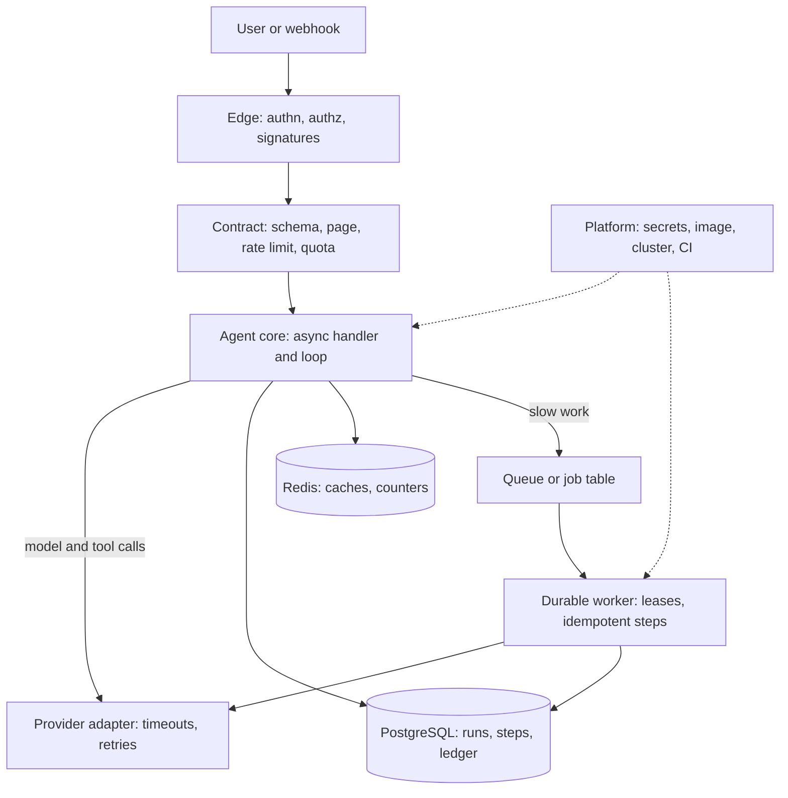

## Overview
This module covers the backend engineering underneath every AI product and every agent. It decides
whether a model call becomes a dependable feature or a demo that falls over at the first retry,
deploy or tenant.

For an agent builder, an agent is a long loop of model calls, tool calls and state writes. Each step
crosses an API, a database, a queue or a trust boundary, so these fundamentals are the shell every
agent runs inside.

What the module gives you, in the order the ideas build:
- **The stack.** Python and FastAPI at the core, Node.js with TypeScript at the product edge, and the HTTP contracts that join them.
- **API design from the provider's side.** REST and GraphQL, versioning and backward compatibility, pagination, rate limits and quotas.
- **API use from the consumer's side.** Integrating third-party APIs, model SDKs and signed webhooks.
- **The data layer.** Schema design, SQL and query plans, PostgreSQL transactions and isolation, and when NoSQL stores or Redis belong beside the relational system of record.
- **Work beyond the request.** Message queues and durable background workers, both of which rely on idempotency.
- **Identity.** Authentication, OAuth 2.0 and OIDC, RBAC and secrets management.
- **Packaging and delivery.** Docker images, Kubernetes, and CI/CD pipelines that also gate prompts and models.

Core for agents (you use them directly in every agent backend): python, fastapi, node-js-typescript,
rest-graphql-api-design, api-and-sdk-integration, pagination-rate-limits-api-quotas, database-design,
sql, postgresql-transactions-and-isolation-levels, redis, background-jobs-durable-workers, webhooks,
authentication-vs-authorization, oauth-2-0-oidc, rbac, secrets-management and ci-cd.

Useful background (you meet it when operating agents): api-versioning-and-backward-compatibility,
message-queues, nosql, docker and kubernetes.

What you can build afterwards:
- A multi-tenant AI or agent service that survives retries, crashes, bursts and deploys, designed, built, secured and shipped by you.
- Tool APIs an agent can call safely: typed, paginated, rate-limited, idempotent and authorized as the user.
- Durable agent runs that resume after a crash and never repeat a side-effecting tool call.
- Defensible answers for each choice in a design review or interview.

It matters most for AI Engineers who own production agent services, and for FDEs who plug those
services into a customer's identity provider, data and infrastructure.

## Why it matters
- **Engineer:** You keep the agent's request path fully async, wrap every model and tool call in explicit timeouts, retries and idempotency keys, claim agent-run jobs with `SKIP LOCKED` and leases, and put an authorization check scoped to the tenant at the top of every mutating handler and tool.
- **Architect:** You choose the contract for agent tools and runs (REST with OpenAPI or GraphQL), the system of record versus caches and specialised stores for agent state, queue versus job table, the token and role model that bounds what agents may do, and the deploy target, knowing which failure mode each choice prevents and what it costs to operate.
- **FDE:** You connect the agent product to a customer's SSO through OIDC, map their identity-provider groups to roles that gate tools, verify the webhooks that trigger runs, respect their API quotas, keep their credentials in a secrets manager, and ship into the Kubernetes cluster and CI rules they already run.

## Mental model
Picture one agent request travelling through a set of trust and time boundaries. Most backend bugs
are a boundary that someone assumed was not there.

| Boundary | What happens there | Lessons |
|---|---|---|
| Edge (trust) | Authentication turns a credential into a principal, authorization checks that principal against this action on this resource, signatures prove inbound webhooks are genuine | authentication-vs-authorization, oauth-2-0-oidc, rbac, webhooks |
| Contract | The API bounds what crosses: a versioned schema, a bounded page, a rate limit and a quota | rest-graphql-api-design, api-versioning, pagination-rate-limits-api-quotas |
| Core | The handler waits cheaply on a model and tools, through an adapter with timeouts and retries | python, fastapi, node-js-typescript, api-and-sdk-integration |
| State | Facts that must stay true live in PostgreSQL behind constraints and short transactions, rebuildable fast state in Redis | database-design, sql, postgresql-transactions, nosql, redis |
| Time | Anything slower than the caller can wait for moves into a queue or a durable job, where at-least-once delivery makes idempotency mandatory | message-queues, background-jobs-durable-workers |
| Platform | Secrets arrive through workload identity, code ships as one immutable image, Kubernetes reconciles desired state, and CI turns every change into evidence | secrets-management, docker, kubernetes, ci-cd |

The diagram shows where each lesson sits around an agent run: the edge and contract decide what gets
in, the core and worker run the loop, the stores keep its state, and the platform ships and secures
all of it.

## Suggested order
1. python — the language of the AI core; asyncio and the GIL explain how every later service waits on models.
2. fastapi — the HTTP layer built on that async model, where Pydantic contracts and dependency injection live.
3. node-js-typescript — the product-edge runtime and where the boundary with Python sits, before designing the contract between them.
4. rest-graphql-api-design — resources, status codes, idempotency and the long-running-job pattern that every later API topic refines; every agent tool is an operation.
5. api-and-sdk-integration — the consumer side of APIs: timeouts, retries, error taxonomy and idempotency around vendor and model SDKs.
6. pagination-rate-limits-api-quotas — the three bounds every API needs, designed as a provider and handled as a consumer; tokens per minute usually binds first for agents.
7. database-design — the schema, keys, constraints and indexes for runs, steps and tool calls that outlive every version of the code.
8. sql — set-based queries and reading `EXPLAIN` plans against the schema you just designed.
9. postgresql-transactions-and-isolation-levels — what concurrent writers see, and how locks and SERIALIZABLE retries prevent lost updates on agent budgets.
10. redis — the fast, shared, short-lived state beside PostgreSQL: caches, rate-limit counters, locks and sessions.
11. background-jobs-durable-workers — job tables, leases and idempotent job bodies, built from transactions, so long agent runs survive deploys and crashes.
12. webhook-signature-verification-and-replay-protection — HMAC verification, replay windows and ack-then-queue for the events that start agent runs, which depend on idempotency and workers.
13. authentication-vs-authorization — the principal versus the permission check, and why 401 differs from 403.
14. oauth-2-0-oidc — delegated access and federated login, building on the authentication model, so agents hold narrow tokens per user per tool.
15. rbac — roles and scoped permissions that bound what users and the agents acting for them may do.
16. secrets-management — keeping API keys, signing keys and OAuth client secrets out of code, images, logs and prompts.
17. docker — packaging the service as one immutable image, which is the unit the remaining topics deploy.
18. ci-cd — build once, promote many: the pipeline that tests, scans, evaluates and ships everything above, including the eval gate on prompts and models.
19. api-versioning-and-backward-compatibility — how a published contract (APIs, tool schemas, pinned models) changes without breaking clients you cannot redeploy.
20. message-queues — durable buffers between producers and consumers, at-least-once delivery and the choice of broker, extending the job table you already built.
21. nosql — when access-pattern-first key design beats the relational default for session state, judged against the SQL foundation.
22. kubernetes — reconciling those images across a fleet with probes, resource requests and graceful termination for long agent runs.

## Capstone
### Brief
This is the module's major project, a multi-day build. The use case: a team needs an agent that turns
uploaded documents into briefs for many customer tenants. It must survive retries, crashes, bursts and
deploys, and never act beyond the user's permissions.

Build and ship "DocBrief", a multi-tenant agent service that summarises uploaded documents with an
LLM.
- **API.** Write the core in FastAPI on PostgreSQL. Expose a REST API, versioned under `/v1` and described by OpenAPI. `POST /v1/documents` returns `202` with a job id and accepts an `Idempotency-Key` header, and `GET /v1/jobs/{id}` reports status. List endpoints use cursor pagination.
- **Schema.** Design it with tenant-scoped foreign keys and indexes justified by `EXPLAIN ANALYZE`.
- **Agent worker.** Summaries run in a durable worker that claims jobs with `SKIP LOCKED` and a lease. It calls the model provider through an adapter with explicit timeouts, bounded retries and a client-side token bucket, and writes results idempotently.
- **Limits.** Per-tenant rate limits and a monthly token quota live in Redis; the authoritative usage ledger stays in PostgreSQL.
- **Webhook.** A billing provider notifies plan changes by webhook: verify the HMAC over the raw body, reject stale timestamps, deduplicate by event id and process the event in the worker.
- **Identity.** Users log in through OIDC against a local identity provider (Keycloak or a dev tenant). Tenant `admin`, `member` and `viewer` roles gate every endpoint. Each provider key comes from a secrets manager, never from the image or the repository.
- **Delivery.** Package the API and the worker as Docker images, deploy them to a local Kubernetes cluster (kind or k3d) with probes and graceful shutdown, and drive everything from a CI pipeline.

### Deliverables
- A repository with the FastAPI service, the agent worker, migrations and a schema diagram, plus an OpenAPI document that CI checks for breaking changes against the previous release.
- A design note covering the job-state machine, the idempotency strategy for the API, worker and webhook, the isolation level or lock chosen for the quota decrement, and why Redis holds counters while PostgreSQL holds the ledger.
- A test suite with integration tests for concurrent idempotent submits, a worker killed mid-job, a replayed webhook, a tampered signature, a cross-tenant read attempt, and a tenant pushed over its rate limit and quota.
- Dockerfiles for the API and the worker, plus Kubernetes manifests (or a Helm chart) with readiness and liveness probes, resource requests, a PodDisruptionBudget and a termination grace period longer than the longest model call.
- A CI workflow that lints, tests, builds one image per commit, scans it, runs the OpenAPI compatibility check and deploys that same image digest to the cluster, authenticating without a stored long-lived cloud key.
- A secrets runbook showing where each secret lives, which workload identity can read it, and a timed end-to-end rotation of the model-provider key with no failed requests.

### Rubric
- Submitting the same document 50 times concurrently with one `Idempotency-Key` creates exactly one job and one model call, and every response returns the same job id.
- Killing a worker pod mid-summary leaves no job stuck: the lease expires, another worker finishes the job, and exactly one summary row exists for it.
- A webhook with a modified body or a timestamp outside the window gets `401` and changes no state; replaying a valid event changes nothing, and logs show it as a duplicate.
- A `viewer` attempting a write gets `403`, an unauthenticated call gets `401`, and a valid token for tenant A requesting tenant B's document gets `404` with no data in the body.
- Sustained traffic above a tenant's limit returns `429` with `Retry-After` and rate-limit headers, other tenants' p99 latency stays flat, and the quota never goes negative under concurrent requests.
- A rolling deploy during a load test drops zero requests, and `git grep` together with an image-layer scan finds no secret in the repository or any published image.
