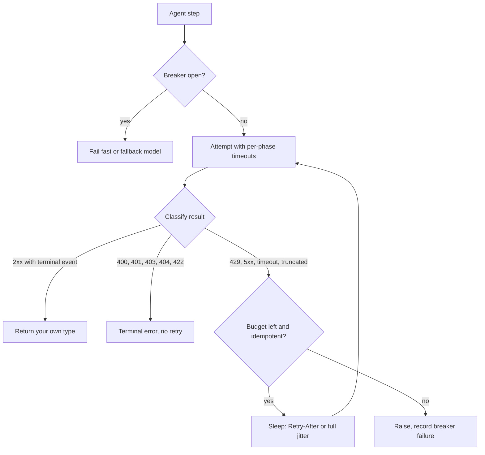

## TL;DR
An agent is mostly calls to APIs you do not control: the model provider and every tool. Use the SDK,
but own a thin adapter with explicit timeouts, one retry policy, idempotency, an error taxonomy and
observability, because SDK defaults ignore your run budget.

## For agent builders
- **Why it matters for agents.** One agent run makes many model calls and tool calls in sequence, so
  per-call failure modes compound: a hung tool stalls the run, a retried side effect acts twice, and
  retries in two layers multiply cost. The adapter turns each failure into a clear signal the loop or
  the model can act on.
- **Where it shows up in your stack.** The OpenAI and Anthropic SDK clients (`timeout`, `max_retries`),
  httpx clients behind each tool, retry helpers such as tenacity, the agent framework's own retry
  settings, and tracing that records each call's vendor request id and token usage.
- **What you control.** A run deadline split into per-step budgets, which layer retries, which tool
  errors go back to the model versus stop the run, idempotency keys derived from run id and step, and a
  breaker with a fallback model.
- **What you can skip.** Writing your own HTTP client or SSE parser. Know the timeout phases, the error
  classes and the `a·t + S` arithmetic.

## Lab
### Task
Turn a naive provider call into an adapter an agent loop can trust. The starter retries every error
including 400s, mints a new idempotency key on each attempt, ignores `Retry-After` and has no total
deadline, so a hung provider holds the step for as long as it likes.

You will add the error taxonomy, one retry policy inside one deadline, and the mapping from failures to
tool results. Time box: 60-90 minutes.
- **Prerequisites:** this lesson's How it works (error classes, timeouts, retries and budgets), and the
  Python lesson's lab for asyncio basics.
- **Setup:** Python 3.12 (for `asyncio.timeout_at`) with `pip install httpx pytest` (checked on httpx
  0.28, pytest 9.1). The provider is a local `httpx.MockTransport` fake: no network, no API key. Save
  the starter as `lab_adapter.py` and the tests as `test_lab_adapter.py`.
- **Done:** `python lab_adapter.py` prints the expected output and `pytest -q` passes.

### Starter code
```python
"""Lab: a vendor adapter an agent can trust (checked on Python 3.12, httpx 0.28)."""
import asyncio, random, time, uuid
import httpx


class RetryableError(Exception):
    def __init__(self, msg: str, retry_after: float | None = None):
        super().__init__(msg)
        self.retry_after = retry_after


class TerminalError(Exception): ...
class StopRun(Exception): ...                      # credentials or policy: a human must act


def classify(r: httpx.Response) -> None:
    """LAB 1: return on status < 400. Raise RetryableError for 429 and 5xx, carrying the
    Retry-After seconds when the header is a number. Raise TerminalError("HTTP <code>: <body[:200]>")
    for every other 4xx."""
    r.raise_for_status()                           # BUG: one exception type for every failure


async def complete(client: httpx.AsyncClient, payload: dict, idem_key: str,
                   attempts: int = 3, budget_s: float = 5.0, base_s: float = 0.05) -> dict:
    """LAB 2: retry only RetryableError, httpx.TimeoutException and httpx.TransportError.
    Sleep the Retry-After hint, else full jitter random.uniform(0, min(1.0, base_s * 2**n)).
    Send the SAME Idempotency-Key on every attempt. If the next sleep would pass the deadline,
    re-raise instead of sleeping. Raise TimeoutError once budget_s has elapsed in total."""
    last: Exception | None = None
    for n in range(attempts):
        try:
            r = await client.post("/v1/complete", json=payload,
                                  headers={"Idempotency-Key": str(uuid.uuid4())})  # BUG: new key each try
            classify(r)
            return r.json()
        except Exception as e:                     # BUG: retries 4xx too, no backoff, no deadline
            last = e
    raise last


async def run_tool(client: httpx.AsyncClient, args: dict, run_id: str, step: int,
                   budget_s: float = 5.0) -> dict:
    """LAB 3: decide what the model sees. Success -> {"ok": body}. 401/403 -> raise StopRun(msg).
    Any other TerminalError -> {"error": msg}. Retries exhausted or TimeoutError ->
    {"error": "lookup unavailable; try another approach"}."""
    return {"ok": await complete(client, args, idem_key=f"{run_id}:{step}", budget_s=budget_s)}


# ---- a scripted fake provider: no network, no API key ---------------------------------------
def fake_provider(script: list) -> tuple[httpx.AsyncClient, list[str]]:
    """Each item is an httpx.Response to return, or a number of seconds to hang."""
    keys: list[str] = []

    async def handler(request: httpx.Request) -> httpx.Response:
        keys.append(request.headers.get("idempotency-key", ""))
        item = script[min(len(keys), len(script)) - 1]
        if isinstance(item, (int, float)):
            await asyncio.sleep(item)              # a provider that accepted the call and went quiet
            return httpx.Response(200, json={"text": "too late"})
        return item

    client = httpx.AsyncClient(transport=httpx.MockTransport(handler), base_url="https://llm.test")
    return client, keys


OK = httpx.Response(200, json={"text": "Refunds take 5 days."})
SCENARIOS = {
    "flaky 503, 503, 200": ([httpx.Response(503), httpx.Response(503), OK], 5.0),
    "bad request 422": ([httpx.Response(422, json={"detail": "max_tokens must be <= 4096"})], 5.0),
    "auth 401": ([httpx.Response(401, text="invalid key")], 5.0),
    "rate limited, Retry-After 30": ([httpx.Response(429, headers={"retry-after": "30"})], 5.0),
    "hung upstream": ([3], 1.0),
}


async def main() -> None:
    for name, (script, budget) in SCENARIOS.items():
        client, keys = fake_provider(script)
        start = time.perf_counter()
        try:
            out = await run_tool(client, {"prompt": "refund policy?"}, "run_7", 3, budget_s=budget)
        except StopRun as e:
            out = f"StopRun: {e}"
        except Exception as e:
            out = f"raised {type(e).__name__}"
        print(f"{name} -> {out} | attempts={len(keys)} keys={len(set(keys))} "
              f"t={time.perf_counter() - start:.1f}s")
        await client.aclose()


if __name__ == "__main__":
    asyncio.run(main())
```

As given, the 422, 401 and 429 cases each print `raised HTTPStatusError | attempts=3 keys=3`, the flaky
case succeeds with `keys=3` (three different keys for one logical call), and the hung upstream returns
`too late` after `t=3.0s` despite its 1-second budget.

### Expected output
```
flaky 503, 503, 200 -> {'ok': {'text': 'Refunds take 5 days.'}} | attempts=3 keys=1 t=0.0s
bad request 422 -> {'error': 'HTTP 422: {"detail":"max_tokens must be <= 4096"}'} | attempts=1 keys=1 t=0.0s
auth 401 -> StopRun: HTTP 401: invalid key | attempts=1 keys=1 t=0.0s
rate limited, Retry-After 30 -> {'error': 'lookup unavailable; try another approach'} | attempts=1 keys=1 t=0.0s
hung upstream -> {'error': 'lookup unavailable; try another approach'} | attempts=1 keys=1 t=1.0s
```

The flaky line prints `t=0.0s` or `t=0.1s` from run to run: its two jittered sleeps are at most 0.05 s
and 0.1 s. Every other field must match exactly.

### Tests
```python
import asyncio, time
import httpx
import pytest
import lab_adapter as lab

R = httpx.Response
OK = R(200, json={"text": "ok"})


def run(script, budget=5.0):
    async def go():
        client, keys = lab.fake_provider(script)
        start = time.perf_counter()
        try:
            out = await lab.run_tool(client, {"prompt": "p"}, "run_1", 2, budget_s=budget)
        finally:
            await client.aclose()
        return out, keys, time.perf_counter() - start
    return asyncio.run(go())


def test_classify_splits_retryable_from_terminal():
    with pytest.raises(lab.RetryableError) as e:
        lab.classify(R(429, headers={"retry-after": "7"}))
    assert e.value.retry_after == 7.0
    with pytest.raises(lab.RetryableError):
        lab.classify(R(503))
    with pytest.raises(lab.TerminalError, match="HTTP 422: bad field"):
        lab.classify(R(422, text="bad field"))


def test_transient_failures_retry_with_one_idempotency_key():
    out, keys, _ = run([R(503), R(502), OK])
    assert out == {"ok": {"text": "ok"}}
    assert len(keys) == 3 and set(keys) == {"run_1:2"}


def test_terminal_errors_are_not_retried_and_reach_the_model():
    out, keys, _ = run([R(422, text="max_tokens must be <= 4096")])
    assert out == {"error": "HTTP 422: max_tokens must be <= 4096"} and len(keys) == 1


def test_auth_errors_stop_the_run():
    with pytest.raises(lab.StopRun, match="HTTP 401"):
        run([R(401, text="invalid key")])


def test_retry_after_past_the_deadline_fails_fast():
    out, keys, elapsed = run([R(429, headers={"retry-after": "30"})], budget=2.0)
    assert out == {"error": "lookup unavailable; try another approach"}
    assert len(keys) == 1 and elapsed < 0.5


def test_total_deadline_bounds_a_hung_provider():
    out, keys, elapsed = run([3], budget=1.0)
    assert out == {"error": "lookup unavailable; try another approach"}
    assert 0.9 < elapsed < 1.5, f"took {elapsed:.2f} s; the 1 s budget must cap it"
```

On the starter all six fail: `raise_for_status` refuses a bare response (`RuntimeError`, so nothing is
classified), the flaky call sends three different keys, the 422, 401 and 429 cases surface as
`httpx.HTTPStatusError` after three attempts, and the hung provider answers after 3 s.

### Failure scenarios
- **Inject: keep `except Exception` in `complete`.** Observe: the 422 test shows 3 attempts; in
  production every bad tool argument costs three calls before the model sees the error. Debug: log
  attempt count with status per call and alert when 4xx responses have attempts above 1.
- **Inject: build the key with `uuid4()` inside the loop.** Observe: `keys=3` for one logical call, so a
  provider or payment API that timed out after acting runs it again. Debug: group upstream logs by
  idempotency key and run id plus step; one step should map to one key.
- **Inject: sleep the `Retry-After` hint without checking the deadline.** Observe: the 429 test takes
  2.0 s and ends in `TimeoutError` instead of failing at once. Debug: log the chosen delay next to the
  remaining budget; a delay larger than the budget should never be slept.
- **Inject: return 401 as `{"error": ...}`.** Observe: the auth test fails; in a live run the model
  retries with invented credentials or loops. Debug: count tool results by status class per run, and
  page on any 401 or 403 reaching the model.

### Submission
- **Code:** `lab_adapter.py` with LAB 1-3 done, retries in exactly this layer and nowhere else.
- **Test run:** `pytest -q` showing 6 passed, plus the script output matching Expected output.
- **A call log:** one line per attempt for the flaky scenario with status, attempt number, key and
  elapsed time, as you would ship it to tracing.
- **A short note (3-5 sentences):** how you would set the real SDK client (`max_retries=0`, explicit
  `timeout`) so its retries do not multiply yours, using the `a·t + S` arithmetic.
- **Evaluation:** tests pass, worst-case latency is bounded by the budget, and no 4xx is retried.

## Why it exists
- **Every remote system misbehaves on schedule.** A model provider, vector database, CRM or payment
  processor returns 429 when you are busiest, 503 during its deploys, a half-finished stream when a load
  balancer recycles, and a slightly different JSON shape after a release you did not read about.
- **The naive version is `requests.post(url, json=payload)` everywhere.** No timeout (the `requests`
  library applies none by default), so a hung provider pins a worker forever; no retry, so a transient
  503 reaches users; raw exceptions, so callers cannot tell "retry later" from "your request is invalid".
- **Scattered keys and silent incidents.** The API key is read in twelve places, so rotation is a treasure
  hunt. The signature incident: every worker blocked on one vendor while the dashboard shows zero errors.
- **"The SDK handles it" is half true.** Official SDKs retry 429 and 5xx with backoff, parse streams and
  type responses, but their defaults are generic. Retries silently multiply latency in a slow outage, and
  cost whenever an attempt the provider already processed is abandoned and resent.
- **Defaults and upgrades bite.** Default timeouts in the major Python LLM SDKs are on the order of ten
  minutes at the time of writing, so one stuck call holds a request for minutes, and an SDK upgrade can
  change the API version it speaks. A layer must own those decisions explicitly.

## How it works
### Raw HTTP versus SDK
| An SDK gives you | An SDK hides |
|---|---|
| auth headers and a base URL | the connection pool |
| typed request and response models | the timeout values |
| retry with exponential backoff on retryable statuses, honouring `Retry-After` | which calls it considers safe to retry |
| SSE parsing into events; auto-pagination iterators | the mapping from HTTP status to exception class |
| matching sync and async clients | |

- **Read the constructor before shipping.** `timeout` and `max_retries` define your worst-case latency
  per model call, and so per agent step.

### The adapter: one module owns the vendor
- **Wrap each external system in one module** that exposes your own types and raises your own exceptions,
  *because* vendor types and errors leak otherwise, and swapping or adding a provider becomes a rewrite.
  In an agent, each tool gets one adapter and the model provider gets one.
- **Classify every failure:**

| Class | Examples | Action | In an agent loop |
|---|---|---|---|
| Retryable | 429, 5xx (most often 502/503/504), connection errors, timeouts, truncated streams | back off and retry | the adapter retries; the model never sees it |
| Terminal | 400/422 (your request is wrong), 401/403 (credentials), 404, content-policy refusals | fail now | 400/422/404 go to the model as a tool error; 401/403 stop the run |
| Ambiguous | a timeout on a non-idempotent call; the request may have completed | retry only with an idempotency key | never let the model "try again" without the key |

### Timeouts
- **Set connect, read and total timeouts separately.**
- **Read timeout is a gap, not a deadline.** In httpx and most clients it is the longest allowed gap
  between received bytes. On a stream it bounds time-to-first-token and every inter-chunk gap.
- **On a non-streaming model call** the server sends nothing until generation finishes, so the read
  timeout effectively bounds generation time.
- **A stream may run for minutes** while each chunk arrives within a second, so the read timeout is a
  per-chunk budget.
- **A total deadline needs a separate wrapper** (`asyncio.timeout` around the call). Tie it to what the
  user-facing request or agent run can afford, not to what the provider allows.

### Retries, idempotency and budgets
- **Backoff with full jitter.** Sleep a uniform random time in `[0, min(cap, base × 2^n)]` and honour
  `Retry-After` when present, *because* synchronized retries from many clients create a thundering herd.
- **Retry only idempotent operations or ones carrying an idempotency key.** An LLM completion is usually
  safe to re-run (it costs money, not correctness); a tool call that sends an email is not.
- **Bound retries** per request and per time window so an outage does not triple your traffic.

```
worst-case latency = a·t + S        a = attempts, t = per-attempt timeout, S = total backoff sleep
outage load on the vendor           up to a × normal traffic
```

- **The arithmetic is `a·t + S`**, and layering multiplies it: 3 adapter attempts around an SDK making 3
  per call (its default of 2 retries) turn one user request into 9 upstream calls. An agent framework
  that retries failed steps adds a third layer.
- **Retry in exactly one layer** and switch the others off (`max_retries=0` on the SDK client).

### Streams fail differently
1. **A stream can return `200`, send half the answer and stop**: a load balancer recycled the connection,
   or the provider hit an internal error mid-generation.
2. **The status already said success**, so the only signal is the missing terminal event: a final
   `finish_reason`, a stop event or a `[DONE]` sentinel, depending on the provider.
3. **Treat a stream that ends without its terminal event as a retryable failure**, not a short answer;
   a truncated tool-call stream yields half-written JSON arguments.
4. **Retrying a stream affects the user.** Tokens already shown cannot be unshown: restart and replace the
   partial text, or surface the truncation and let the user retry.

### Circuit breakers, fallbacks and connection reuse
- **Circuit breaker.** After N consecutive failures, stop calling the vendor for a cool-down and fail
  fast or route to a fallback model; this protects your latency and the vendor's recovery.
- **One client per process**, so TLS handshakes and connections are reused; a client per request (or per
  tool call) is a common source of socket exhaustion.

### Configuration, observability and tests
- **Keys** come from a secret store or environment, never source.
- **Log every call:** the vendor's request id, status, latency, attempt count and token usage, with a
  correlation id; in an agent, the run id and step number are that correlation.
- **Pin** SDK versions and any API-version header.
- **Test** happy paths with recorded responses and failure paths with injected 429/timeout/truncation;
  run a small contract test against the live sandbox on a schedule.

## Diagram
Each attempt is classified; only retryable failures loop, and only while the step's budget allows.



## Examples
### A minimal adapter with a total deadline
Explicit per-phase timeouts, a shared client, an error taxonomy, bounded retries with jitter that honour
`Retry-After`, an idempotency key so a retried `POST` cannot double-execute, and one total deadline the
retries must fit inside.

- **Without the deadline:** three attempts that each hit the 60-second read timeout, plus backoff sleeps,
  can hold the caller for over three minutes.
- **With a 20-second budget:** the first attempt times out at the deadline, and the caller gets a
  `TimeoutError` at 20 seconds that it can turn into a fallback or a clear error.
- **A `Retry-After: 30` hint on a 429** cannot fit in the remaining budget, so the adapter fails
  immediately instead of sleeping past the point where the user has given up.

```python
import asyncio, os, random
import httpx

class RetryableError(Exception):
    def __init__(self, msg: str, retry_after: float | None = None):
        super().__init__(msg); self.retry_after = retry_after

class TerminalError(Exception): ...

TIMEOUT = httpx.Timeout(connect=5.0, read=60.0, write=10.0, pool=5.0)   # explicit, per phase
client = httpx.AsyncClient(base_url="https://api.example-llm.com", timeout=TIMEOUT,
                           headers={"Authorization": "Bearer " + os.environ["LLM_API_KEY"]})

def classify(r: httpx.Response) -> None:
    if r.status_code < 400:
        return
    if r.status_code == 429 or r.status_code >= 500:
        ra = r.headers.get("retry-after")
        raise RetryableError(f"HTTP {r.status_code}", float(ra) if ra and ra.isdigit() else None)
    raise TerminalError(f"HTTP {r.status_code}: {r.text[:200]}")   # 400/401/403/422: retrying won't help

async def complete(payload: dict, idem_key: str, attempts: int = 3, budget_s: float = 20.0) -> dict:
    loop = asyncio.get_running_loop()
    deadline = loop.time() + budget_s                  # total budget across ALL attempts and sleeps
    async with asyncio.timeout_at(deadline):           # Python 3.11+; raises TimeoutError at the deadline
        for n in range(attempts):
            try:
                r = await client.post("/v1/complete", json=payload,
                                      headers={"Idempotency-Key": idem_key})   # safe to retry
                classify(r)
                return r.json()
            except (RetryableError, httpx.TimeoutException, httpx.TransportError) as e:
                hinted = getattr(e, "retry_after", None)
                delay = hinted if hinted else random.uniform(0, min(8.0, 2 ** n))  # full jitter
                if n == attempts - 1 or loop.time() + delay >= deadline:
                    raise                              # retrying cannot finish inside the budget
                await asyncio.sleep(delay)
    raise RuntimeError("unreachable")
```

### Turning adapter errors into tool results
In the agent loop, the tool runner calls the adapter with the step's share of the run budget and an
idempotency key from run id plus step, then decides what the model sees.

```python
import asyncio
import httpx

class StopRun(Exception): ...                         # credentials or policy: a human must act

async def run_tool(tool, args: dict, run_id: str, step: int, run_deadline: float) -> dict:
    loop = asyncio.get_running_loop()
    remaining = run_deadline - loop.time()
    if remaining <= 1.0:
        return {"error": "run budget exhausted; answer with what you have"}
    key = f"{run_id}:{step}:{tool.name}"              # same key if this step is replayed
    try:
        async with asyncio.timeout(min(remaining, tool.max_s)):
            return {"ok": await tool.call(args, idem_key=key)}   # adapter retries inside
    except TimeoutError:
        return {"error": f"{tool.name} timed out; do not repeat the same call"}
    except TerminalError as e:
        msg = str(e)
        if msg.startswith(("HTTP 401", "HTTP 403")):
            raise StopRun(msg)                         # never let the model loop on auth errors
        return {"error": msg[:300]}                    # 400/404/422: the model can fix its arguments
    except (RetryableError, httpx.TransportError) as e:  # adapter exhausted retries (it re-raises
        # the last error, which may be an httpx timeout or connection error, not RetryableError)
        return {"error": f"{tool.name} unavailable ({type(e).__name__}: {e}); try another approach"}
```

### A circuit breaker in front of the adapter
Runnable with the standard library. After `threshold` consecutive failures calls fail fast; after the
cool-down they probe again, and one failed probe re-opens it.

```python
import time

class CircuitBreaker:
    """Open after `threshold` consecutive failures; after `cooldown_s`, let calls probe again."""
    def __init__(self, threshold: int = 5, cooldown_s: float = 30.0):
        self.threshold, self.cooldown_s = threshold, cooldown_s
        self.failures, self.opened_at = 0, None

    def allow(self) -> bool:
        if self.opened_at is None:
            return True                                   # closed: normal traffic
        return time.monotonic() - self.opened_at >= self.cooldown_s   # half-open after cool-down

    def record(self, ok: bool) -> None:
        if ok:
            self.failures, self.opened_at = 0, None       # a success closes the breaker
        else:
            self.failures += 1
            if self.failures >= self.threshold:           # also re-opens on a failed probe
                self.opened_at = time.monotonic()

b = CircuitBreaker(threshold=3, cooldown_s=0.2)
for _ in range(3):
    b.record(False)
print(b.allow())            # False: open, calls fail fast
time.sleep(0.25)
print(b.allow())            # True: half-open, calls may probe again
b.record(False)
print(b.allow())            # False: the probe failed, open again
time.sleep(0.25); b.record(True)
print(b.allow())            # True: closed
```

In the service, check `allow()` before `complete(...)`, call `record(True)` on success and
`record(False)` on retryable failures or `TimeoutError`, and route to a fallback model while it is open.

### Worked scenario: retries in two layers during an outage
A service at 100 user requests per second calls a provider through its SDK (default 2 retries, so 3
attempts) wrapped in an adapter that also makes 3 attempts. The provider starts returning 503.

| Quantity | Two layers retrying, SDK default timeout | Adapter only (`max_retries=0`), 20 s deadline |
|---|---|---|
| Upstream calls per user request | 3 × 3 = 9 | at most 3 |
| Load sent to the struggling provider | ~900 calls/s | up to ~300 calls/s |
| Worst case per request, ten-minute SDK timeout | up to 9 × 10 min of waiting, plus sleeps | capped by the 20 s total deadline |
| What users see | requests hang, then fail | a clear error or fallback within 20 s |

### Worked scenario: a 6-step agent run under a 60-second budget
Each step is one model call plus one tool call; figures are illustrative.

| Design | One slow tool at step 3 | Run outcome |
|---|---|---|
| No per-step budget, tool on library defaults | step 3 waits minutes | user abandons; the run keeps billing |
| Run deadline 60 s, tool capped at 10 s | step 3 returns a timeout tool result at 10 s | the model picks another tool or answers by ~60 s |
| Plus a framework that also retries failed steps | step 3 repeats up to 3 times under one key | one side effect, at most 30 s spent on it |

## Production patterns
- **Budget the whole agent run, then each step.** Set a run deadline, pass the remaining time to every
  model and tool call, and cap each tool with its own maximum. Monitor runs ending on budget exhaustion
  and time per step.
- **Retry in one layer only.** Set `max_retries=0` and an explicit `timeout` on the SDK client, and own
  the policy in the adapter (or the reverse, but never both), and turn off step-level retries in the
  framework if the adapter already retries. Monitor a histogram of attempts per request; the mean sits
  just above 1 when healthy, so alert when it climbs well past that baseline.
- **A total deadline per user request.** Wrap every vendor call in `asyncio.timeout` sized from the
  user-facing budget, and pass the remaining budget down to nested calls. Monitor p99 latency including
  retries and the deadline-exceeded count.
- **Breaker plus fallback model.** Open after N consecutive retryable failures, fail fast or route to a
  secondary provider or smaller model, and probe after a cool-down. Monitor breaker state changes and
  the share of traffic served by the fallback.
- **Log the vendor's request id on every call.** Providers return a request-id response header (named
  differently per provider); log it with your correlation id (run id and step), status, attempts and
  token usage. It is what the vendor's support team asks for during an incident.
- **Fault-injected tests plus a scheduled sandbox contract test.** Mock the transport (for example
  `httpx.MockTransport` or the respx library) to inject 429s, timeouts and truncated streams in CI, and
  run a few live calls against the vendor sandbox on a schedule. Alert when the contract test fails.

## Trade-offs
- **SDK convenience vs control.** An SDK saves weeks of client code and tracks API changes, but chooses
  retry and timeout defaults you must override and couples you to its release cadence; raw HTTP wins
  only for tiny surfaces or unsupported languages.
- **Hidden failures vs amplified outages.** Automatic retries hide transient failures, but each costs
  money and latency and can amplify an outage; it flips when the operation is non-idempotent or the
  budget is tight.
- **Retry in code vs let the model retry.** Code retries are cheap and predictable for transient errors;
  sending errors to the model costs a full model call but lets it fix bad arguments. Use code for
  retryable errors, the model for terminal input errors.
- **Adapter layer vs ceremony.** A thin adapter per vendor adds types and mapping, but makes provider
  swaps, fallbacks and tests cheap; for a single-vendor prototype it can feel like ceremony.
- **Aggressive timeouts vs slow successes.** They protect your latency budget, but turn slow successes
  into failures and create ambiguous outcomes on non-idempotent calls.

## Pitfalls
- **No timeout, or an inherited multi-minute default.** Symptom: worker pools drain during a vendor
  incident while error rates stay at zero. Fix: explicit per-phase timeouts plus a total deadline.
- **Retrying everything, including 400 and 401.** Symptom: the same invalid request hammers the vendor
  four times, with a rate-limit ban on top of the original bug. Fix: retry only the retryable class.
- **Retrying a non-idempotent `POST` after a timeout without an idempotency key.** Symptom: duplicate
  records, double charges or two emails sent, often because the model re-issued the tool call. Fix: send
  an idempotency key, or do not retry.
- **Retrying in two layers** (your wrapper and the SDK, or a gateway and the app). Symptom: vendor-side
  request counts several times your own during an incident. Fix: `max_retries=0` in all but one layer.
- **Treating a stream without its terminal event as complete.** Symptom: answers stop mid-sentence and
  parsers fail on truncated JSON with no error in the logs. Fix: require the terminal event.
- **A new client per request.** Symptom: a TLS handshake on every call and "too many open files" under
  load. Fix: one shared client per process.
- **Parsing vendor error bodies ad hoc in callers.** Symptom: a schema change in the error payload breaks
  twelve call sites at once. Fix: map errors to your own exceptions inside the adapter.

## When to use
- **Scale the adapter to blast radius.** A model provider on the request path gets timeouts, retries,
  idempotency keys, a breaker and metrics; a nightly report API can live with a timeout and a retry.
  Tools with side effects always get idempotency keys.
- **Use the official SDK** when one exists and you have read its timeout and retry settings.
- **Drop to `httpx`** when the SDK lacks a feature, blocks the event loop, or you need exact control over
  streaming.
- **Measure** attempt counts, p99 latency including retries, and vendor request ids in logs.
- **Interviews:** "how do you call a third-party API in production" is standard; walk timeouts, retry
  policy, idempotency, error taxonomy and observability in that order.

## Role lens
- **Engineer:** Builds and tests the adapter: explicit timeouts, retry with jitter, idempotency keys,
  one shared client, and error mapping that callers can branch on.
- **Architect:** Sets the integration standard (which errors retry, the retry budget, breaker
  thresholds, fallback routing) and decides where provider abstraction lives.
- **FDE:** Integrates the AI service with a customer's internal APIs whose SDKs may be absent or
  unreliable, and negotiates sandbox access, rate limits and credentials for them.

## Check yourself
**Q:** Your service calls a model provider through its official SDK with defaults. During a provider
incident, user requests take four minutes to fail and your token spend for the hour jumps well above
normal. Explain what happened and how you would configure the integration differently.
**A:** The SDK retried each failing call (twice by default in the major LLM SDKs) with backoff, and its
long default timeout let each attempt wait minutes, so one user request became several long attempts.
Each retry resent the full prompt, and attempts the provider had partly or fully processed before the
connection died or the client gave up are generally still billed, while users who saw failures retried
on top; that is the cost spike (exactly which failed requests are billed is provider-specific). I would set an explicit total timeout tied to the user-facing
budget, cap retries to one or two with jitter and honour `Retry-After`, add a circuit breaker that
fails fast or routes to a fallback model after consecutive failures, and emit attempt-count and
latency metrics so the behaviour is visible. Idempotency keys would make the remaining retries safe
if the call had side effects.

## Interview questions
### What does the read timeout actually bound on a streaming model call?
- **Definition:** the longest allowed gap between received bytes, not the whole response.
- **On a stream:** it bounds time-to-first-token and each inter-chunk gap, so a healthy stream can run for
  minutes without tripping it.
- **Consequence:** you need a separate total deadline, such as `asyncio.timeout`, sized from the
  user-facing budget or the agent run's remaining time.

### An agent's `send_email` tool call times out. Should the loop retry it, and who decides?
- **It is ambiguous:** the email may already be sent, so a blind retry, or the model re-issuing the call,
  can send two.
- **Decide in code, not in the model:** retry only with an idempotency key derived from run id and step,
  so the email service returns the first outcome.
- **Tell the model the truth:** if retries cannot run, return "timed out, outcome unknown, do not repeat"
  and let a status check or a human resolve it.

### During a vendor incident your agent workers are all busy but error rates are zero. What is happening and how do you fix it?
- **Diagnosis:** calls are hanging, not failing; there is no timeout or a multi-minute default, so
  workers wait instead of erroring.
- **Immediate fix:** explicit connect and read timeouts plus a total deadline, so failures surface fast.
- **Structural fix:** a circuit breaker that fails fast or routes to a fallback, and alerts on in-flight
  calls and latency, not only error rate.

### Which errors should never be retried, and which are ambiguous?
- **Never:** 400/422, 401/403 and 404 are deterministic; a retry repeats the bad request and burns quota.
- **Retry:** 429 (honour `Retry-After`), 502/503/504, connection errors and truncated streams.
- **Ambiguous:** a timeout on a non-idempotent call may have succeeded; retry only with an idempotency key.

### Your adapter makes 3 attempts and the SDK has its default 2 retries. What happens at 100 requests per second during an outage?
- **Multiplication:** 3 × 3 = 9 upstream calls per user request, about 900 calls per second at the
  struggling vendor.
- **Latency:** worst case grows as attempts times timeout plus sleeps in each layer.
- **Fix:** retry in one layer (`max_retries=0` on the SDK), add jitter and a per-request retry budget.

### When would you bypass the official SDK and call the HTTP API directly?
- **Missing features:** a new endpoint or parameter the SDK has not shipped yet.
- **Control:** exact streaming behaviour, a custom transport, or an SDK that blocks the event loop.
- **Cost:** you then own auth, retries, pagination and stream parsing yourself, so keep it behind the
  same adapter interface.

## Quiz
### Q: Which failure should an integration layer not retry automatically?
- [ ] A 503 from the provider's load balancer
- [ ] A connect timeout
- [x] A 422 saying a required field is missing
- [ ] A 429 with a `Retry-After` header
> Retries help only when the next attempt can succeed. A validation error is deterministic, so
> retrying repeats the same bad request, wastes quota and delays the real fix.

### Q: Why add an `Idempotency-Key` header when retrying a `POST` after a timeout?
- [ ] It makes the request faster on the second attempt
- [x] The first attempt may have completed, and the key lets the server return that result instead of executing again
- [ ] It tells the server to skip authentication on retries
- [ ] It disables the server's rate limiter for the retry
> A timeout is ambiguous: the server may have done the work. An idempotency key lets it recognise the
> repeat and return the stored outcome, preventing duplicate side effects.

### Q: What is the main reason to keep one HTTP client per process rather than per request?
- [ ] Per-request clients cannot send custom headers
- [ ] A single client guarantees ordered delivery of requests
- [x] Connection and TLS session reuse, plus one place to configure timeouts and limits
- [ ] Multiple clients would share the same API key incorrectly
> Each new client opens fresh connections and TLS handshakes, which cost latency and sockets. A shared
> client pools connections and centralises the configuration the whole service depends on.

## Use cases & projects
### Use cases
- **Model provider client for an agent service.** One adapter with explicit timeouts, one retry layer,
  a breaker and a fallback model behind every agent step.
- **Side-effecting tools.** Email, ticketing and payment tools carry idempotency keys from run id and
  step, so replayed steps and model re-issues act once.
- **Tool error feedback.** Terminal input errors (400, 404, 422) return to the model as tool results so
  it can fix arguments, while auth errors stop the run.
- **Vendor incident response.** Request ids, attempt counts and breaker state in traces show quickly
  whether the agent, the adapter or the provider is at fault.

### Mini project
**A fault-tolerant tool layer for an agent (2-3 hours).**
- **Goal:** wrap two tools (a read-only lookup and a side-effecting "create ticket") so a flaky backend
  never stalls the run or duplicates a ticket.
- **Steps:** build a fake backend with `httpx.MockTransport` that returns 503, 429 with `Retry-After`,
  422 and slow responses at random; write the adapter and `run_tool` wrapper above; run a 6-step loop
  with a 60-second run deadline and the SDK-style retries switched off.
- **Done when:** a test run with 30% injected failures creates exactly one ticket per step key, no step
  exceeds its cap, 422s reach the model as tool errors, and the trace shows attempts per call.

### Major project
This lesson feeds the module Capstone (see the module guide): DocBrief's worker calls the model
provider through an adapter with explicit timeouts, bounded retries and a client-side token bucket.
