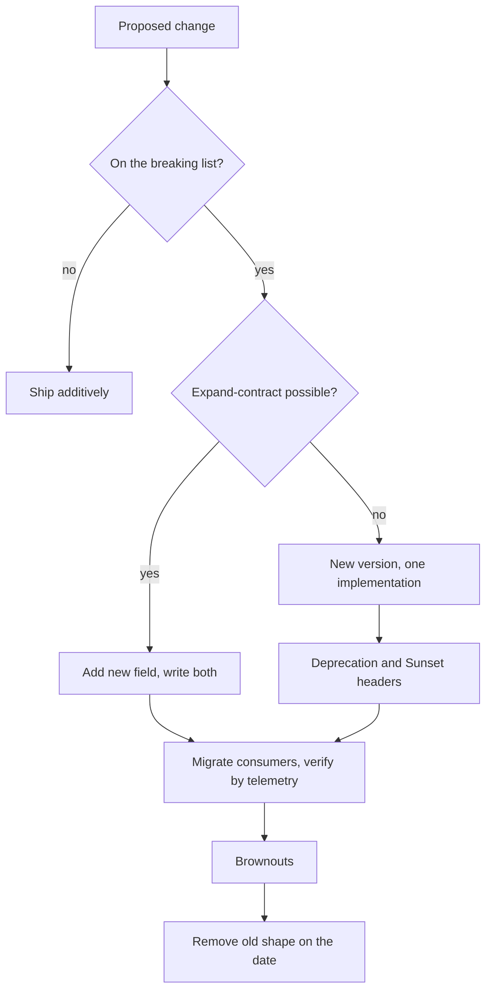

## TL;DR
Once others depend on your API, every change is a negotiation with clients you cannot redeploy. Make
additive changes and tolerant readers the default; version only for rare breaks, with announced
deprecation and sunset. The same applies to models, prompts and tool schemas.

## Why it exists
- **Clients are distributed in time as well as space.** A mobile app users never update, a partner
  integration built by a contractor who left, an SDK pinned in a lockfile, an agent whose system prompt
  describes your tool's arguments. Rename a field and each breaks silently at its own pace, with no
  rollback.
- **Hyrum's law.** With enough users, every observable behaviour of your interface becomes something
  somebody depends on, documented or not.
- **The three naive responses fail.** "Never break anything" freezes bad decisions and bloats the API
  with single-client fields. "Bump to `/v2` whenever we change something" produces version sprawl: each
  version is a fork to maintain, test and secure, and nothing forces clients to migrate.
- **"Be careful" fails too**, the first time a well-meaning engineer makes a required response field
  optional and a strict client starts throwing.
- **The working discipline sits between.** Additive, compatible changes are the normal path so versions
  are rare; an unavoidable break is versioned deliberately, deprecated with dates, measured, and removed
  on schedule. AI services need it twice over, because a model or prompt change can alter outputs for the
  same input, which is also a breaking change from the client's point of view.

## How it works
### What counts as breaking
- **Breaking for clients:** removing or renaming a field or endpoint; changing a field's type or format
  (integer to string, seconds to milliseconds); making an optional request field required; tightening
  validation; changing a default; changing the meaning of a value; changing status codes or the error
  envelope; changing authentication.
- **Usually compatible:** adding an optional request field, adding a response field, adding an
  endpoint, relaxing validation.
- **Contested:** adding an enum value, which breaks clients that switch exhaustively. Document that
  enums are open and clients must handle unknowns.

### Tolerant readers
- **Compatibility is a two-sided contract.** Clients ignore unknown response fields and treat enums as
  open; servers accept missing optional fields and ignore unknown request fields unless the endpoint is
  security-sensitive.
- **Pydantic's default of ignoring extra fields is the tolerant choice.** `extra="forbid"` is stricter
  and turns a client's harmless new field into a 422, so choose it knowingly.
- **Postel's principle, applied with judgement**, *because* total leniency hides bugs.

### Versioning strategies
| Strategy | Example | Gain | Cost |
|---|---|---|---|
| URL path | `/v1/...`, as OpenAI does | visible, routable, easy to test and cache | coarse: the whole API moves together |
| Header | `Accept: application/vnd.acme.v2+json`, or a custom header such as Anthropic's `anthropic-version` date | stable URLs, per-request choice | harder to try in a browser, easy to forget in a proxy |
| Pinned date per account | Stripe: pinned to the version current at the account's first call, overridable per request with `Stripe-Version` | maximum compatibility | a chain of server-side transformations renders new behaviour in old shapes |
| Query parameter | `?version=2` | simple | mixes with filters and cache keys |
| Evolution only | GraphQL: add fields, mark old ones `@deprecated`, remove after usage reaches zero | no versions at all | needs field-level usage telemetry |

- **Keep one implementation and render versions at the edge as representations**, *because* two forked
  code paths drift and the old one stops getting fixes.

### Deprecation lifecycle
1. **Announce** in docs and changelog.
2. **Signal in-band.** On old-version responses emit `Sunset` (RFC 8594, an HTTP date) and a `Link` to
   the migration guide, and mark the route deprecated in OpenAPI.
3. **Add the deprecation header.** RFC 9745 (2025) adds a `Deprecation` header whose value is a
   structured-field date (`@` followed by Unix seconds) and a `deprecation` link relation for the guide.
4. **Measure** requests per version per client, so you know who is left.
5. **Run brownouts**: short planned outages of the old version before removal.
6. **Remove on the announced date.**

### Catching breaks before they ship
Review by eye misses breaks, so make them mechanical with two complementary CI checks.
- **Schema diff (provider side).** Compare the OpenAPI document generated from the branch with the one
  published from `main`; fail on anything in the breaking list (removed field, narrowed type, new
  required input).
- **Consumer-driven contract tests (Pact style).** Each client publishes the requests it sends and the
  fields it reads, and the provider's build replays them. This catches Hyrum's-law dependencies the
  schema never promised, such as a client relying on list order.

### SDKs and client libraries
- **An SDK has its own compatibility surface** on top of the wire API: method names, exception classes,
  default timeouts and retries.
- **Version it with semantic versioning**, so a breaking change to any of those is a major bump even when
  the HTTP API did not change.
- **Decouple the SDK version from the API version it speaks.** Pinning the API version inside each SDK
  release is common, so upgrading the library is not silently also an API migration.

### Data and schema changes: expand and contract
1. **Expand:** add the new field and populate both, so old and new readers both work.
2. **Migrate:** move every consumer to the new field, verified by telemetry rather than by asking.
3. **Contract:** stop writing the old field, then remove it.

- **The order matters** *because* at every point each deployed producer and consumer, old or new, still
  sees a field it understands, which lets the two sides deploy independently.
- **Same pattern** for message schemas and tool arguments.

### AI-specific contracts
- **Model versions retire.** Pin exact snapshot names and track provider deprecation notices.
- **Prompts are contracts.** A revision that changes output format is a contract change for everything
  downstream, so version prompts alongside code.
- **Tool schemas are contracts.** A change can break an agent that learned the old arguments from its
  prompt or few-shot examples.
- **Embeddings are versioned data.** Re-embedding with a new model invalidates an index built with the
  old one.

## Diagram
Most changes take the additive path; only an unavoidable break enters the versioned deprecation
lifecycle, and it leaves only when telemetry says nobody is left.



## Examples
### Two versioned routers over one implementation
The v2 shape renamed `summary` to `text` and added citations, a breaking change. So v1 is kept as a thin
representation with a `Sunset` header and an OpenAPI deprecation flag, not as a forked code path.

```python
from fastapi import APIRouter, FastAPI, Response
from pydantic import BaseModel, ConfigDict

class SummaryV2(BaseModel):             # current shape: renamed field, structured citations
    id: str
    text: str
    citations: list[dict]
    model: str

class SummaryV1(BaseModel):             # frozen shape old clients depend on
    model_config = ConfigDict(extra="ignore")   # Pydantic's default, spelled out: unknown input dropped
    id: str
    summary: str                        # renamed to `text` in v2, hence the shim below

async def summarize(doc_id: str) -> SummaryV2:
    return SummaryV2(id="sum_1", text="...", citations=[{"doc": doc_id, "span": [0, 40]}],
                     model="summarizer-2026-03-01")   # pinned model snapshot is part of the contract

v1, v2 = APIRouter(prefix="/v1"), APIRouter(prefix="/v2")

@v2.post("/summaries", response_model=SummaryV2)
async def create_v2(doc_id: str):
    return await summarize(doc_id)

@v1.post("/summaries", response_model=SummaryV1, deprecated=True)   # flagged in OpenAPI docs
async def create_v1(doc_id: str, response: Response):
    s = await summarize(doc_id)                      # one implementation, two representations
    response.headers["Deprecation"] = "@1767225600"            # RFC 9745: deprecated since 2026-01-01
    response.headers["Sunset"] = "Sat, 31 Oct 2026 00:00:00 GMT"  # RFC 8594: removal date
    response.headers["Link"] = '</docs/migrate-v2>; rel="deprecation"'
    return SummaryV1(id=s.id, summary=s.text)        # render the old shape; drop fields v1 never promised

app = FastAPI()
app.include_router(v1)
app.include_router(v2)
```

### A tolerant reader on the client side
Runnable with the standard library. The client survives a new enum value, a new field and the
`summary` to `text` rename during the expand phase.

```python
from enum import Enum

class Status(str, Enum):
    QUEUED = "queued"
    DONE = "done"
    UNKNOWN = "unknown"

    @classmethod
    def _missing_(cls, value):          # open enum: a value added later maps to UNKNOWN
        return cls.UNKNOWN

def read_job(payload: dict) -> dict:
    return {
        "id": payload["id"],
        "status": Status(payload.get("status", "unknown")),
        "text": payload.get("text") or payload.get("summary"),  # new name first, old as fallback
    }                                    # unknown fields such as "citations" are simply ignored

print(read_job({"id": "j1", "status": "done", "summary": "old shape"}))
print(read_job({"id": "j2", "status": "cancelled", "text": "new shape", "citations": []}))
# {'id': 'j1', 'status': <Status.DONE: 'done'>, 'text': 'old shape'}
# {'id': 'j2', 'status': <Status.UNKNOWN: 'unknown'>, 'text': 'new shape'}
```

### Worked scenario: renaming a field with expand and contract
Rename `summary` to `text` on an endpoint with three integrators. Dates are illustrative.

| Week | Server writes | Readers that work | Gate to move on |
|---|---|---|---|
| 0 (expand) | `summary` and `text` | old and new | deploy is additive, no gate |
| 1-8 (migrate) | both; `Deprecation` and `Sunset` on responses | old and new | per-client telemetry: reads of `summary` |
| 9 (brownout) | `text` only for two one-hour windows | new only | no errors from the remaining clients |
| 10 (contract) | `text` only | new only | announced date reached, usage at zero |

## Production patterns
- **Breaking-change gate in CI.** Generate the OpenAPI document on every build and diff it against the
  published one with a tool such as oasdiff (its `breaking` command), failing the build on removals,
  narrowed types or new required inputs. Track deliberate breaks per release.
- **Consumer contracts before deploy.** With Pact, consumers publish contracts to a broker and the
  provider verifies them in CI; gate deploys with the broker's `can-i-deploy` check. Monitor contract
  verification failures per consumer.
- **Version usage telemetry.** Tag every request metric with API version and client id, and build a
  "who is still on v1" dashboard before announcing a sunset. Alert when a deprecated version's traffic
  rises instead of falls.
- **Scheduled brownouts.** Before removal, return `410 Gone` (or the error your docs promise) from the old
  version for short announced windows, with a body linking the migration guide. Watch support tickets
  and the error rate of remaining clients.
- **Pin model snapshots and prompt versions.** Store the exact model snapshot name and prompt version in
  config, include them in responses or logs, and run the eval and format-parsing suite before changing
  either. Monitor downstream parse-failure rate after each change.

## Trade-offs
- **Additive-only vs a clean API.** Every client keeps working with no migration, but the API accumulates
  legacy fields and awkward names; it flips to a versioned break when the old shape actively misleads
  new integrators.
- **Path versioning vs fine-grained evolution.** Path versions are simple and visible but move the whole
  API at once; header or date pinning allows fine-grained evolution at the cost of transformation code
  and harder debugging.
- **Per-account pinning vs server cost.** Stripe-style pinning gives clients indefinite stability, but
  every change adds a transformation layer the server must maintain and test forever.
- **Strict validation vs tolerance.** `extra="forbid"` catches client typos early but turns harmless
  additive changes by clients into outages; loosen it on public endpoints, keep it on internal ones.

## Pitfalls
- **A field rename shipped as a "small cleanup".** Symptom: a partner integration fails days later with
  `KeyError` on a field you removed.
- **Forking the codebase per version.** Symptom: a bug fixed in v2 still ships in v1, and a security
  patch reaches only one of them.
- **Announcing a deprecation without measuring usage.** Symptom: v1 is removed on the date and the
  largest customer turns out to be still on it.
- **Treating model or prompt updates as invisible.** Symptom: downstream parsers break because the new
  model stopped emitting the code fence the old one always produced.
- **Clients switching exhaustively on an enum.** Symptom: a crash the day a new status value is added,
  even though no field changed.

## When to use
- **Every change to a published interface:** review each diff of a request or response model against the
  breaking list, and give prompt and model changes the same review.
- **Introduce a version** only when a break is unavoidable, and then exactly one.
- **Measure** requests per version per client, error rates after a release, and time-to-migrate for
  deprecated versions.
- **Day to day:** contract tests in CI that fail on breaking schema diffs, and release notes written for
  integrators.
- **Interviews:** list what breaks, pick a strategy with reasons, and describe a deprecation lifecycle
  with dates and telemetry rather than hope.

## Role lens
- **Engineer:** Keeps changes additive, renders old versions as representations over one
  implementation, and wires contract tests that fail on breaking OpenAPI diffs.
- **Architect:** Chooses the versioning strategy and deprecation policy, decides what is a published
  contract versus internal, and extends the policy to models, prompts and tool schemas.
- **FDE:** Shields customer integrations from provider model deprecations and your own API changes
  by pinning versions and planning migrations with the customer's release calendar.

## Check yourself
**Q:** A product team wants to change the `confidence` field in your extraction API from a 0–100
integer to a 0–1 float, and to add a `reasons` array. How do you ship this without breaking the three
external integrators on the endpoint?
**A:** The `reasons` array is additive and ships immediately. The `confidence` change is breaking:
same name, different type and scale, so a client that thresholds at 80 would silently treat every
result as low confidence. Options: add a new field (`confidence_score` as a float), keep `confidence`
as the integer, and deprecate it with a `Sunset` header and docs, removing it after telemetry shows
zero use; or, if the API is already versioned, make the change in the next version and render the old
shape from one implementation. I would avoid a bare `/v2` for one field. Either way, contract tests
in CI should fail on the type change so it cannot ship by accident.

## Interview questions
### What is Hyrum's law, and how does it change how you evolve an API?
- **Definition:** with enough users, every observable behaviour of an interface, documented or not,
  becomes something somebody depends on.
- **Consequence:** the schema is not the whole contract; list order, error wording and timing can all
  be load-bearing for someone.
- **Response:** consumer-driven contract tests and per-client telemetry reveal the dependencies the
  schema never promised, before a change ships.

### A partner reports `KeyError` failures the day after your release, but your schema diff passed. How do you investigate?
- **Find the change:** diff actual responses before and after the release for the partner's calls; an
  undocumented field or a behaviour (a null instead of a missing key) may have changed.
- **Mitigate first:** roll back, or restore the old field as an additive shim.
- **Prevent:** add the partner's expectations as a consumer contract, and extend the schema diff to
  cover nullability and format changes.

### Path, header or date-pinned versioning: how do you choose?
- **Path** when the API is small or public and visibility, routing and caching matter more than
  fine-grained change.
- **Header or date pinning** when many small changes ship continuously and clients must opt in per
  request or per account.
- **The cost of pinning** is a growing chain of transformations rendering new behaviour in old shapes,
  which you maintain and test forever.

### How do you decide when it is safe to remove a deprecated version?
- **Telemetry, not hope:** requests per version per client must reach zero, or the remaining clients have
  agreed dates.
- **In-band warnings:** `Deprecation`, `Sunset` and a `Link` to the migration guide on every old-version
  response for the whole window.
- **Brownouts:** short planned outages flush out stragglers before the hard cutoff.

### Your provider retires the model snapshot behind a structured-extraction endpoint. How do you migrate without breaking clients?
- **Treat it as a contract change:** output format and quality can shift for the same input.
- **Pin and evaluate:** run the candidate snapshot through the eval and format-parsing suite, and adjust
  the prompt version together with the model.
- **Roll out gradually:** shadow or canary traffic, compare parse-failure and quality metrics, and keep
  the response schema identical so clients see no change.

## Quiz
### Q: Which change is backward compatible for a typical JSON API client?
- [ ] Renaming `summary` to `text` in the response
- [x] Adding an optional `citations` array to the response
- [ ] Changing `created_at` from seconds to milliseconds
- [ ] Making the optional `language` request field required
> Tolerant clients ignore fields they do not know, so additions are safe. Renames, unit changes and
> newly required inputs all change what existing clients send or read.

### Q: Why does Stripe-style per-account date pinning cost more on the server than path versioning?
- [ ] Dates are harder to parse than path segments
- [x] The server must maintain a chain of transformations that renders current behaviour in every older pinned shape
- [ ] Pinned accounts cannot use the SDKs
- [ ] It requires a separate database per version
> Each pinned version is a representation the server must keep producing from the current
> implementation, so every change adds a transformation to maintain and test indefinitely.

### Q: What should happen before an old API version is removed?
- [ ] Nothing; the new version has been available for a month
- [ ] Return 500 from the old version so clients notice
- [x] Announce a sunset date, emit deprecation headers, measure remaining usage per client, and run brownouts
- [ ] Silently redirect old-version requests to the new one
> Removal is safe only when you know who is left and they have been warned in-band and out-of-band.
> Brownouts surface stragglers before the hard cutoff; silent redirects hide breaking shape changes.
