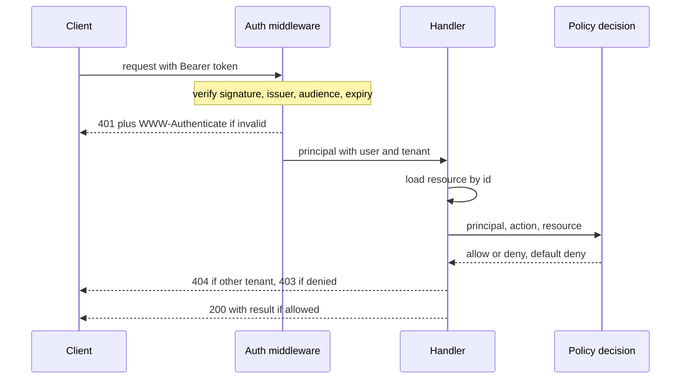

## TL;DR
Authentication verifies *who* is calling; authorization decides whether that principal may do *this
action* on *this resource*. 401 means "I do not know who you are", 403 means "I know, and no". Most
access-control bugs assume the first implies the second.

## Why it exists
- **The second user forces it.** With one user, "logged in" and "allowed" are the same. With two, a request
  for `/documents/42` from a logged-in user says nothing about whether document 42 is theirs; stop asking
  and user A reads user B's data by editing a number in the URL.
- **It is the top web risk.** A valid identity treated as sufficient permission is what OWASP ranks first in
  its 2021 Top 10 (broken access control), and a staple finding of penetration tests.
- **Folding them together fails.** "Check at login, trust everything after" ignores that the questions have
  different inputs and change at different rates. Identity is established once per session; permission
  depends on resource, action, tenant, current role and sometimes time of day, and must be re-evaluated on
  every request. Folding also pushes authorization into the UI (hide the button), which non-UI clients ignore.
- **Separation buys three things.** Several authentication methods (password, single sign-on, API key,
  service identity) feed one authorization model; policy changes without touching login; and audit works,
  because *who* did *what* needs an explicit principal.
- **Agents sharpen it.** An agent calling tools acts *on behalf of* a user, so authentication must say which
  user, and authorization must run per tool call against that user's permissions, not the agent's broad
  service account.

## How it works
### Authentication: credential to principal
- **A credential is evidence:** something the caller knows (password), has (hardware key, phone, signed
  token), or is (biometric).
- **The output is a principal,** a small object such as `{user_id, tenant_id, roles, auth_method,
  auth_time}` attached to the request context.
- **One chokepoint.** Everything downstream trusts that object and never re-examines the credential, so
  this layer must be a single, well-tested chokepoint (middleware or a dependency), not code repeated per handler.

### The common mechanisms
| Mechanism | What is verified | Where state lives |
|---|---|---|
| Password | a slow, salted hash (bcrypt, scrypt or Argon2), *because* a leaked database must not be crackable offline at GPU speed | user table |
| Browser **session** cookie | an opaque id | server-side store: revocation is instant, but every server must reach the store |
| **Bearer token**, opaque | looked up like a session | server-side store |
| **Bearer token**, **JWT** | verified locally with the issuer's public key | none, so it cannot be revoked before expiry |
| **API key** | a hash of a long random string | key table |
| Service-to-service | mutual TLS or platform identities | platform |
| Single sign-on | delegated to an identity provider through OIDC or SAML (the OAuth/OIDC lesson covers the flows) | identity provider |

### Session cookies done right
- **`HttpOnly`:** script cannot read it, so an XSS bug cannot exfiltrate it.
- **`Secure`:** never sent over plain HTTP.
- **`SameSite=Lax` or `Strict`:** not sent on most cross-site requests, *because* browsers attach cookies
  automatically. State-changing endpoints still need CSRF protection where `SameSite` alone does not cover the case.
- **Fresh id at login.** Issue a new session id rather than upgrading the anonymous one, or an attacker who
  planted a known id before login inherits the authenticated session (session fixation).
- **A second factor** (TOTP, or a phishing-resistant WebAuthn key) raises the bar from "knows the password"
  to "also holds the device", which matters because reused and phished passwords are the common way in.

### JWT verification: four checks
1. **Signature,** with the accepted algorithm pinned rather than trusting the token's own `alg` header,
   which is how `none`-algorithm and key-confusion attacks get in.
2. **Issuer.**
3. **Audience,** the one people skip; skipping it means a token minted for another service is accepted by yours.
4. **Expiry.** Because a JWT cannot be revoked before it expires without server state, access tokens are
   short-lived and paired with a refresh token.

### API keys
- **Store only a hash.** Unlike passwords they are long random strings, so a fast hash such as SHA-256 or an
  HMAC is enough; a slow password hash would add latency to every request for no gain.
- **Compare in constant time.**
- **Give keys a recognisable prefix** so secret scanners can spot a leaked key and you can tell which key it
  is without exposing the secret.

### Authorization: (principal, action, resource) to allow or deny
Authorization is a function of three inputs plus context, evaluated with **default deny**. The simplest
form is an ownership check, `resource.owner_id == principal.user_id`, and its absence is the bug above.

| Family | Decides by | Fits |
|---|---|---|
| **RBAC** | principals map to roles, roles to permissions | what most products start with |
| **ABAC** | policies over attributes of principal, resource and environment ("analysts may read documents whose classification is at most internal, from the corporate network") | attribute-driven rules |
| **ReBAC** | relationships ("user is an editor of this document via membership of this group"), the Zanzibar model behind systems such as OpenFGA | deeply shared, hierarchical data |

### Collections need the same care
- **Single resource:** `GET /documents/42` is authorized by loading 42 and checking it.
- **Collection:** `GET /documents?q=refund` must put the permission into the query itself
  (`WHERE tenant_id = $1 AND (owner_id = $2 OR ...)`).
- **Because filtering afterwards** returns short or empty pages, leaks totals through counts, and on a
  vector search lets disallowed chunks crowd out allowed ones in the top-k.

### Placement rules matter more than the model
1. **Enforce on the server, close to the data, on every request.** The UI hiding a button is not
   authorization. In multi-tenant systems every row carries a `tenant_id`, every query filters by it, and
   database row-level security backstops the query someone forgets.
2. **Separate enforcement from decision.** The **enforcement point** (handler or middleware) asks; the
   **decision point** (Casbin, OPA, Cedar, OpenFGA, or your own module) answers, so policy is written once
   and testable in isolation.

### Scopes are not permissions
- **A scope** bounds what a *client application* was allowed to request on the user's behalf.
- **A permission** is what the *user* actually holds.
- **Effective right = intersection:** a `documents:write` scope on a token for a user who can only read
  grants nothing.

### Order inside a request
1. **Authenticate first, in middleware.** Invalid or missing credential: 401 with a `WWW-Authenticate`
   header saying how to authenticate.
2. **Then load the resource and authorize in the handler.** Denied: 403, or 404 when revealing existence
   would itself leak (a document id belonging to another tenant).
3. **Never reverse the order:** an authorization check cannot run without a principal, and an
   unauthenticated caller must not learn which ids exist.

### Agents are principals too
- **A new principal acts for an old one.** The agent (or the tool server) acts for the user.
- **Confused deputy.** If the runtime calls tools with its own powerful credentials and relies on the prompt
  to stay within the user's permissions, the model can be talked into fetching what the user may not see.
- **Fix:** carry the user's identity into every tool call (token exchange, or passing the principal to the
  tool) and let the tool's authorization layer decide, which also makes retrieval permission-aware.
- **Approval gates** for consequential actions are authorization decisions made at a different time, by a
  different decider.

## Diagram
One request, two separate gates: the middleware turns a token into a principal or returns 401, and only
then does the handler load the resource and ask the policy for allow, 403 or 404.



## Examples
### A FastAPI endpoint with the two concerns in two places
- **`current_principal` is the authentication chokepoint.** It verifies signature, issuer, audience and
  expiry of a JWT via the identity provider's published keys (PyJWT).
- **`require` closes a gap:** PyJWT checks `exp` only if the claim is present, so `require` makes its absence
  an error too.
- **`authorize` is the decision function:** tenant match first (returning 404 so other tenants' ids are not
  discoverable), then ownership or an explicit permission.

```python
import jwt                                   # PyJWT
from fastapi import Depends, FastAPI, HTTPException, Request

app = FastAPI()
JWKS = jwt.PyJWKClient("https://idp.example.com/.well-known/jwks.json")

class Principal:
    def __init__(self, claims):
        self.user_id = claims["sub"]
        self.tenant_id = claims["tenant"]
        self.permissions = set(claims.get("permissions", []))

def current_principal(request: Request) -> Principal:        # AUTHENTICATION
    auth = request.headers.get("authorization", "")
    if not auth.startswith("Bearer "):
        raise HTTPException(401, headers={"WWW-Authenticate": "Bearer"})
    token = auth.removeprefix("Bearer ")
    try:
        key = JWKS.get_signing_key_from_jwt(token).key
        claims = jwt.decode(token, key, algorithms=["RS256"],     # pinned, never from the header
                            issuer="https://idp.example.com", audience="docs-api",
                            options={"require": ["exp", "sub", "tenant"]})
    except jwt.PyJWTError:                                   # bad signature, issuer, audience or expiry
        raise HTTPException(401, headers={"WWW-Authenticate": "Bearer"})
    return Principal(claims)

def authorize(p: Principal, action: str, doc) -> None:       # AUTHORIZATION, default deny
    if doc.tenant_id != p.tenant_id:
        raise HTTPException(404)                             # do not reveal cross-tenant existence
    if doc.owner_id == p.user_id or f"documents:{action}" in p.permissions:
        return
    raise HTTPException(403)

@app.delete("/documents/{doc_id}")
def delete_document(doc_id: int, p: Principal = Depends(current_principal)):
    doc = db.get_document(doc_id)
    if doc is None:
        raise HTTPException(404)
    authorize(p, "delete", doc)
    db.delete_document(doc_id, actor=p.user_id)              # audit records who, not just what
    return {"deleted": doc_id}
```

- **`db` is the application's data layer.**
- **Note what is *not* here:** no permission logic in the token parsing, no identity logic in the handler,
  and the tenant check runs before any content-dependent decision.

### Runnable: issuing and checking API keys
Standard library only. The key is shown once, stored as a SHA-256 hash with a public key id and the
tenant it is bound to, and checked in constant time.

```python
import hashlib, hmac, secrets

STORE = {}                                   # key_id -> record; in production, a database table

def issue_api_key(tenant_id):
    key_id = secrets.token_hex(4)            # public part: lets you find and name the key safely
    plaintext = f"docs_{key_id}_{secrets.token_urlsafe(32)}"   # prefix helps secret scanners
    STORE[key_id] = {"tenant_id": tenant_id,
                     "sha256": hashlib.sha256(plaintext.encode()).hexdigest()}
    return plaintext                         # shown to the customer once, never stored

def authenticate_api_key(presented):
    try:
        prefix, key_id, _ = presented.split("_", 2)
    except ValueError:
        return None
    record = STORE.get(key_id)
    if prefix != "docs" or record is None:
        return None
    digest = hashlib.sha256(presented.encode()).hexdigest()
    if not hmac.compare_digest(digest, record["sha256"]):   # constant-time comparison
        return None
    return {"tenant_id": record["tenant_id"], "auth_method": "api_key", "key_id": key_id}

key = issue_api_key("tenant-a")
print(authenticate_api_key(key))             # principal bound to tenant-a
print(authenticate_api_key(key[:-1] + ("x" if key[-1] != "x" else "y")))   # None: tampered secret
print(authenticate_api_key("garbage"))       # None: wrong format
```

### Worked scenario: which status for which request
The `DELETE /documents/{doc_id}` endpoint above, called by different principals.

| Request | Gate that decides | Response |
|---|---|---|
| No `Authorization` header | authentication | 401 with `WWW-Authenticate: Bearer` |
| Valid signature, audience is another service | authentication | 401 |
| Valid token, document belongs to another tenant | authorization (tenant check) | 404 |
| Same tenant, not the owner, no `documents:delete` permission | authorization | 403 |
| Same tenant, owner of the document | authorization | 200, audit log records the user as actor |

## Production patterns
- **Authenticate by default, opt out explicitly.** Attach the principal dependency to the whole app or
  router (FastAPI supports app- and router-level `dependencies=[Depends(current_principal)]`) and mark the
  few public routes deliberately. Monitor 401 rate per endpoint and alert on sudden changes.
- **A cross-tenant test for every route.** Seed two tenants in integration tests and assert that every
  endpoint returns 404 or 403 for the other tenant's ids, including list and search endpoints. Monitor 403
  and 404 spikes per principal in production as an enumeration signal.
- **Database backstop for tenancy.** Set the tenant per transaction (for example `SET LOCAL app.tenant_id`)
  and enforce PostgreSQL row-level security policies on tenant tables, so a forgotten `WHERE` returns
  nothing. Monitor policy-denied queries in tests and logs.
- **Short tokens, fast deprovisioning.** Keep access tokens to minutes, rotate refresh tokens on use, and
  revoke sessions when the identity provider deprovisions a user (for example via SCIM). Monitor active
  sessions or tokens belonging to disabled users; the target is zero.
- **User-scoped tool calls for agents.** Exchange the user's token for a narrowly scoped downstream token
  (OAuth 2.0 Token Exchange, RFC 8693) or pass the principal to each tool, and log the user as actor.
  Monitor tool calls whose actor is the agent's own service account.

## Trade-offs
- **Stateless JWTs vs revocation.** No store lookup per request, but no revocation before expiry; flip to
  server-side sessions when you must log a user out instantly, as in offboarding or compromise.
- **Central policy service vs latency.** One consistent, auditable model across services, but added latency
  and a dependency on every request; inline checks are fine until a second service needs the same rules.
- **Fine-grained permissions vs reviewability.** Precision and least privilege, but the policy surface grows
  and gets hard to review; coarse roles suffice until customers demand custom roles or per-resource sharing.
- **404 vs 403 for cross-tenant resources.** Hides existence from attackers, but confuses your own debugging
  and support unless the server logs the real reason.
- **Long-lived API keys vs exposure.** Simple for machine clients but never expire on their own; flip to
  short-lived, scoped tokens once keys are shared across customer systems or appear in logs.

## Pitfalls
- **Insecure direct object reference.** Authentication present, ownership check absent; changing an id in a
  URL returns another user's record, and it is the first thing a pen tester tries.
- **Skipping the JWT audience check.** Symptom: a token issued for one API is accepted by another, so a
  compromise of a low-value service unlocks a high-value one.
- **Authorization only in the front end.** Symptom: `curl` with a valid token bypasses every restriction the
  UI shows.
- **One agent service account holding the union of all users' permissions.** Symptom: a user asks the agent
  for a document they cannot open in the app and receives it.
- **Caching authorization decisions beyond revocation.** Symptom: a removed employee or deleted share still
  works minutes or hours later.
- **Treating "valid API key" as "known tenant"** without binding keys to tenants and filtering every query.
  Symptom: cross-tenant data in search or RAG results.
- **Plaintext API keys or passwords, or passwords under a fast unsalted hash.** Symptom: one database dump
  exposes every customer's credentials.
- **Returning 403 for an unauthenticated request.** Symptom: clients never retry with credentials because the
  status told them they were already identified.

## When to use
Every multi-user system needs both, so the decisions are about shape:
- **Browser logins where instant logout matters:** server-side sessions.
- **APIs and mobile clients:** short-lived JWTs with refresh tokens.
- **Machine access:** hashed, prefixed, tenant-bound API keys.
- **Enterprise customers:** delegate login to an identity provider as soon as the first one appears.
- **Authorization model:** start with ownership plus RBAC; add ABAC or ReBAC only when sharing rules or
  attribute policies outgrow roles.
- **Measure:** 401 and 403 rates per endpoint, failed-login rates per account, and authorization decision latency.
- **Day to day:** the dependency that produces the principal and the check at the top of every mutating handler.
- **Interviews:** explain 401 versus 403, design the checks for a multi-tenant endpoint, and describe how an
  agent acts on behalf of a user without a confused-deputy hole.

## Role lens
- **Engineer:** Builds the authentication dependency once, verifies all four JWT properties, writes a
  default-deny `authorize` function with tenant and ownership checks, and tests it with another tenant's ids.
- **Architect:** Owns the identity and permission model: session versus token, where policy is decided,
  how tenant isolation is enforced at the data layer, and how agents carry user identity into tools.
- **FDE:** Maps the customer's identity provider, groups and roles onto the product's principal and
  permission model, and proves to their security team that retrieval and tool calls respect existing ACLs.

## Check yourself
**Q:** An agent platform executes tools with one service account that can read every customer's
documents, and the system prompt instructs the model to "only access the current user's documents". The
customer's security team asks whether this is acceptable. What do you tell them and what would you change?
**A:** It is not acceptable, because the prompt is doing authorization and a prompt is not a security
boundary: the model can be induced through injection or error to request another user's document, and
the service account will be allowed to fetch it. Authentication is fine (the user is known at the API
edge) but that identity is dropped before the tool call, which is the confused-deputy pattern. The fix
is to carry the user's principal into every tool invocation, by token exchange for a user-scoped token
or by passing the principal explicitly, and to have the document service authorize each read against
that user's tenant and permissions with default deny. Retrieval should filter by the user's ACLs at
query time, and the agent's own account should hold only the minimal rights it needs for itself. Audit
logs then record the user, not the agent, as the actor.

## Interview questions
### What is the difference between authentication and authorization, and why keep them separate?
- **Authentication** turns a credential into a principal (who); **authorization** decides whether that
  principal may do an action on a resource (may they).
- **Separate because they change at different rates:** identity once per session, permission per request,
  resource and role. Separation lets many login methods feed one policy, and makes audit possible.

### Which JWT checks are mandatory, and what attack does each stop?
- **Signature with a pinned algorithm** stops forged tokens and `none` or key-confusion tricks.
- **Issuer** stops tokens from an untrusted identity provider; **audience** stops a token minted for another
  service being replayed against yours.
- **Expiry** (required, not optional) bounds how long a stolen token works, since JWTs cannot be revoked
  without server state.

### Design authorization for a search endpoint over a multi-tenant document store with sharing.
- **Filter in the query, not after it:** tenant and permission predicates in SQL, or ACL metadata filters
  in the vector search, so pages are full and counts do not leak.
- **Model sharing explicitly:** ownership plus RBAC to start, ReBAC (Zanzibar-style, for example OpenFGA)
  once documents are shared through groups and folders.
- **Backstop** with row-level security and a cross-tenant test suite.

### When would you return 404 instead of 403?
- **When existence itself is sensitive,** such as another tenant's document id: 404 stops enumeration of
  valid ids across tenants.
- **Cost:** support and debugging get harder, so log the true reason server-side; use 403 when the caller
  can legitimately know the resource exists but lacks the right.

### A security review finds that an employee removed yesterday can still call the API. What do you check?
- **Token lifetime and revocation:** long-lived JWTs or API keys keep working until expiry, so shorten
  access tokens and revoke refresh tokens and sessions on deprovisioning.
- **Authorization caching:** cached decisions or role lookups outliving the change; bound cache TTLs to
  your revocation promise.
- **Machine credentials:** API keys the employee created must be bound to owners and rotated.

## Quiz
### Q: A request arrives with no credential at all. Which response is correct and why?
- [ ] 403 Forbidden, because the caller is not allowed to access the resource
- [x] 401 Unauthorized with a WWW-Authenticate header, because the server cannot establish who is calling
- [ ] 404 Not Found, to avoid revealing that the endpoint exists
- [ ] 400 Bad Request, because the Authorization header is required
> 401 signals an authentication problem and tells the client how to supply credentials. 403 would claim
> identity was established and permission denied, which is false and stops clients from retrying with a token.

### Q: A JWT presented to your API has a valid signature from your identity provider and has not expired, but its audience claim names a different service. Should it be accepted?
- [ ] Yes, because the signature proves the identity provider issued it
- [ ] Yes, provided the subject exists in your user table
- [x] No, because a token minted for another service must not grant access to yours, even from the same issuer
- [ ] Only if it also carries the correct scopes
> Signature and expiry prove origin and freshness, not intended recipient. Accepting tokens regardless
> of audience lets a compromise of any service that shares the issuer become a compromise of all of them.

### Q: A logged-in user changes the id in `/invoices/118` to `/invoices/119` and sees another customer's invoice. Which layer failed?
- [ ] Authentication, because the session should have been bound to the invoice
- [x] Authorization, because the handler never checked that the principal may read that resource
- [ ] Transport security, because the id was visible in the URL
- [ ] Rate limiting, because enumeration of ids should have been blocked
> The user was correctly identified; the server then assumed identity implied permission. This is an
> insecure direct object reference, the classic broken-access-control bug, fixed by an ownership or tenant check.
