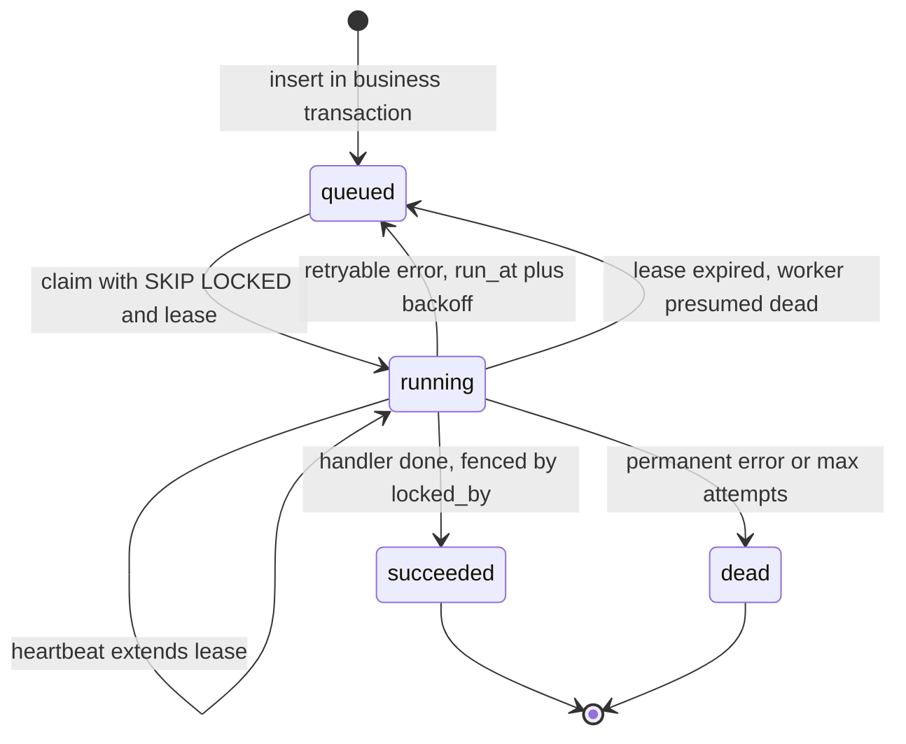

## TL;DR
A long agent run is a background job: a durable worker keeps its state in a store that outlives every
process, so deploys and crashes never lose a run. Leases mean a job can run twice, so agent steps and
tools must be idempotent.

## For agent builders
- **Why it matters for agents.** A twenty-step agent with tool calls runs for minutes, far past any HTTP
  timeout, and your team deploys several times a day. Running it as a durable job with a checkpoint per
  step is what lets a run survive a deploy, resume at step 15 instead of step 1, and avoid repeating a
  side-effecting tool call.
- **Where it shows up in your stack.** Celery, RQ, BullMQ or a Postgres jobs table running agent runs and
  RAG ingestion, LangGraph checkpointers that persist state per step, and durable execution engines such
  as Temporal for long, branching agent workflows.
- **What you control.** What a job is (a whole run, or one step), the lease length against real model
  latency, the checkpoint granularity, which provider errors are retryable, and per-tenant concurrency caps.
- **What you can skip.** Writing your own workflow engine. Know leases, fencing, idempotency, Little's law
  and when a table stops being enough.

## Lab
### Task
A research agent runs as a durable job with a lease and a checkpoint per step, and three defects reached
production: a run resumed after `kill -9` restarted at step 0, a worker that stalled past its lease
overwrote the new holder's steps, and a permanent `400` from the provider was retried five times.

You will fix `run_job` against an in-memory job record with a fake clock that mirrors the jobs table,
so no database is needed. Time box: 45-60 minutes.
- **Prerequisites:** this lesson's lease, Finish/retry/dead-letter, Idempotency and agent-run sections,
  and the lease-expiry runnable under Examples.
- **Setup:** Python 3.11+, standard library only, `pip install pytest` (checked against pytest 9.1.1).
  Save the starter as `agent_jobs.py` and the tests as `test_agent_jobs.py` in one directory.
- **Goal:** a resumed run calls the model only for unfinished steps, a pre-empted worker writes nothing
  after losing its lease, permanent errors go `dead` at once, and retryable ones wait `backoff(attempts)`.

### Starter code
```python
"""agent_jobs.py: an agent run as a durable job with leases and per-step checkpoints. In memory, with a
fake clock, mirroring the jobs table: a resumed run restarted at step 0, a pre-empted worker overwrote
the new holder's work, and a permanent 400 was retried five times."""
from dataclasses import dataclass


@dataclass
class Job:
    id: str
    steps: int                       # agent steps in this run
    state: str = "queued"
    locked_by: str = ""
    lease_until: float = 0.0
    run_at: float = 0.0
    attempts: int = 0
    error: str = ""


class RetryableError(Exception):
    """429, 5xx or a timeout from the model provider."""


class PermanentError(Exception):
    """4xx, a validation failure, a missing document."""


class WorkerCrash(BaseException):
    """kill -9 or an OOM kill: never reaches an `except Exception` handler."""


def backoff(attempt):
    return min(2 ** attempt, 300)    # production adds jitter; kept exact here so tests can check it


def claim(job, worker, now, lease_s=300):
    orphaned = job.state == "running" and job.lease_until < now
    if (job.state == "queued" and job.run_at <= now) or orphaned:
        job.state, job.locked_by, job.lease_until = "running", worker, now + lease_s
        job.attempts += 1
        return True
    return False


def run_job(job, worker, now, checkpoints, do_step, max_attempts=5):
    """Run a claimed job's steps in order; do_step(step) calls the model and tools and returns output.
    checkpoints maps (job_id, step) to output and is the run's durable record."""
    try:
        for step in range(job.steps):
            out = do_step(step)                  # EXERCISE 1: replay recorded steps, do not redo them
            checkpoints[(job.id, step)] = out    # EXERCISE 2: only the lease holder may write
        job.state = "succeeded"                  # EXERCISE 2
    except Exception as e:                       # EXERCISE 3: permanent -> dead, retryable -> backoff
        job.error = str(e)
        job.state = "dead" if job.attempts >= max_attempts else "queued"
        job.run_at = now


if __name__ == "__main__":
    checkpoints, calls = {}, []
    job = Job("run-7", steps=5)

    def crash_at_3(step):
        calls.append(step)
        if step == 3 and calls.count(3) == 1:
            raise WorkerCrash("kill -9 during step 3")
        return f"out{step}"

    claim(job, "A", now=0)
    try:
        run_job(job, "A", 0, checkpoints, crash_at_3)
    except WorkerCrash:
        pass
    claim(job, "B", now=301)                     # A's lease expired
    run_job(job, "B", 301, checkpoints, crash_at_3)
    print("steps called:", calls, "| state:", job.state)

    stale = Job("run-8", steps=3)
    claim(stale, "A", now=0)

    def slow_a(step):
        if step == 1:                            # A stalls past its lease; B takes over and finishes
            claim(stale, "B", now=301)
            run_job(stale, "B", 301, checkpoints, lambda s: f"B{s}")
        return f"A{step}"

    run_job(stale, "A", 0, checkpoints, slow_a)
    print("run-8 checkpoints:", [checkpoints[("run-8", s)] for s in range(3)], "| locked_by:", stale.locked_by)

    for err in (PermanentError("400 invalid tool schema"), RetryableError("429 rate limited")):
        j = Job("run-9", steps=1)
        claim(j, "A", now=1000)

        def fail(step, err=err):
            raise err

        run_job(j, "A", 1000, checkpoints, fail)
        print(type(err).__name__, "->", j.state, "| retry at:", j.run_at if j.state == "queued" else "never")
```

### Expected output
The starter prints `steps called: [0, 1, 2, 3, 0, 1, 2, 3, 4]`, `run-8 checkpoints: ['B0', 'A1', 'A2']`
and `queued | retry at: 1000` for both errors. After the fix, `python agent_jobs.py` prints:

```text
steps called: [0, 1, 2, 3, 3, 4] | state: succeeded
run-8 checkpoints: ['A0', 'B1', 'B2'] | locked_by: B
PermanentError -> dead | retry at: never
RetryableError -> queued | retry at: 1002
```

### Tests
On the starter all 4 fail: the resume test with `At index 4 diff: 0 != 3`, the fence test with
`['B0', 'A1', 'A2'] == ['A0', 'B1', 'B2']`, `('queued', 1) == ('dead', 1)`, and
`assert 1000 == (1000 + 2)` for the backoff.

```python
import pytest

from agent_jobs import Job, PermanentError, RetryableError, WorkerCrash, backoff, claim, run_job


def test_resume_replays_checkpoints_instead_of_redoing_steps():
    checkpoints, calls = {}, []
    job = Job("run-7", steps=5)

    def do_step(step):
        calls.append(step)
        if step == 3 and calls.count(3) == 1:
            raise WorkerCrash("kill -9")
        return f"out{step}"

    assert claim(job, "A", now=0)
    with pytest.raises(WorkerCrash):
        run_job(job, "A", 0, checkpoints, do_step)
    assert claim(job, "B", now=301)
    run_job(job, "B", 301, checkpoints, do_step)
    assert calls == [0, 1, 2, 3, 3, 4]
    assert job.state == "succeeded" and job.attempts == 2


def test_preempted_worker_cannot_overwrite_new_holder():
    checkpoints, a_steps = {}, []
    job = Job("run-8", steps=3)
    claim(job, "A", now=0)

    def slow_a(step):
        a_steps.append(step)
        if step == 1:
            assert claim(job, "B", now=301)
            run_job(job, "B", 301, checkpoints, lambda s: f"B{s}")
        return f"A{step}"

    run_job(job, "A", 0, checkpoints, slow_a)
    assert [checkpoints[("run-8", s)] for s in range(3)] == ["A0", "B1", "B2"]
    assert a_steps == [0, 1]                     # A stops once it sees it lost the lease
    assert job.state == "succeeded" and job.locked_by == "B"


def test_permanent_error_goes_dead_on_first_attempt():
    job = Job("run-9", steps=1)
    claim(job, "A", now=1000)

    def fail(step):
        raise PermanentError("400 invalid tool schema")

    run_job(job, "A", 1000, {}, fail)
    assert (job.state, job.attempts) == ("dead", 1)


def test_retryable_error_is_rescheduled_with_backoff():
    job = Job("run-9", steps=1)
    claim(job, "A", now=1000)

    def fail(step):
        raise RetryableError("429 rate limited")

    run_job(job, "A", 1000, {}, fail)
    assert job.state == "queued"
    assert job.run_at == 1000 + backoff(1)
    assert not claim(job, "B", now=1001)         # not before the backoff
```

### Failure scenarios
- **Inject: fence the final `succeeded` but not each checkpoint.** The fence test fails on `a_steps`
  or on step 1, because A writes `A1` after B finished. Debug: log `(worker, step, locked_by)` on every
  write; in SQL every write carries `AND locked_by = %s`.
- **Inject: `except BaseException` in `run_job`.** A `kill -9` cannot be caught in real life, so the
  test's `WorkerCrash` now marks the job `queued` instead of leaving it to lease expiry, and the resume
  test fails. Debug: a real OOM kill reaches no handler, so recovery must not depend on one.
- **Inject: replay by calling `do_step` and discarding its output.** The trace looks resumed, but the
  model ran again and may pick a different tool. Debug: count model calls per resumed run; above one
  means steps are being regenerated, not replayed.
- **Inject: classify by message text (`"429" in str(e)`).** It works until a provider changes wording.
  Debug: classify by exception type or HTTP status, and test both branches.

### Submission
- **Your fixed `agent_jobs.py`**, with the given tests unchanged.
- **A `pytest -v` log** with all 4 passing, plus the starter's failing run for comparison.
- **The `python agent_jobs.py` output** after the fix.
- **One extra test** of your own, for example that a retryable error on the fifth attempt goes `dead`.
- **A short note** translating each fix to the psycopg worker above: the checkpoint lookup, the
  `DONE` fence on `locked_by`, and the `RetryableError` branch with `backoff`.
- **Evaluated by:** the given tests pass unmodified, your test fails on the starter, and no worker
  writes after losing its lease.

## Why it exists
- **Some work outlasts any client's patience.** Embedding a 300-page PDF, running a twenty-step agent,
  sending ten thousand notifications, re-indexing a tenant.
- **Inline fails three ways.** Load balancers and browsers cut idle connections (commonly around a minute
  by default; check your own), so the client errors while the server keeps working. Slow work eats the web
  tier's capacity, queueing fast requests. A failure at minute nine leaves partial side effects with no
  record of progress.
- **"Fire and forget" loses work silently.** A thread, an `asyncio` task or a framework background task
  lives only in one process's memory; the next deploy, out-of-memory kill or scale-in destroys every
  in-flight and waiting job, and nobody is told.
- **It also has no controls.** No retry, no visibility, no backpressure (a burst of uploads becomes a burst
  of threads), and no way to scale workers separately from the web tier. Teams find out when a customer
  asks why their document never got indexed.
- **Make the job a record, not a call.** Once committed: the job is not lost; at most one worker runs it at
  a time; if that worker dies, it becomes runnable again. That is a message queue's at-least-once contract
  from the worker's side, plus state the worker owns (attempts, next run time, progress, result). It is
  what lets you ship five deploys a day without aborting agent runs in progress.

## How it works
### The job is a row
| Field | Why it exists |
|---|---|
| id, type | identity, and which handler runs it |
| payload | arguments, kept small; large inputs go to object storage by reference |
| state: `queued`, `running`, `succeeded`, `failed`, `dead` | lifecycle, and the caller's status endpoint |
| attempt counter | makes retry policy a function of the row, not worker memory |
| `run_at` | delayed and scheduled jobs for free |
| lease: `locked_by`, `lease_until` | what makes crash recovery possible |
| error or result | the row itself is the audit trail |

### Enqueue is a write, not a call
- **Same database, same transaction.** If the job table lives with the business data, insert the job in
  the *same transaction* as the change that caused it: the job exists if and only if the change committed.
- **Separate queue, dual-write problem.** With Redis, SQS or a broker, "commit, then enqueue" loses the job
  if the process dies between the two; "enqueue, then commit" runs a job for data that may have been rolled back.
- **The general cure is the transactional outbox:** write the job to a table in the business transaction
  and let a relay forward it to the external queue.

### Claim with a lease, not a lock
1. **Claim atomically.** Flip `queued` to `running`, set `lease_until = now + T` and `locked_by = me`. The
   PostgreSQL idiom is one `UPDATE ... WHERE id = (SELECT ... FOR UPDATE SKIP LOCKED LIMIT 1) RETURNING *`.
2. **`SKIP LOCKED` prevents serialization.** Without it N workers block on the same hot row; with it each
   skips rows another worker is examining and takes the next.
3. **A lease, not a transaction-long lock,** because a dead process's lock is held until its connection
   drops, and a transaction open for a ten-minute job pins a database connection.
4. **Expiry is recovery.** The claim also matches `running` rows whose `lease_until` is past, which is
   exactly how a crashed worker's orphaned job gets picked up.

SQS calls the same thing a visibility timeout; Redis-based libraries call it a lock with a duration the
worker renews.

### Heartbeats and the long-job dilemma
| Lease length | Problem |
|---|---|
| Shorter than the job | a healthy worker loses its job to a colleague mid-run, and both run it |
| Very long | recovery from a real crash waits that long |
| **Short lease plus heartbeat** | the usual answer, paired with a hard maximum duration so an alive-but-stuck worker cannot hold a job forever |

### Finish, retry, dead-letter
- **Success:** set `succeeded` and store the result.
- **Retryable errors** (timeouts, 429s, 5xxs from a model provider): set `queued` again with `run_at = now +
  backoff(attempts)`, exponential with jitter, because a dependency recovering from an outage would
  otherwise be hit by every retry at the same instant.
- **Permanent errors** (validation, 4xx, a missing document): straight to `dead`; burning five retries only
  delays the moment a human sees the problem.
- **After `max_attempts`** the job is `dead` and stays inspectable: the dead-letter queue in table form.
  Nothing is ever deleted on failure.

### Idempotency is the price of durability
- **The unavoidable race.** The worker finishes the side effect, then dies before marking the row done; the
  lease expires and the job runs again. "Call the external API" and "update the row" cannot be atomic.
- **Tolerate a second run:** upsert keyed by job id, pass an idempotency key to payment and email
  providers, check the store before acting.
- **Checkpoint multi-step jobs** (a step index, or a per-chunk `done` marker) so a retry *resumes*: a
  40-minute job failing at minute 39 should cost one more minute, not forty.
- **Taken to its conclusion,** recording every step and replaying on failure is what durable execution
  engines such as Temporal do, and what agent runtimes need for long tool-calling loops; the lessons on
  durable workflow execution and checkpointing go deeper.

### Where the store lives
| Store | Gains | Costs |
|---|---|---|
| PostgreSQL table with `SKIP LOCKED` | no new infrastructure, transactional enqueue, trivially inspectable | polling (idle workers cost queries); finished rows must be archived or the table bloats |
| Redis-backed (Celery with Redis, RQ, BullMQ, Sidekiq) | blocking pops, low latency | Redis's weaker durability and the dual-write problem |
| Broker-backed (Celery with RabbitMQ, SQS consumers) | the message-queue lesson from the consumer's chair | another system to run |

Choose by what losing a job costs and by throughput; a few hundred jobs per second (illustrative) is well
within a Postgres table on modest hardware.

### Sizing, fairness and shutdown
- **Little's law sizes workers:** jobs in progress = arrival rate × average duration. Uploads at 0.5 per
  second with 4-minute jobs give 0.5 × 240 = 120 jobs running at steady state; fewer than 120 worker slots
  means the backlog grows without bound, however fast each worker is.
- **Size for peak** arrivals you must absorb within the latency target; the model provider's rate limit,
  not your worker count, may be the real ceiling.
- **Run-order queues are unfair.** One tenant enqueuing 10,000 jobs puts every other tenant behind them.
  Fixes: a per-tenant concurrency cap in the claim (skip tenants at their limit), a claim that rotates
  across tenants, or separate queues per priority class so interactive work never waits behind backfills.
- **Deploys are the most frequent "crash".** On SIGTERM a worker stops claiming, finishes or checkpoints the
  current job within the grace period, and exits. Anything unfinished is recovered by lease expiry, which is
  why the lease, not the shutdown handler, is the correctness mechanism.

### An agent run as a durable job
| Design choice | Recommendation | Because |
|---|---|---|
| **Unit of work** | the run is the job; each step is a checkpoint row | resume needs step-level progress, not a restart |
| **Lease** | a few minutes, heartbeated around each model and tool call | model calls are slow and vary widely in latency |
| **Checkpoint** | after every step: messages, tool result, tokens used | a retry replays from the last committed step |
| **Side-effecting tools** | step id as the idempotency key | the step can run again after a lease expiry |
| **Waiting for a human** | park the run (a waiting state, or `run_at` far ahead) and release the worker | approvals can take hours |
| **Budget** | stop the run, mark it `failed`, keep it inspectable | a looping agent is a poison job |

- **Retry the step, not the run.** A provider 429 at step 12 reschedules from step 12 with backoff; it
  should not re-run steps 1 to 11 and their tool calls.
- **Model calls are not deterministic.** A re-run step may choose a different tool, so recorded steps are
  replayed from the checkpoint, never regenerated.

### What to measure
- **Queue depth and age of the oldest queued job** detect a stalled worker fleet.
- **Run duration per type** shows what each job type costs in worker time.
- **Attempts histogram and dead count** detect a failing dependency.

## Diagram
The job's lifecycle as stored in the row: every arrow is one guarded `UPDATE`, and lease expiry is the
only way a crashed worker's job returns to the pool.



## Examples
### A PostgreSQL-backed worker (psycopg 3)
- **The claim reclaims expired leases,** and the handler must be idempotent.
- **Retryable failures** are rescheduled with jittered backoff; **permanent failures** go to `dead`
  without burning attempts.
- **Every finishing update is guarded by `locked_by`,** so a worker whose lease expired and was taken over
  cannot overwrite the new holder's outcome.
- **Heartbeating is omitted for brevity;** for jobs longer than the five-minute lease, extend
  `lease_until` from a timer thread.

```python
import random, time, uuid, psycopg

WORKER = str(uuid.uuid4())
CLAIM = """
UPDATE jobs SET state='running', locked_by=%s, attempts=attempts+1,
                lease_until=now() + interval '5 minutes'
WHERE id = (SELECT id FROM jobs
            WHERE (state='queued' AND run_at <= now())
               OR (state='running' AND lease_until < now()    -- orphaned by a dead worker
                   AND attempts < 5)                          -- crash-loopers left for a sweeper
            ORDER BY run_at LIMIT 1 FOR UPDATE SKIP LOCKED)
RETURNING id, type, payload, attempts"""
DONE = " WHERE id=%s AND locked_by=%s"     # fence: only the current lease holder may finish

def backoff(attempt):                      # 2, 4, 8 ... s, capped, with jitter
    return min(2 ** attempt, 300) * (0.5 + random.random())

def embed_document(job_id, payload):       # idempotent: keyed writes, safe to re-run
    for chunk in load_chunks(payload["document_id"]):
        if not vectors.exists(chunk.id):   # resume: skip chunks a previous attempt finished
            vectors.upsert(chunk.id, embed(chunk.text))

HANDLERS = {"embed_document": embed_document}

def run_one(conn):
    with conn.transaction():
        row = conn.execute(CLAIM, (WORKER,)).fetchone()
    if row is None:
        return False
    job_id, kind, payload, attempts = row
    try:
        HANDLERS[kind](job_id, payload)
        conn.execute("UPDATE jobs SET state='succeeded', finished_at=now()" + DONE, (job_id, WORKER))
    except RetryableError as e:
        if attempts >= 5:
            conn.execute("UPDATE jobs SET state='dead', error=%s" + DONE, (str(e), job_id, WORKER))
        else:
            conn.execute("UPDATE jobs SET state='queued', error=%s, "
                         "run_at=now() + %s * interval '1 second'" + DONE,
                         (str(e), backoff(attempts), job_id, WORKER))
    except Exception as e:                 # permanent: straight to dead, keep it inspectable
        conn.execute("UPDATE jobs SET state='dead', error=%s" + DONE, (str(e), job_id, WORKER))
    conn.commit()
    return True

with psycopg.connect(DSN) as conn:
    while True:
        if not run_one(conn):
            time.sleep(1)                  # idle poll; LISTEN/NOTIFY can wake workers instead
```

- **App-supplied names:** `load_chunks`, `embed`, `vectors`, `RetryableError` and `DSN` belong to the application.
- **Keep the claim fast:** a partial index on `(run_at) WHERE state IN ('queued','running')` keeps it fast
  as the table grows.
- **Why the `attempts < 5` guard on orphan reclaim:** a job that kills its worker (an out-of-memory crash on
  one huge document) never reaches the `except` branches. Without the guard it is reclaimed forever, and a
  small periodic sweeper should move such rows to `dead`.

### Runnable: lease expiry and the completion fence
Pure Python, in memory. Worker A stalls past its lease, B reclaims the job, and A's late completion is
rejected, exactly what `DONE` does in SQL.

```python
from dataclasses import dataclass

@dataclass
class Job:
    id: str
    state: str = "queued"
    locked_by: str = ""
    lease_until: float = 0.0
    attempts: int = 0

def claim(job, worker, now, lease_s=300):
    orphaned = job.state == "running" and job.lease_until < now
    if job.state == "queued" or orphaned:
        job.state, job.locked_by, job.lease_until = "running", worker, now + lease_s
        job.attempts += 1
        return True
    return False

def finish(job, worker):
    if job.locked_by != worker:            # the fence: WHERE id=%s AND locked_by=%s
        return False
    job.state = "succeeded"
    return True

job = Job("embed-42")
print(claim(job, "A", now=0))              # True: A holds the lease until t=300
print(claim(job, "B", now=100))            # False: lease still valid
print(claim(job, "B", now=301))            # True: A looks dead (GC pause, slow call), B reclaims
print(finish(job, "A"))                    # False: A's late completion is rejected
print(finish(job, "B"), job.attempts)      # True 2
```

### Worked scenario: sizing workers and protecting small tenants
Uploads average 0.5 per second with 4-minute embedding jobs; then one tenant bulk-imports 10,000 documents.

| Question | Arithmetic | Answer |
|---|---|---|
| Worker slots at steady state | 0.5/s × 240 s | 120 jobs in progress; provision more, say 150 slots |
| Bulk import on a shared run-order queue, 150 slots | 10,000 × 240 s ÷ 150 | 16,000 s (about 4.4 hours) before other tenants' new jobs start |
| Same import with a per-tenant cap of 20 slots | the tenant uses 20, others share 130 against the 120 they need | other tenants keep near-normal latency; the import takes 10,000 × 240 s ÷ 20 = 120,000 s (about 33 hours) |

The cap trades the bulk tenant's completion time for everyone else's latency, which is usually the right
product call; make it explicit in the tier's terms.

### Agent scenario: a deploy lands at step 14 of a 20-step run
A research agent takes ~30 s and ~6k tokens per step (illustrative). A deploy sends SIGTERM to the worker
during step 14.

| Design | What happens | Lost work | Duplicate side effects |
|---|---|---|---|
| In-process task | run vanishes; user sees nothing | everything, no record | none, but no result either |
| Durable job, no checkpoints | lease expires, run restarts at step 1 | 13 steps: ~6.5 min, ~78k tokens | every tool call in steps 1-13 runs again |
| Durable job, checkpoint per step | new worker resumes at step 14 | one step: ~30 s, ~6k tokens | none, if step 14's tool uses the step id as its idempotency key |

The checkpointed design costs one row write per step; the cost of skipping it scales with run length.

## Production patterns
- **Partial index plus archival.** Create `CREATE INDEX jobs_claimable ON jobs (run_at) WHERE state IN
  ('queued','running')` and move finished rows older than a retention window to an archive table nightly,
  in batches. Monitor claim query latency and table size.
- **Wake workers with LISTEN/NOTIFY.** Issue `NOTIFY` in the enqueue transaction (it is delivered only on
  commit) and have idle workers `LISTEN`, keeping a slow poll as a fallback for missed notifications.
  Monitor idle-poll query rate and pickup latency.
- **Per-tenant concurrency cap in the claim.** Add a predicate that skips tenants whose `running` count is
  at their limit, or rotate the claim across tenants. Monitor oldest-queued-job age per tenant, not just
  globally.
- **Late acks in Celery.** Set `acks_late=True` and `task_reject_on_worker_lost=True` so a crash redelivers
  instead of losing the task, `worker_prefetch_multiplier=1` for long jobs, and with Redis a broker
  `visibility_timeout` above the longest job. Monitor duplicate executions per task id.
- **Graceful shutdown sized to the platform.** Handle SIGTERM by stopping claims and checkpointing, and set
  the platform grace period (for example Kubernetes `terminationGracePeriodSeconds`) above the checkpoint
  interval. Monitor jobs reclaimed by lease expiry after each deploy; it should be near zero.
- **Checkpoint every agent step.** Commit messages, tool results and token counts after each step, keyed
  by `(run_id, step)`, and have the claim resume from the last committed step. Monitor steps re-executed
  per resumed run; anything above one means checkpoints are missing or late.
- **Separate pools for interactive and batch agents.** User-facing runs and nightly eval or backfill runs
  claim from different queues or priority classes. Monitor oldest-queued-run age per class.

## Trade-offs
- **Job table vs broker.** A table in the main database gains transactional enqueue and zero new
  infrastructure but pays polling and row churn; flip to Redis or a broker at (as an order of magnitude)
  thousands of jobs per second, or when hundreds of idle workers poll.
- **Redis speed vs loss.** Redis-backed queues gain blocking pops and millisecond pickup but lose jobs if
  persistence is off or lagging; fine for cache warming, unacceptable for billing or customer-visible work.
- **Long lease vs fast recovery.** A long lease simplifies the worker but delays crash recovery; a short
  lease with heartbeats recovers fast but needs a maximum-duration guard so a stuck worker cannot renew forever.
- **Retry everything vs classify.** Retrying every failure is easy but hides permanent errors behind five
  slow attempts; classifying costs code and is worthwhile the moment a model provider returns 4xx.
- **Restart vs checkpoint.** Restarting a failed multi-step job is simple but repeats side effects and
  wasted minutes; checkpointing adds state and pays off once jobs exceed a few minutes or several steps.
- **Durable execution engine vs a loop.** An engine gains resume-from-step and full history but costs a
  runtime to operate and a model to learn; a table and a loop suffice until workflows get long and branching.

## Pitfalls
- **In-process background tasks for work that matters.** Symptom: jobs vanish after every deploy,
  discovered weeks later by a customer rather than an alert.
- **A non-idempotent handler.** Symptom: duplicate emails, double charges or two embeddings per chunk after
  a worker is OOM-killed or a lease expires.
- **Enqueueing outside the business transaction.** Symptom: jobs failing on "row not found" because the
  insert rolled back, or committed changes with no job because the process died first.
- **A lease shorter than the job, and no heartbeat.** Symptom: the same job id on two workers and
  `attempts` climbing with no recorded failure.
- **No maximum attempts or dead state.** Symptom: one poison job retried forever, a worker permanently busy
  and a backlog growing behind it.
- **One shared run-order queue for all tenants.** Symptom: one customer's bulk import turns every other
  customer's two-second job into a two-hour wait, with workers fully busy and no errors.
- **Large payloads in the job row.** Symptom: a bloated table, slow claims and a database that has become
  a blob store.
- **Never archiving finished rows, no partial index.** Symptom: a claim query that slows every week even
  though the backlog is small.
- **Assuming the library acks after the work.** Some default to acknowledging before execution (Celery's
  `acks_late` is off by default); the symptom is lost jobs on worker crash despite a "durable" broker.
- **Regenerating completed agent steps on retry.** Symptom: a resumed run takes a different path, calls
  different tools, and its trace no longer matches what the user saw. Fix: replay recorded steps from the
  checkpoint and only call the model for the first unfinished step.
- **Holding a worker while the agent waits for human approval.** Symptom: worker slots full of idle runs
  and a growing queue. Fix: park the run in a waiting state and enqueue a resume when approval arrives.

## When to use
- **Use when:** work must survive the request: anything longer than a few seconds, any external side effect
  that must happen exactly once from the user's view, anything needing retry, scheduling or a pollable status.
- **Agent fits:** any agent run longer than a request timeout, RAG ingestion, scheduled agents and eval
  batches; stream progress to the user from checkpoints while the job runs.
- **Avoid when:** it is a fast read the user is waiting on; use in-process tasks only for best-effort work
  you can lose, such as a metrics sample.
- **Start simple:** a table in the database you already run; move to a broker or execution engine when
  throughput, fan-out or workflow length demands it.
- **Measure from day one:** oldest-job age and dead count.
- **Day to day:** "should this endpoint enqueue or call", lease length against real LLM latency, and what is retryable.
- **Interviews:** design the job table, explain `SKIP LOCKED` and leases, and justify idempotency.

## Role lens
- **Engineer:** Writes the claim query, idempotent handlers and error classification, sizes leases to
  model latency, and adds the partial index and archival job before the table grows.
- **Architect:** Decides where job state lives (database, Redis, broker, execution engine), the retry and
  dead-letter policy, and how callers learn the status of asynchronous work.
- **FDE:** Fits the pipeline to the customer's deploy cadence and infrastructure, proves that a mid-run
  deploy loses nothing, and explains duplicate-safe design when their downstream systems are not idempotent.

## Check yourself
**Q:** Your API accepts document uploads that take two to twenty minutes to chunk and embed, and the
team deploys five times a day. Design the job pipeline so a deploy in the middle of an embedding never
loses or duplicates work, and explain each mechanism's role.
**A:** Make the job a row inserted in the same transaction as the upload record, so a job exists exactly
when a document does. Workers claim with an atomic update using `FOR UPDATE SKIP LOCKED` that sets a
lease; on deploy, workers receive SIGTERM, stop claiming and either finish or let the lease expire, after
which a new worker reclaims the row, so nothing is lost. Guard every completion update with the lease
holder's id so a pre-empted worker cannot overwrite the new holder's result. Duplication is handled inside the handler: each
chunk's vector is upserted by chunk id and skipped if present, so a re-run after an expired lease resumes
rather than repeats, and the twenty-minute job costs only the unfinished chunks. Heartbeat the lease
while embedding so a slow but healthy worker is not pre-empted, with a maximum duration as a guard.
Classify provider errors: 429 and 5xx reschedule with jittered backoff, 4xx go to `dead`. Alert on the age
of the oldest queued job and the dead count.

## Interview questions
### Why isn't FastAPI's BackgroundTasks (or a thread) enough for embedding uploads?
- **The job lives only in process memory,** so a deploy, OOM kill or scale-in silently destroys it with no
  record and no retry.
- **No controls:** no backpressure, no status for the caller, and no way to scale workers apart from the
  web tier. A durable job row fixes all of these.

### Why does SKIP LOCKED matter in a database-backed queue?
- **Without it, N workers contend for the same oldest row** and wait on each other's locks, so the queue
  is effectively single-threaded.
- **With it, each worker skips rows another holds** and takes the next, so a single `UPDATE ... RETURNING`
  claims a distinct job per worker in one statement.

### A job's `attempts` climbs to 5 with no errors logged. What happened?
- **Lease expiry without failure:** the lease is shorter than the job, so other workers reclaim it while the
  first is still healthy, or the job crashes its worker (OOM) and never reaches the error handler.
- **Fix:** heartbeat the lease with a maximum duration, fence completions on `locked_by`, and have a sweeper
  move crash-loopers to `dead` for inspection.

### How would you make a 20-step tool-calling agent survive deploys without repeating tool calls?
- **Run it as a durable job** claimed with a lease and heartbeated around each model and tool call.
- **Checkpoint each step** (messages, tool result, tokens) under a unique `(run_id, step)` key, so a new
  worker replays recorded steps and calls the model only for the first unfinished one.
- **Make tools idempotent** with the step id as the key, and fence completions on `locked_by` so a
  pre-empted worker cannot write a stale result.

### When would you move an agent platform from a Postgres jobs table to a broker or Temporal?
- **Broker:** at thousands of jobs per second, many idle pollers, or fan-out to several consumer services.
- **Durable execution engine:** when workflows are long, branching and multi-step, and you need resume
  from the last step with full history.
- **Stay on the table** while transactional enqueue and inspectability matter more than throughput.

### Uploads arrive at 0.5/s and each embedding takes 4 minutes. How many workers do you need?
- **Little's law:** 0.5 × 240 s = 120 jobs in progress, so you need more than 120 concurrent slots or the
  backlog grows forever.
- **Then check the real ceiling:** the provider's rate limit may cap throughput below what the worker count
  allows, and peak arrivals, not the average, set the target.

## Quiz
### Q: Why does a durable worker claim a job with an expiring lease instead of holding a row lock for the duration of the job?
- [ ] Row locks are not supported for UPDATE statements in most databases
- [x] A lease expires if the worker dies, letting another worker reclaim the job, whereas a lock would require keeping a transaction and connection open for the whole job
- [ ] Leases allow several workers to run the same job in parallel for speed
- [ ] Locks cannot be combined with SKIP LOCKED
> Crash recovery depends on the claim timing out. A transaction-long lock either pins a database
> connection for minutes or, if the worker dies, disappears without any record of what was in progress.

### Q: A worker finishes sending an email through a provider, then crashes before marking the job succeeded. What happens next in a correctly built durable system?
- [ ] The job is marked failed because the worker's connection dropped
- [ ] The broker detects the completed side effect and marks the job done
- [x] The lease expires, another worker re-runs the job, and the handler's idempotency key stops the provider from sending a second email
- [ ] The job is lost, which is why email should be sent inline
> Side effect and acknowledgement cannot be made atomic, so re-running is the only safe default. The
> handler must therefore be idempotent, for example by passing a key the provider deduplicates on.

### Q: Which enqueue strategy guarantees that a job exists if and only if the business change was committed?
- [ ] Push to Redis first, then commit the database transaction
- [ ] Commit the transaction, then push to the queue inside a try/except
- [x] Insert the job row in the same database transaction as the business change, or write it to an outbox table relayed to the queue
- [ ] Enqueue from a background thread after the response is sent
> Only a write in the same transaction is atomic with the business change. Any order of two separate
> writes can be interrupted between them, producing either an orphan job or a change with no job.

## Use cases & projects
### Use cases
- **Long-running agent runs.** Research, coding and report agents run as jobs with per-step checkpoints,
  so a deploy or OOM kill resumes the run instead of losing it.
- **RAG ingestion.** Uploads become chunk-and-embed jobs with per-chunk resume and per-tenant caps, so one
  bulk import does not starve everyone else.
- **Scheduled and triggered agents.** Nightly triage agents, inbox monitors and follow-up agents use
  `run_at` scheduling and the same retry and dead-letter policy.
- **Human-in-the-loop pauses.** A run waiting for approval is parked as a job state and resumed by a new
  job when the human answers, freeing workers in the meantime.

### Mini project
**Make an agent run survive kill -9 (2-3 hours).**
- **Goal:** a Postgres-backed worker that runs a multi-step agent as a durable job and resumes it after a
  crash without repeating tool calls.
- **Steps:** create `jobs` and `run_steps` tables; adapt the worker above so the handler loops over agent
  steps, checkpointing each into `run_steps` with a unique `(run_id, step)`; give the agent a fake
  side-effecting tool that writes to a ledger with the step id as an idempotency key.
- **Crash test:** add the small sweeper that moves orphaned jobs at 5 attempts to `dead`, shorten the
  lease to ~20 s for the test, start two workers, `kill -9` one mid-run, and let the lease expire.
- **Done when:** the run completes on the surviving worker, the ledger has exactly one entry per tool
  step, steps re-executed after the crash is at most one, and a job that always crashes ends in `dead`.
