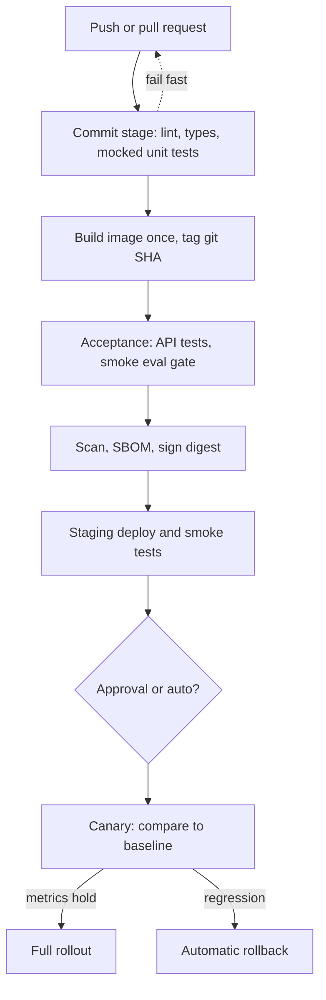

## TL;DR
CI merges and verifies every change on a clean machine; CD turns each verified build into one immutable
artifact with an automated path to production. Small, routine releases make failure cheap to reverse. For
AI systems it also gates prompts and models with evaluations.

## Why it exists
- **Late integration is where bugs live.** Weeks of divergent branches meet at release time, and the merge
  is the defect.
- **"Passes locally" carries no information.** Tests run on developer machines with whatever happens to be
  installed.
- **Manual deploys are not repeatable.** A runbook followed by a person under time pressure differs the
  second time in some detail nobody wrote down. Nobody can say which commit is in production, and rollback
  ("redeploy the old one") fails because dependency resolution has moved on.
- **Each is a feedback-delay problem.** A defect's cost grows with the distance between the change and its
  detection, *because* context is lost and other changes pile on top. CI shrinks that distance by integrating
  at least daily against a build that must stay green; CD extends it to production with stages that give
  fast, cheap feedback first and slow, expensive feedback later.
- **Small and frequent is safer.** The DORA research in *Accelerate* found teams deploying more often with
  shorter lead times also had *lower* change failure rates, the opposite of "test everything manually before
  the big release".
- **AI raises the stakes.** A prompt edit is a behaviour change with no type checker; a model version bump can
  silently regress an untested task; an index rebuild changes answers without touching code. Unverified,
  quality drift ships and users find it.

## How it works
### The stages of a deployment pipeline
1. **Commit stage, minutes.** Clean runner, install from the lockfile, lint, type-check, unit tests with the
   model client mocked or recorded, secret scan. It runs on every push, so it must be cheap and
   deterministic; it exists to fail fast on the majority of mistakes.
2. **Build.** Build the container image once, tag it with the git SHA, push it to a registry. The image digest
   is now the artifact. "Build once, promote many" is a rule *because* rebuilding per environment can resolve
   different dependencies or base layers, so production would run something never tested.
3. **Acceptance.** Start real dependencies (Postgres, Redis) as service containers, run API tests against the
   built image, contract tests against provider APIs, and a small, fixed evaluation set against the prompts
   and model with pass thresholds.
4. **Supply chain.** Audit dependencies, scan the image, produce a software bill of materials, and sign the
   image so later stages can verify they deploy what this stage produced.
5. **Staging.** Deploy automatically; run smoke tests against a production-shaped environment.
6. **Production.** Promote the same digest, gated by an approval (delivery) or automatically (deployment),
   progressively: a canary takes a slice of traffic while error rate, latency and online quality metrics are
   compared with the baseline, then full rollout or automatic rollback.

### Production rollout strategies
| Strategy | How | Cost | What it detects |
|---|---|---|---|
| **Rolling** | Replace replicas a few at a time | No extra capacity beyond the surge | Little: old and new serve side by side and a bad version reaches every user before anyone compares metrics |
| **Blue-green** | Full second environment, switch traffic at once | Double capacity during the release | Nothing that only shows under real load until all users are on it; rollback is an instant switch back |
| **Canary** | Small share of traffic to the new version; promote only if metrics hold | Needs enough traffic for a statistically meaningful comparison | The only one that limits the blast radius of a bad release |

- **Canary metrics must reflect quality:** for LLM features that means online evaluation signals, not just
  HTTP 5xx.
- **GitOps.** The pipeline's last step commits the new digest to a configuration repository, and a controller
  (Argo CD, Flux) reconciles the cluster to it. The config repo becomes the audit log of what ran when, and
  rollback is `git revert`.

### Principles that make the stages work
- **Trunk-based development with feature flags.** Small pull requests into an always-deployable main branch;
  flags separate *deploying* code from *releasing* behaviour.
- **Pipeline as code,** versioned next to the application, so a pipeline change is reviewed like any other.
- **Reproducibility.** Lockfiles for dependencies, base images pinned by digest, third-party pipeline actions
  pinned to a commit SHA rather than a mutable tag.
- **Fast feedback.** Cache dependencies keyed on the lockfile hash, parallelise test shards, and move slow
  suites to a nightly or on-demand lane rather than letting the commit stage grow to thirty minutes,
  *because* a slow pipeline makes developers batch changes, the large, risky merge the pipeline exists to
  prevent.
- **Secrets through identity.** The CI job presents an OIDC token the cloud exchanges for a short-lived role
  credential instead of a stored long-lived key; secrets are masked in logs and never exposed to jobs
  triggered by untrusted pull requests.
- **Environment protection.** Production deploys require a reviewer, a branch rule, or both.
- **Backward-compatible changes across a deploy.** During any rolling or canary release, old and new versions
  run at once against the same database, queue and caches, and a rollback puts the old version back on data
  the new one wrote. Message and API formats follow the same rule.

### Expand-contract for schema changes
1. **Expand:** add the new column or table first; old code ignores it.
2. **Migrate code:** deploy code that writes both and reads the new one.
3. **Backfill** existing rows.
4. **Contract:** only in a later release, drop the old shape.

### What changes for AI systems
| Concern | Practice |
|---|---|
| **Non-determinism** | Unit tests mock or record the client and assert on structure and control flow; quality is measured in an evaluation stage with thresholds over many cases, never with exact-match asserts on generated text |
| **Cost and quota** | Real-model tests spend money and hit rate limits: a small smoke evaluation on every pull request, the full set on main or nightly, under a CI-only key with a spend limit |
| **Artifacts beyond code** | Weights and indexes live in a registry or object store by version; a change to a prompt template, model version or retrieval index triggers the evaluation gate exactly as code triggers tests |
| **GPU work** | Self-hosted runners or cluster Jobs, never the default runner |
| **Rollback scope** | The deployable unit pins code, prompt and model version together, so a rollback reverts all three |

### How you know it is working
- **The four DORA metrics:** deployment frequency, lead time for changes, change failure rate, and time to
  restore service.
- **Plus pipeline duration and flake rate;** a pipeline nobody trusts is one nobody waits for.

## Diagram
Fast, cheap checks run first and every later stage reuses the one digest built in stage two, so what reaches
production is exactly what was tested.



## Examples
### GitHub Actions: test on every PR, build once and deploy the digest on main
- **Every pull request** runs lint, types and mocked unit tests, plus a small smoke evaluation that only runs
  when the secret is available (pushes and same-repository pull requests).
- **On `main`,** the image is built once and pushed with the commit SHA as its tag, and the exact digest is
  rolled out using short-lived credentials obtained through OIDC rather than a stored cloud key.
- **The `production` environment** carries required-reviewer protection.

```yaml
name: ci
on:
  pull_request:
  push: {branches: [main]}
permissions: {contents: read}                # least privilege by default; jobs widen it
jobs:
  test:
    runs-on: ubuntu-latest
    steps:
      - uses: actions/checkout@v4             # pin to a commit SHA in a real repository
      - uses: astral-sh/setup-uv@v5
      - run: uv sync --frozen
      - run: uv run ruff check . && uv run mypy src
      - run: uv run pytest -q tests/unit      # model client mocked: deterministic, free, fast
      - run: uv run pytest -q -m smoke tests/eval   # ~20 golden cases against a cheap model
        if: github.event_name == 'push' || github.event.pull_request.head.repo.full_name == github.repository
        env: {LLM_API_KEY: "${{ secrets.CI_LLM_KEY }}"}
  build-and-deploy:
    needs: test
    if: github.ref == 'refs/heads/main'
    runs-on: ubuntu-latest
    environment: production                  # protection rule: required reviewers
    permissions: {contents: read, packages: write, id-token: write}   # id-token: OIDC to the cloud
    steps:
      - uses: actions/checkout@v4
      - uses: docker/login-action@v3
        with: {registry: ghcr.io, username: "${{ github.actor }}", password: "${{ secrets.GITHUB_TOKEN }}"}
      - id: build
        uses: docker/build-push-action@v6
        with: {push: true, tags: "ghcr.io/${{ github.repository }}:${{ github.sha }}"}   # repo name must be lowercase
      - uses: aws-actions/configure-aws-credentials@v4
        with: {role-to-assume: "arn:aws:iam::123456789012:role/ci-deploy", aws-region: us-east-1}
      - run: |                                 # promote the exact digest that was built and tested
          aws eks update-kubeconfig --name prod
          kubectl set image deployment/llm-api api=ghcr.io/${{ github.repository }}@${{ steps.build.outputs.digest }}
          kubectl rollout status deployment/llm-api --timeout=10m
```

### An evaluation gate as a CI step
Runnable with the standard library. It compares this pull request's eval scores with the baseline from main
and exits non-zero on a regression beyond tolerance, which fails the job. The scores are illustrative; in a
real pipeline they come from the eval run's output file.

```python
import sys

BASELINE  = {"groundedness": 0.91, "format_ok": 0.99, "refusal_rate": 0.04}   # from the last main run
CANDIDATE = {"groundedness": 0.88, "format_ok": 0.99, "refusal_rate": 0.05}   # this pull request
HIGHER_IS_BETTER = {"groundedness": True, "format_ok": True, "refusal_rate": False}
TOLERANCE = {"groundedness": 0.02, "format_ok": 0.01, "refusal_rate": 0.02}   # allowed regression

def regressions(base, cand):
    out = []
    for m, b in base.items():
        delta = cand[m] - b if HIGHER_IS_BETTER[m] else b - cand[m]   # negative = worse
        if delta < -TOLERANCE[m]:
            out.append(f"{m}: {b:.2f} -> {cand[m]:.2f} (tolerance {TOLERANCE[m]:.2f})")
    return out

bad = regressions(BASELINE, CANDIDATE)
for line in bad:
    print("REGRESSION", line)
print("eval gate:", "FAIL" if bad else "PASS")
sys.exit(1 if bad else 0)    # a non-zero exit fails the CI job
# Prints: REGRESSION groundedness: 0.91 -> 0.88 (tolerance 0.02) / eval gate: FAIL
```

### Worked scenario: renaming a column without breaking a rollout
A team wants to rename `user_name` to `display_name` on a service that deploys by rolling update.

| Release | Change | Why it is safe |
|---|---|---|
| Wrong: one release | Rename the column and ship code that reads `display_name` | Old replicas still running mid-rollout query `user_name` and error; rollback fails because old code cannot read the new schema |
| 1 (expand) | Add `display_name`; old code ignores it | Both versions work |
| 2 | Code writes both columns, reads `display_name` | Rollback to release 1 still finds `user_name` populated |
| 3 | Backfill `display_name` for old rows | No code change |
| 4 (contract) | Drop `user_name` once nothing reads it | No running version depends on it |

## Production patterns
- **Path-filtered evaluation gate.** Trigger the full eval job only when prompts, model config or retrieval
  settings change, using `on: pull_request: paths:` with entries such as `prompts/**`, and run the smoke set
  on everything else. Track eval-gate pass rate and the cost per run.
- **Pinned actions with automated updates.** Reference third-party actions by full commit SHA and let
  Dependabot's `github-actions` ecosystem open pull requests to bump them. Review those bumps like code;
  monitor how many workflows still use mutable tags.
- **One deploy at a time per environment.** Add a workflow `concurrency` group (for example `group:
  deploy-production` with `cancel-in-progress: false`) so two merges cannot roll out over each other. Watch
  queued deploy time as merge frequency grows.
- **Flaky-test quarantine.** Mark a flaky test with a pytest marker that moves it to a non-blocking lane the
  day it flakes, with an owner and a deadline. Monitor flake rate per suite and the size of the quarantine.
- **GitOps promotion by digest.** The pipeline commits the new digest to the config repository and Argo CD or
  Flux syncs it, so `git log` answers "what ran when" and `git revert` is the rollback. Alert on applications
  that stay out of sync.

## Trade-offs
- **Eval on every PR vs cost and noise.** It catches prompt regressions early but costs money, time and
  attention when the eval is noisy. The balance flips to a small smoke set per pull request plus a full
  nightly run once the per-pull-request eval bill or wait time pushes people to batch prompt changes or skip
  the gate.
- **Continuous deployment vs approval gates.** Removing the human gate maximises flow, but for regulated
  customers or high-blast-radius changes continuous delivery with an approval and a canary is the right
  stopping point.
- **Build-once-promote-many vs config discipline.** It guarantees production runs what was tested, but forces
  every environment difference into runtime configuration rather than a rebuild, which demands discipline
  about config injection.
- **GitOps vs simplicity.** An auditable, declarative rollback path, but a reconciliation delay and another
  controller to operate; direct `kubectl` from the pipeline is simpler for a single team and few services.
- **Aggressive caching vs staleness.** Pipelines stay fast, but a stale cache produces "green in CI, broken in
  prod"; key caches on lockfile hashes and expire them on base-image changes.

## Pitfalls
- **Tolerating flaky tests.** Symptom: a "just re-run it" culture in which a real failure is merged because
  red no longer means anything. Fix: quarantine flaky tests immediately and fix or delete them.
- **Unit tests that call the real model and assert exact strings.** Symptom: intermittent failures that start
  the day the provider updates the model.
- **Rebuilding the image at deploy time.** Symptom: production behaves differently from staging with the
  "same" commit because dependency resolution drifted between builds.
- **Long-lived cloud keys stored as CI secrets.** Symptom: a leaked runner log or compromised action yields
  permanent credentials. Fix: OIDC federation.
- **Third-party actions referenced by a mutable tag or branch.** Symptom: a supply-chain compromise of that
  action silently runs in your pipeline. Fix: pin to a commit SHA.
- **Only code is versioned and rolled back.** Symptom: a bad prompt needs a hotfix pull request under
  pressure instead of a one-click revert.
- **`pull_request_target` workflows that check out and execute the fork's code.** They run with secrets in
  the base repository's context. Symptom: a malicious pull request exfiltrates secrets through a build script
  or log line.
- **A commit stage that grows past half an hour.** Symptom: rising pull-request size and lead time, because
  developers batch changes to avoid waiting.
- **Shipping a destructive migration (rename or drop a column) in the same release as the code that needs
  it.** Symptom: errors from still-running old replicas during rollout, and a rollback that fails because the
  old code cannot read the new schema.

## When to use
- **Use from day one** for any codebase with more than one contributor or more than one deploy; a five-minute
  lint-and-test workflow is enough to start.
- **Add stages as risk grows:** image build and scan once you deploy containers, an evaluation gate once
  prompt or model changes affect users, canaries once traffic is large enough for a comparison to mean
  something.
- **Use path filters** so documentation changes skip the heavy stages.
- **Measure:** the four DORA metrics plus pipeline duration, flake rate and eval-gate pass rate.
- **Interviews:** explain build-once-promote-many, why small frequent deploys are safer, how you test
  non-deterministic model code, and how a CI job authenticates to the cloud without a stored key.

## Role lens
- **Engineer:** Writes the workflow, mocks the model client in unit tests, maintains the smoke
  evaluation set, pins actions and base images, and reads failed job logs before anyone else does.
- **Architect:** Defines the promotion path, environments and gates (eval thresholds, approvals,
  canary criteria), the artifact and config repositories, and the rollback policy that covers prompt
  and model versions.
- **FDE:** Fits delivery into the customer's tooling (GitLab, Jenkins, Azure DevOps), their change
  windows and approval requirements, and builds the evaluation gate on their data.

## Check yourself
**Q:** A pull request changes the system prompt of your RAG assistant and bumps the model version.
Describe what the pipeline should do before this reaches users, and how you keep it affordable.
**A:** Treat it as code first: the commit stage runs lint, types and unit tests with the model mocked,
which costs nothing. Because files under the prompt and model paths changed, the evaluation gate
triggers: a fixed golden set of a few hundred questions with graded references runs against the new
configuration, scored by deterministic checks and an LLM judge, and compared with the baseline from
main using thresholds on groundedness, refusal rate and output format; the pull request fails if it
regresses beyond tolerance. Keep cost down by running a twenty-case smoke subset on every push and the
full set only when those paths change or a label is applied, under a CI-only key with a spend limit.
Then build the image once, deploy to staging, smoke-test, and canary a small share of production
traffic while watching the same metrics online, with the prompt and model version pinned in the same
artifact so a rollback reverts both.

## Interview questions
### What is the difference between continuous integration, delivery and deployment?
- **Integration:** every change merges to main often and is verified by an automated build and tests on a
  clean machine, so integration bugs surface within hours, not at release time.
- **Delivery:** every green build becomes one immutable artifact with an automated path to production, but a
  human presses the final button.
- **Deployment:** the button is removed; every green build ships, usually through a canary.

### Production behaves differently from staging for the same commit. How do you investigate?
- **Check the artifact:** compare the deployed image digests; if they differ, something rebuilt per
  environment and dependency resolution drifted.
- **Check configuration:** with identical digests the difference is runtime config, secrets, model version or
  data, so diff those next.
- **Fix the process:** build once, promote the digest, and pin prompt and model versions in the artifact.

### Rolling, blue-green or canary for an LLM chat feature: which would you choose?
- **Canary,** because it is the only strategy that limits the blast radius of a bad release, and LLM
  regressions are often quality changes that only real traffic reveals.
- **It needs** enough traffic for a meaningful comparison and online quality signals, not just 5xx.
- **Blue-green** fits when you need instant switch-back and can afford double capacity; rolling is the cheap
  default with the least protection.

### How do you test code that calls an LLM without making CI flaky or expensive?
- **Unit tests mock or record the client** and assert structure and control flow, so they are deterministic,
  free and fast.
- **Quality is an evaluation stage** with thresholds over many cases: a roughly 20-case smoke set per pull
  request, the full set nightly or when prompt and model paths change.
- **Use a CI-only key with a spend limit,** and never assert exact generated strings.

### How does a GitHub Actions job deploy to AWS without a stored access key?
- **The job requests an OIDC token** (`id-token: write`), signed by GitHub, carrying claims such as repository,
  branch and environment.
- **An IAM role trusts that issuer** only for matching claims, and the cloud exchanges the token for
  short-lived credentials.
- **So nothing long-lived exists to leak;** keep the trust conditions narrow, for example main branch of one
  repository.

## Quiz
### Q: Why build the image once and promote the same digest through environments rather than rebuilding per environment?
- [ ] Because container registries charge per build
- [x] Because a rebuild can resolve different dependencies or base layers, so production would run an artifact that was never tested; promoting one digest guarantees identity
- [ ] Because Kubernetes can only pull a given image once per cluster
- [ ] Because tests only execute on the first build of a commit
> The artifact that passed acceptance tests is the only thing known to work; any rebuild is a new,
> untested artifact. Registries do not limit pulls this way and test execution is a pipeline choice,
> not a constraint.

### Q: Unit tests for code that calls an LLM fail intermittently with slightly different wording in the output. What is the best fix?
- [ ] Raise the temperature so outputs become more consistent
- [ ] Automatically retry each failing test three times
- [x] Mock or record the model client in unit tests, and move quality checks to an evaluation stage with thresholds rather than exact-match asserts
- [ ] Pin the tests to one model version and assert the exact string
> Generated text is non-deterministic by nature, so exact matches will keep breaking. Unit tests should
> verify control flow against a stubbed client, while quality is measured statistically over many
> cases. Retries hide real failures and higher temperature increases variance.

### Q: Why is OIDC federation preferred over a stored cloud access key in a CI pipeline?
- [ ] OIDC tokens never expire, so the pipeline never needs to re-authenticate
- [x] The job presents a short-lived signed identity token that the cloud exchanges for temporary credentials, so there is no long-lived secret to leak or rotate
- [ ] Kubernetes requires OIDC for any `kubectl` access from a pipeline
- [ ] Stored keys cannot be restricted to a single repository
> The credential is short-lived, and the cloud's trust policy accepts the token only when its claims
> (repository, branch or environment) match, which removes the single most common CI leak. OIDC tokens are deliberately
> short-lived, and `kubectl` access works with many credential types.
