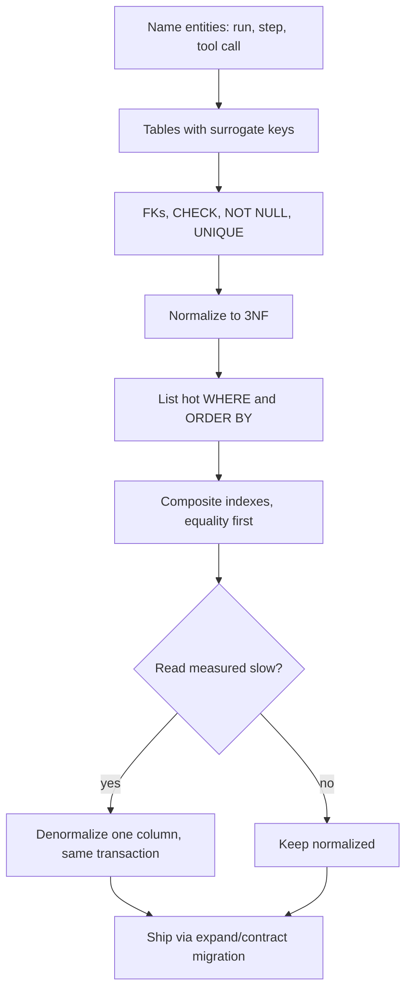

## TL;DR
An agent's runs, tool calls, memory and eval results outlive every prompt and framework version, so
encode what must stay true (keys, constraints, ownership) in the schema. Normalize, denormalize only
where a measured read needs it, and index real queries.

## For agent builders
- **Why it matters for agents.** An agent is a loop that writes state on every step: messages, tool
  calls, tool results, checkpoints, costs. That data feeds resumption after a crash, memory retrieval,
  debugging, billing and evals, so a sloppy schema becomes duplicated tool calls and unanswerable "what
  did the agent do?" questions.
- **Where it shows up in your stack.** LangGraph checkpointers (the Postgres one creates its own tables
  keyed by `thread_id`), LangChain chat-history stores, pgvector tables for RAG chunks, your own
  `agent_runs` and `tool_calls` tables, and trace exports from LangSmith or OpenTelemetry that you later
  join against them.
- **What you control.** Tenant on every row, one run row owning its steps, a unique key that makes each
  side-effecting tool call recordable once, real columns for the fields you filter on (model, status,
  token counts) and jsonb for raw payloads.
- **What you can skip.** Normal-form theory beyond 3NF and vendor-specific tuning. Know the constraints,
  the composite-index rule and expand/contract; that covers agent state schemas.

## Why it exists
- **Data outlives code.** Code is rewritten every year; the data it produced is still there a decade
  later. A layout shaped by whatever the first endpoint needed breaks in three ways.
- **Copies drift (update anomaly).** The same fact stored in several rows (a user's email copied into
  every order) disagrees after the first update that misses one. Application discipline cannot fix it,
  because the next engineer does not know the copies exist.
- **Invariants in code get bypassed.** "A message always belongs to exactly one conversation" is violated
  by the one script, migration or manual fix that skips the code, leaving orphans that crash reads months later.
- **Fast queries become scans.** What was fast at ten thousand rows is a table scan at ten million, and by
  then the layout is load-bearing for a dozen services. "Store JSON blobs and figure it out later" just
  postpones all three to when the data is largest and the authors are gone.
- **AI systems raise the stakes.** Conversation history, tool-call logs, embeddings and evaluation results
  are the product's memory, queried by humans, dashboards and retrieval code long after the request that
  wrote them. Design decides up front which facts exist, who owns each, which rules the database enforces
  and which access paths must be cheap.

## How it works
### Entities, keys and relationships
1. **Name the nouns** the business reasons about: tenant, user, conversation, message, tool call, run,
   document, chunk.
2. **State relationships with cardinality:** a conversation has many messages, a message has zero or more
   tool calls, a document has many chunks.
3. **Give each entity a table and a primary key.** A **surrogate key** (bigint identity or UUID) is the
   default *because* natural keys (email, external IDs) change, get reused, or turn out not to be unique.
4. **Prefer time-ordered UUIDs.** Use UUIDv7 over random UUIDv4 for primary keys, because new UUIDv7 keys
   land at the right edge of the B-tree, while random keys insert into random pages, which defeats cache
   locality and bloats the index as it grows.
5. **Turn relationships into foreign keys** the database enforces, so an orphan cannot exist even when a
   script bypasses the application.

### Normalization: one fact, one place
A table describes one kind of thing, and every non-key column depends on the whole key and nothing else.

| Form | Rule | Example fix |
|---|---|---|
| 1NF | No repeating groups or lists packed into a column | `tags = "a,b,c"` becomes a `tags` table or an array column with proper indexing |
| 2NF | With a composite key, no column depends on only part of it | In a `(conversation_id, user_id)` membership table, `user_name` depends on `user_id` alone and belongs in `users` |
| 3NF | No non-key column depends on another non-key column | If `messages` stores `user_id` and `user_email`, the email belongs in `users`; otherwise changing an email rewrites every message row |

- **Normalize by default** *because* writes are where consistency is decided; a normalized schema makes
  the correct write the only possible write.
- **The cost is joins on read.** A `conversations.last_message_at` column duplicated from `messages` makes
  the inbox query cheap, but must be maintained in the same transaction as the insert.
- **Denormalize on measurement.** Do it when a specific query is measured to be slow, and write down the
  invariant you are now responsible for.

### Constraints are invariants the database guarantees
- **The cheapest tests you will write:** `NOT NULL`, `UNIQUE`, `CHECK (tokens_used >= 0)`, foreign keys
  with explicit `ON DELETE` behaviour, and enum-like `CHECK (role IN ('user','assistant','tool'))`. They
  run on every write path, including the ones you forgot.
- **Partial unique indexes** encode "unique among live rows":
  `CREATE UNIQUE INDEX ... ON documents (tenant_id, external_id) WHERE deleted_at IS NULL`; a plain
  `UNIQUE` constraint cannot take a `WHERE`, and code alone gets this wrong under concurrent inserts.

### Types carry meaning
| Use | Never | Because |
|---|---|---|
| `timestamptz` | bare `timestamp` | `timestamptz` stores an absolute instant (UTC internally); `timestamp` stores a wall-clock reading whose meaning depends on the writer's assumed zone, so rows from servers in different zones cannot be compared |
| `numeric` for money and token prices | `float` | binary floats cannot represent 0.1 exactly, and rounding errors accumulate in invoices |
| `jsonb` for semi-structured payloads (raw model responses, tool arguments) | jsonb for fields you filter or join on | pull those fields into a real column with a real index |

- **Version your JSON.** Store a `schema_version` next to any jsonb you will parse later.

### Multi-tenancy and deletion from day one
- **Tenant on every row.** Every tenant-owned row carries `tenant_id`, every tenant-scoped index leads
  with it, and every query filters on it. PostgreSQL row-level security can enforce the filter when you do
  not trust every code path.
- **Plain FKs allow cross-tenant links.** A foreign key on `conversation_id` still lets a message carry
  tenant A's id while pointing at tenant B's conversation, because nothing compares the two columns.
- **Composite FK fix.** Make the parent's `(tenant_id, id)` unique and have the child reference that pair,
  so the database itself refuses a cross-tenant link.
- **Decide deletion before the first user asks.** A `deleted_at` soft-delete column keeps audit history
  but every query must exclude it. Hard deletes with `ON DELETE CASCADE` are simpler but irreversible.
- **One clear owner.** Retention and right-to-erasure requests are much easier when data is owned by one
  clear parent row.

### Indexes follow queries
- **An index is a sorted copy of some columns.** It makes one access path cheap and every write slightly
  more expensive.
- **Ask the right question.** Not "which columns are important" but which `WHERE` and `ORDER BY` patterns
  run often.
- **Column order matters.** `(conversation_id, created_at)` serves "messages of this conversation in
  order" in one range scan; the same columns reversed do not.
- **Equality first, range or sort last,** *because* the B-tree sorts by the first column, then the second
  within ties. Equality on the leading column narrows to one contiguous slice already ordered by the next.
  Put the range column first and one conversation's entries scatter across the whole range.
- **Index foreign-key columns (usually).** Joins and cascading deletes look rows up by them, and
  PostgreSQL does not create one automatically on the referencing side.

### Modelling agent state
The same rules applied to an agent loop give a small, predictable set of tables:

| Table | One row per | Key rule |
|---|---|---|
| `agent_runs` | one task the agent was given | owns everything below it; carries `tenant_id`, status, model, totals |
| `agent_steps` | one turn of the loop | `UNIQUE (run_id, step_no)` so a replayed step cannot be written twice |
| `tool_calls` | one tool invocation | `UNIQUE (tenant_id, idempotency_key)` so a retried side effect is recorded once |
| memory or chunk tables | one remembered fact or retrieved chunk | tenant-leading index, plus the embedding column if you use pgvector |

- **Checkpoints are not your audit log.** A framework checkpointer stores serialized graph state for
  resumption; its format belongs to the framework and can change between versions. Keep your own
  normalized run and tool-call rows for queries, billing and evals.
- **Status columns get `CHECK`s.** A run is `running`, `waiting_human`, `succeeded` or `failed`; an
  unconstrained text column collects typos that dashboards silently miss.

### Evolving the schema
The schema changes while old code still runs, so every change must work with both versions for the length
of a deploy. That is the **expand/contract** rule:

1. Add the new column or table.
2. Write to both.
3. Backfill in batches.
4. Move reads.
5. Only then drop the old one. A one-step column rename breaks every instance still on the previous release.

| Operation | Cost |
|---|---|
| Add a column with a constant default (since PostgreSQL 11) | does not rewrite existing rows |
| Change a column's type | generally rewrites the table |
| `CREATE INDEX CONCURRENTLY` | builds without blocking writes, but slower, and a failure leaves an invalid index to drop |

Review every migration for which locks it takes on a large, hot table.

## Diagram
Read it top to bottom: design starts from the agent's entities (run, step, tool call) and invariants,
indexes come from the queries your agent and dashboards run, and denormalization is a measured
exception, not a default.



## Examples
### A schema for an LLM application
Note the tenant column on every row (and the composite foreign key that keeps a message in its
conversation's tenant), the constraints that encode rules, and the jsonb for raw payloads next to the
extracted columns (`model`, token counts) that queries actually filter and aggregate on.

The composite index serves the one hot query (load a conversation's messages in order), and the plain
index on the foreign key is what cascading deletes need.

```sql
CREATE TABLE conversations (
  id           uuid PRIMARY KEY,                 -- UUIDv7 generated by the app
  tenant_id    uuid NOT NULL,
  user_id      uuid NOT NULL,
  title        text,
  created_at   timestamptz NOT NULL DEFAULT now(),
  deleted_at   timestamptz,
  UNIQUE (tenant_id, id)                         -- target for tenant-consistent FKs
);

CREATE TABLE messages (
  id              bigint GENERATED ALWAYS AS IDENTITY PRIMARY KEY,
  tenant_id       uuid NOT NULL,
  conversation_id uuid NOT NULL,
  FOREIGN KEY (tenant_id, conversation_id)       -- a message cannot point into another tenant
    REFERENCES conversations (tenant_id, id) ON DELETE CASCADE,
  role            text NOT NULL CHECK (role IN ('system','user','assistant','tool')),
  content         text NOT NULL,
  model           text,
  input_tokens    integer CHECK (input_tokens >= 0),
  output_tokens   integer CHECK (output_tokens >= 0),
  raw_response    jsonb,                     -- provider payload, never filtered on directly
  schema_version  smallint NOT NULL DEFAULT 1,
  created_at      timestamptz NOT NULL DEFAULT now()
);

-- the hot path: "messages of one conversation, oldest first"
CREATE INDEX messages_by_conversation ON messages (conversation_id, created_at);
-- the tenant-scoped dashboard query: spend per tenant per day
CREATE INDEX messages_by_tenant_time ON messages (tenant_id, created_at);

CREATE TABLE tool_calls (
  id            bigint GENERATED ALWAYS AS IDENTITY PRIMARY KEY,
  tenant_id     uuid NOT NULL,                -- child tables carry the tenant too
  message_id    bigint NOT NULL REFERENCES messages(id) ON DELETE CASCADE,
  tool_name     text NOT NULL,
  arguments     jsonb NOT NULL,
  status        text NOT NULL CHECK (status IN ('pending','succeeded','failed')),
  idempotency_key text,
  UNIQUE (tenant_id, idempotency_key)        -- a retried call cannot be recorded twice
);
-- FK lookup for joins and for ON DELETE CASCADE from messages
CREATE INDEX tool_calls_by_message ON tool_calls (message_id);
```

### Runnable: the database refuses bad writes
Standard-library SQLite, so it runs anywhere. It shows the composite foreign key rejecting a cross-tenant
link, a `CHECK` rejecting a bad role, and the composite index serving the ordered read without a sort.

```python
import sqlite3
db = sqlite3.connect(":memory:")
db.execute("PRAGMA foreign_keys = ON")            # SQLite enforces FKs only when asked
db.executescript("""
CREATE TABLE conversations (
  id TEXT PRIMARY KEY, tenant_id TEXT NOT NULL,
  UNIQUE (tenant_id, id));
CREATE TABLE messages (
  id INTEGER PRIMARY KEY, tenant_id TEXT NOT NULL, conversation_id TEXT NOT NULL,
  role TEXT NOT NULL CHECK (role IN ('system','user','assistant','tool')),
  created_at TEXT NOT NULL,
  FOREIGN KEY (tenant_id, conversation_id) REFERENCES conversations (tenant_id, id));
CREATE INDEX messages_by_conversation ON messages (conversation_id, created_at);
""")
db.execute("INSERT INTO conversations VALUES ('c1', 'tenantA')")
db.execute("INSERT INTO messages VALUES (1, 'tenantA', 'c1', 'user', '2025-01-01')")

for bad in [(2, 'tenantB', 'c1', 'user', '2025-01-01'),       # cross-tenant link
            (3, 'tenantA', 'c1', 'robot', '2025-01-01')]:     # role not allowed
    try:
        db.execute("INSERT INTO messages VALUES (?, ?, ?, ?, ?)", bad)
    except sqlite3.IntegrityError as e:
        print("rejected:", bad[0], e)

plan = db.execute("EXPLAIN QUERY PLAN SELECT * FROM messages "
                  "WHERE conversation_id = 'c1' ORDER BY created_at").fetchall()
print(plan[-1][-1])   # SEARCH messages USING INDEX messages_by_conversation (conversation_id=?)
```

### Agent scenario: a run that crashes mid-tool-call
An agent with a `send_invoice` tool crashes after the tool succeeded but before the step was saved. On
resume it replays step 7. The schema decides what happens.

```sql
CREATE TABLE agent_runs (
  id          uuid PRIMARY KEY,                    -- UUIDv7
  tenant_id   uuid NOT NULL,
  status      text NOT NULL CHECK (status IN ('running','waiting_human','succeeded','failed')),
  model       text NOT NULL,
  total_input_tokens  integer NOT NULL DEFAULT 0 CHECK (total_input_tokens >= 0),
  created_at  timestamptz NOT NULL DEFAULT now(),
  UNIQUE (tenant_id, id)
);

CREATE TABLE agent_steps (
  id          bigint GENERATED ALWAYS AS IDENTITY PRIMARY KEY,
  tenant_id   uuid NOT NULL,
  run_id      uuid NOT NULL,
  step_no     integer NOT NULL CHECK (step_no >= 0),
  tool_name   text,
  tool_args   jsonb,
  idempotency_key text,                            -- e.g. run_id || ':' || step_no
  FOREIGN KEY (tenant_id, run_id) REFERENCES agent_runs (tenant_id, id) ON DELETE CASCADE,
  UNIQUE (run_id, step_no),                        -- a replayed step cannot be inserted twice
  UNIQUE (tenant_id, idempotency_key)              -- the tool sees the same key on retry
);
CREATE INDEX agent_steps_by_run ON agent_steps (run_id, step_no);
```

| Design | What the replay of step 7 does |
|---|---|
| No unique key, no idempotency key | second invoice sent, two step-7 rows, cost report double-counts |
| `UNIQUE (run_id, step_no)` only | duplicate row rejected, but the invoice API was already called twice |
| Both keys, key passed to the tool | insert conflicts, the tool's own idempotency check returns the first result |

### Worked scenario: renaming a column with zero downtime
The team wants `messages.content` renamed to `body` on a large, hot table while three app versions roll out.

| Step | Deploy | What runs |
|---|---|---|
| 1. Expand | migration | add nullable `body` column (no table rewrite) |
| 2. Dual write | app v2 | writes `content` and `body`; still reads `content` |
| 3. Backfill | job | copy `content` into `body` in small batches by primary-key range |
| 4. Move reads | app v3 | reads `body`, still writes both |
| 5. Contract | migration, app v4, migration | drop `NOT NULL` on `content` first (otherwise v4 inserts fail), stop writing it, then drop it |

A one-step `ALTER TABLE ... RENAME COLUMN` would have broken every v1 instance still serving traffic.

## Production patterns
- **Own your run log next to the checkpointer.** Use the framework checkpointer (for example LangGraph's
  Postgres saver) for resume, and write `agent_runs`, `agent_steps` and `tool_calls` rows yourself for
  queries. Store the framework's run or trace id in a column so a LangSmith trace joins to your rows.
  Monitor runs stuck in `running` past their timeout.
- **One idempotency key per side-effecting step.** Derive it from run id and step number, store it under a
  unique constraint and pass it to the tool. Monitor unique-violation counts; a spike means replays.
- **Lock-safe migrations.** For any migration on a hot table, set `SET lock_timeout = '5s'` in the
  migration session so a blocked `ALTER` fails fast instead of queueing every write behind it, and build
  indexes with `CREATE INDEX CONCURRENTLY`. Monitor lock waits in `pg_stat_activity` and drop invalid indexes.
- **Add constraints without a long lock.** On large tables add a `CHECK` or foreign key as `NOT VALID`,
  then run `ALTER TABLE ... VALIDATE CONSTRAINT` separately; new writes are checked immediately and
  validation does not block them. Monitor validation duration.
- **Row-level security for tenancy.** `ALTER TABLE messages ENABLE ROW LEVEL SECURITY` plus a policy on
  `tenant_id = current_setting('app.tenant_id')::uuid`, set per request. Table owners bypass policies
  unless you also `FORCE ROW LEVEL SECURITY`. Monitor with a CI test that tries a cross-tenant read.
- **Index review from statistics.** Periodically list indexes with `idx_scan = 0` in
  `pg_stat_user_indexes` (candidates to drop, except those backing a primary key or unique constraint,
  and check replicas too, because the counters are per server) and slow statements from
  `pg_stat_statements` (candidates for a composite index). Monitor write latency on tables you index.
- **Keep big payloads out of the hot table.** Full prompts and document text go in a side table or object
  storage keyed by message id, so the hot table's working set fits in cache. Monitor table size with
  `pg_total_relation_size` and cache hit ratio.

## Trade-offs
- **Framework checkpoint tables vs your own schema.** Checkpointers give resume for free, but their
  serialized blobs are hard to query and tied to a framework version; your own tables cost a little
  write code and survive a framework switch. Flip to checkpoints-only for short-lived prototypes.
- **Normalization vs joins.** One fact in one place costs joins; flip to denormalization only when a
  specific read path is measured slow and its duplicate can be maintained transactionally.
- **Surrogate keys vs natural identifiers.** Surrogate keys are stable and cheap to join, but you still
  need a unique constraint on the natural identifier or duplicates silently appear.
- **UUID vs bigint keys.** UUIDs can be generated client-side and merged across systems, but random UUIDs
  cost index locality and 16 bytes per reference versus 8 for bigint; time-ordered UUIDs recover most of
  the locality.
- **`jsonb` flexibility vs queryability.** It absorbs schema changes without migrations, but every field
  later filtered without a column and index becomes a sequential scan, and nothing enforces its shape.
- **Read speed vs write cost.** Every index speeds one read pattern and taxes every insert and update; on
  write-heavy tables such as event logs, each extra index is a measurable throughput cost.
- **Constraint checks vs trust.** Foreign keys and `CHECK`s cost a lookup per write but catch bugs at the
  only point that sees every path; dropping them "for speed" trades microseconds for untrustworthy data.

## Pitfalls
- **Treating the transcript blob as the database.** Storing each agent run as one jsonb array of
  messages; the symptom is that "which tool failed most this week" needs a script that parses every run.
  Fix: one row per step and per tool call, raw payload in a jsonb column on that row.
- **Omitting `tenant_id` from child tables.** Relying on joins to the parent for scoping; the symptom is
  a query that returns another tenant's rows the first time someone forgets the join.
- **Using `float` for money or token prices.** Symptom: invoices off by a cent and tests that compare
  with tolerances.
- **Bare `timestamp` columns.** Symptom: rows written before and after a server or container time-zone
  change are hours apart in meaning but adjacent in value, and "yesterday" reports disagree.
- **Indexing columns rather than queries.** Symptom: ten single-column indexes, slow writes, and the hot
  query still sorting because no composite index matches its `WHERE` and `ORDER BY`.
- **Entity-attribute-value tables to avoid migrations.** "One table of key/value pairs for everything";
  the symptom is five-way self-joins to rebuild one object and no constraints on anything.
- **Multi-megabyte payloads in the hottest table.** Full prompts or document text; the symptom is bloated
  tables, slow vacuums and a cache that no longer holds the working set.
- **One-step rename or type change on a large table.** Symptom: errors from instances on the previous
  release, or a migration holding a lock for minutes while every write queues behind it.
- **Designing deletion last.** Symptom: a right-to-erasure request takes a week because data is scattered
  across tables with no ownership chain.

## When to use
- **Use when:** data will be read by anything other than the code that wrote it: dashboards, evaluations,
  audits, other services, or future you. Every production agent qualifies, because its runs feed resume,
  cost reports and eval sets.
- **Prototype exception:** for a throwaway prototype a single jsonb column is fine; the moment a second
  query pattern appears, extract real columns.
- **Measure before denormalizing:** run `EXPLAIN ANALYZE` on the slow query and check the write rate of
  the table you would duplicate into.
- **Day to day:** migration reviews ("why is there no index for the query this endpoint runs?", "what
  happens to messages when a conversation is deleted?").
- **Interviews:** expect a product description and a request to draw tables, keys and indexes, then defend
  each constraint and say which query each index serves.

## Role lens
- **Engineer:** Writes the migration, picks types and constraints, and adds the composite index that
  matches the query the new endpoint runs, verified with `EXPLAIN`.
- **Architect:** Owns the ownership model: which service owns which tables, how tenancy is enforced, the
  retention and deletion policy, and when a read model may be denormalized.
- **FDE:** Maps the customer's existing schema and identifiers onto the product's model, finds the missing
  tenant or ownership keys, and plans how their history will be imported and later erased.

## Check yourself
**Q:** A chat product stores each conversation as one jsonb document containing all its messages. Reads
are fast today. What breaks as it grows, and how would you restructure it?
**A:** Appending a message rewrites the whole document, so write cost grows with conversation length and
long conversations create bloat and lock contention. You cannot index or constrain individual messages,
so "all messages by this tool across tenants" or "token spend per day" become full scans that parse JSON.
Deleting one message or one user's data means rewriting documents. The fix is a `messages` table with
`tenant_id`, `conversation_id`, `role`, token counts and `created_at`, a composite index on
`(conversation_id, created_at)` for the conversation view, and a second on `(tenant_id, created_at)` for
reporting; keep the raw provider response in a jsonb column on the message row, where it is not filtered
on. If the inbox view needs `last_message_at`, denormalize that single column and maintain it in the same
transaction as the insert.

## Interview questions
### How would you stop a message from pointing at another tenant's conversation?
- **A plain FK is not enough,** because nothing compares the child's `tenant_id` with the parent's.
- **Use a composite key:** make `(tenant_id, id)` unique on conversations and reference that pair from
  messages, so the database rejects a cross-tenant link on every write path.
- **Add defence in depth** with row-level security on `tenant_id` and tenant-leading indexes so every query
  is scoped and cheap.

### The "load conversation" query is slow even though both columns are indexed. What do you check?
- **Run `EXPLAIN ANALYZE`** and look for a sort node or bitmap combination of two single-column indexes.
- **Fix the index shape:** one composite index with the equality column first and the sort column last,
  `(conversation_id, created_at)`, returns rows already ordered in one range scan.
- **Then check write cost,** dropping single-column indexes the composite one makes redundant.

### When would you choose jsonb or denormalization over a normalized design?
- **jsonb for payloads you do not query:** raw provider responses and tool arguments, with a
  `schema_version`, and extracted columns for anything filtered or joined.
- **Denormalize after measurement:** a single column like `last_message_at` for a hot inbox query,
  maintained in the same transaction as the insert, with the invariant written down.
- **Avoid both** when several teams query the data in ways you cannot predict; normalized tables keep it
  correct for unknown readers.

### How do you change a schema on a large production table without downtime?
- **Expand/contract:** add the new column, dual-write, backfill in batches, move reads, then drop the old
  column a release later, so every running version stays compatible.
- **Watch locks:** adding a column with a constant default is cheap since PostgreSQL 11, a type change
  generally rewrites the table, and indexes go in with `CREATE INDEX CONCURRENTLY`.
- **Fail fast:** set a short lock timeout in migration sessions so a blocked DDL does not queue all writes.

### Design the tables behind a tool-calling agent that must survive crashes and be audited.
- **Entities:** `agent_runs` owns `agent_steps`, which own `tool_calls`; every row carries `tenant_id`
  and children reference `(tenant_id, run_id)` so nothing crosses tenants.
- **Replay safety:** `UNIQUE (run_id, step_no)` plus an idempotency key per side-effecting call, stored
  under a unique constraint and passed to the tool, so a resumed run cannot repeat an action.
- **Queryability:** model, status and token counts as real columns with `CHECK`s; raw arguments and
  responses as jsonb; an index on `(run_id, step_no)` for the replay view.

### Your team uses a framework checkpointer. Why still keep your own run tables?
- **Checkpoints serve resume, not questions.** They store serialized state per thread, so "failure rate
  per tool per tenant" or "spend per run" means deserializing blobs.
- **Framework coupling.** The checkpoint format follows the framework version; your own rows survive an
  upgrade or a framework switch and join cleanly with traces and eval results.

## Quiz
### Q: Why is a composite index on (conversation_id, created_at) better than two single-column indexes for loading a conversation's messages in order?
- [ ] Composite indexes are stored in memory while single-column indexes are on disk
- [x] One range scan over the composite index returns the rows already in the right order, while separate indexes require combining results and then sorting
- [ ] Single-column indexes cannot be used together in the same query
- [ ] The composite index takes less space than two single-column indexes
> The planner can walk the composite index from the first matching conversation_id in created_at order, so
> no sort step is needed. With single-column indexes the planner must either fetch the conversation's rows
> and sort them, or combine indexes in a bitmap scan, which also loses order and needs a separate sort.

### Q: A team drops foreign keys "to make inserts faster". Which failure is this most likely to cause?
- [ ] Queries become slower because the planner can no longer use joins
- [ ] The database refuses to create indexes on the former foreign-key columns
- [x] Orphan rows appear whenever any script or bug deletes a parent without its children, and reads fail later
- [ ] Transactions can no longer be rolled back on those tables
> A foreign key is checked on every write path, including the ones the application code does not cover.
> Without it, orphans accumulate silently and surface as missing-join bugs or crashes much later.

### Q: When is denormalizing a column such as conversations.last_message_at the right call?
- [ ] Whenever a join would otherwise be required, because joins are always expensive
- [ ] Never, because it violates third normal form
- [x] When a specific frequent query is measured to be slow and the duplicate can be updated in the same transaction as the source row
- [ ] Only when the database does not support indexes on the child table
> Denormalization buys read speed by taking on a consistency obligation. It is justified by measurement
> and made safe by maintaining the copy transactionally; doing it by default reintroduces update anomalies.

## Use cases & projects
### Use cases
- **Crash-safe agent runs.** A run row owning ordered step rows, plus a unique key per side-effecting tool
  call, lets a restarted worker resume without sending the same email or refund twice.
- **Multi-tenant agent platforms.** A tenant column on every row and composite foreign keys keep one
  customer's conversations, memories and tool results out of another customer's retrieval.
- **Cost and quality dashboards.** Real columns for model, status and token counts make "spend per tenant
  per day" or "failure rate per tool" a cheap indexed query instead of a scan over jsonb blobs.
- **Eval and audit trails.** Linking eval results and human feedback to the exact run and step rows lets
  you answer "what did the agent do, and was it right?" months later.

### Mini project
**Design and stress a schema for a tool-calling agent (2-3 hours).**
- **Goal:** a Postgres schema for tenants, conversations, agent runs, steps and tool calls that refuses
  bad writes and survives a crash mid-tool-call.
- **Steps:** write the DDL with foreign keys, `CHECK` constraints and a unique key on (run, step) for tool
  calls; add the composite index for loading a run's steps in order; write a small script that runs a fake
  three-tool agent, kills it after the second tool call, restarts it and resumes from the database.
- **Done when:** the resumed run finishes without duplicate tool-call rows, inserting a cross-tenant or
  orphan row fails with a constraint error, and `EXPLAIN` shows the step-loading query using the index
  with no sort step.
