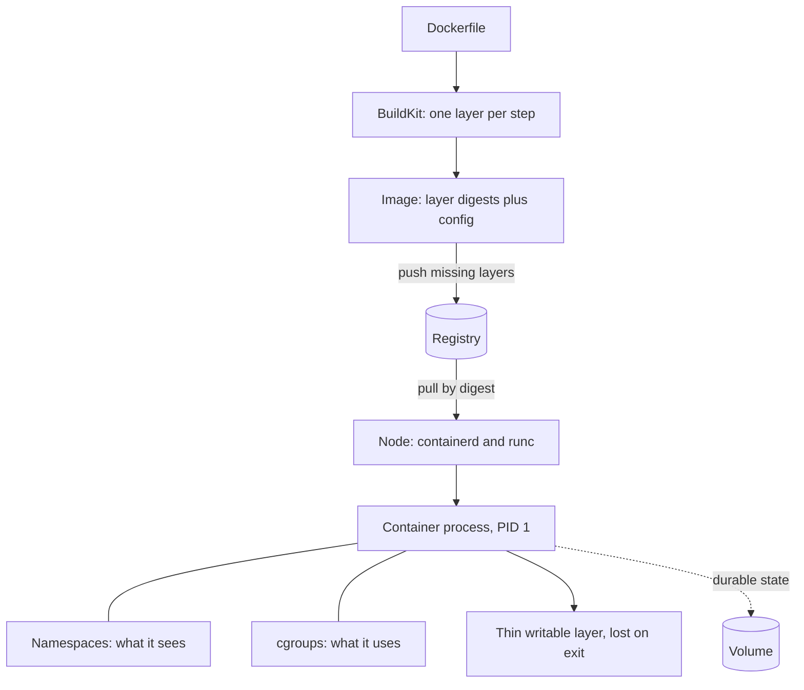

## TL;DR
Docker packages an app with its exact filesystem (OS libraries, interpreter, CUDA runtime, code) into an
immutable, content-addressed image and runs it as an isolated process on the host kernel. What passed CI
is byte-for-byte what runs in production.

## Why it exists
- **A service depends on far more than `requirements.txt`.** The interpreter version, system libraries such
  as glibc and OpenSSL, compiled wheels built against a specific CUDA version, locale settings, environment
  variables.
- **Hand or scripted installs drift.** Two servers provisioned three months apart differ in ways nobody
  recorded, "works on my machine" is a literal description of the problem, and rolling back means
  uninstalling.
- **VMs fix isolation at a high price.** A VM image is gigabytes with its own kernel, boots in tens of
  seconds to minutes, and one per service wastes memory and makes dev/prod parity painful, so people share
  VMs and the drift returns.
- **A process does not need its own kernel to be isolated.** Linux namespaces control what a process can
  *see* (process tree, network interfaces, mount table); cgroups control what it can *use* (CPU, memory,
  I/O). Add an immutable, content-hashed filesystem and a registry, and the artifact becomes the deployment
  unit: no install step, no drift, rollback is pointing at the previous image.
- **For AI it ends "which torch wheel matches which CUDA".** A virtualenv plus setup script pins Python
  packages but nothing beneath them, and CUDA libraries, system codecs and build toolchains are exactly
  what breaks. One image runs identically on a laptop GPU, a CI runner and a Kubernetes GPU node.

## How it works
### Images: layers and content addressing
- **Each `RUN`, `COPY` and `ADD` produces a layer:** a tarball of filesystem changes relative to the previous
  layer, identified by the hash of its contents.
- **An image is an ordered list of layer digests plus a config** (entrypoint, environment, exposed ports,
  user).
- **Layers are immutable and shared.** Twenty services built on the same `python:3.12-slim` base hold one copy
  of those layers on disk and in the registry, and a push uploads only layers the registry lacks.
- **At run time a union filesystem** (overlay2 on most hosts) stacks the layers read-only and adds a thin
  writable layer per container. Writes there disappear with the container, which is *why* durable state goes
  in volumes, not the container filesystem.

### The build cache
1. Each instruction's result is cached, keyed on the instruction and its inputs (for `COPY`, the content of
   the copied files).
2. The first instruction whose inputs changed invalidates every later layer.
3. So ordering is a performance decision: copy the dependency manifest, install, then copy source,
   *because* source changes every commit and dependencies every few weeks. Get it backwards and every commit
   reinstalls torch.

### Containers: namespaces and cgroups
| Mechanism | What `docker run` gives the process |
|---|---|
| PID namespace | Sees itself as PID 1 |
| Network namespace | Own interfaces and port space |
| Mount namespace | Its root is the image |
| UTS, IPC, optional user namespace | Own hostname, IPC objects, optionally remapped users |
| cgroup | CPU and memory caps; exceeding `--memory` triggers the kernel OOM killer: exit code 137, no traceback |
| Capabilities and seccomp | Most Linux capabilities dropped; a seccomp profile filters syscalls |

- **It remains a normal process.** `ps` on the host shows it, a kernel vulnerability escapes it, and it
  starts in milliseconds.
- **Good enough for your own services, not for untrusted code,** which is why agent sandboxes use stronger
  boundaries such as gVisor or microVMs.

### PID 1 and signals
- **The kernel treats PID 1 specially:** default signal dispositions do not apply, so a process without an
  explicit SIGTERM handler ignores `docker stop` and is SIGKILLed when the grace period (10 seconds by
  default) expires.
- **Use the exec form** `CMD ["uvicorn", ...]`, not the shell form `CMD uvicorn ...`, *because* the shell
  form wraps the command in `/bin/sh -c`; unless that shell happens to `exec` the command (behaviour varies by
  shell and command), the shell is PID 1 and does not forward the signal.
- **If the app spawns children,** run under `--init` or `tini` so zombies are reaped.
- **Why it matters later:** this plumbing is what makes graceful draining of an in-flight streaming response
  possible in Kubernetes.

### Tags, digests and registries
- **A tag** such as `:1.4.2` or `:latest` is a mutable pointer; **the digest** `sha256:…` is the immutable
  identity.
- **Deploy by digest or an immutable tag like the git SHA,** because `:latest` on two nodes can mean two
  different images.

### Multi-stage builds
A build stage with compilers, headers and dev tools produces artifacts; the final stage copies only those
into a slim runtime base. The toolchain never ships, the image shrinks, and the attack surface with it.

### GPUs
- **Containers see no GPU by default.** The NVIDIA Container Toolkit injects device nodes and the host
  driver's user-space libraries when you run with `--gpus all`.
- **The split:** the image carries the CUDA runtime and torch; the host carries the kernel driver, which must
  be new enough for the image's CUDA version.
- **Size is cold-start time.** ML images are large (several gigabytes is typical, as an order of magnitude),
  so base-image choice and layer ordering set pull time, which becomes cold-start time when autoscaling.

### Compose
`docker compose` runs several containers (API, Redis, Postgres, a vector database) on one network with named
volumes from a single file: the local development stack that mirrors production topology.

### What "Docker" actually is, and the alternatives
"Docker" names a stack whose pieces are separable *because* the Open Container Initiative standardised them.

| Piece | Role |
|---|---|
| `docker` CLI → `dockerd` daemon | User interface and API |
| BuildKit | Builds |
| containerd → runc | Runs containers; runc sets up namespaces and cgroups |
| OCI image and runtime specs | Any OCI runtime runs a Docker-built image |
| containerd or CRI-O via the Container Runtime Interface | What Kubernetes nodes use; Docker not the runtime since dockershim was removed (v1.24) |
| Podman | Largely compatible CLI, no central root daemon; common where rootless is required |
| Buildah, kaniko | Daemonless builds, suited to CI runners that must not expose a privileged Docker socket |

- **On a Kubernetes node** Docker-built images run unchanged, but `docker ps` shows nothing.
- **The choice rarely changes the Dockerfile;** it changes who needs root on the build machine.

## Diagram
Follow an image from recipe to running process: build once, address by digest, and every node runs the same
bytes with only a thin writable layer on top.



## Examples
### Multi-stage Dockerfile for a FastAPI inference service
Built with `uv`:
- **Dependencies are installed from the lockfile in their own layer** before the source is copied.
- **The runtime stage contains only the virtualenv and code,** and the process runs as a non-root user.
- **The exec-form `CMD` makes uvicorn PID 1** so it receives SIGTERM.
- **Pin the `uv` image** to a specific version in a real repository.

```dockerfile
# syntax=docker/dockerfile:1
FROM python:3.12-slim AS builder
COPY --from=ghcr.io/astral-sh/uv:latest /uv /bin/uv
WORKDIR /app
# Dependencies first: this layer is rebuilt only when the lockfile changes.
COPY pyproject.toml uv.lock ./
RUN --mount=type=cache,target=/root/.cache/uv \
    uv sync --frozen --no-dev --no-install-project
COPY src/ ./src/
RUN --mount=type=cache,target=/root/.cache/uv uv sync --frozen --no-dev

FROM python:3.12-slim AS runtime
RUN useradd --create-home --uid 10001 app
WORKDIR /app
COPY --from=builder /app/.venv /app/.venv
COPY --from=builder /app/src /app/src
ENV PATH="/app/.venv/bin:$PATH" PYTHONUNBUFFERED=1
USER app
EXPOSE 8000
HEALTHCHECK --interval=30s --timeout=3s \
  CMD python -c "import urllib.request as u; u.urlopen('http://127.0.0.1:8000/health')" || exit 1
# Exec form: uvicorn is PID 1 and receives SIGTERM from `docker stop`.
CMD ["uvicorn", "src.app:app", "--host", "0.0.0.0", "--port", "8000"]
```

Build and run it with an immutable tag and a memory cap. A `.dockerignore` listing `.git`, `.venv`, `data/`
and model weights keeps the build context small and the `COPY` cache stable.

```bash
docker build -t llm-api:$(git rev-parse --short HEAD) .
docker run --rm -p 8000:8000 --memory=2g -e LLM_SECRET_ID=prod/llm llm-api:$(git rev-parse --short HEAD)
docker history llm-api:$(git rev-parse --short HEAD)   # where did the bytes go?
```

### A PID 1 that drains on SIGTERM
Runnable with the standard library. As PID 1 this process gets no default SIGTERM behaviour, so it installs
a handler, finishes in-flight work and exits 0 well inside the 10-second grace period.

```python
import signal, sys, threading, time

stop = threading.Event()

def on_term(signum, frame):
    print("SIGTERM received: stop accepting work, finish in-flight", flush=True)
    stop.set()

signal.signal(signal.SIGTERM, on_term)
print("serving", flush=True)
while not stop.is_set():
    time.sleep(0.2)            # stand-in for serving requests
time.sleep(1)                  # stand-in for draining one in-flight stream
print("drained, exiting 0", flush=True)
sys.exit(0)
# Try it: python drain.py & sleep 1; kill -TERM $!   (in a container: docker stop <name>)
```

### Worked scenario: reading exit codes after a restart
Container exit codes above 128 mean "killed by signal (code minus 128)". That turns a silent restart into a
diagnosis.

| Exit code | Signal | Usual cause | Fix |
|---|---|---|---|
| 0 | none | Clean exit after handling SIGTERM | Nothing to fix |
| 137 | 9 (SIGKILL) | Memory over `--memory` (OOM killer), or SIGTERM ignored until the grace period ended | Raise the limit above real peak, or add a handler and exec-form `CMD` |
| 143 | 15 (SIGTERM) | Terminated by SIGTERM without draining: default handling in a process that is not PID 1 (for example under `--init`), or a handler that exits 128 + 15 | Add a handler that drains before exiting 0 |
| 1 | none | Application error | Read `docker logs` for the traceback |

- **Telling the two 137 cases apart:** `docker inspect` reports `OOMKilled: true` for memory kills; a stop
  that took exactly ten seconds points at signal handling.

## Production patterns
- **Deploy by digest.** Tag images with the git SHA, then record the pushed digest (shown by `docker push`,
  or `docker inspect --format '{{index .RepoDigests 0}}' <image>`) in the deploy manifest. Monitor which
  digest runs in each environment so "what is in prod" has one answer.
- **Shared build cache in CI.** Export BuildKit cache to the registry with `docker buildx build --cache-to
  type=registry,ref=<repo>:buildcache,mode=max --cache-from type=registry,ref=<repo>:buildcache`, so fresh
  runners skip unchanged dependency layers. Track cached versus uncached build time.
- **Scan and gate images.** Run an image scanner such as Trivy (`trivy image --severity CRITICAL,HIGH
  --exit-code 1 <image>`) in CI and fail on fixable critical findings. Monitor open critical CVEs per base
  image and rebuild on base-image updates.
- **Harden the runtime.** Run as a non-root `USER`, add `--read-only` with a `--tmpfs /tmp`, and
  `--cap-drop ALL`, adding back only what the service needs. Watch for permission errors in logs after
  enabling, which reveal unexpected writes.
- **Keep weights out of the image.** Ship code and runtime only; load weights from object storage or a
  persistent volume with a node-local cache, and pre-pull large images on GPU nodes. Measure pull time and
  model-load time separately.

## Trade-offs
- **Reproducible images vs pull time.** Deploys are reproducible and rollback is a pointer change, but a
  multi-gigabyte CUDA image takes minutes to pull onto a fresh node, so autoscaling latency becomes an
  image-size problem. The fix flips toward runtime bases, pre-pulled nodes and weights outside the image.
- **Shared kernel vs isolation.** Near-native performance and millisecond startup compared with a VM, but
  weaker isolation; for code you did not write, such as agent-generated scripts, the balance flips to gVisor
  or microVM sandboxes.
- **Layer caching vs hidden inputs.** Rebuilds are fast when instructions are ordered well, but the cache
  only knows the inputs the Dockerfile shows it; an `apt-get update` cached from last month or a `pip
  install` without a lockfile yields different images on different days.
- **One container vs split model server.** API plus model in one container is simple to run; splitting the
  model server from the API adds a network hop in exchange for scaling and restarting the two independently.

## Pitfalls
- **Shell-form `CMD` or no SIGTERM handler.** Symptom: `docker stop` takes exactly ten seconds and in-flight
  requests die; later, rolling updates drop streams.
- **Running as root.** Symptom: every security review flags it, and any code-execution bug becomes root
  inside the container. Fix: add a `USER`.
- **No `.dockerignore`.** Symptom: builds send gigabytes of context (`.git`, `.venv`, datasets, weights) and
  miss the cache every time because a `COPY` input changed.
- **Copying source before installing dependencies.** Symptom: every one-line change reinstalls torch for
  several minutes.
- **A `:latest` base image or unpinned dependencies.** Symptom: a rebuild of the "same" Dockerfile produces
  a different image that fails, usually on the day of an incident.
- **Writing state inside the container.** Symptom: data vanishes on restart, plus slow writes through the
  overlay filesystem.
- **CUDA runtime newer than the host driver supports.** Symptom: a "driver version is insufficient for CUDA
  runtime version" error on one node pool and not another.
- **A memory limit below real peak usage.** Symptom: silent restarts with exit code 137 and no Python
  traceback, typically during model load or a large batch.
- **Mounting `/var/run/docker.sock` into a CI or agent container "so it can build".** Symptom: anything in
  that container can start a privileged container and own the host. Fix: a rootless or daemonless builder.

## When to use
- **Use when** you deploy anything more than once or onto more than one machine: inference APIs, workers,
  eval jobs, fine-tuning runs.
- **Skip it** for a notebook on your laptop; serverless platforms that accept source or a zip build the image
  for you.
- **Measure:** image size, cached and uncached build time, pull time, and time from container start to ready;
  watch each when a deploy feels slow.
- **Day to day:** write Dockerfiles, debug with `docker exec`, `docker logs` and `docker history`, and run
  the local stack with Compose.
- **Interviews:** explain layers versus containers, namespaces versus cgroups, why PID 1 matters, and why
  instruction order changes build time.

## Role lens
- **Engineer:** Writes the multi-stage Dockerfile, pins the base image and lockfile, handles signals
  for graceful shutdown, keeps the CUDA and torch versions consistent, and keeps the image small.
- **Architect:** Decides what lives in the image versus mounted at runtime (weights, config), sets the
  base-image and registry-scanning policy, and chooses the isolation level for untrusted execution.
- **FDE:** Ships the product as images into the customer's registry or air-gapped environment, and
  works around their driver versions, proxies and approved-base-image restrictions.

## Check yourself
**Q:** Your inference image is about 9 GB and each new node takes six minutes to become ready during
autoscaling. Walk through what you would investigate and change.
**A:** Start with `docker history` to see where the bytes are; it is usually CUDA toolkit layers, torch
wheels and model weights copied into the image. In order of payoff: move the weights out of the image
onto object storage or a persistent volume with a node-local cache, so the image is only code and
runtime; switch to a CUDA runtime base instead of a devel base and use a multi-stage build so compilers
never ship; drop unused dependencies; and order layers so the heavy, stable ones (base plus
dependencies) are shared across versions, so a node that pulled last week's image already has most of
this week's. Then attack the platform side: pre-pull images with a DaemonSet, keep a warm node pool,
and use a registry in the same region. Finally separate pull time from model-load time in the
measurements, because the second needs a startup probe and a weight cache rather than a smaller image.

## Interview questions
### What is the difference between a container and a virtual machine?
- **A container is a host process** isolated by namespaces (what it sees) and cgroups (what it uses), sharing
  the host kernel, so it starts in milliseconds.
- **A VM boots its own kernel** on a hypervisor: stronger isolation, but gigabytes per image and boot times
  of tens of seconds or more.
- **So** containers suit your own services; untrusted code needs gVisor or a microVM.

### A container restarts every few hours with exit code 137 and no traceback. How do you debug it?
- **137 means SIGKILL.** Check `docker inspect` (or the pod status) for `OOMKilled`; if true, the cgroup
  memory limit was exceeded.
- **Correlate with workload:** model load or large batches usually drive the peak; measure real peak memory
  and set the limit above it, or bound batch size.
- **If not OOM,** look for a stop that hit the grace period because SIGTERM was ignored.

### Why does instruction order in a Dockerfile change build time but not image size?
- **The cache invalidates every layer after the first changed input,** so installing dependencies before
  copying source lets a code change rebuild only the final cheap layers.
- **Size is the sum of layers either way,** so swapping the two steps leaves the image essentially the same
  size; only rebuild time changes.

### When would you not bake model weights into the image?
- **When images get large,** because multi-gigabyte layers make every new node pull for minutes and turn
  autoscaling into an image-size problem.
- **When weights change on a different cadence** from code, so a model update does not need a code release.
- **Instead** load from object storage or a persistent volume with a node-local cache, keeping the image to
  code and runtime.

### Why is mounting the Docker socket into a CI job dangerous, and what do you use instead?
- **The socket is root on the host:** anything that can talk to it can start a privileged container that
  mounts the host filesystem.
- **Use a daemonless or rootless builder** such as kaniko, Buildah or rootless BuildKit, which build OCI
  images without a privileged daemon.

## Quiz
### Q: Why should a Dockerfile copy the dependency manifest and install before copying the application source?
- [ ] Because the source files need the installed packages present at `COPY` time
- [x] Because the first changed layer invalidates every later cached layer, so putting rarely-changing dependency installation first lets most rebuilds skip it
- [ ] Because Docker requires all `COPY` instructions to appear at the end of a build
- [ ] Because installing dependencies after the source makes the final image larger
> The cache is keyed on each instruction and its inputs, in order. Source changes on every commit,
> dependencies rarely, so installing first means a code change rebuilds only the cheap final layers.
> Swapping these two steps leaves the final image essentially the same size; only rebuild time changes.

### Q: A container ignores `docker stop` and is killed after ten seconds. What is the most likely cause?
- [ ] The container's memory limit is set too low
- [ ] The image was built without a `HEALTHCHECK`
- [x] The main process is PID 1 and does not handle SIGTERM, for example because `CMD` used shell form so `/bin/sh` received the signal
- [ ] The container is running as root
> PID 1 has no default signal handlers, so SIGTERM is dropped unless the process installs one, and the
> shell form typically leaves a shell as PID 1 that does not forward it. Memory limits produce OOM kills, not stop
> timeouts, and health checks do not affect signal delivery.

### Q: What does a container share with its host that a virtual machine does not?
- [ ] The root filesystem
- [ ] The environment variables of the host shell
- [x] The kernel
- [ ] The network namespace
> A container is a process isolated by namespaces and cgroups on the host's kernel, which is why it
> starts in milliseconds and why a kernel exploit escapes it. Its root filesystem comes from the image
> and it gets its own network namespace by default.
