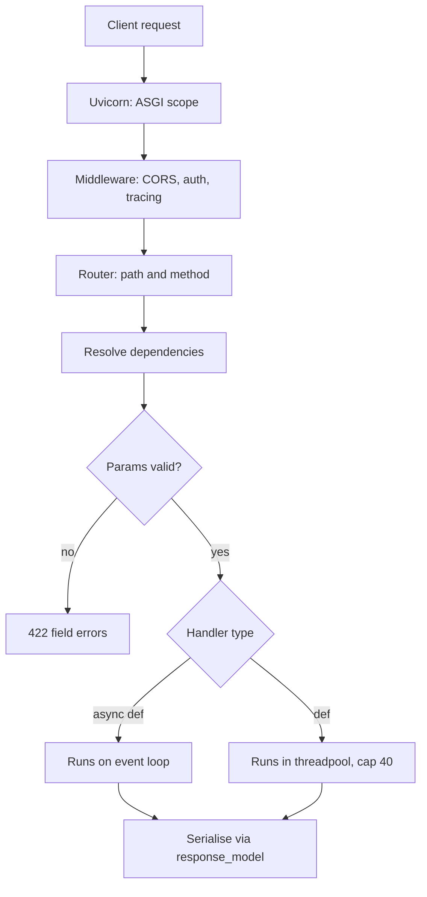

## TL;DR
FastAPI is the default framework for Python AI services: async-native ASGI on Starlette, Pydantic as one contract
for validation and docs, first-class streaming and DI. Sharp edge: one blocking call in `async def`
stalls the worker. (Deep dive: `fastapi-for-ai`.)

## Why it exists
- **An AI endpoint is unusual HTTP.** A request may hold its connection open for ten seconds, stream
  hundreds of chunks, carry large structured bodies both ways, and share expensive clients (a provider
  connection pool, a vector store) across every request.
- **WSGI was built for the opposite.** Flask and traditional Django dedicate one thread or process per
  request. With 200 in-flight model calls of five seconds each, a WSGI server needs 200 workers that sit
  idle on sockets; one ASGI event loop holds all 200 pending awaits, bounded by memory and the upstream.
- **Contract drift.** Hand-written validation and docs diverge the week after launch; a client sends
  `temperature: "0.7"` and the handler crashes deep in a provider call.
- **One declaration, many uses.** FastAPI reads Pydantic types on the handler signature and derives
  validation, a precise 422, response filtering and the OpenAPI schema, so docs cannot lie. The same class
  is the JSON Schema for structured output, closing the loop between API and prompt contracts.
- **The naive alternatives cost more.** Raw Starlette or aiohttp with hand validation reinvents those
  layers; Flask-with-async-bolted-on keeps the WSGI mental model where it hurts most.

## How it works
### ASGI and the request path
1. **Uvicorn accepts the connection** and hands an ASGI `scope` to the app.
2. **Middleware runs** (CORS, auth, tracing).
3. **The router matches** path and method.
4. **FastAPI resolves the handler's dependencies.**
5. **Path, query and body parameters are validated** against the declared types. A failure stops at the
   boundary with a 422 and a field-level error list, before the handler body runs.
6. **The handler runs**, and the return value is serialised through `response_model`.

- **Caveat:** dependencies may already have executed when validation fails, so keep side effects out
  of them.

### `async def` versus `def` handlers
| Handler | Runs on | Use when | Concurrency cap per worker |
|---|---|---|---|
| `async def` | the event loop; every `await` yields | everything you call is async (httpx, async DB drivers, async SDK clients) | memory and the upstream's limits |
| `def` | a bounded worker threadpool, so it cannot block the loop | you must call a blocking library | the threadpool (AnyIO's default limiter is 40 tokens) |

- **The failure mode is the mix.** A sync SDK call inside `async def` blocks the loop, and every other
  request on that worker waits.
- **Same rule for dependencies.** A plain `def` dependency is also run in the threadpool.
- **Capacity arithmetic.** If each `def` call holds a thread for 5 seconds, one worker serves at most
  40 / 5 = 8 requests per second before requests queue for a thread. That is why the async path is the
  default for model-calling endpoints.

### Workers and processes
- **One uvicorn process is one event loop on one core.**
- **Run several worker processes per machine** (uvicorn `--workers`, gunicorn with uvicorn workers, or
  one process per container behind the orchestrator) *because* JSON parsing, validation and
  serialisation still use CPU, and one loop cannot use a second core.
- **Workers share nothing**, so in-memory caches, rate-limit counters and "which streams are open" state
  belong in Redis or the database, not in a module-level dict.

### Pydantic as the contract
- **Request:** declaring `body: ChatRequest` validates and parses the JSON body.
- **Response:** `response_model=Answer` filters output to the declared fields, so a leaked internal
  attribute never reaches a client, and documents it.
- **Constraints:** `Field` constraints (`max_length`, `ge`, `le`) become both runtime checks and schema
  metadata.

### Dependency injection and lifespan
- **`Depends`** lets a handler ask for a current user, a DB session or a shared HTTP client without
  constructing it; dependencies compose and can be overridden in tests.
- **`lifespan`** runs startup and shutdown code: build application-scoped resources there (one
  `httpx.AsyncClient`, one model client) instead of recreating them per request.

### Streaming
- **`StreamingResponse` takes an async generator** and writes each yielded chunk as it arrives.
- **`text/event-stream` framing gives server-sent events**, the standard way to stream tokens to browsers
  and SDKs.
- **A slow stream does not block others**, because each `yield` happens between awaits.

### Background tasks are not a job queue
- **`BackgroundTasks` runs a function after the response is sent, in the same process.** Fine for a few
  hundred milliseconds of follow-up (an audit row, a metric).
- **Wrong home for a two-minute summarisation**, *because* the work dies with the process on a deploy or
  crash, nothing retries it, and it competes with live requests for the same loop or threadpool.
- **Long or must-complete work** goes to a durable queue and a separate worker, with a `202` and a job
  resource on the API side.

### Compared with the alternatives
| Framework | Strength | Fit |
|---|---|---|
| Flask | simple, sync-first | small internal tools; poor for long-lived streaming calls |
| Django | ORM, admin, auth | when those matter more than async purity; async support is partial |
| Starlette | the ASGI core | FastAPI without validation, DI and docs |
| Litestar | comparable ASGI framework, different DI style | the reasoning in this lesson applies too |

## Diagram
Follow one request: validation can reject it before the handler, and the handler's type decides
whether it runs on the loop or in the threadpool.



## Examples
### Streaming chat endpoint
One shared upstream client created in `lifespan`, a validated request body, and an SSE stream from an
async generator. Every `await` inside `events()` releases the loop to other requests, which is the
whole point of the async design.

```python
import json
from contextlib import asynccontextmanager
import httpx
from fastapi import Depends, FastAPI, Request
from fastapi.responses import StreamingResponse
from pydantic import BaseModel, Field

@asynccontextmanager
async def lifespan(app: FastAPI):
    app.state.http = httpx.AsyncClient(base_url="http://model-server:8000", timeout=60)
    yield                                          # the app serves requests here
    await app.state.http.aclose()                  # shutdown: close the pool cleanly

app = FastAPI(lifespan=lifespan)

class ChatRequest(BaseModel):
    prompt: str = Field(min_length=1, max_length=8000)
    temperature: float = Field(0.2, ge=0, le=2)   # validated and documented from one declaration

def http(request: Request) -> httpx.AsyncClient:   # dependency: one shared pool, not one per request
    return request.app.state.http

@app.post("/v1/chat")
async def chat(body: ChatRequest, client: httpx.AsyncClient = Depends(http)):
    async def events():
        async with client.stream("POST", "/generate", json=body.model_dump()) as r:
            async for line in r.aiter_lines():     # each await yields the loop to other requests
                if line:
                    yield f"data: {json.dumps({'token': line})}\n\n"
        yield "data: [DONE]\n\n"
    return StreamingResponse(events(), media_type="text/event-stream")
```

### Testing it without a model server
`dependency_overrides` swaps the shared client for one backed by `httpx.MockTransport`, so the test
exercises validation, the stream framing and the 422 path with no network.

```python
import json
import httpx
from fastapi.testclient import TestClient
from main import app, http                         # the module above

def fake_http() -> httpx.AsyncClient:
    def upstream(request: httpx.Request) -> httpx.Response:
        assert json.loads(request.content)["prompt"] == "hi"
        return httpx.Response(200, text="hello\nworld\n")
    return httpx.AsyncClient(transport=httpx.MockTransport(upstream), base_url="http://test")

app.dependency_overrides[http] = fake_http        # swap the real pool for a fake upstream

def test_chat_streams_tokens():
    with TestClient(app) as c:                     # the with-block runs lifespan
        r = c.post("/v1/chat", json={"prompt": "hi"})
        assert r.status_code == 200
        assert 'data: {"token": "hello"}' in r.text
        assert r.text.endswith("data: [DONE]\n\n")

def test_rejects_out_of_range_temperature():
    with TestClient(app) as c:
        r = c.post("/v1/chat", json={"prompt": "hi", "temperature": 5})
        assert r.status_code == 422                # stopped at the boundary, handler never runs
```

### Worked scenario: sizing one worker for 5-second model calls
Target: 30 requests per second of a model call that takes 5 seconds.

| Design | Per-worker ceiling | Workers needed for 30 rps |
|---|---|---|
| `def` handler, default 40-thread limiter | 40 / 5 = 8 rps | 4, with threads mostly idle on sockets |
| `def` handler, limiter raised to 200 | 200 / 5 = 40 rps | 1, but 200 threads of memory and switching |
| `async def` with an async client | memory and upstream limits; ~150 awaits in flight | 1 for I/O; add workers only for CPU |

By Little's law, 30 rps × 5 s means ~150 requests in flight at once whatever the design; the question is
only whether each one costs a thread or a coroutine.

## Production patterns
- **Shared clients in `lifespan`.** Create one `httpx.AsyncClient` per process at startup, with explicit
  `timeout` and `httpx.Limits(max_connections=...)`, inject it via `Depends`, and close it on shutdown.
  Monitor connection-pool waits and new TLS handshakes per second.
- **A canary for loop lag.** Run a background coroutine that sleeps 100 ms and records how late it wakes;
  export that as a metric and alert on it. A health check whose latency tracks the model endpoint's is
  the same signal from outside.
- **Workers sized to cores, state external.** Run roughly one uvicorn worker per core (`--workers`, or
  one process per container), keep rate-limit counters and caches in Redis, and monitor per-worker CPU.
  Uneven CPU across workers points to a hot CPU-bound handler.
- **Durable jobs for long work.** For anything beyond a few hundred milliseconds or that must finish,
  return `202` with a job id and hand the work to a queue worker (Celery, RQ, Arq or a cloud queue).
  Monitor queue depth, job age and failure rate.
- **Explicit `response_model` on every route.** Declare the response schema so internal fields are
  filtered, and publish the generated OpenAPI as the contract other teams codegen from. Diff the schema
  in CI to catch accidental breaking changes.

## Trade-offs
- **Concurrency vs async discipline.** High concurrency for I/O-bound handlers, but every library on
  the hot path must be async or explicitly offloaded; one blocking call turns the advantage into a
  liability.
- **Validation vs parsing cost.** Pydantic removes boilerplate and keeps docs honest, but adds per-request
  parsing; for very large bodies or extreme throughput that cost is measurable and worth profiling.
- **Thin framework vs batteries.** No ORM, admin or auth framework keeps it flexible, but you assemble
  those pieces yourself; Django wins when a full-stack CRUD app is the actual job.
- **I/O scaling vs CPU scaling.** Single-process asyncio scales I/O, not CPU; you still run several
  uvicorn workers per machine and design them to be stateless.

## Pitfalls
- **Sync SDK or `requests` inside `async def`.** Symptom: latency on every endpoint of that worker grows
  with the sum of blocking upstream calls queued ahead of it. Fix: an async client or `def`.
- **An `httpx.AsyncClient` per request.** Symptom: a new TLS handshake per call and socket exhaustion
  under load. Fix: one client in `lifespan`.
- **Returning ORM objects or internal dicts without `response_model`.** Symptom: an internal field (a
  cost figure, a secret flag) appears in client responses. Fix: declare `response_model` on every route.
- **CPU-heavy work in the handler** (tokenizing megabytes, re-ranking in pure Python). Symptom: loop
  stalls visible as every endpoint slowing together. Fix: a thread, process or worker.
- **Long jobs through `BackgroundTasks`.** Symptom: work silently vanishes on every deploy or pod restart,
  with no error logged because the request already returned 200. Fix: a durable queue and a worker.
- **State in module-level variables.** Symptom: behaviour depends on which worker served the request (a
  rate limit that allows N times the configured rate with N workers). Fix: keep shared state in Redis
  or the database.

## When to use
- **Use when** building the HTTP layer of a Python AI service: model gateways, RAG endpoints, agent
  runners, anything that awaits a model and benefits from streaming and typed contracts.
- **Prefer Django** when the application is mostly conventional CRUD with an ORM and admin, and Flask only
  for tiny sync tools.
- **Measure:** event-loop lag (schedule a no-op every 100 ms and record how late it fires), health-check
  latency under load (it should stay flat; if it tracks the model endpoint's latency, something is
  blocking the loop), threadpool saturation for `def` handlers, and upstream connection reuse.
- **Day-to-day skill:** keep the request path fully async, design Pydantic models that double as
  structured-output schemas, and wire shared clients through dependencies.
- **Interviews:** probe whether you know why `def` and `async def` handlers behave differently. The
  `fastapi-for-ai` module covers each mechanism in depth.

## Role lens
- **Engineer:** Builds endpoints with Pydantic contracts, shared async clients via `Depends`, and SSE
  streaming, and keeps anything blocking out of the event loop.
- **Architect:** Decides that the AI service layer is ASGI and stateless, sets worker and concurrency
  limits per process, and treats the OpenAPI schema as the published contract for other teams.
- **FDE:** Stands up a FastAPI service inside a customer's network, exposes `/docs` so their
  integrators can self-serve, and explains why blocking code in their middleware (a sync auth lookup)
  stalls every async handler behind it.

## Check yourself
**Q:** A FastAPI service has one `async def` endpoint that calls a provider through a synchronous SDK.
Under light load it is fine; under load every endpoint, including the health check, becomes slow.
Explain the mechanism and two fixes with their trade-offs.
**A:** The sync SDK call blocks the event loop thread for the full duration of the model request, so
no other coroutine on that worker, including the health check, can run until it returns; under load
requests queue behind each other. Fix one: switch to the SDK's async client (or httpx) so the call
yields to the loop; this is the right long-term fix but requires the whole path to be async. Fix two:
change the handler to plain `def` so FastAPI runs it in the threadpool; this unblocks the loop
immediately but caps concurrency at the threadpool size (AnyIO's default limiter is 40 threads,
tunable) and adds thread overhead; at 5 seconds per call, 40 threads is only 8 requests per second per
worker. A middle path is to keep the handler async and wrap just the sync call in
`await asyncio.to_thread(...)`, with the same thread cap. Either way, add a metric for event-loop lag
so a regression is visible, and treat a slow health check as the first sign of a blocked loop.

## Interview questions
### What does FastAPI derive from the Pydantic types on a handler signature?
- **Validation and parsing:** path, query and body values are checked and coerced before the handler
  runs, and failures return a 422 with field-level errors.
- **Response filtering:** `response_model` drops undeclared fields, so internal attributes do not leak.
- **Documentation:** the OpenAPI schema comes from the same declarations, so docs and behaviour cannot
  drift; the model can also be the structured-output schema given to an LLM.

### A streaming endpoint works locally but users see the whole answer at once in production. What do you check?
- **Buffering in front of the app:** a reverse proxy or load balancer buffering responses holds chunks
  until the end; disable response buffering for the route (in nginx, for example, the
  `X-Accel-Buffering: no` response header).
- **Compression middleware:** gzip can buffer small chunks; exclude `text/event-stream` from it.
- **The generator itself:** make sure it yields per token and does not collect a list first, and that the
  upstream call is a streaming call.

### Where would you run a two-minute document summarisation triggered by an API call?
- **Not in `BackgroundTasks`:** it dies with the process on deploy or crash, nothing retries it, and it
  competes with live requests.
- **Durable queue plus worker:** return `202` with a job id, enqueue, and let a separate worker run it
  with retries and idempotency.
- **Client contract:** a `GET /jobs/{id}` status resource, or a webhook or SSE notification on completion.

### When would you choose `def` over `async def` for a handler?
- **When the only client is blocking** (a sync SDK or DB driver) and switching is not possible yet:
  `def` runs it in the threadpool so the loop stays free.
- **The cost is a concurrency cap:** AnyIO's default 40 threads means 8 rps per worker at 5 s per call.
- **Never mix:** a blocking call inside `async def` is worse than either option, because it stalls the
  whole worker.

### How many uvicorn workers would you run, and what changes when you go from one to four?
- **Sizing:** roughly one per core, because each worker is one event loop on one core and the CPU work is
  parsing, validation and serialisation.
- **What breaks:** any in-process state, such as rate-limit counters, caches or open-stream tracking,
  now exists four times; move it to Redis or the database.
- **Monitor:** per-worker CPU and loop lag; more workers do not help if the upstream is the bottleneck.

## Quiz
### Q: Why does FastAPI run a plain `def` handler in a threadpool but an `async def` handler on the loop?
- [ ] Threadpools are faster for JSON serialisation
- [x] A sync function would block the single event loop, so it is isolated in a thread while coroutines yield at each await
- [ ] Pydantic validation only works in threads
- [ ] The threadpool enables HTTP/2 multiplexing
> The event loop is one thread; a blocking function on it stops every other request. Running sync
> handlers in threads protects the loop, while async handlers cooperate by yielding at awaits.

### Q: What do you get from declaring the request body as a Pydantic model?
- [ ] Automatic caching of identical request bodies
- [ ] Guaranteed backward compatibility when fields are renamed
- [x] Runtime validation with a 422 error, parsed typed access, and the matching OpenAPI schema from one declaration
- [ ] Automatic retries of the upstream model call on validation failure
> The handler's type annotations drive validation, parsing and documentation together, so the docs and
> the behaviour cannot diverge. Caching, compatibility and retries are separate concerns.

### Q: When is Django a better choice than FastAPI for a service that also calls an LLM?
- [ ] When the service must stream tokens to a browser
- [x] When the application is mostly CRUD with an ORM, admin and auth, and the LLM call is a small part of it
- [ ] When the service needs OpenAPI documentation
- [ ] When the provider SDK is async-only
> FastAPI's strengths are async I/O and typed contracts; Django's are batteries for conventional web
> apps. If the bulk of the work is CRUD and admin, Django's ecosystem outweighs async purity.
