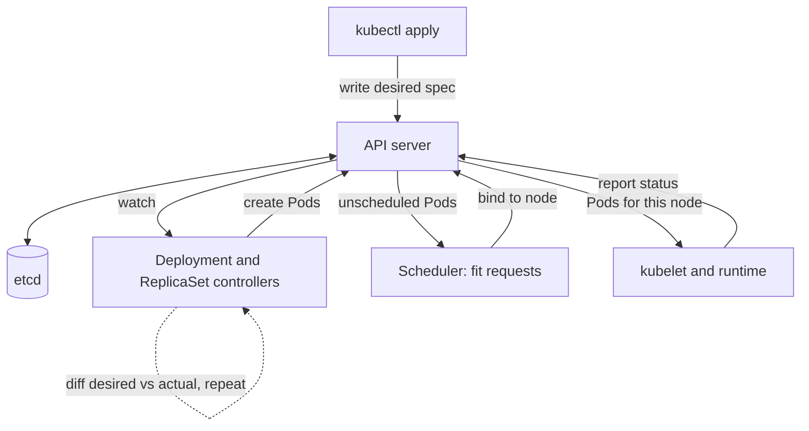

## TL;DR
Kubernetes runs your agent API, agent workers, tool servers and model servers across many machines by
reconciling declared state ("three replicas, ready when `/ready` returns 200") with reality, so long,
streaming agent runs survive deploys and scale on queue depth.

## For agent builders
- **Why it matters for agents.** Agent runs are long (seconds to minutes), stream tokens, call slow tools
  and often sit on GPU-backed model servers. Probes, grace periods and queue-based autoscaling decide
  whether deploys and spikes cut runs off mid-answer.
- **Where it shows up in your stack.** A Deployment for the agent API, a Deployment or Jobs for queue-fed
  agent workers, CronJobs for nightly evals, StatefulSets for the vector database, vLLM or KServe for
  self-hosted models, and namespaced RBAC for each component's service account.
- **What you control.** Readiness that means "model and tools reachable", `terminationGracePeriodSeconds`
  versus your longest run, autoscaling on queue depth instead of CPU, and NetworkPolicies limiting which
  pods the agent's tools may reach.
- **What you can skip.** etcd, CNI internals and writing controllers. Know reconciliation, the core
  objects, requests and limits, the three probes, termination and why GPU Pods sit Pending.

## Lab
### Task
Every deploy of your streaming agent API produces a burst of 5xx and cut-off answers. You write the
pre-deploy check your pipeline runs on the Deployment manifest, then fix the manifest it rejects. The
check is plain Python over YAML, so it runs without a cluster.
- **Agent goal:** a model that loads in 240 s and agent steps of up to 60 s survive startup, rollouts
  and node drains: no liveness kill mid-load, no capacity dip, no SIGKILL mid-step.
- **Time box:** 60-90 minutes.
- **Prerequisites:** Docker (PID 1 and SIGTERM), and this lesson's probes, termination, scheduling
  and "Mapping an agent system onto objects" sections.
- **Needs:** `pyyaml` and `pytest`; checked with PyYAML 6.0.3 and pytest 9.1.1 on Python 3.12. No
  cluster; optionally `kubectl apply --dry-run=server` on kind to confirm the fixed manifest is valid.

### Starter code
```python
# k8s_lab.py: a pre-deploy check for an agent API Deployment, plus fixing the manifest it rejects
import yaml                                           # pip install pyyaml

BAD = """
apiVersion: apps/v1
kind: Deployment
metadata: {name: agent-api}
spec:
  replicas: 3
  strategy: {rollingUpdate: {maxSurge: 1, maxUnavailable: 1}}
  selector: {matchLabels: {app: agent-api}}
  template:
    metadata: {labels: {app: agent-api}}
    spec:
      containers:
      - name: api
        image: registry.example.com/agent-api:latest
        resources:
          limits: {nvidia.com/gpu: 1}
        readinessProbe: {httpGet: {path: /ready, port: 8000}, periodSeconds: 5}
        livenessProbe: {httpGet: {path: /ready, port: 8000}, periodSeconds: 10}
"""

# YOUR CODE (part 2): edit FIXED until check(FIXED, ...) returns [] for this service.
FIXED = BAD

RULES = {
    "K001": "image not pinned by digest",
    "K002": "missing cpu or memory request, or memory limit",
    "K003": "GPU request differs from limit, or no toleration for the nvidia.com/gpu taint",
    "K004": "no startupProbe, or its budget (periodSeconds x failureThreshold) is below model load time",
    "K005": "grace period below longest agent step plus preStop sleep",
    "K006": "rollout may drop below desired replicas (maxUnavailable is not 0)",
    "K007": "liveness probe reuses the readiness path, so a dependency outage restarts Pods",
}

def check(manifest: str, model_load_s: int, longest_step_s: int) -> list:
    """Return the sorted rule ids that the Deployment in `manifest` violates.

    Kubernetes defaults apply when a field is absent: terminationGracePeriodSeconds 30,
    periodSeconds 10, failureThreshold 3, maxUnavailable 25% (anything but 0 counts as K006).
    The preStop sleep is the N in `preStop: {exec: {command: ["sleep", "N"]}}`, else 0.
    K003 applies only to containers that ask for nvidia.com/gpu.
    """
    # YOUR CODE (part 1): implement K001-K007
    return []

if __name__ == "__main__":
    print("BAD:", check(BAD, model_load_s=240, longest_step_s=60))
    print("FIXED:", check(FIXED, model_load_s=240, longest_step_s=60))
    spec = yaml.safe_load(FIXED)["spec"]["template"]["spec"]
    print("FIXED keeps 3 replicas and 1 GPU:", yaml.safe_load(FIXED)["spec"]["replicas"] == 3,
          spec["containers"][0]["resources"]["limits"]["nvidia.com/gpu"] == 1)
```

As given, `check` finds nothing and `FIXED` is still the broken manifest. Checking a GPU limit alone
is enough here because Kubernetes copies an extended-resource limit into the request when the
request is omitted; the rule asks for both so the manifest states its intent.

### Expected output
```
BAD: ['K001', 'K002', 'K003', 'K004', 'K005', 'K006', 'K007']
FIXED: []
FIXED keeps 3 replicas and 1 GPU: True True
```

### Tests
```python
# test_k8s_lab.py: run with `pytest -q`
import copy
import yaml
from k8s_lab import BAD, FIXED, check

def doc(fixed_yaml=FIXED):
    return yaml.safe_load(fixed_yaml)

def run(d, load=240, step=60):
    return check(yaml.safe_dump(d), model_load_s=load, longest_step_s=step)

def pod(d):
    return d["spec"]["template"]["spec"]

def test_bad_manifest_breaks_every_rule():
    assert check(BAD, 240, 60) == ["K001", "K002", "K003", "K004", "K005", "K006", "K007"]

def test_fixed_manifest_passes_and_is_still_the_same_service():
    assert check(FIXED, 240, 60) == []
    d = doc(); c = pod(d)["containers"][0]
    assert d["spec"]["replicas"] == 3 and c["image"].startswith("registry.example.com/agent-api@sha256:")
    assert c["resources"]["limits"]["nvidia.com/gpu"] == 1
    assert c["readinessProbe"]["httpGet"]["path"] == "/ready"

def test_grace_period_defaults_and_counts_prestop():
    d = doc(); p = pod(d)
    p.pop("terminationGracePeriodSeconds", None)
    assert "K005" in run(d)                                   # default 30 < 60
    p["terminationGracePeriodSeconds"] = 64
    p["containers"][0]["lifecycle"] = {"preStop": {"exec": {"command": ["sleep", "5"]}}}
    assert "K005" in run(d)                                   # 64 < 60 + 5
    p["terminationGracePeriodSeconds"] = 65
    assert "K005" not in run(d)

def test_startup_budget_uses_period_times_threshold():
    d = doc(); c = pod(d)["containers"][0]
    c["startupProbe"] = {"httpGet": {"path": "/health", "port": 8000}, "periodSeconds": 10, "failureThreshold": 20}
    assert "K004" in run(d)                                   # 200 s < 240 s
    c["startupProbe"]["failureThreshold"] = 24
    assert "K004" not in run(d)                               # 240 s covers it
    c["startupProbe"] = {"httpGet": {"path": "/health", "port": 8000}}
    assert "K004" in run(d)                                   # defaults: 10 x 3 = 30 s

def test_max_unavailable_default_is_not_zero():
    d = doc(); d["spec"].pop("strategy", None)
    assert "K006" in run(d)

def test_gpu_rules_only_for_gpu_containers():
    d = doc(); p = pod(d); c = p["containers"][0]
    c["resources"]["requests"].pop("nvidia.com/gpu", None)
    assert "K003" in run(d)                                   # limit without matching request
    d = doc(); p = pod(d); p.pop("tolerations", None)
    assert "K003" in run(d)
    d = doc(); p = pod(d); c = p["containers"][0]; p.pop("tolerations", None)
    for k in ("requests", "limits"):
        c["resources"][k].pop("nvidia.com/gpu", None)
    assert "K003" not in run(d)                               # CPU-only container

def test_requests_and_memory_limit_are_required():
    d = doc(); c = pod(d)["containers"][0]
    c["resources"]["limits"].pop("memory", None)
    assert run(d) == ["K002"]

def test_liveness_must_not_reuse_readiness():
    d = doc(); c = pod(d)["containers"][0]
    c["livenessProbe"] = copy.deepcopy(c["readinessProbe"])
    assert run(d) == ["K007"]
```

All 8 fail on the starter: seven with `AssertionError`, and the GPU test with a `KeyError` until
part 2 gives the manifest a `requests` block. Several tests start from your `FIXED`
manifest, so it must pass every rule before they can isolate one.

### Failure scenarios
- **Inject a grace check that ignores `preStop`.** The check accepts the 64-second case and the grace
  test fails: `preStop` eats 5 of those seconds, because the grace clock starts before the hook. On a real cluster you would see
  the last step of a run killed with exit code 137 during `kubectl rollout restart`; compare the
  worker's "step finished" log time with the Pod's deletion timestamp.
- **Inject a K004 check for presence only.** A startup probe with defaults (30 s) passes the check,
  and on a cluster the 240-second load ends in CrashLoopBackOff. `kubectl describe pod` shows
  "Startup probe failed" events before any app log.
- **Inject `maxUnavailable` read with a default of 0.** A manifest without `strategy` passes, but the
  real default is 25%, which rounds down to 0 Pods at 3 replicas; it bites at 4 or more replicas. Rely
  on documented defaults, not the value you would like.
- **Inject a fix that sets `livenessProbe` to `/ready`** "because it checks more". K007 fires; in a
  real incident a model-endpoint outage would restart every replica at once.

### Submission
- **Your `k8s_lab.py`** with `check` implemented and `FIXED` edited, `BAD` unchanged.
- **A `pytest -q` run** showing 8 passed.
- **The script's printed output**, matching the expected lines.
- **A diff of `BAD` versus `FIXED`** with one line per change saying which rule and which failure it
  prevents (5xx after deploy, cut-off stream, CrashLoopBackOff, Pending GPU Pod).
- **Evaluated on:** green tests, Kubernetes defaults applied when fields are absent, the grace budget
  computed as step plus `preStop`, and a fixed manifest that is still the same service.

## Why it exists
- **Docker answers "what to run", not "where and how".** Which machine fits its CPU, memory and GPU needs;
  what happens when it crashes at 3 a.m. or its node dies; how a new version replaces the old without
  downtime; how service A finds B's current IP as replicas come and go; how to go from two replicas to
  twenty; how configuration and secrets reach the process.
- **SSH plus `docker run` fails in a predictable order.** Nothing reconciles: a dead container stays dead
  unless you wrote the watchdog. The real state lives in people's heads and shell history, so no one can say
  what runs where. Compose on a few large hosts has the same gaps.
- **Humans do not bin-pack.** Manual placement leaves expensive GPU nodes half empty while others are
  oversubscribed; bin-packing is what makes GPUs affordable. Every scale, update and rollback becomes a
  bespoke procedure that differs the second time it runs.
- **Borg's idea, generalised.** Google's Borg had operators declare desired state and controllers converge
  the cluster toward it, forever. Kubernetes is the open-source generalisation.
- **Declarations beat commands** ("this should exist" vs "start this here"), *because* declarations can be
  reconciled after failures, versioned in git, and reasoned about without knowing every machine's state.

## How it works
### Control plane and reconciliation
| Component | Job |
|---|---|
| API server | The only component that reads and writes etcd, where every object lives |
| Controllers | Each watches one kind of object and acts to make reality match its spec |
| Scheduler | Assigns Pods with no node to a node whose free resources satisfy their requests |
| kubelet (every node) | Starts containers through the container runtime and reports status |
| kube-proxy and CNI plugin | Networking |

- **`kubectl apply` executes nothing.** It changes desired state in the API server, and controllers converge
  toward it, repeatedly. That is why a deleted Pod comes back and why a `docker run` on a node is invisible to
  the cluster.

Every controller is the same loop, run on every change event and on a periodic resync:

```
loop:
    desired = read spec from API server        # e.g. replicas: 3, image: v2
    actual  = observe status                   # e.g. 2 Pods running v1, 1 Pending
    diff    = desired - actual
    act on diff (create, delete, update)       # one step toward desired, not a script to the end
    write status back
```

- **Level-triggered:** it acts on the current difference, not on the event that caused it, *because* events
  are lost when components restart; a controller that wakes after a crash simply recomputes the diff.
- **No "done" signal from `apply`;** watch status (`kubectl rollout status`) to learn when reality caught up.

### The objects you actually use
| Object | What it is |
|---|---|
| **Pod** | One or more containers sharing a network namespace and volumes; the unit of scheduling; ephemeral, almost never created directly in production (a controller owns it) |
| **Deployment → ReplicaSet → Pods** | Replica count, Pod template and rollout strategy |
| **Service** | Stable virtual IP and DNS name load-balancing to Pods matching a label selector, membership gated by readiness; an Ingress or Gateway brings HTTP in from outside |
| **ConfigMap**, **Secret** | Configuration injected as environment variables or mounted files |
| **Job**, **CronJob** | Run-to-completion work: evals, batch embedding, fine-tuning |
| **StatefulSet** | Stable identity and storage (vector databases) |
| **DaemonSet** | One Pod per node (the GPU device plugin, a log shipper) |
| **Namespace**, RBAC, **ResourceQuota** | Sharing a cluster across teams |

How a Deployment rolls out:
1. Changing the image creates a new ReplicaSet, scaled up while the old one scales down, bounded by
   `maxSurge` and `maxUnavailable`.
2. Old ReplicaSets are kept at zero replicas, which is what makes `kubectl rollout undo` fast.
3. **Kubernetes does not roll back on its own.** A rollout whose new Pods never become ready simply stalls
   (with `maxUnavailable: 0`, harmlessly) and is marked failed after `progressDeadlineSeconds`.
4. Reverting is a human, pipeline or progressive-delivery tool (Argo Rollouts, Flagger) decision.

### Scheduling: requests, limits and GPUs
- **Requests are what the scheduler reserves** on a node; **limits are what the cgroup enforces** at run time.
- **Over a CPU limit** the container is throttled; **over a memory limit** it is OOM-killed (exit code 137).
- **GPUs** are exposed by the NVIDIA device plugin as the extended resource `nvidia.com/gpu`: whole integers,
  request equal to limit, no overcommit, *because* a GPU cannot be time-shared transparently the way CPU can.
- **GPU node pools are usually tainted** so only Pods with a matching toleration land there, keeping CPU-only
  work off expensive hardware.
- **Fractional sharing** needs MIG partitions or time-slicing configured on the node.

### Quality-of-service classes
Requests and limits also set who dies first when a node runs short of memory.

| QoS class | Rule | Evicted under memory pressure |
|---|---|---|
| **BestEffort** | No requests or limits at all | First |
| **Burstable** | Anything in between | Next, those using more than they requested |
| **Guaranteed** | Every container has CPU and memory requests equal to limits | Last |

- **Why Guaranteed goes last:** a Pod that reserved exactly what it uses has made no claim on anyone else's
  memory.
- **The catch:** Guaranteed requires a CPU limit, which reintroduces throttling; the example below is
  Burstable on purpose.

### Probes: the contract that makes rollouts safe
| Probe | Question | On failure | Rule |
|---|---|---|---|
| **Startup** | Has it finished starting (loading weights)? | Other probes stay paused | Needed, *because* otherwise liveness kills the Pod mid-load: CrashLoopBackOff |
| **Readiness** | Should it get traffic? | Removed from Service endpoints, not restarted | Overload or a dependency outage should shed traffic, not restart the process |
| **Liveness** | Should it be restarted? | Container restarted | Cheap; never depends on downstream systems, or a database incident becomes an API restart storm |

### Termination
1. The Pod is marked Terminating.
2. It is removed from Service endpoints, asynchronously, so traffic can still arrive for a moment.
3. Its `preStop` hook runs.
4. PID 1 receives SIGTERM.
5. After `terminationGracePeriodSeconds` (30 by default; the clock starts before `preStop`, so the hook's time
   counts against it) it receives SIGKILL.

- **The server must** stop accepting, drain in-flight requests including streams, and exit.
- **For LLM responses that run for minutes,** raise the grace period and add a short `preStop` sleep so
  endpoint removal propagates first.

### Scaling
- **The Horizontal Pod Autoscaler** changes replica counts on CPU, memory or custom metrics.
- **CPU is a poor signal for GPU-bound services;** scale on queue depth, in-flight requests or tokens waiting,
  through KEDA or custom metrics.
- **Node autoscaling is slow for GPUs.** The Cluster Autoscaler or Karpenter adds nodes, but a GPU node takes
  minutes to boot and pull a multi-gigabyte image, so reactive scaling needs headroom or a warm pool.

### AI workloads specifically
| Where weights live | Trade |
|---|---|
| Baked into the image | Simple, slow to pull |
| Shared read-only volume | Fast start, shared dependency |
| Init container fetches from object storage into an `emptyDir` with a node-local cache | Small image, cache warms per node |

- **Serving stacks** such as vLLM or KServe run as Deployments with the pattern above.
- **Distributed training or inference** runs on Ray via KubeRay.
- **A PodDisruptionBudget** stops node maintenance from evicting every replica at once.

### Mapping an agent system onto objects
| Agent component | Object | Key settings |
|---|---|---|
| Agent API (chat, streaming) | Deployment + Service | Readiness on model and tool reachability, long grace period |
| Background agent workers | Deployment scaled on queue length, or a Job per run | Checkpoint state so a killed run resumes |
| Tool and MCP servers | Deployment per tool, own ServiceAccount | NetworkPolicy so only the agent can call them |
| Code sandbox | Short-lived Pods on an isolated node pool, often with a gVisor RuntimeClass | No secrets, egress denied |
| Nightly evals | CronJob | Same image digest as production |
| Vector DB, memory store | StatefulSet or a managed service | Persistent volumes, backups |
| Self-hosted LLM | Deployment on tainted GPU nodes | Startup probe for weight loading |

- **Long agent runs should not depend on one Pod living.** Persist run state (step, transcript, pending
  tool call) to a database or queue after each step, so a Pod killed by a drain resumes on another.
- **Readiness for an agent API** should fail when its model endpoint is unreachable, so traffic moves to
  replicas that can actually answer; liveness stays cheap and local.

## Diagram
Nothing in the cluster runs your command: `apply` only edits stored state, and the loop on the right keeps
pulling reality toward it, including after failures. The same loop recreates an agent worker that crashed
mid-run, which is why run state must live outside the Pod.



## Examples
### Deployment and Service for a GPU-backed inference API
- **Capacity:** the rollout never drops below three ready replicas.
- **Startup:** the startup probe allows up to ten minutes of model loading before liveness checks begin.
- **Traffic:** the readiness endpoint gates it.
- **Shutdown:** the grace period plus `preStop` sleep let long streaming responses finish before SIGKILL.
- **Image by digest,** so every node runs the same bytes.

```yaml
apiVersion: apps/v1
kind: Deployment
metadata: {name: llm-api}
spec:
  replicas: 3
  strategy: {rollingUpdate: {maxSurge: 1, maxUnavailable: 0}}   # never below 3 ready
  selector: {matchLabels: {app: llm-api}}
  template:
    metadata: {labels: {app: llm-api}}
    spec:
      terminationGracePeriodSeconds: 120       # let long streaming responses finish
      nodeSelector: {accelerator: nvidia-l4}
      tolerations: [{key: nvidia.com/gpu, operator: Exists, effect: NoSchedule}]
      containers:
      - name: api
        image: registry.example.com/llm-api@sha256:3f9c...   # immutable digest, not :latest
        ports: [{containerPort: 8000}]
        envFrom: [{secretRef: {name: llm-api-secrets}}]   # frozen at start; mount as files for hot rotation
        resources:
          requests: {cpu: "2", memory: 8Gi, nvidia.com/gpu: 1}
          limits:   {memory: 8Gi, nvidia.com/gpu: 1}          # no CPU limit: avoids throttling
        startupProbe:                            # model load may take minutes
          httpGet: {path: /health, port: 8000}
          periodSeconds: 10
          failureThreshold: 60                   # up to 10 min before giving up
        readinessProbe:
          httpGet: {path: /ready, port: 8000}    # 200 only after the model is loaded and warm
          periodSeconds: 5
        livenessProbe:
          httpGet: {path: /health, port: 8000}   # cheap, no downstream calls
          periodSeconds: 30
        lifecycle:
          preStop: {exec: {command: ["sleep", "5"]}}   # let endpoint removal propagate
---
apiVersion: v1
kind: Service
metadata: {name: llm-api}
spec:
  selector: {app: llm-api}
  ports: [{port: 80, targetPort: 8000}]
```

### A level-triggered reconcile loop you can run
A toy Deployment controller with `maxSurge` 1. Each step looks only at the current state, so when a node
dies mid-rollout it does not need to replay the lost event: the next diff simply includes the missing Pod.

```python
MAX_SURGE = 1
desired = {"replicas": 3, "image": "v2"}
pods = ["v1", "v1", "v1"]                      # observed: 3 Pods on the old image

def reconcile(pods):
    """One level-triggered step: compute the current diff and take ONE action."""
    new = [p for p in pods if p == desired["image"]]
    old = [p for p in pods if p != desired["image"]]
    if len(new) < desired["replicas"] and len(pods) < desired["replicas"] + MAX_SURGE:
        return pods + [desired["image"]], "create new Pod"
    if old:
        pods = pods.copy(); pods.remove(old[0])
        return pods, "delete one old Pod"
    if len(new) > desired["replicas"]:
        return pods[1:], "scale down extra Pod"
    return pods, "in sync"

for step in range(10):
    if step == 3:
        pods = pods[1:]                        # a node dies: one Pod vanishes, no event replayed
        print("   !! lost a Pod:", pods)
    pods, action = reconcile(pods)
    print(f"{step}: {action:22} {pods}")
    if action == "in sync":
        break
# Converges to ['v2', 'v2', 'v2'] in six steps despite the lost Pod.
```

### Worked scenario: the termination and startup timelines of the manifest above
Numbers come straight from the manifest and the defaults.

| Moment | What happens |
|---|---|
| t = 0 s | Pod marked Terminating; endpoint removal starts propagating; `preStop` `sleep 5` begins |
| t = 5 s | `preStop` ends; uvicorn (PID 1) gets SIGTERM, stops accepting, drains streams |
| t = 120 s | SIGKILL if still running; the budget includes the 5 s `preStop` |
| Startup budget | `periodSeconds: 10` × `failureThreshold: 60` = 600 s, the "up to 10 min" in the comment |
| Default liveness, no startup probe | about 30 seconds of failed checks before a restart, so a 4-minute model load loops forever |
| Rollout with 3 replicas, `maxSurge: 1` | Needs a 4th GPU free during the rollout; capacity never dips below 3 ready |

### Agent workers scaled on queue length with KEDA
Background agent runs (ticket triage, research tasks) are pushed onto a Redis list; KEDA scales the
worker Deployment on its length. Each worker checkpoints after every agent step, so the grace period only
needs to cover one step, not a whole run.

```yaml
apiVersion: keda.sh/v1alpha1
kind: ScaledObject
metadata: {name: agent-workers}
spec:
  scaleTargetRef: {name: agent-worker}     # a Deployment of agent workers
  minReplicaCount: 1                       # keep one warm worker
  maxReplicaCount: 30
  triggers:
  - type: redis
    metadata:
      address: redis.agents.svc:6379
      listName: agent-runs
      listLength: "5"                      # target pending runs per replica
```

### Worked scenario: sizing the grace period for agent runs
Interactive agent runs take p50 40 s and p99 6 minutes (illustrative). Each step (one model call plus one
tool call) is at most about 60 s.

| Design | Grace period needed | What happens on a node drain |
|---|---|---|
| Run lives only in the Pod's memory | Above 6 minutes, plus `preStop` | Drains take minutes per node; anything longer is lost |
| Checkpoint after every step, resume elsewhere | About 60 s plus a 5 s `preStop` | Current step finishes, run resumes on another Pod |
| Default 30 s, no checkpoint | 30 s | Every run longer than 30 s is cut off on each deploy |

Checkpointing turns "raise the grace period forever" into a bounded, per-step budget.

## Production patterns
- **PodDisruptionBudget for every serving Deployment.** Add a `policy/v1` PodDisruptionBudget with
  `minAvailable: 2` and the same label selector, so node drains and upgrades evict one replica at a time.
  Watch `kubectl get pdb` for "allowed disruptions" stuck at 0, which blocks maintenance.
- **Autoscale GPU services on queue depth.** Use KEDA or the HPA with a custom metric (requests waiting or
  in flight per replica) instead of CPU, and keep a warm node or spare replica because GPU nodes take minutes.
  Monitor queue depth, Pending Pods and time from scale-up to ready.
- **Dedicated, tainted GPU node pools.** Taint GPU nodes `nvidia.com/gpu:NoSchedule`, give GPU Pods the
  matching toleration and a `nodeSelector`, and set a ResourceQuota on `nvidia.com/gpu` per namespace.
  Compare GPU allocation with actual utilization (for example from NVIDIA's DCGM exporter).
- **Progressive delivery with automatic abort.** Run rollouts through Argo Rollouts or Flagger as a canary
  with an analysis step on 5xx rate and latency, so the tool reverts instead of a human at 3 a.m. Track
  rollout duration and aborted rollouts.
- **Event-first debugging.** Start every incident with `kubectl describe pod <name>` and `kubectl get events
  --sort-by=.lastTimestamp`, which show `Insufficient nvidia.com/gpu`, OOMKilled and probe failures before any
  log does. Alert on restart counts and Pods Pending beyond a few minutes.
- **Isolate agent tools with NetworkPolicy and ServiceAccounts.** Give each tool server its own
  ServiceAccount with minimal RBAC, and a NetworkPolicy so only agent Pods can reach it and sandbox Pods
  can reach nothing internal. NetworkPolicy only bites if the CNI enforces it (Calico or Cilium do; some
  defaults do not), so test a denied connection after enabling.
- **Evals as CronJobs on the production image.** Run the agent eval suite nightly as a CronJob pinned to the
  deployed digest, writing scores to your metrics store. Alert when a score drops versus the last run.

## Trade-offs
- **Declarative reconciliation vs operating cost.** Self-healing and repeatable deploys, paid for with a large
  object model and a control plane to operate. For one service on one box a managed container service is less
  to learn; the balance flips once you have several services, GPUs, batch jobs and more than one team.
- **`maxUnavailable: 0` vs spare GPUs.** It keeps capacity during rollouts but needs a spare GPU for the surge
  Pod; when GPUs are scarce you choose between a brief capacity dip and permanently reserved headroom.
- **CPU limits vs latency.** They protect neighbours from a runaway process but throttle latency-sensitive Pods
  through the CFS quota. The common compromise: always set requests and memory limits, rarely CPU limits.
- **Queue-depth autoscaling vs idle cost.** It tracks load correctly, but GPU node provisioning takes minutes,
  so reactive scaling needs idle headroom that costs money every hour it is not used.
- **Job per agent run vs long-lived workers.** A Job per run gives isolation and clean resource accounting,
  but pays Pod start time on every run and floods the API server at high volume. Queue-fed workers start
  runs instantly but need checkpointing and careful cleanup of per-run state.

## Pitfalls
- **No resource requests.** Symptom: nodes overloaded and Pods evicted, or, with requests set too high, Pods
  stuck Pending with `Insufficient nvidia.com/gpu` in the events.
- **A liveness probe that calls the model or the database.** Symptom: a restart storm during an incident that
  turns a slow dependency into a full outage.
- **No startup probe on a service that loads weights for minutes.** Symptom: CrashLoopBackOff. Liveness kills
  the container mid-load (with default settings after about 30 seconds of failed checks), and the restart
  backoff grows toward its five-minute cap while the model never finishes loading.
- **Readiness returning 200 before the model is loaded.** Symptom: a burst of 5xx responses right after every
  deploy.
- **The default 30-second grace period with no drain logic.** Symptom: streaming responses cut mid-token on
  every rollout and node drain.
- **Deploying a `:latest` tag.** Symptom: Pods on different nodes run different code depending on when each
  node last pulled.
- **OOMKilled with no application log.** Symptom: restarts under load because the memory limit was set below
  the real peak of tokenizer plus model plus batch.
- **Treating `emptyDir` or local disk as durable for an index.** Symptom: data gone after the Pod is
  rescheduled.
- **HPA on CPU for a GPU-bound service.** Symptom: a growing queue while the autoscaler sees low CPU and never
  adds replicas. Agent workers have the same problem: they mostly wait on model and tool calls, so CPU
  stays low while runs pile up.
- **Agent run state held only in Pod memory.** Symptom: users see runs vanish or restart from scratch after
  every deploy or node drain. Fix: checkpoint after each step and resume from the queue.

## When to use
- **Use for agents** when the system has grown past one service: agent API plus workers, tool servers, a
  vector DB and evals, or self-hosted models on GPUs.
- **Use when** you run several services, need GPU scheduling, run batch jobs beside serving, share
  infrastructure across teams, or deploy into enterprises that already run it, which is most of them.
- **Avoid when** it is a single container with modest load: a managed serverless container platform (Cloud
  Run, AWS App Runner) or a simpler orchestrator (ECS, Nomad) costs less to operate. Those give scheduling and
  restarts but a smaller object model, less portability and, for serverless, limited GPU and long-request
  support.
- **Managed is not free.** Even on EKS, GKE or AKS you own node pools, upgrades, add-ons and every manifest,
  which is where most of the operating cost lives.
- **Measure:** time-to-ready for a new Pod, rollout duration, restart counts, Pending Pods, and GPU allocation
  versus actual utilization.
- **Day to day:** `kubectl get`, `describe`, `logs` and `exec`, reading events, writing Deployments, Jobs and
  autoscalers, packaged with Helm or Kustomize.
- **Interviews:** explain reconciliation, how a Deployment rolls out, the three probes, requests versus
  limits, GPU scheduling and graceful termination.

## Role lens
- **Engineer:** Writes manifests or Helm charts, sets probes, requests and grace periods correctly, and
  debugs CrashLoopBackOff, OOMKilled and Pending Pods from `describe` output and events.
- **Architect:** Designs the cluster topology (GPU node pools, taints, namespaces, quotas), chooses
  autoscaling signals, decides where weights live, and picks managed versus self-run control planes.
- **FDE:** Deploys into the customer's cluster with their CNI, ingress, Pod Security Standards,
  registry mirrors, GPU operator version and restricted RBAC, and sizes node pools with their platform
  team.

## Check yourself
**Q:** After each deploy of your vLLM-based service, users see a burst of errors and some streaming
responses are cut off, even though the Deployment uses a rolling update. What is happening and how do
you fix it?
**A:** Two separate failures. The errors at the start come from new Pods reporting ready before the
engine has loaded, so the Service routes to them; fix it by making `/ready` return 200 only after the
model is loaded and a warm-up request succeeded, and add a startup probe with a generous
`failureThreshold` so liveness does not kill Pods during load. The cut-off streams come from old Pods
receiving SIGTERM and either exiting immediately or hitting the 30-second default grace period
mid-stream; fix it by handling SIGTERM to stop accepting and drain in-flight requests, raising
`terminationGracePeriodSeconds` to cover the longest stream, and adding a `preStop` sleep so endpoint
removal propagates before shutdown begins. Set `maxUnavailable: 0` with `maxSurge: 1` so capacity never
dips, accepting one spare GPU during rollout, and verify by watching 5xx and stream-abort metrics
across a rollout.

## Interview questions
### What does "level-triggered reconciliation" mean, and why does Kubernetes use it?
- **Definition:** each controller compares desired spec with observed state and acts on the current
  difference, not on the event that caused it.
- **Why:** events are lost when components restart; a controller that wakes after a crash recomputes the diff
  and carries on, which is why deleted Pods come back.
- **Consequence:** `apply` gives no "done"; you watch `kubectl rollout status`.

### A GPU Pod has been Pending for 20 minutes. How do you debug it?
- **Read the events** with `kubectl describe pod`: `Insufficient nvidia.com/gpu` means no node has a free
  whole GPU; a taint message means the toleration or `nodeSelector` is wrong.
- **Check supply:** is the device plugin DaemonSet running on GPU nodes, is the node pool at its max, is the
  node autoscaler able to add a node?
- **Check quotas:** a namespace ResourceQuota on `nvidia.com/gpu` can block it too.

### When would you set CPU limits, and when would you not?
- **Without CPU limits,** latency-sensitive Pods avoid CFS throttling, and requests still guarantee their
  share under contention.
- **Set them** when you need Guaranteed QoS (last to be evicted) or must contain a noisy neighbour on shared
  nodes.
- **Always set** requests and memory limits; memory cannot be throttled, only OOM-killed.

### How do you deploy an LLM or agent service whose responses stream for up to two minutes without cutting them?
- **Readiness** returns 200 only after the model is loaded and warm, with a startup probe covering load time.
- **Termination:** handle SIGTERM by draining, set `terminationGracePeriodSeconds` above the longest stream
  plus the `preStop` sleep, for example 120 with a 5-second sleep.
- **Rollout:** `maxUnavailable: 0`, `maxSurge: 1` and a PodDisruptionBudget so capacity never dips.

### Why is CPU a bad autoscaling signal for a GPU inference service?
- **The work is on the GPU,** so CPU can stay low while requests queue; the HPA never scales.
- **Scale on demand directly:** queue depth, in-flight requests or tokens waiting, via KEDA or custom metrics.
- **Plan for lag:** GPU nodes take minutes to boot and pull, so keep headroom or a warm pool.

### Background agent runs last up to ten minutes. How do you run them on Kubernetes so deploys and drains do not lose work?
- **Queue plus workers:** push runs onto a queue and scale a worker Deployment on queue length with KEDA,
  not on CPU, since agents mostly wait on I/O.
- **Checkpoint per step:** persist the transcript and next action after each model or tool call, so a
  SIGTERM only has to finish one step and another Pod resumes the run.
- **Bound the blast:** a PodDisruptionBudget for workers, and idempotent tool calls so a resumed step does
  not repeat side effects.

## Quiz
### Q: What does `kubectl apply` of a Deployment manifest actually do?
- [ ] Starts the containers on the node your kubeconfig points at
- [x] Records desired state in the API server; controllers then create ReplicaSets and Pods and keep converging reality toward that spec
- [ ] Builds the image and pushes it to the cluster's registry
- [ ] Sends the manifest to every kubelet, which executes it once
> Kubernetes is declarative: `apply` changes the stored spec and the Deployment and ReplicaSet
> controllers do the work, repeatedly, which is why Pods are recreated after failures. Nothing builds
> images, and kubelets only run Pods the scheduler has bound to their node.

### Q: Which probe should decide whether a Pod receives traffic, without restarting it?
- [ ] livenessProbe
- [x] readinessProbe
- [ ] startupProbe
- [ ] the preStop hook
> A failing readiness probe removes the Pod from Service endpoints and nothing else, which is the right
> response to overload or a dependency outage. Liveness failure restarts the container, the startup
> probe only gates the other probes during initialisation, and preStop runs at termination.

### Q: Why do GPU Pods often sit Pending while CPU Pods on the same cluster schedule immediately?
- [ ] GPU Pods must be created with `kubectl run` rather than a Deployment
- [ ] The scheduler only honours GPU requests in the kube-system namespace
- [x] `nvidia.com/gpu` is an integer, non-overcommittable resource exposed by the device plugin, and GPU nodes are usually tainted, so the Pod needs a free whole GPU plus a matching toleration
- [ ] GPU nodes do not run the kubelet
> CPU is requested in millicores on plentiful, cheap nodes, so a CPU Pod usually fits somewhere. A GPU
> request needs an entire unallocated device on a node whose taint the Pod tolerates; if none is free the Pod waits
> until one is released or a new node is provisioned.

## Use cases & projects
### Use cases
- **Serving a streaming agent API.** Readiness gated on model reachability, a long grace period and
  `maxUnavailable: 0` keep answers flowing through deploys.
- **Queue-fed background agents.** Workers scale on queue length with KEDA and checkpoint each step, so
  spikes and node drains do not lose runs.
- **Self-hosted models for agents.** vLLM on tainted GPU node pools with startup probes covering weight
  loading.
- **Nightly agent evals.** CronJobs run the eval suite against the deployed image digest and report score
  drift.

### Mini project
**Deploy a resumable agent worker on a local cluster (2-3 hours).**
- **Goal:** agent runs that survive a rolling restart of their workers.
- **Steps:** start kind or minikube; deploy Redis and a worker Deployment that pops run ids, executes a
  fake 10-step agent (sleep plus a fake tool call per step) and writes a checkpoint after each step; add
  readiness and liveness probes and a SIGTERM handler that finishes the current step; enqueue 20 runs and
  run `kubectl rollout restart` mid-way.
- **Done when:** all 20 runs complete with exactly 10 steps each, none restarts from step 1, and every old
  worker's log (follow it with `kubectl logs -f` during the restart, since deleted Pods take their logs
  with them) ends with "step finished, exiting" well inside
  the grace period, not mid-step.
