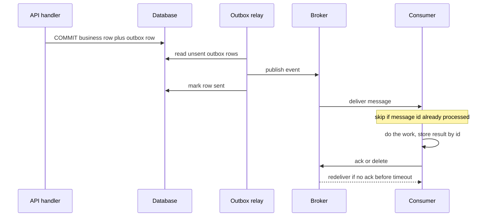

## TL;DR
A message queue durably buffers work between producers and consumers: RAG ingestion, long agent tool
calls, run events. Delivery is at-least-once, so agent consumers must be idempotent. Kafka is a
replayable log, SQS a managed queue, RabbitMQ a routing broker.

## For agent builders
- **Why it matters for agents.** Agents trigger work that is slow, bursty or failure-prone: embedding a
  1,000-page upload, a tool that runs for minutes, fan-out to sub-agents. A queue lets the agent hand that
  off, survive worker crashes and absorb bursts, as long as every consumer tolerates seeing a message twice.
- **Where it shows up in your stack.** SQS or RabbitMQ behind Celery and other job frameworks, Kafka
  carrying run and token events into billing and eval pipelines, document-ingestion queues feeding vector
  indexes, and webhook buffers for provider batch APIs.
- **What you control.** The message key (run id, document id, tool-call id), visibility timeout or ack
  deadline versus real model latency, the DLQ and its owner, outbox publishing, and autoscaling on lag.
- **What you can skip.** Broker internals such as Raft details and Kafka rebalancing protocols. Know
  at-least-once, the outbox, partitions and the λ/μ drain arithmetic.

## Why it exists
- **Inline fan-out fails.** A request triggering five actions (store the upload, extract text, embed
  chunks, update the index, notify the user) would take minutes, fail entirely on any one failure, and hit
  every downstream at the burst rate.
- **Synchronous calls couple three things.** Availability (embedder down, uploads fail), capacity (the
  slowest service sets the pace) and deployment (a change in one means retries across all).
- **"Retry in a background thread" is not a fix.** It loses the work when the process restarts and still
  has no buffer when the downstream is slower than the upstream.
- **A queue removes all three couplings.** Producers write and return, the broker stores durably, consumers
  pull at their own rate, and messages wait while a consumer is down. It also gives fan-out (several
  consumer groups read one event), load levelling (a burst becomes a backlog that drains), and a home for
  retries and dead-letter handling.
- **AI systems use it constantly,** for ingestion pipelines, batch embedding, buffering provider webhooks,
  decoupling an agent's tool calls from their executors, and events (run started, tool failed, tokens
  consumed) for observability and billing. The price: the system becomes asynchronous and eventually
  consistent, and every consumer must tolerate seeing the same message twice.

## How it works
### The core loop
1. A producer publishes a message to a named destination (queue, topic, exchange).
2. The broker persists it and makes it available.
3. A consumer receives it and does the work.
4. The consumer **acknowledges** it; only then does the broker consider it done.
5. If the consumer crashes before acknowledging, the broker redelivers to another consumer.

| Ack timing | Guarantee | Failure mode |
|---|---|---|
| After the work | **at-least-once** | finishing then dying before the ack causes a duplicate |
| Before the work | **at-most-once** | no duplicates, but a crash loses the message |

- **"Exactly-once" across arbitrary side effects is not achievable.** Systems offer at-least-once plus
  **idempotent** consumers (deduplicate by message id or business key): effectively-once from the outside.
- **Kafka's "exactly-once semantics" is real but narrower.** Idempotent producers plus transactions make a
  read-from-Kafka, write-to-Kafka pipeline commit outputs and consumer offsets atomically, so nothing
  inside Kafka is duplicated.
- **The guarantee ends at Kafka's edge.** A consumer that calls an email API or writes to a database is
  back to at-least-once plus idempotency.

### Publishing reliably
- **The dual write.** A handler commits an order, then publishes `order.created`; a crash between the two
  leaves an order with no event, ever.
- **Publishing first is worse:** consumers act on an order the database then rolls back. Retrying the
  publish does not help when the process is gone.
- **The transactional outbox.** Write the event into an `outbox` table in the same database transaction as
  the business change; a separate relay (a poller, or change-data capture reading the database log)
  publishes outbox rows and marks them sent.
- **The relay is at-least-once too.** It can crash after publishing and before marking, so consumers still
  deduplicate.

### Ordering, partitions and parallelism
- **More workers, no order.** One queue consumed by one worker is ordered; add workers and messages
  complete out of order.
- **Kafka partitions.** A topic is split into N ordered logs; a message's key picks its partition (same
  key, same partition, strict order); a **consumer group** assigns each partition to exactly one consumer.
- **So parallelism is capped by partition count,** and a skewed key (one huge tenant) makes one partition hot.

| Broker | Ordering |
|---|---|
| Kafka | strict within a partition |
| SQS FIFO | the same idea, per message group id |
| SQS standard | best-effort only |
| RabbitMQ | FIFO as stored, but competing consumers and requeued redeliveries mean messages are not *processed* in order once there is more than one consumer or any failure |

### Backpressure and retries
- **Watch the lag.** A queue only levels load if someone watches **lag** (messages waiting, or the age of
  the oldest message); an unbounded backlog is a silent outage.
- **The arithmetic.** With arrivals λ per second and completions μ, the backlog grows at λ − μ while λ > μ
  and drains at μ − λ afterwards.

| Scenario | Drain time |
|---|---|
| 120,000 waiting, consumers 500/s, steady arrivals 400/s | 120,000 ÷ 100 = 1,200 s, twenty minutes in which every new message waits |
| Consumers doubled to 1,000/s | 200 s |

- **Autoscale on lag, not CPU.** That is why consumer autoscaling keys off lag or oldest-message age.
- **λ above max μ is debt.** If arrivals exceed the maximum service rate for long, the queue is
  accumulating debt, and the producer must be slowed or work shed.
- **Bound in-flight messages:** RabbitMQ `prefetch`, SQS `MaxNumberOfMessages`, Kafka `max.poll.records`.
- **Retry, then dead-letter.** Failed messages retry with backoff and after N attempts go to a
  **dead-letter queue** (DLQ), so one poison message cannot block the rest.
- **Claim-check large payloads.** A PDF or transcript should not travel through the broker: store it in
  object storage and send the reference.

### Kafka: a distributed, replayable log
- **Retention, not deletion.** Messages stay on disk for a configured retention (time or size), whether
  consumed or not.
- **Consumers own offsets.** Each tracks and commits its **offset** per partition; replay means resetting it.
- **Durability:** each partition is replicated to several brokers; producers use `acks=all` plus the
  idempotent producer setting, which deduplicates retries within a session.
- **Log compaction** keeps the latest message per key, turning a topic into a changelog.
- **Fit:** high throughput, many consumers of one stream, event sourcing. **Cost:** an operations burden
  (or a managed service) and rigid partition-based parallelism; a poor fit for a small job queue needing
  per-job retry and priority.
- **Share groups (KIP-932)** add queue-style consumption with per-message acknowledgement beyond the
  partition count in recent releases; check its maturity on your version before relying on it.

### SQS: a managed queue without replay
- **Fully managed:** no brokers to run, near-unlimited throughput on standard queues, pay-per-request.
- **Visibility timeout:** a received message is hidden from others until the consumer deletes it or the
  timeout expires, when it reappears.
- **Long polling** waits up to 20 seconds for messages instead of returning empty.
- **No replay:** retention is bounded (days, not forever) and messages are deleted when acknowledged.
- **Redrive policy** moves messages to a DLQ after `maxReceiveCount` attempts.
- **Standard vs FIFO:** standard is at-least-once with best-effort ordering; FIFO adds ordering per message
  group and a deduplication id honoured for a five-minute window.
- **Size limits:** 256 KiB for most of SQS's history, raised to 1 MiB in 2025 (check current limits), so
  large payloads go to S3.

### RabbitMQ: a routing broker
- **AMQP exchanges:** producers publish to an **exchange**; bindings route to **queues** by routing key
  (direct), pattern (topic), to all bound queues (fanout), or by headers. Complex routing and
  per-consumer queues are easy.
- **Flow control:** consumers ack or nack; `prefetch` bounds in-flight messages per consumer; dead-letter
  exchanges handle rejects and TTL expiry.
- **Durability:** quorum queues replicate via Raft; the newer streams feature adds a Kafka-like replayable log.
- **Fit:** task distribution with rich routing and moderate throughput; it needs operating like any
  stateful system.

### Choosing
| Need | Choose |
|---|---|
| Replay, many independent consumers of the same events, very high throughput | Kafka (or a managed equivalent) |
| Simple durable buffer, minimal operations, on AWS | SQS |
| Routing rules, per-message priorities, AMQP interop | RabbitMQ |
| Small job queue, already on PostgreSQL | a table with `SKIP LOCKED`; Redis-backed queues sit between that and a real broker |

### Queues in an agent system
| Flow | What goes on the queue | Key / dedup id |
|---|---|---|
| **RAG ingestion** | "document uploaded" events; workers chunk, embed, index | document id (plus content hash) |
| **Long tool calls** | the tool call the agent decided on; a worker executes it and emits a result | tool-call id |
| **Sub-agent fan-out** | one message per sub-task; a joiner waits for all results | parent run id plus sub-task index |
| **Run events** | run started, tool failed, tokens consumed, for billing, traces and evals | run id |

- **The agent loop pauses, not blocks.** For a tool that takes minutes, the run records "waiting on
  tool-call X", the worker publishes the result, and a consumer resumes the run; no process sits holding
  a model context open.
- **The tool-call id is the idempotency key** end to end, because a redelivered "send invoice" message must
  not send a second invoice.

## Diagram
The full at-least-once path: the outbox closes the producer's dual-write gap, and the ack after the work
closes the consumer's, so the only remaining risk is a duplicate, which the idempotency check absorbs.



## Examples
### An SQS consumer for an embedding job
- **Long-polls** for up to five messages at a time.
- **Processes idempotently:** the job id is the dedup key stored with the result.
- **Heartbeats every message in the batch,** extending visibility while they wait and while the slow model
  call runs, so none is redelivered mid-flight.
- **Deletes only after success;** failures expire and retry, and the redrive policy sends repeat offenders
  to a DLQ.

```python
import json, threading, boto3

sqs = boto3.client("sqs")
QUEUE = "https://sqs.us-east-1.amazonaws.com/123456789012/embed-jobs"

def extend_visibility(receipt, stop, every=30, extra=60):
    while not stop.wait(every):                        # heartbeat while work is in flight
        sqs.change_message_visibility(QueueUrl=QUEUE, ReceiptHandle=receipt,
                                      VisibilityTimeout=extra)

def process(job):
    if results.exists(job["job_id"]):                  # idempotent: seen this job already
        return
    vectors = embed(load_chunks(job["document_id"]))   # the slow call
    results.store(job["job_id"], vectors)              # write result keyed by job id

while True:
    resp = sqs.receive_message(QueueUrl=QUEUE, MaxNumberOfMessages=5,
                               WaitTimeSeconds=20, VisibilityTimeout=60)
    batch = resp.get("Messages", [])
    stops = [threading.Event() for _ in batch]          # heartbeat all, not just the current one
    for msg, stop in zip(batch, stops):
        threading.Thread(target=extend_visibility,
                         args=(msg["ReceiptHandle"], stop), daemon=True).start()
    for msg, stop in zip(batch, stops):
        try:
            process(json.loads(msg["Body"]))
            sqs.delete_message(QueueUrl=QUEUE, ReceiptHandle=msg["ReceiptHandle"])
        except Exception as e:
            log.warning("job failed, will be redelivered: %s", e)   # no delete: retry later
        finally:
            stop.set()
```

- **App-supplied names:** `results`, `embed`, `load_chunks` and `log` are the application's own; the shape
  of the loop is what matters.
- **Why the batch-wide heartbeat:** without it, messages two to five would sit unprocessed while message
  one ran, their 60-second timeout would lapse, and another worker would receive them too.
- **Same loop elsewhere:** with Kafka, poll, process, then commit the offset; with RabbitMQ, set
  `basic_qos(prefetch_count=5)`, `basic_consume`, and `basic_ack` after success.

### Runnable: backlog drain and consumer sizing
Pure Python for the λ/μ arithmetic above; use it to set autoscaling targets.

```python
import math

def drain_seconds(backlog, arrival_per_s, service_per_s):
    """Time to clear a backlog while new messages keep arriving (λ = arrival, μ = service)."""
    if service_per_s <= arrival_per_s:
        return math.inf                      # λ ≥ μ: the queue is accumulating debt, not levelling load
    return backlog / (service_per_s - arrival_per_s)

def consumers_needed(backlog, arrival_per_s, per_consumer_per_s, target_s):
    """Smallest consumer count that drains the backlog within target_s."""
    return math.ceil((backlog / target_s + arrival_per_s) / per_consumer_per_s)

print(drain_seconds(120_000, 400, 500))      # 1200.0 s, twenty minutes
print(drain_seconds(120_000, 400, 1_000))    # 200.0 s after doubling consumers
print(drain_seconds(120_000, 600, 500))      # inf: shed load or slow the producer
print(consumers_needed(120_000, 400, per_consumer_per_s=50, target_s=300))   # 16
```

### Agent scenario: a long tool call handed to a queue
A research agent decides to call `transcribe_video`, which takes 2-6 minutes. The agent service records
the call and enqueues it; a tool worker executes it idempotently and publishes the result, which resumes
the run. `tool_results`, `run_tool` and `publish` are application-supplied.

```python
def handle_tool_call(msg):
    call = json.loads(msg["Body"])          # {"tool_call_id", "run_id", "tool", "args"}
    done = tool_results.get(call["tool_call_id"])
    if done is None:                        # redelivery after a crash skips straight to publish
        output = run_tool(call["tool"], call["args"],
                          idempotency_key=call["tool_call_id"])  # side-effecting tools dedupe too
        done = tool_results.put(call["tool_call_id"], output)    # keyed by tool-call id
    publish("agent.tool_result", key=call["run_id"],           # same key keeps one run's events in order
            body={"run_id": call["run_id"], "tool_call_id": call["tool_call_id"], "result_ref": done})
```

| Setting | Value | Why |
|---|---|---|
| p99 tool duration | ~6 min | a fixed visibility timeout would have to exceed this |
| Visibility timeout | 60 s, heartbeat every 30 s | the heartbeat covers the 6 minutes, while a crashed worker's message reappears within a minute |
| `maxReceiveCount` | 5 | a video that always crashes the transcriber goes to the DLQ, and the run is marked failed |

The result event carries a reference, not the transcript, because a long transcript is a claim-check
payload for object storage.

### Production SQL: the transactional outbox
The business row and the event commit together; the relay publishes and marks rows, and several relays
can run safely because of `SKIP LOCKED`.

```sql
CREATE TABLE outbox (
  id         uuid PRIMARY KEY DEFAULT gen_random_uuid(),
  topic      text NOT NULL,
  key        text NOT NULL,                 -- partition key, e.g. document id
  payload    jsonb NOT NULL,
  created_at timestamptz NOT NULL DEFAULT now(),
  sent_at    timestamptz
);

-- In the request handler: one transaction for the change and its event.
BEGIN;
INSERT INTO documents (id, tenant_id, status) VALUES ($1, $2, 'uploaded');
INSERT INTO outbox (topic, key, payload)
VALUES ('document.uploaded', $1, jsonb_build_object('document_id', $1::uuid, 'tenant_id', $2::uuid));
COMMIT;

-- In the relay: lock a batch, publish each row to the broker, then mark them sent.
-- The transaction stays open while publishing, so keep batches small and the broker timeout short.
BEGIN;
SELECT id, topic, key, payload FROM outbox
WHERE  sent_at IS NULL
ORDER  BY created_at
LIMIT  100
FOR UPDATE SKIP LOCKED;
-- ... publish every row; a crash here means they are published again later ...
UPDATE outbox SET sent_at = now() WHERE id = ANY($1);   -- $1: ids of the rows just published
COMMIT;
```

## Production patterns
- **Autoscale consumers on age, not CPU.** On SQS scale from CloudWatch `ApproximateAgeOfOldestMessage`
  and `ApproximateNumberOfMessagesVisible`; on Kafka from consumer-group lag (shown by
  `kafka-consumer-groups.sh --describe`). KEDA has scalers for both on Kubernetes. Alert when oldest-message
  age exceeds the product's freshness promise.
- **DLQ with an owner and a redrive path.** Set `maxReceiveCount` to a small number (for example 5), alarm
  on any DLQ depth above zero, and after fixing the bug move messages back to the source queue (SQS
  supports DLQ redrive). Monitor DLQ inflow rate by error type.
- **Durable Kafka producers.** Set `acks=all` and `enable.idempotence=true`, use replication factor 3 with
  `min.insync.replicas=2`, so one broker loss neither loses nor blocks writes. Monitor under-replicated
  partitions and producer error rate.
- **Outbox via change-data capture.** Instead of polling, stream the `outbox` table from the database log
  (for example Debezium's outbox event router) into the broker. Monitor relay lag and the age of the
  oldest unsent outbox row.
- **Timeouts sized to real model latency.** Set the visibility timeout or ack deadline above p99
  processing time and heartbeat for long calls; key every result by message or job id. Monitor
  redelivery rate (SQS `ApproximateReceiveCount` per message) as a timeout-too-short signal.
- **Separate queues per agent workload class.** Interactive tool calls, bulk ingestion and nightly eval
  runs get their own queues and consumer pools, so a 50,000-document backfill cannot delay a user's agent
  waiting on one tool result. Monitor oldest-message age per queue against each class's latency promise.
- **Failed runs surface from the DLQ.** When a tool-call message dead-letters, a consumer marks the agent
  run failed with the error, so the user and the agent see a final state instead of waiting forever.
  Monitor DLQ inflow per tool name.

## Trade-offs
- **Decoupling vs visibility.** Producers gain availability and burst tolerance, but the caller no longer
  knows when (or whether) work finished, so every flow needs a status path or an event back.
- **At-least-once vs at-most-once.** At-least-once never loses acknowledged work but forces idempotent
  consumers; at-most-once is simpler and acceptable only for data you can drop, such as metrics samples.
- **Kafka replay vs weight.** The retained log allows replay and many consumer groups, but operations
  cost, partition planning and no per-message retry make it heavy for a plain job queue.
- **SQS simplicity vs history.** No broker operations and no capacity planning, but no replay, bounded
  retention and a small message size push payloads to S3 and audit history to a database.
- **RabbitMQ routing vs scale.** Exchanges give fine-grained routing and priorities, but one very hot queue
  is harder to scale than Kafka partitions, and the cluster must be run and upgraded.
- **Keyed ordering vs parallelism.** Partition keys preserve per-entity sequence, but parallelism is capped
  by partition count and a skewed key concentrates load; flip to unordered queues when order does not matter.

## Pitfalls
- **Non-idempotent consumers.** Symptom: duplicate emails, double charges or two embeddings per chunk after
  any consumer restart or timeout.
- **A visibility timeout or ack deadline shorter than the work** (a 90-second model call under a 30-second
  timeout). Symptom: the same job on two workers and redelivery counts climbing under load.
- **No dead-letter queue.** Symptom: one malformed message redelivered forever, consuming a worker and
  hiding a growing backlog behind it.
- **Committing the Kafka offset (or deleting the SQS message) before processing.** Symptom: work silently
  disappears whenever a worker crashes.
- **Nobody alerting on lag or oldest-message age.** Symptom: a backlog discovered hours later by a user
  asking why their document never got indexed.
- **Kafka for a few messages per second of job traffic.** Symptom: the team spends its time on partition
  rebalances and consumer-group tuning instead of the product.
- **Commit to the database, then publish as a second step.** Symptom: rows with no downstream effect
  (never indexed, never notified) after a deploy or crash, and no error anywhere because the publish was
  never attempted.
- **Assuming order on SQS standard or across Kafka partitions.** Symptom: "updated" events processed before
  "created" events and intermittent not-found errors.
- **Multi-megabyte payloads through the broker.** Symptom: size errors, slow brokers, and a broker that has
  become an accidental blob store.
- **Agent runs waiting on a result that dead-lettered.** Symptom: runs stuck in "waiting on tool" for
  days. Fix: a DLQ consumer that fails the run, plus a run-level timeout that does the same.

## When to use
- **Use when:** work must outlive the request, a downstream is slower or less available than the caller,
  several consumers need the same events, or bursts must be smoothed.
- **Agent fits:** RAG ingestion, tool calls longer than a request timeout, sub-agent fan-out, and run
  events for billing and evals; keep the agent's own reasoning loop out of the broker.
- **Avoid when:** it is a synchronous read the user is waiting on, or a database table with `SKIP LOCKED`
  would carry the load without a new system.
- **Measure from day one:** lag, oldest-message age, redelivery rate and DLQ depth.
- **Day to day:** "should this endpoint enqueue or call directly", choosing a partition key, and tuning
  timeouts to the real duration of an LLM call.
- **Interviews:** explain at-least-once, design a partition key for a tenant-skewed workload, and justify
  Kafka versus SQS for a scenario.

## Role lens
- **Engineer:** Writes idempotent consumers, sets visibility or ack timeouts to match model latency,
  wires the DLQ and alerts on lag before the first production backlog.
- **Architect:** Chooses the broker per workload (log versus queue), defines topics, keys and retention,
  and decides where the status of asynchronous work is recorded for callers.
- **FDE:** Integrates with the customer's existing Kafka or SQS, negotiates message schemas and
  ordering guarantees, and sizes consumers against their throughput and quota limits.

## Check yourself
**Q:** A document pipeline on SQS standard occasionally embeds the same chunk twice and sometimes
processes a document's "deleted" event before its "created" event. What is happening and how would you
change the design?
**A:** Both are expected properties of a standard queue. Duplicate embeddings come from at-least-once
delivery: a worker finished the model call but crashed or exceeded its visibility timeout before deleting
the message, so it was redelivered. The fix is an idempotent consumer: key each result by chunk id or
job id and skip or overwrite when it already exists, and set the visibility timeout above the real
processing time with heartbeat extension for long calls. The ordering problem comes from standard queues
offering only best-effort order across many workers. Either move to a FIFO queue with the document id as
the message group id, so events for one document are serialized while different documents proceed in
parallel, or make the consumer order-independent by storing a version per document and ignoring events
older than the current state. Add a DLQ so poison messages do not block either path.

## Interview questions
### What does at-least-once delivery mean, and why can't a broker give you exactly-once?
- **At-least-once:** the broker redelivers until it sees an ack after the work, so a crash between the work
  and the ack produces a duplicate but never a loss.
- **No exactly-once across side effects,** because the ack and an external call cannot be made atomic.
  Kafka's transactions cover only Kafka-to-Kafka pipelines.
- **So consumers are idempotent,** keyed by message id or business key.

### Your service writes to the database and then publishes an event. Sometimes the event never appears. Why, and how do you fix it?
- **Dual write:** the process crashed or was redeployed between commit and publish, so nothing ever tried
  to publish again.
- **Fix:** a transactional outbox, writing the event row in the same transaction, with a relay or CDC
  publishing it; consumers deduplicate because the relay is at-least-once too.

### Kafka or SQS for a RAG agent's document-ingestion pipeline?
- **SQS** if it is a job buffer: per-message retries, a DLQ, visibility timeouts and no brokers to run.
- **Kafka** if several teams consume the same document events, need replay to rebuild an index, or the
  throughput is very high.
- **Neither** if volume is small and you already run PostgreSQL: a `SKIP LOCKED` jobs table is enough.

### One enterprise tenant makes a Kafka partition hot and its consumer lag grows. What do you do?
- **Diagnose:** the partition key is the tenant id, so all its traffic lands on one partition and one consumer.
- **Fix:** key by a finer entity (document or conversation id) when per-tenant order is not needed, or add
  a sub-key suffix for that tenant; raise partitions to allow more consumers.
- **Trade-off:** order is then preserved only per finer key, and adding partitions remaps keys to new
  partitions, so per-key order is not guaranteed across the change.

### A backlog of 120,000 messages builds while arrivals are 400/s. How many consumers do you need?
- **Arithmetic:** draining in 5 minutes needs 120,000 ÷ 300 = 400/s of extra capacity on top of the 400/s
  arrivals, so 800/s total.
- **At 50 messages per second per consumer** (an assumed figure), that is 16 consumers, and the
  autoscaler should key on oldest-message age to get there automatically.

### An agent's side-effecting tool sometimes runs twice when executed through a queue. How do you fix it?
- **Expected under at-least-once:** the worker finished the tool and crashed, or outlived its visibility
  timeout, before acknowledging, so the message was redelivered.
- **Fix:** carry the tool-call id as the idempotency key, store the result keyed by it before acking, pass
  it to the downstream API if it supports idempotency keys, and heartbeat long calls.
- **Verify:** inject a crash between tool execution and ack in a test and assert one side effect.

## Quiz
### Q: Why is "exactly-once delivery" not something a broker can promise for a consumer that calls an external API?
- [ ] Brokers lose messages under load, so at-least-once is the best achievable
- [x] The consumer can complete the external call and then fail before acknowledging, so the broker cannot know whether the side effect happened and must redeliver
- [ ] External APIs do not support message acknowledgements
- [ ] Exactly-once requires FIFO queues, which most brokers lack
> The acknowledgement and the side effect are separate operations that cannot be made atomic across
> systems. Redelivery is the safe default, so idempotency on the consumer side is what makes the outcome
> effectively once.

### Q: A Kafka topic has 4 partitions and a consumer group has 8 consumers. What happens?
- [ ] Each partition is read by two consumers for redundancy
- [ ] Kafka automatically increases the partition count to 8
- [x] Four consumers sit idle, because each partition is assigned to at most one consumer in a group
- [ ] Messages are round-robined across all 8 consumers regardless of partition
> Parallelism within a classic consumer group is bounded by partition count. Extra consumers are standby
> only, which is why partition count must be planned for peak consumer parallelism (newer share groups are
> a separate mechanism with different rules).

### Q: Which situation makes SQS a better choice than Kafka?
- [ ] Multiple independent teams need to replay the same event history
- [x] A team needs a durable buffer for background jobs with minimal operations and no need to re-read past messages
- [ ] Strict ordering of every message across the whole topic is required
- [ ] Messages must be retained indefinitely as the system of record
> SQS offers a managed, pay-per-use queue with retries and dead-lettering but deletes messages on
> acknowledgement and bounds retention. Replay, long retention and many consumer groups are Kafka's strengths.

## Use cases & projects
### Use cases
- **RAG ingestion pipelines.** Upload events fan out to chunking, embedding and indexing consumers that
  scale on backlog age and retry per document.
- **Long-running agent tools.** Transcription, code execution or report generation runs on tool workers
  while the agent run waits for a result event.
- **Sub-agent orchestration.** A planner agent enqueues one task per sub-agent and a joiner resumes the
  parent run when all results arrive.
- **Agent telemetry.** Token, cost and tool-outcome events flow to billing, dashboards and eval datasets
  without slowing the agent loop.

### Mini project
**Run an agent tool through a queue with effectively-once side effects (2-3 hours).**
- **Goal:** an agent whose slow tool executes on a separate worker via a queue, with no duplicate side
  effects under crashes.
- **Steps:** use SQS (or LocalStack, or RabbitMQ in Docker); give a small agent a slow fake tool that
  appends to a ledger; enqueue tool calls with a tool-call id; write the worker with result storage keyed
  by that id, a heartbeat and a DLQ after 3 receives; kill the worker randomly during 50 tool calls.
- **Done when:** the ledger has exactly one entry per tool-call id, every agent run reaches a final state
  (completed or failed from the DLQ), and you can show the redelivery count from the queue metrics.
