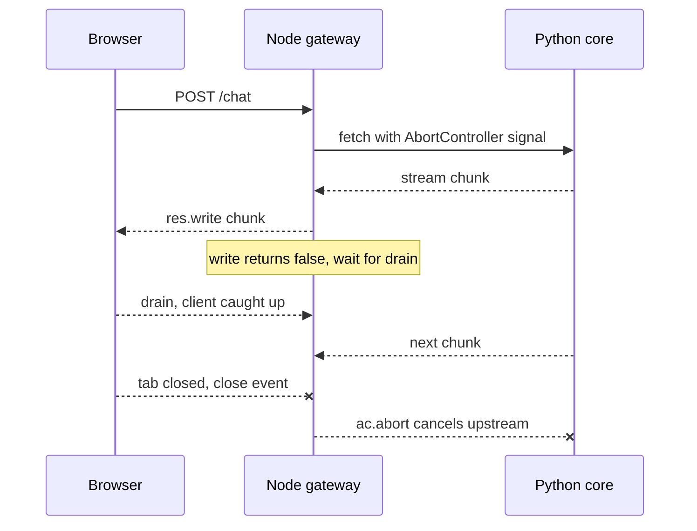

## TL;DR
Node.js with TypeScript runs the product edge of an AI system: UI streaming routes, BFFs, serverless
functions, MCP servers. It proxies many streams cheaply but is a poor home for inference and evals, so
Python owns the core. (Deep dive: `node-ts-for-ai`.)

## Why it exists
- **The web is built in TypeScript.** React, Next.js and the SSR frameworks that render them, the
  serverless and edge platforms that host them, and the Vercel AI SDK that streams model output into
  components. AI products are mostly chat and streaming interfaces, so a product team cannot avoid it.
- **Same language as the UI removes overhead.** Putting the model-facing request path next to the UI
  removes a translation layer, a deployment and a second on-call rota.
- **"Everything in Python" fails at the edge.** The frontend team does not write Python, SSR frameworks are
  TypeScript, and edge runtimes are built around V8; where Python is offered, it runs through WebAssembly
  with a restricted package set.
- **"Everything in TypeScript" fails at the core.** Training, fine-tuning, eval harnesses, tokenizers,
  vector and data tooling are Python-first. The honest outcome is two languages; the real question is
  where the boundary sits and how its contract stays honest.
- **Node fits the edge for a mechanical reason.** Its single-threaded, non-blocking event loop holds
  thousands of concurrent streams cheaply: open upstream, relay chunks, apply backpressure, close. It is
  bad at CPU-bound main-thread work, like Python, but has no NumPy or PyTorch to hand that work to.

## How it works
### The event loop
- **One JavaScript thread.** libuv provides a thread pool for file, DNS and crypto work and a loop that
  dispatches completed I/O callbacks.
- **Waiting is cheap.** A handler awaiting a network call costs a promise, not a thread.
- **The corollary.** Synchronous CPU work on the main thread (parsing a 50 MB JSON body, tokenizing a book
  in pure JavaScript) stops every other request.
- **Escape hatches.** `worker_threads` for CPU-bound tasks, and heavy compute kept in the Python core,
  *because* nothing on the main thread can preempt a running function.

### Streams and backpressure
1. **Read upstream incrementally.** Node 18 and later ship `fetch` and the Web Streams API globally, so a
   handler reads a model stream chunk by chunk and writes it to the client as it arrives.
2. **Watch the write signal.** `res.write()` returns `false` once the response's internal buffer passes
   its high-water mark: the client is reading slower than you write.
3. **Honour it.** Stop pulling from upstream and wait for `drain`. That keeps memory flat when a slow
   browser consumes a fast model; ignoring it is the classic way a streaming proxy runs out of memory.

- **Web Streams express the same idea** through `desiredSize` and pull-based reads, and `pipeTo` handles
  it for you.

### Cancellation
- **The problem.** When the user closes the tab, the upstream model keeps generating tokens you are billed
  for.
- **The signal.** Node reports the hang-up as a `close` event on the response before it finished writing.
- **The wiring.** Connect that to an `AbortController` whose `signal` was passed to `fetch`, which tears
  down the upstream connection.
- **The caveat.** It saves money only if the upstream in turn stops generating when its client
  disconnects, so check that both hops propagate cancellation.

### TypeScript: static types, no runtime
- **Types are erased at compile time.** Inside your code they catch mistakes; at the boundary they
  guarantee nothing, *because* data arrives at runtime from a model, a webhook or an API that never saw
  your types.
- **Pair a runtime schema with inferred types.** One Zod (or similar) schema validates the LLM's JSON,
  derives the TypeScript type, and converts to JSON Schema for the model's tool definition.
- **The other half of the discipline:** `strict` mode and exhaustive switches on discriminated unions.

### Where it fits in an AI system
| Node/TypeScript | Python |
|---|---|
| chat UI and its streaming route handlers | model serving |
| backend-for-frontend adding auth and rate limits in front of the Python service | RAG pipelines |
| serverless functions and edge middleware | evals |
| MCP servers exposing product data as tools | fine-tuning |
| agent orchestration through the OpenAI, Anthropic and Vercel SDKs | batch data jobs |

- **The boundary is an HTTP (often SSE) contract.** Generating the TypeScript client from the Python
  service's OpenAPI schema is how the two sides stay in sync.

## Diagram
The gateway relays chunks, pauses when the browser falls behind, and aborts the upstream call when the
browser leaves.



## Examples
### Streaming gateway with backpressure, cancellation and Zod
A minimal Node gateway that relays a streaming response from the Python core, honours backpressure,
cancels the upstream call when the client disconnects, and validates a model-produced tool call at
runtime with a Zod schema that also provides the static type for free.

```ts
import http from "node:http";
import { Readable } from "node:stream";
import { z } from "zod";

const ToolCall = z.object({                       // runtime schema: TS types vanish at runtime
  name: z.literal("lookup_order"),
  arguments: z.object({ orderId: z.string().regex(/^ord_[a-z0-9]+$/) }),
});
type ToolCall = z.infer<typeof ToolCall>;        // static type derived from the runtime schema

async function* relay(upstream: Response): AsyncGenerator<string> {
  const reader = upstream.body!.getReader();
  const dec = new TextDecoder();
  for (;;) {
    const { value, done } = await reader.read();  // yields the event loop between chunks
    if (done) return;
    yield dec.decode(value, { stream: true });
  }
}

http.createServer(async (req, res) => {
  const ac = new AbortController();               // client hangs up -> cancel upstream generation
  res.on("close", () => { if (!res.writableFinished) ac.abort(); });
  try {
    const upstream = await fetch("http://python-core:8000/v1/chat", {
      method: "POST", headers: { "content-type": "application/json" }, signal: ac.signal,
      body: Readable.toWeb(req) as ReadableStream, // forward the client body without buffering it
      duplex: "half",
    } as RequestInit);
    res.writeHead(200, { "content-type": "text/event-stream" });
    for await (const chunk of relay(upstream)) {
      if (!res.write(chunk))                       // buffer past high-water mark: client is slow
        await new Promise((r) => { res.once("drain", r); res.once("close", r); });
    }
    res.end();
  } catch (e) { if (!ac.signal.aborted) res.destroy(e as Error); } // abort is expected, not an error
}).listen(3000);

const parsed = ToolCall.safeParse(JSON.parse('{"name":"lookup_order","arguments":{"orderId":"ord_42x"}}'));
if (!parsed.success) console.error(parsed.error.issues);   // never trust model output structurally
```

### Measuring a blocked event loop, and the worker fix
Runnable with Node alone (`node lag.mjs`). `perf_hooks.monitorEventLoopDelay` records how late the
loop's timer fires, in nanoseconds.

```js
import { monitorEventLoopDelay } from "node:perf_hooks";
import { Worker } from "node:worker_threads";

const h = monitorEventLoopDelay({ resolution: 10 });     // sample loop delay every 10 ms
h.enable();

const busy = (ms) => { const end = Date.now() + ms; while (Date.now() < end); }; // sync CPU work

async function phase(name, work) {
  h.reset();
  await new Promise((r) => setTimeout(r, 50));             // first sample after reset is a baseline
  await work();
  await new Promise((r) => setTimeout(r, 200));            // let the histogram take samples
  console.log(`${name}: max loop delay ${(h.max / 1e6).toFixed(0)} ms`); // histogram is in ns
}

await phase("idle", async () => {});
await phase("500 ms of CPU on the main thread", async () => busy(500));
await phase("same 500 ms in a worker thread", () => new Promise((resolve) => {
  const src = `const end = Date.now() + 500; while (Date.now() < end);
               require("node:worker_threads").parentPort.postMessage("done");`;
  new Worker(src, { eval: true }).once("message", resolve); // main loop stays free meanwhile
}));
// idle: ~11 ms   main thread: ~507 ms   worker thread: ~11 ms
```

### Worked scenario: why the gateway's memory climbed
A gateway relays 500 concurrent chats. The model emits ~50 tokens per second; a slow mobile client
reads ~10. Figures are illustrative.

| Design | Per slow stream after 60 s | 500 streams |
|---|---|---|
| Ignore `res.write()` returning `false` | ~2,400 unsent tokens buffered and growing | memory climbs until the process dies |
| Wait for `drain` before pulling more | about one high-water mark of buffer | flat; the upstream TCP window throttles the model stream |
| Plus abort on `close` | buffer freed when the tab closes | upstream connections track client connections |

## Production patterns
- **Alert on event-loop delay.** Export `monitorEventLoopDelay` percentiles (p99, max) as a metric every
  few seconds and reset the histogram; alert when p99 climbs. Rising lag across all routes points to sync
  CPU work on the main thread.
- **Move CPU work to a worker pool.** Tokenizing, large JSON transforms or hashing go to
  `worker_threads` (often through a pool library such as Piscina) or to the Python core. Monitor pool
  queue length and task duration.
- **Abort upstream on disconnect.** Pass an `AbortController` signal to every upstream `fetch` and abort
  on the response `close` event before it finished. Monitor the ratio of upstream to client
  connections, and token spend against tokens delivered.
- **Validate every boundary with a schema.** Parse model output, webhooks and third-party responses with
  Zod `safeParse` and log `error.issues` with the prompt version. Track validation-failure rate per model
  and prompt.
- **Generate the client from OpenAPI.** Run a generator (for example openapi-typescript) over the Python
  service's schema in CI and fail the build on a diff. That turns a renamed field into a compile error
  instead of a silent `undefined`.

## Trade-offs
- **One language vs a split ecosystem.** One language from browser to gateway cuts translation and team
  overhead, but the model, eval and data ecosystem stays in Python, so you pay for a cross-language
  contract instead.
- **Cheap streaming vs CPU fragility.** The event loop makes streaming proxies cheap, but any CPU-bound
  step on the main thread blocks everyone; it flips when per-request compute grows and you need worker
  threads or Python.
- **Static safety vs runtime blindness.** Types give refactoring safety but vanish at runtime, so every
  external boundary needs a schema library and the duplication that comes with it.
- **Frictionless serverless vs platform limits.** Serverless and edge deployment is easy for Node, but
  long-running agent loops and large streaming responses hit platform timeouts and body-size limits a
  long-lived server never sees.

## Pitfalls
- **Validating model output with a cast (`as ToolCall`).** Symptom: a runtime
  `undefined is not a function` far from the boundary that produced the bad data. Fix: `safeParse`.
- **Buffering the whole model stream before writing.** Symptom: time-to-first-token equals total
  generation time, and memory spikes under concurrent chats.
- **Not propagating client disconnects upstream.** Symptom: token spend exceeds what users received, and
  open upstream connections outnumber open client connections.
- **Sync tokenization or large JSON transforms in a route handler.** Symptom: every concurrent request's
  latency rises together, visible as event-loop lag.
- **A hand-written TypeScript client drifting from the Python API.** Symptom: a field rename on one side
  surfaces as silent `undefined` on the other. Fix: generate it from OpenAPI.

## When to use
- **Use Node/TypeScript** for the layer facing the product: UI streaming routes, a backend-for-frontend,
  serverless glue, MCP servers for product data, and lightweight agent orchestration where the SDKs are
  excellent.
- **Keep in Python:** inference, evaluation, fine-tuning and data pipelines.
- **TypeScript-only is reasonable** if the team is entirely TypeScript and the AI work is API calls to a
  provider, until evals or custom models appear.
- **Measure:** event-loop lag (`perf_hooks.monitorEventLoopDelay` gives a histogram), heap and RSS under
  many concurrent slow streams, and the ratio of upstream to client connections; generate the client from
  OpenAPI rather than typing it by hand.
- **Interviews:** explain why types are erased, how backpressure works in a streaming proxy, and where the
  Python boundary belongs. The `node-ts-for-ai` module goes deep on each.

## Role lens
- **Engineer:** Writes streaming route handlers, validates model output with Zod, keeps CPU work off
  the main thread, and generates the client types from the Python service's OpenAPI schema.
- **Architect:** Draws the TypeScript/Python boundary, chooses between a BFF and direct calls, and
  owns the contract-generation pipeline that keeps the two sides from drifting.
- **FDE:** Meets customers whose product teams are TypeScript-only and must show how the AI core
  integrates through SSE and typed clients without forcing a Python rewrite on them.

## Check yourself
**Q:** A customer's TypeScript team wants to build the entire AI feature, including evals and a
retrieval pipeline, in Node to avoid "a second language". What do you tell them, and where would you
draw the line?
**A:** I would separate the edge from the core. The chat route, streaming, auth and the MCP tools can
live in TypeScript today with first-class SDKs, and that is where their team is strongest. Evals,
embedding pipelines, reranking and any fine-tuning depend on Python-first libraries and the research
workflow; rewriting them in Node means maintaining ports of tools that move monthly. The line is
"anything that touches model weights, tokenizers or evaluation datasets is Python; anything that
touches the user is TypeScript", with an OpenAPI-generated client as the contract so the second
language costs a build step rather than a translation team.

## Interview questions
### Why does a TypeScript service still need runtime validation?
- **Types are erased at compile time:** the emitted JavaScript has no knowledge of `ToolCall`, so a cast
  only silences the compiler.
- **Boundary data never saw your types:** model output, webhooks and third-party APIs can send anything.
- **The fix is one schema for both:** Zod validates at runtime, `z.infer` derives the static type, and the
  same schema can become the model's tool JSON Schema.

### A Node streaming gateway's memory grows steadily under load until it is OOM-killed. How do you debug it?
- **Suspect ignored backpressure:** check whether the relay keeps writing after `res.write()` returns
  `false` instead of waiting for `drain`.
- **Suspect leaked upstreams:** compare upstream and client connection counts; more upstreams means
  disconnects are not aborting `fetch`.
- **Confirm with a heap snapshot** under a slow-client load test, then add the `drain` wait and the
  `AbortController` wiring and re-run.

### When would you not put an AI feature's backend in Node?
- **When it touches weights, tokenizers or eval datasets:** that tooling is Python-first, and ports lag.
- **When per-request CPU work is heavy:** the single JavaScript thread blocks everyone, and Node has no
  NumPy-class native ecosystem to offload to.
- **When serverless limits bite:** long agent loops or big streams hit platform timeouts and body-size
  limits.

### How would you keep a TypeScript frontend and a Python AI service in sync as both evolve?
- **Single source of truth:** the Python service's Pydantic models generate its OpenAPI schema.
- **Generated client:** CI generates TypeScript types from that schema and fails on an unreviewed diff,
  so a rename breaks the build, not production.
- **Compatibility rules:** additive changes only within a version, plus contract tests on the boundary.

### A user closes the tab halfway through a long answer. What should happen, and how do you verify it?
- **Gateway:** the response `close` event fires before the write finished; abort the `AbortController`
  passed to `fetch`, which closes the upstream connection.
- **Core:** the Python service must notice the disconnect and stop generation, or the abort saves
  nothing; both hops must propagate cancellation.
- **Verify:** load-test with clients that disconnect early and compare tokens generated against tokens
  delivered.

## Quiz
### Q: Why must a TypeScript service validate an LLM's JSON output with a runtime schema even though the response type is declared?
- [ ] Because JSON.parse returns `any` only in strict mode
- [x] TypeScript types are erased at compile time, so declared types guarantee nothing about data that arrives at runtime
- [ ] Because LLM output is always a string and must be converted
- [ ] Because Node's fetch strips type information from responses
> Static types describe what the compiler assumes, not what the network delivers. A Zod-style schema
> checks the bytes that actually arrived and derives the static type from the same definition.

### Q: Which operation blocks every other request in a Node gateway?
- [ ] Awaiting a 5-second streaming response from the model provider
- [ ] Writing chunks to 500 concurrent SSE clients
- [x] Synchronously parsing a 50 MB JSON document in the route handler
- [ ] Reading a secret from an environment variable
> Node runs JavaScript on one thread; synchronous CPU work cannot be interrupted, so all pending
> callbacks wait. Awaited I/O and buffered writes yield to the loop between operations.

### Q: In a mixed TypeScript/Python AI stack, which responsibility belongs in the Python core?
- [ ] The streaming chat route handler next to the React UI
- [ ] Edge middleware that adds auth headers
- [x] The evaluation harness and embedding pipeline
- [ ] An MCP server exposing the product's CRM records as tools
> Evals, embeddings and anything near model weights depend on Python-first tooling. Routes, middleware
> and MCP servers for product data are edge concerns where TypeScript's SDKs and team fit win.
