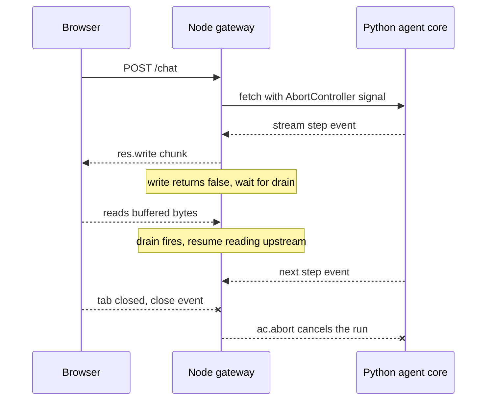

## TL;DR
Node.js with TypeScript is where many agents meet users: streaming agent routes, BFFs, serverless
functions, MCP servers, SDK agent loops. It relays streams cheaply but suits inference and evals poorly,
so Python owns the core. (Deep dive: `node-ts-for-ai`.)

## For agent builders
- **Why it matters for agents.** An agent's tool calls arrive as model-produced JSON, its progress streams
  to a browser, and its runs get cancelled when users leave. Node's event loop, Zod schemas and
  `AbortController` handle exactly those three jobs at the product edge.
- **Where it shows up in your stack.** The Vercel AI SDK and the OpenAI and Anthropic TypeScript SDKs for
  agent loops, the MCP TypeScript SDK for tool servers, Next.js route handlers that stream agent steps,
  and serverless or edge functions that host lightweight agents.
- **What you control.** Runtime validation of every tool call, backpressure on streamed steps,
  cancellation from browser to model, where CPU work runs, and the generated client that keeps the
  TypeScript edge in sync with a Python agent core.
- **What you can skip.** libuv internals and V8 tuning. Know what blocks the loop, how `drain` works and
  why types vanish at runtime; that covers most agent-edge bugs.

## Lab
### Task
Fix the three jobs a TypeScript agent edge must do: validate every model tool call, stop the run when
the user leaves, and stop buffering when the client reads slowly. The starter casts model JSON, keeps
calling the model and tools after an abort, and writes every chunk without waiting for `drain`.
Time box: 60-90 minutes.
- **Prerequisites:** this lesson's How it works (event loop, streams and backpressure, cancellation,
  TypeScript at runtime); runtime-schema-validation and streams-and-backpressure in `node-ts-for-ai`
  go deeper.
- **Setup:** Node 24 in a fresh folder: `npm init -y`, `npm pkg set type=module`,
  `npm i -D zod vitest tsx typescript @types/node` (checked on Node 24.21, Zod 4.6, vitest 5.0,
  tsx 4.23, TypeScript 7.0). Save the starter as `lab.ts` and the tests as `lab.test.ts`.
- **Done:** `npx tsx lab.ts` prints the expected output and `npx vitest run` passes.

### Starter code
```ts
// Lab: validate, cancel and backpressure an agent's tool loop
// (checked on Node 24, Zod 4.6, vitest 5.0, tsx 4.23)
import { z } from "zod";
import { Writable } from "node:stream";
import { pathToFileURL } from "node:url";

export const tools = {
  lookup_order: {
    args: z.object({ orderId: z.string().regex(/^ord_[a-z0-9]+$/) }),
    run: async (a: { orderId: string }) => `order ${a.orderId}: shipped`,
  },
  refund: {
    args: z.object({ orderId: z.string(), amountCents: z.number().int().positive().max(50_000) }),
    run: async (a: { orderId: string; amountCents: number }) => `refund queued: ${a.amountCents} cents`,
  },
} as const;

export const sideEffects: string[] = [];          // every tool that actually ran
export type Result = { content: string } | { error: string };

// LAB 1: never trust model output. Return { error } (never throw) for an unknown tool
// ("unknown tool <name>", including inherited names like "toString"), arguments that are not JSON
// ("arguments were not valid JSON"), and schema failures
// ("invalid arguments: <path of first issue>: <its message>").
// LAB 2a: if `signal` is already aborted, return { error: "run cancelled" } before any tool runs.
export async function dispatch(name: string, rawArgs: string, signal: AbortSignal): Promise<Result> {
  const tool = (tools as any)[name];              // BUG: inherited keys such as "toString" pass
  const args = JSON.parse(rawArgs) as never;      // BUG: a cast is not validation
  sideEffects.push(name);
  return { content: await tool.run(args) };
}

export type Step = { tool: string; args: string } | { final: string };
export type Model = (step: number, signal: AbortSignal) => Promise<Step>;
export type RunResult = { reason: "final" | "budget_exhausted" | "cancelled"; modelCalls: number; text?: string };

// LAB 2b: once `signal` is aborted, make no further model or tool calls and
// return { reason: "cancelled", modelCalls }.
export async function runAgent(model: Model, signal: AbortSignal, maxSteps = 5): Promise<RunResult> {
  let modelCalls = 0;
  for (let i = 0; i < maxSteps; i++) {
    const s = await model(i, signal);
    modelCalls++;
    if ("final" in s) return { reason: "final", modelCalls, text: s.final };
    await dispatch(s.tool, s.args, signal);
  }
  return { reason: "budget_exhausted", modelCalls };
}

// LAB 3: when sink.write() returns false, wait for "drain" (or "close") before the next chunk,
// so a slow client cannot make the gateway buffer the whole stream.
export async function relay(chunks: AsyncIterable<string>, sink: Writable): Promise<void> {
  for await (const c of chunks) sink.write(c);    // BUG: ignores backpressure
  await new Promise<void>((resolve) => sink.end(resolve));
}

// ---- demo ---------------------------------------------------------------------------------
export function slowSink(highWaterMark: number, stats: { maxBuffered: number }): Writable {
  const sink = new Writable({
    highWaterMark,
    write(_chunk, _enc, done) { setTimeout(done, 1); },   // a slow mobile client
  });
  const write = sink.write.bind(sink);
  sink.write = ((c: any, ...rest: any[]) => {
    const ok = write(c, ...rest);
    stats.maxBuffered = Math.max(stats.maxBuffered, sink.writableLength);
    return ok;
  }) as typeof sink.write;
  return sink;
}

export async function* tokens(n: number): AsyncGenerator<string> {
  for (let i = 0; i < n; i++) yield "data: {\"token\":\"abcdefg\"}\n\n";  // 27 bytes per event
}

async function show(label: string, p: Promise<unknown>) {
  try { console.log(label, "->", JSON.stringify(await p)); }
  catch (e) { console.log(label, "-> threw", (e as Error).name); }
}

if (process.argv[1] && import.meta.url === pathToFileURL(process.argv[1]).href) {
  const live = new AbortController().signal;
  await show("lookup_order", dispatch("lookup_order", '{"orderId":"ord_42x"}', live));
  await show("toString", dispatch("toString", "{}", live));
  await show("refund bad JSON", dispatch("refund", "{orderId: ord_1}", live));
  await show("refund too big", dispatch("refund", '{"orderId":"ord_1","amountCents":90000}', live));

  sideEffects.length = 0;
  const ac = new AbortController();
  const model: Model = async (step) => {
    if (step === 1) ac.abort();                    // the user closes the tab during step 1
    return { tool: "lookup_order", args: '{"orderId":"ord_42x"}' };
  };
  const run = await runAgent(model, ac.signal);
  console.log(`cancelled run: reason=${run.reason}, model calls=${run.modelCalls}, tools run=${sideEffects.length}`);

  const stats = { maxBuffered: 0 };
  await relay(tokens(200), slowSink(64, stats));
  console.log(`relay: 200 events, max buffered ${stats.maxBuffered} bytes`);
}
```

As given, it prints `toString -> threw TypeError`, `refund too big -> {"content":"refund queued: 90000 cents"}`,
`reason=budget_exhausted, model calls=5, tools run=5` and `max buffered 5400 bytes`.

### Expected output
```
lookup_order -> {"content":"order ord_42x: shipped"}
toString -> {"error":"unknown tool toString"}
refund bad JSON -> {"error":"arguments were not valid JSON"}
refund too big -> {"error":"invalid arguments: amountCents: Too big: expected number to be <=50000"}
cancelled run: reason=cancelled, model calls=2, tools run=1
relay: 200 events, max buffered 81 bytes
```

The Zod message text is from Zod 4.6; the exact buffered figure can differ slightly by Node version,
but it must stay near the 64-byte high-water mark, not in the thousands.

### Tests
```ts
import { beforeEach, describe, expect, it } from "vitest";
import { dispatch, relay, runAgent, sideEffects, slowSink, tokens, type Model } from "./lab";

const live = () => new AbortController().signal;
beforeEach(() => { sideEffects.length = 0; });

describe("dispatch", () => {
  it("runs a valid call", async () => {
    expect(await dispatch("lookup_order", '{"orderId":"ord_42x"}', live()))
      .toEqual({ content: "order ord_42x: shipped" });
  });
  it("rejects unknown and inherited tool names without throwing", async () => {
    expect(await dispatch("delete_user", "{}", live())).toEqual({ error: "unknown tool delete_user" });
    expect(await dispatch("toString", "{}", live())).toEqual({ error: "unknown tool toString" });
  });
  it("returns JSON and schema errors to the model, and runs nothing", async () => {
    expect(await dispatch("refund", "{orderId: ord_1}", live())).toEqual({ error: "arguments were not valid JSON" });
    const r = await dispatch("refund", '{"orderId":"ord_1","amountCents":90000}', live());
    expect("error" in r && r.error.startsWith("invalid arguments: amountCents: ")).toBe(true);
    expect(sideEffects).toEqual([]);
  });
  it("does not run a tool once the run is cancelled", async () => {
    const ac = new AbortController(); ac.abort();
    expect(await dispatch("refund", '{"orderId":"ord_1","amountCents":500}', ac.signal))
      .toEqual({ error: "run cancelled" });
    expect(sideEffects).toEqual([]);
  });
});

describe("runAgent", () => {
  it("stops calling the model and tools after abort", async () => {
    const ac = new AbortController();
    const model: Model = async (step) => {
      if (step === 1) ac.abort();
      return { tool: "lookup_order", args: '{"orderId":"ord_42x"}' };
    };
    const run = await runAgent(model, ac.signal);
    expect(run).toEqual({ reason: "cancelled", modelCalls: 2 });
    expect(sideEffects).toEqual(["lookup_order"]);
  });
  it("still ends on a final answer or the budget", async () => {
    expect((await runAgent(async () => ({ final: "done" }), live())).reason).toBe("final");
    const loop: Model = async () => ({ tool: "lookup_order", args: '{"orderId":"ord_1"}' });
    expect(await runAgent(loop, live(), 3)).toEqual({ reason: "budget_exhausted", modelCalls: 3 });
  });
});

describe("relay", () => {
  it("honours backpressure from a slow client", async () => {
    const stats = { maxBuffered: 0 };
    await relay(tokens(200), slowSink(64, stats));
    expect(stats.maxBuffered).toBeLessThanOrEqual(96);   // 64-byte high-water mark plus one 27-byte event, with slack
  });
});
```

On the starter, 5 of 7 fail for the intended reasons: a `TypeError` on `toString`, a `SyntaxError` on
bad JSON, a refund that runs after abort, a run that reports `budget_exhausted` with 5 model calls, and
5400 bytes buffered. The valid-call and final-or-budget tests pass and guard the happy path.

### Failure scenarios
- **Inject: check the tool name with `name in tools`.** Observe: `toString` passes the check and
  crashes on `.run`. Debug: `in` walks the prototype chain; use `Object.hasOwn`.
- **Inject: abort only inside `dispatch`, not in `runAgent`.** Observe: no tool runs after the abort
  but the model is still called 5 times, which is the token bill. Debug: count model calls per run in
  your trace and compare them with the moment the client's `close` event fired.
- **Inject: wait with `sink.once("drain", r); sink.once("close", r)`.** Observe: the buffer stays small,
  but Node prints `MaxListenersExceededWarning: ... 11 close listeners added`. Debug: the listener that
  did not fire is never removed; remove both in one `done` callback (the gateway example in Examples
  has the same shape on a per-request response).
- **Inject: cast with `as ToolCall` instead of `safeParse`.** Observe: `refund queued: 90000 cents`, a
  refund over the limit. Debug: log validation results per tool; a zero failure rate is suspicious.

### Submission
- **Code:** your `lab.ts` with LAB 1-3 done, no `as any` left in `dispatch`, and strict type-checking
  clean (`npx tsc --noEmit --strict --module esnext --moduleResolution bundler --types node lab.ts`).
- **Test run:** `npx vitest run` showing 7 passed, plus the script output matching Expected output.
- **Evidence of cancellation:** a log of the aborted run showing 2 model calls and 1 tool run.
- **A short note (3-5 sentences):** what the gateway must also do so the Python core stops generating,
  and why validation errors go back to the model rather than being thrown.
- **Evaluation:** tests pass, no listener warnings, and buffered bytes stay near the high-water mark.

## Why it exists
- **The web is built in TypeScript.** React, Next.js and the SSR frameworks that render them, the
  serverless and edge platforms that host them, and the Vercel AI SDK that streams model output into
  components. AI products and agent UIs are mostly chat and streaming interfaces, so a product team cannot
  avoid it.
- **Same language as the UI removes overhead.** Putting the agent-facing request path next to the UI
  removes a translation layer, a deployment and a second on-call rota.
- **"Everything in Python" fails at the edge.** The frontend team does not write Python, SSR frameworks are
  TypeScript, and edge runtimes are built around V8; where Python is offered, it runs through WebAssembly
  with a restricted package set.
- **"Everything in TypeScript" fails at the core.** Training, fine-tuning, eval harnesses, tokenizers,
  vector and data tooling are Python-first. The honest outcome is two languages; the real question is
  where the boundary sits and how its contract stays honest.
- **Node fits the edge for a mechanical reason.** Its single-threaded, non-blocking event loop holds
  thousands of concurrent agent streams cheaply: open upstream, relay chunks, apply backpressure, close.
  It is bad at CPU-bound main-thread work, like Python, but has no NumPy or PyTorch to hand that work to.

## How it works
### The event loop
- **One JavaScript thread.** libuv provides a thread pool for file, DNS and crypto work and a loop that
  dispatches completed I/O callbacks.
- **Waiting is cheap.** A handler awaiting a model or tool call costs a promise, not a thread, so an agent
  step that awaits three tools in `Promise.all` holds no extra threads.
- **The corollary.** Synchronous CPU work on the main thread (parsing a 50 MB JSON body, tokenizing a book
  in pure JavaScript) stops every other request and every other agent run.
- **Escape hatches.** `worker_threads` for CPU-bound tasks, and heavy compute kept in the Python core,
  *because* nothing on the main thread can preempt a running function.

### Streams and backpressure
1. **Read upstream incrementally.** Node 18 and later ship `fetch` and the Web Streams API globally, so a
   handler reads a model or agent-step stream chunk by chunk and writes it to the client as it arrives.
2. **Watch the write signal.** `res.write()` returns `false` once the response's internal buffer passes
   its high-water mark: the client is reading slower than you write.
3. **Honour it.** Stop pulling from upstream and wait for `drain`. That keeps memory flat when a slow
   browser consumes a fast model; ignoring it is the classic way a streaming proxy runs out of memory.

- **Web Streams express the same idea** through `desiredSize` and pull-based reads, and `pipeTo` handles
  it for you.

### Cancellation
- **The problem.** When the user closes the tab, the upstream model keeps generating tokens, and an agent
  loop keeps calling tools, all of which you are billed for.
- **The signal.** Node reports the hang-up as a `close` event on the response before it finished writing.
- **The wiring.** Connect that to an `AbortController` whose `signal` was passed to `fetch`, which tears
  down the upstream connection; agent SDKs generally accept an abort signal too.
- **The caveat.** It saves money only if the upstream in turn stops generating when its client
  disconnects, so check that both hops propagate cancellation.

### TypeScript: static types, no runtime
- **Types are erased at compile time.** Inside your code they catch mistakes; at the boundary they
  guarantee nothing, *because* data arrives at runtime from a model, a webhook or an API that never saw
  your types.
- **Pair a runtime schema with inferred types.** One Zod (or similar) schema validates the LLM's tool-call
  JSON, derives the TypeScript type, and converts to JSON Schema for the model's tool definition.
- **The other half of the discipline:** `strict` mode and exhaustive switches on discriminated unions,
  which suit agent events (tool call, tool result, text delta, done).

### Where it fits in an agent system
| Node/TypeScript | Python |
|---|---|
| chat UI and its streaming agent route handlers | model serving |
| backend-for-frontend adding auth and rate limits in front of the Python service | RAG pipelines |
| serverless functions and edge middleware | evals |
| MCP servers exposing product data as tools | fine-tuning |
| agent orchestration through the OpenAI, Anthropic and Vercel SDKs | batch data jobs |

- **The boundary is an HTTP (often SSE) contract.** Generating the TypeScript client from the Python
  service's OpenAPI schema is how the two sides stay in sync.

## Diagram
The gateway relays agent-step chunks, pauses when the browser falls behind, and aborts the upstream run
when the browser leaves.



## Examples
### Streaming gateway with backpressure, cancellation and Zod
A minimal Node gateway that relays a streaming agent response from the Python core, honours backpressure,
cancels the upstream run when the client disconnects, and validates a model-produced tool call at
runtime with a Zod schema that also provides the static type for free.

```ts
import http from "node:http";
import { Readable } from "node:stream";
import { z } from "zod";

const ToolCall = z.object({                       // runtime schema: TS types vanish at runtime
  name: z.literal("lookup_order"),
  arguments: z.object({ orderId: z.string().regex(/^ord_[a-z0-9]+$/) }),
});
type ToolCall = z.infer<typeof ToolCall>;        // static type derived from the runtime schema

async function* relay(upstream: Response): AsyncGenerator<string> {
  const reader = upstream.body!.getReader();
  const dec = new TextDecoder();
  for (;;) {
    const { value, done } = await reader.read();  // yields the event loop between chunks
    if (done) return;
    yield dec.decode(value, { stream: true });
  }
}

http.createServer(async (req, res) => {
  const ac = new AbortController();               // client hangs up -> cancel upstream generation
  res.on("close", () => { if (!res.writableFinished) ac.abort(); });
  try {
    const upstream = await fetch("http://python-core:8000/v1/chat", {
      method: "POST", headers: { "content-type": "application/json" }, signal: ac.signal,
      body: Readable.toWeb(req) as ReadableStream, // forward the client body without buffering it
      duplex: "half",
    } as RequestInit);
    res.writeHead(200, { "content-type": "text/event-stream" });
    for await (const chunk of relay(upstream)) {
      if (!res.write(chunk))                       // buffer past high-water mark: client is slow
        await new Promise((r) => { res.once("drain", r); res.once("close", r); });
    }
    res.end();
  } catch (e) { if (!ac.signal.aborted) res.destroy(e as Error); } // abort is expected, not an error
}).listen(3000);

const parsed = ToolCall.safeParse(JSON.parse('{"name":"lookup_order","arguments":{"orderId":"ord_42x"}}'));
if (!parsed.success) console.error(parsed.error.issues);   // never trust model output structurally
```

### A tool dispatcher that validates every model tool call
In a TypeScript agent loop, each tool call the model emits is parsed against its schema before it runs;
a failure goes back to the model as a tool result instead of throwing.

```ts
import { z } from "zod";

const tools = {
  lookup_order: {
    args: z.object({ orderId: z.string().regex(/^ord_[a-z0-9]+$/) }),
    run: async (a: { orderId: string }) => ({ status: "shipped", orderId: a.orderId }),
  },
  refund: {
    args: z.object({ orderId: z.string(), amountCents: z.number().int().positive().max(50_000) }),
    run: async (a: { orderId: string; amountCents: number }) => ({ queued: true, ...a }),
  },
} as const;

type ToolName = keyof typeof tools;

export async function dispatch(name: string, rawArgs: string, signal: AbortSignal) {
  if (!Object.hasOwn(tools, name)) return { error: `unknown tool ${name}` }; // invented tool; `in` would accept "toString"
  const tool = tools[name as ToolName];
  let json: unknown;
  try { json = JSON.parse(rawArgs); } catch { return { error: "arguments were not valid JSON" }; }
  const parsed = tool.args.safeParse(json);
  if (!parsed.success) return { error: parsed.error.issues };           // let the model repair it
  if (signal.aborted) return { error: "run cancelled" };                // user left: do not act
  return tool.run(parsed.data as never);
}
```

### Measuring a blocked event loop, and the worker fix
Runnable with Node alone (`node lag.mjs`). `perf_hooks.monitorEventLoopDelay` records how late the
loop's timer fires, in nanoseconds.

```js
import { monitorEventLoopDelay } from "node:perf_hooks";
import { Worker } from "node:worker_threads";

const h = monitorEventLoopDelay({ resolution: 10 });     // sample loop delay every 10 ms
h.enable();

const busy = (ms) => { const end = Date.now() + ms; while (Date.now() < end); }; // sync CPU work

async function phase(name, work) {
  h.reset();
  await new Promise((r) => setTimeout(r, 50));             // first sample after reset is a baseline
  await work();
  await new Promise((r) => setTimeout(r, 200));            // let the histogram take samples
  console.log(`${name}: max loop delay ${(h.max / 1e6).toFixed(0)} ms`); // histogram is in ns
}

await phase("idle", async () => {});
await phase("500 ms of CPU on the main thread", async () => busy(500));
await phase("same 500 ms in a worker thread", () => new Promise((resolve) => {
  const src = `const end = Date.now() + 500; while (Date.now() < end);
               require("node:worker_threads").parentPort.postMessage("done");`;
  new Worker(src, { eval: true }).once("message", resolve); // main loop stays free meanwhile
}));
// idle: ~11 ms   main thread: ~507 ms   worker thread: ~11 ms
```

### Worked scenario: why the agent gateway's memory climbed
A gateway relays 500 concurrent agent chats. The model emits ~50 tokens per second; a slow mobile client
reads ~10. Figures are illustrative.

| Design | Per slow stream after 60 s | 500 streams |
|---|---|---|
| Ignore `res.write()` returning `false` | ~2,400 unsent tokens buffered and growing | memory climbs until the process dies |
| Wait for `drain` before pulling more | about one high-water mark of buffer | flat; the upstream TCP window throttles the model stream |
| Plus abort on `close` | buffer freed when the tab closes | upstream connections and agent runs track client connections |

## Production patterns
- **Validate every tool call before it runs.** Parse each model tool call with Zod `safeParse`, return
  `error.issues` to the model as the tool result, and log them with the prompt version; parse webhooks
  and third-party responses the same way. Track validation-failure rate per model, prompt and tool; a
  spike after a prompt change is a regression.
- **Abort the agent run on disconnect.** Pass an `AbortController` signal to every upstream `fetch` and
  SDK call, abort on the response `close` event before it finished, and check the signal before
  side-effecting tools. Monitor the ratio of upstream to client connections, and token spend against
  tokens delivered.
- **Alert on event-loop delay.** Export `monitorEventLoopDelay` percentiles (p99, max) as a metric every
  few seconds and reset the histogram; alert when p99 climbs. Rising lag across all routes points to sync
  CPU work on the main thread.
- **Move CPU work to a worker pool.** Tokenizing, large JSON transforms or hashing go to
  `worker_threads` (often through a pool library such as Piscina) or to the Python core. Monitor pool
  queue length and task duration.
- **Generate the client from OpenAPI.** Run a generator (for example openapi-typescript) over the Python
  agent service's schema in CI and fail the build on a diff. That turns a renamed field into a compile
  error instead of a silent `undefined`.
- **Keep long agent runs off short-lived functions.** Serverless routes start or stream short runs; runs
  that loop for minutes go to a long-lived server or a queue, because platform timeouts cut them mid-step.

## Trade-offs
- **One language vs a split ecosystem.** One language from browser to agent gateway cuts translation and
  team overhead, but the model, eval and data ecosystem stays in Python, so you pay for a cross-language
  contract instead.
- **Cheap streaming vs CPU fragility.** The event loop makes streaming proxies cheap, but any CPU-bound
  step on the main thread blocks everyone; it flips when per-request compute grows and you need worker
  threads or Python.
- **Static safety vs runtime blindness.** Types give refactoring safety but vanish at runtime, so every
  external boundary, model output included, needs a schema library and the duplication that comes with it.
- **Frictionless serverless vs platform limits.** Serverless and edge deployment is easy for Node, but
  long-running agent loops and large streaming responses hit platform timeouts and body-size limits a
  long-lived server never sees.

## Pitfalls
- **Validating model output with a cast (`as ToolCall`).** Symptom: a runtime
  `undefined is not a function` far from the boundary that produced the bad data, or a tool run with
  wrong arguments. Fix: `safeParse` and return the issues to the model.
- **Buffering the whole model stream before writing.** Symptom: time-to-first-token equals total
  generation time, and memory spikes under concurrent chats. Fix: relay chunk by chunk and honour `drain`.
- **Not propagating client disconnects upstream.** Symptom: token spend exceeds what users received, and
  open upstream connections outnumber open client connections. Fix: abort the upstream `fetch` on `close`.
- **Sync tokenization or large JSON transforms in a route handler.** Symptom: every concurrent request's
  latency rises together, visible as event-loop lag. Fix: a worker thread or the Python core.
- **A hand-written TypeScript client drifting from the Python API.** Symptom: a field rename on one side
  surfaces as silent `undefined` on the other. Fix: generate it from OpenAPI.

## When to use
- **Use Node/TypeScript** for the agent layer facing the product: UI streaming routes, a
  backend-for-frontend, serverless glue, MCP servers for product data, and lightweight agent
  orchestration where the SDKs are excellent.
- **Keep in Python:** inference, evaluation, fine-tuning and data pipelines.
- **TypeScript-only is reasonable** if the team is entirely TypeScript and the AI work is API calls to a
  provider, until evals or custom models appear.
- **Measure:** event-loop lag (`perf_hooks.monitorEventLoopDelay` gives a histogram), heap and RSS under
  many concurrent slow streams, and the ratio of upstream to client connections; generate the client from
  OpenAPI rather than typing it by hand.
- **Interviews:** explain why types are erased, how backpressure works in a streaming proxy, and where the
  Python boundary belongs. The `node-ts-for-ai` module goes deep on each.

## Role lens
- **Engineer:** Writes streaming route handlers, validates model output with Zod, keeps CPU work off
  the main thread, and generates the client types from the Python service's OpenAPI schema.
- **Architect:** Draws the TypeScript/Python boundary, chooses between a BFF and direct calls, and
  owns the contract-generation pipeline that keeps the two sides from drifting.
- **FDE:** Meets customers whose product teams are TypeScript-only and must show how the AI core
  integrates through SSE and typed clients without forcing a Python rewrite on them.

## Check yourself
**Q:** A customer's TypeScript team wants to build the entire AI feature, including evals and a
retrieval pipeline, in Node to avoid "a second language". What do you tell them, and where would you
draw the line?
**A:** I would separate the edge from the core. The chat route, streaming, auth and the MCP tools can
live in TypeScript today with first-class SDKs, and that is where their team is strongest. Evals,
embedding pipelines, reranking and any fine-tuning depend on Python-first libraries and the research
workflow; rewriting them in Node means maintaining ports of tools that move monthly. The line is
"anything that touches model weights, tokenizers or evaluation datasets is Python; anything that
touches the user is TypeScript", with an OpenAPI-generated client as the contract so the second
language costs a build step rather than a translation team.

## Interview questions
### Why does a TypeScript agent still need runtime validation of tool calls?
- **Types are erased at compile time:** the emitted JavaScript has no knowledge of `ToolCall`, so a cast
  only silences the compiler.
- **Boundary data never saw your types:** model output, webhooks and third-party APIs can send anything,
  and a model can invent a tool name or a malformed argument.
- **The fix is one schema for both:** Zod validates at runtime, `z.infer` derives the static type, and the
  same schema can become the model's tool JSON Schema; failures go back to the model to repair.

### A Node streaming gateway in front of your agents grows in memory under load until it is OOM-killed. How do you debug it?
- **Suspect ignored backpressure:** check whether the relay keeps writing after `res.write()` returns
  `false` instead of waiting for `drain`.
- **Suspect leaked upstreams:** compare upstream and client connection counts; more upstreams means
  disconnects are not aborting `fetch`.
- **Confirm with a heap snapshot** under a slow-client load test, then add the `drain` wait and the
  `AbortController` wiring and re-run.

### A route needs CPU work per request. When do you use `worker_threads`, and when do you send it to the Python core?
- **`worker_threads` for small, self-contained JavaScript work** (hashing, a large JSON transform), where a
  network hop would cost more than the work; use a pool sized to cores, because arguments and results are
  copied between threads unless you transfer buffers.
- **The Python core for anything needing ML libraries** (embedding, reranking, model tokenizers), because
  Node has no NumPy-class native ecosystem and the core already scales separately.
- **Neither, if it is cheap:** measure with `monitorEventLoopDelay` first; work that keeps loop delay to a
  few milliseconds can stay inline.

### How would you keep a TypeScript agent UI and a Python agent service in sync as both evolve?
- **Single source of truth:** the Python service's Pydantic models generate its OpenAPI schema.
- **Generated client:** CI generates TypeScript types from that schema and fails on an unreviewed diff,
  so a rename breaks the build, not production.
- **Compatibility rules:** additive changes only within a version, plus contract tests on the boundary,
  including the agent step-event types the UI renders.

### A user closes the tab halfway through a long agent run. What should happen, and how do you verify it?
- **Gateway:** the response `close` event fires before the write finished; abort the `AbortController`
  passed to `fetch`, which closes the upstream connection.
- **Core:** the Python service must notice the disconnect and stop generation and tool calls, or the
  abort saves nothing; both hops must propagate cancellation.
- **Verify:** load-test with clients that disconnect early and compare tokens generated against tokens
  delivered.

## Quiz
### Q: Why must a TypeScript service validate an LLM's JSON output with a runtime schema even though the response type is declared?
- [ ] Because JSON.parse returns `any` only in strict mode
- [x] TypeScript types are erased at compile time, so declared types guarantee nothing about data that arrives at runtime
- [ ] Because LLM output is always a string and must be converted
- [ ] Because Node's fetch strips type information from responses
> Static types describe what the compiler assumes, not what the network delivers. A Zod-style schema
> checks the bytes that actually arrived and derives the static type from the same definition.

### Q: Which operation blocks every other request in a Node gateway?
- [ ] Awaiting a 5-second streaming response from the model provider
- [ ] Writing chunks to 500 concurrent SSE clients
- [x] Synchronously parsing a 50 MB JSON document in the route handler
- [ ] Reading a secret from an environment variable
> Node runs JavaScript on one thread; synchronous CPU work cannot be interrupted, so all pending
> callbacks wait. Awaited I/O and buffered writes yield to the loop between operations.

### Q: In a mixed TypeScript/Python AI stack, which responsibility belongs in the Python core?
- [ ] The streaming chat route handler next to the React UI
- [ ] Edge middleware that adds auth headers
- [x] The evaluation harness and embedding pipeline
- [ ] An MCP server exposing the product's CRM records as tools
> Evals, embeddings and anything near model weights depend on Python-first tooling. Routes, middleware
> and MCP servers for product data are edge concerns where TypeScript's SDKs and team fit win.

## Use cases & projects
### Use cases
- **Agent chat UIs in Next.js.** A route handler streams agent steps (tool call, tool result, text) to
  React components and aborts the run when the user leaves.
- **MCP servers for product data.** A TypeScript tool server exposes CRM or order records to any MCP
  client, with a Zod schema per tool.
- **BFF in front of a Python agent core.** The gateway adds auth, per-user rate limits and a generated
  typed client, while planning, retrieval and evals stay in Python.
- **Lightweight provider-only agents.** A support or triage agent built with the Vercel AI SDK or a
  provider SDK, where all model work is API calls.

### Mini project
**A validated, cancellable tool-calling route (1-2 hours).**
- **Goal:** build a Node route that runs a small agent loop with two tools, validates every tool call,
  streams steps, and stops when the client leaves.
- **Steps:** define two tools with Zod schemas and a dispatcher like the one above; stream each step as
  an SSE event; wire `res.on("close")` to an `AbortController` passed to the model call and checked before
  each tool runs; add a fake model that sometimes emits malformed arguments.
- **Done when:** malformed calls come back to the model as validation errors, `curl -N` shows steps
  arriving live, and killing curl mid-run stops further model and tool calls in the logs.

### Major project
This lesson feeds the module Capstone (see the module guide): a TypeScript client generated from
DocBrief's OpenAPI document, or a Node gateway in front of it, exercises the cross-language contract.
