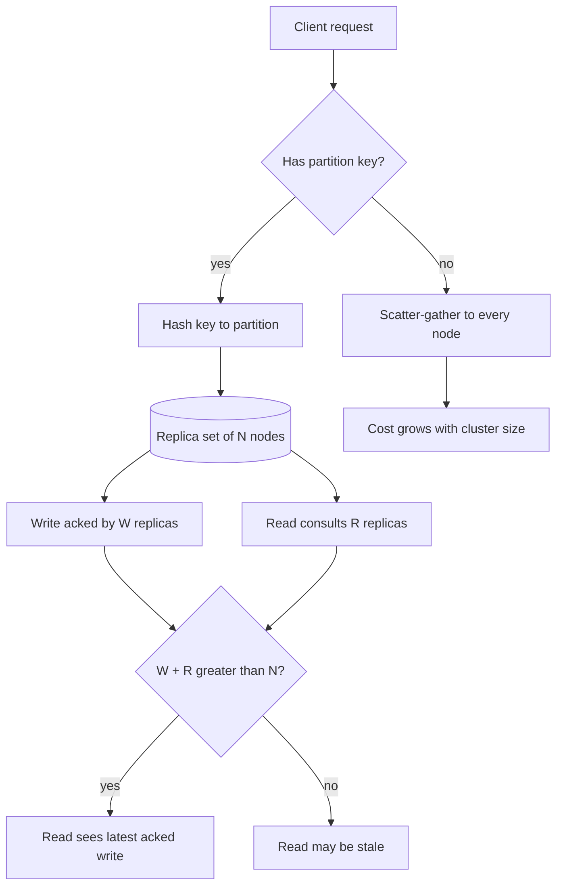

## TL;DR
NoSQL stores give up joins and cross-record transactions to partition data by key with predictable
latency at any size. They suit agent session state and step logs keyed by session, if keys follow the
agent's exact queries and you accept weaker reads.

## For agent builders
- **Why it matters for agents.** Agent sessions are naturally key-shaped: load this thread's state, append
  this step, list this user's recent sessions. A key-value or document store serves those in one
  single-partition call at any scale, which is why many agent platforms keep session state and
  transcripts there.
- **Where it shows up in your stack.** DynamoDB or MongoDB as a session and checkpoint store, Redis as a
  short-lived key-value layer, change streams feeding traces into a warehouse for evals, and vector
  databases, which behave like document stores with a different index.
- **What you control.** The partition and sort keys (session id, zero-padded step number), embed versus
  reference for tool results, conditional writes so a retried step cannot overwrite, TTL on ephemeral
  state, and which reads must be strongly consistent.
- **What you can skip.** Dynamo paper internals and LSM compaction tuning. Know quorums, hot partitions,
  item size limits and access-pattern-first modelling; that is what agent state stores need.

## Why it exists
- **One machine has a ceiling.** A relational database answers any SQL question, but only within one
  machine's disk, memory and write throughput. Past that you must partition.
- **Partitioning breaks the casual operations.** Once rows live on different machines, a join is a network
  operation and a transaction is a distributed commit: possible, but slow and fragile.
- **Restrict the model, gain scale.** If every operation touches one partition identified by a key, each
  machine serves its partition independently, nodes are added without coordination, and a failure affects
  only its share of keys.
- **Hand-sharding SQL is worse.** It pushes joins and transactions into application code where every
  engineer must know the scheme, and keeps the schema rigid across nodes that cannot migrate atomically.
  NoSQL makes the constraint explicit: declare a partition key; cross-partition work is unsupported or
  clearly expensive.
- **Some stores exist for the model, not scale.** Documents let items carry different fields and nest
  read-together data (event payloads, tool outputs whose shape varies by type); graphs make multi-hop
  traversals cheap that would be chains of self-joins. "NoSQL" is a bundle of answers, so first ask which
  problem you have. The cost: unplanned queries are full scans or impossible, and "schemaless" means the
  schema lives in your code, unenforced.

## How it works
### The families
| Family | Examples | Model | Best at |
|---|---|---|---|
| **Key-value** | Redis, DynamoDB used simply, Riak | get and put a value by key | the simplest and fastest; no queries other than by key |
| **Document** | MongoDB, Couchbase, DynamoDB with nested attributes | JSON-like documents with nested fields | indexing and querying fields inside documents, within a collection |
| **Wide-column** | Cassandra, ScyllaDB, Bigtable | rows grouped by partition key, ordered by clustering columns | very high write rates and time-ordered reads within a key |
| **Graph** | Neo4j | nodes and edges | traversals ("friends of friends") |

Search engines and vector databases are specialised stores that behave like document stores with a
different index at the core; they are covered in their own lessons.

### Partitioning by key
1. **Route by key.** The store hashes the partition key to pick a node (or a key range maps to a node).
2. **One lookup at any size.** Every operation carrying the key goes to one node and costs one lookup
   regardless of total data size, which is the whole point.
3. **No key, fan out.** Operations without the key must hit every node, so ask: "which key will every hot
   query have in hand?"

| Store | Key that routes |
|---|---|
| DynamoDB | partition key plus an optional sort key |
| Cassandra | partition key plus clustering columns |
| MongoDB | shard key |

### Replication and consistency
- **N replicas per partition** for durability. Writes are acknowledged after W replicas accept; reads
  consult R replicas.
- **Strict quorum: W + R > N.** The read set must overlap the write set, so a read reaches at least one
  replica holding the latest acknowledged write.
- **Edge cases weaken it:** sloppy quorums that accept writes on stand-in nodes, concurrent writes resolved
  by last-write-wins, and writes that failed on some replicas but were not rolled back.
- **W = 1 is fastest** and allows a read a moment later to see the old value: **eventual consistency**.
- **Per-operation choice.** Cassandra consistency levels and DynamoDB's `ConsistentRead`; strongly
  consistent reads cost more and may fail when a replica is down.
- **CAP in practice:** during a partition, a store either refuses some requests or serves possibly-stale data.

### Modelling: access patterns first
Relational design starts from entities and normalizes; NoSQL starts from the list of queries and shapes
data so each is a single-partition read. Two decisions dominate:

1. **Embed or reference.**
   - Embed child data when it is read together and bounded in size (a message with its tool calls).
   - Reference by id when the child set is unbounded or shared (all messages of a conversation that may
     run to thousands).
   - Documents have hard size limits (16 MB in MongoDB, 400 KB per item in DynamoDB); an unbounded
     embedded array will hit them.
2. **Denormalize and duplicate.**
   - With no joins, data needed by two queries is often stored twice in two key layouts, and the
     application updates both.
   - DynamoDB single-table design takes this to its conclusion: every entity type in one table with
     composite keys like `TENANT#t1#USER#u9` / `SESSION#2026-10-20T10:00`.
   - Global secondary indexes (GSIs) re-key the same items for a second access pattern. A GSI is
     maintained asynchronously, so reads through it are eventually consistent.

### Hot partitions
- **Per-partition ceilings.** Capacity is configured per table, but each physical partition has its own
  throughput ceiling (in DynamoDB, documented as roughly 3,000 read units and 1,000 write units per second
  per partition).
- **The failure.** If one tenant produces 40% of all writes and tenant id is the partition key, that
  partition throttles while the rest of the cluster idles.
- **Do not design around auto-healing.** DynamoDB's adaptive capacity and split-for-heat soften this for
  some workloads, but are not something to rely on.
- **Fix: a high-cardinality key.** Tenant + conversation, or tenant + a shard suffix, spreads a busy tenant
  over several partitions, at the cost of fan-out reads for "everything for this tenant".

### Why wide-column stores write so fast
Cassandra, ScyllaDB and Bigtable use a log-structured merge tree (LSM), not an update-in-place B-tree:

1. A write is appended to a commit log and inserted into an in-memory sorted table.
2. When that fills, it is flushed to disk as an immutable sorted file.
3. Background compaction merges files and discards overwritten and deleted versions.

- **Gain:** every write is sequential I/O with no read first, which is why ingest rates are high.
- **Cost on reads:** a read may consult several files (bloom filters skip most), and compaction consumes
  disk bandwidth in the background.
- **Tombstones:** deletes are written as markers, so a partition with many deletes reads slower until
  compaction removes them, a well-known trap with queue-like access patterns.

### Transactions and indexes
- **Transactions exist but are not the idiom.** Modern document stores support multi-document
  transactions; DynamoDB offers transactional reads and writes across a bounded set of items (up to 100
  per transaction at the time of writing). They cost more capacity and are limited in scope.
- **Every secondary index is a copy** maintained on every write. In DynamoDB each GSI also consumes its own
  write capacity and storage, so "index everything" shows up directly on the bill.

### Agent state in a key-value or document store
| Agent data | Shape | Why |
|---|---|---|
| **Session header** (user, title, status) | one item per session under the user's partition | "my recent sessions" is one query |
| **Steps and messages** | one item per step, partition = session, sort = zero-padded step | unbounded, appended in order |
| **Small tool results** | embedded in the step item | read together with the step |
| **Large tool results** (fetched pages, files) | object storage, pointer in the step item | a single page can exceed 400 KB |
| **Scratch state** (plans, locks, caches) | item with a TTL attribute | expires without a cleanup job |

- **Resuming after a crash** is a strongly consistent query for the session's last step, because an
  eventually consistent read could miss the step just written and redo a side effect.
- **Analytics and evals do not belong here.** "Failure rate per tool across all tenants" is a scan; stream
  the items into a warehouse or Postgres and ask there.

## Diagram
Every request either carries the partition key and goes to one replica set, or it fans out to every node;
the W and R settings decide whether the read is fresh.



## Examples
### Agent sessions and messages in DynamoDB
Designed from two access patterns, "list a user's recent sessions" and "load the last 20 messages of a
session", each a single-partition `Query`.

- **Messages are referenced, not embedded,** because a session can grow without bound.
- **Zero-padded sequence in the sort key** makes lexical order chronological: `MSG#00000010` sorts after
  `MSG#00000009`; unpadded, `MSG#10` would sort before `MSG#9`.
- **The caller assigns `seq`** (for example from a counter on the session item).
- **The conditional put makes collisions visible.** It distinguishes "my own retry already landed" from
  "another writer took this sequence number", which must not be silently swallowed.

```python
import boto3, time
from boto3.dynamodb.conditions import Key

table = boto3.resource("dynamodb").Table("agent-app")
Duplicate = table.meta.client.exceptions.ConditionalCheckFailedException

def create_session(tenant, user, session_id, title):
    table.put_item(Item={
        "pk": f"TENANT#{tenant}#USER#{user}",
        "sk": f"SESSION#{int(time.time()*1000):013d}#{session_id}",
        "title": title, "session_id": session_id,
    })

def append_message(session_id, seq, role, content):
    key = {"pk": f"SESSION#{session_id}", "sk": f"MSG#{seq:08d}"}
    try:
        table.put_item(Item={**key, "role": role, "content": content},
                       ConditionExpression="attribute_not_exists(sk)")  # never overwrite
    except Duplicate:
        existing = table.get_item(Key=key, ConsistentRead=True)["Item"]
        if existing["content"] != content:    # someone else took this seq: caller must retry
            raise                             # with the next one, or the message is lost
        # else: our own earlier attempt landed; the retry is a no-op

def recent_sessions(tenant, user, limit=10):
    r = table.query(
        KeyConditionExpression=Key("pk").eq(f"TENANT#{tenant}#USER#{user}")
                               & Key("sk").begins_with("SESSION#"),
        ScanIndexForward=False, Limit=limit)              # newest first
    return r["Items"]

def last_messages(session_id, limit=20):
    r = table.query(
        KeyConditionExpression=Key("pk").eq(f"SESSION#{session_id}")
                               & Key("sk").begins_with("MSG#"),
        ScanIndexForward=False, Limit=limit,
        ConsistentRead=True)                              # read-your-own-write after append
    return list(reversed(r["Items"]))
```

A query the design does not support, "all messages mentioning refunds across all tenants", would be a full
table scan; if it matters, the data also goes to a search index.

### Runnable: why W + R > N gives fresh reads
Pure Python. It enumerates every write set and read set for N = 3, as if replicas were picked uniformly at
random, and counts reads that miss every replica holding the write.

```python
from itertools import combinations

def stale_read_fraction(n, w, r):
    """Share of (write set, read set) pairs where the read misses every replica that took the write."""
    nodes = range(n)
    pairs = [(ws, rs) for ws in combinations(nodes, w) for rs in combinations(nodes, r)]
    stale = sum(1 for ws, rs in pairs if not set(ws) & set(rs))
    return stale / len(pairs)

for w, r in [(1, 1), (1, 2), (2, 1), (2, 2), (3, 1)]:
    print(f"N=3 W={w} R={r}  W+R>N={w + r > 3}  stale reads: {stale_read_fraction(3, w, r):.0%}")
# N=3 W=1 R=1  W+R>N=False  stale reads: 67%
# N=3 W=1 R=2  W+R>N=False  stale reads: 33%
# N=3 W=2 R=1  W+R>N=False  stale reads: 33%
# N=3 W=2 R=2  W+R>N=True  stale reads: 0%
# N=3 W=3 R=1  W+R>N=True  stale reads: 0%
```

### Worked scenario: one tenant melts one partition
A DynamoDB table takes 5,000 writes per second overall; one tenant produces 40% of them and `tenant_id`
is the partition key. Items are under 1 KB, so each write costs one write unit. Ceiling figure from the
per-partition limit above; arithmetic only, not a benchmark.

| Key design | Writes/s on hottest partition | Against 1,000 write units/s ceiling |
|---|---|---|
| `tenant_id` | 2,000 | throttles about half the tenant's writes |
| `tenant_id#shard` with 4 shards | ~500 per shard | fits, with headroom |
| Cost of the fix | "all runs for the tenant" queries 4 partitions and merges | keep a summary item or GSI for tenant-wide views |

Raising table capacity does not help, because the limit is per partition.

### Agent scenario: a research agent's step log hits the item limit
An agent stores each run as one document with an embedded `steps` array, and every step embeds the raw
tool result. Sizes are illustrative.

| Steps into the run | Embedded tool results | Item size | Effect |
|---|---|---|---|
| 5 | 5 search results, ~8 KB each | ~40 KB | fine, but every append rewrites 40 KB |
| 20 | 16 search results plus 4 fetched pages, ~60 KB each | ~370 KB | appends slow, and each rewrite costs ~370 write units (1 per KB) |
| 21 | one more fetched page | ~430 KB, over 400 KB | DynamoDB rejects the write, the run cannot checkpoint |

- **Fix:** one item per step (partition `RUN#<id>`, sort `STEP#00000021`), large results in object
  storage with a pointer, and a small run header item for status.
- **After the fix,** each append writes only the new step, and resume reads the last step with one
  strongly consistent `Query` with `ScanIndexForward=False, Limit=1`.

## Production patterns
- **Find hot keys before they page you.** Enable CloudWatch Contributor Insights on DynamoDB tables to see
  the most-accessed and most-throttled keys, and alarm on `WriteThrottleEvents` and `ReadThrottleEvents`.
  When one key dominates, add a shard suffix derived from a hash of the item id.
- **Conditional writes as the idempotency primitive.** Use `ConditionExpression="attribute_not_exists(sk)"`
  for inserts and a version attribute check for updates, so retries cannot overwrite. Monitor the
  `ConditionalCheckFailedRequests` metric; a spike means competing writers or a retry storm.
- **TTL for ephemeral agent state.** Put an expiry epoch-seconds attribute on session and cache items and
  enable DynamoDB TTL (or a MongoDB TTL index with `expireAfterSeconds`). Deletion is asynchronous, so
  filter expired items on read. Monitor table size trend.
- **Validate shape at the edge.** Write a `schema_version` on every document and validate with a typed
  model on read and write; in MongoDB add a `$jsonSchema` collection validator. Monitor validation
  failures by version to know when old shapes can be retired.
- **Stream changes to the stores that answer other questions.** Feed DynamoDB Streams or MongoDB change
  streams into search, analytics or the warehouse instead of scanning. Monitor consumer lag (iterator age).
  Agent teams use this to land every step in the warehouse where eval and cost queries run.
- **One item per agent step, payloads offloaded.** Key steps by session and zero-padded step number,
  store large tool outputs in object storage, and keep a pointer. Monitor p99 item size per table; growth
  toward the limit means something is embedding unbounded data again.

## Trade-offs
- **Horizontal scale vs query freedom.** Single-partition operations scale with no ceiling in practice,
  but any query lacking the partition key is a scatter-gather or a scan; the trade flips when ad-hoc
  questions dominate.
- **Flexible schema vs enforcement.** Different shapes coexist and evolve without migrations, but nothing
  enforces them, so validation moves into code and old shapes linger in the data forever.
- **Eventual consistency vs freshness.** Low latency and availability during failures, but a client that
  writes then reads may see stale data; pay for consistent reads where users would notice.
- **Denormalized reads vs update fan-out.** Each read is one call, but every update must touch every copy,
  and a missed copy is a silent inconsistency with no foreign key to catch it.
- **Managed simplicity vs agility.** DynamoDB removes operations work and gives predictable per-request
  cost, but a new access pattern can mean a new index or a data migration, not a new query.
- **No object-relational mismatch vs no joins.** Documents suit nested, read-together data but lose the
  database's ability to join, constrain and aggregate across entities.

## Pitfalls
- **Choosing NoSQL "for scale" at tens of gigabytes.** Symptom: a team rebuilding joins, aggregates and
  constraints in code for data one PostgreSQL instance would handle easily.
- **Partitioning by tenant alone.** Symptom: throttling errors on one partition while overall cluster
  utilisation is low.
- **Embedding an unbounded array** (all messages inside the session document). Symptom: writes slow as the
  conversation grows, then a hard document-size error.
- **Expecting read-your-own-write on default eventually consistent reads.** Symptom: a user posts a
  message and intermittently does not see it on the next refresh.
- **Scans or non-key queries on request paths.** Symptom: latency that rises with table size and a bill
  dominated by read capacity.
- **Letting document shapes drift** (some records with `tokens`, some with `token_count`). Symptom: code
  full of defensive `get` calls and analytics that undercount.
- **Treating secondary indexes as free.** Symptom: write cost multiplying with each index, and GSI reads
  that lag the base table.
- **Resuming an agent from an eventually consistent read.** Symptom: after a worker restart, the agent
  repeats a tool call it had already made, because the read missed the last step. Fix: strongly
  consistent reads on the resume path, plus a conditional put per step number.

## When to use
- **Use when:** you can write down the handful of access patterns up front, each keys to a single
  partition, and write rate, data volume or availability needs exceed one relational node comfortably.
- **Typical AI fits:** per-session agent state and message logs keyed by session, high-volume event and
  trace ingestion, feature or cache lookups by id.
- **Keep agent analytics elsewhere:** cost, failure-rate and eval queries go to SQL or a warehouse fed by
  change streams, because they never carry a single partition key.
- **Avoid when:** the data fits one machine and the questions are still changing; stay relational and add
  a specialised store (search, vector, key-value cache) beside PostgreSQL rather than replacing it.
- **Measure:** partition heat and consistent-read usage once live.
- **Interviews:** expect to design keys for a given set of queries and explain what happens to the query
  you forgot.

## Role lens
- **Engineer:** Designs partition and sort keys from the query list, writes conditional puts for
  idempotency, and chooses consistent reads only on the paths where staleness would be visible.
- **Architect:** Decides which data leaves the relational system of record, how copies stay in sync,
  and what consistency each read path promises to users and downstream services.
- **FDE:** Reads the customer's existing DynamoDB or Mongo model, spots the hot partition or the unbounded
  document, and plans how conversation data will be exported for evaluation and compliance.

## Check yourself
**Q:** You are storing agent runs in DynamoDB with `tenant_id` as the partition key and `run_id` as the
sort key. One enterprise tenant generates half of all traffic. What goes wrong and how do you fix it?
**A:** All of that tenant's reads and writes land on one partition, which has a fixed throughput ceiling,
so that tenant sees throttling while the table's total capacity is mostly unused. Raising provisioned
capacity does not help because the limit is per partition. The fix is to spread the tenant across
partitions by adding high-cardinality data to the key, for example `tenant_id#user_id` or
`tenant_id#shard` where shard is derived from the run id. The cost is that "all runs for the tenant" now
requires querying each shard and merging, so you keep a GSI or a separate summary item for tenant-wide
views, accepting that it is eventually consistent. The general lesson is that the key must distribute
load, not just identify ownership.

## Interview questions
### What does a NoSQL store give up compared with PostgreSQL, and what does it buy?
- **Gives up:** general joins, cross-record transactions and ad-hoc queries, plus database-enforced schema.
- **Buys:** partitioning by key so each operation touches one node, which keeps latency flat at any size
  and lets you add nodes without coordination.
- **So** it fits narrow, known access patterns at scale, not evolving relational questions.

### Design the keys for storing agent conversations so you can list a user's sessions and page a session's messages.
- **Sessions:** partition `TENANT#t#USER#u`, sort key `SESSION#<timestamp>#<id>`, queried newest first.
- **Messages:** separate items, partition `SESSION#<id>`, sort key with a zero-padded sequence so lexical
  order is chronological, because a session grows without bound.
- **Writes:** conditional puts on `attribute_not_exists(sk)` so retries are safe and collisions visible.

### A user posts a message and sometimes does not see it on refresh. What is going on?
- **Eventually consistent read.** The default read hit a replica that had not yet applied the write, or the
  read went through a GSI, which is always asynchronous.
- **Fix:** use a strongly consistent read on the base table for the read-after-write path only (it costs
  more and can fail when a replica is down), or return the written item to the client directly.

### When would you advise against moving a product's data to DynamoDB or MongoDB?
- **Small data, changing questions:** at tens of gigabytes with evolving reporting needs, one PostgreSQL
  instance gives joins, constraints and aggregates for free.
- **Better move:** keep PostgreSQL as the system of record and add a specialised store beside it for the
  one access pattern that actually needs scale.

### Why do Cassandra-style stores ingest writes so fast, and what does it cost?
- **LSM tree:** writes go to a commit log and an in-memory sorted table, then flush as immutable files,
  so each write is sequential I/O with no read first.
- **Costs:** reads may check several files (bloom filters help), compaction uses background disk bandwidth,
  and deletes leave tombstones that slow reads on queue-like partitions until compaction.

### Your agent sometimes repeats a tool call after a worker restart. The state store is DynamoDB. Why?
- **Stale resume read.** The restarted worker read the session's last step with a default, eventually
  consistent read and missed the step that recorded the tool call, so it ran the call again.
- **Fix:** strongly consistent `Query` for the last step on the resume path, a conditional put keyed by
  step number so a duplicate step cannot be written, and an idempotency key on the side-effecting tool.

## Quiz
### Q: Why does a document store make joins across collections expensive or unsupported?
- [ ] JSON documents cannot contain foreign keys
- [x] Data is partitioned by key across nodes, so a join would require moving matching records between machines
- [ ] Document stores do not support indexes on nested fields
- [ ] Joins require a fixed schema that document stores lack
> Horizontal scaling relies on each operation touching one partition. A general join must combine records
> that live on different nodes, which is the network-heavy operation partitioning was designed to avoid.

### Q: A session document embeds every message and writes slow down as conversations grow. What is the correct restructuring?
- [ ] Compress the message array before storing it
- [ ] Switch the session document to a strongly consistent write
- [x] Store messages as separate items keyed by session id with an ordered sort key, and reference them from the session
- [ ] Add a secondary index on the embedded message array
> Embedding suits bounded, read-together data. An unbounded array makes every append rewrite the whole
> document and eventually hits the size limit; separate items keyed by session keep appends constant-cost.

### Q: With N = 3 replicas, which setting guarantees a read sees the latest acknowledged write?
- [ ] W = 1, R = 1, because the write is replicated eventually
- [ ] W = 1, R = 2, because two readers will outvote the stale replica
- [x] W = 2, R = 2, because the write and read replica sets must overlap
- [ ] Any setting, because replication is synchronous by default
> Overlap requires W + R > N. With W = 2 and R = 2 (a strict quorum), at least one replica consulted by the
> read holds the write. W = 1 with R = 2 can read the two replicas that both missed it.

## Use cases & projects
### Use cases
- **Session and checkpoint stores.** Agent platforms keep per-session state and step logs keyed by
  session id, so load and append stay one call at any number of users.
- **High-volume trace ingestion.** Every model call and tool call is an event; a wide-column or key-value
  store absorbs the write rate, and a stream feeds the warehouse.
- **Ephemeral agent memory.** Short-lived plans, scratchpads and per-session caches with TTL expire on
  their own instead of needing a cleanup job.
- **Multi-tenant agent SaaS.** Keys that combine tenant and session spread a large customer's traffic
  across partitions instead of throttling one.

### Mini project
**Build a DynamoDB-style step store for a resumable agent (2-3 hours).**
- **Goal:** store an agent's sessions and steps by key so a crashed run resumes without repeating a step.
- **Steps:** use DynamoDB Local or a dict-backed fake with the same key layout; write `append_step` with a
  conditional put on the step key, `last_step` with a consistent read, and `recent_sessions`; run a fake
  four-step agent, kill it after step 2, restart and resume; push a large tool result through the
  pointer path.
- **Done when:** the resumed run produces exactly four step items, a forced duplicate append raises a
  conditional-check failure, and no item exceeds a size cap you assert in a test.
