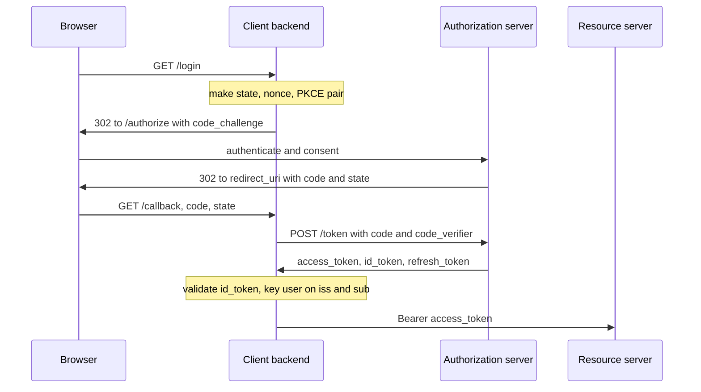

## TL;DR
OAuth 2.0 gives an app a scoped, expiring access token to call an API for a user without seeing their
password. OpenID Connect (OIDC) adds a signed ID token saying *who* logged in. Most login bugs come from
confusing these tokens.

## Why it exists
- **Password sharing was the old answer.** A third-party calendar app asked for your Google password. That
  hands over everything, not just the calendar; it cannot be revoked per app (only by changing the
  password, which breaks every app at once); it stops working once the account has MFA; and dozens of
  apps end up storing a credential that unlocks the whole account.
- **Static per-user API keys only fix half.** They remove password sharing but keys are long-lived, rarely
  scoped, hard to rotate, and the user still copies a secret between systems by hand.
- **OAuth 2.0 (2012) split the problem into four roles.** The **resource owner** (user), the **client**
  (app), the **authorization server** (authenticates the user, records consent, issues tokens) and the
  **resource server** (the API, accepts tokens). The user authenticates only to the authorization server;
  the client gets a token that is scoped (`calendar.readonly`), short-lived (minutes to an hour), revocable
  and tied to that one client.
- **Using OAuth for login is an inference error.** "If the app can call the profile API, the user must be
  who the profile says" is wrong: an access token proves the *client was authorized*, not *who is at the
  keyboard*. An attacker can get a valid token for a victim through a malicious app and replay it against
  another app that trusts the profile endpoint (token substitution).
- **OIDC (2014) closes that hole.** Its **ID token** is a JWT signed by the identity provider, with the
  client's own id in the audience and a nonce bound to this login attempt, so authentication is verified
  rather than inferred.

## How it works
### Two channels, one principle
| Channel | What it is | Trust |
|---|---|---|
| **Front channel** | The user's browser | Untrusted: logged, visible in history and referrers |
| **Back channel** | TLS from the client's server to the authorization server | Trusted |

- **Rule that explains most of the protocol:** *nothing valuable travels the front channel*.
- The browser only ever carries a short-lived, single-use authorization code; tokens move on the back
  channel.

### Authorization code flow with PKCE, step by step
1. **Generate three random values.** `state` (binds the callback to this browser session, defeating login
   CSRF), `nonce` (OIDC: binds the ID token to this attempt) and a PKCE pair: a `code_verifier` and
   `code_challenge = BASE64URL(SHA256(code_verifier))`. Store all three in the user's server-side session.
2. **Redirect to `/authorize`** with `response_type=code`, `client_id`, `redirect_uri`,
   `scope=openid profile email …`, `state`, `nonce`, `code_challenge` and `code_challenge_method=S256`.
3. **The authorization server authenticates the user** however it likes (password, passkey, MFA, corporate
   SSO); the client sees none of it. It shows a consent screen listing the scopes.
4. **Redirect back** to `redirect_uri?code=…&state=…`. The client checks `state` matches the session.
5. **Back channel exchange.** The client POSTs `code`, `redirect_uri`, `code_verifier` and, for a
   confidential client, its `client_secret` to `/token`. The server checks:
   - the code is unused and unexpired;
   - `SHA256(code_verifier)` equals the challenge from step 2;
   - `redirect_uri` is identical to the one in step 2, which `/authorize` already matched exactly against
     the registered list.
6. **Response.** `access_token`, `token_type`, `expires_in`, optionally `refresh_token`, and, when the
   `openid` scope was requested, `id_token`.

Why the checks in step 5 matter:
- **Exact redirect matching**, *because* the redirect URI is where the code is delivered; a wildcard or
  prefix match lets an attacker steer codes to a page they control.
- **PKCE**, *because* public clients (SPAs, mobile apps, CLIs) cannot keep a secret and a code can be
  intercepted (a malicious app registering the same custom URL scheme, a proxy log). Binding the code to a
  value the interceptor never saw makes the stolen code worthless.
- **PKCE everywhere.** The IETF security best current practice (RFC 9700) makes PKCE mandatory for public
  clients and recommends it for confidential clients too, since it also stops code injection.

### Three tokens, three audiences
| Token | Audience | Format | Validated by |
|---|---|---|---|
| Access token | The API (resource server) | Opaque or JWT; client treats it as opaque | The API |
| ID token | The client | Always a JWT | The client |
| Refresh token | The authorization server | Opaque to the client | The authorization server |

- **Access token.** Sent as `Authorization: Bearer …`. For a JWT, the API checks the signature against the
  issuer's JWKS plus `iss`, `aud`, `exp` and the required scopes; for an opaque token, it calls the
  introspection endpoint (RFC 7662).
- **ID token claims.** `iss`, `sub`, `aud` (must equal your `client_id`), `exp`, `iat`, plus `nonce`
  (present when the request sent one) and `auth_time` (when requested), and optionally `email`, `name`.
- **Key users on `(iss, sub)`.** `sub` is the stable user identifier, unique only *within* that issuer;
  email can change or be re-issued.
- **Never send the ID token to an API as a credential**; its audience is you.
- **Refresh token.** Gets fresh access tokens without the user present. It is the longest-lived secret in
  the system and therefore the most valuable to steal. Mitigations: rotation (each use returns a new one
  and reuse of an old one revokes the whole family), sender-constraining (DPoP or mTLS), and keeping it
  server-side only.

### Discovery and key rotation
- An OIDC provider publishes `/.well-known/openid-configuration` listing its endpoints and a `jwks_uri`.
- The JWKS holds public signing keys, each with a `kid`.
- Clients cache the set and refetch on an unknown `kid`, which is how a provider rotates signing keys
  without breaking anyone.

### The other grants
| Grant | Who | Use |
|---|---|---|
| **Client credentials** | No user; a service authenticates as itself (secret, private-key JWT or mTLS) | Batch jobs, agents acting as themselves |
| **Device code** | TVs and CLIs that cannot host a browser | Device polls while the user approves on a phone |
| **Token exchange (RFC 8693)** | A service holding a user's token | "On-behalf-of" calls to a downstream API |
| **Implicit, password** | Deprecated | Removed in the OAuth 2.1 draft |

- **Token exchange** trades a user's token for a new one with a different audience and usually narrower
  scope. It is the clean way for an API to call a downstream API, or for an agent's tool runtime to get a
  token for one tool, *because* forwarding the original token sends a credential whose audience is wrong
  and whose scope is wider than the downstream call needs.
- **Deprecated grants.** The implicit grant (token in the URL fragment, front channel) and the
  resource-owner password grant (the client sees the password). Do not build anything new on them.

### Scopes are not permissions
- **A scope is an upper bound** the *user* granted the *client*.
- **The resource server still applies the user's own authorization** underneath: `scope=repo` never lets an
  app delete a repository the user could not delete themselves.
- **Both checks run on every request** (see RBAC).

## Diagram
Follow the code: it is the only thing that crosses the browser, and it is worthless without the verifier
that stays on the server.



## Examples
### Confidential web client: code flow with PKCE and ID-token validation
A server-side client doing the authorization code flow with PKCE and validating the ID token against the
provider's JWKS. The pieces that matter are the three random values, the back-channel exchange, and the
claims that are checked before trusting `sub`.

```python
import base64, hashlib, secrets, urllib.parse, requests, jwt   # pip install requests pyjwt[crypto]

ISSUER, CLIENT_ID, CLIENT_SECRET = "https://login.example.com", "my-web-app", "<from secrets manager>"
REDIRECT_URI = "https://app.example.com/callback"
disc = requests.get(f"{ISSUER}/.well-known/openid-configuration").json()   # endpoints + jwks_uri
jwks = jwt.PyJWKClient(disc["jwks_uri"])   # caches keys; refetches when it meets an unknown kid

def start_login(session):            # 1. PKCE pair, state, nonce -> stored server-side, never in the URL
    verifier = secrets.token_urlsafe(64)
    challenge = base64.urlsafe_b64encode(hashlib.sha256(verifier.encode()).digest()).rstrip(b"=").decode()
    session.update(verifier=verifier, state=secrets.token_urlsafe(16), nonce=secrets.token_urlsafe(16))
    return disc["authorization_endpoint"] + "?" + urllib.parse.urlencode({
        "response_type": "code", "client_id": CLIENT_ID, "redirect_uri": REDIRECT_URI,
        "scope": "openid profile email", "state": session["state"], "nonce": session["nonce"],
        "code_challenge": challenge, "code_challenge_method": "S256"})

def handle_callback(code, returned_state, session):   # 2. browser returns ?code=...&state=...
    if returned_state != session["state"]:
        raise PermissionError("state mismatch: login CSRF or stale session")
    tok = requests.post(disc["token_endpoint"], data={             # back channel, TLS, server-to-server
        "grant_type": "authorization_code", "code": code, "redirect_uri": REDIRECT_URI,
        "client_id": CLIENT_ID, "client_secret": CLIENT_SECRET,
        "code_verifier": session["verifier"]})
    tok.raise_for_status(); tok = tok.json()                   # error responses carry no tokens
    # 3. Validate the ID token: signature via JWKS, pinned algorithm, issuer, audience = our client_id, expiry
    key = jwks.get_signing_key_from_jwt(tok["id_token"])
    claims = jwt.decode(tok["id_token"], key.key, algorithms=["RS256"],
                        audience=CLIENT_ID, issuer=disc["issuer"])
    if claims.get("nonce") != session["nonce"]:
        raise PermissionError("nonce mismatch: token not minted for this login")
    user_key = (claims["iss"], claims["sub"])     # sub is unique per issuer; email is a display attribute
    return user_key, tok["access_token"], tok.get("refresh_token")   # keep tokens server-side
```

- **After `handle_callback`** the app issues its own HttpOnly session cookie.
- **The access token** is used only when the backend calls the provider's APIs on the user's behalf.
- **The refresh token** never leaves the server.

### Why a stolen code is useless: PKCE in 15 lines
Runnable with the standard library. The authorization server stores only the challenge; an interceptor
who has the code but not the verifier cannot redeem it.

```python
import base64, hashlib, secrets

def challenge_for(verifier: str) -> str:
    digest = hashlib.sha256(verifier.encode()).digest()
    return base64.urlsafe_b64encode(digest).rstrip(b"=").decode()

verifier = secrets.token_urlsafe(64)        # stays in the client's server-side session
stored_challenge = challenge_for(verifier)   # sent on the front channel at /authorize

def token_endpoint_accepts(presented_verifier: str) -> bool:
    return secrets.compare_digest(challenge_for(presented_verifier), stored_challenge)

print(token_endpoint_accepts(verifier))                     # True: the legitimate client
print(token_endpoint_accepts(secrets.token_urlsafe(64)))    # False: attacker with the code only
```

### Resource server: bearer middleware for JWT access tokens
What the API, not the client, runs on every request. It pins issuer, audience and algorithm, then checks
scope. The `scope` claim is a space-separated string in the JWT access-token profile; some providers use
a different claim name, so confirm yours.

```python
import jwt   # pyjwt[crypto]

API_AUDIENCE, ISSUER = "https://api.example.com", "https://login.example.com"
jwks = jwt.PyJWKClient(f"{ISSUER}/.well-known/jwks.json")   # use the jwks_uri from discovery

def authorize(auth_header: str, needed_scope: str) -> dict:
    if not auth_header.startswith("Bearer "):
        raise PermissionError("401: missing bearer token")
    token = auth_header.removeprefix("Bearer ")
    key = jwks.get_signing_key_from_jwt(token)
    claims = jwt.decode(token, key.key, algorithms=["RS256"],
                        audience=API_AUDIENCE, issuer=ISSUER, leeway=30)  # 30 s clock skew
    if needed_scope not in claims.get("scope", "").split():
        raise PermissionError("403: insufficient scope")
    return claims   # next: the user's own role check (RBAC) on the resource
```

## Production patterns
- **Backend-for-frontend for SPAs.** When a browser app needs login, run the code flow on a small backend
  and give the browser only an HttpOnly, Secure, SameSite session cookie; tokens stay server-side. Monitor
  session-store size and refresh failures per provider.
- **Refresh-token rotation with reuse detection.** Turn on rotation in the identity provider so each refresh
  returns a new token and a replayed old one revokes the family. Alert on reuse-detected events, because
  each one is either a bug (two workers racing) or a theft.
- **JWKS cache with refetch on unknown `kid`.** Cache the key set (PyJWKClient does this) and refetch only
  when a token names a `kid` you lack, so key rotation needs no deploy. Monitor signature-validation
  failures; a spike right after provider rotation means a stale or pinned key.
- **Token exchange for downstream and agent tool calls.** Instead of forwarding the user's token, POST to
  `/token` with `grant_type=urn:ietf:params:oauth:grant-type:token-exchange`, the user's token as
  `subject_token`, and the target audience. Log audience and scope per issued token to spot over-broad
  grants.
- **Exact redirect URIs per environment.** Register `https://app.example.com/callback` and the staging and
  localhost equivalents separately, never a wildcard. Review the registered list in the provider console
  as part of each release that touches login.

## Trade-offs
- **Delegation vs moving parts.** No password sharing, paid for with redirect complexity, more moving parts
  and an authorization server on your login path. It flips to "a session cookie is enough" for an internal
  tool that talks only to its own backend and never to third parties.
- **JWT vs opaque access tokens.** JWTs let a resource server validate locally with no network call, but
  cannot be revoked before `exp` without adding a denylist lookup, which gives back the network call.
  Opaque tokens with introspection revoke instantly at the cost of a call (or short cache) per request.
  Choose by how long a stolen token may stay valid.
- **Short-lived access tokens vs refresh risk.** They shrink the damage from a leak, but move the risk onto
  the refresh token and the session store; without rotation and server-side storage you have only
  relocated the problem.
- **External identity provider vs vendor dependency.** Okta, Entra ID, Google or Auth0 take passwords, MFA
  and recovery out of your codebase, but add a vendor on the critical path and provider-specific quirks in
  claim names and refresh policies. For B2B customers SSO is a requirement, so this is rarely a real
  choice.

## Pitfalls
- **Treating an access token as proof of identity** by calling `/userinfo` and trusting the result.
  Symptom: a token issued to app A logs the same user into app B. Fix: require an ID token and check `aud`
  and `nonce`.
- **Omitting or not checking `state`.** Symptom: login CSRF, where a victim's browser completes the
  attacker's login and the victim then uploads data into the attacker's account.
- **Keying users on `email` instead of `(iss, sub)`.** Symptom: duplicate accounts after a rename, account
  takeover at providers that re-issue addresses, or a second, multi-tenant issuer letting anyone assert an
  email they do not own.
- **Registering wildcard or prefix-matched redirect URIs** ("any path under app.example.com"). Symptom:
  codes delivered to an open-redirect or user-content page on your own domain, from where an attacker
  reads them out of the URL. Fix: register exact URIs only.
- **Decoding the JWT without pinning `algorithms`, `audience` and `issuer`.** Symptom: any token from the
  same provider for any other app is accepted, or an `alg: none` token passes.
- **Storing tokens in browser `localStorage`.** Symptom: one XSS exfiltrates every user's tokens. Fix: a
  backend-for-frontend with an HttpOnly session cookie, tokens server-side.
- **Handing an agent or integration a broad, long-lived refresh token "to be safe".** Symptom: one
  compromised worker can act as every user. Fix: request minimal scopes, and use client credentials for
  work the agent does as itself.

## When to use
- **Use OIDC when humans log in** and you do not want to own passwords, MFA and account recovery. For B2B
  products that is nearly always: "do you support SSO" appears in the first security questionnaire.
- **Use the authorization code grant** when your product must call APIs as the user (Google Drive, GitHub,
  Slack, a CRM for an agent); **use client credentials** when a service calls another service.
- **Avoid when** it is a single internal app on a session cookie, and never use it as a substitute for "the
  cron job needs a credential".
- **Day to day:** token validation middleware, mapping provider claims to your roles, token storage and
  rotation, and provider quirks.
- **Interviews:** draw the code flow, explain why the exchange happens on the back channel, what PKCE
  prevents, and what each of the three tokens is for and who validates it.

## Role lens
- **Engineer:** Implements the callback, validates ID tokens against the JWKS, stores refresh tokens
  server-side, and writes the bearer middleware that checks issuer, audience, expiry and scope on every
  API request.
- **Architect:** Decides client types and grants per surface (backend-for-frontend for SPAs, client
  credentials for workers, delegated user tokens for agents), picks JWT versus opaque access tokens by
  revocation needs, and owns the identity-provider boundary and the claim-to-role mapping.
- **FDE:** Wires the product into the customer's Okta or Entra tenant, debugs redirect-URI and claim
  mismatches, gets the agent's tool integrations consented with minimal scopes, and explains why the
  agent acts with the user's token rather than a shared admin key.

## Check yourself
**Q:** A single-page app logs users in with Google by obtaining an access token in the browser, calling
the userinfo endpoint, and posting the returned email to the backend, which trusts it. What is wrong,
and how would you redesign it?
**A:** Three independent failures. First, identity is inferred from an access token: a token minted for
any other app for the same user, or an attacker's own token, is accepted, because nothing ties it to this
client; the fix is to require an ID token and validate signature, `iss`, `aud` equal to your client id,
`exp` and `nonce`. Second, tokens live in JavaScript, so a single XSS steals them. Third, the backend
trusts a client-asserted email. Redesign as a backend-for-frontend: the browser hits `/login`, the server
builds the authorize URL with `state`, `nonce` and PKCE, handles the callback on the back channel,
validates the ID token, keys the user on `(iss, sub)`, and sets an HttpOnly session cookie. Access and refresh
tokens stay server-side and are used only for calls to Google on the user's behalf, with refresh-token
rotation enabled.

## Interview questions
### What is the difference between OAuth 2.0 and OpenID Connect, and why does it matter?
- **OAuth is delegated authorization.** It issues an access token whose audience is an API and which proves
  a client was allowed to act, not who the user is.
- **OIDC adds authentication.** The ID token is a signed JWT with `aud` equal to your `client_id` and a
  `nonce` for this login, so identity is verified rather than inferred.
- **It matters because** using an access token as identity allows token substitution between apps.

### Users report being logged in as someone else after an IdP migration. How do you debug it?
- **Check the user key first.** If accounts are matched on email, two issuers or a re-issued address can
  map different people to one row; key on `(iss, sub)`.
- **Check validation pins.** Confirm `iss` and `aud` are pinned and the new issuer's JWKS is used, so tokens
  for another tenant or app are rejected.
- **Then check sessions.** Make sure the session cookie is reissued on login, not reused across users.

### Would you use JWT or opaque access tokens for an internal API that handles payments?
- **JWT** gives local validation with no network hop, but a stolen token lives until `exp`.
- **Opaque with introspection** revokes instantly at the cost of a call or short cache per request.
- **For payments** I would favour opaque tokens or very short JWT lifetimes plus a denylist, because the
  cost of a long-valid stolen token outweighs one extra lookup.

### An AI agent needs to call GitHub and a CRM on a user's behalf. How do you design its credentials?
- **Delegated user tokens per tool,** obtained by the code flow with minimal scopes, so the agent can never
  exceed what the user can do.
- **Token exchange per downstream call** to narrow audience and scope rather than forwarding one broad token.
- **Refresh tokens server-side with rotation,** and client credentials only for work the agent does as
  itself, so one compromised worker cannot act as every user.

### Why is PKCE now recommended even for confidential clients that have a secret?
- **PKCE binds the code to one login attempt.** The verifier never crosses the front channel, so an
  intercepted code cannot be redeemed.
- **It also stops code injection,** where an attacker plants their own code in a victim's callback; a client
  secret alone does not tie the code to the session that started the flow.
- **RFC 9700** makes it mandatory for public clients and recommends it for all.

## Quiz
### Q: Why does the authorization code flow send a code through the browser and exchange it server-side instead of returning the access token directly?
- [ ] Codes are shorter than tokens and fit more reliably in a redirect URL
- [x] The browser is an untrusted channel; a single-use code bound to PKCE or a client secret is useless if intercepted, whereas a token would be directly usable
- [ ] Access tokens can only be issued over a connection authenticated with mTLS
- [ ] It lets the authorization server rate-limit how many tokens a client receives
> URLs leak through history, logs and referrers. A code that can only be redeemed with the verifier
> or secret the interceptor lacks limits the damage; the implicit grant that put tokens in the URL was
> deprecated for precisely this reason.

### Q: A mobile app calls its own backend API and also needs to know who the user is. Which token goes where?
- [ ] The ID token to the API, and the access token to establish identity
- [x] The access token to the API, and the ID token to establish identity; each has a different audience
- [ ] The refresh token to the API, and the ID token to establish identity
- [ ] Either token works for both purposes because both are signed JWTs
> The ID token's audience is the client, the access token's audience is the API. Sending the ID token
> to an API or using an access token as identity proof breaks the audience check that prevents token
> substitution between applications.

### Q: What does PKCE protect against that a client secret alone cannot?
- [ ] Brute-force guessing of the user's password at the authorization server
- [ ] Replay of an access token after it has expired
- [x] Interception of the authorization code by or on behalf of a public client that cannot hold a secret, and code injection generally
- [ ] Forging the signature of an ID token
> A public client ships its code to users, so any embedded secret is public. PKCE binds the code to a
> per-request verifier that never travels the front channel, so an intercepted code cannot be
> redeemed; the IETF best-practice now recommends it for all clients.
