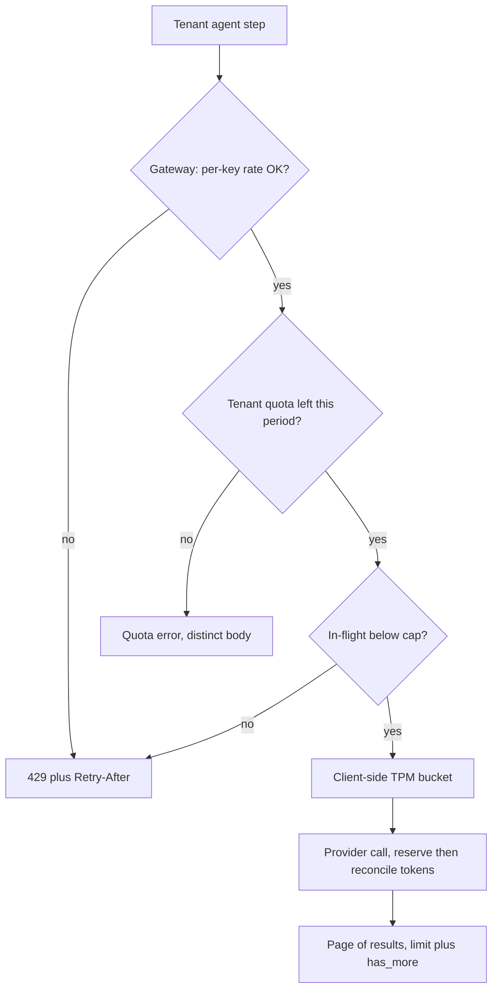

## TL;DR
Agents hit three bounds: pages bound what one tool result returns, rate limits bound requests and tokens
per minute, quotas bound spend per period. Every agent step is a model call, so tokens per minute usually
binds first.

## For agent builders
- **Why it matters for agents.** A 10-step agent makes 10 or more model calls per run, each carrying a
  growing prompt, so provider TPM limits cap how many runs you can serve. Unpaginated tool results flood
  the context window, and one tenant's agents can exhaust the shared provider key.
- **Where it shows up in your stack.** Provider RPM and TPM limits per model and region, `429` with
  `Retry-After` from model and tool APIs, rate-limit headers, `usage` fields in responses, cursor
  pagination in the APIs your tools wrap, and per-tenant limits in your agent gateway.
- **What you control.** Page size and `has_more` in tool results, a client-side token bucket per provider
  key and model, `max_tokens` per step, in-flight run caps, and per-tenant token quotas reserved before a
  run and reconciled after.
- **What you can skip.** Proving limiter algorithms correct. Know token bucket versus fixed window,
  keyset versus offset, Little's law and reserve-then-reconcile.

## Lab
### Task
Build the three bounds an agent gateway needs, using only the standard library: a keyset-paginated
`list_tickets` tool, a token bucket that meters provider tokens per minute, and a tenant quota that
reserves a run's tokens before it starts and reconciles after.

The starter uses offset pages, a fixed-window limiter and a quota that only counts finished runs.
Time box: 90-120 minutes.
- **Prerequisites:** this lesson's How it works (pagination, cursor rules, rate limiting algorithms,
  quotas) and the two worked scenarios, whose numbers the tests reuse.
- **Setup:** Python 3.12, `pip install pytest` (checked on pytest 9.1; `sqlite3` ships with Python).
  The clock is injected, so tests need no sleeping. Save the starter as `lab_bounds.py` and the tests as
  `test_lab_bounds.py`.
- **Done:** `python lab_bounds.py` prints the expected output and `pytest -q` passes.

### Starter code
```python
"""Lab: bound an agent's tools and spend: keyset pages, a token bucket, a run quota
(checked on Python 3.12, standard library only)."""
import base64, json, sqlite3

MAX_PAGE = 50


def make_db(n: int = 120) -> sqlite3.Connection:
    conn = sqlite3.connect(":memory:")
    conn.execute("CREATE TABLE tickets (id INTEGER PRIMARY KEY, created_at INTEGER NOT NULL, title TEXT)")
    conn.execute("CREATE INDEX ix_tickets_created_id ON tickets (created_at, id)")
    # three tickets per second, so created_at values collide at page boundaries
    conn.executemany("INSERT INTO tickets (id, created_at, title) VALUES (?, ?, ?)",
                     [(i, 1_000 + i // 3, f"ticket {i}") for i in range(1, n + 1)])
    return conn


def list_tickets(conn: sqlite3.Connection, limit: int = 20, cursor: str | None = None) -> dict:
    """LAB 1: newest first (created_at DESC, id DESC) with keyset pagination. The cursor is an opaque
    base64 token of the last row's (created_at, id). Fetch limit + 1 rows to set has_more (no COUNT).
    Clamp limit to 1..MAX_PAGE. Raise ValueError("invalid cursor") for a token you did not issue.
    Return {"ids": [...], "next_cursor": str | None, "has_more": bool}."""
    offset = int(cursor or 0)                                  # BUG: offset drifts under inserts
    rows = conn.execute("SELECT id FROM tickets ORDER BY created_at DESC, id DESC LIMIT ? OFFSET ?",
                        (limit, offset)).fetchall()            # BUG: no page-size cap
    total = conn.execute("SELECT COUNT(*) FROM tickets").fetchone()[0]   # BUG: a full count per page
    has_more = offset + limit < total
    return {"ids": [r[0] for r in rows], "next_cursor": str(offset + limit) if has_more else None,
            "has_more": has_more}


class TokenBucket:
    """LAB 2: capacity `capacity`, refilled at `rate` tokens per second, read from the injected clock.
    try_acquire(n) debits n and returns 0.0 when the tokens are there; otherwise it debits nothing and
    returns the seconds until n tokens will be available. n > capacity raises ValueError."""
    def __init__(self, rate: float, capacity: float, clock):
        self.rate, self.capacity, self.clock = rate, capacity, clock
        self.window, self.used = None, 0.0

    def try_acquire(self, n: float = 1.0) -> float:
        w = int(self.clock() // 60)                            # BUG: a fixed window per minute
        if w != self.window:
            self.window, self.used = w, 0.0
        if self.used + n <= self.capacity:
            self.used += n
            return 0.0
        return 60 - self.clock() % 60


class QuotaExceeded(Exception): ...


class RunQuota:
    """LAB 3: a tenant's token quota for the period, reserve then reconcile.
    reserve(run_id, estimate) admits a run only if used + outstanding reservations + estimate <= limit,
    else raises QuotaExceeded. reconcile(run_id, actual) drops that reservation and charges `actual`.
    remaining() = limit - used - outstanding reservations."""
    def __init__(self, limit: int):
        self.limit, self.used, self.reserved = limit, 0, {}

    def reserve(self, run_id: str, estimate: int) -> None:
        if self.used > self.limit:                             # BUG: ignores runs still in flight
            raise QuotaExceeded(run_id)

    def reconcile(self, run_id: str, actual: int) -> None:
        self.used += actual

    def remaining(self) -> int:
        return self.limit - self.used


def span(ids: list[int]) -> str:
    return f"{ids[0]}..{ids[-1]}" if ids else "-"


if __name__ == "__main__":
    db = make_db()
    p1 = list_tickets(db, 20)
    print(f"page 1: {span(p1['ids'])} has_more={p1['has_more']}")
    db.execute("INSERT INTO tickets VALUES (121, 2000, 'new urgent ticket')")   # arrives mid-walk
    p2 = list_tickets(db, 20, p1["next_cursor"])
    print(f"after an insert, page 2: {span(p2['ids'])}, overlap with page 1: {sorted(set(p1['ids']) & set(p2['ids']))}")
    print(f"limit=1000 -> {len(list_tickets(make_db(), 1000)['ids'])} rows")

    t = [0.0]
    b = TokenBucket(rate=2, capacity=10, clock=lambda: t[0])
    waits = [b.try_acquire() for _ in range(15)]
    print(f"bucket b=10 r=2: t=0 admitted {waits.count(0.0)} of 15, next wait {waits[-1]:.1f}s")
    t[0] = 59.5
    edge = TokenBucket(rate=10 / 60, capacity=10, clock=lambda: t[0])
    first = sum(edge.try_acquire() == 0.0 for _ in range(10))
    t[0] = 60.0
    print(f"boundary: {first} admitted at t=59.5, then {sum(edge.try_acquire() == 0.0 for _ in range(10))} at t=60.0")
    t[0] = 0.0
    tpm = TokenBucket(rate=360_000 / 60, capacity=360_000, clock=lambda: t[0])
    runs = [tpm.try_acquire(112_000) for _ in range(4)]
    print(f"TPM: {runs.count(0.0)} runs admitted at t=0, 4th waits {runs[-1]:.1f}s")

    q = RunQuota(300_000)
    q.reserve("r1", 112_000); q.reserve("r2", 112_000)
    try:
        q.reserve("r3", 112_000); r3 = "admitted"
    except QuotaExceeded:
        r3 = "rejected"
    q.reconcile("r1", 72_000)
    print(f"quota: r3 {r3}; after reconciling r1 at 72000, remaining {q.remaining()}")
```

As given, page 2 starts at `101..82` with `overlap with page 1: [101]`, `limit=1000` returns 120 rows,
the boundary line admits `10 at t=60.0`, and the quota admits r3 with `remaining 228000`, although
three runs of 112,000 tokens cannot fit in 300,000.

### Expected output
```
page 1: 120..101 has_more=True
after an insert, page 2: 100..81, overlap with page 1: []
limit=1000 -> 50 rows
bucket b=10 r=2: t=0 admitted 10 of 15, next wait 0.5s
boundary: 10 admitted at t=59.5, then 0 at t=60.0
TPM: 3 runs admitted at t=0, 4th waits 14.7s
quota: r3 rejected; after reconciling r1 at 72000, remaining 116000
```

The numbers follow the worked scenario: 112,000 tokens per run against a bucket of 360,000 (90% of a
400,000 TPM limit). Three runs leave 24,000 tokens, so the fourth waits (112,000 − 24,000) / 6,000 per
second ≈ 14.7 s. After r1 reconciles at 72,000: 300,000 − 72,000 − 112,000 = 116,000.

### Tests
```python
import base64
import pytest
import lab_bounds as lab


def walk(conn, limit=20):
    ids, cursor, pages = [], None, 0
    while True:
        page = lab.list_tickets(conn, limit, cursor)
        ids += page["ids"]; pages += 1
        if not page["has_more"]:
            return ids, pages
        cursor = page["next_cursor"]


def test_walk_returns_every_ticket_once_despite_timestamp_ties():
    ids, pages = walk(lab.make_db())
    assert ids == list(range(120, 0, -1)) and pages == 6


def test_insert_mid_walk_does_not_duplicate_or_skip():
    db = lab.make_db()
    p1 = lab.list_tickets(db, 20)
    db.execute("INSERT INTO tickets VALUES (121, 2000, 'new')")
    p2 = lab.list_tickets(db, 20, p1["next_cursor"])
    assert p2["ids"] == list(range(100, 80, -1))


def test_page_size_is_capped_and_cursor_is_checked():
    db = lab.make_db()
    assert len(lab.list_tickets(db, 1000)["ids"]) == lab.MAX_PAGE
    for bad in ("40", base64.urlsafe_b64encode(b"hello").decode()):
        with pytest.raises(ValueError, match="invalid cursor"):
            lab.list_tickets(db, 20, bad)


def test_no_count_query_per_page():
    db = lab.make_db()
    seen = []
    db.set_trace_callback(seen.append)
    lab.list_tickets(db, 20)
    assert not any("COUNT" in s.upper() for s in seen)


def bucket(rate, cap, t):
    return lab.TokenBucket(rate=rate, capacity=cap, clock=lambda: t[0])


def test_bucket_allows_a_burst_then_the_refill_rate():
    t = [0.0]; b = bucket(2, 10, t)
    waits = [b.try_acquire() for _ in range(15)]
    assert waits.count(0.0) == 10 and waits[-1] == pytest.approx(0.5)
    t[0] = 1.0
    assert [b.try_acquire() for _ in range(3)][:2] == [0.0, 0.0]


def test_bucket_has_no_window_edge_burst():
    t = [59.5]; b = bucket(10 / 60, 10, t)
    assert sum(b.try_acquire() == 0.0 for _ in range(10)) == 10
    t[0] = 60.0
    assert sum(b.try_acquire() == 0.0 for _ in range(10)) == 0


def test_bucket_meters_tokens_and_rejects_impossible_requests():
    t = [0.0]; b = bucket(360_000 / 60, 360_000, t)
    waits = [b.try_acquire(112_000) for _ in range(4)]
    assert waits[:3] == [0.0] * 3 and waits[3] == pytest.approx(88_000 / 6_000)
    with pytest.raises(ValueError):
        b.try_acquire(400_000)


def test_quota_counts_runs_in_flight_and_reconciles():
    q = lab.RunQuota(300_000)
    q.reserve("r1", 112_000); q.reserve("r2", 112_000)
    with pytest.raises(lab.QuotaExceeded):
        q.reserve("r3", 112_000)
    q.reconcile("r1", 72_000)
    assert q.remaining() == 300_000 - 72_000 - 112_000
    q.reserve("r3", 112_000)
    assert q.remaining() == 4_000
```

On the starter, 7 of 8 fail: page 2 repeats ticket 101, the page is not capped, `"40"` is accepted as
a cursor, and a `COUNT(*)` runs per page. The limiter waits for the next minute instead of the refill
time and admits a second burst at the window edge, and the quota admits r3.

The full-walk test passes on the starter and guards the tie-breaker once you switch to keyset.

### Failure scenarios
- **Inject: put only `created_at` in the cursor** (`WHERE created_at < ?`). Observe: the full walk
  returns 114 of 120 tickets; the 6 missing ones shared a timestamp with a page's last row. Debug: diff
  the walked ids against `SELECT id`, then look at the `created_at` of the rows around each gap.
- **Inject: let a bucket accept `n` larger than capacity.** Observe: `try_acquire(400_000)` returns a
  wait it can never satisfy, so a step with an oversized prompt queues forever. Debug: log the requested
  tokens next to bucket capacity, and fail fast or trim the prompt instead.
- **Inject: reconcile without popping the reservation.** Observe: `remaining()` drops by estimate plus
  actual and the tenant hits its quota well before its real usage does. Debug: alert when outstanding
  reservations exceed the number of runs actually in flight.

### Submission
- **Code:** `lab_bounds.py` with LAB 1-3 done; the cursor stays opaque and the clock injectable.
- **Test run:** `pytest -q` showing 8 passed, plus the script output matching Expected output.
- **A paginated tool definition:** the JSON Schema you would hand the model for `list_tickets`, with
  `limit` bounded and `cursor` described as opaque.
- **A short note (3-5 sentences):** where each of the three bounds lives with several workers (Redis
  for the bucket and quota, the database index for keyset) and which error body each one returns.
- **Evaluation:** tests pass, numbers match the worked scenario, and no bound can be bypassed by a
  caller-supplied value.

## Why it exists
- **The unbounded list is a bomb.** `GET /documents` for a tenant with two million rows: the database
  materialises every row, the server serialises hundreds of megabytes of JSON, a 30-second timeout fires
  mid-parse, and the client retries and doubles the load. Response size must be bounded by the server,
  not by the client's good manners, and an agent's tool is a client with no manners.
- **The obvious fix, `?offset=1000&limit=50`, degrades.** Page 20,000 makes the engine produce and discard
  a million rows, and a row inserted while the client is on page 3 shifts every later page, so items are
  skipped or shown twice.
- **Capacity is shared.** A connection pool, a CPU, a provider's tokens-per-minute allowance: one burst (a
  retry storm, a batch script, a scraper, a looping agent) takes capacity from everyone and cascades into
  timeouts. "Just scale up" fails: you cannot scale a provider's limit, bursts beat autoscaling, and
  unlimited capacity is an unlimited bill.
- **A limiter is also a signal.** `429` plus `Retry-After` tells a well-behaved client exactly when to
  come back, which turns overload into orderly queueing instead of a pile-up.
- **Rate limits say nothing about a month.** They protect the system *this minute*, not against a tenant
  running at the limit for a month. When every call costs money, as every LLM call does, you need an
  entitlement (how much, not how fast), or a free-tier batch job outspends its lifetime revenue unnoticed.

## How it works
### Pagination: offset, keyset, cursor
| Style | Query shape | Cost per page | Under concurrent writes | Use for |
|---|---|---|---|---|
| Offset | `ORDER BY created_at DESC LIMIT 50 OFFSET 1000` | produces 1,050 rows and throws 1,000 away; grows linearly with depth | window drifts | small, static sets needing "page 7 of 12" |
| Keyset (seek) | `WHERE (created_at, id) < (:last_ts, :last_id) ORDER BY created_at DESC, id DESC LIMIT 50` | roughly O(log n + page size), any depth | stable | large or moving lists |
| Cursor | keyset values in an opaque token | same as keyset | stable | public APIs and agent tools |

- **Keyset needs an index on `(created_at, id)`** so the engine seeks directly to the position. Inserts do
  not shift the window *because* position is defined by a value rather than a count.
- **The `id` tie-breaker is mandatory** because `created_at` is not unique; without it, rows sharing a
  timestamp at a page boundary get skipped or repeated.

### Cursor rules
1. **Wrap the keyset values in an opaque token** (base64 JSON, optionally HMAC-signed) and return
   `{"data": [...], "next_cursor": "...", "has_more": true}`.
2. **Keep it opaque** *because* it is part of your contract: if clients can read it they will build it,
   and you can never change the sort or the key again.
3. **Bind the cursor to its query.** Include the sort and a hash of the filters, or sign it, so reuse
   with different filters gets a clear 400 rather than a silently wrong page.
4. **Fetch `limit + 1` rows** to compute `has_more` without a count.
5. **Enforce a default and a maximum page size** on the server; clients will ask for 10,000.
6. **Omit or estimate totals**, because `COUNT(*)` over a large table is a full scan on every page.

- **As a consumer:** loop until `has_more` is false, and treat an invalid cursor as "start over".
- **Agent tools need the same discipline:** one page per call with `has_more` surfaced to the model, or one
  tool result eats the context window. The model decides whether to fetch the next page; your tool caps
  how many it may fetch per run.

### Rate limiting algorithms
- **Token bucket:** capacity *b* refilled at *r* tokens per second; each request takes one token (or *n*
  for token-metered APIs); empty means reject or wait. It allows a burst of *b* and a sustained rate of
  *r*, what most APIs want *because* real clients are bursty and shedding a five-request burst from an
  idle client helps nobody.
- **Leaky bucket:** requests queue and drain at a fixed rate; smooth output at the cost of queueing delay.
  Use it in front of a downstream that cannot absorb bursts at all.
- **Fixed window:** `INCR limit:{key}:{minute}` with a TTL. One command, but a client can send a full
  window's worth at 11:59:59 and again at 12:00:00, so the real peak is twice the nominal limit.
- **Sliding window log:** every request timestamp in a sorted set, counting those in the trailing window;
  exact, but memory grows with traffic.
- **Sliding window counter:** weight the previous window's count by its overlap with the trailing window;
  approximate, cheap, usually enough.
- **Concurrency limit:** cap requests *in flight*. By Little's law, in-flight = arrival rate × duration, so
  10 requests per second of 30-second streaming completions is about 300 open streams, each holding a
  connection and a model-server slot. LLM gateways usually enforce both a rate and a max-in-flight per
  tenant; agent platforms add a cap on concurrent runs.

### Token bucket trace
Take *b* = 10 and *r* = 2 per second; an idle client fires 15 requests at t = 0.

| Time | Tokens before | Requests | Outcome |
|---|---|---|---|
| t = 0 | 10 | 15 | first 10 pass and drain the bucket; next 5 are rejected (or wait) |
| t = 1 s | 2 | 2 | 2 more pass |
| any interval *T* | | | at most `b + r·T` admitted: burst *b*, long-run rate *r* |

### Distributed enforcement and placement
- **Counters must be atomic.** `INCR` followed by `EXPIRE` as two commands leaves a key without a TTL if
  the process dies in between, so use a Lua script or `SET NX EX` plus `INCR`.
- **Gateway** (nginx, Envoy, a cloud API gateway): coarse per-IP or per-key limits, no business context.
- **Application level in Redis:** per tenant, per model and token-weighted.
- **Provider dimensions.** Model providers limit requests per minute (RPM) and tokens per minute (TPM)
  separately, often per model and per region. For LLM workloads TPM binds first *because* each request
  carries thousands of tokens, and an agent's prompt grows every step.
- **Admission accounting.** Some providers debit the token budget at admission using your `max_tokens`
  plus a prompt estimate, not tokens actually generated, so a generous `max_tokens` can produce 429s
  while real usage is low. Check your provider's accounting rules.

### Signalling limits
- **Respond `429 Too Many Requests`** (RFC 6585) with `Retry-After` in seconds or as an HTTP date.
- **Publish remaining budget** so clients throttle before they hit 429: `X-RateLimit-Limit`,
  `X-RateLimit-Remaining`, `X-RateLimit-Reset` by convention.
- **The standard is still a draft.** An IETF httpapi draft, still evolving, standardises `RateLimit` and
  `RateLimit-Policy` fields; earlier drafts used `RateLimit-Limit`/`-Remaining`/`-Reset`.
- **As a consumer:** honour `Retry-After`, back off exponentially with jitter, cap concurrency with a
  semaphore, and keep a client-side token bucket sized to your known limit, so you queue locally instead
  of burning retries. In an agent loop this happens in code; the model should never see a 429.

### Quotas: entitlement and cost
- **Definition.** A cap on total consumption over a long window (day, month) or a budget (dollars, tokens,
  jobs) per account, tenant or feature. Rate limit answers "how fast"; quota answers "how much".
- **Enforcement.** A counter per `(tenant, period)` in Redis or the database.
- **Reserve, then reconcile.** For token quotas, reserve an estimate at admission and reconcile from the
  response's `usage` field, *because* real cost is known only after the call and a stream can fail
  halfway. For agents, reserve per run (step cap × per-step estimate) and reconcile per step.
- **Soft vs hard.** Soft limits alert, degrade to a cheaper model, lower `max_tokens` or require approval;
  hard limits reject.
- **Distinguishable errors.** No universal status code exists for quota exhaustion. The error body must be
  machine-distinguishable from a rate limit, because the client reaction differs: wait seconds versus
  stop until the next period or upgrade.
- **Both directions.** You consume a provider's quota and issue quotas to tenants; allocations against one
  provider key must fit its limit, or you overbook with priorities and shed low-priority work on a 429.
  That mapping is capacity planning, covered in the infra-capacity-economics and reliability modules.

## Diagram
A request passes three bounds in order of time scale before any work runs, and the response itself is
bounded by a page size.



## Examples
### Keyset endpoint with an opaque cursor, plus a client-side TPM bucket
The bucket is in-process; with several workers the same logic moves into Redis. `db` is an asyncpg pool
created at startup.

```python
import asyncio, base64, json, time
from datetime import datetime
from fastapi import FastAPI, HTTPException, Query

app = FastAPI()

def encode_cursor(created_at: datetime, id_: int) -> str:
    return base64.urlsafe_b64encode(json.dumps([created_at.isoformat(), id_]).encode()).decode()

def decode_cursor(cursor: str) -> tuple[datetime, int]:
    try:
        ts, id_ = json.loads(base64.urlsafe_b64decode(cursor))
        return datetime.fromisoformat(ts), int(id_)
    except (ValueError, TypeError):
        raise HTTPException(400, "invalid cursor")             # opaque: clients never build or parse it

@app.get("/documents")
async def list_documents(limit: int = Query(20, ge=1, le=100), cursor: str | None = None):
    sql, args = "SELECT id, created_at, title FROM documents", []
    if cursor:
        last_ts, last_id = decode_cursor(cursor)
        sql += " WHERE (created_at, id) < ($1, $2)"             # keyset: seek to position, never skip rows
        args = [last_ts, last_id]
    sql += f" ORDER BY created_at DESC, id DESC LIMIT {limit + 1}"  # +1 row answers has_more without COUNT(*)
    rows = await db.fetch(sql, *args)                           # needs an index on (created_at, id)
    page, has_more = rows[:limit], len(rows) > limit
    next_cursor = encode_cursor(page[-1]["created_at"], page[-1]["id"]) if has_more else None
    return {"data": [dict(r) for r in page], "next_cursor": next_cursor, "has_more": has_more}

class TokenBucket:
    """Client-side limiter: queue locally instead of collecting 429s from the provider."""
    def __init__(self, rate_per_sec: float, capacity: float):
        self.rate, self.capacity = rate_per_sec, capacity
        self.tokens, self.last = capacity, time.monotonic()
    async def acquire(self, n: float) -> None:
        if n > self.capacity:
            raise ValueError("request larger than bucket capacity would wait forever")
        while True:
            now = time.monotonic()
            self.tokens = min(self.capacity, self.tokens + (now - self.last) * self.rate); self.last = now
            if self.tokens >= n:
                self.tokens -= n; return                        # no await between check and debit: safe in asyncio
            await asyncio.sleep((n - self.tokens) / self.rate)  # sleep exactly the refill time we need

tpm_bucket = TokenBucket(rate_per_sec=200_000 / 60, capacity=200_000)   # illustrative 200k TPM limit
# before each model call: await tpm_bucket.acquire(prompt_token_estimate + max_tokens)
```

### A paginated agent tool with a per-run page budget
The tool wraps the endpoint above: small pages, compact rows, `has_more` and the cursor handed to the
model, and a hard cap on pages per run so a curious model cannot walk two million rows.

```python
import httpx

MAX_PAGES_PER_RUN = 5

async def list_documents_tool(client: httpx.AsyncClient, run_state: dict,
                              cursor: str | None = None, limit: int = 20) -> dict:
    used = run_state.setdefault("pages_used", 0)
    if used >= MAX_PAGES_PER_RUN:
        return {"error": f"page budget of {MAX_PAGES_PER_RUN} reached; narrow the search instead"}
    run_state["pages_used"] = used + 1                     # count before awaiting: parallel calls can't overshoot
    params = {"limit": min(limit, 50)}                     # the tool's cap sits below the API's 100
    if cursor:
        params["cursor"] = cursor                          # opaque: the model passes it back verbatim
    r = await client.get("/documents", params=params)
    r.raise_for_status()
    body = r.json()
    return {
        "items": [{"id": d["id"], "title": d["title"][:120]} for d in body["data"]],  # compact rows
        "has_more": body["has_more"],
        "next_cursor": body["next_cursor"],                # model calls again with this if it needs more
    }
```

### Atomic fixed-window counter in Redis
The script runs atomically on the Redis server, so the key can never be left without its TTL. It uses
the redis-py client; `r.eval(script, numkeys, *keys_and_args)` is the standard call.

```python
import time
import redis

r = redis.Redis()
FIXED_WINDOW = """
local n = redis.call('INCR', KEYS[1])
if n == 1 then redis.call('EXPIRE', KEYS[1], ARGV[1]) end
return n
"""

def allow(tenant: str, limit: int = 100, window_s: int = 60) -> bool:
    key = f"rl:{tenant}:{int(time.time() // window_s)}"     # one key per tenant per window
    count = r.eval(FIXED_WINDOW, 1, key, window_s)          # INCR and EXPIRE as one atomic step
    return count <= limit                                   # caller returns 429 + Retry-After if False
```

Remember the boundary burst: this admits up to 2 × `limit` in a two-second span across a window edge,
so put a token bucket in front of anything fragile.

### Worked scenario: sizing a client bucket for a nightly batch
A nightly job classifies 5,000 tickets. Provider limit: 1,000 RPM and 400,000 TPM, debited at admission
as prompt plus `max_tokens`. Each prompt is ~3,000 tokens with `max_tokens` = 500. Figures are illustrative.

| Quantity | Value |
|---|---|
| Admission charge per request | 3,000 + 500 = 3,500 tokens |
| Requests per minute allowed by TPM | 400,000 / 3,500 ≈ 114 (RPM of 1,000 never binds) |
| Client bucket at 90% of TPM | 360,000 tokens per minute ≈ 102 requests per minute |
| Drain time | 5,000 × 3,500 = 17.5 million / 360,000 ≈ 49 minutes |
| `max_tokens` cut to 200 (labels are short) | 5,000 × 3,200 = 16 million / 360,000 ≈ 44 minutes |
| Without a client bucket | 429s within seconds, retries make it worse |

### Worked scenario: how many agent runs fit in one TPM limit
A support agent averages 8 steps per run; its prompt grows from 6,000 to about 20,000 tokens, averaging
~13,000, with `max_tokens` = 1,000 per step. Provider limit: 400,000 TPM. Figures are illustrative.

| Quantity | Value |
|---|---|
| Admission charge per step | 13,000 + 1,000 = 14,000 tokens |
| Charge per run | 8 × 14,000 = 112,000 tokens |
| Runs per minute at 90% of TPM | 360,000 / 112,000 ≈ 3.2 |
| Steady run duration ~40 s, so in-flight runs (Little's law) | 3.2 / 60 × 40 ≈ 2 concurrent runs |
| Same agent with each tool result paginated to 20 compact rows (prompt average ~8,000) | 8 × 9,000 = 72,000 per run, ≈ 5 runs per minute |

## Production patterns
- **Token budget per agent run.** Reserve step cap × per-step estimate from the tenant quota at run start,
  reconcile each step from `usage`, and stop the run with a clear message when the reservation runs out.
  Monitor tokens per run by agent and tenant; a rising p95 often means unpaginated tool results.
- **Client-side bucket per provider key and model.** Size it a little below the published TPM and RPM
  (for example 90%), charge prompt estimate plus `max_tokens`, and queue instead of calling. Monitor
  time waiting in the bucket and the 429 rate; both should stay low and flat.
- **Atomic Redis limiter per tenant and model.** Implement the bucket or window as a Lua script keyed by
  tenant, model and window, and decide up front whether a Redis outage fails open or closed. Monitor
  limiter latency, Redis errors and rejections per tenant.
- **Concurrency leases for streaming and runs.** Cap in-flight streams and agent runs per tenant with a
  counter or semaphore whose entries carry a TTL, so a crashed worker cannot leak slots. Monitor
  in-flight per tenant against the Little's-law estimate (rate × duration).
- **Reserve-and-reconcile token quotas.** Debit an estimate at admission, correct it from `usage` when the
  response ends, and release it on failure. Alert tenants and on-call at a soft threshold (for example
  80%) before the hard stop.
- **Bounded pages everywhere, including agent tools.** Enforce a default and maximum `limit`, return
  `next_cursor` and `has_more`, and never return totals by `COUNT(*)` on hot paths. Monitor p95 page
  latency by depth, the largest page sizes requested and pages fetched per agent run.

## Trade-offs
- **Keyset/cursor vs page numbers.** They cost the same at page 1 and page 10,000 and stay stable under
  writes, but cannot jump to page *N* or sort by an arbitrary unindexed column; offset wins when the set
  is small, static and the UI genuinely needs page numbers.
- **Small tool pages vs extra steps.** Small pages keep each prompt cheap, but an agent that truly needs
  many rows pays a model call per page; give it a filter or search tool instead of a bigger page.
- **Token bucket bursts vs smoothing.** Admitting bursts keeps latency low for bursty, light clients, but a
  burst of size *b* still lands on the downstream at once; when it has no buffer, a leaky bucket's
  smoothing is worth its queueing delay.
- **Gateway vs application enforcement.** The gateway is uniform and cheap but cannot see token counts or
  tenant tier; application-level limiting can, at the price of a Redis round trip per request and one
  more component that must stay highly available.
- **Hard vs soft quotas.** Hard quotas protect the bill and fairness, but stopping a paying customer dead
  at 100% creates support load; soft limits with graceful degradation win when the SLA matters more than
  the marginal cost.
- **Exact vs approximate windows.** A sliding-window log is fair and precise but its memory grows with
  traffic; the sliding counter is cheaper and good enough unless the limit itself is contractual.

## Pitfalls
- **Offset pagination on a growing table.** Symptom: page latency climbs with page number, and users
  report duplicated or missing items while the list is being written to. Fix: keyset or cursor pages.
- **A tool that returns the whole list.** Symptom: one tool result of tens of thousands of tokens, a
  context-length error, or a TPM spike from a single run. Fix: paginate the tool and cap pages per run.
- **A non-unique sort column without a tie-breaker.** Symptom: rows vanish or repeat exactly at page
  boundaries when many rows share a timestamp. Fix: add `id` to the sort and the cursor.
- **A fixed-window counter guarding a fragile downstream.** Symptom: overload incidents clustered around
  minute boundaries, at twice the nominal limit. Fix: a token bucket or sliding window.
- **Retrying 429 immediately or without jitter.** Symptom: a retry storm in which the 429 rate climbs
  instead of clearing, sometimes ending with the provider disabling the key. Fix: honour `Retry-After`.
- **Counting requests when the provider counts tokens.** Symptom: 429s at a small fraction of the request
  limit, because each request carries a 40k-token prompt. Fix: a token-weighted client bucket.
- **Charging quota only after the response.** Symptom: tenants exceed their cap by one burst of concurrent
  requests, and failed streaming calls are never accounted for. Fix: reserve, then reconcile.
- **Rate-limiting long streams without a concurrency cap.** Symptom: the model server or connection pool
  saturates while every tenant is under its requests-per-minute limit. Fix: in-flight leases per tenant.
- **A readable cursor.** Symptom: integrations break after a release that changed the sort order, because
  clients had been hand-building cursors. Fix: opaque, signed cursors.

## When to use
- **Pagination:** default to cursor pagination for any list that can grow or is ordered by time; keep
  offset for small admin tables. Every list-returning agent tool gets a page size and `has_more`.
- **Rate limits:** every endpoint fronting a scarce resource, per tenant or key, with a token bucket in
  Redis at the application layer and coarse limits at the gateway; put a client-side bucket in front of
  every provider whose limits you know.
- **Quotas:** as soon as a call has a cost, which for LLM products is day one.
- **Measure** the 429 rate per tenant, time waiting in client limiters, quota utilisation, tokens per
  agent run, and page latency by depth.
- **Interviews:** "design a rate limiter" is constant; compare token bucket with fixed and sliding
  windows, handle atomicity in Redis, choose response headers, and separate rate from quota.

## Role lens
- **Engineer:** Implements keyset endpoints and opaque cursors, the Redis limiter script, the client-side
  TPM bucket, and the 429 and `Retry-After` handling inside every SDK wrapper.
- **Architect:** Chooses the limit dimensions (RPM, TPM, concurrency), the tenant quota model and how it
  overbooks provider capacity, and where enforcement lives (gateway versus service).
- **FDE:** Translates a customer's expected load into provider limits, requests quota increases ahead of
  launch, and designs the "you have hit your quota" experience and dashboards their admins will see.

## Check yourself
**Q:** Your model provider allows 500 requests and 200,000 tokens per minute on the model you use. Your
agent sends prompts of roughly 20,000 tokens. A customer submits 1,000 documents at once. What happens,
and how do you redesign?
**A:** TPM binds: 200,000 / 20,000 is 10 requests per minute, so the 500 RPM figure is irrelevant and
the burst produces 429s within seconds. The batch is 20 million tokens, so 100 minutes at the very
best. Redesign: queue the batch and drain it through a client-side token bucket sized to TPM (counting
the prompt estimate plus `max_tokens`), bound concurrency, honour `Retry-After` with jittered backoff,
give each tenant a quota so one customer cannot consume the whole budget, shrink the prompt (retrieval
instead of whole documents; prompt caching cuts cost and latency, and on some providers cached tokens
also stop counting against the input-token limit), and ask for a quota
increase or spread load across regions or providers before launch. If the provider offers an
asynchronous batch endpoint with separate limits, route offline jobs there. Then watch the 429 rate and
queue wait time.

## Interview questions
### Why does offset pagination show duplicates and gaps while the list is being written to?
- **Position is a count:** `OFFSET 1000` means "skip 1,000 rows", so a row inserted above the client's
  position shifts every later page by one and an item is shown twice.
- **Deletes do the reverse:** a removed row shifts items up, and one is skipped.
- **Keyset fixes it** because position is a value (`(created_at, id)` of the last row seen), and the `id`
  tie-breaker keeps boundaries exact when timestamps collide.

### Design the rate limiter for a multi-tenant gateway serving agents.
- **Dimensions:** per tenant and per model, enforcing requests per minute, tokens per minute
  (prompt estimate plus `max_tokens`), max in-flight streams and max concurrent agent runs.
- **Mechanism:** a token bucket as an atomic Lua script in Redis, coarse per-IP limits at the gateway,
  and a client-side bucket in front of the provider so tenant allocations fit its limit.
- **Signals and failure:** `429` with `Retry-After` and remaining-budget headers, plus a decision on fail
  open or closed when Redis is down.

### An agent's search tool sometimes returns 5,000 rows and the run then fails or costs ten times normal. What do you change?
- **Paginate the tool:** a small default page with compact rows, `has_more` and an opaque cursor the model
  passes back to get more.
- **Cap and redirect:** a per-run page budget, and a filter or search parameter so the model narrows the
  query instead of paging through everything.
- **Measure:** tokens per tool result and tokens per run; alert when a tool result exceeds a set size.

### Your service gets 429s from the provider, but the usage dashboard shows you at 30% of TPM. What do you check?
- **Admission accounting:** some providers debit `max_tokens` plus a prompt estimate at admission, so a
  generous `max_tokens` consumes budget that is never used.
- **Dimension and scope:** RPM, a per-model or per-region limit, or another service sharing the same key.
- **Fix:** right-size `max_tokens`, add a client-side bucket using the provider's accounting, and split
  keys or projects per workload.

### When do you need a concurrency limit in addition to a rate limit?
- **When requests are long:** by Little's law in-flight = rate × duration, so 10 requests per second of
  30-second streams is about 300 open streams at any moment.
- **What saturates:** connections and model-server slots, not the per-minute counter.
- **So** cap in-flight per tenant with TTL leases, and size the cap from the expected rate and duration.

### Rate limit or quota: which error should the client see, and why does it matter?
- **Rate limit:** `429` with `Retry-After`; the right reaction is to wait seconds and retry.
- **Quota:** a machine-distinguishable error body (no universal status code exists), because the right
  reaction is to stop until the next period, degrade or upgrade.
- **Mixing them up** makes clients retry into an exhausted quota, or give up on a momentary burst.

## Quiz
### Q: Why does keyset pagination stay fast at page 10,000 while offset pagination slows down?
- [ ] Keyset pages are cached in Redis after the first request
- [x] The index seek starts at the last-seen key, so each page costs about the page size rather than the offset
- [ ] Keyset queries return fewer columns, so less data is transferred
- [ ] The database compresses rows that have already been paginated
> OFFSET forces the engine to produce and discard every earlier row in sort order, so cost grows with
> depth. A keyset predicate on an indexed column lets the engine jump straight to the position, so the
> cost is proportional to the page, not the depth.

### Q: A fixed-window limiter allows 100 requests per minute. What is the most a client can push through in a two-second span that straddles the minute boundary?
- [ ] 100, because the limit is enforced per minute
- [ ] About 3, because 100 per minute is under two per second
- [x] 200: the last 100 of one window and the first 100 of the next
- [ ] Unbounded, because the counter resets to zero
> The counter is per calendar window, not per trailing minute, so a client can exhaust one window at
> its end and the next at its start. Sliding-window and token-bucket limiters remove that boundary burst.

### Q: A tenant's plan allows 60 requests per minute and 100,000 requests per month. They send a steady 30 requests per minute for three days. Which bound stops them?
- [ ] The rate limit, because 30 per minute sustained for hours exceeds 60 per minute
- [x] The monthly quota, which 30 per minute exhausts in a little over two days
- [ ] Neither, because they never exceed 60 per minute
- [ ] Both at once, on the third day
> 30 per minute is 43,200 per day, so 100,000 is used up after about 2.3 days without ever exceeding
> the per-minute rate. Rate limits bound speed; quotas bound total consumption over the period.

## Use cases & projects
### Use cases
- **Multi-tenant agent platforms.** Per-tenant TPM buckets, concurrent-run caps and monthly token quotas
  keep one customer's agents from starving the shared provider key.
- **Agent tools over large datasets.** CRM, ticket and document tools return cursor pages with
  `has_more`, so the agent reads 20 rows at a time instead of flooding its context.
- **Batch agent jobs.** Overnight classification or enrichment runs drain through a client-side token
  bucket instead of collecting 429s.
- **Cost guardrails.** Per-run token reservations stop a looping agent at its budget and tell the user
  why, instead of discovering the cost on the invoice.

### Mini project
**Budgeted agent runs over a paginated tool (2-3 hours).**
- **Goal:** run 20 concurrent agent runs against a fake provider with a TPM limit and a paginated tool,
  without a single 429 reaching the model and without any run exceeding its token budget.
- **Steps:** build a fake provider that returns 429 with `Retry-After` above a TPM you choose; put the
  `TokenBucket` above in front of it; implement the paginated tool with a page budget; reserve tokens per
  run and reconcile from a fake `usage` field; launch 20 runs at once.
- **Done when:** the fake provider logs zero 429s, every run either finishes or stops at its budget with a
  clear message, and a table shows tokens, pages and bucket wait time per run.

### Major project
This lesson feeds the module Capstone (see the module guide): DocBrief uses cursor pagination on list
endpoints, per-tenant rate limits and monthly token quotas in Redis, and a client-side token bucket.
