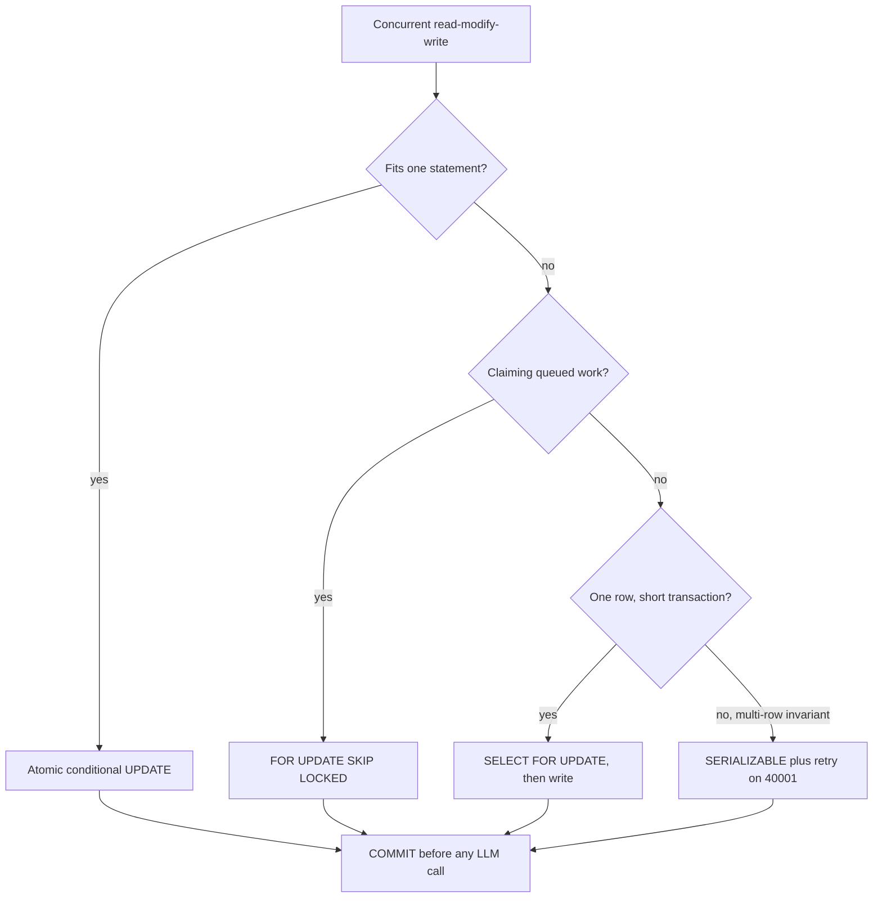

## TL;DR
Concurrent agent runs race on budgets, run limits and step records. Transactions make writes atomic;
isolation decides what concurrent ones see. READ COMMITTED permits lost updates and write skew; fix them
with atomic updates, row locks, or SERIALIZABLE plus retries.

## For agent builders
- **Why it matters for agents.** Many agent runs for the same tenant execute at once, each checking a
  token budget, a concurrent-run cap or "has this tool call already happened?". Those are read-then-write
  decisions, and under the default isolation level they silently overspend or duplicate work.
- **Where it shows up in your stack.** psycopg or SQLAlchemy sessions in your agent service, LangGraph's
  Postgres checkpointer writing state per step, database-backed job queues using `SKIP LOCKED`, and
  PgBouncer in front of a fleet of agent workers.
- **What you control.** Transaction boundaries (commit before every model or tool call), atomic
  conditional updates for budgets, `FOR UPDATE` or SERIALIZABLE for multi-row rules, a retry wrapper for
  `40001`, and timeouts that kill leaked transactions.
- **What you can skip.** SSI internals and the full anomaly literature. Know the four anomalies, which
  level allows which, and the "reserve, commit, call, settle" pattern.

## Lab
### Task
Two agent workers share a tenant's token budget, and three defects showed up together: concurrent
reservations overspend, every step holds a transaction open across the model call, and a resumed
worker crashes on a step another worker already claimed.

You will fix `reserve` and `run_step` so they follow "reserve, commit, call, settle". The lab runs on
standard-library SQLite with two connections to one file, standing in for PostgreSQL at READ COMMITTED;
a trace callback slips worker B in just before worker A writes, so the race is deterministic. Time box:
45-60 minutes.
- **Prerequisites:** this lesson's lost-update walk-through and Transaction boundaries section, and the
  agent scenario under Examples. Database design (unique step rows) helps.
- **Setup:** Python 3.11+ (checked against SQLite 3.53.1; `RETURNING` needs 3.35+), `pip install
  pytest` (checked against pytest 9.1.1). Save the starter as `agent_budget.py` and the tests as
  `test_agent_budget.py` in one directory.
- **Goal:** exactly one of two racing reservations is granted, no transaction is open during the model
  call, a second claim of a step returns `"already claimed"`, and a crash mid-call leaves the claim.

### Starter code
```python
"""agent_budget.py: token budgets and step execution for concurrent agent runs. SQLite stands in for
PostgreSQL at READ COMMITTED here: the lost update and the transaction-boundary bugs have the same shape."""
import os
import sqlite3
import tempfile

SCHEMA = """
CREATE TABLE IF NOT EXISTS tenants (
  id INTEGER PRIMARY KEY, tokens_used INTEGER NOT NULL, budget INTEGER NOT NULL);
CREATE TABLE IF NOT EXISTS steps (
  run_id TEXT NOT NULL, step INTEGER NOT NULL, tenant_id INTEGER NOT NULL,
  reserved INTEGER NOT NULL, tokens INTEGER, status TEXT NOT NULL, UNIQUE (run_id, step));
"""


def connect(path):
    db = sqlite3.connect(path, isolation_level=None, timeout=5)   # autocommit; BEGIN explicitly
    db.executescript(SCHEMA)
    return db


def reserve(db, tenant_id, cost):
    """Add cost to the tenant's usage if it stays within budget. True if reserved."""
    used, budget = db.execute("SELECT tokens_used, budget FROM tenants WHERE id = ?",
                              (tenant_id,)).fetchone()
    if used + cost > budget:
        return False
    db.execute("UPDATE tenants SET tokens_used = ? WHERE id = ?",   # EXERCISE 1: lost update
               (used + cost, tenant_id))
    return True


def run_step(db, tenant_id, run_id, step, estimate, call_model):
    """Reserve, claim, call, settle. Returns "done", "over budget" or "already claimed".
    call_model(idempotency_key) returns the tokens actually used."""
    db.execute("BEGIN")                          # EXERCISE 2: no transaction across the model call
    try:
        if not reserve(db, tenant_id, estimate):
            db.execute("ROLLBACK")
            return "over budget"
        db.execute("INSERT INTO steps VALUES (?, ?, ?, ?, NULL, 'claimed')",   # EXERCISE 3: a second
                   (run_id, step, tenant_id, estimate))                         # claim must not crash
        actual = call_model(f"{run_id}:{step}")
        db.execute("UPDATE steps SET tokens = ?, status = 'done' WHERE run_id = ? AND step = ?",
                   (actual, run_id, step))
        db.execute("UPDATE tenants SET tokens_used = tokens_used + ? WHERE id = ?",
                   (actual - estimate, tenant_id))
        db.execute("COMMIT")
        return "done"
    except Exception:
        db.execute("ROLLBACK")
        raise


if __name__ == "__main__":
    path = os.path.join(tempfile.mkdtemp(), "agent.db")
    a, b = connect(path), connect(path)          # two workers, two connections
    a.execute("INSERT INTO tenants VALUES (42, 999000, 1000000)")
    granted = []

    def slip_b_in(sql):                          # run worker B just before worker A writes
        if sql.upper().startswith("UPDATE") and not granted:
            granted.append(reserve(b, 42, 800))

    a.set_trace_callback(slip_b_in)
    granted.append(reserve(a, 42, 800))
    a.set_trace_callback(None)
    used = a.execute("SELECT tokens_used FROM tenants").fetchone()[0]
    print("granted:", granted.count(True), "| tokens_used:", used)

    a.execute("UPDATE tenants SET tokens_used = 0")
    seen = []

    def model(key):                              # what another worker sees during the model call
        seen.append(b.execute("SELECT status FROM steps WHERE run_id = 'r1' AND step = 7").fetchone())
        return 500

    print("step 7:", run_step(a, 42, "r1", 7, 800, model), "| claim visible during call:", seen[0])
    try:
        print("step 7 again:", run_step(b, 42, "r1", 7, 800, model))
    except sqlite3.Error as e:
        print("step 7 again:", type(e).__name__, e)
    print("tokens_used:", a.execute("SELECT tokens_used FROM tenants").fetchone()[0])
```

### Expected output
The starter prints `granted: 2 | tokens_used: 999800` (two grants, one counted: the lost update),
`claim visible during call: None` and `IntegrityError UNIQUE constraint failed: steps.run_id, steps.step`.
After the fix, `python agent_budget.py` prints:

```text
granted: 1 | tokens_used: 999800
step 7: done | claim visible during call: ('claimed',)
step 7 again: already claimed
tokens_used: 500
```

### Tests
On the starter all 4 fail: `assert 2 == 1` on the grants, `assert not True` on `a.in_transaction`
inside the model call, `IntegrityError` on the second claim, and `assert None == ('claimed', 800)`
after the crash. The race test admits only a single-statement fix, because a lock held by worker A
would make worker B wait on the same thread.

```python
import pytest

from agent_budget import connect, reserve, run_step


@pytest.fixture
def dbs(tmp_path):
    a, b = connect(tmp_path / "agent.db"), connect(tmp_path / "agent.db")
    a.execute("INSERT INTO tenants VALUES (42, 999000, 1000000)")
    return a, b


def used(db):
    return db.execute("SELECT tokens_used FROM tenants WHERE id = 42").fetchone()[0]


def test_concurrent_reserves_grant_only_what_fits(dbs):
    a, b = dbs
    results = []

    def slip_b_in(sql):                          # B runs in full just before A's write
        if sql.upper().startswith("UPDATE") and not results:
            results.append(reserve(b, 42, 800))

    a.set_trace_callback(slip_b_in)
    results.append(reserve(a, 42, 800))
    assert len(results) == 2, "reserve must write with an UPDATE"
    assert results.count(True) == 1
    assert used(a) == 999_800


def test_claim_is_committed_before_the_model_call(dbs):
    a, b = dbs
    a.execute("UPDATE tenants SET tokens_used = 0")

    def model(key):
        assert not a.in_transaction
        assert b.execute("SELECT status FROM steps WHERE run_id = 'r1' AND step = 7").fetchone() == ("claimed",)
        return 500

    assert run_step(a, 42, "r1", 7, 800, model) == "done"
    assert used(a) == 500                        # settle released the unused 300


def test_second_claim_of_a_step_is_refused(dbs):
    a, b = dbs
    calls = []
    model = lambda key: calls.append(key) or 100
    assert run_step(a, 42, "r1", 7, 800, model) == "done"
    assert run_step(b, 42, "r1", 7, 800, model) == "already claimed"
    assert calls == ["r1:7"]
    assert used(a) == 999_100


def test_crash_during_call_leaves_the_claim(dbs):
    a, b = dbs

    def crash(key):
        raise TimeoutError("provider timed out")

    with pytest.raises(TimeoutError):
        run_step(a, 42, "r1", 3, 800, crash)
    assert b.execute("SELECT status, reserved FROM steps WHERE run_id = 'r1' AND step = 3").fetchone() == ("claimed", 800)
```

### Failure scenarios
- **Inject: reserve before claiming, then catch the unique violation.** The second-claim test fails
  with `assert 999900 == 999100` if the reservation is committed, or works only by rolling back both. Debug:
  claim first in the same short transaction, and roll back the claim when the budget refuses.
- **Inject: commit the claim but settle with `SET tokens_used = <computed value>`.** A concurrent
  reservation between call and settle is overwritten: the lost update again, in the settle step. Debug:
  run the race callback against settle; adjust with `tokens_used + (actual - estimate)`.
- **Inject: catch the `IntegrityError` and keep using the transaction.** In PostgreSQL every later
  statement fails with `current transaction is aborted`. Debug: use `ON CONFLICT DO NOTHING` and check
  the affected row count, or roll back to a savepoint.
- **Inject: forget the second `COMMIT` in settle.** Connection A prints `step 7: done`, but A still holds
  its write lock, so worker B's claim waits out the 5 s busy timeout and fails with `OperationalError:
  database is locked` (the second-claim test fails the same way). In PostgreSQL B would block on A's row
  lock while A sits `idle in transaction`. Debug: check `a.in_transaction` after `run_step` returns.

### Submission
- **Your fixed `agent_budget.py`**, with the given tests unchanged.
- **A `pytest -v` log** with all 4 passing, plus the starter's failing run for comparison.
- **The `python agent_budget.py` output** after the fix.
- **One extra test** of your own, for example that an estimate over the remaining budget returns
  `"over budget"` and leaves no step row.
- **A short note** translating each fix to PostgreSQL: the conditional `UPDATE ... RETURNING`, the
  unique `(run_id, step)` claim committed before the call, and what `idle_in_transaction_session_timeout`
  would have caught in the starter.
- **Evaluated by:** the given tests pass unmodified, your test fails on the starter, and no model call
  runs inside a transaction.

## Why it exists
- **Crashes split related writes.** Without transactions, a crash between "insert the message" and
  "increment the tenant's token counter" leaves the two permanently inconsistent.
- **Concurrent read-modify-writes lose updates.** Two requests that both read a balance, compute a new one
  and write it back overwrite each other. Budget checks before an LLM call, a counter of concurrent runs,
  "create the conversation if it does not exist" and "claim the next job" all run concurrently in any real service.
- **The naive fixes fail.** A global application lock serializes everything and does not survive a second
  server. Classic two-phase locking makes readers and writers block each other, so a long report query
  stalls every insert.
- **MVCC lets both proceed.** PostgreSQL keeps multiple versions of each row and gives each transaction a
  consistent snapshot, so readers and writers run concurrently.
- **Isolation levels say which anomalies remain.** That question is where most production data-corruption
  bugs in otherwise careful code come from; understanding the levels is cheaper than debugging a tenant
  whose token usage no longer adds up.

## How it works
### ACID in brief
| Property | Meaning in PostgreSQL |
|---|---|
| **Atomic** | a transaction (`BEGIN` ... `COMMIT`) makes all its writes visible together, or none via rollback |
| **Consistency** | constraints hold at commit |
| **Isolation** | the subject of this lesson |
| **Durability** | a committed transaction survives a crash, because the write-ahead log is fsynced before the commit is acknowledged |

- **That fsync is the floor on commit latency,** which is why batching many small writes into one
  transaction is faster than committing each.
- **`synchronous_commit = off`** (per transaction if you like) acknowledges before the flush, risking the
  last few commits on a crash, but never corruption.

### MVCC: versions instead of locks
1. **Versions carry ids.** Every row version records the transaction that created it (`xmin`) and, once
   updated or deleted, the one that ended it (`xmax`).
2. **Updates append.** An `UPDATE` writes a new version and marks the old one as ended.
3. **Snapshots decide visibility.** A transaction's **snapshot** is the set of transaction ids committed
   when it started looking; it sees exactly the versions committed in that snapshot. So a long `SELECT`
   never blocks an `UPDATE` and vice versa.
4. **`VACUUM` reclaims dead versions** once no snapshot can see them. Long-running or idle-in-transaction
   sessions pin old snapshots and prevent cleanup, which causes table bloat.

### The isolation levels in PostgreSQL
PostgreSQL offers three distinct behaviours. READ UNCOMMITTED is accepted but behaves as READ COMMITTED,
because MVCC never exposes uncommitted data.

1. **READ COMMITTED (default).**
   - Each *statement* takes a fresh snapshot, so two consecutive selects can differ if another
     transaction committed in between (non-repeatable read).
   - An `UPDATE` whose target row was changed by a concurrent committed transaction waits, then
     re-evaluates its `WHERE` on the new version and proceeds.
   - Fast and rarely aborts, but a read-modify-write in application code is not protected at all.
2. **REPEATABLE READ.**
   - The snapshot is taken at the first statement and held for the whole transaction, so repeated reads
     agree and, in PostgreSQL, phantoms do not appear either.
   - Updating a row another transaction modified and committed since the snapshot fails with serialization
     error `40001`, and must be retried.
   - Still permits **write skew**: two transactions each read a condition, both see it true, each writes a
     *different* row, and the combined result violates the condition.
3. **SERIALIZABLE.**
   - Serializable snapshot isolation (SSI) tracks read/write dependencies between concurrent transactions
     and aborts one on the "dangerous structure" (two consecutive read-write dependencies) that any
     non-serializable cycle must contain.
   - The check is conservative, so it sometimes aborts transactions that would have been fine.
   - Result: as if transactions ran one at a time, with no explicit locking, at the cost of extra
     bookkeeping and more `40001` aborts under contention. Any code using it must retry.

### The anomalies, side by side
PostgreSQL behaviour, which is stricter than the SQL standard's minimums:

| Anomaly | What it is | READ COMMITTED | REPEATABLE READ | SERIALIZABLE |
|---|---|---|---|---|
| **Dirty read** | seeing another transaction's uncommitted write | impossible | impossible | impossible |
| **Non-repeatable read, phantom** | a re-read returns changed values or new rows | possible | prevented | prevented |
| **Lost update** | two read-modify-writes, one overwrites the other | possible | second writer gets `40001` | second writer gets `40001` |
| **Write skew** | two transactions read an overlapping condition and write *different* rows | possible | possible | prevented |

### The lost update, concretely
Tenant budget 1,000,000 tokens, 999,000 used, two requests costing 800 each:

1. Both run `SELECT tokens_used` and read 999,000.
2. Both compute 999,800 ≤ 1,000,000.
3. Both run `UPDATE tokens_used = 999800`.
4. Final value 999,800; real usage 1,000,600. The budget was exceeded without any error.

Under READ COMMITTED this is fully allowed. The second `UPDATE` does wait for the first's row lock and
re-checks its `WHERE` on the new version, but its `SET` assigns the constant 999,800 computed from a stale
read, so re-evaluation changes nothing. The fixes move the read inside the protected step:

- **Atomic update:** `UPDATE tenants SET tokens_used = tokens_used + 800 WHERE id = $1 AND
  tokens_used + 800 <= budget RETURNING tokens_used`. Check and write are one statement that waits for the
  row lock, re-evaluates, and returns zero rows if the budget is now blown.
- **Atomic update, cost by level:** cheapest, and needs no retry at READ COMMITTED; at REPEATABLE READ or
  SERIALIZABLE the second statement gets `40001` instead of re-evaluating, so it is still safe but must be retried.
- **Pessimistic lock:** `SELECT ... FOR UPDATE` locks the row for the transaction, so the second request
  waits until the first commits, then reads the new value. The lock lasts the whole transaction, so never
  hold it across a network call.
- **Optimistic:** read a `version` column, write with `WHERE version = $old`, and retry when zero rows
  are affected; or run at SERIALIZABLE and retry on `40001`.

### Row locks, SKIP LOCKED and deadlocks
- **Row lock strengths:** `FOR UPDATE` and the weaker `FOR NO KEY UPDATE` / `FOR SHARE` lock individual rows.
- **`FOR UPDATE SKIP LOCKED`** returns only rows nobody else holds: the primitive behind database-backed job
  queues, where many workers each claim a different row with one statement.
- **`NOWAIT`** errors instead of waiting.
- **Deadlocks:** when two transactions each hold a lock the other wants, PostgreSQL detects the cycle after
  `deadlock_timeout` (one second by default) and aborts one with `40P01`. The usual cause is locking in
  different orders; the fix is a consistent ordering (sort ids before locking).

### Things that surprise people
- **An error poisons the transaction.** PostgreSQL rejects every further statement until `ROLLBACK` (or
  rollback to a `SAVEPOINT`). Catching the exception in code and continuing does not help.
- **Transaction-mode poolers drop session state.** PgBouncer in transaction mode reuses server connections
  between transactions, so session state such as `SET` and session-level advisory locks leaks or vanishes.
- **Prepared statements and PgBouncer.** These were in the same list until PgBouncer 1.21 added
  protocol-level support (`max_prepared_statements`); check your pooler version and setting.
- **Isolation is per transaction:** `BEGIN ISOLATION LEVEL SERIALIZABLE`, or `SET TRANSACTION` as the
  first statement; `SET default_transaction_isolation` changes the session default.

### Transaction boundaries in an agent step
An agent step is "decide, call a model or tool, record the result". Only the database parts belong in
transactions:

1. **Reserve (short transaction).** Atomically reserve budget, claim the step (insert a row with a unique
   `(run_id, step)` key) and commit.
2. **Call (no transaction).** Call the model or tool with the step id as the idempotency key.
3. **Settle (short transaction).** Record the result and actual tokens, release unused budget, commit.

- **Why the unique step row:** a worker that crashes after step 2 and restarts finds the claimed step, so
  it checks the tool's idempotency key instead of calling a side-effecting tool blindly a second time.
- **Why commit before the call:** a transaction open across a 10 s model call holds its row locks, pins
  its snapshot and occupies a pooled connection for all 10 s.

## Diagram
A decision path for a concurrent write: pick the cheapest mechanism that moves the read inside the
protected step, and keep every transaction short.



## Examples
### The budget race in psycopg (3.x)
- **`reserve_atomic`** is the single-statement fix.
- **`reserve_serializable`** shows SERIALIZABLE plus retry for logic that genuinely needs several
  statements, such as checking a budget and then inserting the run that consumes it.

```python
import time, psycopg
from psycopg.errors import SerializationFailure

DSN = "postgresql://app@localhost/app"

def reserve_atomic(conn, tenant_id, cost):
    row = conn.execute(
        """UPDATE tenants SET tokens_used = tokens_used + %s
           WHERE id = %s AND tokens_used + %s <= budget
           RETURNING tokens_used""", (cost, tenant_id, cost)).fetchone()
    return row is not None            # None means the budget would be exceeded

def reserve_serializable(conn, tenant_id, cost, run_id, attempts=5):
    for attempt in range(attempts):
        try:
            with conn.transaction():          # call on an idle connection: SET must come first
                conn.execute("SET TRANSACTION ISOLATION LEVEL SERIALIZABLE")
                used, budget = conn.execute(
                    "SELECT tokens_used, budget FROM tenants WHERE id = %s",
                    (tenant_id,)).fetchone()
                if used + cost > budget:
                    return False
                conn.execute("UPDATE tenants SET tokens_used = %s WHERE id = %s",
                             (used + cost, tenant_id))
                conn.execute("INSERT INTO runs (id, tenant_id, cost) VALUES (%s, %s, %s)",
                             (run_id, tenant_id, cost))   # unique id makes retries idempotent
                return True
        except SerializationFailure:      # SQLSTATE 40001: another txn won; retry
            time.sleep(0.01 * 2 ** attempt)
    raise RuntimeError("could not reserve budget after retries")

with psycopg.connect(DSN) as conn:
    ok = reserve_atomic(conn, tenant_id=42, cost=800)
    conn.commit()
    print("reserved" if ok else "over budget")
```

Run two copies of either function concurrently against a tenant at 999,000 of 1,000,000 with a cost of
800: each lets exactly one through.
- **Atomic version:** the loser's `WHERE` is re-evaluated on the new row and fails.
- **Serializable version:** the loser aborts, retries, and then sees the budget is exhausted.
- **Naive select-then-update at READ COMMITTED** (the same body as `reserve_serializable` without the
  isolation level) lets both through.

### Production SQL: claiming jobs and finding stuck transactions
A job claim with `SKIP LOCKED` (each worker gets a different row in one statement), and the query to find
sessions that hold snapshots open.

```sql
-- Claim one due job; concurrent workers skip rows another worker has locked.
WITH next AS (
  SELECT id FROM jobs
  WHERE  status = 'queued' AND run_at <= now()
  ORDER  BY run_at
  LIMIT  1
  FOR UPDATE SKIP LOCKED
)
UPDATE jobs SET status = 'running', locked_at = now(), attempts = attempts + 1
FROM   next
WHERE  jobs.id = next.id
RETURNING jobs.id, jobs.payload;

-- Sessions idle inside a transaction: they pin old row versions and block VACUUM cleanup.
SELECT pid, usename, now() - xact_start AS open_for, left(query, 60) AS last_query
FROM   pg_stat_activity
WHERE  state = 'idle in transaction'
ORDER  BY xact_start;
```

### Worked scenario: write skew on "at most one active run"
Rule: a tenant may have at most one active run. Both transactions run at REPEATABLE READ.

| Time | Transaction A | Transaction B |
|---|---|---|
| t1 | `SELECT count(*)` of active runs: 0 | |
| t2 | | `SELECT count(*)` of active runs: 0 |
| t3 | `INSERT` run a1 | |
| t4 | | `INSERT` run b1 |
| t5 | `COMMIT` succeeds | `COMMIT` succeeds: 2 active runs |

Neither updated a row the other touched, so REPEATABLE READ sees no conflict. At SERIALIZABLE, SSI sees
the read-write dependencies and aborts one with `40001`.

### Agent scenario: a transaction held across the model call
An agent service has a pool of 20 database connections. Each step's model call takes ~8 s and the
database work takes ~20 ms. Arithmetic only, not a benchmark.

| Design | Connection held per step | Max steps per second the pool allows |
|---|---|---|
| One transaction wraps reserve, model call and settle | ~8 s | 20 ÷ 8 ≈ 2.5 |
| Reserve and commit, call, settle in a second transaction | ~2 × 20 ms | 20 ÷ 0.04 ≈ 500 |

- **Symptoms of the first design:** pool timeouts once 3 or more steps per second arrive, `idle in
  transaction` sessions that live as long as provider latency, and row locks on the tenant budget row
  that serialize every run for that tenant.
- **The second design** needs the unique step row and an idempotency key, because the call now happens
  outside any transaction and a crash between call and settle must be recoverable.

## Production patterns
- **Timeouts as guard rails.** Set `idle_in_transaction_session_timeout` (for example a minute) so a leaked
  transaction is killed instead of pinning snapshots, `lock_timeout` for migrations and request paths, and
  `statement_timeout` per role. Monitor `pg_stat_activity` for `idle in transaction` and lock waits.
- **Reserve, commit, call, settle.** Never wrap an LLM call in a transaction: reserve budget with an atomic
  `UPDATE` and commit, call the provider, then record actual usage in a second short transaction. Monitor
  transaction duration p99, which should not track provider latency.
- **A shared retry wrapper.** One helper retries on `40001` and `40P01` with exponential backoff and jitter
  and a small attempt cap, and requires idempotent bodies (unique ids). Monitor retries per second and
  `deadlocks` in `pg_stat_database`.
- **Consistent lock order.** Lock multiple rows with `SELECT ... WHERE id = ANY($1) ORDER BY id FOR
  UPDATE`, and turn on `log_lock_waits` so waits longer than `deadlock_timeout` are logged. Monitor the log
  for recurring lock-wait statements.
- **Transaction-scoped advisory locks behind a pooler.** Under PgBouncer transaction mode, use
  `pg_advisory_xact_lock` (released at commit), never session-level advisory locks. Monitor lock wait time.
- **Claim each agent step with a unique row.** Insert `(run_id, step)` under a unique constraint in the
  reserve transaction, so two workers resuming the same run cannot both execute step 7; the loser gets a
  unique-violation and moves on. Monitor unique-violation counts on the steps table during deploys and
  worker restarts.

## Trade-offs
- **READ COMMITTED throughput vs races.** High throughput and almost no aborts, but every read-modify-write
  in code is a race; flip to a stricter level or explicit locks once money or quotas are involved.
- **SERIALIZABLE safety vs aborts.** Correctness without reasoning about every race, but aborts rise with
  contention and every caller must retry; on a hot counter row it can thrash.
- **`FOR UPDATE` simplicity vs blocking.** Never aborts, but blocks other writers for the length of the
  transaction, so a transaction that also calls an LLM holds the row for seconds.
- **Optimistic versions vs contention.** Version columns avoid locks and work through a pooler, but under
  heavy contention most attempts fail and the retry loop becomes the bottleneck.
- **Long consistent reads vs bloat.** Long transactions give reports a consistent view but pin old row
  versions, block `VACUUM` and cause bloat; flip to a replica or a snapshot export for long analytics.
- **Transaction pooling vs session features.** It multiplies the clients one database can serve, but costs
  session features such as advisory locks and `SET`, which must move into the transaction.

## Pitfalls
- **Select, compute, update in code under the default level.** Symptom: counters and balances drift from
  the sum of their events, with no errors in the logs.
- **Holding a transaction across an LLM or HTTP call.** Symptom: lock waits and idle-in-transaction
  sessions that scale with provider latency, then pool exhaustion.
- **Not retrying on `40001` at REPEATABLE READ or SERIALIZABLE.** Symptom: sporadic 500s under load that
  disappear when you retry by hand.
- **Assuming REPEATABLE READ prevents write skew.** Symptom: a two-row invariant (for example "at most one
  active run per tenant") violated by concurrent transactions that each saw it satisfied.
- **Catching an exception mid-transaction and continuing.** Symptom: `current transaction is aborted,
  commands ignored until end of transaction block` on the next statement.
- **Locking rows in different orders in two code paths.** Symptom: intermittent `40P01` deadlocks roughly
  one second after the conflicting requests start.
- **Expecting READ UNCOMMITTED to behave as in other databases.** In PostgreSQL it is READ COMMITTED, so
  code relying on dirty reads silently gets committed data only.
- **Forgetting a transaction-mode pooler breaks `SET` and advisory locks across statements.** Symptom:
  settings that seem to apply randomly to other requests.
- **Calling a side-effecting tool inside a transaction that later rolls back.** Symptom: the email or
  refund happened but the database has no record of it, so a retry does it again. Fix: record intent and
  commit first, call with an idempotency key, then record the outcome.

## When to use
- **Default:** start at READ COMMITTED and make every write path safe by construction.
- **Counters and quotas:** atomic single-statement updates, such as reserving a tenant's agent token
  budget before each model call.
- **Exclusive multi-statement decisions:** `FOR UPDATE`, when the transaction stays short.
- **Job claiming:** `SKIP LOCKED`.
- **Multi-row invariants hard to lock explicitly:** SERIALIZABLE with retries.
- **Always:** keep transactions short and never span a network call.
- **Measure:** `pg_stat_activity` for idle-in-transaction sessions and lock waits, and serialization
  failures per second.
- **Interviews:** expect a read-modify-write and a question on which level or lock fixes it, an
  explanation of write skew, and why a long transaction slows a table it never wrote to.

## Role lens
- **Engineer:** Writes the atomic update or the `FOR UPDATE` block, adds the `40001` retry loop, and keeps
  the transaction boundary inside the request rather than around the model call.
- **Architect:** Sets the policy: which invariants are enforced by the database versus the application,
  the default isolation level, and the rule that transactions never cross service or provider calls.
- **FDE:** Diagnoses a customer's drifting usage counters or lock pileups from `pg_stat_activity`, and
  explains why their pooler configuration broke session-level settings.

## Check yourself
**Q:** A service enforces "at most three concurrent runs per tenant" by counting active runs in a
REPEATABLE READ transaction, then inserting a new run if the count is below three. Under load, tenants
end up with five active runs. Why, and what are two fixes?
**A:** This is write skew. Each transaction's snapshot shows two active runs, each inserts a *new* row
rather than updating a row the other touched, so neither conflicts with the other at REPEATABLE READ and
both commit, giving four or five runs. Fix one: run the transaction at SERIALIZABLE and retry on `40001`;
SSI detects the read-write dependency between the count and the inserts and aborts one. Fix two: make
the conflict explicit by locking something shared, for example `SELECT ... FROM tenants WHERE id = $1
FOR UPDATE` before counting, or a per-tenant `pg_advisory_xact_lock`, and drop to READ COMMITTED, so the
second transaction waits and its count statement takes a fresh snapshot after the first commits. At
REPEATABLE READ the lock alone is not enough: the snapshot was taken by the locking statement before it
waited, so the recount still cannot see the other transaction's insert. A third option is to keep an `active_runs` counter on the tenant row and use a
single conditional `UPDATE ... WHERE active_runs < 3`, which turns the invariant into one atomic
statement and avoids retries entirely.

## Interview questions
### How does MVCC let readers and writers avoid blocking each other in PostgreSQL?
- **Updates create new versions** stamped with `xmin`/`xmax` instead of overwriting, so the old version
  stays readable.
- **Each transaction reads from a snapshot** of committed transaction ids (a fresh one per statement at
  READ COMMITTED), so a long `SELECT` sees a stable view while `UPDATE`s proceed.
- **The cost is cleanup:** `VACUUM` must reclaim dead versions, and old open snapshots prevent it.

### Two concurrent agent runs both pass a token-budget check and overspend. Walk through your fix.
- **Diagnose:** it is a lost update; both read the same committed value at READ COMMITTED and wrote a
  constant computed from a stale read.
- **Fix:** one conditional `UPDATE ... SET used = used + cost WHERE used + cost <= budget RETURNING`, which
  waits for the row lock and re-evaluates, so exactly one succeeds without retries.
- **If several statements are needed,** use `FOR UPDATE` in a short transaction or SERIALIZABLE with a retry loop.

### When would you not use SERIALIZABLE everywhere?
- **On hot rows,** because aborts rise with contention and a busy counter can thrash in retries.
- **When callers cannot retry safely,** for example non-idempotent side effects inside the transaction.
- **Prefer** atomic statements and explicit locks for known hot paths, and reserve SERIALIZABLE for
  multi-row invariants that are hard to lock.

### Tables are bloating and queries slowing, but write volume is unchanged. What do you look for?
- **Old open snapshots:** query `pg_stat_activity` for `idle in transaction` sessions and long
  `xact_start` ages; they hold back the cleanup horizon for the whole database.
- **Fix the source** (a transaction wrapped around an HTTP or LLM call, a forgotten commit) and set
  `idle_in_transaction_session_timeout` as a backstop.

### What breaks when you put PgBouncer in transaction mode in front of an app?
- **Session state:** `SET`, session-level advisory locks and anything assumed to persist between
  transactions, because each transaction may get a different server connection.
- **Prepared statements** worked only from PgBouncer 1.21 with `max_prepared_statements` set.
- **Fix:** move settings into each transaction (`SET LOCAL`) and use `pg_advisory_xact_lock`.

### Where do you put transaction boundaries in an agent step that calls a side-effecting tool?
- **Reserve and commit first:** reserve budget and insert the step row with a unique `(run_id, step)`
  key, so a second worker cannot claim the same step.
- **Call outside any transaction,** passing the step id as the tool's idempotency key, because a
  transaction must not stay open across seconds of network latency.
- **Settle in a second short transaction,** recording the result and actual cost; on crash recovery the
  claimed-but-unsettled step tells you to check the tool's status before retrying.

## Quiz
### Q: Under PostgreSQL's default READ COMMITTED level, why can two transactions both pass a "balance is sufficient" check and overspend?
- [ ] READ COMMITTED allows reading uncommitted data from the other transaction
- [x] Each transaction reads the committed balance, computes a new value, and writes it; neither read locks the row, so both writes succeed and one update is lost
- [ ] The database merges both updates by adding them together
- [ ] READ COMMITTED serializes writes but not reads, so the second write is silently dropped
> A plain SELECT takes no lock and the UPDATE only waits for a concurrent writer of the same row. Both
> transactions read the same committed value, so the later write overwrites the earlier one.

### Q: What does SERIALIZABLE in PostgreSQL require from application code that READ COMMITTED does not?
- [ ] Explicit FOR UPDATE locks on every row that will be modified
- [ ] A single connection per transaction without pooling
- [x] A retry loop, because the database may abort a transaction with a serialization failure when a conflict is detected
- [ ] Disabling MVCC so that writers block readers
> SSI resolves dangerous dependency cycles by aborting one transaction with SQLSTATE 40001. The outcome is
> correct only if the caller retries; code that treats the abort as a fatal error turns safety into 500s.

### Q: Why does an idle session that opened a transaction an hour ago slow down tables it never touched?
- [ ] It holds an exclusive lock on the whole database
- [x] Its snapshot keeps old row versions alive, so VACUUM cannot reclaim dead tuples and tables bloat
- [ ] It consumes all available connections in the pool
- [ ] PostgreSQL pauses checkpoints while any transaction is open
> MVCC keeps a row version until no snapshot can see it. An old open snapshot (or an old assigned
> transaction id) holds back the cleanup horizon for the whole database, so dead versions accumulate in
> every table, indexes grow and scans read more pages; this is why idle-in-transaction is monitored.

## Use cases & projects
### Use cases
- **Per-tenant token budgets.** An atomic conditional `UPDATE` reserves tokens before each model call, so
  parallel agent runs cannot overspend the tenant's quota.
- **Concurrent-run caps.** "At most N active agent runs per tenant" is a write-skew-prone rule that needs
  a locked counter row or SERIALIZABLE.
- **Exactly-once step claims.** A unique step row committed before a tool call keeps two resuming workers
  from executing the same step.
- **Database-backed agent job queues.** Workers claim queued agent runs with `FOR UPDATE SKIP LOCKED`
  without a separate broker.

### Mini project
**Break and fix an agent budget under concurrency (1-2 hours).**
- **Goal:** show that naive budget checks overspend under parallel agent runs, then fix them.
- **Steps:** create a `tenants` table with a budget near its limit; run 20 concurrent fake agent steps
  (threads or asyncio) that each select, check and update; record the final usage; switch to the atomic
  conditional `UPDATE`, then to a SERIALIZABLE version with a retry wrapper; add an 8 s fake model call
  inside one transaction and watch `pg_stat_activity`.
- **Done when:** the naive version overspends, both fixed versions end exactly at or under budget, and you
  can show `idle in transaction` sessions appear only in the "transaction around the model call" variant.
