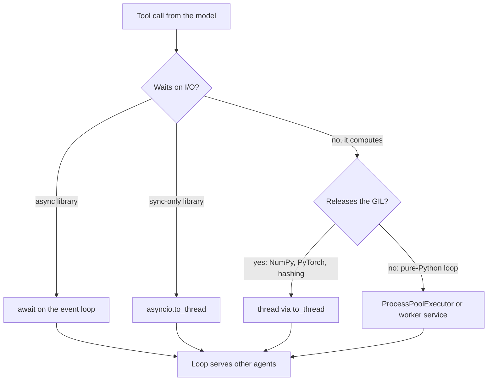

## TL;DR
Python is the default agent language: SDKs and agent frameworks are Python-first and an agent mostly
waits on models and tools. `asyncio` makes that waiting cheap; the GIL only bites CPU-bound pure-Python
work. (Orientation; deep dive: `python-for-ai`.)

## For agent builders
- **Why it matters for agents.** An agent run is a loop of waits: a model call, several tool calls, a
  retrieval, another model call. Running independent tool calls concurrently on one event loop, and never
  blocking it, is what keeps a 10-step agent at seconds rather than minutes.
- **Where it shows up in your stack.** Provider SDKs (OpenAI, Anthropic) with async clients, LangChain
  and LangGraph (graph nodes can be `async def`), LlamaIndex, Pydantic AI, the OpenAI Agents SDK, the MCP
  Python SDK for tool servers, and LangSmith or similar tracing clients. Nearly all are Python-first.
- **What you control.** Async versus sync tools, a concurrency cap per agent step and per provider, where
  CPU-heavy tool work runs, and Pydantic schemas that both describe tools to the model and validate the
  arguments it sends back.
- **What you can skip.** CPython internals and bytecode details. Know what the GIL blocks, when it is
  released, and the one rule: no blocking call inside a coroutine.

## Why it exists
- **An agent service is glue.** It takes a request, builds a prompt, calls one or more models, validates
  the structured answer or tool call, maybe hits a vector store and a tokenizer, and streams a result back.
- **Each piece exists first, often only, in Python.** PyTorch, Hugging Face, sentence-transformers,
  tiktoken, every provider's official SDK, the agent frameworks, the eval harnesses and the research
  team's notebooks. Another language means reimplementing them, shelling out to Python anyway, or
  maintaining two stacks.
- **"Python is slow, use Go or Java" fails on arithmetic.** A model call takes hundreds of milliseconds
  to tens of seconds; the overhead a faster language would shave is microseconds to low milliseconds. The
  hot loops (matrix multiplies, tokenization) already run in C, C++, Rust or CUDA under the Python API.
- **"Python cannot do concurrency because of the GIL" fails too.** The GIL is released while a thread
  blocks on a socket, and an event loop needs no threads to hold thousands of in-flight requests.
- **What Python must do well is wait on many model and tool calls at once**, and `asyncio` does exactly
  that. The GIL is a real limit only for CPU-bound pure-Python loops, answered by a native library or a
  separate process, not a different language.

## How it works
### Execution model and the GIL
1. **CPython compiles source to bytecode and interprets it.**
2. **The Global Interpreter Lock lets one thread execute bytecode at a time**, *because* the
   reference-counting memory model is not thread-safe without it.
3. **Threads still help for I/O.** The interpreter drops the GIL during blocking system calls, and
   well-behaved C extensions (NumPy, PyTorch, hashing, compression) release it during long native work.
4. **CPU-bound pure-Python code needs processes.** `multiprocessing` or `ProcessPoolExecutor` sidestep
   the GIL by running separate interpreters.

- **Free-threaded builds exist but are opt-in.** Python 3.13 added an experimental free-threaded build
  (PEP 703) without the GIL, and 3.14 made it officially supported.
- **Still plan as if the GIL is there**, because it is a separate build rather than the default and not
  every C extension supports it yet.

### asyncio: the agent loop's engine
- **Coroutines.** An `async def` function is a coroutine; `await` hands control back to the event loop
  until the awaited I/O completes.
- **Cheap waiting.** One thread can hold hundreds of pending model and tool calls, each costing a small
  object rather than a thread stack. That is how one worker serves many concurrent agent runs.
- **The agent shape.** When the model returns several tool calls in one turn, run them with
  `asyncio.gather`, cap concurrency with a `Semaphore` to respect provider and tool rate limits, then
  append all results before the next model call.
- **The one rule.** A blocking call inside a coroutine (a sync HTTP client, `time.sleep`, a heavy loop)
  freezes the whole loop, because nothing else can run until it returns. One sync tool stalls every
  agent on that worker.

| 500 agent requests, each awaiting a 4-second model call | Thread per request | Event loop |
|---|---|---|
| What is held | 500 threads, each with its own stack | 500 suspended coroutine objects |
| Cost of waiting | OS context switches to do nothing | woken only when its socket has bytes |
| Python work per request | well under a millisecond (payload build, reply parse) | same, so one loop is idle most of the time |

### Picking where each tool runs
Two questions decide it: does the tool wait or compute, and does it hold the GIL?

| Work | Holds the GIL? | Where it runs |
|---|---|---|
| Async I/O (httpx, async DB driver, provider async client) | No, it waits | `await` it on the loop |
| Blocking I/O from a sync-only library | Released while blocked | `await asyncio.to_thread(fn, ...)` |
| Native compute that releases the GIL (NumPy, PyTorch, hashing) | Released | a thread (`to_thread`) so the loop stays free |
| Pure-Python CPU work (parsing, loops over dicts) | Held | `ProcessPoolExecutor`, or move it to a worker service |

- **Threads are cheaper than processes** (shared memory, no pickling of arguments and results) but only
  help when the GIL is released.
- **Processes always parallelise but every call pays serialisation**, so they pay off only when the work
  is much larger than its inputs and outputs.

### Types and Pydantic: the tool contract
- **Type hints are annotations; the interpreter does not enforce them.** Fine inside your code with
  `mypy` checking it.
- **Boundary data needs runtime validation**: an HTTP body, a model's JSON output, a tool call's
  arguments, a config file. A model's tool arguments are untrusted input.
- **Pydantic validates and coerces at runtime and emits JSON Schema**, so one class is the API contract,
  the tool or structured-output schema you hand to an LLM, and the parsed result. Frameworks such as
  LangChain, Pydantic AI and the OpenAI Agents SDK build tool schemas from Pydantic models or type hints
  for this reason; it is why Pydantic became the lingua franca of AI services.

### Packaging and environments
- **One virtual environment and one lockfile per project.** `uv`, Poetry or plain `pip` with a
  requirements lock all work.
- **The characteristic pain is heavy native dependencies** (PyTorch with a specific CUDA build), which
  is why AI services pin exact versions and ship in containers. Agent frameworks also move fast, so a
  minor bump of LangChain or a provider SDK can change behaviour; pin them too.

### Where it sits in the agent stack
- **Python:** a FastAPI service for the agent API, worker processes for long agent runs, MCP tool
  servers, and scripts and notebooks for evals and data prep.
- **TypeScript:** the product UI and sometimes a thin gateway or a Vercel AI SDK front end.
- **The boundary is an HTTP contract**, usually generated from the Python service's OpenAPI schema.

## Diagram
Route each tool call by two questions: does it wait or compute, and does it hold the GIL while computing?



## Examples
### An agent step that runs tool calls concurrently
The model asks for three tool calls in one turn. Arguments are validated with Pydantic (a bad one goes
back to the model as an error), async tools are awaited, the sync-only tool goes to `asyncio.to_thread`,
and a `Semaphore` caps parallel tool calls. `fake_model` stands in for a provider's async client.

```python
import asyncio, json, time
from pydantic import BaseModel, ValidationError

class SearchArgs(BaseModel):
    query: str
    top_k: int = 5

class WeatherArgs(BaseModel):
    city: str

async def search_docs(a: SearchArgs) -> str:
    await asyncio.sleep(0.8)                      # async I/O: vector store or HTTP API
    return f"{a.top_k} hits for {a.query!r}"

def get_weather_sync(a: WeatherArgs) -> str:      # sync-only SDK: must not run on the loop
    time.sleep(0.8)
    return f"sunny in {a.city}"

TOOLS = {"search_docs": (SearchArgs, search_docs, False),
         "get_weather": (WeatherArgs, get_weather_sync, True)}
SEM = asyncio.Semaphore(4)                        # cap parallel tool calls per agent step

async def run_tool(call: dict) -> dict:
    schema, fn, blocking = TOOLS[call["name"]]
    try:
        args = schema.model_validate_json(call["arguments"])     # model output is untrusted input
    except ValidationError as e:
        return {"id": call["id"], "error": e.errors()[0]["msg"]}  # sent back so the model can repair
    async with SEM:
        out = await (asyncio.to_thread(fn, args) if blocking else fn(args))
    return {"id": call["id"], "content": out}

async def fake_model(messages: list) -> dict:     # stand-in for a provider's async client
    await asyncio.sleep(0.1)
    if messages[-1]["role"] == "tool":
        return {"content": "done", "tool_calls": []}
    return {"content": None, "tool_calls": [
        {"id": "1", "name": "search_docs", "arguments": json.dumps({"query": "refund policy"})},
        {"id": "2", "name": "get_weather", "arguments": json.dumps({"city": "Pune"})},
        {"id": "3", "name": "search_docs", "arguments": json.dumps({"top_k": "many"})}]}

async def agent(task: str, max_steps: int = 8) -> str:
    messages = [{"role": "user", "content": task}]
    for _ in range(max_steps):                    # hard step budget: agents can loop forever
        reply = await fake_model(messages)
        if not reply["tool_calls"]:
            return reply["content"]
        results = await asyncio.gather(*(run_tool(c) for c in reply["tool_calls"]))
        messages += [{"role": "tool", **r} for r in results]
    return "step budget exhausted"

t = time.perf_counter()
print(asyncio.run(agent("Can I get a refund?")), f"{time.perf_counter() - t:.1f}s")
# done 1.0s: the tool calls overlapped; run one after another they would take ~1.6s plus model time
```

### Fan-out with a concurrency cap and a GIL escape hatch
A batch job (eval run or offline classification) fans out calls concurrently, validates each model answer
at runtime, and pushes a CPU-bound step out of the GIL-bound main process. The `Semaphore` is the
rate-limit guard; the `ProcessPoolExecutor` is the GIL escape hatch.

```python
import asyncio
from concurrent.futures import ProcessPoolExecutor
import httpx
from pydantic import BaseModel, ValidationError

class Verdict(BaseModel):
    label: str
    confidence: float

SEM = asyncio.Semaphore(8)                      # at most 8 model calls in flight

async def classify(client: httpx.AsyncClient, text: str) -> Verdict | None:
    async with SEM:                             # waits without holding a thread
        r = await client.post("http://localhost:8000/v1/classify", json={"text": text}, timeout=30)
    try:
        return Verdict.model_validate_json(r.content)  # runtime check; bad JSON is a ValidationError too
    except ValidationError:
        return None

def count_words(text: str) -> int:              # stand-in for CPU-heavy pure-Python work
    return sum(1 for _ in text.split())

async def main(texts: list[str]):
    async with httpx.AsyncClient() as client:   # one connection pool for the whole batch
        verdicts = await asyncio.gather(*(classify(client, t) for t in texts))
    loop = asyncio.get_running_loop()
    with ProcessPoolExecutor() as pool:         # CPU-bound work runs in separate interpreters
        counts = await asyncio.gather(*(loop.run_in_executor(pool, count_words, t) for t in texts))
    return list(zip(verdicts, counts))

if __name__ == "__main__":                      # required when workers are spawned, not forked
    print(asyncio.run(main(["refund my order", "great product"] * 50)))
```

### One blocking tool freezes every other agent
Runnable with the standard library only. The ticker stands in for every other agent run on the loop.

```python
import asyncio, time

async def ticker(stop: asyncio.Event) -> int:
    ticks = 0
    while not stop.is_set():
        await asyncio.sleep(0.01)      # a stand-in for every other request on the loop
        ticks += 1
    return ticks

async def handler(blocking: bool) -> None:
    if blocking:
        time.sleep(1)                  # sync call: the whole loop stops for 1 s
    else:
        await asyncio.sleep(1)         # async wait: the loop keeps serving others

async def main() -> None:
    for blocking in (True, False):
        stop = asyncio.Event()
        t = asyncio.create_task(ticker(stop))
        start = time.perf_counter()
        await asyncio.gather(*(handler(blocking) for _ in range(5)))
        stop.set()
        print(f"blocking={blocking}: {time.perf_counter() - start:.1f}s, ticks={await t}")

asyncio.run(main())
# blocking=True:  5.0s, ticks=1    (five handlers ran one after another, nothing else ran)
# blocking=False: 1.0s, ticks=~90  (five waits overlapped, the ticker kept running)
```

### Worked scenario: is Python the bottleneck in an agent step?
A support agent handles one step in four stages. Figures are illustrative orders of magnitude.

| Stage | Time | Runs in |
|---|---|---|
| Parse body, build prompt and tool schemas | ~0.5 ms | Python |
| Embed query + vector search (retrieval tool) | ~30 ms | network wait |
| Model call | ~2,000 ms | network wait |
| Validate JSON tool arguments with Pydantic | ~0.2 ms | Python (Rust core) |

- **Python executes under 1 ms of a ~2 s step**, so the model dominates by three orders of magnitude.
- **Over a 10-step run** that is still under 10 ms of Python in roughly 20 s of waiting.
- **Rewriting in Go would save well under 0.1% of latency**; running tool calls concurrently, capping
  concurrency and streaming would matter far more.

## Production patterns
- **One shared async client plus a semaphore.** When agents call a provider at volume, create one
  `httpx.AsyncClient` (or the provider's async client) at startup and wrap calls in
  `asyncio.Semaphore(N)` sized below the rate limit. Monitor 429 rate, in-flight count and p95 latency.
- **Async tools by default, explicit offload for the rest.** Write tools as `async def`; wrap sync-only
  SDKs in `asyncio.to_thread` and send pure-Python CPU work to a `ProcessPoolExecutor` or a separate
  queue worker. Monitor per-tool latency in your traces (LangSmith or an OpenTelemetry backend) and worker
  CPU saturation.
- **Watch event-loop lag.** Run staging with asyncio debug mode (`asyncio.run(main(), debug=True)` or
  `PYTHONASYNCIODEBUG=1`) so callbacks slower than `slow_callback_duration` are logged; in production
  sample a stuck worker with `py-spy dump --pid <pid>`. Alert on loop lag and CPU per worker.
- **Structured concurrency for tool fan-out.** Use `asyncio.TaskGroup` (Python 3.11+) or keep a set of
  task references instead of bare `create_task`, so a failing tool surfaces and tasks are not collected.
  Monitor unhandled-exception logs from tasks.
- **Frozen lockfiles in the image.** Build containers with `uv sync --frozen` (or an equivalent locked
  install), pin agent frameworks and provider SDKs, and pin the PyTorch/CUDA build explicitly. Re-run the
  agent eval set on every dependency bump and track score drift.

## Trade-offs
- **Ecosystem vs raw speed.** You get every agent framework, SDK and the fastest path from notebook to
  service, but pay with a runtime slow for CPU-bound pure-Python code. It flips only when the service
  does heavy per-request computation in Python itself rather than in native libraries or a model.
- **Cheap concurrency vs async discipline.** `asyncio` gives cheap concurrency for I/O-bound work, but
  every tool and library on the request path must be async-aware; one blocking call undoes it, and mixing
  sync and async code is a constant tax.
- **Dynamic typing vs safety.** It speeds experimentation, but production code needs `mypy` plus runtime
  validation at boundaries, including tool arguments; skipping either shows up as type errors found by
  users instead of CI.
- **Native dependencies: strength and weakness.** PyTorch and CUDA are the ecosystem's strength and its
  deployment weakness: images are large and version pinning is non-negotiable.

## Pitfalls
- **Sync client inside `async def`.** Calling `requests` or a sync DB driver in an async tool or handler;
  the symptom is throughput collapsing to one request at a time while CPU sits idle. Fix: an async client
  or `asyncio.to_thread`.
- **Running independent tool calls one after another.** A loop of `await` over tool calls; the symptom is
  step latency equal to the sum of tool latencies. Fix: `asyncio.gather` or a `TaskGroup` with a cap.
- **Blaming the GIL for an I/O-bound service.** Profiling shows threads blocked on sockets; the fix is
  concurrency, not multiprocessing.
- **Trusting type hints as validation.** A model returns `"confidence": "high"` and the code crashes
  three functions later instead of at the boundary. Fix: validate with Pydantic at the edge and return
  the validation error to the model as the tool result.
- **Dropping the task from `asyncio.create_task(...)`.** The loop keeps only a weak reference, so the task
  can be garbage-collected mid-flight; background work (a log write, a cache fill) silently never
  completes. Keep a reference or use a `TaskGroup`.
- **Unpinned dependencies in an AI service.** A transitive upgrade of a tokenizer, SDK or agent framework
  changes outputs; the symptom is evals drifting with no code change. Fix: a lockfile and pinned images.

## When to use
- **Default to Python** for agents and anything touching models, tokenizers, embeddings, evals or data
  preparation, and for the service layer that orchestrates them: the library and framework support
  decides it.
- **Keep CPU-bound hot paths** in native code or separate processes, and measure before assuming Python is
  the bottleneck; in most LLM services the model call dominates by two or three orders of magnitude.
- **Measure:** event-loop lag (asyncio's debug mode logs any callback longer than
  `slow_callback_duration`, 100 ms by default), CPU utilisation per worker under load, and a profiler
  sample (py-spy) showing Python frames versus waiting on sockets.
- **Consider another language** for the product edge (TypeScript next to the UI) or a tiny, extremely
  high-throughput proxy where microseconds matter.
- **Interviews:** explain the GIL precisely (what it blocks, when it is released), why `asyncio` fits
  agent workloads, and why Pydantic sits at every boundary. The `python-for-ai` module covers each in
  detail.

## Role lens
- **Engineer:** Writes async service code, keeps blocking work off the event loop, validates every
  boundary with Pydantic, and pins the environment so evals stay reproducible.
- **Architect:** Decides the language split: Python for the model core and data work, TypeScript or
  another language where the product or throughput argument wins, joined by a typed contract.
- **FDE:** Lands inside a customer's existing Python (or non-Python) stack and must explain why the AI
  core stays Python and how it integrates with their Java or .NET services over HTTP.

## Check yourself
**Q:** A colleague argues the new LLM gateway should be written in Go because "Python's GIL cannot handle
2,000 concurrent requests". How do you respond, and what would change your answer?
**A:** The GIL serialises Python bytecode execution, not waiting. A gateway's work per request is
building a payload and awaiting a model call that takes seconds; with `asyncio`, one process holds
thousands of pending awaits on a single thread, and the GIL is irrelevant while they wait on sockets.
Multiple uvicorn workers add CPU headroom for serialisation. I would ask what CPU-bound work the
gateway does per request; if it must tokenize or transform megabytes in pure Python per call, that is
the argument for native code or another language. I would also weigh the cost of a second language
when the model, eval and SDK ecosystem is Python-first.

## Interview questions
### What exactly does the GIL prevent, and when is it released?
- **Definition:** a lock that lets only one thread execute Python bytecode at a time, because CPython's
  reference counting is not thread-safe without it.
- **Released:** during blocking system calls (socket and file I/O) and by C extensions such as NumPy and
  PyTorch during long native work, so I/O-bound and native-heavy threads still overlap.
- **Not released:** in pure-Python CPU loops, which need separate processes or native code to parallelise.

### Your agent's steps take as long as the sum of its tool calls. What do you change?
- **Diagnose:** the trace shows tool spans back to back, so the tools run sequentially, or one sync tool
  blocks the loop.
- **Fix:** run independent tool calls from one model turn with `asyncio.gather` or a `TaskGroup`, under a
  `Semaphore` sized to the tools' rate limits, and wrap sync-only SDKs in `asyncio.to_thread`.
- **Verify:** step latency should approach the slowest tool plus model time, not the sum.

### Throughput of an async FastAPI agent service drops to one request at a time while CPU is idle. How do you debug it?
- **Suspect a blocking call on the loop:** a sync HTTP client, a sync DB driver, `time.sleep`, or a heavy
  loop inside an `async def` handler or tool.
- **Confirm it:** enable asyncio debug mode in staging to log slow callbacks, or take a `py-spy dump` of
  the worker and look for a frame stuck in a sync call.
- **Fix:** switch to the async client, or wrap the sync call in `asyncio.to_thread`; re-measure p95 under
  concurrent load.

### When would you choose threads, processes or asyncio for a piece of work?
- **asyncio** for many concurrent network waits, such as hundreds of model and tool calls, because each
  wait costs a small coroutine object.
- **Threads** for sync-only libraries and GIL-releasing native compute, because memory is shared and
  nothing is pickled.
- **Processes** for pure-Python CPU work, but only when the work is much larger than its inputs and
  outputs, because every call pays serialisation.

### You must run an agent eval over 10,000 documents through a provider limited to 500 requests per minute. How do you structure it?
- **Concurrency cap:** an `asyncio.Semaphore` plus a client-side rate limiter keeps calls under the
  limit; 10,000 at 500 per minute is at least 20 minutes, whatever the language.
- **Resilience:** retry 429 and 5xx with exponential backoff and jitter, validate each answer with
  Pydantic, and record failures for a re-run.
- **Shape:** one shared async client for connection reuse; batch APIs, if the provider offers them, cut
  cost and move the work off the per-minute request limit (they have their own quotas).

### Would you run the free-threaded CPython build in production today?
- **Status:** experimental in 3.13 (PEP 703) and officially supported from 3.14, but a separate opt-in
  build, not the default.
- **Risk:** not every C extension supports it yet, so a single dependency can force the GIL back or
  break.
- **Answer:** only for a measured CPU-bound pure-Python workload whose full dependency tree supports it;
  an I/O-bound agent service gains little, because it was never GIL-bound.

## Quiz
### Q: Why does the GIL rarely limit an LLM-serving backend?
- [ ] Modern Python releases the GIL for all threads automatically
- [x] The service is I/O-bound, and the GIL is released while waiting on sockets, so asyncio or threads overlap the waits
- [ ] Uvicorn runs each request in its own interpreter
- [ ] LLM responses are small, so bytecode execution is negligible regardless of concurrency
> The GIL blocks concurrent execution of Python bytecode, not concurrent waiting. An LLM backend
> mostly awaits network I/O, during which the GIL is not held, so one process serves many requests.

### Q: Which piece of work should leave the main Python process rather than run inside a coroutine?
- [ ] Awaiting 200 concurrent HTTP calls to a model provider
- [ ] A NumPy matrix multiply over a batch of embeddings
- [x] A pure-Python loop that parses a 500 MB log file line by line
- [ ] Reading configuration from environment variables at startup
> Pure-Python CPU work holds the GIL, so neither the event loop nor a thread can overlap it; only a
> separate process can. A long NumPy multiply also blocks the loop if run inline, but it releases the GIL,
> so a thread in the same process (`asyncio.to_thread`) suffices. Awaited HTTP calls are I/O-bound.

### Q: What does a Pydantic model add that a type hint alone does not?
- [ ] It makes the interpreter reject wrongly typed arguments at call time
- [x] Runtime validation and coercion of external data plus JSON Schema generation
- [ ] Faster attribute access through compiled slots
- [ ] Automatic retries when validation fails
> Type hints are inert annotations checked only by tools like mypy. Pydantic validates data at runtime,
> which is what an HTTP body or a model's JSON output needs, and emits the schema you give the LLM.
