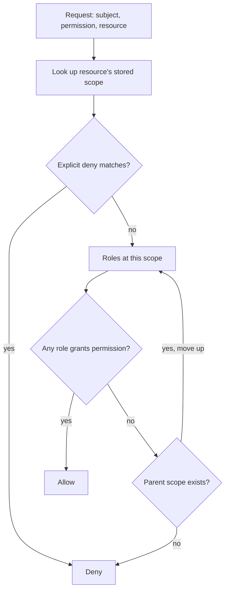

## TL;DR
Role-based access control attaches permissions to roles and assigns callers roles within a scope; a
request is allowed only if some role grants that permission there. Direct per-user grants do not scale,
and the same check must bound agents.

## Why it exists
- **Every request after login asks "may they do this".** Authentication answers "who is calling". The
  obvious answer is a direct grant: a table of (user, permission) rows, or an access-control list on each
  resource. It works for ten users and dies at a few hundred.
- **Direct grants explode.** 2,000 employees and 300 distinct permissions ("read invoices", "delete
  customer", "run eval job") can produce up to 600,000 direct grants. Onboarding a support engineer means
  deciding, grant by grant, which 40 of the 300 they need; a team move means revoking those 40 and adding
  35 others.
- **Reviews become impossible.** "Who can delete customer records?" needs a scan of the whole table, and
  "is this person's access appropriate?" has no reference. Each grant is bespoke, so the set drifts toward
  "whatever was needed once" and never shrinks. This is how a departed contractor keeps production access.
- **Roles compress the problem.** Organisations are made of jobs, and jobs need bundles of permissions.
  With twelve roles averaging forty permissions, assignments drop to 2,000 + 480 rows instead of up to
  600,000. "Is the editor role right?" is one owner's question; "is Alice in the right roles?" is her
  manager's.
- **AI raises the stakes.** An agent must not do more than its user; retrieval must not surface chunks from
  documents the user cannot open; a tool call must be checked when it runs, not at login. All three need a
  decision cheap enough for every request and every retrieved item, which a role lookup gives you.

## How it works
### The model
Four sets and two relations:

| Element | Meaning |
|---|---|
| Subjects | Human users, service accounts, agents |
| Roles | Named bundles of permissions |
| Permissions | An operation on an object type, written `documents:read` |
| Sessions | A subject activates some of its roles |
| User assignment | `UA ⊆ subjects × roles` |
| Permission assignment | `PA ⊆ roles × permissions` |

```
allow (u, p)  iff  there exists a role r with (u, r) ∈ UA and (r, p) ∈ PA
```

- **Default deny.** Anything not explicitly allowed is denied, *because* a default-allow system cannot be
  reasoned about: every missing rule is a hole rather than a lock.
- **Decision rule in words.** Assignments are `UA ⊆ subjects × roles` and `PA ⊆ roles × permissions`. The decision is: allow `(u, p)` iff some role `r` has `(u, r) ∈ UA` and `(r, p) ∈ PA`.

### NIST refinements
- **Hierarchical RBAC.** A senior role inherits a junior role's permissions (`admin ⊇ editor ⊇ viewer`),
  because without inheritance the admin's list duplicates the editor's and the two drift apart.
- **Constrained RBAC (separation of duty).** Nobody may hold both "submit payment" and "approve payment",
  because fraud should require collusion.
  - *Static* separation forbids assigning the two roles to one person at all.
  - *Dynamic* separation allows both assignments but forbids activating them in the same session, which is
    where the session set earns its place.
- **Why these are named levels:** they are the two extensions every real deployment reinvents.

### Least privilege in time, and explicit deny
- **Elevate, do not stand.** An operator assigned `admin` should normally act as `viewer` and elevate for a
  bounded window, with a reason and an audit record, *because* standing privilege is what a stolen session
  or a prompt-injected agent inherits.
- **Explicit deny (cloud IAM).** A deny statement overrides any allow, so a guardrail ("nobody outside the
  security team may delete audit logs") holds regardless of which roles are later granted.
- **Evaluation order:** deny, then allow, then the implicit default deny.

### Scope: where a role applies
- **The production question is scoped.** Not "can this user read documents?" but "can this user read *this
  tenant's* documents?".
- **Make assignments three-part:** (subject, role, scope), where scope is a node in a resource tree such as
  `org → project → resource`.
- **Roles apply downward.** A role granted at a scope applies to everything beneath it, because that is how
  delegation works: the org admin administers every project.
- **Kubernetes implements exactly this split.** `Role` and `RoleBinding` are namespaced; `ClusterRole` and
  `ClusterRoleBinding` apply cluster-wide; binding a ClusterRole inside a namespace restricts it to that
  namespace.

### Where the decision runs
Separate the *decision* (given subject, permission, scope, return allow/deny) from *enforcement*
(middleware at the API boundary, a filter in a database query, a guard in front of a tool call). The
decision needs the caller's role assignments, from one of two places:

1. **From the token.** OIDC providers can put `groups` or `roles` claims in the ID or access token, so the
   check is a local set lookup with no I/O. Cost: staleness, because the token says what was true when it
   was issued, so a revoked role stays usable until expiry. Acceptable for coarse, rarely-changing org
   roles with short token lifetimes.
2. **From the authorization store.** Look assignments up per request (cached with a short TTL). One extra
   read, but revocation takes effect in seconds, and scoped assignments at project or resource level, which
   would bloat a token, live naturally here.

Most systems do both: coarse roles in the token, scoped assignments resolved server-side.

### Enforce at every boundary, not just HTTP
- **The handler check does not cover the rest.** It does nothing for the retrieval query inside it, the
  background job that re-indexes documents, or the tool the agent calls.
- **Apply the same decision function** as a row or chunk filter at data access and as a guard at tool
  invocation.
- **Run as the *end user's* identity, not the service's.** An agent under a privileged service account has
  effectively every role at once; a prompt injection then inherits all of them.

### When roles are not enough
Roles describe job functions, not relationships. "The owner of a document can edit it" or "share this with
Bob" needs a role per document, which is role explosion by another name.

| Model | Decides on | Example |
|---|---|---|
| RBAC | Role at scope | Organisation-level capabilities |
| ABAC | Attributes of subject, resource, context | `resource.classification <= subject.clearance`, `request.time in business_hours` |
| ReBAC (Zanzibar) | Graph of relationship tuples | `doc:7#viewer@group:eng#member`; sharing in Google Docs and Drive |

- **In practice you layer:** RBAC for organisation-level capabilities, ownership or relationship checks for
  per-object access, and ABAC conditions where the customer's policy demands them.

## Diagram
Read it top to bottom: explicit deny wins, then a role at the resource's own scope or any ancestor, and
everything else falls through to default deny.



## Examples
### Scoped, hierarchical check with permission-named guards
Roles inherit downward, assignments carry a scope, and a role at any ancestor scope applies to the
resource. `current_user` stands in for the authentication dependency from the OAuth lesson.

- **Handlers name *permissions*, never roles,** so adding a role touches one table instead of every
  endpoint.
- **Scope comes from the resource's stored owner, never from the URL,** because checking `project:{id}`
  from the path while deleting `doc_id` lets an editor of project 42 delete project 7's documents by
  sending `/projects/42/documents/<a project-7 doc>` (an insecure direct object reference).

```python
from fastapi import Depends, FastAPI, HTTPException

app = FastAPI()
def current_user() -> str: return "alice"   # stub for the bearer-token auth dependency
PERMS = {                                   # role -> permissions granted directly
    "viewer": {"documents:read"},
    "editor": {"documents:write"},
    "admin":  {"documents:delete", "members:manage"},
}
INHERITS = {"admin": "editor", "editor": "viewer"}      # senior -> junior

def permissions_of(role: str) -> set[str]:
    out: set[str] = set()
    while role:                             # walk down the hierarchy
        out |= PERMS[role]; role = INHERITS.get(role, "")
    return out

# (subject, scope) -> roles. Scopes form a tree: project -> org.
ASSIGNMENTS = {("alice", "org:acme"): {"viewer"}, ("alice", "project:42"): {"editor"}}
PARENT = {"project:42": "org:acme", "project:7": "org:acme"}
DOC_SCOPE = {101: "project:42", 202: "project:7"}      # each document's real owning scope

def allowed(subject: str, perm: str, scope: str) -> bool:
    while scope:                            # a role at any ancestor scope applies here
        if any(perm in permissions_of(r) for r in ASSIGNMENTS.get((subject, scope), ())):
            return True
        scope = PARENT.get(scope, "")
    return False                            # deny by default

def require_on_doc(perm: str):
    def guard(doc_id: int, user: str = Depends(current_user)) -> str:
        scope = DOC_SCOPE.get(doc_id)       # scope from the resource, not from the path
        if scope is None or not allowed(user, perm, scope):
            raise HTTPException(404)        # 404, not 403: do not confirm the doc exists
        return user
    return guard

@app.delete("/documents/{doc_id}")
def delete_doc(doc_id: int, user: str = Depends(require_on_doc("documents:delete"))):
    return {"deleted_by": user}

assert allowed("alice", "documents:write", "project:42")       # editor at the project
assert allowed("alice", "documents:read", "project:7")         # viewer inherited from the org
assert not allowed("alice", "documents:delete", "project:42")  # admin nowhere
assert not allowed("alice", "documents:write", DOC_SCOPE[202]) # doc 202 lives in project 7
```

### Worked scenario: the assignment arithmetic
The same 2,000-person company before and after introducing roles.

| Quantity | Direct grants | RBAC |
|---|---|---|
| Rows to manage | up to 600,000 | 2,000 user-role + 480 role-permission |
| Onboard a support engineer | pick 40 of 300 grants | assign 1 role |
| Team move | revoke 40, add 35 | swap 1 role |
| "Who can delete customers?" | scan every row | list roles with that permission, then their members |

### Kubernetes: the same model in a manifest
A namespaced `Role` plus `RoleBinding` gives a group read-only access to pods in one namespace only.

```yaml
apiVersion: rbac.authorization.k8s.io/v1
kind: Role
metadata:
  namespace: team-a
  name: pod-reader
rules:
  - apiGroups: [""]
    resources: ["pods"]
    verbs: ["get", "list", "watch"]
---
apiVersion: rbac.authorization.k8s.io/v1
kind: RoleBinding
metadata:
  namespace: team-a
  name: team-a-devs-read-pods
subjects:
  - kind: Group
    name: team-a-devs
    apiGroup: rbac.authorization.k8s.io
roleRef:
  kind: Role
  name: pod-reader
  apiGroup: rbac.authorization.k8s.io
```

Verify a decision without guessing: `kubectl auth can-i list pods --as=alice -n team-a`.

## Production patterns
- **Permission-named guards, enforced in review.** Every endpoint declares `require("documents:delete")`;
  a CI grep fails the build on role-string comparisons such as `role == "admin"`. Monitor the share of
  handlers with a declared permission, aiming for all of them.
- **Just-in-time elevation.** Operators hold `viewer` by default and request `admin` for a bounded window
  with a reason; the grant expires on its own and is written to the audit log. Monitor how many people hold
  standing admin and how often elevation is used.
- **Coarse roles in the token, scoped grants in the store.** Keep access-token lifetimes short and resolve
  project-level assignments server-side with a short cache TTL, so revocation bites in seconds. Monitor
  time-to-revoke in offboarding drills.
- **Permission-aware retrieval.** At ingestion, write each chunk's allowed users and groups as metadata;
  at query time pass the caller's principals as a filter inside the vector or keyword search. Run a
  standing leakage test: a test user must never retrieve a document they cannot open.
- **Group-to-role mapping via SCIM.** Map customer IdP groups to product roles and let SCIM deprovision
  users, so offboarding happens in their directory. Monitor the ratio of roles to users and run access
  reviews per role owner.

## Trade-offs
- **Indirection vs catalogue ownership.** Assignments shrink from users × permissions to user-role plus
  role-permission rows, but the role catalogue needs an owner; once roles are minted per team per exception
  ("role explosion") you are back to per-user lists with an extra hop.
- **Roles in the token vs revocation speed.** Every check is a local set lookup with no database round
  trip, but revocation lags by the token lifetime. The moment removal must bite within seconds
  (offboarding, a compromised account) the balance flips to a server-side lookup.
- **Hierarchies vs silent inheritance.** They remove duplication and mirror the org chart, but a senior role
  silently inherits every new junior permission, which is how admins accumulate access nobody reviewed. For
  high-impact permissions (payments, deletion, key management) flat, explicitly granted roles are safer.
- **Coarse roles vs expressiveness.** Simple to audit, but cannot express ownership or sharing; as soon as
  the product needs "share this document with Bob" you add a relationship layer and keep RBAC only for
  organisation-level capabilities.

## Pitfalls
- **Comparing role strings in code** (`if user.role == "admin"`) instead of checking permissions. Symptom: a
  new "support" role works nowhere until twenty endpoints are edited, and some are missed.
- **Forgetting scope.** Symptom: an editor in one tenant can edit in every tenant, found by a penetration
  test or, worse, a customer.
- **Taking the scope from the request** (a path or body `project_id`) instead of the stored resource.
  Symptom: changing one ID in a URL reaches another project's object while every permission check still
  passes.
- **Enforcing only at the HTTP layer** while the retrieval query or background job reads the index
  unfiltered. Symptom: the assistant quotes a document the user cannot open in the source system.
- **Running the agent under a privileged service account** instead of the user's delegated roles. Symptom:
  a prompt-injected agent deletes or reads what the asking user never could.
- **Role explosion:** hundreds of near-duplicate roles. Symptom: "who can do X?" needs a script and
  quarterly access reviews are rubber-stamped.
- **Stale claims after a role change.** Symptom: "I removed their access an hour ago and they are still
  deleting things", because the token has not expired.

## When to use
- **Use when** a multi-user system has a stable set of job functions: admin panels, SaaS workspaces,
  Kubernetes, cloud IAM. RBAC is the default.
- **Add ABAC** when decisions depend on attributes of the resource or context (classification, region, time
  of day), and **ReBAC** when the product has per-object sharing.
- **Measure:** the ratio of roles to users (creeping up signals explosion), time-to-revoke, the share of
  checks that are permission-named rather than role-string comparisons, and whether every retrieval and
  tool call carries the end user's identity.
- **Day to day:** write `require("x:y")` guards, map identity-provider groups to roles and filter queries by
  scope.
- **Interviews:** explain users → roles → permissions with scope, the token-versus-store freshness trade,
  and name the case RBAC cannot express.

## Role lens
- **Engineer:** Implements permission-named guards as middleware or dependencies, stores scoped
  assignments, and applies the same decision as a chunk filter in retrieval and a check before each
  tool call.
- **Architect:** Owns the role catalogue and scope hierarchy, decides what rides in the token versus
  the authorization service, and whether a central policy engine (OPA or a Zanzibar-style system) is
  justified.
- **FDE:** Maps the customer's IdP groups from Okta or Entra ID to product roles, wires SCIM-driven
  assignment, and proves to their security team that the assistant cannot see what the user cannot.

## Check yourself
**Q:** A customer wants an AI assistant over a shared document store where every document has its own
sharing list, and they also have org-level roles (admin, member, guest). Design authorization so the
assistant never leaks a document.
**A:** Separate two layers. Org-level RBAC handles coarse capabilities: who may use the assistant, who
manages members, which features guests get; carry these as roles in the token and check them with
permission-named guards at the API boundary. Document access is per-object sharing, which is
relationship-based, so do not model it as roles. Record each document's allowed principals (users and
groups) as metadata on every indexed chunk at ingestion, resolve the caller's identity and group
memberships at request time, and apply them as a filter *inside* the vector or keyword query so
unauthorized chunks never reach the prompt. Sync sharing changes incrementally and treat a stale ACL
as a leak, so re-check the top-k hits against the source system when freshness matters. Run the
assistant under the user's delegated identity, never a privileged service account, so a prompt
injection cannot widen its reach.

## Interview questions
### What problem does RBAC solve that a per-user permission list does not?
- **It adds one indirection, the role,** so assignments go from users × permissions to users → roles plus
  roles → permissions; 2,000 users and 300 permissions shrink from up to 600,000 rows to a few thousand.
- **It makes reviews tractable,** because a role owner audits one bundle and a manager audits a person's
  roles, instead of anyone auditing hundreds of bespoke grants.

### A pentest finds that an editor in tenant A can edit tenant B's documents. Where do you look?
- **Scope on assignments:** check that roles are granted at a scope and that the check passes the resource's
  scope, not a global "editor".
- **Scope source:** check whether the scope is read from the URL or body instead of the stored resource, the
  classic insecure direct object reference.
- **Other boundaries:** confirm background jobs and retrieval queries apply the same tenant filter.

### When would you not use RBAC alone?
- **Per-object sharing.** "Share this doc with Bob" needs a role per document; use relationship tuples
  (ReBAC, Zanzibar-style) instead.
- **Attribute-driven rules.** Classification, region or time-of-day conditions belong in ABAC.
- **Keep RBAC** for organisation-level capabilities and layer the others on top.

### How fast does access revocation take effect in your design, and how would you shorten it?
- **Roles in the token** lag by the token lifetime: with one-hour tokens, up to an hour.
- **Server-side lookup with a short cache** brings it down to the cache TTL, at the cost of one read per
  request.
- **Shorten further** by shortening access-token lifetimes for sensitive surfaces and revoking sessions on
  offboarding events from SCIM.

### How do you stop an AI agent from exceeding its user's permissions?
- **Run tools as the end user's delegated identity,** never as a privileged service account that holds
  every role at once.
- **Check at tool invocation time,** with the same decision function the API uses, not just at login.
- **Filter retrieval inside the query** by the user's principals, so unauthorized chunks never reach the
  prompt where an injection could exfiltrate them.

## Quiz
### Q: Why do permissions attach to roles rather than directly to users in RBAC?
- [ ] Because users cannot be identified reliably until after authorization has run
- [x] Because it replaces a users × permissions assignment problem with users → roles plus roles → permissions, which is far smaller to manage, review and revoke
- [ ] Because roles are stored in the identity provider while permissions are stored in the application
- [ ] Because direct permission grants cannot be represented as JWT claims
> The indirection collapses the number of assignments and makes reviews about a handful of roles.
> Where roles are stored is an implementation choice, and JWTs can carry any claim, so neither explains
> the design.

### Q: You removed a user's only role in your application's authorization service ten minutes ago, but they can still call a protected endpoint. Access tokens live for an hour. What is the most likely cause?
- [ ] The role hierarchy still grants the permission through a junior role
- [x] Roles are carried in the access token, which has not expired, so the check is using stale claims
- [ ] The permission check is scoped to the wrong tenant
- [ ] The identity provider has not propagated the change through SCIM
> Token claims are a snapshot at issue time, so revocation lags by the token lifetime. With no other
> role left there is no junior role to inherit from, and SCIM carries changes from the identity
> provider into the app, whereas this change was made in the app's own store; neither touches a token
> that is already issued and valid.

### Q: Which requirement is RBAC alone poorly suited to express?
- [ ] Administrators can manage the members of their own organisation
- [ ] Viewers can read documents in the projects they are assigned to
- [x] A document's owner can edit it and share it with specific colleagues
- [ ] Only staff in the billing role can issue refunds
> Ownership and sharing are relationships between a subject and one object; expressing them with roles
> needs a role per document. The other three are role-at-scope statements that core or hierarchical
> RBAC handles directly.
