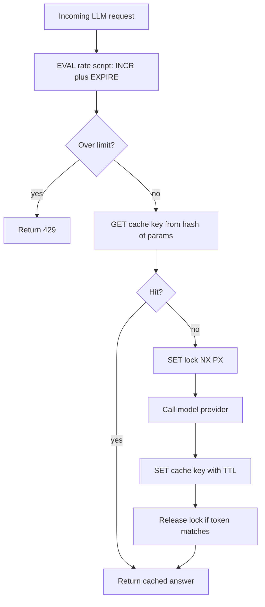

## TL;DR
Redis is an in-memory data-structure server whose commands run atomically on one thread. That makes it
the default home for shared, short-lived state (caches, rate limits, locks, sessions, queues), at the cost
of memory-sized data and weaker durability than a database.

## Why it exists
- **Backends need shared, hot state.** The cached answer to an expensive call, requests a client made this
  minute, who holds a lock, a logged-in user's session: shared across processes and read far more than written.
- **The primary database is the wrong place.** Rows on disk with transaction logging and MVCC mean a
  counter increment costs a write-ahead-log append and a row version; ten thousand increments a second
  from a rate limiter compete with real transactions for CPU and I/O.
- **Process memory is wrong with two processes.** Each has its own copy, and a load balancer sends
  consecutive requests to different ones.
- **A plain key-value cache is too thin.** Memcached offers only get and set, so "add this item to the
  user's sorted-by-time list and trim it to 100" becomes a read-modify-write race between two servers.
- **Redis makes those single atomic commands** on rich structures, in memory with sub-millisecond latency,
  plus enough persistence, replication and clustering to trust it with more than a cache. In AI backends
  it holds response caches keyed by prompt hash, per-tenant token-rate limits, semaphores capping
  concurrent model calls, and the broker behind job queues.

## How it works
### Data structures, not just values
Each key maps to one typed value:

| Type | What it is | Typical use |
|---|---|---|
| **string** | bytes, also integers with `INCR` | counters, cached blobs |
| **hash** | field-to-value map | an object |
| **list** | push/pop at either end | a queue |
| **set** / **sorted set** | members; sorted sets keep members ordered by a score | leaderboards, sliding windows, scheduled jobs |
| **stream** | append-only log with consumer groups | the closest thing to Kafka inside Redis |

- **Commands operate in place,** so "push onto the list and trim it" is two commands, not a round trip to
  fetch, modify and write back.
- **TTLs** delete a key after a set time; they are how caches and rate-limit windows expire without a
  cleanup job.
- **Pub/sub stores nothing.** It broadcasts to whoever is subscribed at that instant, so a subscriber
  disconnected for a second misses that second. It suits live notifications (push a token stream to
  whichever web node holds the user's socket), never work that must be done.

### Single-threaded execution is the point
- **Commands run one at a time on a single thread.** Newer versions use extra threads for network I/O,
  but command execution stays serialized.
- **So every command is atomic with no locking,** which is why `INCR`, `SET ... NX`, `ZADD` and friends
  are the primitives of counters, locks and schedulers across many application servers.
- **And one slow command stalls every client:** `KEYS *`, a huge `SMEMBERS`, a long Lua script.
- **Multi-command atomicity** comes from `MULTI`/`EXEC` transactions and Lua scripts, which run as a single
  unit on the server.

### Persistence and what "durable" means here
| Mode | How | Loss on crash |
|---|---|---|
| **RDB** | periodic snapshots, cheap | everything since the last snapshot |
| **AOF** | appends every write to a log | set by its `fsync` policy: every write, every second, or left to the OS |

Neither makes Redis a system of record. Treat its data as rebuildable, or at least acceptable to lose a
second of, and put anything that must survive in a database.

### Memory limits and eviction
`maxmemory` caps the dataset; when reached, the eviction policy decides:

| Policy | Behaviour | Fits |
|---|---|---|
| `noeviction` | writes fail | queues and lock stores, because evicting a job silently is worse than failing loudly |
| `allkeys-lru` / `allkeys-lfu` | evict least recently / least frequently used of any key | caches |
| `volatile-lru`, `volatile-ttl` | evict only keys with a TTL | mixed instances (with care) |
| random variants | evict at random | rarely |

- **LRU is approximated** by sampling a few keys rather than tracking exact order.
- **Policy is instance-wide.** `maxmemory` and the policy cover every numbered logical database, which is
  why mixing a cache and a queue in one instance is a design error.

### Replication, Sentinel and Cluster
- **Asynchronous replication.** A primary replicates to replicas; Sentinel monitors and promotes one on
  failure. A failover can lose the last writes, which matters for locks and queues.
- **Cluster sharding.** Keys hash into 16,384 slots spread across nodes. Multi-key commands work only when
  all keys hash to the same slot, controlled with hash tags such as `{tenant42}:limit`.
- **Managed offerings** (ElastiCache, Memorystore, Upstash, Redis Cloud) run these for you.
- **Licensing.** Redis changed its licence in 2024 (to source-available terms) and the Linux Foundation
  fork Valkey appeared; Redis 8 in 2025 added AGPLv3 as an option. Core commands match, newer features
  diverge, so check which one your platform ships.

### The patterns that matter in AI backends
- **Cache-aside:** look up `cache:{model}:{sha256(prompt+params)}`; on miss, call the model and `SET` with
  a TTL. Only safe when the call is deterministic enough for your use (temperature 0, or you accept a
  stored sample).
- **Fixed-window rate limiting:** `INCR` a per-tenant-per-window key and set its TTL on first increment.
  Atomic, so correct across all servers, but a client can spend its whole limit in the last second of one
  window and again in the first second of the next: up to 2× the limit in two seconds.
- **Sliding-window rate limiting:** when that burst matters, keep a sorted set of request timestamps per
  client (`ZREMRANGEBYSCORE` the expired ones, `ZCARD`, `ZADD`, in one script) for an exact window, at
  one entry of memory per request; or weight the previous window's count to approximate one in constant memory.
- **Concurrency semaphore:** cap concurrent calls to a model provider with a counter bounded by a Lua
  script, so a burst does not trip the provider's limits.
- **Queues and streams:** lists for simple job queues (`LPUSH`/`BRPOP`); streams with consumer groups for
  acknowledged, replayable delivery. BullMQ, Celery and RQ build on these.

### Locks, and why they need fencing
1. **Acquire:** `SET lock:key token NX PX 30000` succeeds only if absent and expires if the holder dies.
2. **Release by checking the token** in a Lua script, *because* a plain `DEL` from a holder whose lease
   already expired would delete the next holder's lock.
3. **Fence if correctness matters.** Expiry means a slow holder can lose the lock while still working. Issue
   a number from `INCR` with each acquisition; the protected resource stores it and rejects writes carrying
   an older one.
4. **Redlock is disputed.** Acquiring on a majority of independent nodes addresses failover loss, but its
   safety under clock drift and process pauses is contested (Kleppmann's critique is the usual reference).
   Treat Redis locks as an efficiency mechanism, not a correctness guarantee, unless fenced.

## Diagram
One request path through Redis: an atomic rate-limit check first, then cache-aside with a short lock so
only one caller pays for the model call on a miss.



## Examples
### Three primitives in redis-py
An LLM response cache, a fixed-window rate limiter made atomic with a Lua script, and a lock with a safe
release.

- **Why the script:** it runs server-side so the increment and the TTL cannot be separated by a crash. With
  two client calls, a process dying after `INCR` and before `EXPIRE` leaves a key with no TTL, and that
  tenant is rate-limited forever once it reaches the limit.
- **Why hash every parameter:** two requests that differ only in temperature or system prompt must not
  share an entry.

```python
import hashlib, json, redis, time, uuid
from contextlib import contextmanager

r = redis.Redis(host="localhost", port=6379, decode_responses=True)

def cached_completion(model, prompt, call, **params):
    spec = json.dumps({"prompt": prompt, **params}, sort_keys=True)   # stable across dict order
    key = f"cache:{model}:" + hashlib.sha256(spec.encode()).hexdigest()
    hit = r.get(key)
    if hit is not None:
        return json.loads(hit)
    out = call(model, prompt, **params)       # the expensive provider call
    r.set(key, json.dumps(out), ex=3600)      # 1-hour TTL; eviction handles the rest
    return out

RATE_LUA = """
local n = redis.call('INCR', KEYS[1])
if n == 1 then redis.call('EXPIRE', KEYS[1], ARGV[1]) end
return n
"""
rate_script = r.register_script(RATE_LUA)

def allow(tenant, limit=60, window_s=60):
    key = f"rl:{tenant}:{int(time.time() // window_s)}"   # e.g. rl:t42:29361600, one key per minute
    return rate_script(keys=[key], args=[window_s]) <= limit   # 61st call this minute -> False

RELEASE_LUA = """
if redis.call('GET', KEYS[1]) == ARGV[1] then return redis.call('DEL', KEYS[1]) end
return 0
"""
release_script = r.register_script(RELEASE_LUA)

@contextmanager
def with_lock(name, ttl_ms=30000):
    token = str(uuid.uuid4())
    if not r.set(f"lock:{name}", token, nx=True, px=ttl_ms):
        raise RuntimeError("busy")
    try:
        yield                                  # with with_lock("reindex:tenant42"): ...
    finally:
        release_script(keys=[f"lock:{name}"], args=[token])   # only deletes if still ours
```

### Runnable: the fixed-window burst, simulated
Pure Python, no Redis needed. It replays 60 calls just before and 60 just after a minute boundary against
both limiter designs, with a limit of 60 per minute.

```python
from collections import defaultdict, deque

LIMIT, WINDOW = 60, 60.0                       # 60 requests per 60 s
burst = [59.5] * 60 + [60.5] * 60              # 60 calls just before and just after the minute boundary

def fixed_window(times):
    counts, allowed = defaultdict(int), 0      # mirrors INCR on rl:{tenant}:{t // window}
    for t in times:
        counts[int(t // WINDOW)] += 1
        allowed += counts[int(t // WINDOW)] <= LIMIT
    return allowed

def sliding_log(times):
    log, allowed = deque(), 0                  # mirrors ZREMRANGEBYSCORE + ZCARD + ZADD
    for t in times:
        while log and log[0] <= t - WINDOW:
            log.popleft()
        if len(log) < LIMIT:
            log.append(t); allowed += 1
    return allowed

print("fixed window allowed:", fixed_window(burst))   # 120 in one second: 2x the limit
print("sliding log allowed: ", sliding_log(burst))    # 60
```

### Worked scenario: one hot key saturates one node
A 5 MB cached response (say, a large shared document summary) is read 1,000 times a second in a cluster.

| Quantity | Value |
|---|---|
| Bytes served per second from one key | 5 MB × 1,000 = ~5 GB/s |
| In network terms | ~40 Gbit/s, from the single node owning that slot |
| Other nodes | idle, because the key lives in exactly one slot |
| Fixes | shrink the value, cache it in process memory for a few seconds, or replicate it under several keys |

The arithmetic is illustrative, but the shape is common: one node's network saturates while the cluster
looks underused.

## Production patterns
- **One instance per role.** Run the cache with `maxmemory-policy allkeys-lfu` (or `allkeys-lru`) and TTLs
  on every key; run queues and locks on a separate instance with `noeviction` and `appendonly yes` plus
  `appendfsync everysec`. Monitor `evicted_keys` and `used_memory` from `INFO`.
- **Watch the slow log.** Set `slowlog-log-slower-than` (microseconds) and review `SLOWLOG GET` after
  incidents; deny `@dangerous` commands such as `KEYS` and `FLUSHALL` to application users with an ACL.
  Monitor command latency percentiles.
- **Find big and hot keys.** Run `redis-cli --bigkeys` periodically and `MEMORY USAGE key` on suspects;
  `--hotkeys` works when an LFU policy is set. Monitor per-node network throughput in a cluster.
- **Stampede protection on popular cache keys.** On a miss, take a short `SET ... NX PX` lock so one caller
  regenerates while others wait briefly or serve a stale copy, and add jitter to TTLs so keys do not expire
  together. Monitor hit ratio from `keyspace_hits` and `keyspace_misses`.
- **Pool connections.** Create one `redis.ConnectionPool` (or client) per process at startup, with a
  bounded `max_connections`, rather than a client per request. Monitor `connected_clients` and handshake
  latency.

## Trade-offs
- **Speed vs RAM-sized data.** Sub-millisecond operations in memory, but the dataset must fit in RAM;
  when the working set exceeds memory, eviction or a move to a disk-based store is forced.
- **Durability vs throughput.** AOF with fsync every write approaches database durability but cuts
  throughput; fsync every second is the usual compromise, accepting up to a second of loss on a crash.
- **Atomic scripts vs blocking.** Lua scripts and `MULTI` give atomicity across commands, but a long script
  blocks every other client; flip to application-side logic when a script would touch thousands of keys.
- **Cluster scale vs multi-key ops.** Cluster mode scales memory and throughput, but multi-key operations
  need hash tags and cross-slot transactions are unavailable, complicating single-node scripts.
- **Expiring locks vs exclusivity.** They never deadlock after a crash but a slow holder can lose them;
  fencing tokens restore safety at the cost of making the protected resource check the token.
- **Redis queue simplicity vs loss.** Simple and fast, but asynchronous replication and eviction can drop
  jobs; when loss is unacceptable, a durable broker or database-backed queue is the better trade.

## Pitfalls
- **Running `KEYS *` or a huge `SMEMBERS` in production.** Symptom: every client stalls for seconds while
  the single thread walks the keyspace. Use `SCAN`.
- **Caching without a TTL or sensible eviction policy.** Symptom: memory grows until `maxmemory`, then write
  failures (`noeviction`) or surprising evictions of non-cache keys.
- **Sharing one instance between cache and queue.** Symptom: jobs vanish under memory pressure because
  `allkeys-lru` evicted them.
- **Setting a lock without an expiry.** Symptom: a permanent "busy" after one worker crashes mid-task.
- **Treating an expiring lock as exclusive without fencing.** Symptom: two workers write the same resource
  after a GC pause or slow model call exceeded the TTL.
- **Hot keys and large values** (a 5 MB cached response read 1,000 times a second). Symptom: one node
  saturates its network while others idle.
- **A new connection per request instead of pooling.** Symptom: connection-count spikes and latency
  dominated by handshakes.
- **Cache stampede when a popular key expires.** Symptom: a burst of identical provider calls in the same
  second. Use a short lock or early refresh on the miss path.

## When to use
- **Use when:** state is shared across processes, read-heavy or counter-shaped, and rebuildable or
  tolerable to lose: caches, rate limits, semaphores, sessions, short-lived coordination, and simple job
  queues where occasional loss is acceptable.
- **Avoid when:** it would be the system of record for conversations, billing or anything you cannot
  recompute; use PostgreSQL for that and put Redis in front.
- **Check first:** confirm the database genuinely cannot carry the load (a rate limit on a few hundred
  requests per second may be fine in PostgreSQL).
- **Measure:** memory usage, evicted keys, hit ratio and slow-log entries.
- **Interviews:** explain why single-threaded execution makes `INCR` a correct distributed counter, and
  where an expiring lock is unsafe.

## Role lens
- **Engineer:** Implements cache-aside, rate limiting and semaphores with atomic commands or Lua, sets
  TTLs on every key, and pools connections in FastAPI or Node services.
- **Architect:** Decides what may live only in Redis versus the database, the eviction policy and
  persistence mode per instance, and whether the queue needs a durable broker instead.
- **FDE:** Checks a customer's managed Redis tier, memory ceiling and eviction policy before deploying a
  cache or limiter, and explains what is lost on failover of their setup.

## Check yourself
**Q:** A team uses one Redis instance with `allkeys-lru` for both the LLM response cache and the Celery
job queue. Jobs occasionally disappear under load. Explain the mechanism and the fix.
**A:** Under memory pressure `allkeys-lru` evicts keys that have not been touched recently, regardless of
what they are. Queue libraries keep state in many keys besides the main queue list: Celery keeps
unacknowledged and scheduled (ETA) messages and task results in separate keys, and libraries such as RQ
and BullMQ store one hash per job. A job that has been waiting is untouched since it was enqueued, and
a queue for a rarely used task type may be idle as a whole. The cache fills memory with fresh entries,
eviction samples and removes idle keys, and some of those are queue state, so jobs vanish without an
error. The fix is separation into two instances: numbered logical databases do not help, because
`maxmemory` and the eviction policy are instance-wide. The queue instance gets `noeviction` and AOF
persistence, so running out of memory fails enqueues loudly instead of silently discarding work; the
cache instance gets `allkeys-lru` and TTLs on every key. If loss is still unacceptable, move the queue to
a durable broker or a database-backed queue.

## Interview questions
### Why is Redis fast, and what is the catch of its single-threaded model?
- **In-memory structures plus serialized execution:** no disk on the hot path and no locks, so each
  command is atomic and sub-millisecond.
- **The catch:** one slow command (`KEYS *`, a huge `SMEMBERS`, a long Lua script) blocks every client, so
  use `SCAN`, bound collection sizes and keep scripts short.

### Design a per-tenant rate limiter for an LLM API running on 20 app servers.
- **Shared counter in Redis,** because in-process counters split across servers. A Lua script does `INCR`
  and sets `EXPIRE` on the first hit so a crash cannot leave a key without a TTL.
- **Fixed window allows 2× bursts at boundaries;** if that matters, use a sorted-set sliding log in one
  script, or a weighted two-window approximation in constant memory.
- **Key by tenant and window,** and return 429 with a retry hint when over the limit.

### Two workers both wrote to the same index while holding a Redis lock. How?
- **The lease expired while the first worker was still busy** (a GC pause or slow model call longer than
  `PX`), so the second worker acquired it legitimately.
- **Fix:** issue a fencing token from `INCR` on each acquisition and have the index reject writes carrying
  an older token; release with a token-checking script so nobody deletes another holder's lock.

### When would you not put a queue in Redis?
- **When losing a job is unacceptable.** Replication is asynchronous, so a failover can drop recent
  writes, and an evicting policy can remove idle queue keys silently.
- **Use** a durable broker or a database-backed queue instead; if you keep Redis, give the queue its own
  instance with `noeviction` and AOF.

### How would you size and monitor a Redis cache for LLM responses?
- **Size:** average response size × distinct cached prompts within the TTL, plus overhead; set
  `maxmemory` below the instance's RAM and an `allkeys-lfu` or `allkeys-lru` policy.
- **Monitor:** hit ratio, evicted keys, memory usage, slow-log entries and per-node network for hot keys.
  A falling hit ratio with rising evictions means the cache is too small or the TTL too long.

## Quiz
### Q: Why can a plain INCR in Redis be used as a correct rate-limit counter across many application servers?
- [ ] Redis replicates the increment to every application server's memory
- [x] Commands execute one at a time on a single thread, so each INCR is atomic without client-side locking
- [ ] INCR acquires a row lock like a relational UPDATE
- [ ] The client library retries INCR until the value is consistent
> Serial execution means no two increments interleave, so the returned count is exact. A memcached-style
> get-then-set would race between servers; INCR's atomicity is a property of Redis's execution model.

### Q: A lock is acquired with SET key token NX PX 30000. What problem remains if the holder takes longer than 30 seconds?
- [ ] The lock becomes permanent and other workers block forever
- [ ] The token is rotated automatically and the holder cannot release it
- [x] The key expires, another worker acquires the lock, and two holders can act on the resource at once
- [ ] Redis returns an error to the original holder on its next command
> Expiry protects against crashed holders but not slow ones. Once the key is gone a second worker
> acquires it; only a fencing token checked by the protected resource makes this safe.

### Q: Which persistence and eviction configuration is appropriate for a Redis instance used as a job queue?
- [ ] RDB snapshots every hour with allkeys-lru
- [ ] No persistence with volatile-lru, since jobs are short-lived
- [x] AOF persistence with noeviction, so a full instance fails writes rather than discarding jobs
- [ ] AOF persistence with allkeys-lru, so old jobs make room for new ones
> A queue must fail loudly, never drop work silently. noeviction makes memory exhaustion an error the
> producer sees, and AOF limits what a crash loses; LRU policies would evict idle waiting jobs.
