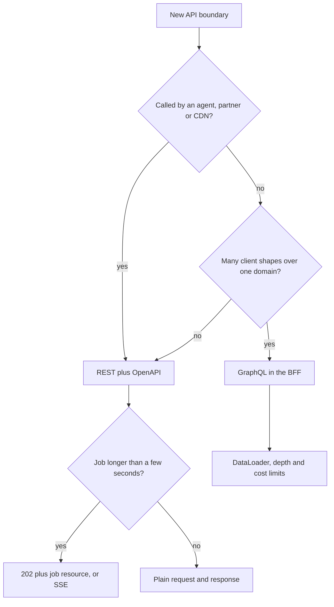

## TL;DR
Agents act through APIs: every tool is an operation, every retry tests its semantics. REST with OpenAPI
gives tools clear names, schemas and retry-safe methods; GraphQL suits product UIs reading many shapes of
one domain, not agent tools.

## For agent builders
- **Why it matters for agents.** A model picks tools by name and description and fills arguments from a
  schema, then your loop retries on timeouts. Noun-based REST operations with typed bodies, real status
  codes and idempotent methods are what make those calls understandable to the model and safe to repeat.
- **Where it shows up in your stack.** Tool definitions generated from an OpenAPI document, MCP servers
  wrapping internal REST services, your own agent-run API (`POST /runs` returning `202`), SSE streams of
  agent steps, and GraphQL BFFs behind the agent's UI.
- **What you control.** Operation names and descriptions the model reads, the error envelope the model
  sees as a tool result, `Idempotency-Key` on side-effecting tools, `ETag`/`If-Match` for agents that
  edit shared state, and job resources for long tool work.
- **What you can skip.** HATEOAS purity and GraphQL federation. Know methods, status codes, idempotency,
  conditional requests and the `202` job pattern.

## Why it exists
- **A shipped interface is frozen.** Casual day-one choices cost forever: an action-style endpoint named
  `/getUserOrders2`, an error returned as 200 with `{"ok": false}`, a delete that is not safe to retry.
  API styles make those decisions by convention instead of by accident, and agents will call whatever you
  shipped.
- **REST leans on HTTP instead of tunnelling through it.** Safe, idempotent `GET` can be cached and
  retried blind; idempotent `PUT` and `DELETE` survive a timeout retry without duplicates; meaningful
  status codes let load balancers count 5xx and retry policies act on 429 and 503 without reading bodies.
- **The naive alternative throws that away.** One `POST /api` endpoint with an `action` field: nothing
  cacheable, nothing retry-safe by inspection, every request identical to observability, and one vague
  tool for the model.
- **GraphQL solved a different pain.** It arose at Facebook (open-sourced in 2015): mobile clients needed
  many shapes of the same data, and REST either over-fetched (one fat resource) or under-fetched (three
  round trips per screen), with endpoints multiplying per screen. Client-authored queries over a typed
  schema fix that, at the cost of HTTP's per-resource semantics, so neither style dominates.
- **AI services sharpen the question.** Model calls are big `POST` bodies with streaming responses, and
  tools exposed to an agent are easiest to describe as REST operations with an OpenAPI schema.

## How it works
### REST: resources and methods
- **Model nouns, not verbs:** `/conversations/{id}/messages`, not `/sendMessage`. Nest collections and
  items at most a level or two. Each operation becomes one clearly named agent tool.

| Method | Semantics (defined by HTTP) |
|---|---|
| `GET` | safe and idempotent; may be cached |
| `PUT` | replaces a resource; idempotent |
| `DELETE` | idempotent |
| `PATCH` | applies a partial change |
| `POST` | creates or triggers; *not* idempotent, which is why non-trivial APIs accept an `Idempotency-Key` header on it |

- **Idempotency is about server state, not identical responses.** A second `DELETE` of the same job may
  return `204` or `404`; both are idempotent, because the resource ends up gone either way. Pick one and
  document it, since clients (and agent retry wrappers) write retry logic against it.

### REST: status codes and errors
Status codes are the first thing a client, or an agent's tool wrapper, branches on.

| Code | Meaning | What the agent loop does |
|---|---|---|
| `200`, `201 Created` | success; created | return the body as the tool result |
| `202 Accepted` | work continues after the response | poll the job or wait for an event |
| `204` | empty success | report success |
| `400` / `422` | invalid input | send the error to the model to fix arguments |
| `401` / `403` | identity / permission | stop; do not let the model retry |
| `404` | not found | tell the model; it may have guessed an id |
| `409` | state conflict | re-read, then retry or ask |
| `429` | rate limited | back off in code, not via the model |
| `5xx` | your fault | bounded retry, then fail the step |

- **One error envelope everywhere.** Problem Details (RFC 9457) gives a standard JSON shape with `type`,
  `title`, `status` and `detail`; a short, specific `detail` is what lets a model repair a bad call.

### REST: concurrency and conditional requests
1. **A `GET` returns an `ETag`**, a version tag for the representation.
2. **The updater sends `If-Match: <etag>`** with its `PUT` or `PATCH`.
3. **The server answers `412 Precondition Failed`** if someone changed the resource in between.

- **Optimistic concurrency without a custom `version` field.** It stops two editors (or two agents) from
  silently overwriting each other's changes to the same prompt template or config.
- **Cheap polling.** The same tag sent as `If-None-Match` on a `GET` lets the server answer
  `304 Not Modified` with no body.

### REST: hypermedia and long-running work
- **Fielding's definition also requires hypermedia** (responses carrying links to what the client can do
  next, often called HATEOAS). Most production "REST" APIs skip it; the useful remnants are the `Location`
  header, `next` links in paginated responses, and job resources that link to their result.
- **Long-running AI work maps cleanly.** `POST /summaries` returns `202` with a `Location` to a job
  resource that clients `GET` until it is `succeeded`, or the response streams as `text/event-stream`.
  Agent runs themselves fit the same shape.
- **Both keep proxies and timeouts happy**, *because* no single request has to live as long as the job.

### GraphQL: schema, resolvers, one endpoint
1. **A schema in SDL** declares types and fields and three roots: `Query`, `Mutation`, `Subscription`.
2. **A client sends a query** naming exactly the fields it wants.
3. **The server executes it** by calling a resolver per field, walking the tree.

- **N+1 by default.** Resolvers run per field and per parent object, so 100 conversations each resolving
  `lastMessage` naively issue 101 database queries. The standard fix is a per-request DataLoader that
  batches and caches lookups.
- **No HTTP caching by default.** Almost everything travels as `POST` to one endpoint, unless you send
  queries (typically persisted ones) over `GET`.
- **Errors ride with data.** Field errors return alongside partial data in an `errors` array,
  conventionally with a 200, so clients must inspect the body. The GraphQL-over-HTTP spec lets servers
  using `application/graphql-response+json` answer 4xx when a request fails before execution.
- **Cost limits are mandatory**, *because* clients author queries and an unbounded nested query is a
  denial-of-service vector, worse when a model writes the query. Enforce depth and cost limits.
- **Subscriptions have no fixed transport.** Most servers use WebSockets (the `graphql-ws` protocol); SSE
  is a common alternative.

### GraphQL: evolving the contract
- **No URL versions.** Add fields freely: clients receive only what they ask for, so additions break no one.
- **Deprecate, then remove.** Mark old fields `@deprecated(reason: ...)` and remove them once field-level
  usage telemetry shows zero queries selecting them.
- **That telemetry is a quiet advantage.** REST cannot give it per field without extra work, which matters
  for a fast-moving product schema.

### The decision
| Situation | Choose | Because |
|---|---|---|
| One product UI assembling screens from a rich domain, team iterates weekly | GraphQL | shape selection moves to the client |
| Service-to-service calls | REST + OpenAPI | simple, cacheable, retry-safe |
| Public APIs for integrators | REST + OpenAPI | the schema generates clients |
| Anything cached by CDNs | REST | HTTP caches key on method and URL |
| Anything exposed to an LLM as a tool | REST + OpenAPI | the schema generates tool definitions directly |

- **Many teams run both:** GraphQL in the product's BFF, REST underneath and outward to agents.

## Diagram
Start from the client and the boundary, not from taste: most agent and AI-service boundaries land on REST.



## Examples
### REST: a long-running summarisation job in FastAPI
`POST` returns `202` with a `Location`, `GET` is safe to poll, `DELETE` is idempotent. An agent tool
wrapping this submits once, then polls.

```python
from uuid import uuid4
from fastapi import FastAPI, HTTPException, Response, status
from pydantic import BaseModel

app = FastAPI()
JOBS: dict[str, dict] = {}                          # stand-in for a database

class SummarizeRequest(BaseModel):
    document_id: str
    max_words: int = 200

@app.post("/v1/summaries", status_code=status.HTTP_202_ACCEPTED)
async def create_summary(body: SummarizeRequest, response: Response):
    job_id = f"sum_{uuid4().hex[:12]}"
    JOBS[job_id] = {"id": job_id, "status": "queued", "input": body.model_dump(), "result": None}
    # enqueue to a worker here; the HTTP request returns immediately
    response.headers["Location"] = f"/v1/summaries/{job_id}"   # where to poll
    return JOBS[job_id]

@app.get("/v1/summaries/{job_id}")                  # GET is safe and idempotent: poll freely
async def get_summary(job_id: str):
    job = JOBS.get(job_id)
    if job is None:
        # FastAPI wraps this as {"detail": {...}}; a real service maps errors to RFC 9457 in a handler
        raise HTTPException(status_code=404, detail={"type": "not_found", "job_id": job_id})
    return job                                       # 200 whether queued or done; status is in the body

@app.delete("/v1/summaries/{job_id}", status_code=204)   # idempotent: a second DELETE is also 204
async def cancel_summary(job_id: str):
    JOBS.pop(job_id, None)
    return Response(status_code=204)
```

### Turning REST operations into agent tools
FastAPI's `app.openapi()` returns the OpenAPI document; each operation becomes a tool with a name, a
description and a JSON Schema for its arguments. Simplified: it handles body schemas and path parameters
only, and inlines no `$ref`s.

```python
def tools_from_openapi(spec: dict) -> list[dict]:
    tools = []
    for path, ops in spec["paths"].items():
        for method, op in ops.items():
            props, required = {}, []
            for p in op.get("parameters", []):            # path and query parameters
                props[p["name"]] = p.get("schema", {"type": "string"})
                if p.get("required"): required.append(p["name"])
            body = op.get("requestBody", {}).get("content", {}).get("application/json")
            if body:                                      # body schema (resolve $ref in real code)
                props["body"] = body["schema"]; required.append("body")
            tools.append({
                "name": op.get("operationId", f"{method}_{path}").replace("/", "_")[:64],
                "description": op.get("summary") or op.get("description") or f"{method.upper()} {path}",
                "input_schema": {"type": "object", "properties": props, "required": required},
                "x_http": {"method": method.upper(), "path": path,
                           "retry_safe": method in ("get", "put", "delete")},  # POST needs a key
            })
    return tools

# tools = tools_from_openapi(app.openapi())  ->  create_summary, get_summary, cancel_summary
```

### GraphQL: the same domain
For a client that wants to pick fields and subscribe to updates.

```graphql
enum JobStatus { QUEUED RUNNING SUCCEEDED FAILED }
type Summary { id: ID!  status: JobStatus!  result: String }
type Query { summary(id: ID!): Summary }
type Mutation { createSummary(documentId: ID!, maxWords: Int = 200): Summary! }
type Subscription { summaryUpdated(id: ID!): Summary! }
```

### Worked scenario: two agents edit one prompt template
Agent A and agent B both improve the same template within seconds.

| Step | Without `If-Match` | With `ETag` / `If-Match` |
|---|---|---|
| A and B `GET` the template | both read version `"v7"` | both receive `ETag: "v7"` |
| A sends `PUT` | saved as v8 | `If-Match: "v7"` matches, saved, new tag `"v8"` |
| B sends `PUT` | silently overwrites A's change | `If-Match: "v7"` fails: `412 Precondition Failed` |
| B recovers | nothing to recover; "my change disappeared" | re-`GET` v8, merge, retry with `If-Match: "v8"` |

## Production patterns
- **Design tool-facing operations for the model.** Give each operation a stable `operationId`, a one-line
  summary saying when to use it, and narrow typed parameters (enums, formats). Monitor per-tool
  argument-validation failures; a high rate means the name, description or schema confuses the model.
- **One Problem Details envelope.** Register exception handlers that map every error to RFC 9457 JSON
  with the `application/problem+json` media type and a stable `type` URI per error kind. Monitor error
  counts by `type` and status, which turns dashboards into a list of named failure modes.
- **Idempotency keys on `POST`.** Require an `Idempotency-Key` on creates and job submissions, store key
  plus request hash plus response for a fixed window (for example 24 hours), and replay the stored
  response on a repeat. Agent loops derive the key from run id plus step, so a retried step never acts
  twice. Monitor replay hits and key reuse with a different body (return `409` or `422`).
- **Job resources with polling hints.** For model or tool work over a few seconds, return `202` plus
  `Location`, and add a `Retry-After` hint so clients poll at a sane interval. Monitor job age by status
  and the share of jobs stuck in `queued`.
- **GraphQL guardrails.** Use persisted (allow-listed) queries for first-party clients, a per-request
  DataLoader for every list relation, and depth or complexity limits in the server. Monitor database
  queries per operation and rejected-query counts.
- **Breaking-change gate in CI.** Generate the OpenAPI document on every build and diff it against the
  released one with a tool such as oasdiff; fail on removed fields or tightened types, because generated
  tool definitions change with it. Track the count of deliberate breaking changes per release.

## Trade-offs
- **REST caching vs round trips.** REST gets HTTP caching, retry-safety by method and tooling for free,
  but a screen needing five resources costs five round trips; it flips to GraphQL when client-side shape
  variety dominates.
- **GraphQL exact shapes vs operational load.** Clients get exact shapes and one evolving schema, but you
  give up HTTP caching, must defend against expensive queries and must batch resolvers. It usually flips
  back to REST for public APIs, where caching and per-endpoint limits matter (GitHub and Shopify are
  notable GraphQL exceptions).
- **Many narrow tools vs one generic tool.** One operation per tool keeps model choices clear and retries
  safe by method, but a large API becomes dozens of tools that crowd the context; expose a curated subset.
- **`202` jobs vs simplicity.** A job resource keeps requests short and proxy-friendly, but clients must
  poll or subscribe, which costs more code than one long request when jobs are reliably under a few seconds.
- **Strict status codes vs up-front work.** A single error envelope and strict codes make clients simple,
  but force you to decide the code for every failure up front rather than leaking exceptions as 500s.

## Pitfalls
- **Verbs in URLs and everything as `POST`.** Symptom: nothing can be cached or safely retried, and
  observability shows one undifferentiated endpoint. Fix: nouns for resources, methods for actions.
- **Errors with status 200 and a flag in the body.** Symptom: retry and alerting policies never fire, SDKs
  treat failures as success, and agents report a failed tool call as done. Fix: real status codes plus
  one Problem Details body.
- **GraphQL resolvers without DataLoader.** Symptom: query count scales with list length in the database
  logs (the N+1 pattern). Fix: a per-request DataLoader for every list relation.
- **Holding a request open for a multi-minute AI job.** Symptom: intermittent 504s from a proxy whose idle
  timeout you never configured, and clients retrying work that already ran. Fix: `202` plus a job resource.
- **Read-modify-write without `ETag`/`If-Match` or a version field.** Symptom: "my change disappeared"
  reports when two users or two agents edit the same resource within seconds. Fix: require `If-Match`.
- **Unlimited GraphQL query depth and cost.** Symptom: one client's nested query pins the database while
  everything else times out. Fix: depth and cost limits, persisted queries for first-party clients.

## When to use
- **Default to REST with an OpenAPI schema** for AI service endpoints, internal service-to-service calls
  and anything an agent calls as a tool; the schema becomes the client, the docs and the tool definition.
- **Reach for GraphQL** when a product team owns a UI that assembles many shapes from a shared domain and
  is paying for it in round trips and endpoint sprawl.
- **Measure** round trips per screen, cache hit rate and p99 latency before switching either way; for
  agent tools, measure validation failures and retries per tool.
- **Day to day:** name resources, choose status codes deliberately, and design the long-running-job
  pattern.
- **Interviews:** expect "design the API for X" questions testing whether you reach for idempotency,
  `202` plus polling or streaming, and a consistent error shape without being prompted.

## Role lens
- **Engineer:** Designs resource paths and status codes, implements `202` plus polling or SSE for
  model calls, and keeps the OpenAPI schema accurate enough to generate clients and tool definitions.
- **Architect:** Decides which style each boundary uses (GraphQL in the BFF, REST between services and
  outward), sets the error envelope and idempotency conventions, and reviews breaking changes.
- **FDE:** Maps a customer's existing REST or GraphQL conventions onto the AI service's contract and
  explains why model endpoints need async job patterns their CRUD APIs never required.

## Check yourself
**Q:** You are designing the API for a document-analysis service whose jobs take 30 seconds to 5
minutes and whose results are read by a web UI, a partner integration and an internal agent. Which
style and request pattern do you choose, and why?
**A:** REST with an OpenAPI schema, because three different clients including an agent need a
contract that generates clients and tool definitions, and partners expect it. `POST /analyses` returns
`202 Accepted` with a `Location` and a job resource; clients `GET` it until `status` is terminal, or
subscribe to an SSE stream of progress events for the UI. The `POST` accepts an `Idempotency-Key` so a
partner's retry after a timeout does not run the job twice. Results live at `/analyses/{id}/result`
and are cacheable once terminal. I would not pick GraphQL here: the shapes are few, the clients are
mostly machines, and long-running work plus caching favour HTTP semantics.

## Interview questions
### What does "idempotent" mean for an HTTP method, and why does it matter for agent retries?
- **Definition:** repeating the request leaves the server in the same state as sending it once; the
  responses may differ (a second `DELETE` may return `404`).
- **Why it matters:** a client, proxy or agent loop can retry an idempotent request after a timeout
  without creating duplicates; `GET`, `PUT` and `DELETE` are idempotent, `POST` is not.
- **Making `POST` safe:** accept an `Idempotency-Key` and replay the stored result for repeats; an agent
  derives it from run id plus step.

### How would you design an internal API so an agent can use it well as a set of tools?
- **One noun-based operation per tool:** stable `operationId`, a summary saying when to use it, and narrow
  typed parameters, so the generated tool definitions are unambiguous.
- **Errors the model can act on:** real status codes plus a Problem Details `detail` that names the bad
  field; the loop handles `401`, `403` and `429` itself instead of passing them to the model.
- **Safe side effects:** `Idempotency-Key` on every `POST`, `If-Match` on edits, and `202` job resources
  for anything slow.

### Two agents keep overwriting each other's edits to a shared config. How do you diagnose and fix it?
- **Diagnosis:** a read-modify-write race; logs show two `PUT`s within seconds from different agents or
  users, the later one built on a stale read.
- **Fix:** return an `ETag` on `GET` and require `If-Match` on `PUT`/`PATCH`; the losing writer gets `412`
  and must re-read and merge.
- **Agent behaviour:** treat `412` as "re-read and redo the step", and surface repeated conflicts to a
  human instead of looping.

### When would you not use GraphQL?
- **Public or partner APIs:** integrators expect REST, CDN caching and per-endpoint rate limits, all
  awkward when everything is `POST /graphql`.
- **Agent tools and service-to-service calls:** OpenAPI operations map directly onto tool definitions and
  generated clients.
- **Few client shapes:** the resolver, DataLoader and cost-limit machinery only pays off when many
  clients need different shapes.

### A GraphQL endpoint's p99 jumped after a new screen shipped. What do you look at?
- **Resolver fan-out:** database queries per operation; a new list field without DataLoader shows as
  N+1 (100 items, 101 queries).
- **Query cost:** depth and estimated complexity of the new query, and whether a cost limit should reject
  or paginate it.
- **Fix and guard:** batch with DataLoader, persist the query, and alert on queries-per-operation.

### How would you implement `Idempotency-Key` on a `POST`, and how much storage does it need?
- **Record before doing the work:** insert the key, scoped per client, with a hash of the body and an
  in-progress state under a unique constraint; on success store the response, and replay it for repeats.
- **Edge cases:** a duplicate arriving while the first is still in progress gets `409` and retries later;
  the same key with a different body is rejected (`409` or `422`) rather than replayed.
- **Sizing:** keys live for a fixed window; at 50 creates per second and a 24-hour window that is
  50 × 86,400 = 4.32 million rows, so give them a TTL or a scheduled purge.

## Quiz
### Q: Why return `202 Accepted` with a `Location` header for a five-minute AI job instead of holding the request open until it finishes?
- [ ] Because `200` cannot carry a JSON body larger than the proxy buffer
- [x] Proxies and clients have idle timeouts, and a short request plus a pollable job resource survives them and is retry-safe
- [ ] Because `202` enables HTTP caching of the eventual result
- [ ] Because FastAPI cannot await for more than 60 seconds
> Long-held connections hit proxy and client timeouts and make retries ambiguous. A job resource
> turns the work into state that can be polled, cached when terminal and cancelled.

### Q: Why can an ordinary HTTP cache not store GraphQL responses by default?
- [ ] GraphQL responses are always compressed
- [ ] The GraphQL spec forbids caching
- [x] Queries go as `POST` to one endpoint, so the URL does not identify the resource being read
- [ ] GraphQL responses never include a `Content-Type` header
> HTTP caches key on method and URL. With every query a `POST` to `/graphql`, there is nothing to key
> on; persisted queries over `GET` are the workaround.

### Q: A GraphQL list of 100 conversations resolving `lastMessage` issues 101 database queries. What is the standard fix?
- [ ] Switch the field to a REST endpoint
- [x] A per-request DataLoader that batches and caches the lookups
- [ ] Increase the database connection pool to 101
- [ ] Mark the field as `@deprecated`
> Resolvers run per parent object, so without batching each one queries alone. DataLoader collects the
> keys requested in one tick and issues a single batched query.

## Use cases & projects
### Use cases
- **Internal tools for a support agent.** Order lookup, refund and ticket operations exposed as REST
  endpoints whose OpenAPI document generates the agent's tool list.
- **Agent-run APIs.** `POST /v1/runs` returns `202` and a run resource; the UI streams steps over SSE and
  a partner polls the same resource.
- **Multi-agent edits to shared state.** Prompt templates, configs or documents guarded by `ETag` and
  `If-Match` so concurrent agents cannot silently overwrite each other.
- **Agent UI on a GraphQL BFF.** The chat screen reads conversations, runs and citations in one query,
  while the agent itself calls REST tools underneath.

### Mini project
**Generate safe agent tools from a REST API (1-2 hours).**
- **Goal:** expose a small FastAPI service as agent tools and prove that retries cannot duplicate side
  effects.
- **Steps:** build three endpoints (get order, create refund with `Idempotency-Key`, update a note with
  `If-Match`); convert `app.openapi()` into tool definitions with the function above; write a tiny loop
  that calls them, retries timeouts, and returns Problem Details errors to the model as tool results.
- **Done when:** replaying the same refund step three times creates one refund, a stale `If-Match` returns
  `412` that the loop handles by re-reading, and the tool list shows clear names and descriptions.

### Major project
This lesson feeds the module Capstone (see the module guide): DocBrief's `/v1` REST API, `202` job
resources, `Idempotency-Key` handling and OpenAPI document are designed with these rules.
