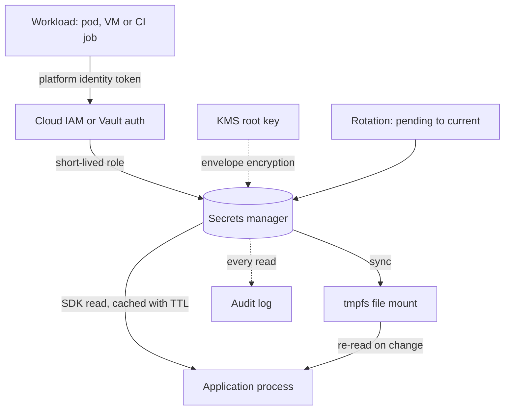

## TL;DR
A secret is any value that lets someone act as your system. Secrets management keeps secrets out of code,
images, logs and prompts, stores them encrypted, delivers them via platform identity, and keeps them
short-lived and rotatable, so leaks stay small.

## Why it exists
- **Secrets leak through boring paths.** A `.env` committed "just once", an `ENV API_KEY=` line in a
  Dockerfile, a build argument captured in image history, a key pasted into a ticket or a chat with an LLM,
  an exception trace that logs request headers, a notebook checked into git, a CI log that echoed the
  environment.
- **For AI teams a provider key is a billing key.** Keys pushed to public repositories are routinely found
  and abused by scanners within minutes (illustrative; the exact window varies), turning into unexpected
  bills, exhausted quotas and rate limits for your real traffic. Unless you create narrower project- or
  workspace-scoped keys, one key often reaches a whole organisation's quota and data.
- **Environment variables are delivery, not storage.** They are inherited by every child process, readable
  from `/proc/<pid>/environ`, and dumped into crash reports.
- **Encrypted repo files are only a middle ground.** sops or git-crypt work, but the decryption key is itself
  a secret to bootstrap, and rotation means re-encrypting in every environment. "We will be careful" fails
  at the first contractor laptop.
- **Rotation is the deeper problem.** A secret copied into fourteen places cannot be rotated without an
  outage, so nobody does, and a three-year-old key sits on a dozen laptops. Goal one: one source of truth
  referenced by name. Goal two: as few long-lived secrets as possible.

## How it works
### 1. Inventory and minimise
List every credential and ask whether it needs to exist. Every secret you do not have is one you never
rotate or leak.

| Static secret | Replace with |
|---|---|
| Cloud access key on a VM or pod | Platform identity: IAM role, managed identity |
| Cloud key stored in CI | OIDC federation |
| Static API key | Short-lived tokens, where the provider supports them |

### 2. Store in a manager backed by a KMS
Vault, AWS Secrets Manager or Parameter Store, GCP Secret Manager and Azure Key Vault do the same core job:
- **Envelope encryption.** Values are encrypted with a data key; the data key is encrypted by a root key the
  service never exposes. Cloud services hold it in an HSM-backed KMS; Vault protects it through its seal,
  which can itself be a cloud KMS or HSM.
- **Access is an IAM policy** per identity per secret path.
- **Recent versions are kept** for rollback, and **every read is audited**.

Kubernetes `Secret` objects are *not* this:
- base64-encoded, stored in etcd unencrypted unless an `EncryptionConfiguration` with a KMS provider is
  enabled;
- readable by anyone with `get secrets` in the namespace, and in effect by anyone who can create a Pod
  there, since a Pod can mount any Secret in its namespace;
- so treat them as the last hop, populated from a real manager by the External Secrets Operator, the
  Secrets Store CSI driver or a Vault agent sidecar.

### Secrets store vs KMS
| | Secrets store | KMS (AWS KMS, Cloud KMS, Key Vault keys, Vault transit) |
|---|---|---|
| Returns the value? | Yes, to the caller | Never; key is non-exportable |
| Caller sends | A name | Data to sign, encrypt or decrypt |
| Use for | Passwords, API keys | JWT signing keys, webhook signing, field-level encryption |

- **Why keys belong in a KMS:** a key that never enters application memory cannot leak through a heap dump,
  a log line or a compromised dependency.
- **Limit:** the attacker who owns the process can still call `sign` while they hold it, but loses that
  power the moment access is revoked.

### 3. Authenticate the workload: the secret-zero problem
To fetch secrets a workload needs a credential; if that is a static key you have gained nothing. The way
out is identity the platform attests without a stored secret:

| Platform | Identity mechanism |
|---|---|
| EC2 | Instance profile |
| EKS | IAM Roles for Service Accounts (projected service-account token exchanged for a role via OIDC federation) or EKS Pod Identity (a node agent exchanges the same token through the EKS Auth API) |
| GKE | Workload Identity |
| Azure | Managed identity |
| Vault | Kubernetes and JWT auth methods |
| GitHub Actions | `id-token: write`: a short-lived OIDC token a cloud role trusts for a specific repository and branch |

- **Trust now lives in configuration** (`sub = repo:org/app:ref:refs/heads/main`) instead of in a key, so
  keep those conditions narrow.

### 4. Deliver to the process
| Option | Pros | Cons |
|---|---|---|
| Fetch through the SDK at startup | Simple | Needs network and identity; cache with a TTL |
| Mount as files on a tmpfs volume | Preferred on Kubernetes: the manager rewrites the file, the app re-reads without a restart | App must re-read |
| Inject as environment variables | Universal | Frozen for the process life and leaky as above |

- **Never bake into the image.** `docker build --secret` mounts a value during one build step without
  writing it to any layer.

### 5. Rotate, and prefer dynamic
Static secrets rotate on a schedule and immediately after any suspected exposure, using two-key overlap,
*because* an atomic swap across many consumers is impossible. For a database password:
1. Create the new credential at the database while the old one still works.
2. Store it in the manager as the pending version.
3. Verify a login with it.
4. Promote it to current, so consumers pick it up on their next refresh.
5. Wait at least one consumer refresh interval (the cache TTL, plus restart time for anything that reads
   only at boot).
6. Revoke the old credential.

- **AWS Secrets Manager models exactly this** with staging labels `AWSPENDING`, `AWSCURRENT` and
  `AWSPREVIOUS`.
- **Revoking at step 4 instead of 6** is the classic rotation outage.
- **Dynamic secrets remove the schedule.** Vault's database engine creates a per-workload database user with
  a TTL and drops it on expiry; cloud STS tokens expire within hours.
- **Rotation only works if consumers re-read,** so cache with a TTL and refetch on an authentication failure.

### 6. Detect and contain
- **Catch before it lands:** pre-commit and CI scanning (gitleaks, trufflehog) and GitHub push protection.
- **Git history is permanent exposure.** A secret that reached history is compromised even after the commit
  is removed: rotate it.
- **Limit logs:** redact known secret values, allowlist logged fields, and alert when a secret is read by an
  identity that never read it before.

### 7. Rules specific to AI systems
- **One model-provider key per service and environment, with a spend cap,** kept server-side only and ideally
  behind a gateway, so rotation happens in one place and spend is attributable.
- **Never place a secret in the prompt or a tool result,** because a model can be induced to repeat its
  context, and traces in your observability tool would store it.
- **Tools receive opaque references** and resolve credentials in the tool runtime, outside the model's
  context.
- **Per-customer credentials isolated by tenant** for agents that reach into customer systems; the agent's
  own identity is never the customer's key.

## Diagram
The workload proves who it is with a platform-issued identity, so no stored secret is needed to reach the
manager; the value then arrives as a file or SDK read that refreshes on rotation.



## Examples
### Resolver: file mount or manager, TTL refresh and log redaction
A small resolver that reads a secret from a mounted file when one exists (Vault agent or CSI driver),
otherwise from AWS Secrets Manager using the pod's or instance's ambient IAM identity. It re-reads after a
TTL so rotations take effect without restarts, and installs a logging filter that redacts the value.

```python
import logging, os, time, boto3
from requests import post

class Secrets:
    """No static credential anywhere: boto3 picks up the IAM role from the environment (IRSA / instance profile)."""
    def __init__(self, mount="/var/run/secrets/app", ttl_s=300):
        self.mount, self.ttl_s, self._cache = mount, ttl_s, {}
        self._sm = boto3.client("secretsmanager")

    def get(self, name: str, force=False) -> str:
        hit = self._cache.get(name)
        if hit and not force and time.monotonic() - hit[1] < self.ttl_s:
            return hit[0]
        path = os.path.join(self.mount, name.replace("/", "_"))
        if os.path.exists(path):                                   # file mount rotates in place
            value = open(path).read().strip()
        else:                                                      # manager call, audited per identity
            value = self._sm.get_secret_value(SecretId=name)["SecretString"]
        self._cache[name] = (value, time.monotonic())
        return value

class Redact(logging.Filter):
    def __init__(self, values): super().__init__(); self.values = [v for v in values if v]
    def filter(self, record):
        msg = record.getMessage()
        if any(v in msg for v in self.values):
            for v in self.values: msg = msg.replace(v, "[REDACTED]")
            record.msg, record.args = msg, ()
        return True

secrets = Secrets()
LLM_KEY = secrets.get("prod/llm-gateway/api-key")        # per-service key with a spend cap
logging.basicConfig(level=logging.INFO)
for h in logging.getLogger().handlers:                   # on handlers: logger filters skip propagated records
    h.addFilter(Redact([LLM_KEY]))                       # re-register with the new value after a rotation

def call_provider(payload):
    key = secrets.get("prod/llm-gateway/api-key")        # cheap: served from cache until ttl
    r = post("https://llm-gateway.internal/v1/chat", json=payload, headers={"Authorization": f"Bearer {key}"})
    if r.status_code == 401:                             # rotated under us: refetch once, then retry
        key = secrets.get("prod/llm-gateway/api-key", force=True)
        r = post("https://llm-gateway.internal/v1/chat", json=payload, headers={"Authorization": f"Bearer {key}"})
    return r
```

- **On rotation** the file mount updates or the next TTL expiry refetches; the 401 branch covers the window
  in between.
- **Nothing** in the repository, image or environment contains the value.

### Worked scenario: a rotation that caused an outage, and the fixed plan
Twelve services share one database password; the resolver TTL is 300 s and a few batch jobs read only at
boot. The figures are illustrative.

| Plan | What happens |
|---|---|
| Old: write new password, revoke old at once (step 4) | Every consumer still holding the cached old value fails auth for up to 300 s; boot-only jobs fail until restarted |
| Fixed: create, store as pending, verify, promote, wait, revoke (steps 1 to 6) | Consumers move over on their next refresh; revoke only after TTL plus the longest restart time |
| Better: per-service credentials | One service's rotation cannot break the other eleven |
| Best where possible: dynamic database users | Each workload gets its own user with a TTL; no shared password to rotate |

### Build secrets and CI federation instead of stored keys
A BuildKit secret mount for a private package index, and a GitHub Actions job that gets cloud credentials
from OIDC instead of a stored key.

```dockerfile
# syntax=docker/dockerfile:1
# build with: docker build --secret id=pip_token,src=./pip_token.txt .
FROM python:3.12-slim
COPY requirements.txt .
# the token exists only during this RUN step and is never written to a layer
RUN --mount=type=secret,id=pip_token \
    PIP_INDEX_URL="https://__token__:$(cat /run/secrets/pip_token)@pypi.internal/simple" \
    pip install -r requirements.txt
```

```yaml
permissions:
  id-token: write        # lets the job request an OIDC token
  contents: read
jobs:
  deploy:
    runs-on: ubuntu-latest
    steps:
      - uses: aws-actions/configure-aws-credentials@v4
        with:
          role-to-assume: arn:aws:iam::123456789012:role/deploy-main   # trusts only repo:org/app:ref:refs/heads/main
          aws-region: us-east-1
```

## Production patterns
- **Per-service provider keys behind a gateway.** Issue one model-provider key per service and environment
  with a spend cap, and route calls through an internal gateway that holds it. Monitor spend per key and
  401 rates; a key whose spend jumps without a deploy is a likely leak.
- **Scan on every commit and push.** Run gitleaks or trufflehog as a pre-commit hook and a CI step, and turn
  on GitHub push protection. Track findings per month and time from finding to rotation.
- **Managed rotation with overlap.** Use the manager's rotation workflow (Secrets Manager rotation with the
  `AWSPENDING` and `AWSCURRENT` labels, or Vault dynamic credentials) instead of hand edits. Monitor secret
  age and auth failures in the minutes after each rotation.
- **Kubernetes Secrets synced from a manager.** Let the External Secrets Operator or the Secrets Store CSI
  driver populate Secrets with a refresh interval, enable etcd encryption with a KMS provider, and restrict
  `get secrets` in RBAC. Audit who can create Pods in each namespace, since they can mount any Secret there.
- **Alert on unusual reads.** Send manager read events (CloudTrail for Secrets Manager, Vault audit device)
  to your SIEM and alert when an identity reads a secret it has never read before.

## Trade-offs
- **Central manager vs startup dependency.** One place to rotate and audit, but a runtime dependency on
  startup; cache with a TTL and fail fast at boot. For a two-person project without infrastructure,
  encrypted files in the repo are an acceptable step up from nothing.
- **Dynamic credentials vs consumer complexity.** Short-lived credentials shrink the blast radius but every
  consumer must handle expiry and refresh, and database users churn. Static secrets with scheduled rotation
  are simpler where consumers cannot refresh.
- **File mounts vs environment variables.** File mounts allow hot rotation but need the application to
  re-read; environment variables work with every runtime but are frozen for the process lifetime and
  inherited by children.
- **Platform identity vs portability.** It removes secret zero but ties you to that platform's IAM model; in
  air-gapped or on-premises deployments you may need Vault with AppRole and a bootstrap token delivered out
  of band.

## Pitfalls
- **`ENV` or `ARG` with a secret in a Dockerfile.** Symptom: `docker history` or any pull of the image
  reveals it. Fix: use build secrets.
- **A `.env` deleted from the working tree but still in git history.** Symptom: a scanner alert or a
  surprise provider bill weeks later. Fix: rotate, do not just rewrite history.
- **Logging whole request objects or headers.** Symptom: `Authorization: Bearer …` lines in the log store.
  Fix: allowlist fields and add redaction filters.
- **One shared production key used by twelve services.** Symptom: rotation causes an outage and spend
  cannot be attributed. Fix: per-service keys.
- **Secrets placed in prompts, tool arguments or tool outputs.** Symptom: the model echoes a key in chat or
  a trace contains it. Fix: resolve credentials inside the tool runtime.
- **Consumers that read secrets only at startup.** Symptom: authentication failures after every rotation
  until a restart. Fix: re-read on a TTL and on 401.
- **Assuming Kubernetes Secrets are encrypted.** Symptom: any namespace reader dumps them. Fix: enable
  encryption at rest, restrict RBAC on secrets, and source them from a manager.
- **Mounting a Kubernetes Secret with `subPath`, or reading it through `env`.** Symptom: the manager and the
  Secret show the new value but the Pod keeps the old one until it restarts, because neither path receives
  in-place updates (whole-volume mounts do, after a short sync delay).
- **Revoking the old credential as soon as the new one is written.** Symptom: a burst of authentication
  failures across every consumer whose cache has not yet refreshed.

## When to use
- **Always.** There is no setting where this does not apply; what varies is the tooling.
- **Day to day:** adding a secret means creating it in the manager, referencing it by name in configuration,
  granting one identity access, and never pasting it anywhere.
- **Measure:** the number of static long-lived secrets, the age of the oldest, the time to rotate one end to
  end, and scanner findings per month.
- **Interviews:** explain the secret-zero problem and how workload identity solves it, how to rotate without
  downtime, and, for AI roles, where model-provider keys live, why they never reach the browser or the
  prompt, and how a prompt-injected agent could exfiltrate a credential left in its context.

## Role lens
- **Engineer:** Reads secrets through a resolver with TTL and refetch-on-401, adds log redaction, uses
  build secrets in Dockerfiles, and keeps provider keys out of tool arguments and traces.
- **Architect:** Chooses the manager and the identity model per environment, defines the rotation policy
  and key-per-service boundaries, and sets the rule that credentials resolve in the tool runtime rather
  than in the model's context.
- **FDE:** Fits the product into the customer's Vault or cloud KMS, gets workload identity granted in
  their cluster, and answers the security questionnaire's questions on storage, rotation and audit.

## Check yourself
**Q:** A deployment on Kubernetes stores the model-provider key in a Kubernetes Secret created by hand,
reads it into an environment variable, and the same key is used by the API, the batch evaluator and a
developer's notebook. What are the risks, and how would you fix it in order of impact?
**A:** First, the key is shared, so a leak from the notebook exposes production and rotation would
break all three consumers at once; issue a per-service key with its own spend cap, kept behind a
gateway. Second, the Kubernetes Secret is base64 in etcd, unencrypted unless at-rest encryption is
configured, and readable by anyone with namespace access; source it from a managed secrets store through
the External Secrets Operator or CSI driver, enable etcd encryption, and restrict RBAC on secrets. Third,
the environment variable is frozen and inherited by child processes; mount it as a file and re-read on a
TTL so rotation needs no restart. Fourth, no identity story exists for the workload; use IRSA or workload
identity so the pod authenticates to the manager without a stored credential. Finally, add scanning,
redaction and a read-audit alert, and rotate the current key now because it has lived in a notebook.

## Interview questions
### Why are environment variables not a secrets store?
- **They are a delivery mechanism.** They are inherited by every child process, readable from
  `/proc/<pid>/environ`, and dumped into crash reports.
- **They are frozen for the process lifetime,** so a rotation needs a restart.
- **A real store adds** encryption at rest, per-identity access policy, versions and an audit trail.

### A model-provider key was pushed to a public repo ten minutes ago. What do you do, in order?
- **Rotate first:** revoke the key at the provider and issue a new one, because scanners find public keys
  within minutes and deleting the commit does not un-expose it.
- **Contain:** check provider usage and spend for the exposure window and set or lower the spend cap.
- **Prevent:** add push protection and pre-commit scanning, and move the key into a manager with
  per-service scoping.

### Static secrets with rotation, or dynamic credentials: which would you choose?
- **Dynamic** (Vault database engine, STS) shrinks blast radius and removes the rotation schedule, but every
  consumer must handle expiry and database users churn.
- **Static with scheduled rotation** is simpler where consumers cannot refresh, for example a legacy job that
  reads only at boot.
- **Rule of thumb:** dynamic for services you control, static plus overlap rotation for the rest.

### How do you rotate a shared database password without downtime?
- **Overlap two credentials:** create the new one while the old still works, store it as pending, verify,
  then promote to current.
- **Wait one refresh interval,** the cache TTL plus the longest restart time for boot-only readers, before
  revoking the old one.
- **Make consumers re-read** on a TTL and on authentication failure, otherwise rotation always breaks
  something.

### How should an agent's tools get credentials for customer systems?
- **Resolve in the tool runtime,** keyed by tenant and tool, from the secrets store; the model only sees an
  opaque reference.
- **Never in the prompt or tool results,** because prompt injection can make the model repeat its context and
  traces would store it.
- **Isolate per customer,** so a compromised tenant credential cannot reach another tenant.

## Quiz
### Q: What is the "secret zero" problem and what solves it?
- [ ] The first secret created in a vault is unencrypted until the vault is sealed; sealing solves it
- [x] A workload needs a credential to fetch its credentials; platform-attested identity (IAM roles, workload identity, OIDC federation) solves it without a stored secret
- [ ] Environment variables are numbered from zero and the first one is visible to all users
- [ ] The root token of a secrets manager cannot be rotated; a hardware module solves it
> If the bootstrap credential is a static key, the manager only relocates the problem. Identity that
> the platform asserts about the running workload breaks the chain, because nothing durable exists to
> steal.

### Q: Why are Kubernetes Secret objects not a sufficient secrets store on their own?
- [ ] They can hold at most one value per object
- [ ] They are only available to pods on the control-plane nodes
- [x] They are base64-encoded, unencrypted in etcd unless at-rest encryption is configured, and readable by any identity with namespace secret access
- [ ] They cannot be mounted as files, only as environment variables
> Base64 is an encoding, not encryption. Without an EncryptionConfiguration and tight RBAC, a
> namespace reader or an etcd backup exposes every value; a managed store feeding Secrets fixes the
> storage and audit gap.

### Q: An agent's tool for querying a customer's CRM needs an API token. Where should the token be handled?
- [ ] Passed to the model in the system prompt so it can include it in tool calls
- [ ] Returned to the model inside the tool's JSON result for subsequent calls
- [x] Resolved inside the tool runtime from the secrets store, keyed by tenant, so it never enters the model's context
- [ ] Stored in the conversation memory so multi-turn sessions can reuse it
> Anything in the model's context can be echoed back through prompt injection or captured in traces.
> The tool runtime looks the credential up by the tenant and the tool, uses it, and returns only data.
