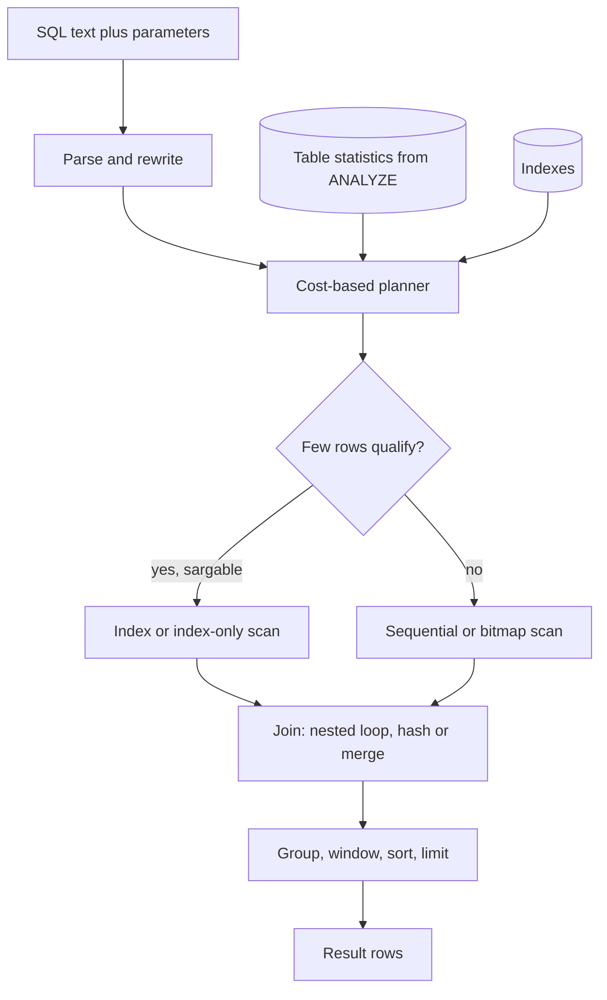

## TL;DR
Agents read and write SQL constantly: run logs, memory lookups, cost reports and text-to-SQL tools. SQL
is declarative and a cost-based planner picks the algorithm, so index the agent's real queries, think in
sets, and read the plan.

## For agent builders
- **Why it matters for agents.** Every agent step lands in tables (runs, steps, tool calls, token
  counts), and the questions you ask later ("spend per tenant", "failure rate per tool", "last N
  messages for this thread") are SQL. A text-to-SQL tool also lets the model itself issue queries,
  which turns plan quality and safety into agent behaviour.
- **Where it shows up in your stack.** Postgres behind LangGraph checkpointers and chat-history stores,
  pgvector hybrid queries that mix similarity with a `WHERE tenant_id = $1` filter, SQLAlchemy in your
  FastAPI service, and SQL-database tools in agent frameworks.
- **What you control.** Parameters instead of string building (including for model-generated values), a
  read-only role and `statement_timeout` for any query an agent can issue, keyset pagination over
  transcripts, and indexes matching the agent's hot lookups.
- **What you can skip.** Relational algebra proofs and exotic join hints. Know evaluation order, NULL
  logic, sargability, `EXPLAIN ANALYZE` and N+1; that covers agent backends.

## Why it exists
- **Navigational databases coupled code to layout.** Programs walked pointers from record to record, so
  every program encoded the physical layout, and changing the layout meant changing every program.
- **Codd separated what from how.** Data became relations (tables of tuples) and queries became algebra
  over them. SQL is the practical language from that, and the planner turns the *what* into a *how* at run
  time using statistics about the actual data.
- **The naive loop is N+1.** Fetch conversations, then each one's messages, then count tokens per message.
  Each round trip is a network hop (hundreds of microseconds to milliseconds), so 1,000 conversations cost
  1,001 queries and between half a second and several seconds of wall time.
- **The loop also hides the question.** The database never sees the whole request, so it cannot pick a hash
  join or use an index to do the work in one pass. One query with a join and an aggregate is one scan.
- **AI backends are heavy SQL users.** Per-tenant token spend, latency percentiles per model, the last N
  messages of a conversation, eval results joined to prompt versions, and hybrid retrieval mixing vector
  similarity with a metadata filter are each one query when written well, a slow fan-out when not.

## How it works
### Logical evaluation order
A `SELECT` is written in one order and evaluated in another:

1. `FROM` and `JOIN`: build the row set.
2. `WHERE`: filter rows.
3. `GROUP BY`: collapse into groups.
4. `HAVING`: filter groups.
5. `SELECT`: compute output columns, including window functions.
6. `DISTINCT`.
7. `ORDER BY`.
8. `LIMIT`/`OFFSET`.

This explains the classic confusions:
- **No `SELECT` alias in `WHERE`,** because `WHERE` runs first.
- **`HAVING` exists** because aggregates do not exist yet when `WHERE` runs.
- **Window functions see filtered, grouped rows** because they run during `SELECT`.

### Joins are set operations, not loops
- **Inner join** keeps rows that match on both sides.
- **Left join** keeps every left row and fills the right side with NULLs when nothing matches; that is how
  you find conversations with no messages (`WHERE m.id IS NULL`).
- **`EXISTS`/`NOT EXISTS`** express "has at least one" without duplicating rows the way a join would.

The engine picks the physical algorithm; you make the good ones possible with indexes and accurate statistics:

| Algorithm | Chosen when |
|---|---|
| **Nested loop** | one side is tiny, or has an index on the join key |
| **Hash join** | both sides are large and unsorted |
| **Merge join** | both sides are already sorted on the key |

### Aggregates and window functions
- **`GROUP BY` collapses rows.**
- **A window function computes per row without collapsing:**
  `SUM(...) OVER (PARTITION BY tenant_id ORDER BY day)` gives running totals, rankings and "latest row per
  group" in a single pass.
- **PostgreSQL idiom for "newest message per conversation":** `DISTINCT ON (conversation_id) ... ORDER BY
  conversation_id, created_at DESC`.

### How the planner decides
`EXPLAIN ANALYZE` shows the tree the planner chose, with real row counts and timings. Cost estimates come
from table statistics (row counts, value distributions gathered by `ANALYZE`).

| Scan | What it does | Cheapest when |
|---|---|---|
| Sequential | read everything | most rows qualify |
| Index | walk a B-tree to matching rows | few rows qualify |
| Bitmap | collect matching pages from one or more indexes, then read them in physical order | in between |
| Index-only | answer from the index alone, skipping the table | the index holds every column read, e.g. via `INCLUDE (input_tokens)` |

- **Sargable predicates.** A predicate can use an index when the indexed column appears bare on one side:
  `created_at >= $1` can; `date(created_at) = $1` cannot, because the index stores `created_at`, not its date.
- **Prefix `LIKE`.** `LIKE 'abc%'` can use a B-tree, but in PostgreSQL only if the index uses the `C`
  collation or the `text_pattern_ops` operator class. A default index under a locale such as
  `en_US.UTF-8` is not used for `LIKE`.
- **Infix `LIKE`.** `LIKE '%abc%'` cannot use a B-tree at all and needs a trigram (`pg_trgm`) index.
- **Index-only scans need vacuum.** They work only for pages the visibility map marks all-visible, one more
  reason vacuum health shows up in query latency.
- **Statistics go stale.** A table that grew 100× since the last `ANALYZE` gets bad plans; autovacuum
  usually re-analyzes, but can lag after a bulk load.

### NULL is not a value
SQL uses three-valued logic: a comparison with NULL is *unknown*, and `WHERE` keeps only rows where the
predicate is true.

- **`WHERE model <> 'gpt-x'`** silently drops every row whose `model` is NULL.
- **`x = NULL` never matches;** use `IS NULL` or `IS DISTINCT FROM`.
- **`NOT IN (subquery)` returns nothing** once the subquery yields a single NULL, because
  `a NOT IN (b, NULL)` expands to `a <> b AND a <> NULL`, which can never be true.
- **Arithmetic propagates NULL:** `input_tokens + output_tokens` is NULL if either side is.
- **`SUM` skips NULLs,** so a row with a missing count vanishes from a spend total instead of erroring.
- **`COUNT(*)` counts rows; `COUNT(col)` counts non-NULL values.** The difference is a common source of
  reports that disagree.

### Parameters, not string formatting
- **Parameters travel separately.** Placeholders (`$1`, `%s`, `?` depending on the driver) are sent apart
  from the SQL text.
- **The only reliable injection defence,** *because* the database never parses user input as SQL. It also
  lets the server reuse a prepared plan.
- **Interpolation is a vulnerability** regardless of how well you escape.

### Pagination and the OFFSET trap
- **`LIMIT 20 OFFSET 100000` still reads and discards 100,000 rows;** cost grows linearly with page depth.
- **Keyset pagination** (`WHERE (created_at, id) < ($last_ts, $last_id) ORDER BY created_at DESC, id DESC
  LIMIT 20`) seeks directly to the next page using the index and costs the same on page 1 and page 5,000.

### Where the ORM fits
- **Convenient for CRUD, dangerous for reporting.** Lazy-loaded relationships are the usual source of
  N+1, and complex aggregations are often clearer as SQL.
- **Working rule:** let the ORM handle simple writes and reads by key; write (and `EXPLAIN`) the hot or
  analytical queries by hand.

### SQL that an agent issues
When the model writes or fills in SQL (a text-to-SQL tool, a memory lookup with model-chosen filters),
treat the query as untrusted input:

| Guard | Why |
|---|---|
| **Read-only role or connection** | a hallucinated `DELETE` fails at the database, not in your prompt |
| **`statement_timeout` on that role** | one model-written cross join cannot pin a connection |
| **Row cap returned to the model** | 50 rows fit in context; 50,000 blow the window and the bill |
| **Parameters for model-chosen values** | a model-extracted name with an apostrophe must not become SQL |
| **Tenant filter added by your code** | never trust the model to remember `WHERE tenant_id = $1` |

- **Return errors as tool results.** The database's error message ("column does not exist") is exactly
  what the model needs to repair its query on the next step.
- **Expose views, not raw tables.** A narrow view with clear column names gives the model fewer ways to
  write a wrong or expensive query.

## Diagram
Follow a query from text to rows, whether your code or the agent's SQL tool wrote it: the planner, fed by
statistics, picks scans and joins; stale statistics or a non-sargable predicate is where it goes wrong.



## Examples
### Two queries an LLM backend runs constantly
- **Spend report:** per-tenant spend with a running total, one pass, a window function over the grouped rows.
- **Inbox view:** "newest message per conversation" via a `LATERAL` subquery (the `DISTINCT ON` form above
  is the alternative), with a keyset cursor so page depth does not change the cost.
- **Scaling note:** each page still evaluates the lateral lookup for every conversation the user owns.
  With thousands of conversations, the next step is a denormalized `conversations.last_message_at` with an
  index on `(tenant_id, user_id, last_message_at, id)`, so the cursor seeks straight to the page.

```sql
-- 1. Daily token spend per tenant for the last 7 days, with a running total.
--    No tenant filter, so a (tenant_id, created_at) index gives no simple range scan;
--    an index on created_at (or a BRIN index on an append-only table) serves this.
--    Day boundaries follow the session TimeZone setting.
SELECT tenant_id,
       date_trunc('day', created_at) AS day,
       SUM(COALESCE(input_tokens, 0) + COALESCE(output_tokens, 0))        AS tokens,
       SUM(SUM(COALESCE(input_tokens, 0) + COALESCE(output_tokens, 0)))   -- window over groups
         OVER (PARTITION BY tenant_id ORDER BY date_trunc('day', created_at)) AS running_tokens
FROM   messages
WHERE  created_at >= now() - interval '7 days'      -- sargable: bare column vs constant
  AND  role = 'assistant'
GROUP  BY tenant_id, date_trunc('day', created_at)
ORDER  BY tenant_id, day;

-- 2. Inbox: the newest message of each conversation for one user, 20 at a time.
--    Keyset pagination: pass the last row's (created_at, id) back instead of an OFFSET.
SELECT c.id, c.title, m.content, m.created_at
FROM   conversations c
JOIN   LATERAL (
         SELECT content, created_at, id
         FROM   messages
         WHERE  conversation_id = c.id
         ORDER  BY created_at DESC, id DESC           -- id breaks timestamp ties
         LIMIT  1                                     -- hits (conversation_id, created_at)
       ) m ON true
WHERE  c.tenant_id = $1 AND c.user_id = $2 AND c.deleted_at IS NULL
  AND  (m.created_at, m.id) < ($3, $4)                -- previous page's last row; first page: ('infinity', 0)
ORDER  BY m.created_at DESC, m.id DESC
LIMIT  20;
```

Run each with `EXPLAIN (ANALYZE, BUFFERS)` and check:
1. **The scan on `messages` is an index scan,** not a sequential scan.
2. **Estimated rows are within an order of magnitude of actual.** A large mismatch means stale statistics
   or a predicate the planner cannot estimate.

- **The `id` tie-breaker matters** in both the `ORDER BY` and the cursor: two messages with the same
  `created_at` would otherwise have no defined order, and a page boundary between them could skip or
  repeat a row.
- **The `COALESCE` calls** stop a single row with a NULL count from dropping out of the total.

### Runnable: NULL silently changes answers
Standard-library SQLite follows the same three-valued logic as PostgreSQL here.

```python
import sqlite3
db = sqlite3.connect(":memory:")
db.executescript("""
CREATE TABLE messages (id INTEGER PRIMARY KEY, model TEXT, input_tokens INTEGER);
INSERT INTO messages (model, input_tokens) VALUES ('gpt-x', 10), ('other', 20), (NULL, 30), ('other', NULL);
CREATE TABLE blocked (model TEXT);
INSERT INTO blocked VALUES ('gpt-x'), (NULL);
""")
q = lambda sql: db.execute(sql).fetchall()
print(q("SELECT COUNT(*) FROM messages WHERE model <> 'gpt-x'"))          # [(2,)]  NULL row dropped
print(q("SELECT COUNT(*), COUNT(input_tokens), SUM(input_tokens) FROM messages"))  # [(4, 3, 60)]
print(q("SELECT COUNT(*) FROM messages WHERE model NOT IN (SELECT model FROM blocked)"))  # [(0,)]
print(q("""SELECT COUNT(*) FROM messages m
           WHERE NOT EXISTS (SELECT 1 FROM blocked b WHERE b.model = m.model)"""))   # [(3,)]
```

### Worked scenario: what N+1 costs an inbox endpoint
An endpoint lists 1,000 conversations and lazily loads each one's latest message (illustrative round-trip
times, not a benchmark).

| Approach | Queries | At 0.5 ms per round trip | At 3 ms per round trip |
|---|---|---|---|
| ORM loop (N+1) | 1,001 | ~0.5 s | ~3 s |
| One `LATERAL` join | 1 | one round trip plus query time | one round trip plus query time |

Each of the 1,001 queries looks fast in the log; the sum is the latency. The join lets the planner use
`(conversation_id, created_at)` once per conversation inside a single statement.

### Agent scenario: a guarded SQL tool over the agent's own run log
An ops agent answers "which tool is failing most?" by querying `tool_calls`. The tool is read-only,
row-capped and time-boxed, and returns database errors to the model so it can fix its query.

```python
import sqlite3, time

db = sqlite3.connect(":memory:")
db.executescript("""
CREATE TABLE tool_calls (id INTEGER PRIMARY KEY, run_id INT, tool TEXT, status TEXT, ms INT);
INSERT INTO tool_calls (run_id, tool, status, ms) VALUES
 (1,'search','ok',420),(1,'fetch','error',3000),(2,'search','ok',380),(2,'fetch','ok',900),(3,'fetch','error',3000);
""")
db.execute("PRAGMA query_only = ON")          # the agent's connection cannot write

def run_sql_tool(sql: str, params=(), max_rows=50, budget_s=2.0):
    """Tool exposed to the agent: read-only, row-capped, time-boxed."""
    deadline = time.monotonic() + budget_s
    db.set_progress_handler(lambda: time.monotonic() > deadline, 10_000)  # nonzero aborts
    try:
        cur = db.execute(sql, params)
        rows = cur.fetchmany(max_rows + 1)
        return {"columns": [d[0] for d in cur.description], "rows": rows[:max_rows],
                "truncated": len(rows) > max_rows}
    except sqlite3.Error as e:
        return {"error": str(e)}               # returned to the model as a tool result
    finally:
        db.set_progress_handler(None, 0)

print(run_sql_tool("""SELECT tool, COUNT(*) AS calls, SUM(status = 'error') AS errors, AVG(ms) AS avg_ms
FROM tool_calls GROUP BY tool ORDER BY errors DESC"""))
# {'columns': [...], 'rows': [('fetch', 3, 2, 2300.0), ('search', 2, 0, 400.0)], 'truncated': False}
print(run_sql_tool("DELETE FROM tool_calls"))  # {'error': 'attempt to write a readonly database'}
print(run_sql_tool("SELECT * FROM tool_calls WHERE run_id = ?", (2,), max_rows=1))  # truncated: True
```

In PostgreSQL the same guards are a role with only `SELECT` grants on a few views, a per-role
`statement_timeout`, and `LIMIT` enforced by the tool wrapper rather than by the prompt.

## Production patterns
- **Rank by total time, not mean.** Enable the `pg_stat_statements` extension and sort by `total_exec_time`
  weekly; a 2 ms query run a million times outranks a 5 s nightly report. Monitor the top ten after each
  release.
- **Log slow plans automatically.** Load the `auto_explain` module with `auto_explain.log_min_duration`
  set (for example 500ms) so production plans of slow queries land in the logs. Monitor for sequential
  scans on large tables and estimate-versus-actual row gaps.
- **Cap runaway queries.** Set `statement_timeout` per role or per transaction (for example a few seconds
  for the API role, longer for reporting), so one bad plan cannot pin connections. Monitor cancelled
  statements by route.
- **Keyset pagination everywhere users scroll.** Return an opaque cursor encoding `(created_at, id)` and
  back it with an index ending in those columns. Monitor p95 latency by page depth; it should be flat.
- **Detect N+1 in tests.** Count queries per request in integration tests (for example SQLAlchemy's
  `before_cursor_execute` event) and fail when a list endpoint's count grows with result size. Agent
  history loaders (messages, then tool calls per message) are a frequent N+1 source.
- **A separate database role for agent tools.** Grant the text-to-SQL tool `SELECT` on curated views only,
  with its own short `statement_timeout`, and inject the tenant filter in code. Monitor rejected and
  timed-out agent queries per run; a spike usually means a prompt or schema change confused the model.
- **One index per agent hot path.** Loading a thread's last N messages, a run's steps in order and a
  tenant's memories by recency each get an index ending in the sort column, so context assembly stays a
  few milliseconds as history grows. Monitor context-assembly latency per agent step.

## Trade-offs
- **Declarative vs control.** The planner adapts to data growth, but you give up control of the
  algorithm; when it guesses wrong you fix statistics or indexes, not the query's "steps".
- **One big query vs several.** One joined query minimizes round trips but can produce a huge intermediate
  result; when a join multiplies rows (one conversation × many messages × many tool calls), two targeted
  queries are cheaper.
- **Index speed vs write cost.** Indexes make predicates cheap but each slows writes and uses memory; an
  hourly reporting query rarely justifies an index every insert pays for.
- **ORM convenience vs visibility.** ORMs speed CRUD and keep types in sync but hide the SQL; once a query
  touches more than two tables or an aggregate, hand-written SQL is usually faster and clearer.
- **Keyset vs OFFSET.** Keyset is constant-cost but cannot jump to "page 37"; OFFSET can, at linear cost,
  so pick by whether users actually jump or just scroll.
- **CTE readability vs fences.** Since PostgreSQL 12 the planner can inline a CTE referenced once, so
  readability no longer forces materialization, but `MATERIALIZED` is there when you need the optimisation fence.

## Pitfalls
- **The N+1 loop hidden behind an ORM relationship.** Symptom: hundreds of identical small queries in the
  log per request, each fast, together slow.
- **Wrapping an indexed column in a function** (`lower(email) = $1`, `date(created_at) = $1`). Symptom: a
  sequential scan in `EXPLAIN` despite an index. Rewrite as a range or add an expression index.
- **Mutable expression indexes.** The expression must be immutable, so on a `timestamptz` column index
  `((created_at AT TIME ZONE 'UTC')::date)`, not `date(created_at)`, which depends on the session time zone.
- **`NOT IN (subquery)` where the subquery can return NULL.** Symptom: silently zero rows. Use `NOT EXISTS`.
- **`SELECT *` in application code.** Symptom: a column added for a migration doubles network payload and
  breaks positional unpacking in a client.
- **Deep `OFFSET` pagination.** Symptom: page one in milliseconds, page two hundred in seconds, database CPU
  climbing as users scroll.
- **Building SQL with f-strings or template literals.** Symptom: a security finding, or a query that breaks
  on the first title containing an apostrophe.
- **Trusting plans from a small dev database.** Symptom: instant in staging, a sequential scan over 50
  million rows in production, because the planner's choice flips with size.
- **Giving the agent's SQL tool a read-write connection.** Symptom: an eval transcript where the model
  "cleaned up" rows with a `DELETE`. Fix: a read-only role, curated views and a timeout, enforced by the
  database rather than by instructions in the prompt.
- **Dumping unbounded result sets into context.** Symptom: one tool call returns thousands of rows, the
  next step hits the context limit or costs 10× normal. Fix: cap rows in the tool, return a `truncated`
  flag, and let the model aggregate in SQL instead.

## When to use
- **Use when:** the question is relational: filtering, joining, aggregating or ranking rows across entities,
  such as agent spend, tool failure rates, or a thread's recent messages for context assembly.
- **Give an agent SQL when:** users ask open-ended questions over structured data; wrap it in a read-only,
  row-capped, time-boxed tool and evaluate it on a set of known questions with known answers.
- **Write by hand:** anything that joins more than two tables, aggregates, or runs on a hot path; let the
  ORM handle simple key lookups and inserts.
- **Measure before shipping:** run `EXPLAIN ANALYZE` against production-sized data and confirm scan types
  and row estimates.
- **Measure after shipping:** watch `pg_stat_statements` for the queries with the highest total time, not
  the highest mean.
- **Interviews:** expect to write a query with a join, a `GROUP BY` and a window function, explain why a
  predicate cannot use an index, and diagnose an N+1 from a description of symptoms.

## Role lens
- **Engineer:** Writes the spend and inbox queries, replaces ORM loops with joins, and reads
  `EXPLAIN ANALYZE` to confirm each hot query uses the index it was designed for.
- **Architect:** Decides which questions are answered by the transactional database versus a warehouse or
  search index, and sets the rule that hot-path SQL is reviewed with its plan.
- **FDE:** Writes the one-off queries that prove value in a customer's data, and reads their slow-query
  logs to find the N+1 or missing index behind a complaint about latency.

## Check yourself
**Q:** A dashboard query filtering `messages` by `tenant_id` and the last 24 hours takes 8 seconds in
production but 20 ms in staging. There is an index on `(tenant_id, created_at)`. What do you check and why?
**A:** First run `EXPLAIN (ANALYZE, BUFFERS)` in production to see whether the index is used at all. If the
plan shows a sequential scan, the predicate is probably not sargable (a function wrapped around
`created_at`, or a type mismatch that makes PostgreSQL cast the column rather than the parameter, such as
an `integer` column compared with a `numeric` parameter) or the statistics are stale after rapid growth,
so `ANALYZE messages` and compare. If the
index is used but the query is still slow, look at actual versus estimated rows: one huge tenant can make
the range scan return millions of rows, in which case the aggregate itself is the cost and a pre-aggregated
daily table is the fix. Staging is fast simply because it is small; the planner's choice flips with data
volume, which is why plans must be checked against production-sized data.

## Interview questions
### Why can't you use a SELECT alias in WHERE, but you can in ORDER BY?
- **Logical order:** `FROM`/`JOIN`, `WHERE`, `GROUP BY`, `HAVING`, `SELECT`, `DISTINCT`, `ORDER BY`, `LIMIT`.
- **So `WHERE` runs before the alias exists,** while `ORDER BY` runs after `SELECT` has computed it. The
  same order explains why aggregates need `HAVING` rather than `WHERE`.

### A query with NOT IN suddenly returns zero rows after a data import. What happened?
- **The subquery now yields a NULL.** `a NOT IN (b, NULL)` becomes `a <> b AND a <> NULL`, which is never
  true under three-valued logic, so every row is dropped.
- **Fix:** rewrite with `NOT EXISTS`, which compares row by row and ignores the NULL, or filter NULLs out of
  the subquery explicitly.

### Users report that page 200 of a list takes seconds while page 1 is instant. Diagnose and fix.
- **Cause:** `LIMIT/OFFSET` reads and discards every earlier row, so cost grows linearly with depth.
- **Fix:** keyset pagination on `(created_at, id)` with a matching index; every page is one index seek.
- **Trade-off:** no jumping to an arbitrary page number, so confirm users scroll rather than jump.

### How would you find the queries worth optimizing in a production PostgreSQL?
- **Use `pg_stat_statements` sorted by total time,** because a fast query called millions of times often
  costs more than a slow rare one.
- **Then read the plan** with `EXPLAIN (ANALYZE, BUFFERS)` on production-sized data, checking scan types and
  estimated versus actual rows; a gap of 10× or more points to stale statistics or a predicate the
  planner cannot estimate.

### How would you expose a database to an agent as a text-to-SQL tool safely?
- **Least privilege at the database:** a role with `SELECT` on a few curated views, a short
  `statement_timeout`, and no access to raw PII columns, because prompts are not a security boundary.
- **Guards in the tool wrapper:** inject the tenant filter, cap returned rows with a truncation flag, and
  return database errors as tool results so the model can repair the query.
- **Evaluate it:** a set of questions with known answers, scored on result correctness, not SQL text.

### Each step of your agent gets slower as conversations grow. Where in SQL do you look?
- **Context assembly queries first.** Loading history with `OFFSET`, or messages then tool calls per
  message (N+1), costs more every step as the thread grows.
- **Check the plans:** the "last N messages" query should be an index scan on `(conversation_id,
  created_at)` with a `LIMIT`, flat in cost regardless of thread length.
- **Measure per step:** time spent in the database versus the model call, from traces, before changing anything.

## Quiz
### Q: Why can WHERE date(created_at) = '2026-10-20' not use a B-tree index on created_at?
- [ ] Date comparisons are never indexable in PostgreSQL
- [x] The index stores created_at values, not the result of date(), so the planner cannot seek on the function's output
- [ ] The literal must be cast to timestamptz before the index can be used
- [ ] B-tree indexes only support equality on integer columns
> The index is ordered by the raw column. Applying a function hides the column from the planner; rewrite
> as a range (`created_at >= '2026-10-20' AND created_at < '2026-10-21'`) or create an index on an
> immutable expression such as `((created_at AT TIME ZONE 'UTC')::date)`.

### Q: An endpoint loads 500 conversations and then each conversation's last message via an ORM relationship. Which fix addresses the root cause?
- [ ] Add an index on messages.content to speed up each lookup
- [ ] Increase the connection pool size so the 500 queries run in parallel
- [x] Replace the per-row lookups with one query that joins or uses a lateral subquery to fetch the latest message per conversation
- [ ] Cache the conversation list in Redis so the loop runs less often
> The cost is 501 round trips, not slow individual queries. A single joined or lateral query lets the
> database do the work in one pass; more connections or a cache only hides the pattern.

### Q: What is the main advantage of keyset pagination over LIMIT/OFFSET?
- [ ] It returns rows in a stable order even without an ORDER BY clause
- [ ] It allows jumping directly to any page number
- [x] It seeks to the next page through the index, so deep pages cost the same as the first page
- [ ] It avoids the need for an index on the sort column
> OFFSET reads and discards every preceding row, so cost grows with page depth. A keyset cursor uses the
> index to start exactly where the previous page ended; the trade is losing random page jumps.

## Use cases & projects
### Use cases
- **Context assembly.** Each agent step loads the thread's last N messages and relevant memories; an
  indexed, limited query keeps that cost flat as conversations grow.
- **Text-to-SQL agents.** Analysts ask questions in English and the agent queries a warehouse or
  Postgres through a read-only, row-capped tool.
- **Cost and reliability reporting.** Spend per tenant, tokens per run, and tool failure rates per
  release are window-function and `GROUP BY` queries over run logs.
- **Hybrid retrieval.** pgvector similarity combined with tenant and date filters in one SQL statement,
  where sargable filters decide whether the query stays fast.

### Mini project
**Build a guarded text-to-SQL tool for an agent (2-3 hours).**
- **Goal:** an agent tool that answers questions over a small `agent_runs` and `tool_calls` dataset
  without being able to write, scan forever or flood its context.
- **Steps:** create the tables in SQLite or Postgres with a few hundred fake rows; write the tool
  wrapper (read-only connection, timeout, row cap with a `truncated` flag, errors returned as results);
  connect it to a model with tool calling; write 10 questions with known answers, such as "which tool
  failed most last week".
- **Done when:** at least 8 of 10 answers match, a prompt asking the agent to delete rows fails at the
  database, and `EXPLAIN` shows index scans for the two most frequent queries.
