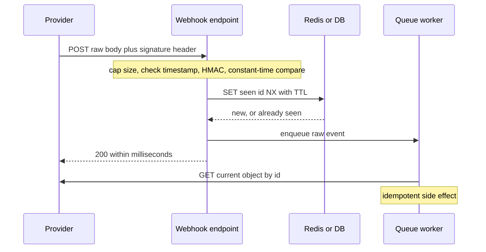

## TL;DR
Anyone can POST to a webhook URL, so providers sign each delivery with an HMAC-SHA256 over a timestamp
and the raw body. Verify in constant time, bound replays with a timestamp window and event-id dedupe,
and keep the handler idempotent: providers retry.

## Why it exists
- **The endpoint is public.** `POST /webhooks/payments` is reachable from every machine on the internet.
  Trust the body and an attacker sends `{"type": "payment.succeeded", "customer": "them"}` and gets the
  product for free.
- **AI systems raise the stakes.** An agent platform receiving Slack events will execute instructions from
  anyone who can craft a request: prompt injection with a delivery mechanism. A pipeline waiting for a
  "batch job finished" event will ingest a forged result.
- **Plain HTTP does not identify the sender.** TLS authenticates your server to the sender, not the
  sender to you.
- **The naive defences fail.** A secret URL is a bearer token that leaks through access logs, proxies,
  browser history and support-ticket screenshots, and rotating it touches every integration. IP
  allowlists break on large, changing cloud ranges and ingress that rewrites source addresses. A
  `"source": "billing"` field is written by whoever sends the JSON.
- **What remains is a MAC.** Mutual TLS would settle it, but few SaaS providers offer it for webhooks. A
  shared secret used to compute a MAC over the exact bytes is cheap, verifiable offline, and proves the
  producer held the secret.
- **Signing stops forgery, not replay.** A captured delivery is still correctly signed next week, so
  "credit 100 units" can be resent at will. Providers also redeliver on any non-2xx or timeout, so
  duplicates are normal operation. A signed timestamp bounds the window, an event id bounds duplicates
  inside it, and an idempotent handler makes the rest harmless.

## How it works
### What the provider signs
- **Each endpoint gets its own secret.** Stripe calls it a signing secret; GitHub a webhook secret you
  type into the settings page.
- **On delivery** the provider computes `HMAC-SHA256(secret, signed_content)` and sends the result in a
  header. Schemes differ in what `signed_content` is:

| Provider or scheme | Signed content | Headers |
|---|---|---|
| Stripe | `"{timestamp}.{raw_body}"` | `Stripe-Signature: t=<unix>,v1=<hex>` |
| Standard Webhooks (Svix and several vendors) | `"{msg_id}.{timestamp}.{raw_body}"` | `webhook-id`, `webhook-timestamp`, `webhook-signature` |
| GitHub | the body alone, no timestamp | `X-Hub-Signature-256: sha256=<hex>`, plus a separate `X-GitHub-Delivery` id |
| Slack | `"v0:{timestamp}:{raw_body}"` | `X-Slack-Signature` |

- **The common core:** an HMAC with a per-endpoint secret over raw bytes.
- **An HMAC, not a bare hash**, *because* a hash of public bytes can be computed by anyone.
- **In a header, not the body**, *because* the body is the thing being authenticated.
- **Some providers sign asymmetrically** with a published public key, which lets many parties verify
  without any of them being able to forge.

### Verifying, in order
1. **Read the raw body bytes before any framework parses them.** Re-serialising parsed JSON changes
   whitespace, key order, float formatting and unicode escaping, so the MAC will not match. Cap the body
   size at the edge first, since an unauthenticated sender can otherwise make you buffer and hash
   arbitrarily large payloads.
2. **Parse the header** into a timestamp and one or more signatures; reject anything malformed.
3. **Check `|now − timestamp| ≤ tolerance`.** A few minutes (Stripe's libraries default to 300 seconds),
   not zero, *because* clocks drift and deliveries queue.
4. **Recompute the MAC and compare with `hmac.compare_digest`, never `==`.** An ordinary comparison
   returns at the first differing byte, so response time leaks how many leading bytes of a guess were
   right; a constant-time compare removes that side channel.
5. **Accept if *any* supplied signature matches**, because during secret rotation providers send one
   signature per active secret.
6. **Only now parse the JSON** and dispatch on the event type.

### Replay protection
- **The timestamp helps only because it is signed.** An attacker who edits it breaks the MAC.
- **No signed timestamp, no replay bound.** An unsigned timestamp header, or none at all (GitHub's
  scheme), means dedupe by delivery id is the only replay defence, and its retention must be long.
- **A signed window is still enough for a double credit.** It turns "valid forever" into "valid for five
  minutes", so also deduplicate by event id: `SET webhook:seen:{id} 1 NX EX <ttl>` in Redis, or an insert
  into a `processed_events(event_id UNIQUE)` table.
- **Retention covers the retry horizon (often days)**, not just the tolerance window, *because*
  legitimate retries arrive later with the same id.
- **Check whether retries are re-signed** with a fresh timestamp; if not, the tolerance must cover the
  provider's retry schedule too.

| Dedupe store | Guarantee | Failure mode |
|---|---|---|
| Uniqueness insert in the same DB transaction as the side effect | both commit or neither; a crash between "seen" and "credited" cannot lose an event | a write per event |
| Redis flag set before the work | one cheap command | can mark an event seen that then fails: the exactly-once limitation |

- **The cure for the remainder:** an idempotent handler plus periodic reconciliation against the
  provider's API.

### Acknowledge fast, process later, trust the API over the payload
- **Providers are impatient.** They time out deliveries after seconds to tens of seconds, retry any
  non-2xx with backoff over hours or days, and may disable an endpoint that keeps failing.
- **So:** verify, dedupe, enqueue the raw event, return 200, and let a worker do the real work.
- **Deliveries are unordered and payloads can be stale** (a `completed` can arrive before `started`).
  For anything that moves money or grants access, fetch the current object from the provider's
  authenticated API by id and act on that.
- **"Thin" webhooks** that carry only ids make this pattern the default.

### Secrets
- **Store it in your secret manager, per endpoint, never in code.**
- **It is symmetric:** anyone holding it can forge deliveries, so never share one secret across services
  or environments.
- **Rotate with an overlap window** during which both old and new secrets are accepted.

## Diagram
Verification and dedupe happen before any work, the provider gets its 200 at once, and the worker acts
on the provider's current object rather than the payload.



## Examples
### FastAPI receiver for a Stripe-style scheme
Raw-body HMAC, timestamp tolerance, multiple signatures for rotation, constant-time compare, Redis
dedupe keyed by event id with retention longer than the tolerance, and a queue hand-off so the provider
gets its 200 in milliseconds. Test it with three fixtures: a recorded good delivery, the same body with
one byte changed, and the same delivery twice.

```python
import hashlib, hmac, json, os, time
from fastapi import FastAPI, HTTPException, Request
import redis.asyncio as redis

app = FastAPI()
SECRET = os.environ["WEBHOOK_SIGNING_SECRET"].encode()   # per-endpoint secret from the secret manager
TOLERANCE_S = 300                                        # clock skew + delivery delay we accept
SEEN_TTL_S = 3 * 24 * 3600                               # must cover the provider's retry horizon
r = redis.from_url(os.environ["REDIS_URL"])

def verify(raw: bytes, header: str) -> None:
    # Stripe-style header: "t=<unix>,v1=<hex>[,v1=<hex>]"; two v1 values appear during secret rotation
    fields = [p.split("=", 1) for p in header.split(",") if "=" in p]
    ts = next((v for k, v in fields if k == "t"), None)
    sigs = [v for k, v in fields if k == "v1"]
    if ts is None or not ts.isdigit() or not sigs:
        raise HTTPException(400, "malformed signature header")
    if abs(time.time() - int(ts)) > TOLERANCE_S:
        raise HTTPException(400, "timestamp outside tolerance")        # bounds replay to a short window
    expected = hmac.new(SECRET, f"{ts}.".encode() + raw, hashlib.sha256).hexdigest()
    # constant-time compare on bytes: compare_digest raises TypeError on non-ASCII str input
    if not any(hmac.compare_digest(expected.encode(), s.encode()) for s in sigs):
        raise HTTPException(400, "bad signature")

@app.post("/webhooks/provider")
async def receive(request: Request):
    raw = await request.body()                     # the exact bytes that were signed, never re-serialised JSON
    verify(raw, request.headers.get("Provider-Signature", ""))
    event_id = json.loads(raw).get("id")
    if not event_id:
        raise HTTPException(400, "missing event id")
    key = f"webhook:seen:{event_id}"
    if not await r.set(key, 1, nx=True, ex=SEEN_TTL_S):
        return {"status": "duplicate"}             # 2xx: a retry or a replay, either way do nothing again
    try:
        await r.lpush("webhook:inbox", raw)        # ack fast; a worker fetches the object by id and acts
    except Exception:
        await r.delete(key)                        # un-mark so the provider's retry is not dropped
        raise
    return {"status": "queued"}
```

### The fixtures, runnable with the standard library
A self-contained version of the same checks, run against a good delivery, a tampered body, a retry, a
replay a week later, and a delivery signed during secret rotation.

```python
import hashlib, hmac

def sign(secret: bytes, ts: int, raw: bytes) -> str:
    return hmac.new(secret, f"{ts}.".encode() + raw, hashlib.sha256).hexdigest()

def check(secrets: list[bytes], raw: bytes, header: str, seen: set, now: float, tol: int = 300) -> str:
    fields = [p.split("=", 1) for p in header.split(",") if "=" in p]
    ts = next((v for k, v in fields if k == "t"), None)
    sigs = [v for k, v in fields if k == "v1"]
    if ts is None or not ts.isdigit() or not sigs:
        return "400 malformed"
    if abs(now - int(ts)) > tol:
        return "400 stale"
    ok = any(hmac.compare_digest(sign(s, int(ts), raw).encode(), sig.encode())
             for s in secrets for sig in sigs)            # any active secret, any supplied signature
    if not ok:
        return "400 bad signature"
    if raw in seen:                                       # stand-in for dedupe by event id
        return "200 duplicate"
    seen.add(raw)
    return "200 queued"

old, new = b"whsec_old", b"whsec_new"
body, now, seen = b'{"id":"evt_1","type":"payment.succeeded"}', 1_760_000_000, set()
good = f"t={now},v1={sign(old, now, body)}"
print(check([old], body, good, seen, now))                         # 200 queued
print(check([old], body.replace(b"1", b"2"), good, seen, now))     # 400 bad signature (one byte changed)
print(check([old], body, good, seen, now + 60))                    # 200 duplicate (retry or replay)
print(check([old], body, good, seen, now + 7 * 86400))             # 400 stale (replayed a week later)
rot = f"t={now},v1={sign(old, now, body)},v1={sign(new, now, body)}"
print(check([new], body, rot, set(), now))                         # 200 queued (rotation overlap)
```

### Worked scenario: which check stops which attack
Tolerance 300 seconds, dedupe retention 3 days, provider retries for up to a few days.

| Incoming request | Signature | Timestamp window | Event-id dedupe | Result |
|---|---|---|---|---|
| Forged body, no secret | fails | | | 400 |
| Real delivery, one byte edited | fails | | | 400 |
| Real delivery replayed after a week | valid | fails | | 400 |
| Real delivery replayed after 2 minutes | valid | passes | seen | 2xx, no side effect |
| Provider retry after a timeout | valid (re-signed) | passes | seen | 2xx, no side effect |
| Retry after 4 days, beyond retention | valid | passes | expired | processed again: only an idempotent handler saves you |

## Production patterns
- **Verify in a dedicated dependency on raw bytes.** Read `await request.body()` before any JSON parsing,
  cap the body size at the proxy, and use the provider's official verification helper when one exists.
  Monitor the verification-failure rate per provider; anything above zero is an attack or a
  misconfiguration.
- **Transactional dedupe for money and access.** Insert into `processed_events(event_id UNIQUE)` with
  `INSERT ... ON CONFLICT (event_id) DO NOTHING` inside the same transaction as the side effect, and skip
  when no row was inserted. Monitor the duplicate rate; a spike usually means slow acks.
- **Ack-then-queue with a dead-letter queue.** Return 200 after verify, dedupe and enqueue, and let workers
  retry with a dead-letter queue for poison events. Monitor processing lag, DLQ depth and provider-side
  delivery failures in the provider's dashboard.
- **Overlapped secret rotation.** Keep a list of active secrets per endpoint in the secret manager, accept
  a match from any of them, roll the provider to the new secret, then retire the old one after the overlap.
  Watch for a burst of signature failures during the switch.
- **Scheduled reconciliation.** Periodically list recent objects from the provider's API and compare with
  what you processed, to catch dropped or expired-dedupe events. Track the count of discrepancies found
  per run.

## Trade-offs
- **Shared-secret HMAC vs asymmetric signatures.** HMAC is simple, fast and verifiable offline, but every
  holder can forge; asymmetric signatures win when many parties must verify or the verifier must never be
  able to sign.
- **Tight vs wide tolerance.** A tight window shrinks replay exposure, but clock skew and queued
  deliveries cause false rejections and more retries; widen it when the provider does not re-sign retries
  and lean on id deduplication instead.
- **Redis TTL vs a unique constraint.** Redis dedupe is one cheap command but not transactional with your
  side effect; a unique constraint in the same transaction costs a write per event and buys a real
  effectively-once guarantee.
- **Immediate ack vs visible completion.** Acknowledging immediately frees you from provider timeouts, but
  a 200 no longer means "done", so monitoring, dead-lettering and reconciliation move to the queue.
- **Fetching the object vs API cost.** Fetching the authoritative object on every event defeats stale and
  out-of-order payloads, but adds an API call per event, subject to the provider's rate limits.

## Pitfalls
- **Verifying over re-serialised JSON.** Symptom: signatures fail only for some payloads (non-ASCII text,
  floats, nested key order) while every local test passes.
- **Comparing signatures with `==`.** There is no functional symptom, which is exactly the danger; it
  surfaces only in a pentest or security review.
- **Checking the signature but neither timestamp nor event id.** Symptom: double side effects (two credits,
  two emails) whenever the provider retries, and silent replayability.
- **A gateway, body-parsing middleware or compression layer rewriting the body.** Symptom: every signature
  fails after a deployment that changed nothing in your code.
- **Doing the work inline and returning 200 at the end.** Symptom: provider-side timeouts, escalating
  retries and duplicate processing under load, sometimes ending with the endpoint disabled.
- **Assuming ordered delivery.** Symptom: a record stuck in `started` because a late `started` event
  overwrote `completed`.
- **Rotating the secret without an overlap.** Symptom: a burst of 400s and missed events during the switch.
- **Logging full headers and bodies.** Symptom: signatures, tokens and customer data sit in the log
  platform for anyone with search access.

## When to use
- **Every inbound webhook, without exception**, including your own services' events whenever they cross a
  trust boundary; the cost is a few lines, the failure mode is an attacker driving your business logic.
- **If a sender cannot sign**, require at least a secret header, and prefer polling the provider's API for
  state over trusting pushes.
- **Measure** the verification-failure rate (anything above zero is an attack or a misconfiguration), the
  duplicate rate, the distribution of timestamp age, and processing lag.
- **Interviews:** "how would you secure a webhook endpoint" is standard; walk raw-body HMAC, constant-time
  compare, timestamp window, id dedupe, idempotent handler, ack-then-queue and fetching the authoritative
  object, and say why each exists.

## Role lens
- **Engineer:** Writes the verification middleware on raw bytes, the dedupe and queue hand-off, and the
  three fixtures (good, tampered, duplicated) that keep it honest in CI.
- **Architect:** Defines the trust boundary for inbound events: which may trigger side effects, where the
  idempotency store lives, the retry horizon, and who owns and rotates each secret.
- **FDE:** Wires customer systems (Slack, GitHub, Salesforce, an in-house ERP) to the agent, checks each
  one's signing scheme, and agrees how secrets are exchanged and rotated inside the customer's security
  process.

## Check yourself
**Q:** A colleague says the billing webhook is already secure: it lives at a long random URL, the
handler checks that the JSON contains `"source": "billing"`, and the site is HTTPS-only. Explain what
each measure misses and what you would implement instead.
**A:** The random URL is a bearer secret that leaks through access logs, proxies and screenshots and
cannot be rotated without touching every integration. The `source` field is part of the body the
attacker writes. HTTPS encrypts in transit and proves your identity to the sender; it says nothing
about who sent the request. Instead: verify an HMAC-SHA256 over the timestamp and the raw body using a
per-endpoint secret from the secret manager, compare in constant time, reject timestamps older than a
few minutes, deduplicate on event id with retention covering the provider's retry schedule, make the
handler idempotent, return 200 quickly and process from a queue, and for anything that grants value,
fetch the current object from the billing API by id before acting.

## Interview questions
### Why is the timestamp included inside the signed content rather than sent as its own header?
- **Binding:** if the timestamp is part of the MAC input, an attacker who changes it to look fresh breaks
  the signature.
- **Unsigned is useless:** a separate, unsigned timestamp can be rewritten on a replayed request, so it
  bounds nothing.
- **Without one** (GitHub's scheme), deduplication by delivery id with long retention is the only replay
  defence.

### After a deploy, every webhook signature fails, but the secret did not change. How do you debug it?
- **Suspect the bytes:** new body-parsing middleware, a gateway transformation or a compression layer is
  changing the body before verification.
- **Confirm:** log a hash and length of the raw body at the edge and in the handler for one delivery, and
  compare with the provider's dashboard.
- **Also check** that the header name and the secret's environment variable still match after the deploy,
  and that the server clock has not drifted outside the tolerance.

### Redis `SET NX` or a unique constraint in the database: which do you use for webhook dedupe?
- **Redis** is one cheap command with a TTL, fine for low-stakes events, but it is not transactional with
  the side effect and can mark an event seen that then fails.
- **A unique insert in the same transaction** as the side effect costs a write per event and guarantees
  both commit or neither.
- **For money or access**, use the transaction, plus an idempotent handler and reconciliation for what
  slips past retention.

### How long should dedupe records live, and what happens if they expire too early?
- **Retention covers the provider's retry horizon**, often days, not the few-minute tolerance window,
  because legitimate retries carry the same id later.
- **Too short:** a late retry is processed again, producing double side effects unless the handler is
  idempotent.
- **Size it** from the provider's documented retry schedule, and monitor the age of duplicates you see.

### Why acknowledge immediately and process in a worker instead of doing the work in the handler?
- **Provider timeouts:** deliveries time out after seconds to tens of seconds, and a slow handler causes
  retries, duplicates and possibly a disabled endpoint.
- **Ordering and freshness:** the worker can fetch the current object by id, which handles out-of-order
  and stale payloads.
- **Cost:** a 200 no longer means "done", so you need queue monitoring, a dead-letter queue and
  reconciliation.

## Quiz
### Q: Why must the HMAC be computed over the raw request bytes rather than over the parsed JSON object?
- [ ] Parsing JSON is too slow to do before authentication
- [x] Serialisation is not canonical, so re-encoded JSON can differ byte for byte from what the provider signed
- [ ] Raw bytes include the headers, which are part of the signature
- [ ] JSON objects cannot be hashed because they are unordered
> The provider signed a specific byte sequence. Whitespace, key order, escaping and number formatting
> can all change on a parse-and-dump round trip, producing a different MAC even though the data is
> "the same".

### Q: A delivery arrives with a valid signature and a timestamp two minutes old, but its event id is already in your seen-set. What should the handler do?
- [ ] Return 400 so the provider stops sending it
- [ ] Process it again, because the signature proves it is genuine
- [x] Return 2xx without running the side effect again
- [ ] Return 500 so the provider retries later with a fresh timestamp
> Whether it is a provider retry or an attacker's replay, the right action is the same: acknowledge and
> do nothing. A non-2xx would only trigger more retries of an event you have already handled.

### Q: What does a constant-time comparison such as `hmac.compare_digest` protect against that `==` does not?
- [ ] SHA-256 hash collisions
- [ ] Length-extension attacks on the hash
- [x] A timing side channel where early exit reveals how many leading bytes of the guess were correct
- [ ] Replay of a previously valid signature
> Ordinary string comparison stops at the first mismatch, so response time correlates with the number
> of correct leading bytes. Length-extension is already prevented by HMAC's construction, and replay is
> handled by timestamps and ids, not by the comparison.
