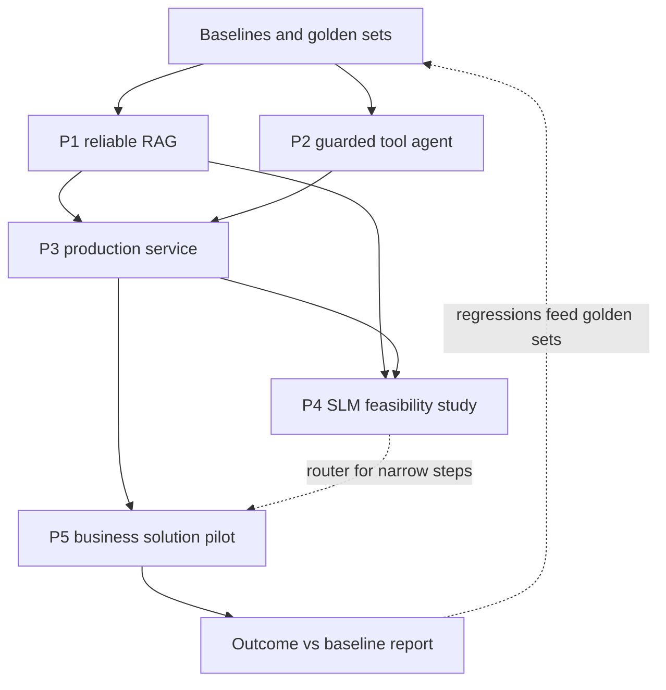

## Overview
This module is where the course stops being a set of topics and becomes a body of work you can show.
It has five projects, and each one grows across the course in six milestones. Each milestone is
labelled with the module it follows, such as "after rag-retrieval" or "after deployment".

The five projects build on each other:

- **Project 1, reliable RAG application:** retrieval that finds the right chunks, cites them, refuses when the answer is absent, and proves all three with a golden set rerun in CI.
- **Project 2, tool-using agent with guardrails:** a small toolset where every call is validated, permitted, time-boxed, retried safely, logged and, if risky, approved by a person.
- **Project 3, production AI service:** the Project 1 or 2 core wrapped in an authenticated, persistent, observable, cost-tracked service with CI and a rollback path.
- **Project 4, SLM feasibility study:** one narrow agent subtask measured across a rules baseline, a large hosted model and small models, ending in a written decision.
- **Project 5, end-to-end business solution:** one real workflow taken from measured baseline to pilot, with the business outcome reported against that baseline.

How it connects to the rest of the course:

- Projects 1 and 4 reuse what you learned in evals and rag-retrieval; the golden-set harness from Project 1 is the same one Project 4 runs.
- Project 2 applies agents, agent-reliability, observability and safety-security.
- Project 3 applies fastapi-for-ai, serving-inference, llmops-platform and deployment.
- Project 5 applies scoping, enterprise-integration, deployment and adoption, and reuses everything from Projects 1-3.

Afterwards you can:

- Show a working system with numbers instead of a demo.
- Prove each guardrail with a failing test.
- Defend a model choice with quality, latency and cost.
- Tie a technical build to a metric a business owner signed.

## Why it matters
- **Engineer:** You write the ingest pipeline, the hardened dispatcher, the API with one error envelope, the eval harness and the CI gate, and each project makes you prove behaviour with a test or a number rather than a screenshot.
- **Architect:** You choose the retrieval mix, the permission and approval model, the storage and tenancy design, the release gate and whether a small model can replace a large one, and you write those choices down with the evidence behind them.
- **FDE:** Customers want a pilot that moves a metric they own; Project 5 is that engagement in miniature, from baseline and signed metrics brief through failure testing and rollout to a business outcome report.

## Mental model
Think of the five projects as one system built in layers, where each layer must be measured before
the next one is trusted.

- **Evidence first.** Every project starts with a measurement: a golden set (Project 1), malformed-call tests (Project 2), envelope tests (Project 3), a rules baseline (Project 4) or a baseline table from real records (Project 5). Nothing is "better" until it beats that number.
- **Capability layer.** Retrieval (Project 1) and guarded tools (Project 2) are what the agent can do. Retrieval is the tool agents call most, so its recall caps everything above it.
- **Service layer.** Project 3 makes that capability something others can depend on: auth, storage, traces, cost per tenant, clean failures, deployment with rollback.
- **Optimisation layer.** Project 4 asks whether one narrow step can move to a small model without losing quality, and the router lives in front of the service's model calls.
- **Outcome layer.** Project 5 puts the stack into one real workflow with a human work queue and reports hours saved, errors avoided or cycle time against the baseline.

The milestones interleave with the course modules, so you advance each project as you finish the
module it depends on rather than building it all at the end.

## Suggested order
1. project-1-reliable-rag-application — start here: its ingest, golden set and eval harness are reused by every later project, and retrieval is the agent's most common tool.
2. project-2-tool-using-agent-with-guardrails — adds actions on top of retrieval, with validation, limits, approval and logging enforced in code around each call.
3. project-3-production-ai-service — wraps the Project 1 or 2 core in a deployable service, which needs both projects' behaviour already tested.
4. project-4-slm-feasibility-study — reuses Project 1's harness and Project 3's service to decide whether a small model can take one narrow step.
5. project-5-end-to-end-business-solution — last because it integrates Projects 1-3 (and any SLM decision from Project 4) into one real workflow measured against a business baseline.

## Capstone
### Brief
This is the module's major project: assemble your five projects into one portfolio system and defend
it in a design review. Plan on about two weeks after the last milestone of Project 5.

**Use case:** the workflow you chose in Project 5, for example a support team answering policy
questions and issuing refunds. The agent retrieves from the Project 1 index, acts through the Project 2
dispatcher, runs inside the Project 3 service, and sends one narrow step (routing or argument
extraction) to a small model only if Project 4 said yes.

**Starting point:** five separate repositories or folders, each with its own eval scripts and numbers
measured at different times.

**Your job:**

- Wire them into one deployed service with one trace per request across retrieval, tools and models.
- Rerun every project's evaluation against the integrated system in one CI job.
- Run the pilot, then write a portfolio report that states each design decision, the evidence for it and what you would change.

### Deliverables
- One deployed service, with a README, that serves the Project 5 workflow end to end using the Project 1 retriever, Project 2 dispatcher and guardrails, and Project 3 auth, storage, tracing and rollback.
- A single CI pipeline that runs the RAG golden set, the guardrail test suite, the API envelope tests and the SLM routing eval on every change, and blocks the release when any gate fails.
- A model-routing decision record from Project 4 showing quality, latency and cost per candidate on the same golden set, and the router configuration that implements the decision (or the record of why it stays on the large model).
- A business outcome report comparing pilot results to the Project 5 baseline table, with the guardrail metric, the queries that recompute each number, and the workflow owner's sign-off.
- A 20-minute design review deck or document covering architecture, the failure scenarios tested and the three decisions you would revisit.

### Rubric
- One command or CI run reproduces every reported number (hit@5, recall@5, guardrail test pass count, envelope test pass count, SLM accuracy and p95 latency, outcome metrics) from committed code and data.
- A single request id retrieves the full trace across retrieval, each tool call with its permission decision, each model call with its cost, and the final response.
- Deliberately breaking one component (lowering retrieval top-k, removing an argument limit, or dropping a response field) makes the matching CI gate fail before deploy.
- An unanswerable question is refused with no citation, and a risky write action waits in the approval queue, both shown in the pilot's logs.
- The outcome report states the pilot metric and the guardrail metric next to the baseline with sample sizes, and every claim in the design review links to a measurement in the repository.
