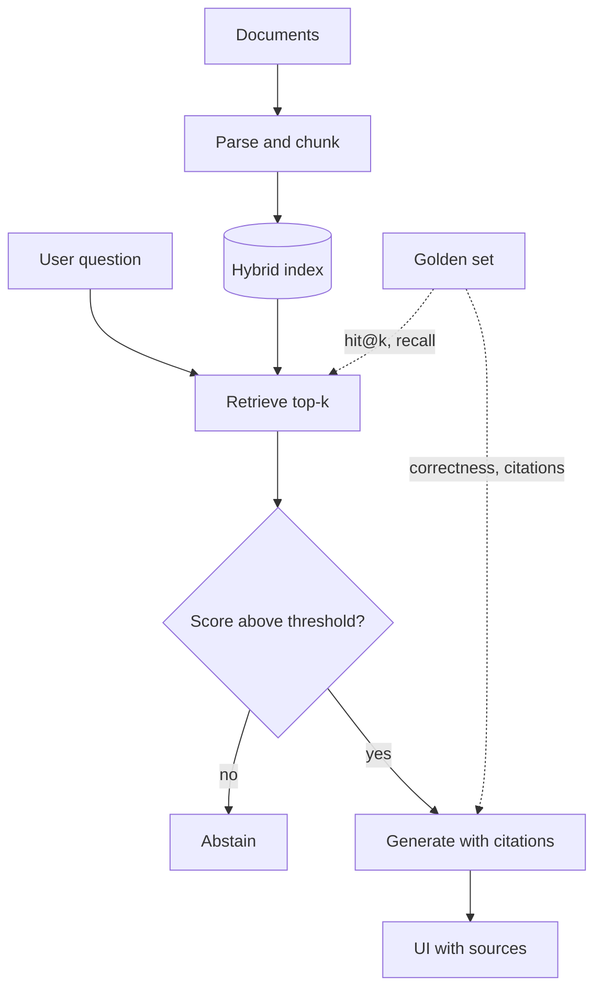

## TL;DR
Build a question-answering app over a real document set that retrieves the right chunks, cites them,
refuses when the answer is absent, and proves all three with a golden set you rerun on every change.

## For agent builders
- **Why it matters for agents.** Retrieval is the most common tool an agent calls. If search returns the
  wrong chunk, no planner or prompt can recover, so this project is the foundation for Projects 2 and 5.
- **Where it shows up in your stack.** A parser and chunker at ingest, a vector or hybrid index, a
  reranker, the generation prompt, and an eval harness that runs in CI.
- **What you control.** Chunk size and boundaries, the retrieval mix (dense, BM25, both), top-k, the
  abstention threshold, and what counts as a correct citation.
- **What you can skip.** Fine-tuning embeddings and GraphRAG. A well-chunked hybrid index with a measured
  recall number beats an exotic pipeline you cannot evaluate.

## Why it exists
- **Demos hide retrieval bugs.** A RAG demo answers the five questions its author tried. Real users ask
  the other 500, and most bad answers trace back to a chunk that was never retrieved.
- **Answer quality alone is ambiguous.** A wrong answer can come from parsing, chunking, retrieval or
  generation. Measuring retrieval (hit@k, recall) separately from answer correctness tells you which
  layer to fix.
- **Citations are the trust contract.** Users and auditors accept an answer when they can click through
  to the source. A citation that points at the wrong chunk is worse than none.
- **Abstention is a feature.** "I don't know from these documents" on out-of-scope questions prevents
  the confident fabrications that end pilots.
- **It compounds.** The ingestion code, golden set and eval harness you build here are reused by the
  agent in Project 2 and the service in Project 3.

## How it works
Pick one real corpus of 50-500 documents you can get questions for: product docs, an internal handbook
or public regulations. Each milestone below lists acceptance criteria you can run and the lessons it
draws on. Each runs after the module that unlocks it and after the milestone before it, so M1-M3 all
open once rag-retrieval is done.

### M1. Ingestion and chunking (after rag-retrieval)
- **Build:** parse PDFs and HTML to clean text, keep headings, assign stable chunk ids
  (`doc_id#offset`), store source URL and version per chunk.
- **Acceptance:** re-running ingestion yields identical chunk ids; 20 sampled chunks read as
  self-contained passages; tables and headings survive parsing.
- **Lessons:** `python-for-ai/json-jsonl`, `rag-retrieval/document-parsing`,
  `rag-retrieval/chunking-strategies`, `rag-retrieval/chunk-overlap`, `rag-retrieval/embedding-pipelines`.

### M2. Retrieval with a baseline number (after rag-retrieval)
- **Build:** BM25 first, then dense, then hybrid with reciprocal rank fusion, then a reranker if it pays.
- **Acceptance:** a golden set of at least 50 questions, each labelled with the chunk ids that answer
  it; hit@5 and recall@5 reported for every variant in one table.
- **Lessons:** `rag-retrieval/hybrid-search`, `rag-retrieval/reranking`, `rag-retrieval/metadata-filtering`,
  `evals/golden-dataset`.

### M3. Grounded generation (after rag-retrieval)
- **Build:** a prompt that answers only from supplied chunks, cites chunk ids inline, and abstains below
  a retrieval-score threshold or when chunks do not contain the answer.
- **Acceptance:** every factual sentence carries a citation; at least 10 out-of-scope questions in the
  golden set, and the app abstains on 90% or more of them.
- **Lessons:** `rag-retrieval/citations-grounding`, `rag-retrieval/lost-in-the-middle`,
  `prompting/structured-outputs-json-mode`, `prompting/context-engineering`.

### M4. Evaluation in CI (after evals)
- **Build:** one command that runs the golden set and prints retrieval metrics, answer correctness,
  citation correctness and abstention rate; CI fails if any drops past a set tolerance.
- **Acceptance:** a deliberately broken chunker makes CI fail; the judge (if you use one) agrees with
  your own labels on at least 90% of 30 or more hand-checked answers.
- **Lessons:** `evals/retrieval-evaluation`, `evals/faithfulness-groundedness`,
  `rag-retrieval/citation-correctness`, `evals/llm-as-a-judge`, `evals/regression-tests`.

### M5. Simple UI (after evals)
- **Build:** a FastAPI endpoint plus a single page: question box, streamed answer, numbered sources that
  open the cited passage.
- **Acceptance:** first token under 2 seconds on your hardware; every citation link opens the exact
  passage; a thumbs-down button stores the trace id.
- **Lessons:** `fastapi-for-ai/streamingresponse`, `fastapi-for-ai/server-sent-events`.

### M6. Tracing and failure review (after observability)
- **Build:** one trace per query with spans for retrieve, rerank and generate, logging chunk ids and scores.
- **Acceptance:** for any thumbs-down you can say within 5 minutes whether retrieval or generation failed;
  new failures are added to the golden set weekly.
- **Lessons:** `observability/tracing`, `rag-retrieval/retrieval-failure-diagnosis`, `evals/error-analysis`.

## Diagram
Follow a question down the left; the golden set on the right scores retrieval and the answer separately.



## Examples
### Starter skeleton: chunk, retrieve, cite, evaluate
Standard library only. The extractive `answer` stands in for the LLM call so the eval harness runs
offline; swap in your model once retrieval numbers are honest.

```python
import math, re
from collections import Counter

DOCS = {  # doc_id -> text; in the project this comes from your ingestion step
    "refund-policy": "Refunds are issued within 14 days of purchase. Digital goods are not refundable "
                     "once downloaded. Contact billing to start a refund.",
    "shipping": "Standard shipping takes 5 business days. Express shipping takes 2 business days "
                "and costs 15 dollars.",
    "security": "Passwords must be rotated every 90 days. Two-factor authentication is required for admins.",
}

def chunk(doc_id, text, size=12, overlap=4):          # word windows; swap for structure-aware chunking
    w = text.split()
    return [{"id": f"{doc_id}#{i}", "doc": doc_id, "text": " ".join(w[i:i + size])}
            for i in range(0, max(len(w) - overlap, 1), size - overlap)]

tok = lambda s: re.findall(r"[a-z0-9]+", s.lower())
CHUNKS = [c for d, t in DOCS.items() for c in chunk(d, t)]
DF = Counter(t for c in CHUNKS for t in set(tok(c["text"])))

def retrieve(q, k=2):                                   # BM25-lite; replace with hybrid search later
    def score(c):
        tf = Counter(tok(c["text"]))
        return sum(tf[t] * math.log(1 + len(CHUNKS) / DF[t]) for t in set(tok(q)) if t in tf)
    return [c for c in sorted(CHUNKS, key=score, reverse=True)[:k] if score(c) > 0]

def answer(q):                                          # stand-in for the LLM call: must cite or abstain
    hits = retrieve(q)
    if not hits:
        return {"answer": "I don't know from the provided documents.", "citations": []}
    return {"answer": hits[0]["text"], "citations": [h["id"] for h in hits]}

GOLDEN = [  # question, doc that must be retrieved, phrase the answer must contain (None = must abstain)
    ("How long do refunds take?", "refund-policy", "14 days"),
    ("How much does express shipping cost?", "shipping", "15 dollars"),
    ("How often must passwords rotate?", "security", "90 days"),
    ("What is the CEO's salary?", None, None),
]
rows = []
for q, doc, must in GOLDEN:
    out = answer(q)
    docs = {c.split("#")[0] for c in out["citations"]}
    rows.append((doc is None or doc in docs,                       # retrieval hit@2
                 (must is None and not out["citations"]) or (must is not None and must in out["answer"])))
print(f"chunks={len(CHUNKS)} hit@2={sum(r[0] for r in rows)}/{len(rows)} "
      f"answer_correct={sum(r[1] for r in rows)}/{len(rows)}")
for (q, *_), (hit, ok) in zip(GOLDEN, rows):
    print(f"{'PASS' if hit and ok else 'FAIL'}  {q}")
```

Run on Python 3.9, it prints `chunks=7 hit@2=4/4 answer_correct=2/4`. The two failures are the lesson:
- **Express shipping.** The right document is found, but "costs 15 dollars" sits in the next chunk and
  "cost" does not match "costs", so only the first chunk is retrieved.
- **CEO salary.** The common word "is" matches the security chunk, so the app cites it instead of abstaining.
- **Takeaway.** Retrieval hit@k looked perfect while answers were wrong; you need both metrics. The
  out-of-scope row has no gold document, so it counts as a hit by definition; score it on abstention.

### Evaluation table to fill per variant
Keep one row per configuration in the repo and update it on every change. Targets are illustrative
starting points; set yours from the first honest baseline.

| Metric | What it catches | How measured | Illustrative target |
|---|---|---|---|
| hit@5 | right chunk never retrieved | labelled chunk ids in top 5 | 0.90+ |
| recall@5 | multi-chunk answers half found | share of labelled chunks in top 5 | 0.80+ |
| Answer correctness | wrong or incomplete answer | exact phrase or judge vs reference | 0.85+ |
| Citation correctness | cited chunk does not support claim | judge or human per cited sentence | 0.95+ |
| Abstention rate | fabrication on out-of-scope questions | share of no-answer questions refused | 0.90+ |
| p95 latency | slow reranker or long context | trace timings | under 4 s |

## Production patterns
- **Version the index with the eval.** Store chunker settings, embedding model and index build id next to
  the eval results, so a recall drop maps to one change. Monitor recall@5 per build.
- **Golden set grows from failures.** Every thumbs-down that turns out to be a real miss becomes a
  labelled question. Monitor golden set size and the share drawn from production.
- **Threshold abstention, then LLM abstention.** Refuse when the top retrieval score is below a tuned
  cutoff, and also instruct the model to refuse when chunks lack the answer. Monitor abstention rate on
  in-scope questions, which should stay low.
- **Hybrid by default.** BM25 catches exact identifiers and codes that dense embeddings blur; fuse both
  with reciprocal rank fusion. Monitor which retriever contributed the cited chunk.
- **Cite ids, render titles.** The model cites `doc#offset` ids that you validate against the retrieved
  set before rendering; unknown ids are stripped and logged. Monitor invalid-citation rate.

## Trade-offs
- **Small chunks vs context.** Small chunks rank precisely but split facts across boundaries, as the
  example shows; larger chunks or parent-document retrieval keep facts whole at higher token cost.
- **Reranker quality vs latency.** A cross-encoder often lifts precision but adds a model call per query;
  it flips to not worth it when hit@5 is already high and latency budgets are tight.
- **LLM judge vs human labels.** A judge scales to thousands of answers but drifts and has biases;
  calibrate it against human labels before trusting it in a CI gate.
- **Strict abstention vs helpfulness.** A high threshold stops fabrications but refuses answerable
  questions; tune it on both in-scope and out-of-scope sets.

## Pitfalls
- **Evaluating only end-to-end answers.** Symptom: answer quality drops and nobody knows why. Diagnose:
  compute hit@k on the failed questions; if the right chunk was absent, it is a retrieval bug. Fix: report
  retrieval and answer metrics side by side.
- **Unstable chunk ids.** Symptom: golden labels silently stop matching after re-ingestion and recall
  falls to near zero. Diagnose: diff chunk ids between two ingestion runs of unchanged documents. Fix:
  derive ids from document id plus offset or content hash.
- **Golden set written by the builder from the docs.** Symptom: 95% offline, complaints online. Diagnose:
  compare question length and vocabulary in the golden set with real logged queries. Fix: source
  questions from users or SMEs and add production misses.
- **Stale or deleted documents still retrieved.** Symptom: answers cite superseded policy. Diagnose:
  query the index for chunks whose document version is not the latest. Fix: delete by document id on
  update and test deletion in CI.

## When to use
- **Use when:** the answer lives in documents you control and users need to verify it, such as support,
  policy, internal knowledge or compliance questions.
- **Avoid when:** the corpus fits in the context window and changes rarely; long-context prompting is
  simpler until cost or latency says otherwise.
- **Measure:** hit@5, answer correctness, citation correctness and abstention rate on every change.
- **Interviews:** this is the project to walk through when asked "how do you know your RAG works?".

## Exercise
**Goal:** complete M1 and the measurement half of M2 on your own corpus, with no generation yet.
- **Inputs:** 50-500 real documents and at least 50 questions, 10 of which the corpus cannot answer.
- **Constraints:** chunk ids must be stable across runs; BM25 only for now; no LLM calls.
- **Deliver:** an `ingest` command, a golden set file mapping each question to answering chunk ids (or
  none), and a script printing hit@5 and recall@5.
- **Acceptance:** two ingestion runs produce identical chunk id sets; the eval script runs in under a
  minute; for the three worst misses you record whether the answer was split, ranked below 5 or absent.
- **Acceptance (stretch):** change chunk size once and report both rows in the evaluation table.

## Role lens
- **Engineer:** Builds the ingestion, retrieval and eval pipeline, and owns the golden set and the CI
  gate that keeps recall from regressing silently.
- **Architect:** Chooses the index, chunking policy and abstention design, and decides which metrics
  gate a release and who labels the golden set.
- **FDE:** Sources real questions from the customer, sets the abstention behaviour with them, and shows
  retrieval and citation numbers instead of a demo.

## Check yourself
**Q:** Your RAG app scores hit@5 = 0.95 but answer correctness is only 0.70. Where do you look first,
and what would you change?
**A:** Retrieval is mostly finding the right chunks, so the gap is in what happens after retrieval.
Inspect failed answers whose correct chunk was in the top 5: is the fact split across two chunks so only
part reaches the prompt, is it buried mid-context, or does the model ignore or misread it? Fixes follow
the cause: larger chunks or parent-document retrieval for split facts, reranking and fewer chunks for
buried ones, and prompt or model changes for misreads. Also check the correctness metric itself, since a
strict phrase match can mark correct paraphrases wrong.

## Interview questions
### How do you separate retrieval failures from generation failures in a RAG system?
- **Label chunks, not only answers.** Each golden question lists the chunk ids that answer it, so
  hit@k and recall@k measure retrieval on its own.
- **Then read answers given perfect retrieval.** Failures where the right chunk was present are
  generation or context-assembly problems.
- **Trace every query** with retrieved ids and scores so production misses can be classified the same way.

### Walk me through how you built your golden set.
- **Sources:** real user questions or SME-written ones, not questions the builder wrote while reading
  the docs, plus out-of-scope questions to test abstention.
- **Labels:** answering chunk ids and a short reference answer, reviewed by a second person on a sample.
- **Upkeep:** production misses added weekly; the set is versioned with the index build.

### When would you not use RAG for a knowledge assistant?
- **Small, stable corpus.** If everything fits in context and rarely changes, long-context prompting
  with caching is simpler and avoids retrieval misses entirely.
- **Answers need computation.** Questions over tables or metrics are better served by a SQL or API tool
  than by retrieving text chunks.

### Your agent uses this RAG system as a tool. What contract should the tool return?
- **Chunk ids, text, scores and source metadata,** so the agent can cite, decide whether to search again
  with a rewritten query, or stop.
- **An explicit empty result** below the score threshold rather than weak matches, because agents tend to
  trust whatever a tool returns.
- **Bounded size,** for example top 5 chunks under a token budget, so one search cannot flood the context.

### What numbers would you put in a release gate?
- **Retrieval:** recall@5 must not drop more than an agreed tolerance versus the last release.
- **Answers:** correctness, citation correctness and abstention rate on out-of-scope questions, each with
  a floor.
- **Operations:** p95 latency and cost per query, so a better but much slower reranker is a visible decision.

## Quiz
### Q: hit@5 is perfect but several answers are still wrong. What does this most directly suggest?
- [ ] The embedding model must be replaced
- [x] The failure is after retrieval: context assembly, split facts or generation
- [ ] The golden set has too many questions
- [ ] BM25 should be removed from the hybrid mix
> When the labelled chunk is already in the top 5, retrieval did its job. Look at how chunks reach the
> prompt and how the model uses them, including facts split across chunk boundaries.

### Q: Why should a RAG app have out-of-scope questions in its golden set?
- [ ] To increase the dataset size cheaply
- [ ] To test the reranker's latency
- [x] To measure whether the app abstains instead of fabricating an answer
- [ ] To train the embedding model on negatives
> Without questions the corpus cannot answer, you never measure abstention, and confident fabrication on
> such questions is one of the fastest ways to lose user trust.

### Q: What makes citations verifiable in a production RAG app?
- [ ] Asking the model to name the document title in prose
- [x] Citing stable chunk ids that are validated against the retrieved set before rendering
- [ ] Showing all retrieved chunks under every answer
- [ ] Using a larger context window
> Stable ids let the UI open the exact passage and let you check each citation was actually retrieved.
> Free-text titles cannot be validated and drift when documents are renamed.

## Mastery test
**Problem:** the same app must now serve two departments from one index, and HR documents must never be
retrieved for, or cited to, engineering users. Documents also change daily. Adapt the design and the
evaluation.

**A strong answer:**
- adds an access-control field per chunk at ingestion and filters at retrieval time, before ranking,
  never only in the UI or the prompt, and keys any answer or retrieval cache by role so it cannot leak;
- adds golden questions per role, including HR questions asked by an engineering user that must abstain,
  and treats any leak as a release-blocking failure, not a percentage;
- handles daily change with delete-by-document-id on update, re-embedding only changed documents, and a
  freshness check that no superseded version is retrievable;
- notes that filtering shrinks the candidate pool, so recall is re-measured per role.

## Use cases & projects
### Use cases
- **Support knowledge assistant.** Agents and customers ask product questions and click through to the
  exact help-centre passage.
- **Policy and compliance lookup.** Answers must cite the clause, and abstention beats a guess.
- **Retrieval tool for an agent.** The same pipeline becomes the `search_docs` tool in Project 2.
- **Onboarding assistant.** New hires query an internal handbook that changes every week.

### Mini project
**Hybrid versus BM25 on your golden set (2 hours).**
- **Goal:** decide with numbers whether dense retrieval earns its place on your corpus.
- **Steps:** embed your chunks with one open embedding model; run BM25, dense and reciprocal-rank-fused
  hybrid over the golden set; record hit@5, recall@5 and p95 latency for each; read ten questions where
  the variants disagree.
- **Done when:** three rows are in the evaluation table and you can name the question types each
  retriever wins on, such as exact codes for BM25 and paraphrases for dense.
