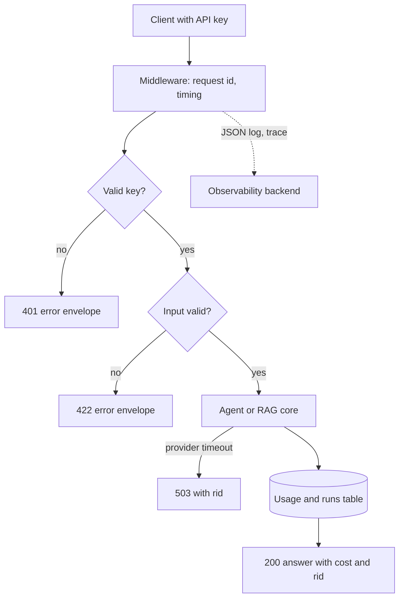

## TL;DR
Wrap the RAG app or agent from Projects 1-2 in a service others can depend on: authenticated, persistent,
observable, tested in CI, cost-tracked per tenant, failing cleanly, and deployed with a rollback path.

## For agent builders
- **Why it matters for agents.** An agent that works in a notebook is not a product. Teams adopt it when
  it has auth, a stable API, known cost per request and an on-call story.
- **Where it shows up in your stack.** FastAPI (or similar) in front of the agent, a database for runs
  and usage, a tracing backend, a CI pipeline and a container platform.
- **What you control.** The API contract and error envelope, who can call it, what is stored, which
  failures return 503 versus 500, cost attribution, and the release gate.
- **What you can skip.** Kubernetes and multi-region. One container on a managed platform with a health
  check and a database teaches every production concern here.

## Why it exists
- **Model calls fail differently from code.** Providers time out, rate-limit and return malformed output;
  a service must map those to clear errors instead of stack traces.
- **Cost is per request and unbounded.** A single tenant with long prompts can multiply your bill, so
  tokens and cost must be recorded per call and per tenant from day one.
- **Without traces, nobody can debug.** "The answer was wrong" is only actionable with a request id that
  links the input, retrieved context, model call and output.
- **Tests are the change-safety net.** Prompts, models and dependencies change weekly; unit, integration
  and eval tests in CI catch the regression before users do.
- **Deployment needs a way back.** A bad prompt or model version must be rolled back in minutes, which
  requires versioned releases and health checks.

## How it works
Reuse the core from Project 1 or 2 as a library; this project builds the service around it. Each
milestone lists acceptance checks and the lessons it draws on. M1 and M2 open early in the track, before
Projects 1-2 exist, so build them on a stubbed core like `fake_llm` below and swap the real one in later.

### M1. API contract (after fastapi-for-ai)
- **Build:** Pydantic request and response models with length limits, routers, and one JSON error
  envelope (`error`, `message`, `rid`) for every failure.
- **Acceptance:** OpenAPI docs render; an empty or oversized input returns 422; no endpoint returns an
  unhandled 500 in the test suite.
- **Lessons:** `fastapi-for-ai/pydantic-request-response-models`, `fastapi-for-ai/response-model`,
  `fastapi-for-ai/httpexception-handling`, `fastapi-for-ai/request-size-limits-and-upload-security`.

### M2. Auth, tenancy and storage (after fastapi-for-ai)
- **Build:** API keys (hashed at rest) or OAuth2/JWT mapped to a tenant; PostgreSQL tables for runs,
  messages and usage, created with migrations; every query scoped by tenant.
- **Acceptance:** a missing or wrong key returns 401; tenant A cannot read tenant B's runs (a test proves
  it); schema changes apply with one migration command.
- **Lessons:** `fastapi-for-ai/api-keys-oauth2-jwt`, `backend-fundamentals/authentication-vs-authorization`,
  `fastapi-for-ai/alembic-migrations`, `system-design/tenant-isolation`, `backend-fundamentals/secrets-management`.

### M3. Failure handling (after serving-inference)
- **Build:** timeouts on every provider call, bounded retries on 429 and 5xx, a circuit breaker or
  fallback model, and mapping of provider failures to 503 with a retry hint.
- **Acceptance:** with the provider stubbed to time out, the API returns 503 in under the configured
  timeout plus margin, and the error is logged with the request id.
- **Lessons:** `fastapi-for-ai/timeouts`, `serving-inference/retry-strategies`, `serving-inference/fallbacks`;
  architect track: `reliability/circuit-breakers`, `system-design/model-fallback-strategies`,
  `system-design/graceful-degradation`.

### M4. Observability and cost (after observability)
- **Build:** a request id on every request and response, structured JSON logs, OpenTelemetry spans for
  retrieval, model and tool calls, and a usage row per model call with tokens and computed cost.
- **Acceptance:** given a request id from a user complaint, you find its full trace in under 2 minutes;
  a daily query reports cost per tenant and per endpoint.
- **Lessons:** `fastapi-for-ai/structured-logging`, `fastapi-for-ai/opentelemetry-instrumentation`,
  `observability/token-cost-tracking`, `observability/latency-percentiles`, `infra-capacity-economics/cost-allocation-by-tenant-and-feature`.

### M5. Automated tests in CI (after llmops-platform)
- **Build:** unit tests with a stubbed model, integration tests against a real database container, and
  the Project 1 or 2 eval suite as a gate on prompt or model changes.
- **Acceptance:** CI blocks a merge that breaks auth, tenancy or the eval threshold; the stubbed suite
  runs in under 2 minutes.
- **Lessons:** `fastapi-for-ai/testclient-plus-pytest-asyncio`, `fastapi-for-ai/integration-tests-with-real-dependencies`,
  `llmops-platform/ci-cd-for-prompts-and-models`, `llmops-platform/evaluation-gates-for-production-releases`.

### M6. Deployment (after deployment)
- **Build:** a container image, config from environment variables, liveness and readiness endpoints,
  graceful shutdown, and a documented rollback to the previous image and prompt version.
- **Acceptance:** a deploy of a deliberately broken build is rolled back by following the runbook in
  under 10 minutes.
- **Lessons:** `backend-fundamentals/docker`, `fastapi-for-ai/health-readiness-endpoints`,
  `fastapi-for-ai/graceful-shutdown-and-worker-draining`, `deployment/rollout-criteria-and-rollback-triggers`,
  `deployment/runbooks`.

## Diagram
Each request passes auth, gets a request id, and leaves a log line and a usage row whether it succeeds
or fails.



## Examples
### Starter skeleton: auth, storage, request ids, cost and tests
Needs `pip install fastapi httpx pytest`. Tested with FastAPI 0.128.8, Starlette 0.49.3 and Python 3.9;
run with `python app.py` or `pytest app.py`. The in-memory SQLite and `fake_llm` are stand-ins.

```python
import json, logging, sqlite3, time, uuid
from fastapi import Depends, FastAPI, Header, HTTPException, Request
from fastapi.responses import JSONResponse
from pydantic import BaseModel, Field

logging.basicConfig(level=logging.INFO, format="%(message)s")
log = logging.getLogger("svc")
KEYS = {"test-key-1": "tenant-a"}                 # load hashed keys from a secrets store in real code
PRICE_PER_1K = {"in": 0.003, "out": 0.015}        # illustrative USD prices; read yours from the provider
db = sqlite3.connect(":memory:", check_same_thread=False)
db.execute("CREATE TABLE calls (id TEXT, tenant TEXT, tokens_in INT, tokens_out INT, cost REAL)")
app = FastAPI()

class Ask(BaseModel):
    question: str = Field(min_length=1, max_length=2000)

def tenant(x_api_key: str = Header(default="")):
    if x_api_key not in KEYS: raise HTTPException(401, "invalid api key")
    return KEYS[x_api_key]

def fake_llm(q):                                   # swap for the real client; keep the usage fields
    if "boom" in q: raise TimeoutError("provider timeout")
    return {"text": f"echo: {q}", "usage": {"in": len(q.split()) * 2, "out": 12}}

@app.middleware("http")
async def trace(request: Request, call_next):
    rid, t0 = request.headers.get("x-request-id", uuid.uuid4().hex), time.perf_counter()
    request.state.rid = rid
    resp = await call_next(request)
    log.info(json.dumps({"rid": rid, "path": request.url.path, "status": resp.status_code,
                         "ms": round((time.perf_counter() - t0) * 1000, 1)}))
    resp.headers["x-request-id"] = rid
    return resp

@app.exception_handler(TimeoutError)
async def upstream_timeout(request: Request, exc: TimeoutError):
    return JSONResponse(status_code=503, content={"error": "upstream_timeout", "rid": request.state.rid})

@app.post("/ask")
def ask(body: Ask, request: Request, t: str = Depends(tenant)):
    r = fake_llm(body.question)
    u = r["usage"]
    cost = u["in"] / 1000 * PRICE_PER_1K["in"] + u["out"] / 1000 * PRICE_PER_1K["out"]
    db.execute("INSERT INTO calls VALUES (?,?,?,?,?)", (request.state.rid, t, u["in"], u["out"], cost))
    db.commit()
    return {"answer": r["text"], "cost_usd": round(cost, 6), "rid": request.state.rid}

@app.get("/healthz")
def health(): return {"ok": True}

# ---- tests (pytest picks these up; run directly here for the demo)
from fastapi.testclient import TestClient
c = TestClient(app)
def test_auth():      assert c.post("/ask", json={"question": "hi"}).status_code == 401
def test_validation(): assert c.post("/ask", json={"question": ""}, headers={"x-api-key": "test-key-1"}).status_code == 422
def test_cost_row():
    r = c.post("/ask", json={"question": "what is rag"}, headers={"x-api-key": "test-key-1"})
    assert r.status_code == 200 and db.execute("SELECT count(*) FROM calls").fetchone()[0] >= 1
def test_upstream_error():
    r = c.post("/ask", json={"question": "boom"}, headers={"x-api-key": "test-key-1"})
    assert r.status_code == 503 and r.json()["error"] == "upstream_timeout"
if __name__ == "__main__":
    for f in (test_auth, test_validation, test_cost_row, test_upstream_error): f(); print("PASS", f.__name__)
    print(db.execute("SELECT tenant, sum(cost) FROM calls GROUP BY tenant").fetchall())
```

All four tests pass, each request logs one JSON line with `rid`, status and milliseconds (httpx, used by
the test client, adds its own INFO line), and the last line prints cost per tenant. Gaps left for the milestones:
- **Errors are not one envelope yet.** 401 and 422 still use FastAPI's default `detail` shape (M1).
- **Keys are plaintext and storage is in memory** (M2); there is no retry or fallback (M3).
- **Usage is only written on success,** so failed calls that still cost tokens are invisible (M4).

### Evaluation table: production readiness
Score each row pass or fail before calling the service done. Thresholds are illustrative; agree real
ones with whoever will depend on the service.

| Area | Check | Illustrative threshold |
|---|---|---|
| Auth | wrong key, expired token, cross-tenant read | all rejected, tested in CI |
| Errors | provider timeout, rate limit, malformed output | 503 or 502 with envelope, never a bare 500 |
| Storage | restart the container | runs and usage survive |
| Observability | find a trace from a request id | under 2 minutes |
| Cost | cost per tenant per day | matches provider invoice within 5% |
| Tests | stubbed suite and eval gate | under 2 minutes, block merge on failure |
| Latency | p95 end to end at expected load | inside the agreed SLO |
| Deploy | roll back a bad release | under 10 minutes by runbook |

## Production patterns
- **One error envelope.** Register handlers for validation, HTTP and provider exceptions that all return
  the same JSON shape with a request id. Monitor the ratio of 5xx to 503; unexpected 500s mean an
  unmapped failure.
- **Usage row per model call.** Record tenant, endpoint, model, input, cached and output tokens and cost,
  including calls that failed after tokens were billed. Monitor daily cost per tenant against budgets.
- **Request id end to end.** Accept `x-request-id` or create one, put it in logs, spans, usage rows and the
  response header. Monitor the share of log lines with a request id; it should be 100%.
- **Stub the model in unit tests, not the database.** Fast tests replace the provider; integration tests
  use a real database container, because tenancy bugs hide in SQL. Monitor CI duration and flake rate.
- **Release prompt and model with code.** Version prompts and model ids in the repo so a rollback restores
  all three together. Monitor eval scores per release.

## Trade-offs
- **Managed platform vs Kubernetes.** A single container on a managed service ships in a day and covers
  most loads; Kubernetes pays off when you run many services or need GPU scheduling.
- **API keys vs OAuth2/JWT.** Keys are simple for server-to-server clients; user-facing or enterprise
  integrations need OAuth2 and short-lived tokens, at the cost of identity-provider setup.
- **Synchronous vs queued requests.** Synchronous endpoints are simplest but tie up workers on slow agent
  runs; past tens of seconds per request, a job queue with status polling is safer.
- **Rich traces vs privacy and cost.** Logging full prompts makes debugging easy but stores user data and
  grows storage; redact or sample when policy or volume requires.

## Pitfalls
- **Cost tracked from the invoice only.** Symptom: the monthly bill jumps and nobody can say which tenant
  or feature caused it. Diagnose: try to compute yesterday's cost by tenant from your own tables. Fix: a
  usage row per call, reconciled against the provider invoice monthly.
- **Provider errors leak as 500s.** Symptom: clients retry blindly and alerts fire on every provider
  blip. Diagnose: group 5xx responses by exception type in logs. Fix: map timeouts and rate limits to
  503 with `Retry-After`, malformed output to 502.
- **Tenancy enforced in the UI only.** Symptom: one tenant's run appears in another's export. Diagnose: run
  a test that requests another tenant's run id directly. Fix: scope every query by the tenant from auth,
  never from the request body.
- **Blocking calls in async endpoints.** Symptom: latency climbs for all users when one request is slow.
  Diagnose: compare event-loop lag or worker saturation with provider latency. Fix: use async clients in
  `async def` endpoints or plain `def` for sync code.

## When to use
- **Use when:** anyone other than you will call the agent, or it will run unattended with real users,
  data or money.
- **Avoid when:** you are still testing whether the idea works; a notebook or script is faster until the
  eval says the core is worth hardening.
- **Measure:** error rate by class, p95 latency, cost per request and per tenant, CI duration and time to
  roll back.
- **Interviews:** use this project to answer "how did you take an LLM feature to production?".

## Exercise
**Goal:** complete M1: a typed API around your Project 1 or 2 core with one error envelope.
- **Inputs:** your core as an importable function; FastAPI and pytest.
- **Constraints:** every non-2xx response, including 401, 404, 422 and provider failures, uses the same
  JSON shape with a request id; no bare 500s.
- **Deliver:** routers, request and response models with limits, exception handlers, and a test file.
- **Acceptance:** tests cover empty input, oversized input, wrong key, unknown route and a stubbed provider
  timeout, and each asserts status code plus envelope shape; OpenAPI docs list every response model.
- **Acceptance (stretch):** a contract test fails if a field is removed from the response model.

## Role lens
- **Engineer:** Builds the API, auth, storage, tests and logging, and makes every failure path return a
  clear status with a request id.
- **Architect:** Chooses the deploy target, tenancy model, data retention and SLOs, and defines the
  release gate that combines tests and evals.
- **FDE:** Gives the customer an API they can integrate, cost reports per team, and a runbook their
  operations staff can follow.

## Check yourself
**Q:** Finance reports that your AI service's bill doubled last week, but traffic was flat. How do you
find the cause with what this project builds?
**A:** Query the usage table by day, tenant, endpoint and model to see where tokens grew. Flat traffic with
higher cost points to more tokens per request (longer prompts, larger retrieved context, more agent
steps), a model change to a pricier tier, lost prompt caching (cached share dropped), or failed calls
being retried. Use request ids from the top rows to open traces and compare a request from last week
with one from this week. Then confirm against the provider invoice and add an alert on cost per request.

## Interview questions
### How do you track LLM cost per tenant in a production service?
- **Record usage per call:** tenant, endpoint, model, input, cached and output tokens, and cost computed
  from a versioned price table.
- **Include failures,** because tokens are often billed even when the request errors.
- **Reconcile** monthly against the provider invoice and alert on cost per request, not only total spend.

### A user says "the answer was wrong yesterday". What do you need to debug it?
- **A request id** shown to the user or stored with their conversation.
- **A trace** linking input, retrieved chunks or tool calls, prompt version, model id and output.
- **Then classify** the failure as retrieval, tool, generation or data, and add the case to the eval set.

### Which provider failures should map to which HTTP status codes?
- **Timeouts and rate limits:** 503 with a retry hint, because the client can try later.
- **Malformed model output after repair attempts:** 502, an upstream failure the client cannot fix.
- **Invalid user input:** 422, never retried. Unexpected exceptions stay 500 and page someone.

### When would you not containerise and deploy your own service?
- **When a managed product covers it,** such as a hosted assistant with your documents, and the eval says
  quality is enough.
- **When the feature is an internal experiment;** a scheduled script or notebook is cheaper until there
  are real consumers.

### How do you make prompt and model changes as safe as code changes?
- **Version them in the repo,** with the model id pinned and prompts as files.
- **Gate in CI** with the eval suite and a cost-per-request check.
- **Roll out gradually** and roll back prompt, model and code together from one release id.

## Quiz
### Q: Why should usage rows be written even for failed model calls?
- [ ] Failed calls are free, so the row records zero cost
- [x] Providers may bill tokens for calls that later fail, so cost would be under-reported
- [ ] It is required by HTTP semantics
- [ ] It makes the error envelope consistent
> A call can consume tokens and then time out or fail validation. Without a row, your per-tenant cost
> will not match the invoice and retry storms stay invisible.

### Q: What status code fits a provider timeout in an AI service?
- [ ] 400 Bad Request
- [ ] 422 Unprocessable Entity
- [x] 503 Service Unavailable with a retry hint
- [ ] 200 with an empty answer
> The client did nothing wrong and may succeed later. A 503 with a retry hint tells it to back off,
> while 200 with an empty answer hides the failure from monitoring.

### Q: Where should tenant scoping be enforced?
- [ ] In the frontend, by hiding other tenants' data
- [ ] In the prompt, by telling the model which tenant is active
- [x] In every database query, using the tenant derived from authentication
- [ ] In the load balancer
> Only the server knows the authenticated tenant. Scoping each query by it stops direct requests for
> another tenant's ids, which UI or prompt rules cannot prevent.

## Mastery test
**Problem:** a customer requires that no prompts or outputs leave their cloud account and that the
service keep working, with reduced quality, if the hosted model provider is down for an hour. Change the
design.

**A strong answer:**
- deploys the service, database and tracing backend inside the customer's account, with logs redacted or
  kept in-account;
- adds a self-hosted fallback model (often a smaller one) behind the same interface, routed to by a circuit
  breaker, and runs the eval suite against it to know the quality drop;
- marks degraded responses in the API and usage table so cost and quality reporting stay honest;
- notes the primary model must also be reached in-account (the cloud's managed model service through a
  private endpoint, with no-retention terms), since a public provider API would send prompts out;
- tests failover by disabling the primary in staging, and documents the runbook and data-flow diagram for
  security review.

## Use cases & projects
### Use cases
- **Internal AI platform endpoint.** Several teams call one service with per-team keys and cost reports.
- **Customer-facing assistant API.** Partners integrate against a versioned contract with clear errors.
- **Batch document processing.** A queued endpoint processes uploads with traced, costed runs.
- **Regulated deployment.** In-account hosting with audit logs and redaction for a bank or hospital.

### Mini project
**Cost and latency dashboard from your own tables (2 hours).**
- **Goal:** answer "what did each tenant cost and how fast was it" without the provider console.
- **Steps:** generate 200 requests across three tenants with varied input sizes, including some provider
  failures; write usage rows for every call; build queries for cost per tenant per day, p50 and p95
  latency per endpoint, and error rate by class.
- **Done when:** one page or notebook shows all three views and the cost total matches your own
  token-times-price calculation exactly.
