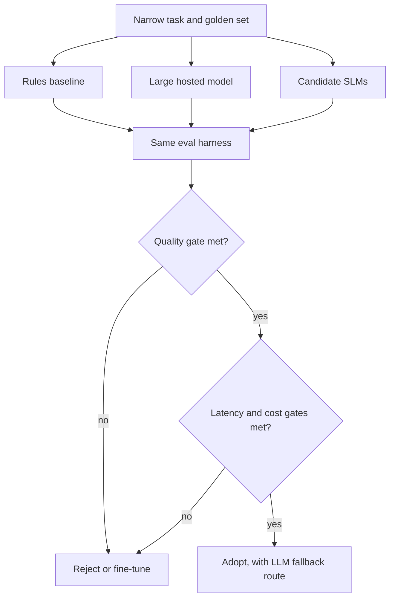

## TL;DR
Take one narrow, real agent subtask, measure a rules baseline, a large hosted model and two or three
small models on the same golden set, and write down, with quality, latency and cost numbers, whether an
SLM is viable.

## For agent builders
- **Why it matters for agents.** Many agent steps are narrow (route, extract, classify, fill a tool
  argument). If a small model handles one reliably, you cut cost and latency on every run and may keep
  data on your own hardware.
- **Where it shows up in your stack.** A local runtime (Ollama, llama.cpp or vLLM), a structured-output
  mode, your eval harness from Project 1, and a router in front of the model calls.
- **What you control.** Task scope, the golden set, candidate models and quantization, prompts, decoding
  constraints, hardware and the acceptance gate.
- **What you can skip.** Fine-tuning, at first. Prompted, constrained small models often pass narrow
  tasks; fine-tune only when the study shows a gap worth closing.

## Decision case
### Scenario
A support platform's agent first routes each ticket to one of 12 queues, and that call sits on the
critical path of every run. The study (M1-M5) is done; the lead needs the M6 decision. All figures are
illustrative, not benchmarks or vendor prices.
- **Volume:** 300,000 routing tasks a day, an average of about 3.5 a second and a peak of about
  10.4 a second (3x average).
- **Hosted model:** about 600 input and 20 output tokens a task at an assumed $3 and $15 per million,
  so $0.0018 + $0.0003 = $0.0021 a task, $2.10 per 1,000 and $630 a day.
- **Self-hosted SLM:** one GPU at an assumed $1.20 an hour serves 20 tasks a second; two GPUs for
  redundancy cost 2 x 24 x $1.20 = $57.60 a day.
- **Golden set results:** hosted 94.0%; 8-bit SLM 93.1% with 99.9% valid JSON under grammar
  constraints; 4-bit SLM 91.2%; rules baseline 81.0%.
- **Constraints:** p95 under 300 ms for this step; quality within 2 points of hosted and 99.5% valid
  output; one ML engineer who has run GPU services before.

### Options
| Option | How it works | Quality gate | p95 at peak | Cost a day |
|---|---|---|---|---|
| Stay hosted | Every task goes to the large model | Reference, 94.0% | 900 ms with network: fails | $630 |
| Rules baseline | Keyword rules | 81.0%: fails | under 5 ms | near zero |
| Replace with the 8-bit SLM | Every task goes to the SLM | 93.1%, 0.9 points below: passes | 180 ms | $57.60 |
| 8-bit SLM with fallback | Invalid or low-confidence output (3% in shadow) is re-sent to the hosted model | 93.8% on the golden set | about 190 ms; p99 about 1.1 s | $57.60 + 0.03 x $630 = $76.50 |

### Decision
**Adopt the 8-bit SLM behind a router with hosted fallback.** It passes all three gates, saves about
$630 - $76.50 = $553.50 a day, and keeps headroom for edge cases the golden set missed.

Replacing the model outright is cheaper by $18.90 a day but has no answer for the long tail. The 4-bit variant fails the
quality gate at 2.8 points below the reference.
- **Fallback must stay rare:** only 3% of tasks take the slow path, so p95 stays on the SLM. Above 5%,
  the slow path enters the p95 and the latency gate fails.
- **Volume has margin:** break-even against hosted is about $57.60 / (0.97 x $0.0021), roughly 28,000
  tasks a day, far below 300,000.

**What would change it.**
- **Sensitivity:** at half volume the router costs $57.60 + $9.45 = $67.05 against $315 hosted. At double
  volume the 20.8-a-second peak needs 3 GPUs, so $86.40 + $37.80 = $124.20 against $1,260. Both keep
  the decision.
- **Reverse it** if the fallback rate stays above 5%, if new queues arrive weekly (prompt-only changes
  favour hosted), or if the engineer who runs the GPUs leaves with no replacement.

### Trade-offs accepted
- **GPU operations are now ours:** upgrades, capacity planning and on-call. They are not in the cost
  figures; track the hours spent each month against the $553.50-a-day saving.
- **A 0.2-point quality gap to hosted** (93.8% against 94.0%). Track per-queue accuracy on a weekly
  sample; one queue can degrade while the average holds.
- **A slow p99** of about 1.1 s on fallback tasks. Track the fallback rate daily as the leading signal.

### Review rubric
- **Every option faces the same three gates:** quality, valid output and latency at peak, from one harness.
- **Cost is recomputed from inputs:** tokens x price for hosted, hardware ÷ throughput with redundancy for
  self-hosted, each input labelled as measured or assumed.
- **The fallback's effect on tail latency is checked,** not only its cost.
- **Break-even and a sensitivity row** at half and double volume are shown.
- **Excluded costs are named,** such as operations effort, rather than silently left out.
- **Reversal conditions are measurable:** fallback rate, category churn or staffing.

## Why it exists
- **"Use a small model" is a claim, not a plan.** Without a golden set, teams either never try SLMs or
  ship one that fails silently on the long tail.
- **Quality alone misleads.** A model that is 2 points less accurate but ten times cheaper and faster can be
  the right answer; one with equal accuracy but 5% invalid JSON is not.
- **Baselines are often skipped.** A regex or classical classifier sometimes matches the model. If it
  does, you need neither LLM nor SLM for that step.
- **Cost depends on volume and hardware.** A self-hosted SLM has a fixed hourly cost that only beats
  per-token pricing above some volume, so the break-even must be computed.
- **The output is a decision.** The deliverable is a short document a lead can act on: adopt, adopt with
  routing, or reject, with the evidence.

## How it works
Choose one subtask from your Project 1-3 system: query routing, intent classification, entity
extraction, tool-argument filling or citation checking. It must have a checkable correct output.
M1-M2 open after evals; M3-M6 need candidate SLMs, so they open after slm-for-agents, the last module in
the track, even though serving and cost lessons come earlier.

### M1. Task and baseline (after evals)
- **Build:** a one-page task definition (inputs, allowed outputs, what counts as correct, daily volume,
  latency budget) and the simplest credible non-LLM baseline.
- **Acceptance:** two people label 20 examples independently and agree on at least 90% of them (report
  Cohen's kappa too); the baseline runs on the full set.
- **Lessons:** `evals/task-specific-acceptance-criteria`, `evals/inter-annotator-agreement`; FDE track:
  `scoping/problem-decomposition`, `scoping/success-metrics-kpis`,
  `scoping/baseline-measurement-before-deployment`.

### M2. Golden set and harness (after evals)
- **Build:** at least 200 examples sampled from real traffic, stratified to include rare and hard cases;
  a harness reporting accuracy, valid-output rate, per-class errors and latency percentiles.
- **Acceptance:** the large hosted model is run once to set the quality reference; raw outputs are cached
  so re-scoring gives identical numbers; fresh re-runs at temperature 0 stay within a stated tolerance,
  since hosted and batched GPU inference is not bit-exact.
- **Lessons:** `evals/golden-dataset`, `evals/task-specific-acceptance-criteria`,
  `customer-data-evaluation/representative-test-case-sampling`, `evals/error-analysis`.

### M3. Candidate SLMs (after slm-for-agents)
- **Build:** two or three open models of different sizes, run locally with the same prompt and
  constrained output (JSON schema or grammar), in at least two quantization levels for the best one.
- **Acceptance:** every candidate has a row in the evaluation table; invalid outputs are counted as
  wrong, never repaired silently.
- **Lessons:** `slm-for-agents/choosing-an-slm`, `slm-for-agents/running-slms-locally`,
  `slm-for-agents/quantized-slms`, `slm-for-agents/tool-calling-and-structured-output-with-slms`.

### M4. Latency under load (after slm-for-agents)
- **Build:** measure time to first token and total latency at concurrency 1 and at your expected peak,
  on the hardware you would actually deploy.
- **Acceptance:** p50 and p95 reported per model at both concurrencies, with hardware and runtime
  versions written down.
- **Lessons:** `serving-inference/ttft`, `serving-inference/throughput-vs-latency`,
  `serving-inference/batching-and-concurrency-limits`, `observability/latency-percentiles`.

### M5. Operating cost (after slm-for-agents)
- **Build:** cost per 1,000 tasks for the hosted model (tokens times price) and for each SLM (hardware
  cost per hour divided by tasks per hour at target utilisation), plus the break-even volume.
- **Acceptance:** every input in the cost model is sourced or labelled as an assumption; a sensitivity
  row shows the answer at half and double the expected volume.
- **Lessons:** `infra-capacity-economics/cost-modeling`, `infra-capacity-economics/break-even-analysis`,
  `infra-capacity-economics/unit-economics-per-successful-task`.

### M6. Decision (after slm-for-agents)
- **Build:** a two-page write-up: task, setup, evaluation table, cost model, failure analysis and a
  recommendation (adopt, adopt behind a router with LLM fallback, or reject).
- **Acceptance:** a reviewer can reproduce the headline numbers from the repo; the recommendation names
  the conditions that would reverse it.
- **Lessons:** `system-design/slm-vs-llm-trade-offs`, `slm-for-agents/slm-llm-cascades-and-routing`,
  `system-design/adrs`.

## Diagram
Every option goes through the same harness, and the decision needs all three gates, not just accuracy.



## Examples
### Starter skeleton: one harness for every option
Standard library only. The baseline is real; `candidate_stub` shows how invalid output is scored and is
where you call your local SLM. Run on Python 3.9.

```python
import json, re, statistics, time

# Narrow task: route a support ticket to one of 4 queues and return strict JSON.
LABELS = {"billing", "shipping", "account", "other"}
EVAL = [("I was charged twice this month", "billing"), ("Where is my parcel?", "shipping"),
        ("Reset my password please", "account"), ("Refund the duplicate invoice", "billing"),
        ("Package arrived damaged", "shipping"), ("Can't log in after the update", "account"),
        ("Do you sponsor hackathons?", "other"), ("Change the email on my profile", "account")]

def baseline(text):                                   # always build the dumbest credible baseline first
    rules = {"billing": r"charg|refund|invoice", "shipping": r"parcel|package|deliver",
             "account": r"password|log in|email|profile"}
    hit = next((k for k, p in rules.items() if re.search(p, text, re.I)), "other")
    return json.dumps({"queue": hit})

def candidate_stub(text):                             # replace with a call to an SLM (Ollama, vLLM, llama.cpp)
    return '{"queue": "billing"}' if "charg" in text else "Sure! The queue is: shipping"

def evaluate(name, model, price_per_call_usd=0.0):
    lat, correct, valid = [], 0, 0
    for text, gold in EVAL:
        t0 = time.perf_counter(); raw = model(text); lat.append((time.perf_counter() - t0) * 1000)
        try:
            q = json.loads(raw)["queue"]; valid += q in LABELS; correct += q == gold
        except (ValueError, KeyError, TypeError):
            pass                                       # invalid output counts as wrong, never silently fixed
    lat.sort()
    p95 = lat[min(len(lat) - 1, int(0.95 * len(lat)))]
    return {"model": name, "accuracy": correct / len(EVAL), "valid_json": valid / len(EVAL),
            "p50_ms": round(statistics.median(lat), 3), "p95_ms": round(p95, 3),
            "cost_per_1k_usd": round(price_per_call_usd * 1000, 2)}

for row in (evaluate("rules-baseline", baseline), evaluate("slm-stub", candidate_stub)):
    print(row)
```

The rules baseline scores accuracy 1.0 and the stub 0.125 with valid JSON 0.125. Read both results
critically:
- **A perfect baseline means the eval is too easy.** The rules were written while looking at these eight
  examples. Real tickets ("my card was declined at checkout") break them; M2's sampled set exposes that.
- **Format failures are quality failures.** The stub's chatty second answer is wrong even though it names
  a queue, because a parser downstream would crash on it.

### Evaluation table and decision gates
One row per option, all from the same harness and golden set. Gate values are illustrative; set yours
from the task's error cost and the latency budget in M1.

| Option | Accuracy | Valid output | p95 latency at peak | Cost per 1k tasks | Data stays in-house |
|---|---|---|---|---|---|
| Rules baseline | measured | 100% by construction | measured | near zero | yes |
| Large hosted model | reference | measured | measured incl. network | tokens × price | no |
| SLM A, 8-bit | measured | measured | measured | hardware ÷ throughput | yes |
| SLM A, 4-bit | measured | measured | measured | hardware ÷ throughput | yes |
| SLM B | measured | measured | measured | hardware ÷ throughput | yes |
| **Illustrative gate** | within 2 points of reference | 99.5%+ | under budget | below hosted at expected volume | if required |

A worked cost row, with assumed inputs: a GPU at $1.20 per hour sustaining 20 tasks per second costs
1.20 ÷ 72,000 × 1,000 ≈ $0.017 per 1,000 tasks at full use, but at 10% utilisation it is ten times that.
Utilisation, not the hourly price, usually decides the break-even.

## Production patterns
- **Route, do not replace.** Send the task to the SLM and fall back to the large model when output is
  invalid or confidence is low. Monitor the fallback rate; it is your real SLM coverage.
- **Constrain the output.** Use JSON schema or grammar-constrained decoding in the runtime so small
  models cannot produce unparseable answers. Monitor valid-output rate per model version.
- **Shadow before switching.** Run the SLM alongside the current model on live traffic and compare
  answers without serving them. Monitor disagreement rate by class.
- **Pin model, quantization and runtime.** Record the model file hash, quantization and runtime version
  with each eval run, because a re-quantized file is a different model. Monitor eval scores per pin.
- **Re-run the study on drift.** Re-evaluate when input distribution or labels change, using the same
  harness. Monitor per-class accuracy on a weekly sample.

## Trade-offs
- **Cost and latency vs headroom.** An SLM that passes today has less margin for new edge cases than a
  large model; a router with fallback buys that headroom back at some cost.
- **Self-hosting vs operations.** Owning the model keeps data in-house and fixes cost, but adds GPU
  capacity planning, upgrades and on-call; at low volume the hosted API is usually cheaper overall.
- **Quantization vs quality.** 4-bit weights fit smaller hardware and run faster, with a quality cost that
  must be measured per task, not assumed from public benchmarks.
- **Prompting vs fine-tuning.** Prompted SLMs are quick to test; fine-tuning closes larger gaps but needs
  labelled data, training runs and a retraining plan.

## Pitfalls
- **Judging SLMs on public benchmarks.** Symptom: the model that tops a leaderboard loses on your task.
  Diagnose: compare leaderboard rank with rank on your golden set. Fix: decide only on task-specific
  evals.
- **Latency measured at concurrency 1.** Symptom: p95 explodes in production. Diagnose: plot latency
  against concurrency on the deployment hardware. Fix: test at expected peak, and size replicas from it.
- **Cost model at 100% utilisation.** Symptom: the SLM looks 50 times cheaper on paper, and the bill says
  otherwise. Diagnose: compute actual tasks per GPU hour from traffic logs. Fix: use measured
  utilisation and include idle time, ops effort and fallback calls.
- **Repairing outputs in the harness.** Symptom: scores high offline, parse errors online. Diagnose: count
  how often the harness's cleanup code changed an output. Fix: score raw outputs, and put any repair in
  the production path so it is measured.

## When to use
- **Use when:** a high-volume, narrow step dominates cost or latency, or data must stay on your hardware.
- **Avoid when:** the task needs broad knowledge or long multi-step reasoning, or volume is too low for
  self-hosting to pay back.
- **Measure:** accuracy versus the large-model reference, valid-output rate, p95 at peak, cost per 1,000
  tasks and fallback rate.
- **Interviews:** this project answers "when would you use a small model instead of a frontier model?".

## Exercise
**Goal:** complete M1 and the baseline row of M2 for one subtask from your own system.
- **Inputs:** real or realistic inputs for the subtask, at least 200 of them, and a second person (or your
  own re-labelling a day later) to check labels.
- **Constraints:** no model calls yet; the baseline must be rules or a classical classifier; latency
  budget and daily volume written before you measure anything.
- **Deliver:** the task definition page, the labelled golden set with a stratification note, and the
  harness output for the baseline.
- **Acceptance:** re-running the harness gives identical numbers; label agreement is reported; the three
  most common baseline error types are named with examples.
- **Acceptance (stretch):** add the large hosted model as the reference row.

## Role lens
- **Engineer:** Builds the harness, runs candidate models locally, measures latency under load and keeps
  every number reproducible from the repo.
- **Architect:** Sets the quality, latency and cost gates, and decides between replacement, routing with
  fallback, or staying on the hosted model.
- **FDE:** Frames the study around the customer's real task and data constraints, and presents the
  decision with its reversal conditions.

## Check yourself
**Q:** An 8B model scores 1 point below the hosted model on your golden set, but its valid-JSON rate is
97% versus 99.9%. Is it viable?
**A:** Not as a drop-in replacement. At 97% valid output, 3 in 100 calls break the downstream parser,
which costs more than the 1-point accuracy gap suggests. First try constrained decoding (JSON schema or
grammar) in the runtime, which usually makes output valid by construction, and re-run the harness. If the
rate reaches the gate, compare latency at peak and cost per 1,000 tasks at measured utilisation. A
router that falls back to the hosted model on invalid output is a reasonable intermediate answer.

## Interview questions
### How do you decide whether a small model is good enough for an agent step?
- **Define the task narrowly** with a checkable output and a golden set from real traffic.
- **Compare against references:** a non-LLM baseline and the large model, all in the same harness.
- **Gate on three things:** quality within an agreed margin, valid-output rate, and latency and cost at
  expected volume.

### Your SLM study looks great offline. What could still go wrong in production?
- **Distribution shift:** the golden set missed rare or new input types.
- **Load:** latency at peak concurrency is much worse than at one request.
- **Operations:** model updates, GPU failures and re-quantization change behaviour; shadow traffic and
  a fallback route catch these.

### How do you compute the cost of a self-hosted SLM versus an API?
- **API:** tokens per task times price, plus retries.
- **Self-hosted:** hardware cost per hour divided by tasks per hour at real utilisation, plus operations
  effort and fallback calls.
- **Break-even:** the volume where the two lines cross, with sensitivity at half and double volume.

### When would you recommend against an SLM even though it passed the quality gate?
- **Low volume:** fixed GPU cost exceeds the API bill for years.
- **No team to run it:** on-call, upgrades and capacity planning are real costs.
- **Fast-changing task:** frequent new categories favour a large model that adapts by prompt alone.

### How would you fit a passing SLM into an existing agent?
- **Behind a router** with the same interface as the current model call.
- **With fallback** on invalid output or low confidence, and shadow mode first.
- **With monitoring** of fallback rate, disagreement and per-class accuracy.

## Quiz
### Q: Your rules baseline scores 100% on the golden set. What is the most likely explanation?
- [ ] The task does not need evaluation
- [x] The golden set is too small or was used to write the rules
- [ ] Rules always beat language models on classification
- [ ] The harness is measuring latency instead of accuracy
> A perfect score from hand-written rules usually means they were tuned on the same examples. A larger,
> sampled set from real traffic shows how they generalise.

### Q: Why count invalid outputs as wrong in the harness?
- [ ] It makes the numbers look worse, which is conservative
- [x] Downstream code fails on invalid output, so it is a real error users would see
- [ ] Invalid outputs are rare enough to ignore either way
- [ ] Because JSON parsing is slow
> If the harness repairs or skips invalid outputs, offline scores overstate production quality. Scoring
> raw outputs measures what the agent will actually receive.

### Q: What usually decides whether a self-hosted SLM is cheaper than an API?
- [ ] The parameter count alone
- [ ] The GPU's peak FLOPs
- [x] Volume and real utilisation of the hardware
- [ ] Whether the model is open source
> Self-hosting has a fixed hourly cost, so cost per task depends on how many tasks each hour actually
> serves. At low utilisation the API is usually cheaper.

## Mastery test
**Problem:** the same study must now target a laptop-class device with no GPU and no network, running
fully offline for field technicians, with a 1-second latency budget. Redo the plan.

**A strong answer:**
- swaps the hosted model for a reference-only role (it sets quality but cannot be deployed) and picks
  smaller, heavily quantized candidates that fit device memory;
- measures latency on the actual device, including load time and battery or thermal behaviour, not on a
  workstation, and keeps prompts and outputs short, since CPU prefill and decode speed usually bind the
  1-second budget before accuracy does;
- replaces cost per 1,000 tasks with device requirements and update distribution cost;
- designs an offline fallback (rules baseline, or queue the case for later sync) instead of an LLM route;
- states which task variants are out of scope on-device.

## Use cases & projects
### Use cases
- **Agent query router.** A small model picks the tool or sub-agent for each request before any large call.
- **Structured extraction.** Pull fields from forms or emails into a fixed schema at high volume.
- **On-premise classification.** Data that cannot leave the network is labelled by a local model.
- **Guardrail checks.** A small classifier screens inputs or outputs on every step at low latency.

### Mini project
**Quantization sweep on your best candidate (2 hours).**
- **Goal:** find the lowest-precision version of one SLM that still passes your quality gate.
- **Steps:** run the same model at 16-bit (if it fits), 8-bit and 4-bit in your local runtime; run the
  golden set at temperature 0; record accuracy, valid-output rate, memory used and p95 latency per variant.
- **Done when:** a table with one row per precision exists, and you can state which variant you would
  deploy and why, including where errors first appeared.
